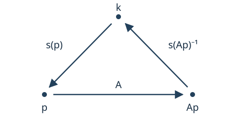

# LREP25 1粒子Hilbert空間の誘導表現

<!-- definition-example-audit: strict -->

前講までに、運動量を変えない変換が内部スピンやヘリシティをどう変えるかを調べました。しかし一粒子の波束には、異なる運動量の成分が同時に含まれます。任意のLorentz変換は一般に運動量を変えます。そこで各運動量の内部空間を標準運動量の内部空間と比較し、固定群の作用だけで波束全体の変換を組み立てます。

[共通の符号規約](../../../../../dream-theater-lorentz-conventions.md)に従い、$c=\hbar=1$、$\eta=\operatorname{diag}(-1,1,1,1)$ とします。$p\cdot a=\eta(p,a)$ です。$\pi:SL(2,\mathbb C)\to SO^+(1,3)$ は[二重被覆](../LREP10/index.md#thm-lrep10-double-cover)とし、以下 $Ap$ は $\pi(A)p$ の略記です。

## 1. 運動量ごとの内部状態

[未来質量殻](../LREP22/index.md#def-lrep22-mass-shell) $\mathcal O_m$ を固定します。空間運動量を $\boldsymbol q$、エネルギーを $E_{\boldsymbol q}=\sqrt{m^2+|\boldsymbol q|^2}$ とすると、$p=(E_{\boldsymbol q},\boldsymbol q)$ です。$m=0$ の場合は $\boldsymbol q=0$ を除きます。

標準運動量は $m>0$ なら $k=(m,0,0,0)$、$m=0$ なら $k=(1,0,0,1)$ です。[運動量のlittle group](../LREP23/index.md#def-lrep23-little-group)の被覆側を

$$
K=\{R\in SL(2,\mathbb C):Rk=k\}
$$

とします。

内部空間 $V$ は非零の可分複素Hilbert空間（可算個のベクトルの線形結合で稠密に近似できる空間）とします。$\mathcal U(V)$ は $V$ のユニタリ作用素の群です。$D:K\to\mathcal U(V)$ は群準同型で、各 $v\in V$ に対して $D(R)v$ が $R$ に関してノルム連続と仮定します。これは [強連続ユニタリ表現](../LREP21/index.md#def-lrep21-unitary-representation) と同じ連続性の条件を固定群に課したものです。

一つの運動量での内部成分を $V$ のベクトルで表し、それを質量殻上で動かすと波束になります。ノルムは全運動量について内部ノルムの二乗を積分します。

<!-- formal-statement-start -->
> **定義（質量殻波束空間）**
> $m\ge0$、$V$ を非零の可分複素Hilbert空間とする。$\mu_m$ を[質量殻測度](../LREP22/index.md#def-lrep22-shell-measure)とする。波束空間は可測な $V$ 値関数の二乗可積分なものを、ほとんど至る所の一致で同一視したHilbert空間

$$
\mathcal H_m=L^2(\mathcal O_m,\mu_m;V),
\qquad d\mu_m(p)=\frac{d^3q}{2E_{\boldsymbol q}}
$$

> とする。内積とノルムを次で定める。

$$
\langle f,g\rangle=\int_{\mathcal O_m}\langle f(p),g(p)\rangle_V\,d\mu_m(p),
\qquad \|f\|^2=\int_{\mathcal O_m}\|f(p)\|_V^2\,d\mu_m(p).
$$
<!-- formal-statement-end -->

<!-- definition-example-start: def-lrep25-packet-space -->
**定義の確認**。 $m=0$、$V=\mathbb C^2$ とし、球殻 $S=\{p:1<|\boldsymbol q|<2\}$ の指示関数を使って $f(p)=c\,1_S(p)(1,i)^{\mathsf T}/\sqrt2$ とします。球殻はBorel集合なのでこの関数は可測です。内部ベクトルのノルムは1であり、球座標の体積要素 $r^2dr\,d\Omega$ から

$$
\mu_0(S)=4\pi\int_1^2\frac{r^2}{2r}\,dr=3\pi.
$$

従って $\|f\|^2=3\pi|c|^2$ は有限で、$c=1/\sqrt{3\pi}$ なら規格化されています。
<!-- definition-example-end -->

可分性により、有限個の固定ベクトルにスカラー連続コンパクト台関数を掛けた有限和は $\mathcal H_m$ に稠密です。実際、二乗可積分関数を有限値の単関数で近似し、各指示関数を測度の正則性でコンパクト集合と開集合の間から連続関数で近似できます。この測度は空間運動量座標で正の連続密度を持ち、コンパクト集合上で有限です。

## 2. 標準点と各運動量を結ぶ

各運動量へ標準点を移す行列を一つずつ選びます。この選択を断面と呼びます。光的運動量の場合は方向によって回転軸を選ぶため、全点で連続であることは要求せず、可測でほとんど至る所連続なものを使います。

<!-- formal-statement-start -->
> **定義（運動量断面）**
> 未来質量殻 $\mathcal O_m$ の標準点を $k$ とする。Borel可測な写像 $s:\mathcal O_m\to SL(2,\mathbb C)$ が

$$
s(p)k=p
$$

> を全点で満たすとき、運動量断面とする。
<!-- formal-statement-end -->

<!-- definition-example-start: def-lrep25-section -->
**定義の確認**。 正質量では[正質量の標準boost](../LREP23/index.md#def-lrep23-standard-boost)を選べます。

$$
s(p)=\frac{(E_{\boldsymbol q}+m)I_2+\boldsymbol q\cdot\boldsymbol\sigma}{\sqrt{2m(E_{\boldsymbol q}+m)}}.
$$

[標準boostの存在と一意性](../LREP23/index.md#thm-lrep23-boost-section)により行列式は1で、標準点を $p$ へ移します。分母は正で、全成分が $\boldsymbol q$ に関して連続なのでBorel可測です。例えば $p=k$ では分子も分母も $2m$ 倍の単位行列とスカラーにそれぞれなり、$s(k)=I_2$ です。
<!-- definition-example-end -->

質量零でも具体的に選べます。$r=|\boldsymbol q|>0$、$\boldsymbol n=\boldsymbol q/r$ とし、$n_3\ne-1$ なら

$$
u(\boldsymbol n)=\frac1{\sqrt{2(1+n_3)}}
\begin{pmatrix}
1+n_3&-n_1+in_2\\
n_1+in_2&1+n_3
\end{pmatrix}.
$$

二列は直交し、各列のノルム二乗は $(1+n_3)^2+n_1^2+n_2^2=2(1+n_3)$ を分母で割った1です。行列式も同じ分子を持つため1です。南極 $\boldsymbol n=(0,0,-1)$ では $u=\begin{pmatrix}0&-1\\1&0\end{pmatrix}$ とします。これも行列式1のユニタリ行列です。

$$
s(p)=u(\boldsymbol n)\operatorname{diag}(\sqrt r,1/\sqrt r).
$$

[エルミート行列模型](../LREP10/index.md#def-lrep10-hermitian-model)で $H(k)=\operatorname{diag}(2,0)$ です。最初に対角行列で合同変換すると $\operatorname{diag}(2r,0)$ になります。$u$ の第1列を $v$ とすれば、次の合同積は $2rvv^\dagger$ です。北側の公式では

$$
2rvv^\dagger
=r\begin{pmatrix}
1+n_3 & n_1-in_2\\
n_1+in_2 & 1-n_3
\end{pmatrix}=H(p).
$$

右下成分には $n_1^2+n_2^2=(1-n_3)(1+n_3)$ を使いました。南極でも $2rvv^\dagger=\operatorname{diag}(0,2r)=H(p)$ です。よって $s(p)k=p$ が全点で成立します。南極方向の半直線だけを除いて連続で、この半直線は三次元Lebesgue測度零、従って $\mu_0$ でも零です。断面はBorel可測です。

## 3. 固定群へ戻る変換

まず $s(p)$ で標準点から $p$ へ移動し、$A$ で $Ap$ へ進み、$s(Ap)^{-1}$ で標準点へ戻ると、全体は標準点を固定します。これを内部空間へ作用させます。

図では矢印をたどる順序と行列積を読む順序が逆になることを確認してください。[原寸の図](assets/section-loop.svg)

<!-- formal-statement-start -->
> **定義（断面の固定群補正）**
> 運動量断面 $s$、Lorentz被覆群の元 $A$、質量殻上の点 $p$ に対して

$$
w_s(A,p)=s(Ap)^{-1}As(p)
$$

> と定める。
<!-- formal-statement-end -->

<!-- definition-example-start: def-lrep25-little-cocycle -->
**定義の確認**。 $m>0$ で[正質量の標準boost](../LREP23/index.md#def-lrep23-standard-boost)を使います。$p=k$ とし、回転

$$
A=R=\operatorname{diag}(e^{-i\theta/2},e^{i\theta/2})
$$

を考えます。二つの対角成分の積は1で、各成分の絶対値も1なので行列式1のユニタリ行列です。[正質量の静止安定化群](../LREP23/index.md#thm-lrep23-rest-group)の同定から $Rk=k$ です。

$s(k)=I_2$ を使うと、補正は

$$
w_s(R,k)=s(k)^{-1}Rs(k)=R
$$

となり、$SU(2)$ に入ります。
<!-- definition-example-end -->

二つの変換を順に行うと、途中の断面の行列とその逆が打ち消し合います。この関係が一般の群作用を作るための鍵です。

<!-- formal-statement-start -->
> **定理（固定群補正の合成則）**
> 運動量断面 $s$ に対して、任意の $A,B\in SL(2,\mathbb C)$ と $p\in\mathcal O_m$ で $w_s(A,p)\in K$ であり、

$$
w_s(I,p)=I,\qquad
w_s(AB,p)=w_s(A,Bp)w_s(B,p)
$$

> が成立する。
<!-- formal-statement-end -->

**証明の見取り図。** まず標準点を追跡して固定群への所属を示し、次に中間点 $Bp$ における断面を挿入します。

<!-- proof-start -->
### 証明

断面の条件から

$$
w_s(A,p)k=s(Ap)^{-1}Ap=k.
$$

三つの行列はすべて行列式1なので $w_s(A,p)\in K$ です。$A=I$ では $s(p)^{-1}s(p)=I$ です。また

$$
\begin{aligned}
w_s(A,Bp)w_s(B,p)
&=s(ABp)^{-1}As(Bp)s(Bp)^{-1}Bs(p)\\
&=s(ABp)^{-1}ABs(p)\\
&=w_s(AB,p).
\end{aligned}
$$

特に $B=A^{-1}$ として、$w_s(A,A^{-1}p)^{-1}=w_s(A^{-1},p)$ も得ます。$\square$
<!-- proof-end -->

## 4. 波束上のPoincare作用

出力側の運動量を $p$ とすると、入力側の運動量は $A^{-1}p$ です。その点から出発する固定群補正を用います。時空並進は運動量ごとに位相を掛けます。

<!-- formal-statement-start -->
> **定義（質量殻上の誘導作用）**
> 運動量断面 $s$ と固定群 $K$ の強連続ユニタリ表現 $D$ を選ぶ。質量殻波束空間 $\mathcal H_m$ 上で、被覆Poincare群の元 $(a,A)$ に対する作用を

$$
(U_s(a,A)f)(p)=e^{ip\cdot a}
D(w_s(A,A^{-1}p))f(A^{-1}p)
$$

> とする。
<!-- formal-statement-end -->

<!-- definition-example-start: def-lrep25-induced -->
**定義の確認**。 $m>0$、$V=\mathbb C$、$D(R)=1$ とすると、任意の断面に対し内部因子は1です。例えば $a=(t,0,0,0)$、$A=I$ では

$$
(U_s(a,I)f)(p)=e^{-iE_{\boldsymbol q}t}f(p).
$$

この因子は連続かつ絶対値1なので可測性・二乗可積分性・ほとんど至る所の同値類を保ちます。Lorentz成分だけの場合も $f(A^{-1}p)$ は可測です。[質量殻測度のLorentz不変性](../LREP22/index.md#thm-lrep22-measure-invariance)で零集合と積分値が保存されます。従ってこの例では任意の $(a,A)$ の作用が波束空間上で定義されます。
<!-- definition-example-end -->

次に内部空間が一般の場合についても、群の積とノルムが保たれることを示します。強連続性には先ほど具体的に作った断面のほとんど至る所の連続性を使います。

<!-- formal-statement-start -->
> **定理（誘導作用のユニタリ性と強連続性）**
> $s$ を $\mu_m$ ほとんど至る所連続な運動量断面、$D$ を固定群 $K$ の可分複素Hilbert空間 $V$ 上の強連続ユニタリ表現とする。
> このとき質量殻上の誘導作用 $U_s$ は被覆Poincare群の強連続ユニタリ表現である。
<!-- formal-statement-end -->

**証明の見取り図。** ノルム保存には位相・内部作用・測度の三つの保存性を使います。群の積では[固定群補正の合成則](#thm-lrep25-cocycle)と[Lorentz群の計量保存条件](../LREP9/index.md#def-lrep9-lorentz-group)が対応します。最後に連続なコンパクト台波束で極限を計算し、一般の波束へ近似で拡張します。

<!-- proof-start -->
### 証明

まず $p\mapsto w_s(A,A^{-1}p)$ は可測です。$D(R)v$ は $R$ と $v$ の組に関して連続です。実際、$R_n\to R$、$v_n\to v$ なら

$$
\|D(R_n)v_n-D(R)v\|
\le\|v_n-v\|+\|(D(R_n)-D(R))v\|\to0.
$$

従って誘導作用の右辺は可測です。位相と $D$ はノルムを保ち、[質量殻測度のLorentz不変性](../LREP22/index.md#thm-lrep22-measure-invariance)により変数 $q=A^{-1}p$ で

$$
\begin{aligned}
\|U_s(a,A)f\|^2
&=\int_{\mathcal O_m}\|f(A^{-1}p)\|_V^2\,d\mu_m(p)\\
&=\int_{\mathcal O_m}\|f(q)\|_V^2\,d\mu_m(q)=\|f\|^2.
\end{aligned}
$$

零ノルムの差も零ノルムに移るため、同値類上で良定義です。

群法則を確認します。$q=A^{-1}p$、$r=B^{-1}q$ とすると $Br=q$、$ABr=p$ です。二回作用させた右辺は

$$
\begin{aligned}
&(U_s(a,A)U_s(b,B)f)(p)\\
&=e^{ip\cdot a+iq\cdot b}
D(w_s(A,q))D(w_s(B,r))f(r).
\end{aligned}
$$

$\Lambda=\pi(A)$ と書くと $p=\Lambda q$ です。[Lorentz群の計量保存条件](../LREP9/index.md#def-lrep9-lorentz-group)は $\Lambda^{\mathsf T}\eta\Lambda=\eta$ なので

$$
p\cdot Ab=(\Lambda q)^{\mathsf T}\eta\Lambda b
=q^{\mathsf T}\eta b=q\cdot b.
$$

[固定群補正の合成則](#thm-lrep25-cocycle)により

$$
D(w_s(A,q))D(w_s(B,r))=D(w_s(AB,r)).
$$

また $r=(AB)^{-1}p$ なので

$$
U_s(a,A)U_s(b,B)=U_s(a+Ab,AB).
$$

これは[被覆Poincare群](../LREP21/index.md#def-lrep21-covered-poincare)の積そのものです。$U_s(0,I)=I$ であり、群の逆元から $U_s(a,A)$ の逆が存在するため、先の等長性と合わせてユニタリです。

強連続性は恒等元で確認すれば十分です。$(a_n,A_n)\to(0,I)$ とし、まず連続コンパクト台波束 $f$ を取ります。$s$ の連続点 $p$ では $A_n^{-1}p\to p$ なので

$$
w_s(A_n,A_n^{-1}p)=s(p)^{-1}A_ns(A_n^{-1}p)\to I.
$$

よって位相の連続性、$D$ の強連続性、$f$ の連続性から $U_s(a_n,A_n)f(p)\to f(p)$ です。$f$ の台をコンパクト集合 $C$ とすると、全 $A_n C$ と $C$ は一つのコンパクト集合 $C'$ に含まれます。なぜなら $\{I,A_1,A_2,\ldots\}$ がコンパクトで、その集合と $C$ の積の連続像がコンパクトだからです。

$$
\|U_s(a_n,A_n)f(p)-f(p)\|_V^2
\le4\|f\|_\infty^2\,1_{C'}(p).
$$

右辺は積分可能であり、収束はほとんど至る所で成立するので、[Lebesgueの優収束定理](../../../解析系/F0/F0-00D2B/index.md#thm-f0-00d2b-01)により $\|U_s(a_n,A_n)f-f\|\to0$ です。一般の $g\in\mathcal H_m$ に対し、稠密性から $\|g-f\|<\varepsilon$ となる上記の $f$ を選びます。ユニタリ性より

$$
\|U_s(a_n,A_n)g-g\|
\le2\varepsilon+\|U_s(a_n,A_n)f-f\|.
$$

上極限は $2\varepsilon$ 以下で、$\varepsilon>0$ は任意です。任意の群元への収束は恒等元への収束に帰着できます。以上より[強連続ユニタリ表現](../LREP21/index.md#def-lrep21-unitary-representation)の条件がすべて成立します。$\square$
<!-- proof-end -->

## 5. 正エネルギーと質量

波束の運動量がどの集合に入るかを測るには、その集合の指示関数を掛ければよいことに注目します。

<!-- formal-statement-start -->
> **定理（誘導表現の共同運動量と正エネルギー）**
> [誘導作用のユニタリ性と強連続性](#thm-lrep25-unitary)の仮定の下で、並進の共同スペクトル測度はBorel集合 $B\subset\mathbb R^4$ に対し

$$
(F(B)f)(p)=1_B(p)f(p)
$$

> である。表現は正エネルギー表現であり、質量二乗作用素は $m^2 I$ である。
<!-- formal-statement-end -->

**証明の見取り図。** 射影値測度の条件を指示関数で確認し、並進の位相をそのスペクトル積分として書きます。

<!-- proof-start -->
### 証明

$F(B)$ は指示関数の実数値性から自己共役、$1_B^2=1_B$ から射影です。$F(\mathbb R^4)=I$、$F(B)F(C)=F(B\cap C)$ も指示関数の積で成立します。互いに素な $B_j$ に対して有限和と可算和の差のノルム二乗は

$$
\int_{\mathcal O_m\cap\bigcup_{j>N}B_j}\|f(p)\|_V^2\,d\mu_m(p).
$$

尾部の指示関数が点ごとに零へ収束し、$\|f(p)\|_V^2$ が積分可能なので、この量は零へ収束します。従って各波束に対し射影の有限和がノルムで可算和へ収束します。これが射影値測度に要求される可算加法性です。

この測度による有界可測関数の積分は、単関数の場合の指示関数の線形結合から、一様に有界な点ごとの近似と[Lebesgueの優収束定理](../../../解析系/F0/F0-00D2B/index.md#thm-f0-00d2b-01)によって関数の乗算作用に一致します。特に

$$
\left(\int e^{ip\cdot a}\,dF(p)\right)f
=e^{ip\cdot a}f(p)=U_s(a,I)f(p).
$$

[並進の共同スペクトル表示](../LREP21/index.md#thm-lrep21-translation-spectrum)の一意性よりこれが共同スペクトル測度です。質量殻は未来閉光円錐 $\overline V_+$ に含まれるため $F(\overline V_+)=I$ です。これは[正エネルギー表現](../LREP21/index.md#def-lrep21-positive-energy)の条件です。また質量殻では $-\eta(p,p)=m^2$ なので、[質量二乗の不変性](../LREP22/index.md#thm-lrep22-mass-casimir)のスペクトル積分は全空間で定義された $m^2I$ になります。$\square$
<!-- proof-end -->

## 6. 断面を替えても粒子表現は同じ

標準点から各運動量への移動方法には自由度があります。別の断面を使うと内部状態の座標表示が変わりますが、波束空間のユニタリな座標変換で対応します。

<!-- formal-statement-start -->
> **定理（断面変更による誘導表現の同値性）**
> $s,s'$ を同じ質量殻と標準点についてのほとんど至る所連続な運動量断面とする。同じ固定群表現 $D$ を使用する。
> このとき $r(p)=s(p)^{-1}s'(p)$ は固定群に属し、

$$
(Jf)(p)=D(r(p))^{-1}f(p)
$$

> は波束空間上のユニタリ作用素で、任意の被覆Poincare群の元 $g$ に対し

$$
U_{s'}(g)=JU_s(g)J^{-1}
$$

> が成立する。
<!-- formal-statement-end -->

**証明の見取り図。** 二つの断面の差を固定群の元で表し、補正行列の入力・出力の両側に座標変換が現れることを確認します。

<!-- proof-start -->
### 証明

$s'(p)k=p$、$s(p)^{-1}p=k$ より $r(p)k=k$ で、行列式は1です。従って $r(p)\in K$ です。$r$ は可測なので $J$ は可測な点ごとのユニタリ作用であり、ノルムを保存し、逆は $D(r(p))$ の乗算です。

$s'(p)=s(p)r(p)$ を代入すると

$$
\begin{aligned}
w_{s'}(A,q)
&=r(Aq)^{-1}s(Aq)^{-1}As(q)r(q)\\
&=r(Aq)^{-1}w_s(A,q)r(q).
\end{aligned}
$$

$q=A^{-1}p$ とすれば $Aq=p$ です。従って

$$
\begin{aligned}
(JU_s(a,A)J^{-1}f)(p)
&=e^{ip\cdot a}D(r(p))^{-1}\\
&\quad\cdot D(w_s(A,q))D(r(q))f(q)\\
&=e^{ip\cdot a}D(w_{s'}(A,q))f(q)\\
&=(U_{s'}(a,A)f)(p).
\end{aligned}
$$

ユニタリ同値が示されました。$\square$
<!-- proof-end -->

正質量では[正質量の既約内部スピン空間](../LREP23/index.md#prop-lrep23-spin-multiplicity)を選べば内部成分数は $2j+1$ です。質量零で並進自明の内部表現を選ぶ場合は[ヘリシティの内部表現](../LREP24/index.md#def-lrep24-helicity-rep)を使います。例えば $h=1/2$ では被覆の中心 $-I_2$ による作用は $-1$ です。実際、$-I_2$ は全運動量を固定し、全断面と可換なので $w_s(-I_2,p)=-I_2$ です。この符号は断面を替えても変わりません。

内部作用をユニタリとする仮定は本質的です。例えば質量零の被覆固定群の行列そのものを $V=\mathbb C^2$ 上の表現 $D(R)=R$ とすると、これは準同型ですが一般にはユニタリではありません。

[光的標準運動量の被覆固定群](../LREP24/index.md#thm-lrep24-null-stabilizer)の元

$$
A=N(1)=\begin{pmatrix}1&1\\0&1\end{pmatrix}
$$

は $k$ を固定します。第2節の断面では $s(k)=I_2$ なので $w_s(A,k)=A$ です。第2標準基底 $v=(0,1)^{\mathsf T}$ に作用させると

$$
D(w_s(A,k))v=\begin{pmatrix}1\\1\end{pmatrix}.
$$

従って次の不等式を得ます。

$$
\|D(w_s(A,k))v\|^2=2>1=\|v\|^2.
$$

断面は $k$ の近傍で連続なので、この厳密不等式はある開近傍 $C$ でも成立します。$C$ を十分小さくして正かつ有限の測度に取り、波束 $f=1_Cv$ を使います。

変数変換後のノルム二乗は

$$
\int_C\|D(w_s(A,q))v\|^2\,d\mu_0(q)
>\mu_0(C)=\|f\|^2.
$$

固定群補正がノルムを保つという第4節の等号が壊れます。

ここで得たのは、固定群表現から粒子の波束表現を作る方法です。任意の既約正エネルギー表現がこの形に尽きることや、内部表現の既約性から誘導表現の既約性が従うことまで証明したわけではありません。次講ではこの波束表現と、有限次元の場の成分を変換する表現との違いを扱います。

## 7. 演習

### Level A

#### LREP25-A01 球殻波束の規格化
- Level: A
- ID: LREP25-A01

質量零、$V=\mathbb C$ とする。$f(p)=c\,1_{\{2<|\boldsymbol q|<3\}}(p)$ を規格化する正の実数 $c$ を求めよ。

<!-- solution-start -->
**詳細解答**

[質量殻波束空間](#def-lrep25-packet-space)のノルムを球座標で計算します。

$$
\|f\|^2=c^2\cdot4\pi\int_2^3\frac{r^2}{2r}\,dr
=c^2\pi(9-4)=5\pi c^2.
$$

これを1に等しくして $c=1/\sqrt{5\pi}$ を得ます。
<!-- solution-end -->

#### LREP25-A02 光的断面の軸方向
- Level: A
- ID: LREP25-A02

質量零で $p=(4,0,0,4)$、標準点 $k=(1,0,0,1)$ とする。第2節の断面行列を求め、エルミート行列の合同積で $k$ を $p$ へ移すことを確認せよ。

<!-- solution-start -->
**詳細解答**

$r=4$、$\boldsymbol n=(0,0,1)$ なので $u=I_2$ です。よって

$$
s(p)=\operatorname{diag}(2,1/2).
$$

行列式は1です。[エルミート行列模型](../LREP10/index.md#def-lrep10-hermitian-model)で

$$
s(p)\begin{pmatrix}2&0\\0&0\end{pmatrix}s(p)^\dagger
=\begin{pmatrix}8&0\\0&0\end{pmatrix}=H(p).
$$

したがって断面条件を満たします。
<!-- solution-end -->

#### LREP25-A03 入力側の運動量
- Level: A
- ID: LREP25-A03

質量正のスカラー内部表現で、連続波束の代表元 $f$ を取り、空間の $z$ 軸周りの90度回転を $A$ とする。$p=(5,3,0,0)$ での $U_s(0,A)f$ の値を $f$ の値として表せ。

<!-- solution-start -->
**詳細解答**

逆回転は $x$ 軸正方向を $y$ 軸負方向へ移すので $A^{-1}p=(5,0,-3,0)$ です。質量二乗は $25-9=16$ のままです。スカラー内部表現が恒等で並進も零のため、[質量殻上の誘導作用](#def-lrep25-induced)に代入すると

$$
(U_s(0,A)f)(5,3,0,0)=f(5,0,-3,0)
$$

です。これは具体的な関数の代表元についての式であり、一般の二乗可積分同値類の一点評価は定義されません。
<!-- solution-end -->

#### LREP25-A04 並進の符号
- Level: A
- ID: LREP25-A04

$p=(5,0,0,3)$ において $a=(2,0,0,1)$ の並進位相を求めよ。質量も求めよ。

<!-- solution-start -->
**詳細解答**

計量は $(-+++)$ なので $p\cdot a=-5\cdot2+3\cdot1=-7$ です。したがって[質量殻上の誘導作用](#def-lrep25-induced)の位相は $e^{-7i}$ です。また

$$
m^2=-p\cdot p=25-9=16,\qquad m=4.
$$
<!-- solution-end -->

### Level B

#### LREP25-B01 同一直線上の光的boost
- Level: B
- ID: LREP25-B01

$k=(1,0,0,1)$、$p=rk$、$r>0$、$A=\operatorname{diag}(e^{\chi/2},e^{-\chi/2})$ とする。第2節の断面を用いて $Ap$ と $w_s(A,p)$ を求めよ。

<!-- solution-start -->
**詳細解答**

エルミート行列は $H(p)=\operatorname{diag}(2r,0)$ です。$AH(p)A^\dagger=\operatorname{diag}(2re^\chi,0)$ から $Ap=re^\chi k$ です。方向は北極のままなので

$$
s(Ap)=\operatorname{diag}(\sqrt r e^{\chi/2},e^{-\chi/2}/\sqrt r)=As(p).
$$

したがって[断面の固定群補正](#def-lrep25-little-cocycle)に代入して $w_s(A,p)=I$ を得ます。エネルギーは変わりますが内部作用は恒等です。
<!-- solution-end -->

#### LREP25-B02 被覆の中心と降下
- Level: B
- ID: LREP25-B02

質量零の内部表現 $D_h$ について、誘導作用が四次元側のPoincare群へ降りる条件を求めよ。

<!-- solution-start -->
**詳細解答**

$-I_2$ は全運動量を固定するので

$$
w_s(-I_2,p)=s(p)^{-1}(-I_2)s(p)=-I_2.
$$

[ヘリシティの内部表現](../LREP24/index.md#def-lrep24-helicity-rep)では $-I_2=R(2\pi)$ に対する位相は $e^{-2\pi ih}$ です。従って $U_s(0,-I_2)=e^{-2\pi ih}I$ です。

[被覆Poincare群の二重被覆](../LREP21/index.md#prop-lrep21-cover)の核は $(0,\pm I_2)$ です。核の元が恒等作用なら同じ像を持つ二元は同じ作用を持ち、逆に四次元側の表現なら核は恒等作用です。よって降下条件は $e^{-2\pi ih}=1$、すなわち $h\in\mathbb Z$ です。
<!-- solution-end -->

#### LREP25-B03 運動量射影の共変性
- Level: B
- ID: LREP25-B03

Borel集合 $B\subset\mathbb R^4$ について $U_s(0,A)F(B)=F(AB)U_s(0,A)$ を直接示せ。ここで $AB$ は集合 $B$ のLorentz像を表す。

<!-- solution-start -->
**詳細解答**

[誘導表現の共同運動量と正エネルギー](#thm-lrep25-energy)より $F(B)$ は $1_B$ の乗算です。$q=A^{-1}p$ とすると

$$
(U_s(0,A)F(B)f)(p)=D(w_s(A,q))1_B(q)f(q).
$$

$q\in B$ と $p\in AB$ は同値なので $1_B(q)=1_{AB}(p)$ です。指示関数はスカラーなので内部作用と可換です。これを代入すれば

$$
(U_s(0,A)F(B)f)(p)=1_{AB}(p)(U_s(0,A)f)(p)
$$

となり、所望の作用素等式が得られます。
<!-- solution-end -->

#### LREP25-B04 不変測度を外した場合
- Level: B
- ID: LREP25-B04

質量零のスカラー波束で、ノルムを誤って $d^3q$ で定めたとする。$z$ 方向のラピディティ $\chi>0$ のboostのもとで、$q_z>0$ に台を持つ非零波束のノルムが増えることを示せ。

<!-- solution-start -->
**詳細解答**

入力の運動量を $(r,x,y,z)$ とします。出力は $x'=x,y'=y,z'=\cosh\chi\,z+\sinh\chi\,r$ です。$r=\sqrt{x^2+y^2+z^2}$ なので空間座標のJacobianは

$$
\frac{\partial z'}{\partial z}=\cosh\chi+\sinh\chi\,\frac z r.
$$

他の二行は恒等だから、これが行列式です。$z>0$ では $\cosh\chi>1$ と合わせて1より大です。変数変換すると

$$
\|U_s(0,A)f\|_{d^3q}^2
=\int |f(\boldsymbol q)|^2
\left(\cosh\chi+\sinh\chi\,\frac z r\right)d^3q
>\|f\|_{d^3q}^2.
$$

積分は有限で、非零波束なので不等式は厳密です。[誘導作用のユニタリ性と強連続性](#thm-lrep25-unitary)で使った測度不変性が欠けています。
<!-- solution-end -->

### Level C

#### LREP25-C01 運動量依存の内部位相
- Level: C
- ID: LREP25-C01

質量零、$h=1/2$ の内部表現を考える。第2節の光的断面を $s$ とし、実数値連続関数 $\beta(p)=p^0$ を使って $s'(p)=s(p)R(\beta(p))$ とする。新しい固定群補正と波束の変換式を求め、断面変更後も並進スペクトルが変わらないことを示せ。

<!-- solution-start -->
**詳細解答**

$R(\beta(p))$ は標準点を固定するので $s'(p)k=s(p)k=p$ です。連続関数 $\beta$ と行列積から新断面は可測で、元の断面の連続点では連続です。$q=A^{-1}p$ と置きます。行列の積と逆を展開すると

$$
w_{s'}(A,q)=R(-\beta(p))w_s(A,q)R(\beta(q)).
$$

[ヘリシティの内部表現](../LREP24/index.md#def-lrep24-helicity-rep)で $D_{1/2}(R(\theta))=e^{-i\theta/2}$ なので

$$
D_{1/2}(w_{s'}(A,q))
=e^{i\beta(p)/2}D_{1/2}(w_s(A,q))e^{-i\beta(q)/2}.
$$

したがって

$$
(U_{s'}(a,A)f)(p)=
e^{ip\cdot a}e^{i(\beta(p)-\beta(q))/2}
D_{1/2}(w_s(A,q))f(q).
$$

各運動量で位相を掛ける線形写像

$$
(Jf)(p)=e^{i\beta(p)/2}f(p)
$$

を考えます。絶対値1の因子なのでノルムを保ち、逆写像は共役の位相を掛けるものです。従って $J$ はユニタリです。上式は[断面変更による誘導表現の同値性](#thm-lrep25-section-equivalence)の $U_{s'}=JU_sJ^{-1}$ を具体化しています。

並進の場合は $A=I$、$q=p$ なので二つの追加位相は相殺し、$U_{s'}(a,I)=U_s(a,I)$ です。また $J$ と指示関数の乗算は可換なので $JF(B)J^{-1}=F(B)$ です。共同運動量、正エネルギー条件、質量二乗は変化しません。
<!-- solution-end -->

## 8. まとめ

- 運動量断面は各点で内部空間を標準点と比較するための選択である。
- 固定群補正の合成則が、波束に対する群法則を保証する。
- 質量殻測度の不変性と内部表現のユニタリ性が、全波束のノルムを保存する。
- 断面変更はユニタリな座標変換であり、並進の共同スペクトルは質量殻に集中する。
