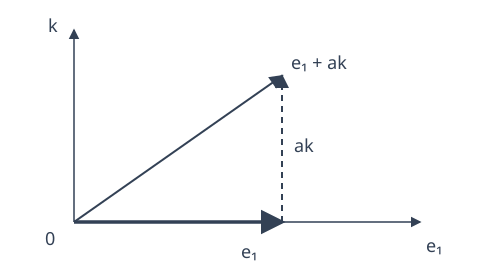

# LREP27 光子の偏極とゲージ

<!-- definition-example-audit: strict -->

前講では場の成分と粒子の内部成分を区別しました。四元ベクトル場で光子を表すと、四成分のうち運動量に平行な成分が変わっても同じ電磁場を表すことがあります。この余分な方向を取り除いた空間に、質量零の固定群がどう作用するかを調べます。

直接の前提講座：[LREP26 有限次元場表現と1粒子表現](../LREP26/index.md)、[QFT15 Maxwell場のゲージ自由度](../../../物理系/QFT/QFT15/index.md)。

[共通符号規約](../../../../../dream-theater-lorentz-conventions.md)に従い、$c=\hbar=1$、$\eta=\operatorname{diag}(-1,1,1,1)$ とします。$u\cdot v=\eta(u,v)$ は複素ベクトルにも双線形に拡張し、$\bar u$ は成分ごとの複素共役です。$\Lambda$ は実Lorentz行列です。

## 1. 四成分と物理偏極の違い

正質量 $m>0$ のスピン1を選ぶと、[正質量の既約内部スピン空間](../LREP23/index.md#prop-lrep23-spin-multiplicity)で $j=1$ として次元 $2j+1=3$ を得ます。ベクトル模型では静止運動量 $p=(m,0,0,0)$ に直交する列は $\epsilon=(0,x,y,z)$ であり、三成分を空間回転が混ぜます。一般の正質量運動量へはLorentz変換で運べます。

ところが光的運動量は自身に直交します。[真空Maxwell平面波の二つの物理偏極](../../../物理系/QFT/QFT15/index.md#thm-qft15-two-polarizations)によれば、非零の未来光的運動量 $p=(E,\boldsymbol p)$ における平面波の複素振幅 $\epsilon$ は $p\cdot\epsilon=0$ を満たし、$\epsilon+\alpha p$ は同じ物理偏極です。$E=|\boldsymbol p|>0$、$\alpha\in\mathbb C$ です。

そこで、直交条件を満たす三次元の空間の中で、同じ偏極を表す列を一つにまとめます。$\mathbb Cp$ は $p$ の複素数倍全体で、$p\cdot p=0$ だから直交条件を満たす部分空間です。商空間とは、その部分空間の元だけ異なる列を同じ元とする線形空間です。

<!-- formal-statement-start -->
> **定義（光的偏極商空間）**
> $p=(E,\boldsymbol p)$ を実非零未来光的運動量とする。複素ベクトル空間

$$
W_p=\{\epsilon\in\mathbb C^4:p\cdot\epsilon=0\}
$$

> の商空間を

$$
P_p=W_p/\mathbb Cp
$$

> とする。元 $[\epsilon]$ は $\epsilon+\alpha p$ 全体を表し、加法と複素数倍は代表元に施して定める。
<!-- formal-statement-end -->

<!-- definition-example-start: def-lrep27-polarization-quotient -->
**定義の確認。** $k=(1,0,0,1)$、$e_1=(0,1,0,0)$ とすると $k\cdot e_1=0$ です。$e_1+2k=(2,1,0,2)$ も $-2+2=0$ を満たし、差が $2k$ なので同じ類です。$e_1$ は $k$ の倍数ではないので零類ではありません。二つの代表元をそれぞれ $\alpha k,\beta k$ だけ変えても和は $(\alpha+\beta)k$ だけ、複素数倍はその係数倍だけ変わるので演算は代表元に依存しません。
<!-- definition-example-end -->

図は $k$ と $e_1$ が張る実二次元の座標模式図です（Lorentz計量での長さや角度は表していません）。横座標が等しい二つの代表元は同じ類です。

## 2. 商空間には正定値内積が残る

四次元のLorentz計量は不定ですが、物理的な内部状態には正定値ノルムが必要です。時間成分を消した代表元を用いれば、どこで正定値性が生まれるかが分かります。

<!-- formal-statement-start -->
> **定理（偏極商空間の正定値内積）**
> $p=(E,\boldsymbol p)$ を実非零未来光的運動量とする。光的偏極商空間 $P_p$ は次の内積を持つ複素二次元空間である。

$$
\langle[\epsilon],[\zeta]\rangle_p=\bar\epsilon\cdot\zeta.
$$

> 任意の $\Lambda\in SO^+(1,3)$ に対して写像

$$
P_p\longrightarrow P_{\Lambda p},\qquad
[\epsilon]\longmapsto[\Lambda\epsilon]
$$

> は線形な全射等長写像である。
<!-- formal-statement-end -->

**証明の見取り図。** 内積の交差項は直交条件で消えます。時間成分を零にする代表元では内積が通常の三次元空間の内積になり、残る平面は運動方向に垂直です。

<!-- proof-start -->
### 証明

$p$ は実なので $p\cdot\bar\epsilon=\overline{p\cdot\epsilon}=0$ です。代表元を変えると

$$
\begin{aligned}
(\bar\epsilon+\bar\alpha p)\cdot(\zeta+\beta p)
&=\bar\epsilon\cdot\zeta
+\bar\alpha p\cdot\zeta\\
&\quad+\beta\bar\epsilon\cdot p
+\bar\alpha\beta p\cdot p\\
&=\bar\epsilon\cdot\zeta.
\end{aligned}
$$

よって内積は代表元に依存せず、第一変数で共役線形、第二変数で線形、共役対称です。[真空Maxwell平面波の二つの物理偏極](../../../物理系/QFT/QFT15/index.md#thm-qft15-two-polarizations)の代表元の構成を適用すると

$$
\epsilon_T=\epsilon-\frac{\epsilon^0}{E}p
=(0,\boldsymbol v),\qquad \boldsymbol p\cdot\boldsymbol v=0.
$$

従って $\langle[\epsilon],[\epsilon]\rangle_p=\sum_{i=1}^3|v_i|^2$ です。零になるのは $\boldsymbol v=0$、すなわち $\epsilon=(\epsilon^0/E)p$ のときだけです。$\boldsymbol p\ne0$ なので横平面を定める線形汎関数の階数は1、核の次元は2です。代表元の一意性により商空間も二次元です。

[Lorentz群の計量保存条件](../LREP9/index.md#def-lrep9-lorentz-group)より $(\Lambda p)\cdot(\Lambda\epsilon)=p\cdot\epsilon=0$ であり、$\Lambda(\epsilon+\alpha p)=\Lambda\epsilon+\alpha\Lambda p$ なので商への写像が定まります。$\Lambda$ は実行列だから

$$
\overline{\Lambda\epsilon}\cdot\Lambda\zeta
=(\Lambda\bar\epsilon)\cdot(\Lambda\zeta)
=\bar\epsilon\cdot\zeta.
$$

逆写像は $\Lambda^{-1}$ から得られます。$\square$
<!-- proof-end -->

$k=(1,0,0,1)$ なら $e_2=(0,0,1,0)$ とともに $[e_1],[e_2]$ が正規直交基底です。代表元の時間成分は変換で一般には零のままとは限りませんが、類の内積は変わりません。

## 3. 固定群の並進はどの成分を変えるか

[光的標準運動量の被覆固定群](../LREP24/index.md#thm-lrep24-null-stabilizer)では、$k$ を固定する被覆群の元が $N(w)R(\theta)$ と書けました。$w=a-ib$、$a,b\in\mathbb R$ とします。$N(w)$ の作用は時空並進ではなく線形変換です。

<!-- formal-statement-start -->
> **定理（光的偏極への固定群作用）**
> $k=(1,0,0,1)$、$\epsilon=(t,x,y,t)\in W_k$ とする。被覆固定群の並進部分 $N(a-ib)$ の四元ベクトル作用は

$$
N(a-ib)\epsilon=\epsilon+(ax+by)k
$$

> であり、$P_k$ 上では恒等作用である。回転部分 $R(\theta)$ の $P_k$ 上の行列は、基底 $[e_1],[e_2]$ で

$$
Q_\theta=\begin{pmatrix}\cos\theta&-\sin\theta\\
\sin\theta&\cos\theta\end{pmatrix}
$$

> となる。
<!-- formal-statement-end -->

**証明の見取り図。** 四元ベクトルの行列模型で下右成分が零になるため、並進が横成分を変えず、時間成分と縦成分を同じだけ変えます。

<!-- proof-start -->
### 証明

[四元ベクトルのエルミート行列模型](../LREP10/index.md#def-lrep10-hermitian-model)を複素線形に拡張します。複素振幅では行列自体がエルミートとは限りませんが、実ベクトルで成立する合同作用の等式は複素線形性から成立します。

$$
H(\epsilon)=\begin{pmatrix}2t&x-iy\\x+iy&0\end{pmatrix}.
$$

$N(w)$ を左から、$N(w)^\dagger$ を右から掛けると

$$
\begin{aligned}
N(w)H(\epsilon)&=
\begin{pmatrix}2t+w(x+iy)&x-iy\\x+iy&0\end{pmatrix},\\
N(w)H(\epsilon)N(w)^\dagger&=
\begin{pmatrix}
2t+w(x+iy)+\bar w(x-iy)&x-iy\\
x+iy&0
\end{pmatrix}.
\end{aligned}
$$

$w=a-ib$ を代入した左上の追加項は $2ax+2by$ です。従って新しい列は $(t+ax+by,x,y,t+ax+by)$ となります。商空間では差が $k$ の倍数なので恒等作用です。

回転 $R(\theta)=\operatorname{diag}(e^{-i\theta/2},e^{i\theta/2})$ では上下の非対角成分にそれぞれ $e^{-i\theta},e^{i\theta}$ が掛かります。上右成分を展開すると

$$
e^{-i\theta}(x-iy)
=x\cos\theta-y\sin\theta-i(x\sin\theta+y\cos\theta).
$$

下左成分も $e^{i\theta}(x+iy)$ で、同じ新しい $x,y$ を与えます。よって主張の行列になります。$\square$
<!-- proof-end -->

例えば $a=2,b=-1$ の並進は $e_1+e_2$ を $e_1+e_2+k$ に移します。場の四成分は変わりますが、物理的な類は変わりません。

## 4. 二つの円偏極と場・粒子の対応

実横基底の二方向を複素線形結合すると、回転の際に各方向が混ざらず位相だけが変わる基底を選べます。

<!-- formal-statement-start -->
> **定理（光子偏極のヘリシティ分解）**
> $P_k$ に固定群の四元ベクトル作用から誘導される作用を入れる。正規直交基底

$$
v_\pm=[(e_1\pm i e_2)/\sqrt2]
$$

> の各直線上の作用は $D_{\pm1}(N(w)R(\theta))=e^{\mp i\theta}$ である。従って内部表現は二つの異なる一次元既約表現 $D_1\oplus D_{-1}$ の直和である。
<!-- formal-statement-end -->

**証明の見取り図。** 横回転を複素化して固有ベクトルを求めます。並進はすでに商空間上で恒等です。

<!-- proof-start -->
### 証明

[光的偏極への固定群作用](#thm-lrep27-little-action)により

$$
\begin{aligned}
Q_\theta(1,i)^{\mathsf T}
&=(\cos\theta-i\sin\theta,\sin\theta+i\cos\theta)^{\mathsf T}\\
&=e^{-i\theta}(1,i)^{\mathsf T},\\
Q_\theta(1,-i)^{\mathsf T}
&=(\cos\theta+i\sin\theta,\sin\theta-i\cos\theta)^{\mathsf T}\\
&=e^{i\theta}(1,-i)^{\mathsf T}.
\end{aligned}
$$

[偏極商空間の正定値内積](#thm-lrep27-positive-quotient)で $[e_1],[e_2]$ は正規直交なので各ノルム二乗は $(1+1)/2=1$、互いの内積は $(1+(-i)(-i))/2=0$ です。二つは基底をなし、並進は恒等です。[ヘリシティの内部表現](../LREP24/index.md#def-lrep24-helicity-rep)と位相を比較するとそれぞれ $h=+1,-1$ になります。一次元の非零表現は真の非零部分空間を持たず既約であり、例えば $\theta=\pi/2$ で位相が $-i,i$ と異なるので同値ではありません。$\square$
<!-- proof-end -->

正質量スピン1では三成分が一つの既約内部表現を作ります。光子の二成分は異なるヘリシティの直和です。一般の質量零表現が必ずこの二つになるのではなく、ここでは四元ベクトルの偏極商空間によって実現される表現を選んでいます。

[運動量断面](../LREP25/index.md#def-lrep25-section) $s(p)$ を使い、標準点の代表元 $u_\pm=(e_1\pm i e_2)/\sqrt2$ を $s(p)$ で運べば、$P_p$ の基底が得られます。$s(p)$ は被覆行列ですが四元ベクトルにはそのLorentz像を作用させる略記です。[断面の固定群補正](../LREP25/index.md#def-lrep25-little-cocycle) $w(A,p)=s(Ap)^{-1}As(p)$ を用いると

$$
As(p)u_\pm=s(Ap)w(A,p)u_\pm.
$$

$w(A,p)=N(a-ib)R(\theta)$ と分解し、上の定理を使えば、ある複素数 $\gamma$ に対して

$$
As(p)u_\pm=e^{\mp i\theta}s(Ap)u_\pm+\gamma Ap
$$

となります。最後の項は商空間で消えます。これは[共変モード係数](../LREP26/index.md#def-lrep26-mode-intertwiner)の等式に対応する、類を値とする等式です。前講の正質量の定理を質量零へそのまま適用したわけではありません。

この基底で各運動量の係数を二成分の波束とすると、[質量殻上の誘導作用](../LREP25/index.md#def-lrep25-induced)で内部因子に $D_1\oplus D_{-1}$ を選べます。[誘導作用のユニタリ性と強連続性](../LREP25/index.md#thm-lrep25-unitary)の仮定を満たす、ほとんど至る所連続な断面を選べば、物理波束のノルムは保存されます。四成分の代表元が正定値内積についてユニタリに変換することを要求する必要はありません。

## 5. 演習

#### LREP27-A01 正質量の偏極数
- Level: A
- ID: LREP27-A01

$m=2$、$p=(2,0,0,0)$ とする。$p\cdot\epsilon=0$ の解空間を求めよ。$p$ の倍数を取り除けるか。

<!-- solution-start -->
**詳細解答**

$\epsilon=(t,x,y,z)$ とおくと $-2t=0$ なので $t=0$。基底は三つの空間座標ベクトルです。$p\cdot(\alpha p)=-4\alpha$ なので $\alpha\ne0$ では直交条件を壊します。質量零の場合と違い、$p$ 方向は直交空間の部分空間ではありません。
<!-- solution-end -->

#### LREP27-A02 代表元の選択
- Level: A
- ID: LREP27-A02

$p=(3,0,0,3)$、$\epsilon=(6,1,i,6)$ とする。直交条件を確認し、時間成分が零の代表元と類のノルム二乗を求めよ。

<!-- solution-start -->
**詳細解答**

$p\cdot\epsilon=-18+18=0$。$\alpha=-6/3=-2$ を選ぶと $\epsilon-2p=(0,1,i,0)$ です。[偏極商空間の正定値内積](#thm-lrep27-positive-quotient)によりノルム二乗は $1+|i|^2=2$。時間成分を消す $\alpha$ は $6+3\alpha=0$ から一意です。
<!-- solution-end -->

#### LREP27-A03 並進の計算
- Level: A
- ID: LREP27-A03

$k=(1,0,0,1)$、$\epsilon=(0,2,-1,0)$ に $N(1-3i)$ を作用させよ。

<!-- solution-start -->
**詳細解答**

[光的偏極への固定群作用](#thm-lrep27-little-action)を $a=1,b=3,x=2,y=-1$ に適用すると $ax+by=2-3=-1$。変換後は $\epsilon-k=(-1,2,-1,-1)$ です。差は $-k$ だから類は同じです。
<!-- solution-end -->

#### LREP27-A04 円偏極の位相
- Level: A
- ID: LREP27-A04

$v_+,v_-$ に角度 $\pi/2$ の回転を作用させよ。

<!-- solution-start -->
**詳細解答**

回転行列は $\begin{pmatrix}0&-1\\1&0\end{pmatrix}$ です。$(1,i)$ の像は $(-i,1)=-i(1,i)$、$(1,-i)$ の像は $(i,1)=i(1,-i)$。規格化係数は変わらず、位相は $-i,i$ です。
<!-- solution-end -->

#### LREP27-B01 別方向の光的運動量
- Level: B
- ID: LREP27-B01

$p=(5,3,4,0)$、$\epsilon=(2,2,1,3)$ を考える。直交条件を確認し、時間成分零の代表元を求め、そのノルムを計算せよ。

<!-- solution-start -->
**詳細解答**

$p^2=-25+9+16=0$、$p\cdot\epsilon=-10+6+4=0$ です。$\alpha=-2/5$ を選ぶと

$$
\epsilon_T=(0,4/5,-3/5,3).
$$

横条件は $3(4/5)+4(-3/5)=0$。ノルム二乗は $16/25+9/25+9=10$、ノルムは $\sqrt{10}$ です。元の列でも $-4+4+1+9=10$ となります。
<!-- solution-end -->

#### LREP27-B02 商を取らない場合の障害
- Level: B
- ID: LREP27-B02

$W_k$ に通常の成分の正定値内積を入れる。$N(1)$ がその内積を保存しないことを示し、商空間での結果と比較せよ。

<!-- solution-start -->
**詳細解答**

[光的偏極への固定群作用](#thm-lrep27-little-action)で $e_1$ は $e_1+k=(1,1,0,1)$ に移ります。通常の成分ノルム二乗は1から3に変化します。一方Lorentz形式では $-1+1+1=1$。ただし $k$ のLorentzノルム二乗は0なので $W_k$ 全体で正定値ではありません。商では $[k]=0$ となり、[偏極商空間の正定値内積](#thm-lrep27-positive-quotient)により正定値かつ固定群で保存されます。
<!-- solution-end -->

#### LREP27-B03 場の振幅の非一意性
- Level: B
- ID: LREP27-B03

光的運動量 $p$ に対し、反対称な振幅 $M^{\mu\nu}=p^\mu\epsilon^\nu-p^\nu\epsilon^\mu$ を考える。$\epsilon$ に $\alpha p$ を加えても $M$ は変わらないこと、逆に $M=0$ なら $\epsilon\in\mathbb Cp$ であることを示せ。

<!-- solution-start -->
**詳細解答**

変換による追加項は

$$
\alpha(p^\mu p^\nu-p^\nu p^\mu)=0
$$

です。逆に全成分が零なら $\mu=0$ の式から $E\epsilon^\nu=p^\nu\epsilon^0$。$E>0$ で割ると $\epsilon=(\epsilon^0/E)p$ です。したがって $W_p$ に制限したこの線形写像の核はちょうど $\mathbb Cp$ です。これは同じ類の振幅が同じ反対称テンソルを与えることを示します。
<!-- solution-end -->

#### LREP27-C01 標準点を変えた偏極の比較
- Level: C
- ID: LREP27-C01

$s=\operatorname{diag}(\sqrt2,1/\sqrt2)$ とし、$p=sk$ とする。$A=sN(2-i)R(\pi/2)s^{-1}$ を考える。$Ap=p$ を確認し、$su_+$ の像を四元ベクトルと商空間の両方で求めよ。ここで $u_+=(e_1+i e_2)/\sqrt2$。

<!-- solution-start -->
**詳細解答**

[SL(2,C)の四元ベクトル作用](../LREP10/index.md#def-lrep10-sl2c-action)で

$$
sH(k)s^\dagger=\begin{pmatrix}4&0\\0&0\end{pmatrix}
$$

なので $p=2k$。固定群の二因子は $k$ を固定するため $Ap=sN(2-i)R(\pi/2)k=sk=p$ です。$s$ は非対角成分を変えないので $su_+=u_+$ です。

まず [光子偏極のヘリシティ分解](#thm-lrep27-helicity-split) の回転計算から、代表元に対しても $R(\pi/2)u_+=-iu_+$ です。次に [光的偏極への固定群作用](#thm-lrep27-little-action)で $a=2,b=1$、$x=1/\sqrt2,y=i/\sqrt2$ とすると

$$
N(2-i)u_+=u_++\frac{2+i}{\sqrt2}k.
$$

従って

$$
Asu_+=-isu_+-\frac{i(2+i)}{\sqrt2}p.
$$

後項は $p$ の倍数なので $P_p$ では $[Asu_+]=-i[su_+]$。位相の絶対値は1であり、類のノルムも保存されます。$A$ の四元ベクトル作用は非自明な追加項を持つことと、内部作用が位相だけであることが両立しています。
<!-- solution-end -->

## 6. まとめ

四元偏極の直交条件だけでは三成分が残ります。光的運動量自身が零ノルムであるため、さらにその方向を商で除くと正定値の二次元空間になります。固定群の並進は代表元を変えるだけで、円偏極には回転位相が残ります。次講では離散対称性を加え、スピン・場・粒子の変換を総合します。
