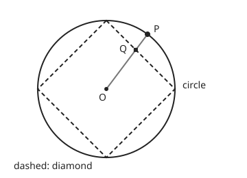
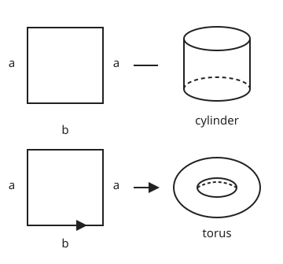

# ATOP1 図形を位相的に見る：同相・商・局所模型

円周と四角形の周は、角の有無や長さが違います。それでも、両者の点を一対一に対応させ、近くの点が近くの点に移ることを両方向で保証できれば、位相的には同じ図形です。

一般位相では開集合から空間を調べました。これからの位相幾何学では、具体的な図形を作り、どのような変形や貼り合わせを経ても残る性質を取り出します。図を描くだけでなく、対応する写像の式と逆向きの条件を確かめることが出発点です。

前提は [TOP2](../../../基礎科目/TOP/TOP2/index.md)、[TOP3](../../../基礎科目/TOP/TOP3/index.md)、[TOP4](../../../基礎科目/TOP/TOP4/index.md)、[GEO1](../../GEO/GEO1/index.md) の位相的な部分です。

<!-- definition-example-audit: strict -->

## 1. 長さや角を忘れて図形を比べる

[同相写像・同相](../../../基礎科目/TOP/TOP2/index.md#def-top2-homeomorphism) では、全単射と両方向の連続性を要求します。以下の Euclid 空間の部分集合には部分空間位相を入れます。部分集合 $A$ の開集合は、周囲の空間の開集合 $O$ との共通部分 $A\cap O$ です。像が $A$ に入る写像の連続性は、[部分空間位相の連続性判定](../../../基礎科目/TOP/TOP1/index.md#prop-top1-subspace-universal) により周囲の空間への写像として判定できます。

単位円周を $S^1$、単位閉円板を $D^2$ と書きます。

$$
S^1=\{(x,y):x^2+y^2=1\},
\qquad
D^2=\{(x,y):x^2+y^2\le1\}.
$$

菱形の周を $P=\{(x,y):|x|+|y|=1\}$ とします。中心から一本の半直線を伸ばすと、円周と菱形の周の両方に一度ずつ当たります。この対応が連続に動くか、式で検証しましょう。

図中のラベル P（菱形の周を表す集合 $P$ とは別です）の座標は $(3/5,4/5)$、点 Q は $(3/7,4/7)$ です（図の上下は通常の座標軸に従います）。これらは同じ向きの半直線上にあります。[図を拡大](assets/radial-circle-diamond.svg)

<!-- formal-statement-start -->
> **命題（円周と菱形の周の動径同相）**
> 単位円周 $S^1$ と $P=\{(x,y)\in\mathbb R^2:|x|+|y|=1\}$ は同相である。その同相写像は

$$
f:S^1\to P,\qquad
f(x,y)=\frac{(x,y)}{|x|+|y|}
$$

> で与えられる。
<!-- formal-statement-end -->

中心からの向きを保ち、長さだけ変えます。逆写像では Euclid ノルムが1になるように長さを戻せばよいはずです。

<!-- proof-start -->
### 証明

任意の平面ベクトル $u=(u_1,u_2)$ に対して $a(u)=|u_1|+|u_2|$、$b(u)=\|u\|=\sqrt{u_1^2+u_2^2}$ と置きます。添字は成分番号です。$v=(x,y)\in S^1$ とします。$v\ne0$ なので $a(v)>0$ です。$f(v)=v/a(v)$ の二成分の絶対値の和は $a(v)/a(v)=1$ ですから、$f(v)\in P$ です。

次に $w\in P$ とします。$w\ne0$ より $b(w)>0$ で、$g(w)=w/b(w)$ はノルム1の点です。両写像とも各成分が連続関数の商であり、分母が零にならないので連続です。

$b(v)=1$ と $a(w)=1$ を用いると

$$
b(f(v))=\frac{1}{a(v)},\qquad
a(g(w))=\frac{1}{b(w)}.
$$

従って

$$
g(f(v))=\frac{v/a(v)}{1/a(v)}=v,
\qquad
f(g(w))=\frac{w/b(w)}{1/b(w)}=w.
$$

相互に逆なので全単射であり、逆写像も連続です。[同相写像の定義](../../../基礎科目/TOP/TOP2/index.md#def-top2-homeomorphism) の三条件が成立しました。
<!-- proof-end -->

角がある点で微分ができなくても、連続性には問題がありません。この例で円周の長さや曲率は保存していません。

## 2. 同相と、ある空間の中への埋め込み

同じ図形でも、どの空間に置くかは別の情報です。たとえば円周は平面全体と同じではありませんが、平面の部分集合として置けます。ここでは像の上で元の位相を回復できることを要求します。

写像の像 $i(X)$ は $i(x)$（$x\in X$）を全て集めた集合です。終域をこの集合に取り直すと自動的に全射になります。単射なら逆写像が定まり、[同相写像の定義](../../../基礎科目/TOP/TOP2/index.md#def-top2-homeomorphism) に従って順方向と逆方向の連続性を確かめればよいわけです。

<!-- formal-statement-start -->
> **定義（位相的埋め込み）**
> 位相空間 $X,Y$ と写像 $i:X\to Y$ に対して、像 $i(X)$ に $Y$ の部分空間位相を入れる。写像 $i$ が単射であり、終域を像に制限した写像

$$
X\longrightarrow i(X),\qquad x\longmapsto i(x)
$$

> が同相写像であるとき、$i$ は位相的埋め込みであるという。
<!-- formal-statement-end -->

<!-- definition-example-start: def-atop1-topological-embedding -->
**定義の確認**

包含写像 $i:S^1\to\mathbb R^2$ を考えます。点をそのまま平面の点にするので単射です。像 $i(S^1)=S^1$ の部分空間位相は最初から $S^1$ に入れた位相と同じです。像への写像もその逆も恒等写像であり、開集合の逆像はそれ自身なので連続です。従って位相的埋め込みです。

しかし原点は像に含まれず、平面全体への全射ではありません。この写像は平面全体への同相写像ではありません。
<!-- definition-example-end -->

単射で連続なら十分とは限りません。半開区間から円周への写像

$$
h:[0,1)\to S^1,\qquad
h(t)=(\cos 2\pi t,\sin 2\pi t)
$$

は各成分が連続です。角度が $0\le2\pi t<2\pi$ の範囲を一度ずつ通るので全単射ですが、逆写像は連続ではありません。$t_n=1-1/n$（$n\ge2$）とすると $h(t_n)\to(1,0)$ です。一方 $h^{-1}(1,0)=0$ に対して、$t_n$ は0の近傍 $[0,1/2)$ に最終的に入らないので0へ収束しません。連続性なら収束列を収束列へ移すため、矛盾です。この例では定義域のコンパクト性が失われています。$1$ は定義域に含まれない極限点なので $[0,1)$ は閉集合でなく、[Heine–Borel の定理](../../../基礎科目/F0/F0-00C1/index.md#thm-f0-00c1-02) よりコンパクトではありません。

## 3. 貼り合わせを写像で検算する

[同値関係](../../../基礎科目/TOP/TOP2/index.md#def-top2-equivalence) は反射律・対称律・推移律を満たす関係です。点 $x$ と関係する点全体を同値類 $[x]$ と書きます。[同値関係による同一視空間](../../../基礎科目/TOP/TOP2/index.md#def-top2-identification-space) の各点は、元の点ではなく同値類です。商空間 $X/{\sim}$ の開集合は、その標準射影による逆像が $X$ で開となる集合です。

具体的な図形 $Y$ を得たいときは、連続全射 $F:X\to Y$ を作り、次の両方向を確認します。

$$
x\sim x'\quad\Longleftrightarrow\quad F(x)=F(x').
$$

左から右は同じ類に矛盾なく値を与える条件で、右から左は意図しない同一視を防ぐ条件です。従って $\bar F([x])=F(x)$ と定めると、代表元 $x$ の選択に依存しない全単射を得ます。点 $y\in Y$ の逆像 $F^{-1}(\{y\})$（ファイバー）はちょうど一つの同値類です。

さらに $X$ がコンパクト、$Y$ が Hausdorff なら、[コンパクト商空間の同定判定](../../../基礎科目/TOP/TOP2/index.md#thm-top2-compact-quotient-identification) により誘導写像は同相写像です。ここで [コンパクト空間からHausdorff空間への連続全単射](../../../基礎科目/TOP/TOP2/index.md#thm-top2-compact-hausdorff-bijection) が逆連続性を保証しています。

### 3.1 円周、円筒、トーラス

$I=[0,1]$ と置き、$e(t)=(\cos2\pi t,\sin2\pi t)$ とします。$s,t\in I$ について

$$
e(s)=e(t)\quad\Longleftrightarrow\quad s-t\in\mathbb Z.
$$

実際、二つの単位ベクトルの内積は加法定理により $\cos(2\pi(s-t))$ です。両者の差のノルムの二乗は

$$
\|e(s)-e(t)\|^2=2-2\cos(2\pi(s-t)).
$$

これが零であることは $s-t$ が整数であることと同値です。従って $I$ の中では、同じ点か両端の組だけが同じ像を持ちます。[区間の端点同一視は円](../../../基礎科目/TOP/TOP2/index.md#thm-top2-interval-circle) の写像です。

正方形 $Q_0=I^2$ の座標を $(t,s)$ とします。円筒は $C=S^1\times I$、トーラスは $T=S^1\times S^1$ です。後者は二つの円周を独立に選ぶ空間であり、積は Euclid 空間の部分空間として扱えます。

$$
F_C(t,s)=(e(t),s),
\qquad
F_T(t,s)=(e(t),e(s)).
$$

両写像は連続であり、各円周の点に角度を選べるため全射です。像の一致は、それぞれ次の条件になります。

$$
\begin{aligned}
F_C(t,s)=F_C(t',s')
&\Longleftrightarrow t-t'\in\mathbb Z,\ s=s',\\
F_T(t,s)=F_T(t',s')
&\Longleftrightarrow t-t',s-s'\in\mathbb Z.
\end{aligned}
$$

図の辺 a はどちらも下から上、辺 b はどちらも左から右を向きます。上段の水平辺は互いに貼りません。下段の四隅は全て同じ類です。右の立体は商の結果の模式図であり、平面に描かれたトーラスの輪郭そのものを空間とするのではありません。[図を拡大](assets/square-gluings.svg)

$Q_0$ は [Heine–Borel の定理](../../../基礎科目/F0/F0-00C1/index.md#thm-f0-00c1-02) によりコンパクトです。$C,T$ はそれぞれ $\mathbb R^3,\mathbb R^4$ の部分空間であり Hausdorff です。よって上の同値関係で商を取れば、それぞれ [正方形の一組の対辺同一視は円柱](../../../基礎科目/TOP/TOP2/index.md#thm-top2-square-cylinder)、[正方形の二組の対辺同一視はトーラス](../../../基礎科目/TOP/TOP2/index.md#thm-top2-square-torus) の同相が得られます。

### 3.2 円板を作る：一本の辺を一点にする

円板の中心では角度を区別できません。半径と角度の長方形から円板を作るとき、半径0の辺全体を一つの点にまとめる必要があります。第3.1節の第2座標をここでは半径 $r$ と呼び、$t$ を一周を1とする角度の変数にします。

<!-- formal-statement-start -->
> **定理（正方形の極座標商と円板）**
> $I=[0,1]$ とし、$I^2$ の点 $(t,r)$ と $(t',r')$ の間に次の関係を入れる。

$$
(t,r)\sim(t',r')
\Longleftrightarrow
\begin{cases}
r=r'=0,\quad\text{または}\\
r=r'>0,\ t-t'\in\mathbb Z.
\end{cases}
$$

> これは同値関係であり、商空間 $I^2/{\sim}$ は単位閉円板 $D^2$ と同相である。
<!-- formal-statement-end -->

左右を貼るだけでは円筒ができます。さらに下の円周を一点にまとめると円板ができます。式でこの二種類の同一視がちょうど必要十分であることを示します。

<!-- proof-start -->
### 証明

写像 $F:I^2\to D^2$ を

$$
F(t,r)=r(\cos2\pi t,\sin2\pi t)
$$

と置きます。各成分が連続でノルムは $r\in I$ なので、定義域全体で値が円板に入ります。

任意の $z\in D^2$ に対して $r=\|z\|$ と置きます。$r=0$ なら $z=F(0,0)$、$r>0$ なら $z/r\in S^1$ なので $e(t)=z/r$ となる $t\in I$ が存在します。このとき $F(t,r)=z$ となり、全射です。

$F(t,r)=F(t',r')$ とします。ノルムを取ると $r=r'$ です。$r=0$ なら角度は任意です。$r>0$ なら両辺を $r$ で割り、$e(t)=e(t')$ から $t-t'\in\mathbb Z$ を得ます。逆に関係の第一条件では両像が原点、第二条件では角度と半径から両像が一致します。従ってこの関係は像の等しさと同値です。具体的に、正方形の任意の点 $x,y,z$ について、$F(x)=F(x)$ なので $x\sim x$、$F(x)=F(y)$ なら $F(y)=F(x)$ なので $y\sim x$、$F(x)=F(y)=F(z)$ なら $x\sim z$ です。これで [同値関係の三条件](../../../基礎科目/TOP/TOP2/index.md#def-top2-equivalence) を確認しました。

$I^2$ は閉有界なので [Heine–Borel の定理](../../../基礎科目/F0/F0-00C1/index.md#thm-f0-00c1-02) でコンパクト、$D^2$ は平面の部分空間なので Hausdorff です。[コンパクト商空間の同定判定](../../../基礎科目/TOP/TOP2/index.md#thm-top2-compact-quotient-identification) により誘導写像

$$
\bar F([(t,r)])=r e(t)
$$

は同相写像です。
<!-- proof-end -->

たとえば $(0,1/2)$ と $(1,1/2)$ は同じ類ですが、$(1/4,1/2)$ は別の類です。$(1/4,0)$ と $(3/4,0)$ はともに中心です。円板の外周 $r=1$ は一点にはまとめません。

## 4. 局所模型：点の近くだけを見る

[GEO1 の位相多様体](../../GEO/GEO1/index.md#def-geo1-topological-manifold) では、Hausdorff 性・第二可算性に加え、各点の開近傍が Euclid 空間の開集合と同相であることを要求しました。この同相写像を [座標写像](../../GEO/GEO1/index.md#def-geo1-chart) と呼びます。円周の全体を一つの実数座標で表すことはできなくても、短い弧であれば可能です。

### 4.1 円周の開近傍

任意の $p=(a,b)\in S^1$ に対して $q=(-b,a)$ と置きます。$p,q$ は互いに直交する単位ベクトルです。$z\cdot p>0$ を満たす半円を $U_p$ とします。内積は連続なので $U_p$ は円周で開であり、$p$ を含みます。

$$
\varphi_p:U_p\to(-1,1),
\qquad
\varphi_p(z)=z\cdot q.
$$

内積 $z\cdot p$ と $z\cdot q$ は直交単位基底 $p,q$ における係数です。実際 $p\cdot p=q\cdot q=a^2+b^2=1$、$p\cdot q=-ab+ab=0$ なので、

$$
z=\alpha p+v q,\qquad
\alpha=z\cdot p>0,\quad v=z\cdot q.
$$

この表示ではノルム1の条件が

$$
1=\|z\|^2=\alpha^2+v^2
$$

となります。$\alpha>0$ から $|v|<1$ で、$\alpha=\sqrt{1-v^2}$ が一意に決まります。従って座標 $v$ から元の点を復元する逆写像の候補は

$$
\psi_p(v)=\sqrt{1-v^2}\,p+v q
$$

となります。$|v|<1$ なら正の平方根を持ち、ノルムの二乗は $(1-v^2)+v^2=1$ なので $U_p$ の点です。また $\psi_p(v)\cdot p=\sqrt{1-v^2}>0$ です。二つの合成を計算すると、

$$
\begin{aligned}
\varphi_p(\psi_p(v))
&=\sqrt{1-v^2}(p\cdot q)+v(q\cdot q)=v,\\
\psi_p(\varphi_p(z))
&=(z\cdot p)p+(z\cdot q)q=z.
\end{aligned}
$$

内積と正の平方根は連続であり、部分空間への写像としても連続です。従って同相です。

トーラスの点 $(p,p')$ では二つの開近傍 $U_p,U_{p'}$ の積を使い、座標を $(\varphi_p(z),\varphi_{p'}(z'))$ とすれば $(-1,1)^2$ への同相です。逆写像は各成分に $\psi$ を適用します。積近傍が開であることは [積位相の基底](../../../基礎科目/TOP/TOP1/index.md#thm-top1-product-basis) によります。円周とトーラスは Euclid 空間の部分空間なので [Hausdorff 空間](../../../基礎科目/TOP/TOP4/index.md#def-top4-t2) です（異なる二点間の距離の3分の1を半径とする球で分離できます）。

また有理数座標の中心と正の有理数半径の開球を各空間と交わらせた族は可算です。任意の点 $x$ の相対開近傍には $B(x,\epsilon)$ と空間との共通部分が含まれます。有理数座標の中心 $c$ を $\|c-x\|<\epsilon/4$ に選び、有理数半径 $\rho$ を $\|c-x\|<\rho<\epsilon-\|c-x\|$ に取れば $x\in B(c,\rho)\subset B(x,\epsilon)$ です。従ってこの族は基底であり、[第二可算](../../../基礎科目/TOP/TOP4/index.md#def-top4-second-countable) です。

これらを合わせると [位相多様体の条件](../../GEO/GEO1/index.md#def-geo1-topological-manifold) を全て満たします。

### 4.2 円板の内点と外周の点

内点 $z$ で $\|z\|<1$ なら、$\epsilon=(1-\|z\|)/2>0$ と置きます。$\|w-z\|<\epsilon$ から

$$
\|w\|\le\|z\|+\|w-z\|<\|z\|+\epsilon
=\frac{1+\|z\|}{2}<1
$$

が従います。従って $z$ の周囲には円板に含まれる平面の開球があります。

一方、外周の点 $p$ の近傍として

$$
V_p=\{z\in D^2:\|z\|>1/2,\ z\cdot p>0\}
$$

を取ります。両方の不等号が真に厳しいので、円板の部分空間位相で開です。半径と方向を分けるため $u=z/\|z\|$ と置きます。$u\in U_p$ であり、次の写像を作れます。

$$
\Phi_p(z)=(\varphi_p(u),1-\|z\|).
$$

第1座標は方向を表し、第2座標 $h=1-\|z\|$ は外周からの半径方向の距離を表します。値は $(-1,1)\times[0,1/2)$ に入ります。この範囲の全ての点が像に入ることも含めて確かめるため、逆写像の候補を

$$
\Psi_p(v,h)=(1-h)\psi_p(v)
$$

とします。$0\le h<1/2$ より半径は $1-h\in(1/2,1]$ です。方向の $p$ 成分は正ですから像は $V_p$ に入ります。$\Phi_p\circ\Psi_p$ では方向が $\psi_p(v)$、半径が $1-h$ なので $(v,h)$ を回復します。逆の合成も、$u=z/\|z\|$ とおけば

$$
\Psi_p(\Phi_p(z))
=\|z\|\psi_p(\varphi_p(u))
=\|z\|u=z
$$

です。全ての分母が正で、両写像は連続です。

この像は閉半平面 $\mathbb R\times[0,\infty)$ の部分空間位相で開です。$h=0$ が外周に対応します。円筒 $C=S^1\times I$ の点 $(p,0)$ では、相対開近傍 $U_p\times[0,1/2)$ を取り、$(u,s)\mapsto(\varphi_p(u),s)$ とすれば同じ半平面模型を得ます。逆写像は $(v,h)\mapsto(\psi_p(v),h)$ です。点 $(p,1)$ では高さを $h=1-s$ に置き換えれば同じ構成が使えます。高さ $0<s<1$ では十分短い開区間を選び、開平面の座標になります。トーラスでは二方向とも開区間の座標になります。

ここで確認したのは局所座標の具体的構成です。外周の点を内点に移す同相写像が存在しないことの一般的な証明は、後の局所的な位相不変量で扱います。

## 5. 同相でないことをどう証明するか

同相を示すには写像を一本構成すれば足ります。非同相を示すには、どのような同相写像を仮定しても矛盾する性質を探します。たとえば [連結性](../../../基礎科目/TOP/TOP3/index.md#def-top3-connected) は両方向の連続性で保存されます。

閉区間 $I$ と円周 $S^1$ が同相だと仮定し、$1/2$ の像を $p$ とします。同相写像を一点を除いた部分空間に制限すると、制限と逆の制限は連続で互いに逆になります。ところが

$$
I\setminus\{1/2\}=[0,1/2)\cup(1/2,1]
$$

は非空な二つの相対開集合への分離を持ちます。一方 $S^1\setminus\{p\}$ は連結です。実際、$p=(a,b)$ とし、第4.1節の直交単位基底 $p,q=(-b,a)$ を使います。写像

$$
R(x,y)=(ax+by,-bx+ay)
$$

は点の $p,q$ 方向の係数を標準座標に並べたものです。ノルムを保ち、逆写像は $(u,v)\mapsto up+vq$ で両方向とも連続です。特に $R(p)=(1,0)$ です。$(0,1)$ から $t\mapsto e(t)$ で $(1,0)$ 以外の円周全体へ連続全射が得られます。[実数の区間は連結](../../../基礎科目/TOP/TOP3/index.md#thm-top3-real-interval) および [連結空間の連続像は連結](../../../基礎科目/TOP/TOP3/index.md#thm-top3-continuous-image) を用いると円周から一点を除いた空間は連結です。これは同相写像の制限による連結性保存に反します。

最後に、全ての点の区別を維持するのではなく、連続的な時間変化で図形を簡単にすることを考えます。円板では

$$
H:D^2\times I\to D^2,\qquad H(z,t)=(1-t)z
$$

が連続で、$H(z,0)=z$、$H(z,1)=0$ です。終時刻では全点が一点に重なるため全単射ではありません。このような変形を使う比較が、次講のホモトピー同値への入口です。円板と一点は同相ではありませんが、この変形により円板を一点へ縮められます。写像を同相に保ったまま変形することとは別の概念です。

## 6. 演習

### 演習 ATOP1-A1：動径対応の計算

- Level: A

単位円周上の点 $v=(-5/13,12/13)$ を、[円周と菱形の周の動径同相](#prop-atop1-radial-circle-diamond) で移し、逆写像で元の点へ戻せ。

<!-- solution-start -->
**詳細解答**

絶対値の和は $5/13+12/13=17/13$ です。したがって

$$
w=\frac{(-5/13,12/13)}{17/13}
=(-5/17,12/17).
$$

絶対値の和は1で菱形の周上にあります。$w$ の Euclid ノルムは $\sqrt{25+144}/17=13/17$ です。$w/(13/17)=(-5/13,12/13)$ と戻ります。
<!-- solution-end -->

### 演習 ATOP1-A2：位相的埋め込み

- Level: A

写像 $i:\mathbb R\to\mathbb R^2$ を $i(t)=(t,2t)$ とする。位相的埋め込みであることを示し、平面全体への同相写像か判定せよ。

<!-- solution-start -->
**詳細解答**

$i(s)=i(t)$ の第1成分から $s=t$ で単射です。像 $L=\{(x,2x):x\in\mathbb R\}$ への写像は、各成分が連続で像が $L$ に入ることから [部分空間位相の連続性判定](../../../基礎科目/TOP/TOP1/index.md#prop-top1-subspace-universal) により連続です。任意の $(x,2x)\in L$ は $i(x)$ なので像への写像は全射であり、逆写像 $L\to\mathbb R$ は $(x,y)\mapsto x$ です。これは座標射影の制限で連続です。従って [位相的埋め込みの定義](#def-atop1-topological-embedding) を満たします。一方 $(0,1)\notin L$ なので平面全体へは全射でなく、同相写像ではありません。
<!-- solution-end -->

### 演習 ATOP1-A3：辺と角の同値類

- Level: A

正方形 $[0,1]^2$ から左右だけを貼る円筒の商と、上下左右を貼るトーラスの商を考える。それぞれ $(0,0)$ および $(0,1/3)$ の同値類を全て求めよ。対応は同じ高さまたは同じ横位置とする。

<!-- solution-start -->
**詳細解答**

添字 $C,T$ はそれぞれ円筒、トーラスを作る同値関係を区別します。円筒の場合は第2座標を固定し、第1座標の0と1だけを同一視します。従って

$$
[(0,0)]_C=\{(0,0),(1,0)\},
$$

$$
[(0,1/3)]_C=\{(0,1/3),(1,1/3)\}.
$$

トーラスの場合は第2座標も0と1を同一視するため

$$
[(0,0)]_T=\{0,1\}\times\{0,1\}.
$$

$1/3$ は端点でないので $[(0,1/3)]_T=[(0,1/3)]_C$ です。判定には [円筒の同定](../../../基礎科目/TOP/TOP2/index.md#thm-top2-square-cylinder) と [トーラスの同定](../../../基礎科目/TOP/TOP2/index.md#thm-top2-square-torus) の座標別の関係を使いました。
<!-- solution-end -->

### 演習 ATOP1-A4：円板の中心と外周

- Level: A

[正方形の極座標商と円板](#thm-atop1-disk-quotient) の写像 $F(t,r)=r e(t)$ で、原点、$(0,1/2)$、$(1,0)$ の逆像をそれぞれ求めよ。

<!-- solution-start -->
**詳細解答**

ノルムが半径 $r$ そのものなので、原点の逆像は $I\times\{0\}$ です。$(0,1/2)$ の半径は $1/2$、単位方向は $(0,1)$ です。$2\pi t=\pi/2$ のみが $0\le2\pi t\le2\pi$ に入るため、逆像は $\{(1/4,1/2)\}$ です。

$(1,0)$ の半径は1、角度は0または $2\pi$ なので、逆像は $\{(0,1),(1,1)\}$ です。
<!-- solution-end -->

### 演習 ATOP1-B1：外周近傍の座標

- Level: B

円板 $D^2$ で $p=(0,1)$ とし、第4節の $q=(-1,0)$ を使う。$z=(3/5,3/5)$ の座標 $\Phi_p(z)$ を求め、逆写像で復元せよ。

<!-- solution-start -->
**詳細解答**

$\|z\|=3\sqrt2/5$ は $1/2$ より大きく1より小さいです。$z\cdot p=3/5>0$ より $z\in V_p$ です。単位方向は $(1/\sqrt2,1/\sqrt2)$ なので

$$
v=-1/\sqrt2,\qquad h=1-3\sqrt2/5.
$$

$\psi_p(v)$ の $p$ 方向の係数は $\sqrt{1-v^2}=1/\sqrt2$、$q$ 方向は $-1/\sqrt2$ です。従って

$$
\psi_p(v)=(1/\sqrt2,1/\sqrt2).
$$

これに $1-h=3\sqrt2/5$ を掛けると $(3/5,3/5)$ を得ます。
<!-- solution-end -->

### 演習 ATOP1-B2：コンパクト性を失った全単射

- Level: B

$X=[0,1)$ とし、$Y=S^1$ とする。$e(t)=(\cos2\pi t,\sin2\pi t)$ は連続全単射である。逆写像が連続でないことを、$X$ の相対開集合 $[0,1/4)$ の像を調べて示せ。

<!-- solution-start -->
**詳細解答**

$[0,1/4)=X\cap(-1,1/4)$ は $X$ で開です。その像は $(1,0)$ を含み、第一象限の円弧のうち $(0,1)$ を除いた部分です。

$t_n=1-1/n$ とすれば $n\ge2$ で $t_n\ge1/2$ となり、$e(t_n)$ は単射性よりその像に含まれません。しかし $e(t_n)\to(1,0)$ です。もし像が円周で開なら $(1,0)$ を含む開近傍なので、十分大きい $n$ で $e(t_n)$ が像に入るはずです。矛盾です。

逆写像 $e^{-1}:Y\to X$ による、$X$ の開集合 $[0,1/4)$ の逆像が開でないので逆写像は連続でありません。$X$ は Euclid 空間で閉でなく、[Heine–Borel の定理](../../../基礎科目/F0/F0-00C1/index.md#thm-f0-00c1-02) よりコンパクトではありません。
<!-- solution-end -->

### 演習 ATOP1-B3：一点を除いて区別する

- Level: B

実直線 $\mathbb R$ と単位円周 $S^1$ が同相でないことを、一点を除いた空間の連結性から示せ。

<!-- solution-start -->
**詳細解答**

同相写像 $f:\mathbb R\to S^1$ が存在すると仮定し、$p=f(0)$ と置きます。$f$ と $f^{-1}$ を一点を除いた集合に制限すれば、部分空間位相に関して連続な互いに逆の写像になります。

$\mathbb R\setminus\{0\}=(-\infty,0)\cup(0,\infty)$ の右辺の二集合は非空、互いに素で相対開です。従って [連結性の定義](../../../基礎科目/TOP/TOP3/index.md#def-top3-connected) から非連結です。

$p=(a,b)$ とすると、第5節の写像は第4.1節の基底 $p,q$ での係数を並べる座標変換です。標準基底でこの線形写像を表す行列は、各行が $p,q$ の成分となる

$$
R=\begin{pmatrix}a&b\\-b&a\end{pmatrix}
$$

です。円周を保つことと逆写像が存在することを次の計算で確かめます。$R^\mathsf{T}$ は転置行列です。

$$
R^\mathsf{T}R=
\begin{pmatrix}
a^2+b^2&ab-ab\\
ab-ab&a^2+b^2
\end{pmatrix}
=I_2.
$$

ここで $I_2$ は2次の単位行列です。従って $R^{-1}=R^\mathsf{T}$ であり、任意の平面ベクトル $z$ に対し

$$
\|Rz\|^2=z^\mathsf{T}R^\mathsf{T}Rz
=z^\mathsf{T}z=\|z\|^2
$$

です。逆もノルムを保ちます。また $Rp=(a^2+b^2,-ba+ab)=(1,0)$ です。両方向とも成分が一次式で連続なので、円周への制限は [同相写像](../../../基礎科目/TOP/TOP2/index.md#def-top2-homeomorphism) です。

区間 $(0,1)$ から $e(t)$ で $(1,0)$ を除いた円周へ連続全射が得られます。さらに次の合成を考えます。

$$
t\longmapsto R^{-1}e(t)\in S^1\setminus\{p\}.
$$

これは連続全射です。

[実数の区間は連結](../../../基礎科目/TOP/TOP3/index.md#thm-top3-real-interval) と [連結空間の連続像は連結](../../../基礎科目/TOP/TOP3/index.md#thm-top3-continuous-image) からこの円周の部分集合は連結です。制限同相の逆写像に連結性保存を適用すれば $\mathbb R\setminus\{0\}$ も連結となり矛盾します。
<!-- solution-end -->

### 演習 ATOP1-C1：円板の外周を一点にする

- Level: C

単位閉円板 $D^2$ で外周 $S^1$ の全点を一つの類にまとめ、内点はそれぞれ単独の類とする。この商が単位球面 $S^2=\{(x,y,z):x^2+y^2+z^2=1\}$ と同相であることを、次の写像で証明せよ。円板の点 $v$ のノルムを $r$ とし、

$$
G(v)=
\begin{cases}
(\sin(\pi r)\,v/r,\cos(\pi r)),&r>0,\\
(0,0,1),&r=0
\end{cases}
$$

と置く。最初の二成分をまとめてベクトルで書いた。原点での連続性、全射性、像が一致する条件、商の同相を順に検証せよ。

<!-- solution-start -->
**詳細解答**

$r>0$ のとき $v/r$ は単位ベクトルなので、三成分の二乗和は $\sin^2(\pi r)+\cos^2(\pi r)=1$ です。$r=0$ でも値は球面上です。$r>0$ では分母が正で連続です。原点へ近づくと最初の二成分のノルムは $|\sin(\pi r)|\to0$、最後の成分は $\cos(\pi r)\to1$ です。従って原点でも連続です。

球面の点 $(w,z)$（$w\in\mathbb R^2$）を取ります。$\cos(\pi r)$ は $r\in[0,1]$ で1から $-1$ へ厳密に減少するため、$\cos(\pi r)=z$ を満たす $r$ が一意に存在します。$r=0$ なら北極で原点が逆像、$r=1$ なら南極で外周上の任意の点が逆像です。

$0<r<1$ のとき $\sin(\pi r)>0$ であり、

$$
\|w\|^2=1-z^2=\sin^2(\pi r).
$$

従って $u=w/\sin(\pi r)$ は単位ベクトルです。$v=ru$ と選べば $\|v\|=r$、$G(v)=(w,z)$ となり全射です。

次に $G(v)=G(v')$ とします。最後の成分の一致と $\cos(\pi r)$ の単調性から $r=r'$ です。$r=0$ なら両点は原点、$r=1$ なら両点は外周上です。$0<r<1$ では $\sin(\pi r)>0$ なので最初の二成分をこれで割ると $v/r=v'/r$、従って $v=v'$ です。逆に同じ点、または外周上の任意の二点は同じ像になります。これで像の一致が指定された同値関係と必要十分に対応しました。

$D^2$ は閉有界なので [Heine–Borel の定理](../../../基礎科目/F0/F0-00C1/index.md#thm-f0-00c1-02) によりコンパクトです。球面は $\mathbb R^3$ の部分空間なので Hausdorff です。[コンパクト商空間の同定判定](../../../基礎科目/TOP/TOP2/index.md#thm-top2-compact-quotient-identification) により誘導写像 $[v]\mapsto G(v)$ は同相です。

第3.2節では正方形の下辺全体を円板の中心にまとめました。今回は円板の外周を一点にまとめ、閉じた球面を得ました。ここで用いた判定手順は [正方形の極座標商と円板](#thm-atop1-disk-quotient) と同じです。
<!-- solution-end -->

## 7. まとめ

- 同相は全単射と両方向の連続性で決まります。図の角や長さを保存する必要はありません。
- 商模型の同定では像の一致と同値関係の必要十分性を確認します。コンパクト性と Hausdorff 性は逆連続性を保証します。
- 円周、円筒、トーラス、円板は貼り方を変えることで作れます。
- 点の周囲を開区間・開平面・半平面で表す具体的な局所座標を構成しました。
- 同相でないことは連結性などの保存される性質を用いて証明できます。次講では点を一対一に保つ条件を弱め、連続的な変形そのものを扱います。
