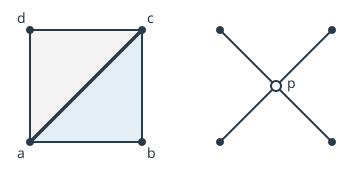
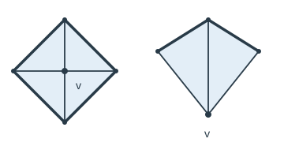

# ATOP10 単体複体と三角形分割

<!-- definition-example-audit: strict -->

前講までに、道と[ループ](../ATOP4/index.md#def-atop4-loop)から図形の一次元的な情報を取り出しました。今度は面も記録したいと考えます。三角形の三辺だけを残す場合と、内部まで塗りつぶす場合とでは、頂点と辺が同じでも図形が違います。そこで、どの頂点の組が辺・面・立体を作るのかを有限集合として記録し、そのデータから位相空間を組み立てます。

## 1. 頂点の組から図形を記録する

[単体・標準単体](../../../応用系/FIX/FIX1/index.md#def-fix1-standard-simplex) では、線分や三角形を頂点の凸包として作りました。ここでは位置を決める前に頂点の名前だけを用意します。三角形を含めるなら、その三辺と三頂点も含めるという規則が必要です。

<!-- formal-statement-start -->
> **定義（抽象単体複体）**
> 有限集合 $V$ と、その部分集合からなる族 $K$ を取る。次の条件を満たすとき、$K$ は頂点集合 $V$ 上の有限抽象単体複体である。
>
> - 空集合と、各 $v\in V$ の一元集合が $K$ に属する。
> - $\sigma\in K$ かつ $\tau\subseteq\sigma$ ならば $\tau\in K$ である。
>
> $K$ の元を抽象単体、その部分集合を面という。非空な単体の次元は頂点数から1を引いた値とし、複体の次元は非空な単体の次元の最大値とする。非空な単体が存在しないときの次元は $-1$ とする。
<!-- formal-statement-end -->

<!-- definition-example-start: def-atop10-abstract-complex -->
**定義の確認**

頂点集合を $V=\{a,b,c,d\}$ とし、三角形 $abc,acd$ とその全ての部分集合を取ります。以下では $abc$ は集合 $\{a,b,c\}$ の略記です。$a$ のような一文字も一元集合 $\{a\}$ を表すものとします。ただし座標や点名として使う場合は頂点自身を指します。

$$
K=\{\varnothing,a,b,c,d,ab,bc,ac,ad,cd,abc,acd\}.
$$

全頂点が一元集合として現れます。二つの三角形の二元部分集合はそれぞれ $ab,bc,ac$ と $ac,ad,cd$ で、すべて列挙されています。辺の一元部分集合もあり、空集合もあります。従って条件を満たします。最大の頂点数は3なので次元は2です。
<!-- definition-example-end -->

辺 $bd$ は存在しません。頂点が4個あるという情報だけではこの複体を決められないことに注意してください。三角形 $abc$ からその三元集合だけを除くと、辺は残る一方で面はなくなります。

## 2. 座標を与えて図形を作る

頂点名を点へ変換するには、頂点ごとに別々の標準基底ベクトルを割り当てます。面の内部の点は、その頂点に正の重みを置いた凸結合になります。

<!-- formal-statement-start -->
> **定義（幾何学的実現）**
> 有限抽象単体複体 $K$ の頂点集合を $V$ とする。各 $v\in V$ に対する座標を $x_v$ と書き、幾何学的実現を次の部分空間として定める。

$$
|K|=\left\{x\in\mathbb R^V:
x_v\ge0,\ \sum_{v\in V}x_v=1,\
\operatorname{supp}(x)\in K\right\},
$$

$$
\operatorname{supp}(x)=\{v\in V:x_v>0\}.
$$

> 各非空単体 $\sigma\in K$ の実現 $|\sigma|$ は、$\sigma$ の頂点以外の座標が0となる点全体である。空単体の実現は空集合とする。位相にはユークリッド空間からの部分空間位相を用いる。
<!-- formal-statement-end -->

<!-- definition-example-start: def-atop10-realization -->
**定義の確認**

前節の頂点順を $a,b,c,d$ とします。点 $x=(1/4,0,3/4,0)$ は全成分が非負で、和が1、支持集合が $ac\in K$ です。従って $x\in |K|$ であり、共通辺 $|ac|$ 上にあります。

一方、$y=(0,1/2,0,1/2)$ も非負で和が1ですが、支持集合 $bd$ は $K$ に含まれません。従って $y\notin |K|$ です。幾何学的実現は標準単体全体ではなく、許された面だけを集めたものです。
<!-- definition-example-end -->

二つの単体を同じ空間で実現したとき、意図しない重なりが起きないことが重要です。

<!-- formal-statement-start -->
> **命題（実現の共通面性）**
> 有限抽象単体複体 $K$ の任意の単体 $\sigma,\tau$ について、次が成立する。

$$
|\sigma|\cap|\tau|=|\sigma\cap\tau|.
$$

> また、$|K|$ は単体の実現の有限和集合であり、コンパクトである。
<!-- formal-statement-end -->

### 証明の見取り図

点が二つの面に属するなら、その正の座標は両方に許されなければなりません。座標が正となる頂点を調べれば、交わりが決まります。

<!-- proof-start -->
### 証明

$x\in|\sigma|\cap|\tau|$ とします。$x_v>0$ なら $v\in\sigma$ かつ $v\in\tau$ です。従って $\operatorname{supp}(x)\subseteq\sigma\cap\tau$ なので右辺に属します。逆に右辺に属すれば支持集合は両方の部分集合なので左辺に属します。共通頂点がなければ全座標が0でなければならず、和が1という条件に反するため交わりは空です。

任意の $x\in |K|$ は $\sigma=\operatorname{supp}(x)\in K$ の実現に属します。逆に $x\in|\sigma|$ なら支持集合が $\sigma$ の面なので $K$ に属します。これで和集合の等式が得られます。

各 $|\sigma|$ は非負性、座標和1、指定座標0という有限個の閉条件で定まり、すべての座標は0以上1以下です。[Heine–Borelの定理](../../../基礎科目/F0/F0-00C1/index.md#thm-f0-00c1-02) によりコンパクトです。有限個のコンパクト集合の和集合はコンパクトなので結論が従います。
<!-- proof-end -->

例えば $|abc|\cap|acd|=|ac|$ です。これを平面に描く場合には、四頂点を正方形の周上に順番に置き、対角線 $ac$ で分ければ同じ貼り合わせになります。

## 3. 幾何学的単体複体と三角形分割

実際の空間に三角形を置くときは、その位置が重要になります。頂点の組が抽象的に正しくても、辺が途中で交差すると、頂点として登録していない点が共有されてしまいます。

<!-- formal-statement-start -->
> **定義（幾何学的単体複体）**
> ユークリッド空間内の非空単体の有限族 $L$ が、各単体のすべての非空面を含み、任意の二単体の交わりが空集合または双方の面であるとき、有限幾何学的単体複体という。その台 $|L|$ は全単体の和集合であり、部分空間位相を持つ。
<!-- formal-statement-end -->

<!-- definition-example-start: def-atop10-geometric-complex -->
**定義の確認**

頂点を次のように置きます。

$$
a=(0,0),\quad b=(1,0),\quad c=(1,1),\quad d=(0,1).
$$

三角形 $abc$ の点の座標は

$$
x=\lambda_b+\lambda_c,\qquad y=\lambda_c
$$

です。係数和が1であることから

$$
\lambda_a=1-x,\quad \lambda_b=x-y,\quad \lambda_c=y.
$$

従って非負性は $0\le y\le x\le1$ と同値です。

三角形 $acd$ では

$$
\lambda_a=1-y,\quad \lambda_c=x,\quad \lambda_d=y-x
$$

となるので、非負性は $0\le x\le y\le1$ と同値です。二つの領域の共通部分は $x=y$ を満たす対角線 $ac$ です。

各三角形とその全非空面を集めます。同じ三角形の二面の交わりは頂点集合の共通部分の凸包です。異なる三角形の面の交わりは共通辺上にあり、各面がその辺と共有するのは辺全体、端点または空集合です。従ってすべての交わりが面または空集合となります。

これに対し、線分 $(0,0)$ から $(2,2)$ と $(0,2)$ から $(2,0)$ は $(1,1)$ で交わります。この点は双方の端点でないので、二線分とその端点だけでは条件を満たしません。交点を新しい頂点として双方を分割する必要があります。
<!-- definition-example-end -->

左では太い対角線が共通の面です。右の白丸は交点ですが、もとの線分の頂点ではありません。

抽象的な頂点データと、条件を満たして描いた図形が本当に同じ位相を持つことを確かめます。

<!-- formal-statement-start -->
> **定理（幾何学的単体複体の座標実現）**
> 有限幾何学的単体複体 $L$ の頂点集合を $V$ とし、各単体の頂点集合と空集合からなる抽象単体複体を $K$ とする。各頂点の位置を $p_v$ とすると、次の写像は同相写像である。

$$
F:|K|\longrightarrow|L|,\qquad
F(x)=\sum_{v\in V}x_v p_v.
$$
<!-- formal-statement-end -->

### 証明の見取り図

各単体の中では頂点の重みが一意です。別々の単体で同じ点を表しても、その点は共通面に属するので、共通面の外の重みは0になります。これにより全体でも重みが一意に決まります。

<!-- proof-start -->
### 証明

$L$ は面をすべて含むので、頂点集合の任意の部分集合も対応する面の頂点集合となり、$K$ は抽象単体複体です。

$x\in |K|$ の支持集合 $\sigma$ に対して、$F(x)$ は対応する単体の頂点の凸結合です。従って値は $|L|$ に属します。逆に $|L|$ の任意の点はある単体の凸結合であるため、その係数を他の頂点で0と延長すれば $|K|$ の点が得られ、全射です。

$F(x)=F(y)=z$ とします。支持集合を $\sigma,\tau$ とすると $z$ は対応する二単体の共通面に属します。[単体の定義](../../../応用系/FIX/FIX1/index.md#def-fix1-standard-simplex) にある頂点差の線形独立性により、一つの単体での凸結合係数は一意です。実際、二組の係数 $\alpha_i,\beta_i$ の和がともに1で、凸結合が等しいとすれば

$$
\sum_{i=1}^n(\alpha_i-\beta_i)(p_i-p_0)=0.
$$

従って $i\ge1$ の差はすべて0であり、係数和から $i=0$ の差も0です。共通面内の凸結合を元の単体に延長すれば共通面以外の係数は0です。よって $x,y$ はともに共通面の一意な係数を全頂点へ0で延長したものであり、$x=y$ です。

$F$ は線形写像の制限なので連続です。[実現の共通面性](#prop-atop10-intersection) により定義域はコンパクトです。値域はユークリッド空間の部分空間なので Hausdorff 空間です。[コンパクト空間からHausdorff空間への連続全単射](../../../基礎科目/TOP/TOP2/index.md#thm-top2-compact-hausdorff-bijection) をこの $F$ に適用すれば逆写像も連続であり、同相です。
<!-- proof-end -->

曲がった曲面では、平面内の直線で分割する必要はありません。曲面全体と単体複体の台との同相写像を指定すれば、位相的な分割を記述できます。

<!-- formal-statement-start -->
> **定義（位相空間の三角形分割）**
> 位相空間 $X$ に対し、有限抽象単体複体 $K$ と同相写像 $h:|K|\to X$ の組を、$X$ の有限三角形分割という。
<!-- formal-statement-end -->

<!-- definition-example-start: def-atop10-space-triangulation -->
**定義の確認**

第1節の $K$ と正方形の座標を使います。[幾何学的単体複体の座標実現](#thm-atop10-coordinate-realization) により $h(x)=\sum_v x_v p_v$ は二つの三角形の和集合への同相写像です。前の二つの不等式の領域の和集合は正方形 $[0,1]^2$ 全体なので、この $K,h$ は正方形の有限三角形分割です。
<!-- definition-example-end -->

[重心細分](../../../応用系/FIX/FIX1/index.md#def-fix1-barycentric-subdivision) は一つの単体の面の重心を結ぶ操作でした。共通面の重心はどちらの単体から計算しても同じ頂点の平均なので一致します。したがって各三角形に同じ操作を施せば貼り合わせを保ったまま細かくできます。細分の一般的な構成と単体近似は ATOP15 で扱います。

## 4. 頂点のまわりを調べる

三角形がいくつ集まっているかだけでは曲面のような近傍かどうかは分かりません。頂点のまわりを一周できるか、途中で端があるかを記録する必要があります。頂点自身を取り除き、そこへ接続する辺や三角形の反対側だけを集めます。頂点 $v$ のリンクについては、一元集合 $\{v\}$ を引数とすることを略して $\operatorname{lk}_K(v)$ と書きます。

<!-- formal-statement-start -->
> **定義（単体のリンク）**
> 有限抽象単体複体 $K$ の非空単体 $\sigma$ に対し、そのリンクを次の集合族とする。

$$
\operatorname{lk}_K(\sigma)=
\{\tau\in K:\tau\cap\sigma=\varnothing,\
\tau\cup\sigma\in K\}.
$$

> 頂点集合は、この集合族に含まれる一元集合に対応する頂点全体とする。
<!-- formal-statement-end -->

<!-- definition-example-start: def-atop10-link -->
**定義の確認**

三角形 $abc,acd$ とその面からなる複体を再び使います。頂点 $a$ のリンクでは $a$ を含まないことに加え、$a$ を付け足しても単体になることが必要です。$b,c,d$ はそれぞれ辺 $ab,ac,ad$ を作るので含まれます。辺 $bc,cd$ は三角形 $abc,acd$ を作るので含まれますが、$bd$ は含まれません。

$$
\operatorname{lk}_K(a)=\{\varnothing,b,c,d,bc,cd\}.
$$

これは $b$ から $c$ を経由して $d$ へ至る線分の連なりです。空集合は条件を満たします。またリンクの単体の部分集合 $\rho\subseteq\tau$ について、$\rho\cup\sigma\subseteq\tau\cup\sigma\in K$ なので $\rho$ もリンクに属します。従ってリンク自身も抽象単体複体です。
<!-- definition-example-end -->

四面体の表面、すなわち頂点 $a,b,c,d$ のすべての三元以下の部分集合からなる複体では、$a$ のリンクは辺 $bc,cd,db$ とその面です。これは三角形の周であり、内部は含みません。

一本の道の形をしたリンク（例えば $bc,cd$）は、辺を順番に区間へ対応させれば閉区間と同相です。具体的に $b,c,d$ をそれぞれ $0,1/2,1$ へ送って辺上で線形に延ばすと連続全単射となります。連続性は共通端点で値が一致することから、各閉辺での連続性を合わせて得られます。逆の連続性は [コンパクト空間からHausdorff空間への連続全単射](../../../基礎科目/TOP/TOP2/index.md#thm-top2-compact-hausdorff-bijection) から従います。三角形の周では $b,c,d,b$ の順に三辺を $[0,1]$ の三等分に対応させると、両端点だけが同じ頂点に対応します。[区間の端点同一視は円](../../../基礎科目/TOP/TOP2/index.md#thm-top2-interval-circle) により円周と同相です。頂点や辺が増えても、同じように各辺へ長さの等しい小区間を割り当てれば対応を作れます。

太線がリンクです。左は四本の辺が閉じた輪を作り、右は二本の辺がつながって両端を持ちます。どちらも頂点 $v$ やそこから延びる辺そのものはリンクに含めません。

頂点近傍の構造を座標で確かめましょう。頂点 $v$ の座標が正の点全体は開集合であり、他の頂点の座標の合計を半径のように使えます。

<!-- formal-statement-start -->
> **定理（頂点リンクと局所模型）**
> 有限抽象単体複体 $K$ の頂点 $v$ を取り、そのリンクの実現が空でないとする。開近傍

$$
U_v=\{x\in |K|:x_v>0\}
$$

> は $|\operatorname{lk}_K(v)|\times[0,1)$ のうち半径0の点をすべて同一視した商空間と同相である。
>
> 特にリンクの実現が円周と同相なら $U_v$ は開円板と同相であり、閉区間と同相なら相対的に開いた半円板と同相である。
<!-- formal-statement-end -->

### 証明の見取り図

頂点から離れた量を $r=1-x_v$ とします。残りの座標を $r$ で割ると、リンク上の点になります。これを円周上の方向や半円上の方向と対応させれば、普通の極座標になります。

<!-- proof-start -->
### 証明

リンクの実現の各点 $y$ を、$v$ およびリンクに属さない座標を0として $\mathbb R^V$ に延長します。次の連続写像を取ります。

$$
\Phi(y,r)=(1-r)e_v+ry,\qquad 0\le r<1.
$$

$r>0$ のとき支持集合は $\{v\}\cup\operatorname{supp}(y)$ であり、リンクの条件から $K$ に属します。$r=0$ なら値は $e_v$ です。常に $v$ の座標は $1-r>0$ です。

逆に $x\in U_v$ について $r=1-x_v$ とします。$r=0$ なら $x=e_v$ です。$r>0$ なら

$$
y=\frac{x-x_ve_v}{r}
$$

は非負、座標和1で、支持集合は $x$ の支持集合から $v$ を取り除いた集合です。従ってリンクに属します。この $y,r$ は一意です。$\Phi$ は半径0で一定で、それ以外の点を同一視しません。[商空間への写像の降下](../../../基礎科目/TOP/TOP2/index.md#thm-top2-quotient-descent) によって連続な全単射を与えます。

逆写像の連続性は頂点以外では上の除算式から従います。実際、$x\mapsto(y,r)$ は $r>0$ の範囲で連続であり、その後に商写像を合成すれば逆写像になります。

頂点での確認にはリンクのコンパクト性を使います。[実現の共通面性](#prop-atop10-intersection) によりリンクの実現はコンパクトです。商空間の頂点の任意の開近傍の逆像は

$$
|\operatorname{lk}_K(v)|\times\{0\}
$$

を含む開集合です。各 $y$ に対して積近傍 $O_y\times[0,\epsilon_y)$ をその逆像内に取り、有限個の $O_y$ でリンクを覆います。

その有限被覆を添字 $j=1,\ldots,m$ で表せば

$$
\epsilon=\min_{1\le j\le m}\epsilon_j>0
$$

と取れます。半径が $\epsilon$ 未満の全方向が逆像に含まれるため、$x_v>1-\epsilon$ の近傍は逆写像によって指定された近傍へ入ります。

リンクと円周の同相写像を $g$ とすれば、円板への写像は $r g(y)$ です。半径はノルム、方向は非零点をノルムで割ることで復元できます。頂点での連続性と逆連続性は半径が0に近づくことと上の有限被覆の議論から従います。

リンクが閉区間と同相なら、その座標 $t\in[0,1]$ を使い $g(t)=(\cos\pi t,\sin\pi t)$ とすれば上半円の方向が一意に決まります。写像 $r g(t)$ は同じ理由で $\{(u,w):u^2+w^2<1,\ w\ge0\}$ への同相写像です。
<!-- proof-end -->

このように、頂点から出る辺の本数が3本でも4本でも、リンクが一つの円周なら内点の局所模型になります。リンクが一本の区間なら境界点の局所模型になります。

## 5. 曲面として判定する

[位相多様体](../../GEO/GEO1/index.md#def-geo1-topological-manifold) の二次元の場合は、どの点の近くも平面の一部に見える空間でした。円板の外周も含めて扱いたいので、半平面を局所模型として許します。

<!-- formal-statement-start -->
> **定義（位相曲面の局所模型）**
> 非空な Hausdorff かつ第二可算な位相空間 $M$ の各点が、閉上半平面の相対開集合と同相な開近傍を持つとき、$M$ を境界付き位相曲面という。

$$
\mathbb H^2=\{(u,w)\in\mathbb R^2:w\ge0\}.
$$

> 平面の開集合と同相な開近傍を各点が持つものは境界のない位相曲面である。コンパクトで境界のない位相曲面を閉曲面という。
<!-- formal-statement-end -->

<!-- definition-example-start: def-atop10-surface-model -->
**定義の確認**

閉上半平面 $\mathbb H^2$ はユークリッド空間の部分空間なので Hausdorff です。有理数中心・有理数半径の開円板を半平面と交わらせた集合が可算基底を与えるので第二可算です。任意の点を含む半平面内の相対開集合を恒等写像でそのまま局所座標にできるため、境界付き位相曲面の条件を満たします。$w>0$ の点では半径を $w$ より小さく取った円板が平面内に収まり、$w=0$ の点では中心の高さが0の半円板が近傍になります。コンパクト性は要求していないことにも注意してください。
<!-- definition-example-end -->

単体の接続データから、この局所模型を検出できるかを調べます。

<!-- formal-statement-start -->
> **定理（頂点リンクによる曲面の十分条件）**
> 非空な有限二次元抽象単体複体 $K$ のすべての頂点のリンクの実現が円周または閉区間と同相なら、$|K|$ はコンパクトな境界付き曲面である。すべてが円周なら境界のない曲面である。
<!-- formal-statement-end -->

### 証明の見取り図

頂点の座標が正の近傍は頂点自身だけでなく、隣接する辺と三角形の点も含みます。任意の点には少なくとも一つ正の座標があるので、この近傍で空間全体を覆えます。

<!-- proof-start -->
### 証明

[頂点リンクと局所模型](#thm-atop10-vertex-neighborhood) により、各 $U_v$ は開円板または相対的に開いた半円板と同相です。開円板は平面内で開であり、相対的に開いた半円板は閉上半平面内で開です。各 $x\in|K|$ は座標和1なので、ある $v$ で $x_v>0$、すなわち $x\in U_v$ です。従って全点が必要な近傍を持ちます。有限次元ユークリッド空間の部分空間なので、異なる点は互いに素な十分小さい開球で分離でき、[Hausdorff 性](../../../基礎科目/TOP/TOP4/index.md#def-top4-t2) が成立します。また有理数成分を持つ中心と正の有理数半径の開球を $|K|$ と交わらせた可算族が開基を与え、[第二可算性](../../../基礎科目/TOP/TOP4/index.md#def-top4-second-countable) が成立します。[実現の共通面性](#prop-atop10-intersection) によりコンパクトです。すべてのリンクが円周ならこの開被覆は平面の局所模型だけからなるので境界のない曲面です。
<!-- proof-end -->

辺 $ab$ に接する三角形の個数は、$a$ のリンクにおける頂点 $b$ の次数（接続する辺数）に等しくなります。

実際、三角形 $abc$ とリンクの辺 $bc$ が一対一に対応します。有限グラフの頂点の十分小さな近傍は、頂点から次数と同じ本数の線分が延びる形です。円周または閉区間と同相なら、この近傍を局所座標内に小さく選べます。連結な開近傍から頂点を除いた部分は、円周上の点や区間の内点では二つ、区間の端点では一つに分かれます。従って円周型のリンクの各頂点の次数は2、区間型のリンクでは両端点で1、それ以外で2です。

従って上の局所条件を持つ複体では、各辺は一枚または二枚の三角形に属します。辺 $ab$ の内部点では二つの頂点座標がともに正です。$U_a$ の半径と方向の表示では、この点の方向はリンクの頂点 $b$ になります。

区間型のリンクで $b$ が端点なら、半円板への写像の角度は $0$ または $\pi$ です。その点は半円板の直線部分にあります。リンクで $b$ が内部点なら角度は両端の間にあり、開円板の近傍を取れます。円周型のリンクでも開円板の近傍を取れます。

したがって一枚に接する辺は境界に対応し、二枚に接する辺の内部は曲面の内点に対応します。

三枚の三角形 $abc,abd,abe$ が同じ辺を共有する場合、リンクで $b$ から $c,d,e$ へ三本の辺が延びてしまい、上の条件を満たしません。

また三角形 $abc,ade$ が頂点 $a$ だけで接する場合、その頂点のリンクは互いに離れた二本の辺になります。頂点の開近傍から頂点を除くと二つの部分に分かれます。

任意の十分小さい円板・半円板から中心を除いた集合は弧状連結なので、そのような局所模型は存在しません。実際、仮に局所座標があれば $U_a$ 内に中心を含む小円板または半円板の像を取れます。その像は開近傍なので双方の部分と交わる一方、中心を除いた像は弧状連結となり矛盾します。

一般の位相曲面が初めから三角形分割を持つかどうかは別の存在問題です。

<!-- formal-statement-start -->
> **定理（Radó の三角形分割定理）**
> コンパクトな位相曲面は有限三角形分割を持つ。境界付きの場合も成立する。
<!-- formal-statement-end -->

さらに閉曲面の三角形分割では、各辺はちょうど二つの三角形に属し、各頂点のリンクは一つの閉路になります。これら一般曲面からの三角形分割の存在と閉曲面の接続条件は古典的な曲面論の結果として引用します（Munkres, Topology, 第78節；Gallier–Xu, A Guide to the Classification Theorem for Compact Surfaces）。

本講で証明したのは接続データから局所模型を構成する方向です。曲面から分割を構成する一般論には平面内の曲線を扱う追加の位相理論が必要になるため、ここではその証明を引用に留めます。次講では閉曲面をこの有限の三角形データから切り貼りして分類します。

## 6. 演習

### 演習 ATOP10-A1：部分集合を補う

- Level: A

頂点 $a,b,c,d$ と、三角形 $abc$ および辺 $cd$ を含む最小の抽象単体複体を列挙し、次元を求めよ。

<!-- solution-start -->
**詳細解答**

[抽象単体複体](#def-atop10-abstract-complex) の条件から $abc$ の三つの辺 $ab,ac,bc$、辺 $cd$ の二端点、各頂点、空集合が必要です。

$$
K=\{\varnothing,a,b,c,d,ab,ac,bc,cd,abc\}.
$$

これらの部分集合はすべて列挙済みなので複体であり、どの元も条件から必要なので最小です。最大単体 $abc$ の頂点数が3なので次元は2です。
<!-- solution-end -->

### 演習 ATOP10-A2：座標と面

- Level: A

四頂点 $a,b,c,d$ の複体を、三角形 $abc,acd$ とその面から作る。座標順を $a,b,c,d$ とするとき、点 $(1/3,1/3,1/3,0)$、$(1/2,0,1/2,0)$、$(0,1/3,1/3,1/3)$ が実現に属するか判定せよ。

<!-- solution-start -->
**詳細解答**

三点とも非負で和が1です。[幾何学的実現](#def-atop10-realization) の残る条件は支持集合です。順に $abc,ac,bcd$ となります。最初は登録済みの三角形、二番目はその共通辺です。三番目は $bcd$ がどちらの三角形の部分集合でもないため不適格です。
<!-- solution-end -->

### 演習 ATOP10-A3：交差を判定する

- Level: A

平面の二線分を $(0,0)$ から $(4,0)$、$(2,-1)$ から $(2,1)$ とする。交点を求め、幾何学的単体複体にするための分割を示せ。

<!-- solution-start -->
**詳細解答**

第一線分の点は $(4s,0)$、第二線分の点は $(2,-1+2t)$ です。ただし $s,t\in[0,1]$ です。等置すると $4s=2$、$-1+2t=0$ から $s=t=1/2$ です。交点 $(2,0)$ は双方の内部点なので、元の線分の面ではありません。[幾何学的単体複体](#def-atop10-geometric-complex) にするには交点を新頂点とし、四端点から交点へ至る四線分と五頂点を取ります。各線分の内部は互いに素で、共通点は交点だけなので条件を満たします。
<!-- solution-end -->

### 演習 ATOP10-A4：リンクを列挙する

- Level: A

四面体の表面の複体、すなわち四頂点 $a,b,c,d$ の三元以下の部分集合全体において、頂点 $a$ と辺 $ab$ のリンクを求めよ。

<!-- solution-start -->
**詳細解答**

[単体のリンク](#def-atop10-link) によれば $a$ と素で、$a$ を追加したとき頂点数が3以下となる集合が許されます。従って $a$ のリンクは

$$
\{\varnothing,b,c,d,bc,bd,cd\}.
$$

これは三角形の周です。$ab$ には既に二頂点あるため、追加できるのは空集合または一頂点だけです。従って

$$
\operatorname{lk}_K(ab)=\{\varnothing,c,d\}.
$$

辺のリンクは二つの離れた点です。
<!-- solution-end -->

### 演習 ATOP10-B1：抽象座標から平面座標へ

- Level: B

第1節の二三角形の複体を、$p_a=(0,0),p_b=(2,0),p_c=(2,2),p_d=(0,2)$ へ実現する。点 $(3/2,1/2)$ と $(1,1)$ の抽象座標を求めよ。

<!-- solution-start -->
**詳細解答**

[座標実現](#thm-atop10-coordinate-realization) では平面座標 $(u,w)$ は

$$
u=2(x_b+x_c),\qquad w=2(x_c+x_d)
$$

です。第一点は $w<u$ なので三角形 $abc$ 内にあり $x_d=0$ です。$2x_c=1/2$ から $x_c=1/4$、$2(x_b+x_c)=3/2$ から $x_b=1/2$、座標和から $x_a=1/4$ です。

第二点は対角線上なので $x_b=x_d=0$ です。$2x_c=1$ から $x_c=1/2$、$x_a=1/2$ となります。いずれも非負で支持集合が許された単体なので求める座標です。
<!-- solution-end -->

### 演習 ATOP10-B2：頂点近傍の半径と方向

- Level: B

三角形 $abc$ とその面からなる複体で、頂点順 $a,b,c$ とする。点 $x=(1/2,1/8,3/8)$ の $a$ を中心とした半径 $r$ とリンク上の方向 $y$ を求め、半円板の座標を求めよ。ただしリンク $bc$ は $t=y_c$ によって区間 $[0,1]$ と対応させる。

<!-- solution-start -->
**詳細解答**

[頂点リンクと局所模型](#thm-atop10-vertex-neighborhood) から $r=1-x_a=1/2$ です。残りの座標を $r$ で割ると

$$
y=(0,1/4,3/4).
$$

確かに $y_b+y_c=1$ でリンクの辺 $bc$ 上です。$t=3/4$ なので半円板への写像は

$$
r(\cos\pi t,\sin\pi t)
=\left(-\frac{\sqrt2}{4},\frac{\sqrt2}{4}\right).
$$

逆向きには $(1-r)e_a+ry$ を計算すると $(1/2,1/8,3/8)$ に戻ります。
<!-- solution-end -->

### 演習 ATOP10-B3：二枚の三角形は曲面か

- Level: B

三角形 $abc,acd$ とその面からなる複体について全頂点のリンクを求め、曲面の十分条件を確認せよ。また一枚だけに属する辺を列挙せよ。

<!-- solution-start -->
**詳細解答**

[単体のリンク](#def-atop10-link) により、頂点を除いた三角形の反対側の辺を集めます。

| 頂点 | リンクの辺 |
| --- | --- |
| $a$ | $bc,cd$ |
| $b$ | $ac$ |
| $c$ | $ab,ad$ |
| $d$ | $ac$ |

それぞれの辺とその面がリンクです。二本の辺の場合は共通端点でつながる一本の道、一辺の場合は線分です。いずれも閉区間と同相なので [頂点リンクによる曲面の十分条件](#thm-atop10-surface-link-test) が適用でき、コンパクトな境界付き曲面です。

二つの三角形を比較すると $ac$ のみが双方に属し、$ab,bc,ad,cd$ は一枚に属します。これは正方形の外周に対応します。
<!-- solution-end -->

### 演習 ATOP10-B4：頂点だけで貼る反例

- Level: B

三角形 $abc,ade$ とその面からなる複体について、各辺の三角形への所属数と頂点 $a$ のリンクを求めよ。辺の所属数だけでは曲面を判定できない理由を述べよ。

<!-- solution-start -->
**詳細解答**

辺は $ab,ac,bc,ad,ae,de$ で、それぞれちょうど一枚の三角形に属します。頂点 $a$ のリンクは $bc,de$ とその面で、二本の線分は頂点を共有しません。[頂点リンクと局所模型](#thm-atop10-vertex-neighborhood) により、$a$ を除いた開近傍はリンクと $(0,1)$ の積と同相で二つの部分に分かれます。

仮に $a$ の円板または半円板の局所座標があれば、その中で十分小さな円板または半円板の近傍を $U_a$ 内に取れます。開近傍であるため、$a$ に近づく辺 $ab,ad$ の点をどちらも含みます。しかし中心を除いた円板や半円板は弧状連結であり、二つの離れた部分にまたがることはできません。矛盾です。辺の所属数に問題がなくても、頂点で接続が途切れていると曲面にはなりません。
<!-- solution-end -->

### 演習 ATOP10-C1：四面体の表面から一面を除く

- Level: C

四面体の表面の抽象単体複体から三角形 $abc$ だけを除き、すべての辺と頂点を残す。得られる複体 $K$ について、次を示せ。

1. 抽象単体複体の条件を満たすこと。
2. 全頂点のリンクを求め、曲面の局所条件を確認すること。
3. 一枚の三角形に属する辺を求めること。
4. 頂点、辺、三角形の個数をそれぞれ数えること。

<!-- solution-start -->
**詳細解答**

残る三角形は $abd,acd,bcd$ です。その部分集合をすべて残したので面について閉じています。全四頂点と空集合も残るため [抽象単体複体](#def-atop10-abstract-complex) の条件を満たします。

[リンクの定義](#def-atop10-link) から、それぞれの頂点を含む三角形からその頂点を除きます。

| 頂点 | リンクの辺 | 形 |
| --- | --- | --- |
| $a$ | $bd,cd$ | $b$–$d$–$c$ の道 |
| $b$ | $ad,cd$ | $a$–$d$–$c$ の道 |
| $c$ | $ad,bd$ | $a$–$d$–$b$ の道 |
| $d$ | $ab,ac,bc$ | 三角形の周 |

各リンクの頂点は表の辺の端点全体です。前の三つのリンクは閉区間、最後は円周と同相です。[曲面の十分条件](#thm-atop10-surface-link-test) によって境界付き曲面となり、$d$ は開円板の近傍を持ちます。

辺 $ab,ac,bc$ はそれぞれ $abd,acd,bcd$ の一枚に属し、$ad,bd,cd$ はそれぞれ二枚に属します。従って境界を構成する辺は $ab,ac,bc$ です。

頂点は4、辺は $ab,ac,ad,bc,bd,cd$ の6本、三角形は3枚です。差 $4-6+3=1$ を得ます。もとの表面では三角形が4枚なので差は $4-6+4=2$ です。後の講義でこの交代和と図形の位相との関係を学びます。
<!-- solution-end -->

## 7. 次の講義へ

単体複体によって、連続的な図形を頂点・辺・三角形の有限の接続データとして扱えるようになりました。次は曲面を三角形から多角形へ組み直し、辺の貼り合わせから曲面を分類します。

## 参考文献

- J. R. Munkres, *Topology*, 2nd ed., §78, Constructing Compact Surfaces（曲面の三角形分割と接続条件）。
- J. Gallier and D. Xu, [A Guide to the Classification Theorem for Compact Surfaces](https://www.cis.upenn.edu/~jean/surfclassif-root.pdf)（曲面の三角形分割と分類）。
