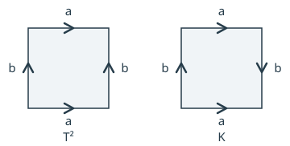
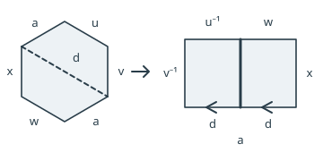
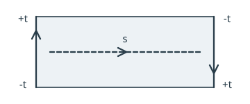

# ATOP11 コンパクト曲面の分類定理

<!-- definition-example-audit: strict -->

[ATOP10](../ATOP10/index.md) では曲面を有限個の三角形に分け、各辺・頂点の近くの模型を調べました。今回は三角形を逆につなぎ、曲面全体を一枚の紙の辺の貼り合わせで表します。穴のある曲面や裏表を区別できない曲面も、紙の境界に並ぶ文字の順序から作れるようになります。

直接の前提は [ATOP10](../ATOP10/index.md) と [ATOP8](../ATOP8/index.md) です。第5節では [GEO19 の Euler 標数の定義](../../GEO/GEO19/index.md#def-geo19-euler-characteristic) も参照しますが、微分幾何の結果は使いません。ここで証明する分類は**標準形の存在**です。同じ曲面が異なる種数の標準形にならないことを示すには、三角形分割に依存しない不変量が必要です。その部分は後続のホモロジーで完成させます。

## 1. 多角形の辺に名前と矢印を付ける

正方形の左右を同じ高さで、上下を同じ横位置で貼るとトーラスになります。左右の高さを逆に対応させると Klein の壺になります。曲がった紙を三次元空間に埋め込む必要はありません。どの点を同じ点とするかを指定するだけで空間を作ります。

閉円板とは平面の閉単位円板と同相な空間です。多角形の各辺を矢印の始点から終点へ向かう区間 $[0,1]$ とみなし、$t=0$ を始点、$t=1$ を終点とします。貼る前の辺は端点以外で互いに重なりません。同じ辺名の点をこの座標で対応させ、端点については対応を何度でもつないで同値類を作ります。こうして得る空間には [同値関係による同一視空間](../../../基礎科目/TOP/TOP2/index.md#def-top2-identification-space) の商位相を入れます。

境界を一方向に一周し、各辺の矢印に沿うときは文字 $a$、逆のときは $a^{-1}$ と記します。文字は群の元ではなく、辺の貼り合わせの指示です。

<!-- formal-statement-start -->
> **定義（辺対付き多角形表示）**
> 閉円板 $D$ の境界を有限個の弧に分け、各弧を向き付き区間とする。各辺名がちょうど二度出現するように名前を付け、各辺と閉区間との同相で矢印方向の座標を定める。同じ名前の二辺の矢印に沿うパラメータ $t\in[0,1]$ が等しい点を同一視する。端点でもこれらの同一視から生成される同値関係を取る。この商空間を辺対付き多角形表示と呼ぶ。
>
> 境界を一周する符号付き文字列を境界語とする。語の巡回移動、各辺名の一斉変更、同じ辺名の二つの符号の一斉反転、境界の周回方向全体の反転（逆順に並べて全符号を反転）は表示の読み方の変更である。
<!-- formal-statement-end -->

<!-- definition-example-start: def-atop11-polygon-word -->
**定義の確認**

正方形 $[0,1]^2$ の境界を左下から反時計回りにたどります。下辺を $a$、右辺を $b$、上辺を $a^{-1}$、左辺を $b^{-1}$ とすると各文字が二度ずつ現れます。正方形は閉円板と同相で、その境界は四つの閉弧に分かれています。$a$ の二辺の座標写像は $t\mapsto(t,0),(t,1)$、$b$ の二辺は $t\mapsto(1,t),(0,t)$ です（$0\le t\le1$）。各写像は区間から辺への同相で、逆符号の辺では周回方向と矢印が逆になります。したがって矢印方向での同一視は

$$
(t,0)\sim(t,1),\qquad (0,t)\sim(1,t)
$$

です。端点では $(0,0)\sim(0,1)\sim(1,1)\sim(1,0)$ なので四頂点は一つの類です。辺の内部では指定された相手の一点だけが同値で、正方形の内部では同一視はありません。

この同値類とトーラスの点を対応させるため、各座標を独立に円周 $S^1$ へ送る連続写像

$$
(x,y)\longmapsto(e^{2\pi i x},e^{2\pi i y})
$$

を使います。ここで $e^{2\pi i t}=\cos(2\pi t)+i\sin(2\pi t)$ は円周上の点です。二つの像が等しい条件は、二つの座標差がそれぞれ整数であることです。各座標は $[0,1]$ にあるので、差が0なら同じ座標、差が $\pm1$ なら0と1の組に限られます。従って同値類と写像のファイバーは一致します。各円周上の点には $[0,1]$ の角度パラメータがあるので全射です。商はコンパクトな正方形の連続像でコンパクト、円周の積はユークリッド空間の部分空間なので Hausdorff です。商から円周の積への連続全単射を得ます。[コンパクト空間からHausdorff空間への連続全単射](../../../基礎科目/TOP/TOP2/index.md#thm-top2-compact-hausdorff-bijection) により同相です。
<!-- definition-example-end -->

右の正方形では右辺の矢印だけを逆にしています。従って下辺と上辺は $(t,0)\sim(t,1)$、左右は $(0,t)\sim(1,1-t)$ です。境界語は $ab^{-1}a^{-1}b^{-1}$ で、$b$ の名前の向きを逆に選べば $aba^{-1}b$ になります。

境界語 $aa$ の二辺形も考えます。円板の境界を半円二つに分け、同じ向きにたどったときのパラメータを一致させます。これは境界上の対蹠点を同一視する表示です。上半球の境界が赤道であり、赤道上だけ対蹠点を貼れば球面のすべての対蹠点を同一視した空間と同相になります。これが実射影平面です。

## 2. 三角形を一枚の円板にまとめる

前講の [位相曲面の局所模型](../ATOP10/index.md#def-atop10-surface-model) で定義したように、閉曲面はコンパクトで境界のない位相曲面です。閉曲面の有限三角形分割では各辺にちょうど二枚の三角形が接し、各頂点の周囲の三角形は一つの輪に並びます（[Radó の三角形分割定理と閉曲面の接続条件](../ATOP10/index.md#thm-atop10-rado-triangulation)）。三角形を頂点、共通辺を接続と考えると、三角形同士の隣接グラフが作れます。ここで使うのは元の曲面の辺グラフとは異なるグラフです。[全域木](../ATOP8/index.md#def-atop8-spanning-tree) は、この隣接グラフの全頂点を含む連結で閉路のない部分グラフです。

<!-- formal-statement-start -->
> **定理（閉曲面の多角形表示）**
> 非空な連結閉曲面は辺対付き多角形表示を持つ。
<!-- formal-statement-end -->

### 証明の見取り図

隣接グラフの [全域木](../ATOP8/index.md#def-atop8-spanning-tree) に沿って三角形を一枚ずつつなぎます。木は閉路を持たないため、すでに作った円板に一辺だけで次の三角形を足せます。残った境界辺を元どおりに貼ると曲面が復元されます。

<!-- proof-start -->
### 証明

[Radó の三角形分割定理](../ATOP10/index.md#thm-atop10-rado-triangulation) によって有限三角形分割を取る。隣接グラフが連結であることを確認する。[単体のリンク](../ATOP10/index.md#def-atop10-link) は頂点を除いた隣接単体の接続を記録する。頂点を共有する三角形はその頂点リンクの一つの輪に沿って辺を共有する三角形列で結べる。従って隣接グラフの異なる連結成分に属する三角形は、辺だけでなく頂点も共有しない。閉曲面の全単体は三角形の面であるから、異なる成分の三角形の和集合は互いに素な閉集合で曲面全体を覆う。有限個なので各集合の補集合も閉じ、各集合は開でもある。曲面の連結性から成分は一つである。

[全域木の存在](../ATOP8/index.md#thm-atop8-spanning-tree) により隣接グラフの全域木を選び、一つの三角形を根とする。まず全三角形を互いに素なコピーにする。根から順に、親と子を結ぶ木の辺に対応する一辺だけを貼る。木の辺以外の同一視はまだ行わない。

円板二枚をそれぞれの境界の一つの閉弧で貼った空間は円板である。実際、各円板を半円板へ写し、指定弧を直径へ写す境界同相を選び、中心からの放射方向に延長する。二つの半円板を直径で貼ったものは円板となる。指定されたパラメータが一致するよう直径上の写像を選べる。

従って根の三角形から始め、子を一つ追加するたびに円板が得られる。木の辺数は三角形数 $F$ に対して $F-1$ なので、最後の円板には

$$
3F-2(F-1)=F+2
$$

本の境界辺が残る。もとの各辺は二つのコピーを持つ。木の辺に対応するものは二つともすでに貼られ、そうでない辺は二つとも残っている。各残存辺に元の辺名と向きを付け、元のパラメータに従い対を貼る。最終商は元の三角形分割と同じ同値関係を生成する。得られる連続全単射は [コンパクト空間からHausdorff空間への連続全単射](../../../基礎科目/TOP/TOP2/index.md#thm-top2-compact-hausdorff-bijection) により同相である。
<!-- proof-end -->

例えば四面体の表面には四枚の三角形があります。三辺を木に従い貼ると境界は $12-6=6$ 辺です。残りの三対を貼れば球面に戻ります。このように多角形の辺数は曲面の種類を直接表すわけではありません。

## 3. 境界語の切断と貼り直し

語の等号ではなく、対応する商空間が同相であるという関係を $\simeq$ と書きます。以下では $\sim$ は点の同一視、$\simeq$ は表示間の同相型の一致を表し、区別します。文字列 $U$ の逆語 $U^{-1}$ は、並びを逆にして各符号を反転したものです。例えば $(ab^{-1}c)^{-1}=c^{-1}ba^{-1}$ です。

同じ辺名が逆符号で現れるときは二枚の紙の周回方向を保ったまま貼り直せます。同符号なら一枚の周回方向を逆転して貼る必要があります。この違いが還元の鍵になります。

<!-- formal-statement-start -->
> **命題（多角形の切断・再接着）**
> 辺対付き多角形表示の境界語で $a$ が指定した一対、$d$ が未使用の辺名、$U,V,U_1,U_2,V_1,V_2$ が残りの文字列（空でもよい）とする。次の変形は商空間の同相型を保つ。
>
> 逆符号の一対では
>
$$
aU_1U_2a^{-1}V_1V_2
\simeq V_1d^{-1}U_2U_1dV_2.
$$

> 同符号の一対では

$$
aUaV\simeq ddU^{-1}V.
$$

> また隣接した逆符号の一対 $aa^{-1}$ は残りの語が空でなければ消去できる。語が $aa^{-1}$ のみなら、その商は球面である。
<!-- formal-statement-end -->

### 証明の見取り図

切断してできる二枚の円板の境界をそれぞれ書き、古い辺 $a$ を接着する。接着した辺は内部に移るので境界語から消え、新しい切断辺 $d$ が二度現れる。最後に $d$ の対を貼れば切断前と同じ空間になる。

<!-- proof-start -->
### 証明

逆符号の場合、$U_1$ と $U_2$ の間、および $V_1$ と $V_2$ の間の二点を円板の内部を通る弧で結ぶ。切断後の二円板の周を

$$
U_2a^{-1}V_1d^{-1},\qquad
V_2aU_1d
$$

と読める。巡回移動して $a^{-1}V_1d^{-1}U_2$ と $aU_1dV_2$ にする。

$a^{-1}$ と $a$ のパラメータを合わせて貼ると、残りの周は $V_1d^{-1}U_2U_1dV_2$ である。二円板を一辺で貼ったものは円板であることは [閉曲面の多角形表示](#thm-atop11-polygon-existence) の証明で確認した。

同符号の場合、二つの $a$ の始点を結ぶ弧で切ると、二円板の語は $aUd^{-1}$ と $aVd$ になる。

第一の周を反転すると $dU^{-1}a^{-1}$ になる。

これを巡回移動して $a^{-1}dU^{-1}$ と読み、第二の円板の $a$ と貼れば $dU^{-1}Vd$ になる。

巡回移動で $ddU^{-1}V$ を得る。いずれの変形でも、切断辺の二つのコピーは元の点同士を対応させているので、新旧の最終商は同じ同一視を持つ。

隣接する $aa^{-1}$ の場合、その共通頂点を円板の頂点 $v$ とする。残りの境界弧を底辺に見立て、円板を区間の錐（底の各点を $v$ に結んだ三角形）と同一視する。指定二辺は錐の左右の辺である。この二辺を対応する高さで貼ると、底辺の両端を貼った円周の錐、すなわち円板になる。

具体的には底辺のパラメータ $t\in[0,1]$ と頂点からの高さ $r\in[0,1]$ に対し $(r\cos(2\pi t),r\sin(2\pi t))$ が同一視を正確に表す。従って残りの境界語を変更せずこの対を消去できる。

二辺だけの場合、円板を区間の両端をそれぞれ一点に縮めた長方形 $[0,1]\times[-1,1]$ で表す（高さ $-1,1$ の各水平辺を一点にする）。残る二辺 $t=0,1$ は逆符号で貼る。商から球面への写像は

$$
(t,z)\longmapsto
(\sqrt{1-z^2}\cos(2\pi t),
 \sqrt{1-z^2}\sin(2\pi t),z)
$$

であり、指定された同一視以外に点をつぶさない。[コンパクト空間からHausdorff空間への連続全単射](../../../基礎科目/TOP/TOP2/index.md#thm-top2-compact-hausdorff-bijection) により同相である。
<!-- proof-end -->

図では $U=uv,\ V=wx$ としています（残りの辺は図の外でも対をなすものとします）。左の円板の破線を切り、一片を反転して太い $a$ の辺を接着すると、右の外周は $ddv^{-1}u^{-1}wx$ になります。下辺の右端から矢印に沿って追ってください。

同符号の操作を $abacb^{-1}c^{-1}$ に適用してみます。$U=b$、$V=cb^{-1}c^{-1}$ なので

$$
abacb^{-1}c^{-1}\simeq
dd b^{-1}cb^{-1}c^{-1}.
$$

文字を逆に読むと符号が変わるため、残りの $b$ の対も同符号になりました。単に文字列の交換を許しているのではありません。

## 4. 標準形への還元

逆符号の辺が交互に現れる語 $aba^{-1}b^{-1}$ をハンドルのブロックと呼びます。一対が同符号の語 $aa$ は実射影平面のブロックです。これは穴あき実射影平面に対応する交叉帽（crosscap）のブロックとも呼ばれます。標準形ではこれらのブロックを連ねます。同じ文字は別のブロックで再使用しません。

<!-- formal-statement-start -->
> **補題（交互に現れる逆符号辺対の分離）**
> $a,b$ が異なる辺名であり、他の文字列 $P,Q,R,S$ にこれらの辺名が含まれないとする。このとき新しい異なる辺名 $d,e$ を用いて
>
$$
aPbQa^{-1}Rb^{-1}S
\simeq e^{-1}de d^{-1}SRQP
$$

> とできる。$e^{-1}de d^{-1}$ はハンドルのブロックである。
<!-- formal-statement-end -->

### 証明の見取り図

[多角形の切断・再接着](#prop-atop11-word-moves) の逆符号の場合を二度使い、四つの余分な文字列をハンドルの外に追い出します。

<!-- proof-start -->
### 証明

[多角形の切断・再接着](#prop-atop11-word-moves) の逆符号の場合で $U_1=P,\ U_2=bQ,\ V_1=Rb^{-1},\ V_2=S$ と取る。すると

$$
aPbQa^{-1}Rb^{-1}S
\simeq Rb^{-1}d^{-1}bQPdS.
$$

ここで $c=b^{-1}$、$f=d^{-1}$ と名前を付け直し、巡回移動すると右辺は

$$
cf c^{-1}QP f^{-1}SR
$$

となる。今度は $c$ の対について $U_1$ を空、$U_2=f$、$V_1=QP$、$V_2=f^{-1}SR$ とする。同じ命題から

$$
cf c^{-1}QP f^{-1}SR
\simeq QP e^{-1}fe f^{-1}SR.
$$

巡回移動すると $e^{-1}fe f^{-1}SRQP$ となる。$f$ を $d$ と改名すれば主張の語になる。
<!-- proof-end -->

次に同符号の対から作った平方ブロック一つとハンドル一つを合わせて、実射影平面のブロック三つで置き換えられることを確認します。

<!-- formal-statement-start -->
> **命題（ハンドルと交叉帽の交換）**
> 三つの異なる辺名 $a,b,c$ と、それらを含まない文字列 $W$ を取り、残りの文字も対をなすとする。新しい異なる辺名 $x,y,z$ を用いて
>
$$
aabcb^{-1}c^{-1}W\simeq xxyyzzW
$$

> とできる。
<!-- formal-statement-end -->

### 証明の見取り図

[多角形の切断・再接着](#prop-atop11-word-moves) の同符号の場合を一度逆に使い、ハンドルの辺対に同符号を作ります。その後に同符号の操作を三回使い、最後に語全体の読み方を戻します。

<!-- proof-start -->
### 証明

[多角形の切断・再接着](#prop-atop11-word-moves) の同符号の場合を $x b^{-1}x c b^{-1}c^{-1}W$ に適用すると $aabcb^{-1}c^{-1}W$ を得る。従って逆向きに変形できる。次に $b^{-1}$ の対の間を $xc$ とすると

$$
xb^{-1}xcb^{-1}c^{-1}W
\simeq yy c^{-1}x^{-1}c^{-1}Wx.
$$

この式は巡回移動後の表示である。ここで $W$ を挟むと次の操作で文字列の位置が変わるため、最初の逆向き変形において $W$ を保ったまま計算するための読み方を明示する。

$b^{-1}xcb^{-1}c^{-1}Wx$ から同符号操作で $yy c^{-1}x^{-1}c^{-1}Wx$。さらに $c^{-1}$ の対を先頭にして操作すると

$$
c^{-1}x^{-1}c^{-1}Wxyy
\simeq zz xWxyy.
$$

最後に $x$ の対を先頭に巡回移動する。間の文字列は $W$、もう一方の文字列は $yyzz$ なので、

$$
xWxyyzz\simeq uuW^{-1}yyzz
$$

となる。ここで $u$ はそれまでの語にない新しい辺名である。

従って $W$ を含む一般の場合は、その全体を一度反転し、各新しい平方の辺名の向きを反転すれば $xxyyzzW$ の順にできる。

具体的に逆語は $z^{-1}z^{-1}y^{-1}y^{-1}W u^{-1}u^{-1}$ で、巡回移動して $u^{-1}u^{-1}z^{-1}z^{-1}y^{-1}y^{-1}W$、各辺名を改名すればよい。途中で $W$ の各辺は消去も追加もされていない。
<!-- proof-end -->

分離済みの平方やハンドルを残りの文字から離しておくため、幾何的な移動を確認します。

<!-- formal-statement-start -->
> **補題（標準ブロックの移動）**
> 連結閉曲面の辺対付き多角形表示で、連続部分語 $B$ が一つの平方またはハンドルのブロックであり、その文字が他の部分に出現しないとする。残りの語が空でないなら、$B$ を残りの語の任意の辺の間へ移しても同相型は変わらない。
<!-- formal-statement-end -->

### 証明の見取り図

ブロックを穴あき曲面として切り出し、残りの曲面の穴を別の場所へ移して貼り戻す。

<!-- proof-start -->
### 証明

円板の周で $B$ の最初と最後の頂点を内部弧 $d$ で結んで切る。

ブロック側の円板は $aa d$ または $aba^{-1}b^{-1}d$ のように $d$ を一つ残す。

辺を貼ると $B$ の全頂点が一つになるため $d$ は円周になる。

ブロックの文字数を $n$ とし、周回順の頂点を $v_0,\ldots,v_n$ と番号付けする。各頂点の小さな扇形は、辺の貼り合わせによってその端の半径方向同士がつながる。平方 $aa$ では始点同士と終点同士の対応から

$$
v_0\sim v_1,\qquad v_1\sim v_2.
$$

ハンドル $aba^{-1}b^{-1}$ では

$$
a:\ v_0\sim v_3,\ v_1\sim v_2,
\qquad
b:\ v_1\sim v_4,\ v_2\sim v_3.
$$

よって扇形は平方では $0,1,2$、ハンドルでは $0,3,2,1,4$ の順に一列につながる。両端の扇形だけに未接着の切断辺 $d$ の方向が残る。

従って $d$ の片側の近傍は帯状である。元の曲面では頂点の扇形の両側がすべて対になり、方向の接続は閉路の有限非交和となる。もし閉路が二つ以上なら頂点を除いた十分小さい扇形近傍は非連結であり、その内側に取った開円板座標から中心を除いた連結集合が各閉路側に達することに矛盾する。従ってこの扇形列の両端も含めた頂点近傍の方向全体が一つの円周をなす（[頂点リンクと局所模型](../ATOP10/index.md#thm-atop10-vertex-neighborhood) と同じ扇形の接続）。ブロック側がその円周の一つの閉弧を占めるため、残り側の方向も補閉弧一つとなる。従って反対側も帯状である。切断円周は埋め込まれた円周であり、切り離した両側はそれぞれ一境界成分を持つ曲面である。

両側を円板で塞ぐ。境界の帯を $S^1\times[1,2]$ と表すと、内周を一点に縮めた帯は半径 $r-1$ の円板となる。従って充填することと境界を一点に縮めることは同相型として等しい。残りの多角形では $d$ を一点に縮める操作にあたる。円板の境界の真部分弧を一点に縮めても円板である。

実際、境界角の単調連続写像をその弧で一定、それ以外で狭義単調に取り、内部の半径 $r<1$ では恒等角度写像との凸結合（重み $r$）を使えば、内部は一対一で境界弧だけを縮める連続写像を作れる。よって充填した残りの曲面は、元の語から $B$ を除いた多角形表示を持つ。

充填した円板は外側に環状近傍を持つので、少し大きな円板内で外周を固定する半径の狭義単調変換によって小さくできる。連結曲面は局所弧状連結だから、現在の円板の中心から移動先の頂点へ道を取れる。この道を有限個の円板座標近傍で覆い、重なる近傍内の点を順に通る。

各座標近傍で点を移す同相は、二点を含む小さい凸多角形の外周を固定し、一方の点から各境界点への線分を他方の点からの線分に同じ比で送って作れる。この合成は中心を移動先に送り、移動先の円板座標内へ元の小円板を収められるよう、最初の縮小量を十分小さく選べる。

この議論では円板を多角形で取り、すべての辺の貼り合わせを区分線形にできる（辺上のパラメータを直線区間へ移して円板内部へ放射状に延長すればよい）。貼り合わせた多角形を細分して局所扇形を平面内の扇形に移せば、区分線形な座標近傍を選べる。上の点移動も凸多角形を三角形に分け、各三角形で線形に延長することで区分線形に取れる。

合成写像は中心の十分小さな近傍では有限個の扇形上で線形である。従って、中心を含む十分小さな凸多角形を移した像は、移動先の中心から各方向に一本の半径区間を持つ星形多角形になる。元の穴も目的の穴も切断円周の帯を用いてそのような小さい多角形に取れる。

移動した穴と目的の穴の半径を方向 $\theta$ ごとに $r_1(\theta),r_2(\theta)$ とする。

両方を含む外周の半径を $R$ とし、各方向で $0,r_1(\theta),R$ を $0,r_2(\theta),R$ へ写す区分線形な狭義単調写像を用いる。両方の半径は正で方向に連続だから、これは外周を固定した円板の同相であり、目的の穴に正確に移す。こうしてブロックを取り付ける穴を移せる。

移動先の小円板を取り除き、元のブロック側を境界で貼り戻す。円周の向きを保つ二つの貼り合わせの違いは、環状近傍で吸収できる。

実際、円周を $t\in\mathbb R/\mathbb Z$ と表し、円周同相を $H:S^1\to S^1$ とする。[円周の実直線による被覆](../ATOP5/index.md#prop-atop5-circle-cover) $p(t)=e^{2\pi it}$ に対し、[道の持上げ](../ATOP5/index.md#thm-atop5-path-lifting) で $H(p(t))$（$0\le t\le1$）の持上げ $h$ を取る。$H$ が単射なので $0\le t<1$ では $h$ は単射で、連続性により狭義単調となる。端点の像が等しいので $h(1)-h(0)$ は整数であり、途中で同じ円周上の点を二度通らないから絶対値は1である。向きを保つ場合は増加するので差は1となる。$h(t+1)=h(t)+1$ で実数全体へ延長すれば狭義増加同相 $h:\mathbb R\to\mathbb R$ を得る。そこで、半径方向のパラメータ $\lambda\in[0,1]$ に応じて

$$
h_\lambda(t)=(1-\lambda)h(t)+\lambda t
$$

と置くと $h_\lambda(t+1)=h_\lambda(t)+1$ であり、各 $h_\lambda$ は狭義増加で全射である。従って $(t\bmod1,\lambda)\mapsto(h_\lambda(t)\bmod1,\lambda)$ は環状近傍の連続全単射で、[コンパクト空間からHausdorff空間への連続全単射](../../../基礎科目/TOP/TOP2/index.md#thm-top2-compact-hausdorff-bijection) により同相である。内周では指定の同相、外周では恒等写像になる。

向きを反転する必要があればブロックの語全体を逆に読む。平方もハンドルも逆語は辺名と向きを選び直せば同じ形になる。移動先の頂点で多角形に小さな切断弧を作り、そこにブロック側の円板を貼ると、境界語はその位置に $B$ を挿入した語になる。以上が標準ブロックの移動である。
<!-- proof-end -->

ここまでの操作で一般の有限語を処理できます。まだ分離していない対の個数を数えれば、手続きが有限回で終わることも分かります。

<!-- formal-statement-start -->
> **定理（コンパクト閉曲面の分類・存在部分）**
> 非空な連結閉曲面は、次のいずれかの標準表示と同相である。
>
> - 球面。
> - 整数 $g\ge1$ に対して、$g$ 個のハンドルを連ねた表示

$$
a_1b_1a_1^{-1}b_1^{-1}\cdots
a_gb_ga_g^{-1}b_g^{-1}.
$$

> - 整数 $k\ge1$ に対して、$k$ 個の実射影平面のブロックを連ねた表示

$$
c_1c_1\cdots c_kc_k.
$$

> すべての辺名は同一ブロックでの指定された対以外は異なる。
<!-- formal-statement-end -->

### 証明の見取り図

まず [閉曲面の多角形表示](#thm-atop11-polygon-existence) を得ます。未処理部分に同符号の対があれば [切断・再接着](#prop-atop11-word-moves) で平方に、逆符号の交互の対があれば [交互に現れる逆符号辺対の分離](#lem-atop11-handle-extraction) でハンドルに分離します。どちらもないなら隣接逆符号対を消せます。最後に平方とハンドルが混在していれば [ハンドルと交叉帽の交換](#prop-atop11-three-squares) を使います。

<!-- proof-start -->
### 証明

[閉曲面の多角形表示](#thm-atop11-polygon-existence) から有限の境界語を得る。分離済みブロックを一つの連続した塊とし、その補部分を未処理文字列とする。新たなブロックを分離するたびに [標準ブロックの移動](#lem-atop11-block-slide) で既存の塊の隣に移す。未処理部分が空になれば移動は不要である。

未処理部分に同符号の対がある場合、必要なら辺名を反転して $aUaV$ と読む。二つの $a$ の間の $U$ を未処理部分だけに取れる。

分離済みブロックは $V$ の一部となる。[多角形の切断・再接着](#prop-atop11-word-moves) により $ddU^{-1}V$ に変形すれば、新しい平方ブロックを一つ分離できる。

未処理部分が逆符号対だけなら、対の出現位置を線上の二点とみなす。位置が交互に並ぶ二対があれば、[交互に現れる逆符号辺対の分離](#lem-atop11-handle-extraction) によりハンドルを分離する。この操作では分離済みの文字列は一つの連続した塊として $S$ または他の余剰文字列に含められ、内部は変更されない。

交互に並ぶ対がなければ、未処理部分において二つの出現位置の間の文字数が最小の対を選ぶ。その間に文字があると、その相手は間の外にあれば選んだ対と交互になり、間の内にあればより短い対を作る。どちらも矛盾する。従って間は空であり、[多角形の切断・再接着](#prop-atop11-word-moves) で隣接逆符号対を消せる。分離済みブロックがなく、最後の二文字だけが残った場合は [多角形の切断・再接着](#prop-atop11-word-moves) の二辺形の場合から球面になる。

各操作で未処理の対の個数が少なくとも一つ減る。負の個数にはならないから有限回で未処理部分は空になる。

平方とハンドルが混在していれば循環語の少なくとも一箇所で平方の直後にハンドルが来る。そこでその境界から読み始め、 [ハンドルと交叉帽の交換](#prop-atop11-three-squares) を適用する。ハンドルが一つ減り、平方は一つから三つになる。有限回でハンドルがなくなる。平方が最初からなければハンドルだけが残る。以上の三つが結論の標準形である。
<!-- proof-end -->

球面はハンドルなしの場合とも考えられます。ハンドルの個数を向き付け可能な標準形の種数と呼びます。平方の個数は向き付け不可能な標準形の種数です。これらの名前が実際に同相型で一意に定まることは、以下の不変量を完成させてから結論します。

## 5. 向きと Euler 標数

各三角形に周回方向を選び、共通辺で二枚が逆方向を誘導するようにできるかを調べます。このような周回方向を全三角形に矛盾なく選べることを、ここでは分割上の向き付け可能性と呼びます。この条件が満たされれば局所の向きが隣の三角形へ伝わります。多角形の内部の向きを固定すると境界の周回方向が決まり、逆符号の対だけなら貼り合わせを越えて向きが一致します。同符号の対では逆転します。

例えば帯 $[0,1]\times[-1,1]$ の端を $(0,t)\sim(1,-t)$ で貼ると Möbius の帯になります。中央線に沿って一周すると横方向が $t\mapsto-t$ へ変わるため、向きを一周して維持できません。

横の座標を $s$、縦の座標を $t$ とした図です。同符号の辺対では、両辺の中点を円板内部の細い帯でつなぎ、帯の両端を対応させるとこの模型が現れます。帯の両端の境界周回方向は互いに逆ですが、貼り合わせは両辺の周回方向を一致させるため、帯の横方向の座標は反転します。局所の向きが位相的な同相によって保存されることの厳密な扱いは ATOP34 で行います。

三角形分割の頂点数、辺数、三角形数をそれぞれ $V,E,F$ とします。数の交代和

$$
\chi=V-E+F
$$

が [Euler 標数](../../GEO/GEO19/index.md#def-geo19-euler-characteristic) の計算式です。多角形表示でも、同一視後の頂点類、辺対、面の個数を数えて同じ交代和を作ります。ここでは各表示の交代和を計算し、GEO19 の三角形分割不変性を証明の前提にはしません。ATOP14 の鎖の計算と ATOP21・ATOP22 の比較・胞体計算によって、表示に依存しないことをホモロジーから導きます。

標準語の頂点を確認しましょう。

ハンドルブロックの四辺に沿う頂点を $v_0,v_1,v_2,v_3,v_4$ とすると $a$ の対応は $v_0\sim v_3,\ v_1\sim v_2$、$b$ の対応は $v_1\sim v_4,\ v_2\sim v_3$ です。

よって五点が一つの類になります。平方では $v_0\sim v_1\sim v_2$ になります。隣のブロックとは端点を共有するため、標準語全体でも頂点類は一つです。

| 標準模型 | 頂点類 | 辺対 | 面 | 交代和 |
| --- | ---: | ---: | ---: | ---: |
| 球面（二辺形） | 2 | 1 | 1 | 2 |
| ハンドル $g$ 個 | 1 | $2g$ | 1 | $2-2g$ |
| 平方 $k$ 個 | 1 | $k$ | 1 | $2-k$ |

例えばトーラスと Klein の壺はともに交代和が0です。しかし前者は逆符号の対だけ、後者は同符号の対を持つため、向きの情報が異なります。交代和と向きの二つが揃えば標準形の一意性を得られます。ATOP22 では整数係数の一次ホモロジーのねじれの有無と Euler 標数を用いて標準形を区別し、分類の一意性まで完成させます。ATOP34 では局所の向きそのものを位相的に定義します。

## 6. 境界を持つ曲面

[位相曲面の局所模型](../ATOP10/index.md#def-atop10-surface-model) で扱ったように、閉曲面と違い、円板や円環には境界があります。[Radó の三角形分割定理](../ATOP10/index.md#thm-atop10-rado-triangulation) の境界付きの場合と曲面の局所条件を用います。ここでは境界が部分複体となり、内点の頂点リンクが円周、境界頂点のリンクが区間となる三角形分割を取ります。この接続条件も Radó の曲面の三角形分割定理の境界付きの場合の古典的結果として用います（ATOP10 での引用と同じ曲面の三角形分割論）。境界の辺は一枚の三角形に接し、境界頂点では [頂点リンクの局所模型](../ATOP10/index.md#thm-atop10-vertex-neighborhood) における区間の両端がちょうど二本の境界辺に対応します。従って境界は有限個の互いに素な閉路です。各閉路は円周と同相であり、それぞれを境界成分と呼びます。

<!-- formal-statement-start -->
> **命題（境界成分の円板による充填）**
> 非空な連結コンパクト境界付き曲面 $M$ の境界成分数を $b$ とする。各境界成分に一枚の円板を境界同相で貼ると連結閉曲面 $\widehat M$ が得られる。
>
> $M$ は $\widehat M$ から貼った $b$ 枚の円板の内部を除いた空間と同相である。
>
> 三角形分割を円板充填に合わせて拡張すると、交代和は $b$ だけ増える。
<!-- formal-statement-end -->

### 証明の見取り図

境界の各閉路を一つの新頂点から三角形に分けて塞ぎます。旧境界頂点の区間リンクに新しい道が加わり、閉路リンクになることを確認します。

<!-- proof-start -->
### 証明

各境界閉路を $m$ 頂点 $v_1,\ldots,v_m$（$m\ge3$）の単体複体で表す。添字は $v_{m+1}=v_1$、$v_0=v_m$ と巡回させる。まずこの閉路を円板の周として貼る構成を示す。任意の境界同相による貼り方も、円板の境界同相を内部へ半径方向に延長することでこの貼り方に移せる。実際、境界上の同相を $h:S^1\to S^1$ とすると、$ru\mapsto rh(u)$（$u\in S^1,0<r\le1$、原点は原点に送る）は逆写像を $h^{-1}$ で与える円板同相である。

この閉路専用の新頂点 $p$ を加え、頂点集合 $\{p,v_i,v_{i+1}\}$ の三角形とすべての面を追加する。これらは閉路の錐であり円板である。[頂点リンクと局所模型](../ATOP10/index.md#thm-atop10-vertex-neighborhood) と同じ極座標の構成で円周方向と半径から円板に対応する。

新頂点のリンクは元の閉路である。旧境界頂点 $v_i$ のリンクは区間で、その両端 $v_{i-1},v_{i+1}$ に対し新しい辺 $v_{i-1}p,pv_{i+1}$ が加わる。

新頂点 $p$ は旧リンクにはなかったため、区間と新しい道を両端で貼ったものは一つの閉路である。他の頂点のリンクは変わらない。従って [頂点リンクによる曲面の十分条件](../ATOP10/index.md#thm-atop10-surface-link-test) から充填した空間は閉曲面となる。

元の連結空間に各円板を空でない境界で貼ったため連結性も保たれる。円板の内部を除けば追加した頂点・放射辺・三角形の内部がすべて除かれ、元の複体が残る。

一つの閉路につき新頂点1個、放射辺 $m$ 本、三角形 $m$ 枚なので

$$
\Delta(V-E+F)=1-m+m=1.
$$

$b$ 個の閉路は互いに素であり、合計は $b$ である。
<!-- proof-end -->

従って境界付き曲面も [閉曲面の分類・存在部分](#thm-atop11-surface-existence) の標準模型から互いに素な円板の内部を取り除いたものとして表せます。ここで得た円板は同相写像で運ばれた埋め込み円板です。穴の位置を標準化する同相の構成と分類の一意性は区別して考えます。円環の交代和も具体的な分割で確認できます。内外の正方形の対応する四頂点を結び、四つの台形をそれぞれ対角線で二分します。頂点8個、内外周の辺8本、対応する頂点を結ぶ辺4本、対角線4本、三角形8枚なので

$$
V-E+F=8-(8+4+4)+8=0.
$$

内外の境界を充填すれば交代和は $0+2=2$ になります。

## 7. 演習

### 演習 ATOP11-A1：辺の対応

- Level: A

境界語 $aba^{-1}b$ の正方形で、下辺を右向き、右辺を上向きに読む。上辺と左辺の対応を座標で書き、頂点類を数えよ。

<!-- solution-start -->
**詳細解答**

左下から反時計回りの周回方向を取る。[辺対付き多角形表示](#def-atop11-polygon-word) に従うと $a^{-1}$ の上辺は周回と逆の右向き、$b$ の左辺は周回と同じ下向きである。共通の矢印座標 $0\le t\le1$ で

$$
(t,0)\sim(t,1),\qquad (1,t)\sim(0,1-t)
$$

となる。左下は左上と、右下は右上と下辺・上辺の対応で結ばれる。右下は左上とも結ばれるので四点は一つの類となる。これは [辺対付き多角形表示](#def-atop11-polygon-word) の Klein の壺である。
<!-- solution-end -->

### 演習 ATOP11-A2：三角形の個数

- Level: A

閉曲面の三角形分割に三角形が10枚あるとする。隣接グラフの全域木に沿って貼るとき、残る辺の数と辺対数を求めよ。

<!-- solution-start -->
**詳細解答**

[閉曲面の多角形表示](#thm-atop11-polygon-existence) で全域木は $10-1=9$ 辺を持つ。貼る前の辺のコピーは $3\cdot10=30$ 本で、一回の接着で2本ずつ境界から消える。従って $30-2\cdot9=12$ 本が残る。各元の辺のコピーは二本ずつ対になるので辺対は6個である。
<!-- solution-end -->

### 演習 ATOP11-A3：平方を分離する

- Level: A

$abac^{-1}bc$ に同符号の切断・再接着を一回施して $a$ の対を分離せよ。

<!-- solution-start -->
**詳細解答**

[多角形の切断・再接着](#prop-atop11-word-moves) の同符号の場合で $U=b$、$V=c^{-1}bc$ とする。$U^{-1}=b^{-1}$ だから

$$
abac^{-1}bc\simeq dd b^{-1}c^{-1}bc.
$$

新しい $d$ の対は隣接する同符号、残った $b,c$ の対は逆符号になっている。
<!-- solution-end -->

### 演習 ATOP11-A4：交代和

- Level: A

ハンドル3個の標準語と平方6個の標準語の交代和を求め、交代和だけで両者を区別できるか答えよ。

<!-- solution-start -->
**詳細解答**

[標準ブロックの移動](#lem-atop11-block-slide) の証明で求めた端点の対応により、各ブロックの全頂点は一つの類となり、隣のブロックと端点を共有する。従ってどちらの語も頂点類は一つ、面は一つである。前者の辺対は $2\cdot3=6$、後者は6。従って両方とも $1-6+1=-4$ である。交代和の値は等しいのでこれだけでは区別できない。前者はすべて逆符号、後者は同符号を含み、向きに関する情報が異なる。
<!-- solution-end -->

### 演習 ATOP11-B1：逆符号の切断

- Level: B

$abca^{-1}b^{-1}c^{-1}$ に対して $a$ を切断・再接着の対象とし、$U_1=b,\ U_2=c,\ V_1=b^{-1},\ V_2=c^{-1}$ と取る。切断後の二円板の語と再接着後の語を求めよ。

<!-- solution-start -->
**詳細解答**

[多角形の切断・再接着](#prop-atop11-word-moves) の証明と同じく、切断後は $ca^{-1}b^{-1}d^{-1}$ と $c^{-1}abd$ になる。巡回移動すれば $a^{-1}b^{-1}d^{-1}c$ と $abd c^{-1}$ である。逆符号の $a$ を貼るので残りの境界は

$$
b^{-1}d^{-1}cbdc^{-1}.
$$

$b,c,d$ はいずれも一度ずつ正負で出現し、変形前と同様に全辺が対になっている。
<!-- solution-end -->

### 演習 ATOP11-B2：交互の対を取り出す

- Level: B

$abca^{-1}b^{-1}c^{-1}$ からハンドル一つを分離し、残りの文字列を求めよ。

<!-- solution-start -->
**詳細解答**

[交互に現れる逆符号辺対の分離](#lem-atop11-handle-extraction) で $P,R$ は空、$Q=c,\ S=c^{-1}$ とする。すると

$$
abca^{-1}b^{-1}c^{-1}
\simeq e^{-1}de d^{-1}c^{-1}c.
$$

末尾の対は隣接した逆符号対であるから [多角形の切断・再接着](#prop-atop11-word-moves) で消せる。残りは $e^{-1}de d^{-1}$ であり、辺名 $e^{-1}$ を新たな正向きの名前に選べばハンドル一つである。
<!-- solution-end -->

### 演習 ATOP11-B3：円板を貼る

- Level: B

境界成分が三つあり、それぞれ4、5、7辺からなる曲面の分割に円板を貼る。新しく増える頂点・辺・面と交代和を求め、さらに充填後の分割の交代和がハンドル二つの標準表示の交代和と一致すると仮定して、充填前の交代和を求めよ。

<!-- solution-start -->
**詳細解答**

[境界成分の円板による充填](#prop-atop11-capping) では各閉路に頂点を一つ置き、放射辺と三角形を閉路の辺数だけ増やす。従って $\Delta V=3$、$\Delta E=4+5+7=16$、$\Delta F=16$ である。

$$
\Delta\chi=3-16+16=3.
$$

[標準ブロックの端点の対応](#lem-atop11-block-slide) からハンドル二つの標準形は頂点類1、辺対4、面1であり、交代和は $1-4+1=-2$。問題の追加仮定によって充填後の分割の交代和も $-2$ であるから、充填前は $-2-3=-5$ である。
<!-- solution-end -->

### 演習 ATOP11-B4：同符号を追う

- Level: B

$aba^{-1}b$ から平方二つの語を作れ。反転によってどの符号が変わるか明示せよ。

<!-- solution-start -->
**詳細解答**

巡回移動して $ba^{-1}ba$ と読む。[多角形の切断・再接着](#prop-atop11-word-moves) で $U=a^{-1}$、$V=a$ だから $U^{-1}=a$。

$$
ba^{-1}ba\simeq ddaa.
$$

平方二つである。逆符号だった $a$ の対の一方を反転した結果、両者が正符号になった。
<!-- solution-end -->

### 演習 ATOP11-C1：混在する標準形

- Level: C

語 $abacb^{-1}c^{-1}ee$ を平方だけの標準語へ還元せよ。各操作の対象を示し、最終表示の交代和を求めよ。

<!-- solution-start -->
**詳細解答**

最初の $a$ の対に [多角形の切断・再接着](#prop-atop11-word-moves) を適用する。$U=b,\ V=cb^{-1}c^{-1}ee$ なので

$$
abacb^{-1}c^{-1}ee
\simeq dd b^{-1}cb^{-1}c^{-1}ee.
$$

$b^{-1}$ の対を先頭に巡回移動して $b^{-1}cb^{-1}c^{-1}eedd$ と読む。$U=c,\ V=c^{-1}eedd$ だから

$$
b^{-1}cb^{-1}c^{-1}eedd
\simeq ff c^{-1}c^{-1}eedd.
$$

これで $f,c^{-1},e,d$ の四つの平方ブロックになった。辺名の向きを選び直せば $ffggeedd$（$gg$ は新しい平方）と読める。[標準ブロックの端点の対応](#lem-atop11-block-slide) からすべての頂点は一つの類、辺対は4、面は1。

交代和は $1-4+1=-2$ である。ここでは途中の符号反転が逆符号の対を同符号の対に変えたことが重要である。
<!-- solution-end -->

### 演習 ATOP11-C2：平方とハンドルを交換する

- Level: C

境界語 $aabcb^{-1}c^{-1}hh$ を平方だけの標準形に還元せよ。交換命題を単に引用せず、その切断・再接着を具体的な文字列で実行し、標準形の辺対数を求めよ。

<!-- solution-start -->
**詳細解答**

[多角形の切断・再接着](#prop-atop11-word-moves) の同符号の式を逆向きに使う。$U=b^{-1}$ と $V=cb^{-1}c^{-1}hh$ を選ぶと $U^{-1}=b$ なので、$x$ を新しい辺名として

$$
aabcb^{-1}c^{-1}hh\simeq
xb^{-1}xcb^{-1}c^{-1}hh.
$$

$b^{-1}$ の対の間は $xc$ であり、その逆語は $c^{-1}x^{-1}$。巡回移動して同符号操作を適用すると

$$
b^{-1}xcb^{-1}c^{-1}hhx
\simeq yy c^{-1}x^{-1}c^{-1}hhx.
$$

今度は $c^{-1}$ の対を先頭へ移し、その間の $x^{-1}$ を反転する。

$$
c^{-1}x^{-1}c^{-1}hhxyy
\simeq zz xhhxyy.
$$

最後に $x$ の対を先頭にして、間の $hh$ を逆語 $h^{-1}h^{-1}$ に変える。

$$
xhhxyyzz\simeq
uu h^{-1}h^{-1}yyzz.
$$

$h^{-1}$ を新しい正向きの辺名 $v$ にすれば $uuvvyyzz$ を得る。平方ブロックは4個、辺対は4個。これは [ハンドルと交叉帽の交換](#prop-atop11-three-squares) の具体的な実行であり、既存の平方2個とハンドル1個が平方4個になる。

[標準ブロックの端点の対応](#lem-atop11-block-slide) から頂点類は1、面は1なので、交代和も $1-4+1=-2$ である。
<!-- solution-end -->

## 8. 次の講義へ

今回は曲面を標準形へ切り貼りする存在部分を証明しました。次講 ATOP12 では標準語から基本群の生成元と関係式を作り、球面・トーラス・Klein の壺などを具体的に計算します。Euler 標数が表示によらない理由は ATOP14・ATOP21・ATOP22 で、向きの位相的な意味は ATOP34 で扱います。

参考文献：J. R. Munkres, *Topology*, 2nd ed., §78; J. Gallier and D. Xu, *A Guide to the Classification Theorem for Compact Surfaces*.
