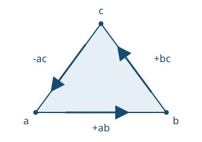
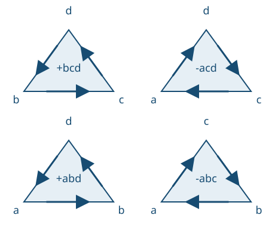

# ATOP13 向き付き単体と単体鎖複体

<!-- definition-example-audit: strict -->

[ATOP10 の抽象単体複体](../ATOP10/index.md#def-atop10-abstract-complex)では、頂点の組から辺や三角形を記録しました。三辺だけの三角形と内部を含む三角形を区別するには、辺を一周する記録だけでなく、その記録が面の縁として得られるかを調べたいところです。

以下、$ab,abc$ などは頂点集合を表す略記です。非空な単体の次元は頂点数から1を引いた値であり、空集合も複体には含まれますが、本講の整数鎖の基底には含めません。

本講では、各単体に向きを与えて整数係数で足し合わせます。面から辺、辺から頂点へ進む境界の計算を作り、境界を二度取ると必ず消える理由を証明します。最後に、頂点の写像がこの計算を保つ条件を調べます。

## 1. 頂点の順序を向きに変える

辺を $a$ から $b$ へ進む記録と逆向きの記録は、和を取ったときに打ち消し合ってほしいものです。三角形でも、頂点を巡る順序を逆転すれば境界の進行方向も逆転するようにします。

[置換の転倒数と符号](../../../基礎科目/LA/LA3B/index.md#def-la3b-permutation-sign)を用い、符号が $+1$ の置換を偶置換、$-1$ の置換を奇置換と呼び、偶置換で移り合う頂点列を同じ向きとします。$\operatorname{sgn}(\pi)$ は置換 $\pi$ の符号です。添字は $0$ から始めますが、置換の符号は添字を1ずつずらしても変わりません。

<!-- formal-statement-start -->
> **定義（向き付き単体）**
> 有限抽象単体複体 $K$ の非空な $n$ 次元単体を考え、その頂点を一度ずつ並べる。偶置換で移り合う列を同一視したものを向き付き単体とし、$[v_0,\ldots,v_n]$ と書く。
>
> $n\ge1$ では奇置換で得られる列は反対の向きを表す。$n=0$ では順序は一つだけである。
<!-- formal-statement-end -->

<!-- definition-example-start: def-atop13-oriented-simplex -->
**定義の確認**

三角形の頂点が $a,b,c$ なら、$(a,b,c)$ から $(b,a,c)$、さらに $(b,c,a)$ と隣接交換を2回施すので、最後の列は最初と同じ向きです。$(b,a,c)$ は1回の交換なので反対の向きです。頂点列に同じ頂点が二度現れるものは、この定義の向き付き単体ではありません。
<!-- definition-example-end -->

この同一視が矛盾しない理由は [置換の符号の積](../../../基礎科目/LA/LA3B/index.md#lem-la3b-permutation-sign-product) にあります。偶置換の合成と逆置換は偶置換であり、恒等置換も偶置換です。頂点数が2以上なら一回の交換が存在し、全順序は符号が正と負の二組に分かれます。

## 2. 単体を整数係数で足し合わせる

何回通ったかを記録するため、各辺や面の係数に整数を使います。係数が負なら、選んだ向きと反対の向きで数えています。これは [加群の基底・自由加群](../../../代数系/MOD/MOD1/index.md#def-mod1-free-module-basis) を単体の集合から作る操作です。

<!-- formal-statement-start -->
> **定義（単体鎖群）**
> 有限抽象単体複体 $K$ の頂点集合に全順序を一つ固定する。$n\ge0$ に対し、昇順に並べた $n$ 次元単体を基底とする自由 $\mathbb Z$-加群を

$$
C_n(K;\mathbb Z)
$$

> とし、その元を $n$ 鎖という。該当する単体がない次数および $n<0$ では零加群（零元だけからなる加群）とする。
>
> 異なる頂点からなる任意の順序の記号は、昇順の基底元にその並べ替えの符号を掛けた元を表す。
<!-- formal-statement-end -->

<!-- definition-example-start: def-atop13-simplicial-chains -->
**定義の確認**

以下、複体と係数環が明らかなときは $C_n(K;\mathbb Z)$ を $C_n$ と略記します。また $\cong$ は加群同型を表します。

$a<b<c$ とし、三角形とその全ての面を含む複体を取ります。$C_0\cong\mathbb Z^3$ の基底は $[a],[b],[c]$、$C_1\cong\mathbb Z^3$ の基底は $[a,b],[a,c],[b,c]$、$C_2\cong\mathbb Z$ の基底は $[a,b,c]$ です。ここでの同型は基底の係数を座標とする対応であり、鎖そのものと座標列を区別します。これらの基底はそれぞれ単体を一度ずつ列挙したものです。例えば

$$
2[b,a]+[a,c]+[a,b]
=-[a,b]+[a,c]
$$

は $C_1$ の座標 $(-1,1,0)$ に対応します。加法と整数倍は座標ごとに行い、座標が一致する場合に限って鎖は等しくなります。従って基底表示は一意です。3次元以上の単体はないので $C_3,C_4,\ldots$ は零です。
<!-- definition-example-end -->

[置換の符号の積](../../../基礎科目/LA/LA3B/index.md#lem-la3b-permutation-sign-product) により任意の置換 $\pi$ について

$$
[v_{\pi(0)},\ldots,v_{\pi(n)}]
=\operatorname{sgn}(\pi)[v_0,\ldots,v_n].
$$

この式は向きの異なる幾何学的単体を二つの独立な基底元にするのではなく、反対向きを負号で表すことを意味します。頂点の全順序を変更すると各基底元が必要に応じて符号反転するだけで、相互に逆な座標変換が得られます。

## 3. 境界を計算する

辺 $[a,b]$ の境界を終点から始点を引いた $[b]-[a]$ とすれば、続く辺との間で共有する頂点が消えます。

三角形 $[a,b,c]$ では辺を $a\to b\to c\to a$ と巡ります。昇順の辺で表すと

$$
[b,c]-[a,c]+[a,b]
$$

です。一般の次数でも頂点を一つ消して、消す位置に応じて符号を付けます。$\partial_n$ は次数 $n$ の鎖から次数 $n-1$ の鎖への境界作用素であり、微分記号ではありません。整数線形とは [加群準同型](../../../代数系/MOD/MOD1/index.md#def-mod1-homomorphism) として加法と整数倍を保つことです。各昇順基底の像を指定すれば [自由加群の普遍性](../../../代数系/MOD/MOD1/index.md#thm-mod1-free-universal-property) により整数線形な延長はただ一つです。

<!-- formal-statement-start -->
> **定義（単体境界作用素）**
> 有限抽象単体複体 $K$ と整数係数の単体鎖群 $C_n(K;\mathbb Z)$ に対し、$n\ge1$ の昇順基底上で次の式を定め、整数線形に延長する。

$$
\partial_n[v_0,\ldots,v_n]
=\sum_{i=0}^n(-1)^i
[v_0,\ldots,\widehat{v_i},\ldots,v_n].
$$

> 帽子はその頂点を列から除くことを示す。始域は $C_n(K;\mathbb Z)$、終域は $C_{n-1}(K;\mathbb Z)$ である。$n\le0$ では零写像とする。
<!-- formal-statement-end -->

<!-- definition-example-start: def-atop13-boundary -->
**定義の確認**

[抽象単体複体の面に関する閉性](../ATOP10/index.md#def-atop10-abstract-complex) により、三角形の各頂点を消した二元集合は全て複体の辺です。上の式で $i=0,1,2$ とすると

$$
\partial_2[a,b,c]=[b,c]-[a,c]+[a,b].
$$

また $\partial_1[a,b]=[b]-[a]$ です。$2[a,b]-[b,c]$ に対しては

$$
\begin{aligned}
\partial_1(2[a,b]-[b,c])
&=2([b]-[a])-([c]-[b])\\
&=-2[a]+3[b]-[c].
\end{aligned}
$$

結果は $C_0$ の元で、係数ごとに足したため加法と整数倍を保ちます。$\partial_0[a]=0$ は空単体を基底に含めない規約によるものです。
<!-- definition-example-end -->

図の $c$ から $a$ への矢印は $-[a,c]$ です。内部の三角形を一つの鎖と見なすと、その縁の三辺がこの向きで現れます。

任意順序で書いた単体にも同じ境界公式を適用できることを確認します。ここを確かめないと向きの表記を変えるだけで結果が変わる恐れがあります。

<!-- formal-statement-start -->
> **命題（境界公式と向きの整合性）**
> 有限抽象単体複体 $K$ の任意の順序で書いた向き付き $n$ 次元単体 ($n\ge1$) に対して、単体境界作用素の交代和公式が成立する。従って向きを反転すると境界鎖も符号反転する。
<!-- formal-statement-end -->

見取り図：隣り合う頂点二つを交換したとき、それらを残す面では面の向きが逆になり、それらの片方を消す面では削除位置の符号が逆になります。

<!-- proof-start -->
### 証明

順序付き列 $v=(v_0,\ldots,v_n)$ の右辺の交代和を $B(v)$ とします。位置 $k,k+1$ の頂点を交換した列を $w$ とします。

$i\ne k,k+1$ を消したとき、残った列は元の面の隣接二頂点を交換したものなので、[単体鎖群の符号規約](#def-atop13-simplicial-chains) により負になります。削除位置 $i$ 自体は同じです。

$i=k$ の削除では $w$ から元の $v_{k+1}$ が除かれます。残る列は $v$ の位置 $k+1$ を消した列と一致し、係数は $(-1)^k$ です。元の係数 $(-1)^{k+1}$ とは逆符号です。$i=k+1$ でも元の位置 $k$ の削除と対応し係数が反転します。

全項を対応付けると $B(w)=-B(v)$ です。[置換の符号の積と隣接交換への分解](../../../基礎科目/LA/LA3B/index.md#lem-la3b-permutation-sign-product) により任意の列は昇順から有限回の隣接交換で得られ、その回数の偶奇が符号に一致します。よって昇順で定めた境界作用素を任意順序で書いても $B(v)$ と一致します。存在と一意性は [自由加群の普遍性](../../../代数系/MOD/MOD1/index.md#thm-mod1-free-universal-property) によります。
<!-- proof-end -->

例えば $[b,a,c]=-[a,b,c]$ なので

$$
\partial_2[b,a,c]=[a,c]-[b,c]+[b,a]
=-\partial_2[a,b,c].
$$

## 4. 境界の境界は消える

先ほどの三角形の境界にもう一度境界作用素を適用すると

$$
\begin{aligned}
\partial_1\partial_2[a,b,c]
&=([c]-[b])-([c]-[a])+([b]-[a])\\
&=0.
\end{aligned}
$$

これは頂点が偶然に消えたのではありません。高次元でも、二つの頂点を削除する順序が二通りあるため、同じ面が逆符号で現れます。

<!-- formal-statement-start -->
> **定理（二重境界の消滅）**
> 有限抽象単体複体 $K$ の整数係数の単体境界作用素に対し、すべての整数 $n$ で次が成立する。

$$
\partial_{n-1}\circ\partial_n=0.
$$
<!-- formal-statement-end -->

見取り図：元の添字 $i<j$ を消すとき、先に $i$ を消せば $j$ の位置は $j-1$ になります。逆順では $i$ の位置は変わりません。この1の差が符号相殺を生みます。

<!-- proof-start -->
### 証明

$n\le1$ では少なくとも一方の境界作用素が零なので成立します。$n\ge2$ では基底元 $[v_0,\ldots,v_n]$ について調べれば、整数線形性で任意の鎖に結論が及びます。

[単体境界作用素](#def-atop13-boundary) を二度適用します。元の位置 $i<j$ の二頂点を除いた面を $F_{ij}$ とします。削除順序は次の二つだけです。

- 先に $i$、後に元の $j$：二度目の位置は $j-1$、係数は $(-1)^i(-1)^{j-1}$。
- 先に $j$、後に元の $i$：二度目の位置は $i$、係数は $(-1)^j(-1)^i$。

残りの頂点の相対順序は両方とも元の順序のままです。従って二項は同じ $F_{ij}$ を表します。係数和は

$$
(-1)^{i+j-1}+(-1)^{i+j}=0.
$$

全ての二重削除は $0\le i<j\le n$ のどれか一組に対応するため

$$
\partial_{n-1}\partial_n[v_0,\ldots,v_n]
=\sum_{0\le i<j\le n}0F_{ij}=0.
$$

これを基底から整数線形に延長すると主張が従います。
<!-- proof-end -->

四面体 $[a,b,c,d]$ の場合、まず

$$
\partial_3[a,b,c,d]=[b,c,d]-[a,c,d]+[a,b,d]-[a,b,c].
$$

図では各面の係数を付けた後の辺の向きを示します。たとえば辺 $bc$ は $[b,c,d]$ の境界で正、$-[a,b,c]$ の境界で負です。全ての項を展開すると

$$
\begin{aligned}
\partial_2\partial_3[a,b,c,d]
={}&([c,d]-[b,d]+[b,c])\\
&-([c,d]-[a,d]+[a,c])\\
&+([b,d]-[a,d]+[a,b])\\
&-([b,c]-[a,c]+[a,b])\\
={}&0.
\end{aligned}
$$

6本の各辺は一度ずつ正と負で現れています。

このように、次数ごとの鎖群を境界作用素で結び、隣り合う二つの作用素の合成が零となる構造を一つの対象として扱います。

<!-- formal-statement-start -->
> **定義（単体鎖複体）**
> 有限抽象単体複体 $K$ に対する整数係数の単体鎖群と単体境界作用素の族を、$K$ の単体鎖複体という。隣接する二作用素の合成は零である。

$$
\cdots\longrightarrow C_2(K;\mathbb Z)
\xrightarrow{\partial_2} C_1(K;\mathbb Z)
\xrightarrow{\partial_1} C_0(K;\mathbb Z)
\xrightarrow{\partial_0}0.
$$
<!-- formal-statement-end -->

<!-- definition-example-start: def-atop13-simplicial-chain-complex -->
**定義の確認**

三角形全体の複体では次数2,1,0の加群は $\mathbb Z,\mathbb Z^3,\mathbb Z^3$ です。境界の式は各加群の間の整数線形写像になり、$\partial_1\partial_2=0$ は上で三角形の唯一の2次元基底について計算しました。整数線形性により任意の整数倍でも零となり、これは [二重境界の消滅](#thm-atop13-boundary-square) の具体例です。次数1以下と3以上では一方の写像が零なので、全ての次数で合成が零になります。
<!-- definition-example-end -->

次回は境界で消える鎖の集合と、既に一つ上の次数の境界として得られた鎖の集合を比較します。[二重境界の消滅](#thm-atop13-boundary-square) が後者を前者の中に置くための根拠になります。

## 5. 行列として境界を読む

[自由加群の普遍性](../../../代数系/MOD/MOD1/index.md#thm-mod1-free-universal-property) に従い、各基底元の像を列に並べると整数行列で計算できます。次数 $n$ の基底を $e_j$、次数 $n-1$ の基底を $u_i$ とし、$d_{ij}$ を境界 $\partial_ne_j$ の $u_i$ 成分とします。鎖 $z=\sum_j z_je_j$ に対し、整数線形性から

$$
\begin{aligned}
\partial_n e_j&=\sum_i d_{ij}u_i,\\
\partial_n z&=\sum_j z_j\partial_n e_j\\
&=\sum_i\left(\sum_j d_{ij}z_j\right)u_i.
\end{aligned}
$$

ここで $[z]$ は固定した基底での鎖の座標列を表します（頂点列を囲む角括弧とは区別します）。従って $D_n=(d_{ij})$ とおけば、境界の座標列は $D_n[z]$ です。行数は次数 $n-1$ の基底数、列数は次数 $n$ の基底数です。座標表示の一意性により、二重境界がすべての鎖で零であることと $D_{n-1}D_n$ が零行列であることは同値です。三角形の頂点基底を $( [a],[b],[c] )$、辺基底を $( [a,b],[a,c],[b,c] )$ とします。

上付き $\mathsf T$ は行ベクトルを列ベクトルにする転置です。$\partial_1$ の行列の各列は、順に

$$
(-1,1,0)^{\mathsf T},\quad
(-1,0,1)^{\mathsf T},\quad
(0,-1,1)^{\mathsf T}.
$$

$\partial_2$ の行列の唯一の列は辺の係数 $(1,-1,1)^{\mathsf T}$ です。従って行列は

$$
D_1=\begin{pmatrix}-1&-1&0\\1&0&-1\\0&1&1\end{pmatrix},
\qquad
D_2=\begin{pmatrix}1\\-1\\1\end{pmatrix}.
$$

行列の積は $3\times1$ で

$$
D_1D_2=
\begin{pmatrix}-1+1+0\\1+0-1\\0-1+1\end{pmatrix}
=\begin{pmatrix}0\\0\\0\end{pmatrix}.
$$

三角形の内部を取り除いた複体では $D_1$ は同じですが $C_2=0$ なので $D_2$ の始域が異なります。この違いを次回の計算で検出します。

## 6. 単体を写したときの境界

図形を変形・比較するため、頂点を別の頂点に対応付けます。ただし、元の三角形の頂点の像が相手の複体で一つの単体を作らなければ、面を送る先がありません。辺を一点へ縮めるような対応も許したいので、頂点が一対一に対応することは要求しません。

<!-- formal-statement-start -->
> **定義（単体写像）**
> 有限抽象単体複体 $K,L$ の頂点集合をそれぞれ $V,W$ とする。写像 $f:V\to W$ が任意の単体 $\sigma\in K$ に対して、その像の集合 $f(\sigma)$ が $L$ の単体になる条件を満たすとき、$f$ を単体写像とする。
<!-- formal-statement-end -->

<!-- definition-example-start: def-atop13-simplicial-map -->
**定義の確認**

$K$ を三角形 $abc$ とその全ての面、$L$ を辺 $xy$ とその全ての面からなる複体とします。頂点の写像を

$$
f(a)=f(b)=x,\qquad f(c)=y
$$

と置きます。

- 空集合の像は空集合、各頂点の像は $x$ または $y$。
- 辺 $ab$ の像は $\{x\}$。
- 辺 $ac,bc$ と三角形の像は $\{x,y\}$。

全て $L$ に含まれるので単体写像です。

一方、$L$ から辺 $xy$ だけを取り除けば、$ac$ の像は単体でなくなり、同じ頂点の対応は単体写像になりません。
<!-- definition-example-end -->

単体写像は [幾何学的実現](../ATOP10/index.md#def-atop10-realization) 上で各点の重みを像の頂点へ集めることもできます。点 $t=(t_v)_{v\in V}$ の座標を $t_v$ とし、像の点を $s=(s_w)_{w\in W}$ と書きます。像の頂点 $w$ の重みを

$$
s_w=\sum_{v:f(v)=w}t_v
$$

とします。この重みは非負で、各 $v$ はただ一つの $w=f(v)$ に対応するため

$$
\sum_{w\in W}s_w
=\sum_{w\in W}\sum_{v:f(v)=w}t_v
=\sum_{v\in V}t_v=1.
$$

非負の和が正になるのは正の項があるときに限るので、支持集合（正の座標を持つ頂点の集合）は $f(\operatorname{supp}(t))$ となり、単体写像の条件で $L$ に属します。座標は線形なので連続です。

しかし鎖に対しては、潰れた三角形を辺として返すと次数が合いません。そこで次数が落ちる像は零とします。このように、単体写像 $f$ から次数 $n$ を保つ整数線形な写像を作り、$f_{\#,n}$ と書きます。添字 $n$ は作用する鎖の次数です。[自由加群の普遍性](../../../代数系/MOD/MOD1/index.md#thm-mod1-free-universal-property) を使い、昇順基底上での値から任意の鎖へ延長します。

<!-- formal-statement-start -->
> **定義（単体写像の誘導鎖準同型）**
> 有限抽象単体複体の単体写像 $f:K\to L$ と整数 $n\ge0$ に対し、$f_{\#,n}:C_n(K;\mathbb Z)\to C_n(L;\mathbb Z)$ を昇順基底上で次の式により定め、整数線形に延長する。

$$
f_{\#,n}[v_0,\ldots,v_n]=
\begin{cases}
[f(v_0),\ldots,f(v_n)]&
\text{像の頂点がすべて異なるとき},\\
0&\text{それ以外}.
\end{cases}
$$

> 負の次数では零写像とする。
<!-- formal-statement-end -->

<!-- definition-example-start: def-atop13-induced-chain-map -->
**定義の確認**

先ほどの $f(a)=f(b)=x,\ f(c)=y$ では

$$
f_{\#,2}[a,b,c]=0,\qquad f_{\#,1}[a,b]=0,
$$

$$
f_{\#,1}[a,c]=[x,y],\qquad f_{\#,1}[b,c]=[x,y].
$$

三角形の像は辺であって2次元の基底ではないため零です。辺 $ac,bc$ の像は異なる二頂点を持つ辺です。$f_{\#,1}(2[a,b]+3[a,c]-[b,c])=2[x,y]$ のように係数ごとに延長するので加法と整数倍を保ちます。頂点は $f_{\#,0}[a]=[x]$ のように送られます。
<!-- definition-example-end -->

任意順序の単体でも定義の式が成立します。像の頂点が全て異なれば元の並べ替えと像の並べ替えは同じ置換なので、[単体鎖群の符号規約](#def-atop13-simplicial-chains) により同じ符号が付きます。像が重複すれば順序を変えても重複するのでどちらも零です。

単体鎖複体の間の次数を保つ準同型の族が、境界を取る前後で同じ結果を与えるとき、それは鎖写像です。単体写像から得た準同型がこの条件を満たすことを証明します。$\partial_n^K,\partial_n^L$ はそれぞれ複体 $K,L$ の境界作用素です。次の等式の両辺は $C_n(K;\mathbb Z)$ から $C_{n-1}(L;\mathbb Z)$ への写像で、並べて書いた作用素は右から順に適用します。

<!-- formal-statement-start -->
> **定理（単体写像は境界と可換）**
> 有限抽象単体複体の単体写像 $f:K\to L$ が誘導する整数係数の鎖準同型は、各整数 $n$ で次を満たす。

$$
\partial_n^L f_{\#,n}
=f_{\#,n-1}\partial_n^K.
$$

> すなわち誘導された準同型の族は鎖写像となる。
<!-- formal-statement-end -->

見取り図：像の頂点が重複しないなら削除と写像を交換できます。重複する場合、左辺は零です。右辺で零でない面が残る可能性があるのは、ただ一組の重複頂点がある場合だけです。その二つの面は符号を含めて打ち消し合います。

<!-- proof-start -->
### 証明

$n\le0$ では両辺は零です。$n\ge1$ の基底元を $\sigma=[v_0,\ldots,v_n]$ とし、$w_i=f(v_i)$ とします。ここで $\sigma$ は頂点集合そのものではなく、それに対応する向き付き基底元を指します。境界の公式は [向きとの整合性](#prop-atop13-boundary-orientation) により任意順序で使えます。

まず $w_0,\ldots,w_n$ が全て異なる場合、

$$
\partial_n^L f_{\#,n}\sigma
=\sum_{i=0}^n(-1)^i[w_0,\ldots,\widehat{w_i},\ldots,w_n].
$$

各削除面の像にも重複がないため、[誘導鎖準同型の定義](#def-atop13-induced-chain-map) によって他方は

$$
\begin{aligned}
f_{\#,n-1}\partial_n^K\sigma
&=\sum_{i=0}^n(-1)^i f_{\#,n-1}
[v_0,\ldots,\widehat{v_i},\ldots,v_n]\\
&=\sum_{i=0}^n(-1)^i
[w_0,\ldots,\widehat{w_i},\ldots,w_n].
\end{aligned}
$$

従って項ごとに一致します。

次に異なる像頂点が $n-1$ 個以下なら、どの頂点を除いても残りの $n$ 個の像に重複が存在します。全ての削除面が誘導準同型によって零になり、右辺は零です。左辺も $f_{\#,n}\sigma=0$ により零です。

最後に異なる像頂点がちょうど $n$ 個なら、ただ一組の位置 $i<j$ が

$$
w_i=w_j
$$

を満たします。それ以外の位置の削除では重複が残るため零です。

$i$ を除いた像の列を $A$、$j$ を除いた像の列を $B$ とします。$B$ の位置 $i$ の頂点を右へ $j-i-1$ 回隣接交換して移すと $A$ になります。他の頂点の順序は保たれます。

よって [単体鎖群の符号規約](#def-atop13-simplicial-chains) により

$$
[A]=(-1)^{j-i-1}[B].
$$

残る二項の和は

$$
\begin{aligned}
(-1)^i[A]+(-1)^j[B]
&=\bigl((-1)^{j-1}+(-1)^j\bigr)[B]\\
&=0.
\end{aligned}
$$

最後の場合も左辺は像の頂点に重複があるため零です。これで全ての場合に右辺が左辺と一致しました。双方は整数線形なので基底上の一致が全ての鎖へ及びます。
<!-- proof-end -->

先ほどの三角形から辺への写像では $f_{\#,2}[a,b,c]=0$ であり、もう一方の計算も

$$
f_{\#,1}\partial_2[a,b,c]
=[x,y]-[x,y]+0=0.
$$

となります。縮めた単体を低い次数へ送らず零とする規則が、次数を保つ境界の可換性につながっています。

<!-- formal-statement-start -->
> **命題（誘導鎖準同型の合成）**
> 有限抽象単体複体の単体写像 $f:K\to L,\ g:L\to M$ に対して各整数 $n$ で

$$
(g\circ f)_{\#,n}=g_{\#,n}\circ f_{\#,n}.
$$

> 恒等単体写像は恒等準同型を誘導する。
<!-- formal-statement-end -->

見取り図：[単体写像の定義](#def-atop13-simplicial-map) により、任意の単体 $\sigma\in K$ に対して $f(\sigma)\in L$、さらに $g(f(\sigma))\in M$ なので、合成も単体写像です。一度重複した頂点は、その後の写像で別々の頂点に戻ることはありません。重複がなければ頂点ごとの合成を取るだけです。

<!-- proof-start -->
### 証明

$n<0$ は零加群なので成立します。$n\ge0$ で基底単体を取ります。$f$ の像に重複がある場合、その二頂点の $g$ による像も同じです。両辺が零です。

$f$ の像に重複がない場合、[誘導鎖準同型の定義](#def-atop13-induced-chain-map) の直後で確かめた任意順序での公式を適用します。$g$ による像に重複があれば両辺は零、なければ両辺とも $[g(f(v_0)),\ldots,g(f(v_n))]$ です。整数線形性で全鎖に成立します。

恒等写像では全頂点が元のままで重複はなく、各基底元が自分自身に写るので恒等準同型になります。
<!-- proof-end -->

## 7. 演習

### 演習 ATOP13-A1：並べ替えの符号

- Level: A

$a<b<c<d$ とする。$[c,a,d,b]$ と $[d,c,b,a]$ を昇順の単体を使って書け。

<!-- solution-start -->
**詳細解答**

[置換の転倒数と符号](../../../基礎科目/LA/LA3B/index.md#def-la3b-permutation-sign) を用いる。$(c,a,d,b)$ の転倒は次の3組である。

$$
(c,a),\quad(c,b),\quad(d,b).
$$

よって符号は $(-1)^3=-1$。逆順 $(d,c,b,a)$ では全ての二頂点の組が転倒なので $3+2+1=6$ 個である。従って [単体鎖群の符号規約](#def-atop13-simplicial-chains) から

$$
[c,a,d,b]=-[a,b,c,d],\qquad
[d,c,b,a]=[a,b,c,d].
$$
<!-- solution-end -->

### 演習 ATOP13-A2：辺の係数

- Level: A

三角形全体の複体で $z=2[a,b]+3[b,c]-[a,c]$ の境界を求めよ。

<!-- solution-start -->
**詳細解答**

[単体境界作用素](#def-atop13-boundary) は辺の終点から始点を引き、整数線形に延長する。従って

$$
\begin{aligned}
\partial_1z
&=2([b]-[a])+3([c]-[b])-([c]-[a])\\
&=-[a]-[b]+2[c].
\end{aligned}
$$

係数和は $-1-1+2=0$ である。
<!-- solution-end -->

### 演習 ATOP13-A3：面の向きを逆転する

- Level: A

$a<b<c$ として $\partial_2[c,b,a]$ を昇順の辺で表し、もう一度境界を取れ。

<!-- solution-start -->
**詳細解答**

[境界公式と向きの整合性](#prop-atop13-boundary-orientation) により書かれた順に削除できる。

$$
\begin{aligned}
\partial_2[c,b,a]
&=[b,a]-[c,a]+[c,b]\\
&=-[a,b]+[a,c]-[b,c].
\end{aligned}
$$

再び [単体境界作用素](#def-atop13-boundary) を適用すると

$$
-([b]-[a])+([c]-[a])-([c]-[b])=0.
$$
<!-- solution-end -->

### 演習 ATOP13-A4：次数が落ちる像

- Level: A

四面体全体を三角形全体へ送る頂点写像 $a\mapsto x,b\mapsto y,c\mapsto x,d\mapsto z$ を考える。単体写像であることを確認し、$f_{\#,3}[a,b,c,d]$ と $f_{\#,2}[b,c,d]$ を求めよ。ただし $x<y<z$ とする。

<!-- solution-start -->
**詳細解答**

終域は三角形 $xyz$ の全ての部分集合を含む。元の任意の単体の像は $\{x,y,z\}$ の部分集合なので [単体写像](#def-atop13-simplicial-map) の条件を満たす。

[誘導鎖準同型](#def-atop13-induced-chain-map) の式では四面体の像の列は $(x,y,x,z)$ で重複するため零。面 $bcd$ の像は $(y,x,z)$ で三頂点は異なる。昇順にする交換は一回なので

$$
f_{\#,3}[a,b,c,d]=0,\qquad
f_{\#,2}[b,c,d]=-[x,y,z].
$$
<!-- solution-end -->

### 演習 ATOP13-B1：共通辺の相殺

- Level: B

$a<b<c<d$ とし、三角形 $abc,acd$ とそれらの全ての面からなる複体を考える。$u=[a,b,c]+[a,c,d]$ の境界を求め、もう一度境界を取れ。なぜ辺 $ac$ が現れないか説明せよ。

<!-- solution-start -->
**詳細解答**

[単体境界作用素](#def-atop13-boundary) を各面に適用する。

$$
\begin{aligned}
\partial_2u
&=[b,c]-[a,c]+[a,b]\\
&\quad+[c,d]-[a,d]+[a,c]\\
&=[a,b]+[b,c]+[c,d]-[a,d].
\end{aligned}
$$

共通辺 $ac$ は1枚目で係数 $-1$、2枚目で $+1$ なので消える。残る4辺は $a\to b\to c\to d\to a$ の巡回を表す。

$$
\begin{aligned}
\partial_1\partial_2u
&=([b]-[a])+([c]-[b])\\
&\quad+([d]-[c])-([d]-[a])\\
&=0.
\end{aligned}
$$

これは [二重境界の消滅](#thm-atop13-boundary-square) の具体例でもある。
<!-- solution-end -->

### 演習 ATOP13-B2：符号なしでは失敗する

- Level: B

三角形全体で、昇順の基底単体の全ての面を正符号で足す作用素 $T_2,T_1$ を定め、整数線形に延長する。$T_1T_2[a,b,c]$ を計算せよ。失われた機構を説明せよ。

<!-- solution-start -->
**詳細解答**

仮定した規則では

$$
T_2[a,b,c]=[b,c]+[a,c]+[a,b].
$$

各辺の両端を正符号で足すから

$$
\begin{aligned}
T_1T_2[a,b,c]
&=([b]+[c])+([a]+[c])+([a]+[b])\\
&=2[a]+2[b]+2[c]\ne0.
\end{aligned}
$$

頂点は二つの辺から一度ずつ現れるが、いずれも係数が $+1$ である。[二重境界の消滅](#thm-atop13-boundary-square) では削除順序による符号差が相殺の原因だった。ここではその差が失われ、整数係数の零鎖にはならない。
<!-- solution-end -->

### 演習 ATOP13-B3：離れた位置の重複

- Level: B

A4 の四面体から三角形への単体写像について、$f_{\#,2}\partial_3[a,b,c,d]$ を全ての面の像から計算せよ。

<!-- solution-start -->
**詳細解答**

[単体境界作用素](#def-atop13-boundary) によって

$$
\partial_3[a,b,c,d]
=[b,c,d]-[a,c,d]+[a,b,d]-[a,b,c].
$$

[誘導鎖準同型](#def-atop13-induced-chain-map) の規則を順に使うと

$$
\begin{aligned}
f_{\#,2}[b,c,d]&=[y,x,z]=-[x,y,z],\\
f_{\#,2}[a,c,d]&=0,\\
f_{\#,2}[a,b,d]&=[x,y,z],\\
f_{\#,2}[a,b,c]&=0.
\end{aligned}
$$

したがって

$$
f_{\#,2}\partial_3[a,b,c,d]
=-[x,y,z]-0+[x,y,z]-0=0.
$$

反対順の計算も $f_{\#,3}[a,b,c,d]=0$ より零で、[単体写像は境界と可換](#thm-atop13-chain-map) を確認できた。
<!-- solution-end -->

### 演習 ATOP13-B4：写像の合成と向き

- Level: B

三つの辺の複体 $K=ab,L=xy,M=pq$（全ての面を含む）を考える。$a<b,\ x<y,\ p<q$ とする。$f(a)=y,f(b)=x$、$g(x)=q,g(y)=p$ のとき、両写像の1鎖の像と合成の像を求めよ。さらに $g(x)=g(y)=p$ に変更した場合も求めよ。

<!-- solution-start -->
**詳細解答**

いずれも各単体の頂点の像の集合は空集合、頂点または辺であり、終域の複体に属する。従って [単体写像の条件](#def-atop13-simplicial-map) を満たす。[誘導鎖準同型](#def-atop13-induced-chain-map) により

$$
f_{\#,1}[a,b]=[y,x]=-[x,y],
\qquad
g_{\#,1}[x,y]=[q,p]=-[p,q].
$$

従って合成は $g_{\#,1}(-[x,y])=[p,q]$。頂点の合成は $a\mapsto p,b\mapsto q$ なので $(g\circ f)_{\#,1}[a,b]=[p,q]$ で一致する。

変更後は $g_{\#,1}[x,y]=0$ なので $g_{\#,1}f_{\#,1}[a,b]=0$。合成の頂点像も両方 $p$ で重複するため零であり、[誘導鎖準同型の合成](#prop-atop13-chain-map-composition) が具体的に確認できる。
<!-- solution-end -->

### 演習 ATOP13-C1：境界行列と埋められた面

- Level: C

B1 の二三角形を持つ複体で、頂点基底を $(a,b,c,d)$、辺基底を $(ab,ac,ad,bc,cd)$、面基底を $(abc,acd)$ の昇順の向きで固定する。境界行列 $D_1,D_2$ を求め、積が零であることを確認せよ。

さらに $z=2[ a,b]+[b,c]-[a,c]+[c,d]-[a,d]$ がある2鎖の境界であるか判定せよ。最後に $z'=[a,b]+[b,c]+[c,d]-[a,d]$ ではどうなるか。

<!-- solution-start -->
**詳細解答**

[単体境界作用素](#def-atop13-boundary) の基底元ごとの係数を列とする。辺の像は指定の順で

$$
[b]-[a],\quad[c]-[a],\quad[d]-[a],\quad
[c]-[b],\quad[d]-[c].
$$

面の像は

$$
[b,c]-[a,c]+[a,b],\qquad
[c,d]-[a,d]+[a,c].
$$

[境界の座標表示](#boundary-matrix-coordinates) に従って、

$$
D_1=
\begin{pmatrix}
-1&-1&-1&0&0\\
1&0&0&-1&0\\
0&1&0&1&-1\\
0&0&1&0&1
\end{pmatrix},
\qquad
D_2=
\begin{pmatrix}
1&0\\-1&1\\0&-1\\1&0\\0&1
\end{pmatrix}.
$$

$D_1$ は $4\times5$、$D_2$ は $5\times2$ である。第1列への作用は

$$
D_1(1,-1,0,1,0)^{\mathsf T}
=(-1+1,1-1,-1+1,0)^{\mathsf T}=0.
$$

第2列への作用は

$$
D_1(0,1,-1,0,1)^{\mathsf T}
=(-1+1,0,1-1,-1+1)^{\mathsf T}=0.
$$

従って $D_1D_2$ は $4\times2$ の零行列である。

$z$ の座標は $(2,-1,-1,1,1)^{\mathsf T}$ なので

$$
D_1[z]=(-2+1+1,2-1,-1+1-1,-1+1)^{\mathsf T}
=(0,1,-1,0)^{\mathsf T}.
$$

これは $\partial_1z$ の座標であり零でない。仮に $z=\partial_2u$ となる2鎖 $u$ があれば、[二重境界の消滅](#thm-atop13-boundary-square) により $\partial_1z=\partial_1\partial_2u=0$ となるはずなので矛盾する。従って $z$ は2鎖の境界ではない。

一方 $z'$ の座標は $(1,0,-1,1,1)^{\mathsf T}$ である。任意の2鎖 $s[ a,b,c]+t[a,c,d]$ の境界座標は

$$
D_2\begin{pmatrix}s\\t\end{pmatrix}
=(s,-s+t,-t,s,t)^{\mathsf T}.
$$

第1、第5成分から $s=t=1$ が必要で、残りも $-1+1=0,-1,1$ と一致する。従って $z'=\partial_2([a,b,c]+[a,c,d])$ であり、具体的な2鎖が得られた。
<!-- solution-end -->

## 8. 次の講義へ

向きと整数係数を用いると、図形から境界行列の列が作れます。二重境界が消えることと、単体写像が境界と可換であることを確認しました。次回 ATOP14 では、境界で消える鎖を一つ上の次数の境界で同一視し、円や球面の穴を代数的に計算します。
