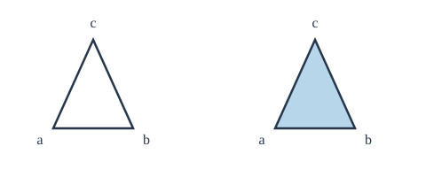
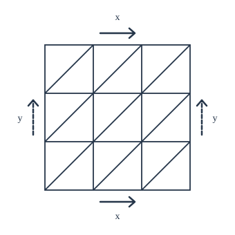

# ATOP14 単体ホモロジーと計算

<!-- definition-example-audit: strict -->

[ATOP13 の単体鎖複体](../ATOP13/index.md#def-atop13-simplicial-chain-complex)では、辺の端点や面の縁を整数係数の鎖として計算しました。閉じた三辺は端点を持ちません。しかし、三角形の内部が存在する場合と存在しない場合とでは、同じ三辺の役割が異なります。今回は、閉じている鎖のうち、上の次数の鎖の境界で説明できるものを除き、残る情報を取り出します。

## 1. 閉じた鎖と境界である鎖

有限抽象単体複体 $K$ を固定し、係数はすべて整数とします。鎖群を $C_n=C_n(K;\mathbb Z)$、境界作用素を $\partial_n:C_n\to C_{n-1}$ と略記します。負次数の鎖群は零で、$\partial_0=0$ とします。[核と像](../../../代数系/MOD/MOD1/index.md#def-mod1-homomorphism)を使うと、二つの種類の鎖をまとめて記述できます。

<!-- formal-statement-start -->
> **定義（単体サイクルと単体境界鎖）**
> 有限抽象単体複体 $K$ と $n\ge0$ に対し、整数係数の $n$ 次のサイクル群と境界群をそれぞれ次で定める。

$$
Z_n(K)=\ker\partial_n,\qquad
B_n(K)=\operatorname{im}\partial_{n+1}.
$$

> それぞれの元を単体サイクル（閉鎖）と単体境界鎖という。
<!-- formal-statement-end -->

<!-- definition-example-start: def-atop14-cycles-boundaries -->
**定義の確認**

頂点 $a<b<c$ と三辺からなる複体 $L$ と、さらに面 $abc$ を含む複体 $K$ を比べます。

[単体境界作用素](../ATOP13/index.md#def-atop13-boundary)を使い、辺基底を $(ab,ac,bc)$ とします。ここで $ab$ は $[a,b]$ の略記です。

$$
\partial_1(xab+yac+zbc)
=(-x-y)[a]+(x-z)[b]+(y+z)[c].
$$

零となる条件は $y=-x,\ z=x$ です。残りの式も $-x+x=0$ となります。従って両複体の $Z_1$ は $u=ab-ac+bc$ を基底とする $\mathbb Z u$ です。一方 $C_2(L)=0$ なので $B_1(L)=0$、$C_2(K)=\mathbb Z[ a,b,c]$ で $\partial_2[a,b,c]=u$ なので $B_1(K)=\mathbb Z u$ です。例えば $2u$ は両方でサイクルですが、$K$ では $2[a,b,c]$ の境界、$L$ では境界ではありません。
<!-- definition-example-end -->

[核と像は部分加群](../../../代数系/MOD/MOD1/index.md#prop-mod1-kernel-image)であり、[二重境界の消滅](../ATOP13/index.md#thm-atop13-boundary-square)により $b=\partial_{n+1}c$ なら $\partial_n b=0$ です。従って $B_n\subseteq Z_n$ が成立します。この包含があるからこそ、閉じた鎖を境界の差だけ無視して分類できます。

<!-- formal-statement-start -->
> **定義（単体ホモロジー群）**
> 有限抽象単体複体 $K$ の整数係数の $n$ 次単体ホモロジー群 ($n\ge0$) を次の商加群とする。

$$
H_n(K;\mathbb Z)=Z_n(K)/B_n(K).
$$

> サイクル $z$ が表す元（ホモロジー類）は $[z]=z+B_n(K)$ と書く。二つのサイクルは、その差が境界群に属するとき、かつそのときに限り同じ類を表す。
<!-- formal-statement-end -->

<!-- definition-example-start: def-atop14-simplicial-homology -->
**定義の確認**

先ほどの $L$ では $H_1(L)=\mathbb Z u/0\cong\mathbb Z$ です。$[2u]\ne[u]$ なのは差 $u$ が零鎖でないからです。$K$ では $H_1(K)=\mathbb Z u/\mathbb Z u=0$ で、差 $u$ は $\partial_2[a,b,c]$ だから $[2u]=[u]=0$ です。[商加群の演算の良定義性](../../../代数系/MOD/MOD1/index.md#prop-mod1-quotient-well-defined) により代表元を取り替えても加法は変わりません。例えば $K$ で $u$ と $2u$ はともに零類を代表し、どちらを $3u$ に足しても零類になります。
<!-- definition-example-end -->

「閉じている」だけでは類が非零とは限りません。また $\partial_n z\ne0$ の鎖にはそもそもホモロジー類を割り当てません。

## 2. 0次：頂点を結ぶ道を数える

辺の境界は二頂点の差です。従って同じ辺の列で結ばれた頂点は、0次では同じ類になります。ここで頂点を辺の有限列で結べるという同値関係による分割を辺連結成分とします。孤立頂点も一成分です。

<!-- formal-statement-start -->
> **定理（0次単体ホモロジーと成分）**
> 有限抽象単体複体 $K$ の辺連結成分数が $c$ なら、整数係数の0次単体ホモロジー群は $\mathbb Z^c$ と同型である。
<!-- formal-statement-end -->

見取り図：各成分の頂点係数の総和を保存する写像を作ります。総和が零の鎖は、基準頂点から他の頂点までの辺の境界で書けます。

<!-- proof-start -->
### 証明

成分を $K_1,\ldots,K_c$ とし、各成分の頂点集合を $V_j$ とします。写像 $s:C_0\to\mathbb Z^c$ を

$$
s\left(\sum_v a_v[v]\right)
=\left(\sum_{v\in V_j}a_v\right)_{j=1}^c
$$

と定めます。各成分の基準頂点 $r_j$ が標準基底に写るため全射です。辺の両端は同じ成分にあり、[単体境界作用素](../ATOP13/index.md#def-atop13-boundary)による差の係数和は零です。従って $B_0\subseteq\ker s$。

逆に $s(z)=0$ なら各成分で $a_{r_j}=-\sum_{v\in V_j\setminus\{r_j\}}a_v$ です。よって

$$
z=\sum_j\sum_{v\in V_j\setminus\{r_j\}}
a_v([v]-[r_j]).
$$

成分内で $r_j=v_0,\ldots,v_\ell=v$ という辺の列を選び、向きを進行方向に合わせると

$$
\partial_1\sum_{i=1}^{\ell}[v_{i-1},v_i]
=\sum_{i=1}^{\ell}([v_i]-[v_{i-1}])
=[v]-[r_j].
$$

従って $z\in B_0$ です。$Z_0=C_0$ であり、[加群の第一同型定理](../../../代数系/MOD/MOD1/index.md#thm-mod1-first-isomorphism)により $C_0/B_0\cong\mathbb Z^c$ となります。空複体では両辺とも零です。
<!-- proof-end -->

例えば辺 $ab$ と孤立頂点 $c$ の複体では $[a]=[b]$ ですが $[c]$ は独立であり、写像は $(x,y,z)\mapsto(x+y,z)$ になります。$H_0\cong\mathbb Z^2$ です。

## 3. 境界行列を整数のまま計算する

有理数上の行列階数だけでは、例えば $\mathbb Z/2\mathbb Z$ と零群を区別できません。整数係数では境界がサイクルのどの整数倍まで届くかも必要です。

<!-- formal-statement-start -->
> **定理（Smith 標準形による単体ホモロジーの計算）**
> 有限抽象単体複体 $K$ の整数境界行列を $D_n,D_{n+1}$ とし、$m=\operatorname{rank} C_n$ とする。整数可逆行列 $U,V$ により $UD_nV$ を Smith 標準形にし、その非零対角成分数を $r$ とする。
>
> $V^{-1}D_{n+1}$ の先頭 $r$ 行は零である。残り $m-r$ 行の行列を $A$ とし、その Smith 標準形の正の対角成分を $d_1,\ldots,d_s$ とすると、

$$
H_n(K;\mathbb Z)\cong
\mathbb Z^{m-r-s}\oplus
\bigoplus_{i=1}^s\mathbb Z/d_i\mathbb Z.
$$

> $d_i=1$ の項は零群である。
<!-- formal-statement-end -->

見取り図：[Smith 標準形定理](../../../代数系/MOD/MOD2/index.md#thm-mod2-smith-normal-form)で最初に核の整数基底を選び、その基底で一つ上の境界を表示し直します。二度目の対角化は核の内部で行います。

<!-- proof-start -->
### 証明

$D_n$ は $C_n$ から $C_{n-1}$ への行列です。$U,V$ はそれぞれ終域と始域の階数に対応する正方整数可逆行列です。$z=Vw$ とすると $D_nz=0$ と $UD_nVw=0$ は同値です。非零整数 $e_i$ に対する $e_iw_i=0$ は $w_i=0$ を意味するので、核の整数基底は $V$ の最後の $m-r$ 列です。零次では $D_0$ の終域は零、$r=0,V=I$ と取れます。

[二重境界の消滅](../ATOP13/index.md#thm-atop13-boundary-square)から

$$
(UD_nV)(V^{-1}D_{n+1})=UD_nD_{n+1}=0.
$$

先頭 $r$ 行の各成分に非零整数 $e_i$ を掛けると零なので、その各行は零です。従って核の座標 $w_{r+1},\ldots,w_m$ における境界は $A$ の列の整数結合であり、

$$
Z_n/B_n\cong \mathbb Z^{m-r}/A\mathbb Z^{\operatorname{rank} C_{n+1}}.
$$

再度 [Smith 標準形定理](../../../代数系/MOD/MOD2/index.md#thm-mod2-smith-normal-form)を $A$ に適用します。始域の基底変更は像を変えず、終域の整数可逆変換は商の同型を与えます（[行列同値は余核を保つ](../../../代数系/MOD/MOD2/index.md#prop-mod2-equivalence-cokernel)）。従って初めの $s$ 個の座標はそれぞれ $d_i\mathbb Z$ で割り、残りの座標には関係式がありません。これが主張の直和表示です。
<!-- proof-end -->

例えば第1節の三角形では、核の基底 $u$ で境界行列を表示すると、面のある場合は $A=(1)$ であり、面がなければ $A$ は列を持たない行列です。後者は自由な1座標が残ります。二つの行列を互いに無関係な基底で対角化して境界の座標をそのまま読むことはできません。

整数の問題を理解するため、単体鎖複体とは限らない例として $\mathbb Z\xrightarrow{2}\mathbb Z\xrightarrow{0}0$ を見ると、中間の商は $\mathbb Z/2\mathbb Z$ です。$1$ はサイクルですが境界ではなく、$2$ は境界です。有理数なら $1=2(1/2)$ となってしまい、この情報が消えます。

## 4. 円と球面を計算する

以降は指定された三角形分割の単体ホモロジーを求めます。異なる三角形分割でも同じ結果となる一般的な根拠は後続の比較定理で学びます。

円には第1節の三辺だけの複体を使えます。$H_0=\mathbb Z$ は [0次単体ホモロジーと成分](#thm-atop14-h0-components)、$H_1=\mathbb Z$ は第1節の核と境界の比較から従い、2次以上は鎖群自体が零です。

球面には四面体の境界、すなわち頂点 $a<b<c<d$、全6辺、四つの三角形 $abc,abd,acd,bcd$ を使います。四面体内部は含めません。辺の略記は第1節と同じで、面も同様に略記します。

### 4.1 1次の核

辺の座標を $(ab,ac,ad,bc,bd,cd)$ の順に取ります。[単体境界作用素](../ATOP13/index.md#def-atop13-boundary) から

$$
D_1=\begin{pmatrix}
-1&-1&-1&0&0&0\\
1&0&0&-1&-1&0\\
0&1&0&1&0&-1\\
0&0&1&0&1&1
\end{pmatrix}.
$$

後ろ三つの座標を $p,q,r$ とすると、最後の三行が零である条件は

$$
x_{ab}=p+q,\quad x_{ac}=-p+r,\quad x_{ad}=-q-r.
$$

先頭行も $-(p+q)-(-p+r)-(-q-r)=0$ です。従って $Z_1$ の整数基底は

$$
u=ab-ac+bc,\quad v=ab-ad+bd,\quad
w=ac-ad+cd.
$$

それぞれ $abc,abd,acd$ の境界なので、$B_1=Z_1$ となり $H_1=0$ です。

### 4.2 2次の核

面の境界を辺基底に並べると

$$
D_2=\begin{pmatrix}
1&1&0&0\\
-1&0&1&0\\
0&-1&-1&0\\
1&0&0&1\\
0&1&0&-1\\
0&0&1&1
\end{pmatrix}.
$$

面の係数を $(x,y,z,t)$ とすると、後ろ三行が零であることから $x=-t,y=t,z=-t$ です。先頭三行は $-t+t=0,\ t-t=0,\ -t+t=0$ となります。従って

$$
Z_2=\mathbb Z(bcd-acd+abd-abc).
$$

$C_3=0$ なので $B_2=0$、$H_2\cong\mathbb Z$ です。球面の全体を向き付きで一周する2鎖が非零類を表します。辺連結なので $H_0=\mathbb Z$、3次以上は零です。四面体の内部を追加するとその3単体の境界がこの2鎖そのものになることが、[境界公式](../ATOP13/index.md#def-atop13-boundary)から分かります。

## 5. トーラスの三角形分割と整数関係式

正方形の対辺を同方向に貼り合わせます。一枚の正方形の頂点を一つに同一視しただけでは、同じ頂点を繰り返す辺が生じ、抽象単体複体になりません。そこで各方向を三分割し、各小正方形を左下から右上への対角線で分けます。

添字 $i,j$ は $0,1,2$ を取り、加算は3を法として行います。頂点は $(i,j)$ の9個です。辺の向きを次のように選びます。

$$
\begin{aligned}
h_{ij}&:(i,j)\to(i+1,j),\\
v_{ij}&:(i,j)\to(i,j+1),\\
d_{ij}&:(i,j)\to(i+1,j+1).
\end{aligned}
$$

各辺は異なる二頂点を持ちます。水平・鉛直・対角の端点の差はそれぞれ $(1,0),(0,1),(1,1)$ またはその負で、互いに重複しません。同じ種類で逆向きに一致することも $2\ne0$（法3）からありません。従って辺は27本です。各正方形の面を、反時計回りの頂点列で

$$
\begin{aligned}
P_{ij}&=[(i,j),(i+1,j),(i+1,j+1)],\\
Q_{ij}&=[(i,j),(i+1,j+1),(i,j+1)]
\end{aligned}
$$

とします。各面には対角辺が一本だけあり、その対角辺を持つ二面は第三頂点が異なります。従って面は18枚です。平面の周期格子を法3で商にした三角形分割で、これらの単体と全ての面からなる有限抽象単体複体を取れます。各軸の三分割された閉区間は周期的に並び、異なる区間同士は端点一つで交わるか交わりません。従って異なる小正方形の交わりは空、共通頂点または共通辺です。同じ小正方形内の二面は対角辺で交わり、隣の正方形の三角形とは共通辺の全体、頂点または空集合で交わります。このため商で同一視した後にも単体の面の貼り合わせが保たれます。図の正方形を貼り合わせたトーラスをこの複体で表せます。

[境界公式と向きの整合性](../ATOP13/index.md#prop-atop13-boundary-orientation)により、昇順でなくても選んだ向きで計算できます。

$$
\begin{aligned}
\partial_2P_{ij}&=h_{ij}+v_{i+1,j}-d_{ij},\\
\partial_2Q_{ij}&=d_{ij}-h_{i,j+1}-v_{ij}.
\end{aligned}
$$

この二式が $27\times18$ の境界行列の全列を指定しています。$D_1$ の各列は辺の終点の行に $+1$、始点の行に $-1$ を置いた $9\times27$ 行列です。

### 5.1 2次の計算

任意の2鎖を $\sum_{i,j}(p_{ij}P_{ij}+q_{ij}Q_{ij})$ と書きます。対角辺 $d_{ij}$ の係数は $-p_{ij}+q_{ij}$ です。従ってサイクルなら $p_{ij}=q_{ij}$。水平辺 $h_{ij}$ の係数は $p_{ij}-q_{i,j-1}$、鉛直辺 $v_{ij}$ の係数は $p_{i-1,j}-q_{ij}$ なので

$$
p_{ij}=p_{i,j-1}=p_{i-1,j}
$$

となります。9個全ての係数は一つの整数に一致します。逆に全てを同じ整数にすれば3種類の辺の係数は全て零です。3単体はないので

$$
H_2\cong\mathbb Z,\qquad
\text{生成元 } \left[\sum_{i,j}(P_{ij}+Q_{ij})\right].
$$

### 5.2 1次の計算：木の辺を取り除く

まず、辺の鎖を自由に変形するのではなく、核の座標を作るために木を利用します。水平辺 $h_{0j},h_{1j}$（各行で2本）と鉛直辺 $v_{00},v_{01}$ を選びます。各頂点から $(0,0)$ へ一意の辺の列で戻れる8本の辺です。この8本の整数結合全体を $T\subset C_1$ とします。

$\partial_1|_T$ の像は頂点係数和が零の鎖全体です。実際、各頂点への木の道の境界がその頂点と $(0,0)$ の差になるためです。また $\partial_1|_T$ は単射です。木の端の頂点には木の辺が一本しか接しないので、境界が零ならその辺の係数は零です。端の辺を順次取り除けば全係数が零になります。

任意の1鎖 $c$ に対し、$\partial_1c$ の頂点係数和は零なので、$\partial_1t=\partial_1c$ となる $t\in T$ が一意にあります。従って $c-t\in Z_1$ であり、$C_1=Z_1\oplus T$ です。$B_1\subseteq Z_1$ だから自然な写像 $Z_1\to C_1/(B_1+T)$ は全射で、核は $B_1$ です。[加群の第一同型定理](../../../代数系/MOD/MOD1/index.md#thm-mod1-first-isomorphism)から

$$
H_1\cong C_1/(B_1+T).
$$

この商では木の8辺を零と置けます。面の境界の関係式により

$$
d_{ij}=h_{ij}+v_{i+1,j}
=v_{ij}+h_{i,j+1}.
$$

対角辺をすべて消去して得られる関係式は

$$
h_{ij}+v_{i+1,j}=v_{ij}+h_{i,j+1}.
$$

$i=0,1$ では水平辺が零なので $v_{i+1,j}=v_{ij}$。従って全列の鉛直辺は第0列の鉛直辺と等しく、$v_{00}=v_{01}=0$、残るのは $V=v_{02}$ だけです。

$i=2$ では $v_{0j}=v_{2j}$ が既に従うため、関係式は $h_{2j}=h_{2,j+1}$ です。残る水平辺はすべて $H=h_{20}$ と等しくなります。以上の消去は係数が $1$ または $-1$ の関係式による代入なので整数の割り算は不要です。

独立性も確認しましょう。辺から $\mathbb Z^2$ への整数線形写像を、$h_{ij}$ は $i=2$ のとき $(1,0)$、それ以外は零、$v_{ij}$ は $j=2$ のとき $(0,1)$、それ以外は零、$d_{ij}$ は対応する水平・鉛直の値の和に送るよう定めます。木の辺はすべて零に写り、上の二つの面境界も零に写ります。よって商上の写像が得られ、$H,V$ を標準基底へ送ります。従ってこれらに非自明な整数関係式はありません。

元のサイクルの代表は $h_{00}+h_{10}+h_{20}$ と $v_{00}+v_{01}+v_{02}$ です。各辺の端点差は巡回して相殺され、商では $H,V$ に対応します。従って

$$
H_1\cong\mathbb Z^2.
$$

[0次単体ホモロジーと成分](#thm-atop14-h0-components)から $H_0=\mathbb Z$、3次以上は零です。トーラスでは横と縦の二つの独立な巡回と、面全体の2次の類が残ります。

## 6. Euler 標数を鎖群とホモロジー群で比較する

群の自由部分の個数を、鎖群を数えるだけで検算できます。有限生成整数加群の自由部分の階数は [有限生成 Abel 群の構造定理](../../../代数系/MOD/MOD2/index.md#thm-mod2-fg-abelian)の自由因子の個数です。本節では $H_n$ の階数を $b_n$ と書きます。

[ATOP11 の Euler 標数の議論](../ATOP11/index.md)では曲面の頂点・辺・面の個数の交代和を計算しました。ここでは有限単体複体の各次数の単体数 $f_n$ の交代和 $\chi(K)=\sum_{n\ge0}(-1)^nf_n$ として計算します。

<!-- formal-statement-start -->
> **定理（Euler–Poincaré の鎖レベル恒等式）**
> 有限抽象単体複体 $K$ の $n$ 次単体の個数を $f_n$、整数係数の単体ホモロジー群の自由部分の階数を $b_n$ とする。このとき

$$
\sum_{n\ge0}(-1)^nf_n
=\sum_{n\ge0}(-1)^nb_n.
$$
<!-- formal-statement-end -->

見取り図：境界行列の階数を $r_n$ とすると、各次数の単体数はサイクルの階数と $r_n$ の和です。サイクルから境界の階数 $r_{n+1}$ を引くと $b_n$ になり、交代和で境界の階数が相殺されます。

<!-- proof-start -->
### 証明

[Smith 標準形による単体ホモロジーの計算](#thm-atop14-smith-computation)で $m=f_n,r=r_n$ と置きます。境界行列の基底変更 $V^{-1}$ は可逆で、先頭 $r_n$ 行が零になるので、残りの行列 $A$ の有理数上の階数は $D_{n+1}$ の階数 $r_{n+1}$ と同じです。従ってその非零対角成分数は $r_{n+1}$ であり

$$
b_n=f_n-r_n-r_{n+1}.
$$

最大次元を $N$ とすると $r_0=r_{N+1}=0$ です。有限和で

$$
\begin{aligned}
\sum_{n=0}^{N}(-1)^n(f_n-b_n)
&=\sum_{n=0}^{N}(-1)^nr_n
+\sum_{n=0}^{N}(-1)^nr_{n+1}\\
&=\sum_{n=1}^{N}(-1)^nr_n
+\sum_{j=1}^{N}(-1)^{j-1}r_j=0.
\end{aligned}
$$

空複体では両辺が零です。
<!-- proof-end -->

| 三角形分割 | 単体数 $(f_0,f_1,f_2)$ | $(b_0,b_1,b_2)$ | Euler 標数 |
|---|---|---|---|
| 円 | $(3,3,0)$ | $(1,1,0)$ | $0$ |
| 球面 | $(4,6,4)$ | $(1,0,1)$ | $2$ |
| トーラス | $(9,27,18)$ | $(1,2,1)$ | $0$ |

円とトーラスの Euler 標数は同じでも、ホモロジー群は異なります。交代和は各次数の情報を一つの整数へ圧縮します。また、恒等式だけから任意の三角形分割間の同相不変性はまだ結論できません。

## 7. 単体写像が類に与える写像

図形を対応させたときにも、サイクルと境界の区別を保てるでしょうか。[単体写像は境界と可換](../ATOP13/index.md#thm-atop13-chain-map)だったので、サイクルはサイクルへ、境界は境界へ送られます。

<!-- formal-statement-start -->
> **定理（単体写像の誘導ホモロジー準同型）**
> 有限抽象単体複体の単体写像 $f:K\to L$ は各 $n\ge0$ で整数係数の準同型を誘導する。

$$
H_n(f):H_n(K;\mathbb Z)\to H_n(L;\mathbb Z),
\qquad [z]\mapsto[f_{\#,n}z].
$$

> 恒等写像は恒等準同型を誘導し、単体写像 $g:L\to M$ との合成について次が成立する。

$$
H_n(g\circ f)=H_n(g)\circ H_n(f).
$$
<!-- formal-statement-end -->

見取り図：代表元の差が境界なら、写像した後の差も同じ次数の境界となります。

<!-- proof-start -->
### 証明

[単体写像は境界と可換](../ATOP13/index.md#thm-atop13-chain-map)なので $z\in Z_n(K)$ に対して

$$
\partial_n^L f_{\#,n}z=f_{\#,n-1}\partial_n^K z=0.
$$

$z'-z=\partial_{n+1}^K c$ のとき

$$
f_{\#,n}z'-f_{\#,n}z
=\partial_{n+1}^L f_{\#,n+1}c
$$

であり、$[f_{\#,n}z']=[f_{\#,n}z]$ です。従って写像は良定義です。鎖準同型の加法性から $[f_{\#,n}(z+w)]=[f_{\#,n}z]+[f_{\#,n}w]$ が成立します。

[誘導鎖準同型の合成](../ATOP13/index.md#prop-atop13-chain-map-composition)から恒等写像については $[\operatorname{id}_{\#,n}z]=[z]$、合成については

$$
[(g\circ f)_{\#,n}z]=[g_{\#,n}f_{\#,n}z]
=H_n(g)(H_n(f)[z])
$$

です。
<!-- proof-end -->

三辺だけの複体から三角形全体への包含は、同じサイクル $u$ を送りますが、終域では境界になっているので $H_1$ 上は零準同型です。

## 8. 演習

### 演習 ATOP14-A1：サイクルか境界か

- Level: A

三辺だけの三角形で $z=ab+bc-ac$ と $w=ab+ac$ がサイクルか判定せよ。さらに三角形の面を加えたときの $[z]$ を求めよ。

<!-- solution-start -->
**詳細解答**

[単体境界作用素](../ATOP13/index.md#def-atop13-boundary)から

$$
\begin{aligned}
\partial_1z&=([b]-[a])+([c]-[b])-([c]-[a])=0,\\
\partial_1w&=[b]+[c]-2[a]\ne0.
\end{aligned}
$$

$z$ はサイクルだが $w$ はサイクルでないので類を持たない。三辺だけなら $C_2=0$ なので $z$ は非零類。面を加えると $\partial_2[a,b,c]=z$ であり、[単体ホモロジー群](#def-atop14-simplicial-homology)では $[z]=0$。
<!-- solution-end -->

### 演習 ATOP14-A2：0次の類

- Level: A

頂点 $a,b,c,d,e$、辺 $ab,bc,de$ だけを持つ複体を考える。$H_0$ と $[2a-b-c+3d-e]$ の座標を求めよ。頂点名は0鎖の略記とする。

<!-- solution-start -->
**詳細解答**

辺連結成分は $\{a,b,c\},\{d,e\}$。各成分で係数和を取る [0次単体ホモロジーと成分](#thm-atop14-h0-components) の同型により

$$
H_0\cong\mathbb Z^2,\qquad
(2-1-1,\ 3-1)=(0,2).
$$

実際、最初の成分の鎖は $-2\partial_1ab-\partial_1bc=2a-b-c$。第2成分の鎖は $2d-\partial_1de=3d-e$ なので、類は $2[d]$ に等しい。
<!-- solution-end -->

### 演習 ATOP14-A3：整数係数の意味

- Level: A

整数加群の列 $\mathbb Z\xrightarrow{6}\mathbb Z\xrightarrow{0}0$ について中間の核を像で割った群を求め、$[4]$ の位数を計算せよ。これは一般の整数鎖の計算練習であり、単体複体の境界行列とは仮定しない。

<!-- solution-start -->
**詳細解答**

核は $\mathbb Z$、像は $6\mathbb Z$。よって商は $\mathbb Z/6\mathbb Z$ である。$4,8$ は6の倍数ではなく、$12=2\cdot6$ だから $[4]$ を3回足したとき初めて零になり、位数は3である。有理数に係数を変えると6倍写像は全射となり、商は零になる。
<!-- solution-end -->

### 演習 ATOP14-A4：球面の面の向き

- Level: A

四面体の境界で $z=abc-abd+acd-bcd$ がサイクルであることを各辺の係数から確認し、$[z]$ が零か判定せよ。

<!-- solution-start -->
**詳細解答**

[単体境界作用素](../ATOP13/index.md#def-atop13-boundary)から

$$
\begin{aligned}
\partial_2z={}&(ab-ac+bc)-(ab-ad+bd)\\
&+(ac-ad+cd)-(bc-bd+cd)=0.
\end{aligned}
$$

6辺の係数は全て零である。3単体がないため $B_2=0$ であり、$z$ は非零鎖だから $[z]\ne0$。本文の生成元の負である。
<!-- solution-end -->

### 演習 ATOP14-B1：二つの円が頂点を共有する

- Level: B

頂点 $a<b<c<d<e$ と辺 $ab,ac,bc,ad,ae,de$ のみを持つ複体の全次数のホモロジー群を求めよ。さらに面 $abc$ を追加した場合を計算せよ。

<!-- solution-start -->
**詳細解答**

辺基底を問題の順に取り、座標を $(x,y,z,p,q,r)$ とする。[単体境界作用素](../ATOP13/index.md#def-atop13-boundary)による頂点係数は

$$
(-x-y-p-q,\ x-z,\ y+z,\ p-r,\ q+r).
$$

零条件から $x=z,y=-z,p=r,q=-r$。先頭も零となるので、核の基底は $u=ab-ac+bc$ と $v=ad-ae+de$ である。面がなければ $B_1=0$、$H_1\cong\mathbb Z^2$。面 $abc$ を追加すると $B_1=\mathbb Z u$ であり、$H_1\cong\mathbb Z v$。また $\partial_2(kabc)=ku$ が零になるのは $k=0$ のみなので $H_2=0$。どちらも辺連結であり [0次単体ホモロジーと成分](#thm-atop14-h0-components)から $H_0=\mathbb Z$、3次以上は零。
<!-- solution-end -->

### 演習 ATOP14-B2：核の整数基底を作る

- Level: B

一般の整数鎖の列 $\mathbb Z^2\xrightarrow{D_2}\mathbb Z^3\xrightarrow{D_1}\mathbb Z$ を

$$
D_1=(1,1,0),\qquad
D_2=\begin{pmatrix}2&0\\-2&0\\0&6\end{pmatrix}
$$

とする。積を確認し、中間のホモロジーに相当する商を整数上で求めよ。

<!-- solution-start -->
**詳細解答**

積は $(2-2,0)=(0,0)$。$D_1(x,y,z)^{\mathsf T}=x+y=0$ から整数核の基底は $u=(1,-1,0)^{\mathsf T},v=(0,0,1)^{\mathsf T}$ である。基底変更 $V$ を列 $(1,0,0)^{\mathsf T},u,v$ とすれば

$$
D_1V=(1,0,0),\qquad
V^{-1}D_2=\begin{pmatrix}0&0\\2&0\\0&6\end{pmatrix}.
$$

$V$ の行列式は $-1$ で整数可逆。下2行の行列は $2\mid6$ なので既に Smith 標準形である。[Smith 標準形による単体ホモロジーの計算](#thm-atop14-smith-computation) の証明と同じ整数商の計算を行えば

$$
(\mathbb Zu\oplus\mathbb Zv)/(2\mathbb Zu\oplus6\mathbb Zv)
\cong\mathbb Z/2\mathbb Z\oplus\mathbb Z/6\mathbb Z.
$$
<!-- solution-end -->

### 演習 ATOP14-B3：反射が円の類に与える作用

- Level: B

三辺だけの複体で $a\mapsto a,b\mapsto c,c\mapsto b$ とする。単体写像であることを確かめ、$H_1$ と $H_0$ に誘導する準同型を求めよ。

<!-- solution-start -->
**詳細解答**

頂点の置換は三辺を三辺へ送るため [単体写像](../ATOP13/index.md#def-atop13-simplicial-map) である。[誘導鎖準同型](../ATOP13/index.md#def-atop13-induced-chain-map)によって

$$
f_{\#,1}(ab-ac+bc)=ac-ab-bc=-u.
$$

[単体写像の誘導ホモロジー準同型](#thm-atop14-induced-homology)から $H_1\cong\mathbb Z$ で $k\mapsto-k$。$H_0$ では $[a]=[b]=[c]$ であり、生成元 $[a]$ は自身に写るので恒等準同型。
<!-- solution-end -->

### 演習 ATOP14-B4：Euler 標数から階数を検算する

- Level: B

本文のトーラス分割で $D_1,D_2$ の有理数上の階数を求め、$b_1=2$ を検算せよ。Euler 標数だけからねじれ部分が求まらない理由も述べよ。

<!-- solution-start -->
**詳細解答**

[0次単体ホモロジーと成分](#thm-atop14-h0-components) の証明により $B_0$ は係数和零の9頂点鎖全体で階数8、従って $r_1=8$。2次の核は本文の面係数の計算により階数1なので、$D_2$ の18列のうち階数は $18-1=17$。よって [Euler–Poincaré の鎖レベル恒等式](#thm-atop14-euler-poincare) の証明の式から

$$
b_1=27-8-17=2,\qquad
9-27+18=0=1-2+1.
$$

ねじれ部分は自由階数に寄与しない。例えば A3 の中間の群は $\mathbb Z/6\mathbb Z$ で階数零だが零群ではない。Euler 標数だけでは整数の不変因子を区別できない。
<!-- solution-end -->

### 演習 ATOP14-C1：四面体の面を一枚除く

- Level: C

四面体の境界から面 $abc$ だけを除き、その三辺は残した複体 $K$ の全ホモロジー群を求めよ。残る面の境界が $Z_1$ を整数上で生成することを示し、Euler 標数でも検算せよ。

<!-- solution-start -->
**詳細解答**

辺と頂点は本文の球面と同じであるため、4.1節の $D_1$ と核の整数基底 $u,v,w$ をそのまま使える。すなわち

$$
u=ab-ac+bc,\quad v=ab-ad+bd,\quad w=ac-ad+cd.
$$

[単体境界作用素](../ATOP13/index.md#def-atop13-boundary)により残る三面の境界は

$$
\partial_2abd=v,\qquad
\partial_2acd=w,\qquad
\partial_2bcd=u-v+w.
$$

最後の式の展開は $(ab-ac+bc)-(ab-ad+bd)+(ac-ad+cd)=bc-bd+cd$ である。従って $u=(u-v+w)+v-w$ も境界群に入り、$Z_1=B_1$ である。実際、核の基底 $(u,v,w)$ における面境界の行列は

$$
A=\begin{pmatrix}
0&0&1\\1&0&-1\\0&1&1
\end{pmatrix}.
$$

任意の $(p,q,r)$ に対し $A(x,y,z)^{\mathsf T}=(z,x-z,y+z)^{\mathsf T}$ なので $z=p,x=q+p,y=r-p$ が整数の一意解となる。従って商は零であり、同時に $\partial_2$ の核も零だから $H_2=0$。辺連結であるため [0次単体ホモロジーと成分](#thm-atop14-h0-components)により $H_0=\mathbb Z$。3次以上の鎖群は零である。

Euler 標数は $4-6+3=1$。ホモロジーの自由階数の交代和も $1-0+0=1$ で一致する。面を一枚だけ除くことで球面の2次の類は消えるが、1次の類が新たに生じるとは限らない。
<!-- solution-end -->

## 9. 次の講義へ

境界の計算からサイクルを求め、整数の関係式で割ることで、円・球面・トーラスを区別できました。次回 ATOP15 では、単体を細かく分け、連続写像を単体写像で近似する方法を学びます。
