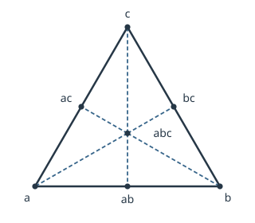
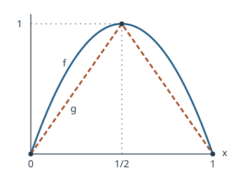

# ATOP15 細分と単体近似

[単体ホモロジー群](../ATOP14/index.md#def-atop14-simplicial-homology)を計算するとき、三角形分割が細かいほど鎖群の基底は増えます。辺を中点で二分しただけで穴の数が変わるでしょうか。また、頂点を頂点へ送らない連続写像にも、前講の誘導準同型を使えるでしょうか。

この二つの問いを結びます。まず分割前の鎖を分割後の鎖へ移す整数線形写像を作り、その逆がホモロジー類の上で存在することを示します。次に連続写像を、十分細かい分割上の頂点写像で近似します。

## 1. 面を頂点とする複体

有限非空抽象単体複体 $K$ を取り、[幾何学的実現](../ATOP10/index.md#def-atop10-realization)を $|K|$ と書きます。各頂点を座標空間の標準基底ベクトルと同一視します。非空面 $F$ の重心は

$$
b_F=\frac{1}{|F|}\sum_{v\in F}v
$$

です。この分母の $|F|$ は頂点数を表します。以下、単体の幾何学的実現は必要に応じて $\operatorname{conv}(F)$ と書いて区別します。[重心細分](../../../応用系/FIX/FIX1/index.md#def-fix1-barycentric-subdivision)の幾何的な作り方を、抽象複体全体へ適用します。共有する面の重心はどちらの単体から計算しても同じなので、面の名前そのものを頂点として使えます。

<!-- formal-statement-start -->
> **定義（重心細分複体）**
> 有限非空抽象単体複体 $K$ の重心細分複体 $\operatorname{sd}K$ は、$K$ の非空単体 $F$ を頂点 $b_F$ とし、非空単体を厳密包含鎖
>
$$
F_0\subsetneq F_1\subsetneq\cdots\subsetneq F_j
$$

> に対応する頂点集合 $\{b_{F_0},\ldots,b_{F_j}\}$ とする抽象単体複体である。空単体も含める。
<!-- formal-statement-end -->

<!-- definition-example-start: def-atop15-subdivision-complex -->
**定義の確認**

頂点 $a,b,c$ の三角形全体なら、細分の頂点は $a,b,c,ab,ac,bc,abc$ の七つの非空面に対応します（$ab$ は集合 $\{a,b\}$ の略記）。例えば $a\subset ab\subset abc$ は一つの三角形です。全ての最大の包含鎖を表にすると次の六つになります。図では元の頂点・辺・面をそれぞれの重心の位置に記しています。面の重心から伸びる破線が六つの小三角形を区切ります。

| 頂点から辺へ | 辺から面へ |
| --- | --- |
| $a\subset ab$ | $ab\subset abc$ |
| $b\subset ab$ | $ab\subset abc$ |
| $a\subset ac$ | $ac\subset abc$ |
| $c\subset ac$ | $ac\subset abc$ |
| $b\subset bc$ | $bc\subset abc$ |
| $c\subset bc$ | $bc\subset abc$ |

包含鎖から任意の項を除いても包含鎖です。従って面を取る操作で閉じており、各一頂点も非空面に対応します。一方 $ab$ と $ac$ は互いに包含しないため、二つの重心を結ぶ辺はありません。元の三角形の辺 $ab$ は $b_a,b_{ab},b_b$ を通る二辺になり、隣接三角形も同じ二辺を共有します。
<!-- definition-example-end -->

<!-- formal-statement-start -->
> **命題（重心細分複体の実現）**
> 有限非空抽象単体複体 $K$ に対し、各細分頂点を元の面の重心へ送り、各細分単体上で凸結合を保つ写像 $j:|\operatorname{sd}K|\to |K|$ は同相写像である。
<!-- formal-statement-end -->

見取り図：元の点の座標を大きい順に並べると、その点を含む小単体の面の包含鎖が復元できます。同じ大きさの座標はまとめて処理します。

<!-- proof-start -->
### 証明

まず細分単体の包含鎖の最後の面を $F$ とすれば、その全重心は元の閉単体 $\operatorname{conv}(F)$ に属します。凸結合もそこに属するので $j$ の値域は確かに $|K|$ です。

点 $x=\sum_v t_v v$ の正の座標の異なる値を $s_1>\cdots>s_m>0$ と並べ、$s_{m+1}=0$ とします。$F_i=\{v:t_v\ge s_i\}$ とおけば各 $F_i$ は支持集合の部分集合であり、厳密包含鎖です。

$$
\lambda_i=|F_i|(s_i-s_{i+1})>0.
$$

$t_v=s_k$ である頂点は $F_i$ に $i\ge k$ のときだけ属するので、

$$
\sum_{i=k}^{m}\frac{\lambda_i}{|F_i|}
=\sum_{i=k}^{m}(s_i-s_{i+1})=s_k.
$$

従って $x=\sum_i\lambda_i b_{F_i}$ です。両辺の全座標の和を取ると $\sum_i\lambda_i=1$ となります。

逆に、厳密包含鎖に沿った正係数の凸結合では、$F_i\setminus F_{i-1}$（$F_0=\varnothing$）に属する頂点の座標は $\sum_{k=i}^m\lambda_k/|F_k|$ であり、隣の値との差は正です。従って元の点から正係数の支持鎖と係数が一意に復元されます。これで全単射です。

$j$ は座標の線形写像の制限なので連続です。[実現の共通面性](../ATOP10/index.md#prop-atop10-intersection) により定義域はコンパクトであり、$|K|$ は Euclid 空間の部分空間で Hausdorff です。[コンパクト空間からHausdorff空間への連続全単射](../../../基礎科目/TOP/TOP2/index.md#thm-top2-compact-hausdorff-bijection) を $j$ に適用して逆写像も連続です。
<!-- proof-end -->

以下では $j$ で実現を同一視します。メッシュは全単体の直径の最大値です。$d=\dim K$ とすると、[重心細分によるメッシュ縮小](../../../応用系/FIX/FIX1/index.md#prop-fix1-barycentric-mesh)の評価を各正次元単体に適用でき、$q/(q+1)\le d/(d+1)$（$1\le q\le d$）なので $d\ge1$ なら

$$
\operatorname{mesh}(\operatorname{sd}^r K)
\le \left(\frac{d}{d+1}\right)^r\operatorname{mesh}(K)
\longrightarrow 0.
$$

$d=0$ なら各単体は一点でありメッシュは初めから零です。ここで距離は各回とも元の $|K|$ 内の Euclid 距離です。細分ごとに別の標準基底空間へ移して距離を測るのではありません。

## 2. 細分前後の鎖を対応させる

係数は整数とし、[単体鎖群](../ATOP13/index.md#def-atop13-simplicial-chains)を $C_n(K)$ と略します。$\partial$ は [単体境界作用素](../ATOP13/index.md#def-atop13-boundary) です。

辺 $[a,b]$ を二つの小辺 $[b_a,b_{ab}]+[b_{ab},b_b]$ に置き換えると、中点の境界係数が相殺されます。一般の次数でも、元の単体をその境界から組み立てる方法を使います。

頂点 $w$ と、$w$ を加えても単体になる全ての向き付き単体 $[u_0,\ldots,u_k]$ に対して、先頭に $w$ を置く操作を $c_w$ と書きます。

$$
c_w[u_0,\ldots,u_k]=[w,u_0,\ldots,u_k].
$$

$w$ が既に列に現れるときは零とし、整数線形に延長します。例えば $c_w[u,v]=[w,u,v]$、$c_w[w,v]=0$ です。$w$ を先頭に加えると他の頂点を消す符号が全て反転するため、$k\ge1$ では

$$
\partial c_w z=z-c_w\partial z.
$$

$k=0$ では $\epsilon(\sum a_u[u])=\sum a_u$ を係数和とおくと、

$$
\partial c_w z=z-\epsilon(z)[w].
$$

実際、$u\ne w$ なら $\partial[w,u]=[u]-[w]$、$u=w$ なら右辺も零です。正次数で $w$ が既に列にある場合も、境界で $w$ を消した一項だけが $c_w$ により残り、その符号と $w$ を先頭へ移す符号が相殺して $c_w\partial z=z$ になります。従って閉鎖（0次なら係数和零）を $c_w$ で埋められます。

<!-- formal-statement-start -->
> **定義（細分鎖写像の構成）**
> 有限非空抽象単体複体 $K$ の整数鎖群において、頂点上で $S_0[v]=[b_{\{v\}}]$ とし、$n\ge1$ の昇順基底単体 $\sigma=[v_0,\ldots,v_n]$ に対して
>
$$
S_n\sigma=c_{b_F}S_{n-1}\partial\sigma,\qquad
F=\{v_0,\ldots,v_n\}
$$

> と定め、整数線形に延長する。ここで $c_{b_F}$ は先頭に $b_F$ を加える操作である。$S_n$ の値域は $C_n(\operatorname{sd}K)$ とする。
<!-- formal-statement-end -->

<!-- definition-example-start: def-atop15-subdivision-chain -->
**定義の確認**

辺 $\sigma=[a,b]$ では $\partial\sigma=[b]-[a]$ なので、$m=b_{ab}$、$a'=b_a,b'=b_b$ とおくと

$$
S_1[a,b]=[m,b']-[m,a']=[a',m]+[m,b'].
$$

両方とも厳密包含鎖に対応し、細分複体の1鎖です。逆向きは整数線形性から $S_1[b,a]=-S_1[a,b]$ です。

三角形 $[a,b,c]$ では $o=b_{abc}$ とおき、

$$
\begin{aligned}
S_2[a,b,c]={}&[o,b',b_{bc}]+[o,b_{bc},c']\\
 &-[o,a',b_{ac}]-[o,b_{ac},c']\\
 &+[o,a',b_{ab}]+[o,b_{ab},b'].
\end{aligned}
$$

ここで $c'=b_c$ です。六項は前節の六つの最大包含鎖を一つずつ表します。$o$ を末尾の面に対応させれば各項は包含鎖であり、整数係数を持つ2鎖です。例えば最終項は $[b',b_{ab},o]$ へ奇置換で移るので負の向きになります。この符号を落とすと共有辺が相殺されません。
<!-- definition-example-end -->

<!-- formal-statement-start -->
> **定理（細分鎖写像と境界の可換性）**
> 有限非空抽象単体複体 $K$ の整数係数の細分鎖写像 $S_n:C_n(K)\to C_n(\operatorname{sd}K)$ は全次数で定義され、各単体の細分内に支持を持つ。$n\ge1$ に対して
>
$$
\partial S_n=S_{n-1}\partial
$$

> が成立する。
<!-- formal-statement-end -->

見取り図：小単体の内側の辺や面は二回ずつ反対符号で数えられます。この相殺を先頭に重心を加える公式と、二重境界の消滅だけで一括して示せます。

<!-- proof-start -->
### 証明

次数0では一頂点の像がその頂点の細分に属します。次数 $n$ の基底単体の境界は全て真の面の鎖です。帰納法によりその細分鎖の各項は真の面の包含鎖であり、元の単体全体 $F$ を末尾に加えられます。よって $c_{b_F}$ が定義でき、支持も $\operatorname{sd}F$ 内です。

$n=1$ では $z=S_0\partial[v_0,v_1]=[b_{\{v_1\}}]-[b_{\{v_0\}}]$ の係数和が零なので、$\partial c_{b_F}z=z$ です。

$n\ge2$ では帰納法と [二重境界の消滅](../ATOP13/index.md#thm-atop13-boundary-square) により

$$
\partial S_{n-1}\partial\sigma
=S_{n-2}\partial\partial\sigma=0.
$$

従って先頭に加える公式から

$$
\begin{aligned}
\partial S_n\sigma
&=\partial c_{b_F}S_{n-1}\partial\sigma\\
&=S_{n-1}\partial\sigma
-c_{b_F}\partial S_{n-1}\partial\sigma\\
&=S_{n-1}\partial\sigma.
\end{aligned}
$$

基底上で成立したので整数線形性により全鎖上で成立します。次数0では両側の境界が零です。
<!-- proof-end -->

## 3. 細分を元へ戻す

元の頂点に全順序を固定します。細分の各頂点 $b_F$ を $F$ の最大頂点へ送る写像を $p$ とします。包含鎖に沿って選んだ頂点は全て最後の面に属するので、$p:\operatorname{sd}K\to K$ は [単体写像](../ATOP13/index.md#def-atop13-simplicial-map) です。

例えば $a<b$ なら

$$
p(b_a)=a,\qquad p(b_b)=p(b_{ab})=b.
$$

[誘導鎖準同型](../ATOP13/index.md#def-atop13-induced-chain-map) を $p_\#$ と書きます。重複頂点のある像は零になることに注意します。

二つの鎖写像の差を、次数を1上げる操作 $D$ を用いて境界の前後の和 $\partial D+D\partial$ として表せれば、サイクル上の差が境界になります。この関係が鎖ホモトピーです。

<!-- formal-statement-start -->
> **定理（細分の鎖ホモトピー）**
> 有限非空抽象単体複体 $K$ の整数係数の細分鎖写像 $S$ と、全順序から得た最大頂点写像 $p:\operatorname{sd}K\to K$ の誘導鎖準同型 $p_\#$ に対し
>
$$
p_\# S=\operatorname{id}_{C_*(K)}
$$

> が成立する。また次数を1上げる整数線形写像 $D_n:C_n(\operatorname{sd}K)\to C_{n+1}(\operatorname{sd}K)$ が存在し、$D_{-1}=0$ として
>
$$
\partial D_n+D_{n-1}\partial
=\operatorname{id}-S_np_\#
$$

> を満たす。従って $S$ と $p_\#$ は整数係数単体ホモロジー群上で互いに逆の同型を誘導する。
<!-- formal-statement-end -->

右辺は同じ次数の二つの鎖写像の差です。左辺のように、一つ上の次数の境界と、境界を取ってから次数を上げる操作の和で表す関係を鎖ホモトピーといいます。サイクルでは後者が零になるため、差は境界です。

見取り図：$p_\# S$ は各元の単体の内部から出ません。もう一方の合成 $Sp_\#$ について、細分単体の最も大きな面を選ぶと、そこに属する全鎖をその面の重心で埋められます。

<!-- proof-start -->
### 証明

まず次数0で $p_\# S[v]=[v]$ です。次数 $n\ge1$ の元の単体 $\sigma$ 上では、$p_\# S\sigma$ は $\sigma$ 内の $n$ 鎖なので整数 $k$ を用いて $k\sigma$ と書けます。[細分鎖写像と境界の可換性](#thm-atop15-subdivision-chain-map)と [単体写像は境界と可換](../ATOP13/index.md#thm-atop13-chain-map) を使うと、帰納法より

$$
k\partial\sigma
=\partial p_\# S\sigma
=p_\# S\partial\sigma
=\partial\sigma.
$$

$\partial\sigma$ は異なる面を係数 $\pm1$ で足した非零鎖なので $k=1$ です。

次に $T=\operatorname{id}-Sp_\#$ とおきます。$T$ は境界と可換です。細分頂点を対応する面の頂点数の昇順（同数なら任意の固定順）で全順序付けます。

細分基底単体を包含順に向き付けます。

$$
\tau=[b_{F_0},\ldots,b_{F_n}],\qquad F=F_n.
$$

$p_\#\tau$ は零または $F$ 内の鎖です。細分鎖写像は各単体の細分内に支持を持つため、$T\tau$ は $\operatorname{sd}F$ 内にあります。

$D$ を帰納的に構成します。すでに低次数で等式と支持条件（各細分単体の最後の面の細分内に値を持つこと）が成立しているとします。$n=0$ では $D_{-1}\partial=0$ とします。

$$
z=T\tau-D_{n-1}\partial\tau.
$$

$\partial\tau$ の各面の最後の面は $F$ の部分集合なので、帰納法により $z$ は $\operatorname{sd}F$ 内の鎖です。$n=0$ なら $z=[b_F]-[b_{\{p(b_F)\}}]$ は係数和零です。$n\ge1$ なら

$$
\begin{aligned}
\partial z
&=T\partial\tau-\partial D_{n-1}\partial\tau\\
&=T\partial\tau
-(T-D_{n-2}\partial)\partial\tau\\
&=D_{n-2}\partial^2\tau=0.
\end{aligned}
$$

最後の等号は [二重境界の消滅](../ATOP13/index.md#thm-atop13-boundary-square) によります。

$\operatorname{sd}F$ の全単体は $b_F$ を加えても包含鎖のままです。従って $D_n\tau=c_{b_F}z$ と定めると、先頭に加える公式により $\partial D_n\tau=z$ です。この値は $\operatorname{sd}F$ 内にあり、必要な支持条件も保たれます。基底上の定義を整数線形に延長して帰納法が閉じます。

境界と可換な写像はサイクルをサイクルへ、境界を境界へ送るので、[単体ホモロジー群の商の定義](../ATOP14/index.md#def-atop14-simplicial-homology) から $S_*,p_*$ が良定義です。$p_\# S=\operatorname{id}$ から $p_*S_*=\operatorname{id}$ です。任意の細分サイクル $z$ について

$$
z-Sp_\#z=\partial Dz+D\partial z=\partial Dz
$$

であり、商では $[z]=[Sp_\#z]$ です。従って $S_*p_*=\operatorname{id}$ でもあり、互いに逆の同型になります。
<!-- proof-end -->

辺の例で $a<b$ とすると、$p_\# S[a,b]=[a,b]+0$ です。中点 $m$ 上では $T[m]=[m]-[b']$、従って $D_0[m]=-[m,b']$ です。境界は $[m]-[b']$ となります。細分の点が元の頂点に移されても、ホモロジー類を変えないことが具体的に分かります。

この定理は重心細分に対する不変性を示しています。任意の三角形分割間の比較や、任意の連続写像に対するホモロジーの構成にはさらに議論が必要です。

## 4. 開スターで頂点の行き先を選ぶ

連続写像 $f:|K|\to |L|$ は頂点を辺の途中に送ることがあります。頂点の像を単に最近傍の頂点に丸めると、隣り合う頂点の像が同じ単体に入るとは限りません。そこで、点がどの単体の内部にいるかを重心座標で記録します。

<!-- formal-statement-start -->
> **定義（頂点の開スター）**
> 有限非空抽象単体複体 $K$ の頂点 $v$ に対し、実現 $|K|$ における開スターを
>
$$
\operatorname{st}_K(v)=\{x\in |K|:t_v(x)>0\}
$$

> とする。$t_v(x)$ は点 $x$ の頂点 $v$ における重心座標である。
<!-- formal-statement-end -->

<!-- definition-example-start: def-atop15-open-star -->
**定義の確認**

三辺だけからなる三角形では、$a$ の開スターは $a$ と、$ab,ac$ の両辺の端点を除いた部分です。

例えば $x=(a+b)/2$ は $t_a(x)=1/2$ なので属します。一方 $x=(b+c)/2$ は $t_a(x)=0$ なので属しません。$b,c$ も属しません。

内部の面を含む三角形なら $x=(a+b+c)/3$ も属します。座標射影 $t_a$ は連続で、正の実数全体の逆像なので、どちらの複体でも相対位相で開集合です。
<!-- definition-example-end -->

各点には正の座標が少なくとも一つあるため、頂点の開スターは $|K|$ を開被覆します。また、点 $x$ の正の座標を持つ頂点集合は $K$ の単体です。従って複数の開スターに共通点があれば、それらの頂点は一つの単体に属します。

細分後も同じ座標の説明を各細分単体上の重心座標で行います。細分頂点 $v$ の開スターに属する点は $v$ を含む単体内にあるので、元の実現内で測った距離はメッシュ以下です。従って開スターの直径はメッシュの2倍以下です。

<!-- formal-statement-start -->
> **定義（単体近似）**
> 有限非空抽象単体複体 $K,L$ と連続写像 $f:|K|\to |L|$ に対し、単体写像 $g:K\to L$ が全頂点 $v$ について
>
$$
f(\operatorname{st}_K(v))
\subseteq \operatorname{st}_L(g(v))
$$

> を満たすとき、$g$ を $f$ の単体近似という。この包含をスター条件という。
<!-- formal-statement-end -->

<!-- definition-example-start: def-atop15-simplicial-approximation -->
**定義の確認**

$K=L$ を線分 $[0,1]$ の端点と辺からなる複体とし、$f(x)=x^2$ とします。端点を固定する $g(0)=0,g(1)=1$ は唯一の辺をその辺へ送る単体写像です。

二つの開スターは次の通りです。

$$
\operatorname{st}(0)=[0,1),\qquad
\operatorname{st}(1)=(0,1].
$$

$x\in[0,1)$ なら $0\le x^2<1$ なので0のスター条件が成立します。$x\in(0,1]$ なら $0<x^2\le1$ なので1のスター条件も成立します。

$|g|(x)=x$ は $f(x)$ そのものではありません。例えば $x=1/2$ で値は $1/2$ と $1/4$ です。
<!-- definition-example-end -->

<!-- formal-statement-start -->
> **定理（単体近似定理）**
> 有限非空抽象単体複体 $K,L$ と連続写像 $f:|K|\to |L|$ に対し、ある整数 $r\ge0$ と単体写像 $g:\operatorname{sd}^rK\to L$ が存在し、細分の実現を元の実現と同一視したとき、$g$ は $f$ の単体近似となる。その実現 $|g|$ は $f$ とホモトピックである。
<!-- formal-statement-end -->

見取り図：値域の開スターを逆像にして定義域を覆います。十分細分すれば各頂点の開スターが逆像のどれか一つに収まるため、行き先の頂点を選べます。共通の点の像が、選んだ頂点たちが同じ単体に属することを保証します。

<!-- proof-start -->
### 証明

$L$ の各頂点 $w$ に対し、開スターの逆像を取ります。

$$
U_w=f^{-1}(\operatorname{st}_L(w)).
$$

連続性から各逆像は開集合です。値域の開スターが値域を覆うので、これらの逆像は $|K|$ を覆います。

$|K|$ は Euclid 距離を持ち、[実現の共通面性](../ATOP10/index.md#prop-atop10-intersection) によりコンパクトです。[Lebesgue数補題](../ATOP5/index.md#lem-atop5-lebesgue-number) をこの開被覆に適用し、直径が $\delta$ 未満の部分集合がどれか一つの $U_w$ に含まれるような $\delta>0$ を取ります。

第1節のメッシュ評価により $2\operatorname{mesh}(\operatorname{sd}^r K)<\delta$ となる $r$ が存在します。$d=0$ では $r=0$ で十分です。$K'=\operatorname{sd}^r K$ とおくと各頂点 $v$ の開スターの直径は $\delta$ 未満です。そこで

$$
\operatorname{st}_{K'}(v)\subseteq U_{g(v)}
$$

となる $L$ の頂点 $g(v)$ を一つずつ選びます。

$K'$ の単体 $\{v_0,\ldots,v_k\}$ の重心 $x$ を取ります。重心は全頂点で座標が正なので、全ての $\operatorname{st}_{K'}(v_i)$ に属します。逆像の包含を適用すると

$$
f(x)\in\bigcap_{i=0}^k\operatorname{st}_L(g(v_i)).
$$

よって全ての $g(v_i)$ は $f(x)$ の支持集合に含まれます。その支持集合は $L$ の単体なので、その部分集合 $\{g(v_0),\ldots,g(v_k)\}$ も単体です。

従って $g$ は単体写像です。逆像の包含を書き直せばスター条件も成立します。

任意の点 $x$ に対し、$K'$ での正の座標を $\lambda_i$、対応する頂点を $v_i$ とします。スター条件により、全ての $g(v_i)$ は $f(x)$ の支持集合に入ります。従って

$$
|g|(x)=\sum_i\lambda_i g(v_i)
$$

は $f(x)$ と同じ閉単体内にあります。そこで

$$
H(x,t)=(1-t)f(x)+t|g|(x)
\qquad (0\le t\le1)
$$

を値域の座標空間内で定めます。同じ単体は凸集合なので全ての $H(x,t)$ が $|L|$ に属します。

$|g|$ は頂点写像の線形延長の制限なので連続であり、$H$ も連続です。両端では

$$
H(x,0)=f(x),\qquad H(x,1)=|g|(x).
$$

従って [ホモトピーの定義](../ATOP2/index.md#def-atop2-homotopy) を満たします。
<!-- proof-end -->

この証明は二つの写像が点ごとに同じ単体内へ入ることを保証します。値域全体が凸である必要はありません。例えば円周の二点を座標空間で無条件に直線補間すると円周から出ますが、ここではスター条件がそれを防ぎます。

さらに近似は同相写像であることを意味しません。線分を一点に送る定数写像は既に単体写像で、近似として自分自身を取れますが全単射ではありません。

<!-- formal-statement-start -->
> **命題（単体近似の選択と共通単体）**
> 有限非空抽象単体複体 $K,L$ と連続写像 $f:|K|\to|L|$ に対し、同一の複体 $K$ 上の二つの単体近似 $g,h:K\to L$ を取る。任意の単体 $\sigma$ について $g(\sigma)\cup h(\sigma)$ は $L$ の単体である。従って $|g|$ と $|h|$ はホモトピックである。
<!-- formal-statement-end -->

<!-- proof-start -->
### 証明

$\sigma$ の重心 $x$ を取ると、全頂点 $v\in\sigma$ の開スターに $x$ が入ります。二つのスター条件から $g(v)$ と $h(v)$ はともに $f(x)$ の支持集合に属します。従ってその合併は支持集合の部分集合であり、単体です。

任意の点 $y$ の支持単体を $\sigma$ とすれば $|g|(y),|h|(y)$ はともにこの合併の閉単体に属します。従って $(1-t)|g|(y)+t|h|(y)$ はその単体内にあり、連続性と端点条件からホモトピーになります。
<!-- proof-end -->

例えば線分の中点への定数写像は、両端点への定数単体写像のどちらでも近似できます。二つの像の合併は値域の辺です。単体近似の選択は一意でなくても、連続変形で結び付けられます。

## 5. 演習

### 演習 ATOP15-A1：三角形の細分

- Level: A

三角形全体の複体 $K$ について、$\operatorname{sd}K$ の頂点数、辺数、三角形数を求めよ。

<!-- solution-start -->
**詳細解答**

[重心細分複体の定義](#def-atop15-subdivision-complex) により頂点数は元の非空面の数 $3+3+1=7$。辺は二面の厳密包含鎖です。頂点から辺へは各辺につき2個で6個、辺から面へ3個、頂点から面へ3個。合計12個です。三角形は頂点、辺、面の三項の厳密包含鎖で、各辺につき2個なので6個です。従って Euler 標数の交代和は $7-12+6=1$ となり元の $3-3+1=1$ と一致します。
<!-- solution-end -->

### 演習 ATOP15-A2：細分と境界

- Level: A

辺 $[a,b]$ の細分頂点を $a',m,b'$（端点、中点、端点）とする。$S_1[a,b]$ とその境界を計算せよ。

<!-- solution-start -->
**詳細解答**

[細分鎖写像の構成](#def-atop15-subdivision-chain) から

$$
S_1[a,b]=c_m([b']-[a'])
=[a',m]+[m,b'].
$$

[単体境界作用素](../ATOP13/index.md#def-atop13-boundary) を各辺に使うと

$$
\partial S_1[a,b]=([m]-[a'])+([b']-[m])
=[b']-[a'].
$$

一方 $S_0\partial[a,b]=S_0([b]-[a])=[b']-[a']$ です。中点の項が消えるので両者が一致します。
<!-- solution-end -->

### 演習 ATOP15-A3：細分回数

- Level: A

最大次元2、メッシュ3の有限複体を反復重心細分する。メッシュ評価だけで開スターの直径が $1/2$ 未満となることを保証する最小の回数を求めよ。

<!-- solution-start -->
**詳細解答**

[重心細分によるメッシュ縮小](../../../応用系/FIX/FIX1/index.md#prop-fix1-barycentric-mesh) により、$r$ 回後のメッシュは $3(2/3)^r$ 以下です。開スターの直径はその2倍以下なので、求める十分条件は

$$
6(2/3)^r<1/2
\quad\Longleftrightarrow\quad
(2/3)^r<1/12.
$$

6回と7回の値を比較します。

$$
(2/3)^6=64/729>1/12
$$

分母を払うと $768>729$ なので6回では保証できません。一方、

$$
(2/3)^7=128/2187<1/12
$$

であり、分母を払うと $1536<2187$ です。この上界は単調減少するので最小の保証回数は7です。実際のメッシュがより速く減少する場合は、少ない回数でも条件を満たし得ます。
<!-- solution-end -->

### 演習 ATOP15-A4：スター条件を調べる

- Level: A

線分 $[0,1]$ を一つの辺とする複体上で $f(x)=1-x^2$ とする。端点を交換する単体写像 $g$ が単体近似か確かめ、$f$ と $|g|$ のホモトピーを書け。

<!-- solution-start -->
**詳細解答**

端点の交換は辺を辺へ送るので単体写像です。$x\in[0,1)$ なら $0<1-x^2\le1$ なので

$$
f(\operatorname{st}(0))\subseteq\operatorname{st}(1).
$$

$x\in(0,1]$ なら $0\le1-x^2<1$ なので

$$
f(\operatorname{st}(1))\subseteq\operatorname{st}(0).
$$

従って [単体近似の定義](#def-atop15-simplicial-approximation) の二条件が成立します。$|g|(x)=1-x$ ですから

$$
H(x,t)=(1-t)(1-x^2)+t(1-x)
$$

とすれば連続で、両値の凸結合なので $[0,1]$ に属し、$H(x,0)=f(x),H(x,1)=|g|(x)$ です。
<!-- solution-end -->

### 演習 ATOP15-B1：三角形の内側の辺

- Level: B

三角形 $[a,b,c]$ の細分で、$o=b_{abc}$、$z=S_1\partial[a,b,c]$ とする。$z$ の六つの小辺を展開し、$\partial z=0$ と $\partial c_o z=z$ を確かめよ。

<!-- solution-start -->
**詳細解答**

$m_{uv}=b_{\{u,v\}}$、$u'=b_{\{u\}}$ とおくと

$$
\begin{aligned}
z={}&[b',m_{bc}]+[m_{bc},c']\\
&-[a',m_{ac}]-[m_{ac},c']\\
&+[a',m_{ab}]+[m_{ab},b'].
\end{aligned}
$$

境界の六項は順に

$$
\begin{aligned}
&([m_{bc}]-[b'])+([c']-[m_{bc}])\\
&-([m_{ac}]-[a'])-([c']-[m_{ac}])\\
&+([m_{ab}]-[a'])+([b']-[m_{ab}]).
\end{aligned}
$$

中点の項が相殺され、$[c']-[b']-[c']+[a']+[b']-[a']=0$ が残ります。各項 $[u,v]$ に対して

$$
\partial[o,u,v]=[u,v]-[o,v]+[o,u]
=[u,v]-c_o\partial[u,v].
$$

六項に線形に適用すると $\partial c_o z=z-c_o(0)=z$ です。共有する放射状の辺の係数は零になり、外周だけが残ります。
<!-- solution-end -->

### 演習 ATOP15-B2：最大頂点写像と退化

- Level: B

頂点 $a<b<c$ の三角形の細分について、六つの2単体のうち最大頂点写像の下で退化しないものを特定し、その細分鎖における符号を調べよ。

<!-- solution-start -->
**詳細解答**

包含鎖の頂点、辺、面の順に像を並べます。

| 包含鎖 | 最大頂点の列 |
| --- | --- |
| $a,ab,abc$ | $a,b,c$ |
| $b,ab,abc$ | $b,b,c$ |
| $a,ac,abc$ | $a,c,c$ |
| $c,ac,abc$ | $c,c,c$ |
| $b,bc,abc$ | $b,c,c$ |
| $c,bc,abc$ | $c,c,c$ |

[誘導鎖準同型](../ATOP13/index.md#def-atop13-induced-chain-map) では重複する列の像は零なので一行目だけが残ります。$S_2[a,b,c]$ の該当項は $[o,a',b_{ab}]$ です。包含順 $[a',b_{ab},o]$ への移動は二回の隣接交換で正符号。従ってその像は $+[a,b,c]$ です。これで $p_\#S_2[a,b,c]=[a,b,c]$ を直接確認できました。
<!-- solution-end -->

### 演習 ATOP15-B3：鎖ホモトピーを辺上で検算する

- Level: B

辺 $a<b$ の細分 $a',m,b'$ を考える。$T=\operatorname{id}-Sp_\#$ とし、$D_0[a']=D_0[b']=0$、$D_0[m]=-[m,b']$、$D_1=0$ とする。全ての基底で $\partial D+D\partial=T$ を確認せよ。

<!-- solution-start -->
**詳細解答**

最大頂点写像は $a'\mapsto a$、$m,b'\mapsto b$ です。0次では $T[a']=T[b']=0$、$T[m]=[m]-[b']$ であり、$\partial D_0[m]=-\partial[m,b']=[m]-[b']$ です。

1次では $p_\#[a',m]=[a,b]$、$p_\#[m,b']=0$。従って

$$
\begin{aligned}
T[a',m]&=[a',m]-([a',m]+[m,b'])\\
&=-[m,b'],\\
T[m,b']&=[m,b'].
\end{aligned}
$$

一方

$$
D_0\partial[a',m]=D_0[m]-D_0[a']=-[m,b'],
$$

$$
D_0\partial[m,b']=D_0[b']-D_0[m]=[m,b'].
$$

$D_1=0$ なのでこれらが左辺の全てです。0次と1次の全基底で一致し、高次鎖群は零なので等式が全次数で成立します。
<!-- solution-end -->

### 演習 ATOP15-B4：細分が必要な写像

- Level: B

線分 $[0,1]$ を一辺とする複体 $K=L$ について $f(x)=4x(1-x)$ とする。元の複体上で単体近似が存在しないことを示し、中点で細分した複体上の単体近似を作れ。

<!-- solution-start -->
**詳細解答**

元の頂点0の開スターは $[0,1)$ で、$f(0)=0$ と $f(1/2)=1$ の両方が像に含まれます。$L$ の開スター $[0,1)$ と $(0,1]$ のどちらも両端点を含まないため、頂点0の行き先は存在しません。従ってスター条件が失敗します。

中点 $m=1/2$ を加えた複体では、頂点0の開スターは $[0,1/2)$、中点の開スターは $(0,1)$、頂点1の開スターは $(1/2,1]$ です。

$$
f(x)=1-(2x-1)^2.
$$

両端の開スターでは $0\le f(x)<1$、中点の開スターでは $0<f(x)\le1$ です。従って $g(0)=g(1)=0,g(m)=1$ とすれば全スター条件が成立します。二つの小辺はどちらも値域の辺へ送られ、単体写像です。図の実線が $f$、破線が $|g|$ です。各小辺上で $|g|$ は一次関数となり、三頂点の値が $0,1,0$ になります。

[単体近似定理](#thm-atop15-simplicial-approximation) の直線補間で $|g|$ と $f$ はホモトピックです。
<!-- solution-end -->

### 演習 ATOP15-B5：座標から小三角形を復元する

- Level: B

三角形全体 $K$ の点 $x=\frac12 a+\frac13 b+\frac16 c$ を含む細分単体と、その細分単体上の重心座標を求めよ。元の三つの座標を再計算して一致を確認せよ。

<!-- solution-start -->
**詳細解答**

[重心細分複体の実現](#prop-atop15-realization) の構成で、座標の異なる正の値は $s_1=1/2,s_2=1/3,s_3=1/6$、最後に $s_4=0$ とします。値が各閾値以上の頂点集合は $F_1=\{a\},F_2=\{a,b\},F_3=\{a,b,c\}$ です。従って求める小三角形の頂点は $b_a,b_{ab},b_{abc}$ です。

$$
\begin{aligned}
\lambda_1&=1(1/2-1/3)=1/6,\\
\lambda_2&=2(1/3-1/6)=1/3,\\
\lambda_3&=3(1/6-0)=1/2.
\end{aligned}
$$

係数は全て正で和は1なので小三角形の内部に属します。実際、

$$
\begin{aligned}
\frac16 a+\frac13\frac{a+b}{2}+\frac12\frac{a+b+c}{3}
&=\left(\frac16+\frac16+\frac16\right)a\\
&\quad+\left(\frac16+\frac16\right)b+\frac16 c\\
&=\frac12 a+\frac13 b+\frac16 c.
\end{aligned}
$$

このように座標の大小関係から小単体を特定でき、さらに座標差から係数を復元できます。
<!-- solution-end -->

### 演習 ATOP15-C1：円周のサイクルと細分

- Level: C

三辺だけからなる三角形 $K$ に対し $a<b<c$ とし、$u=[a,b]+[b,c]-[a,c]$ とする。細分後の1サイクル群を境界の係数から求めよ。さらに $S_1u$ がその生成元であることを確認し、最大頂点写像がその類をどこへ送るか求めよ。

<!-- solution-start -->
**詳細解答**

元の三角形に2単体はありません。細分後も2単体はなく、六辺は円周状に並びます。端点の細分頂点を $a',b',c'$、辺の重心を $m_{ab},m_{bc},m_{ac}$ とし、巡回順に

$$
(w_0,w_1,w_2,w_3,w_4,w_5)
=(a',m_{ab},b',m_{bc},c',m_{ac})
$$

と置きます。$w_6=w_0$ として $e_i=[w_i,w_{i+1}]$ を向き付き辺とします。任意の1鎖は $z=\sum_{i=0}^5 k_ie_i$ と一意に書けます。[単体境界作用素](../ATOP13/index.md#def-atop13-boundary) で $\partial e_i=[w_{i+1}]-[w_i]$ なので

$$
\partial z=\sum_{i=0}^5(k_{i-1}-k_i)[w_i],
\qquad k_{-1}=k_5.
$$

頂点は自由基底なので、閉鎖の条件は全ての $k_{i-1}=k_i$ です。従って $k_0=\cdots=k_5$ となり、1サイクル群は $\mathbb Z(e_0+\cdots+e_5)$ です。2鎖群が零のため境界群は零です。

[細分鎖写像の構成](#def-atop15-subdivision-chain) に従って各辺を二分すると

$$
\begin{aligned}
S_1u={}&[a',m_{ab}]+[m_{ab},b']\\
&+[b',m_{bc}]+[m_{bc},c']\\
&-[a',m_{ac}]-[m_{ac},c']\\
={}&e_0+e_1+e_2+e_3+e_4+e_5.
\end{aligned}
$$

よって生成元です。最大頂点写像の巡回順の値は $a,b,b,c,c,c$ です。従って $p_\#$ は六辺を順に $[a,b],0,[b,c],0,0,[c,a]$ へ送り、その和は $u$ になります。両複体に2鎖がないのでこの計算はそのままホモロジー類の対応です。[細分の鎖ホモトピー](#thm-atop15-subdivision-homotopy) の同型がこの例で具体的に実現されました。
<!-- solution-end -->

## 6. まとめと次講

重心細分では、包含鎖による幾何的な分割と、境界に可換な鎖写像を対応させました。最大頂点写像と鎖ホモトピーが細分に伴う余分な鎖を消します。また開スターと Lebesgue 数を用いれば、連続写像を単体写像へ近似できます。

次講では、三角形分割が与えられていない空間でも、標準単体から空間への連続写像そのものを鎖の基底にする方法を学びます。

## 参考文献

- J. R. Munkres, *Elements of Algebraic Topology*, simplicial approximation and subdivision.
- A. Hatcher, [*Algebraic Topology*](https://pi.math.cornell.edu/~hatcher/AT/ATchapters.html), Chapter 2.
