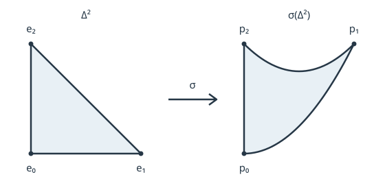
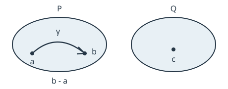

# ATOP16 特異鎖・特異ホモロジーと関手性

<!-- definition-example-audit: strict -->

[単体ホモロジー群](../ATOP14/index.md#def-atop14-simplicial-homology)は、与えられた三角形分割の辺や面から計算できました。しかし、任意の位相空間 $X$ に三角形分割があるとは限りません。また連続写像は、分割の頂点を頂点へ送るとは限りません。

そこで、空間の内部に直線の辺や平らな面を探す代わりに、標準単体を空間へ連続的に写します。曲がった辺、重なった面、一点へ潰れた面も同じ方法で扱えます。係数は全て整数とします。

## 1. 標準単体を空間へ写す

整数 $n\ge0$ を固定します。[標準単体](../../../応用系/FIX/FIX1/index.md#def-fix1-standard-simplex)を次の座標で表します。

$$
\Delta^n=\{(t_0,\ldots,t_n)\in\mathbb R^{n+1}:
t_i\ge0,\ \sum_{i=0}^n t_i=1\}.
$$

位相は Euclid 空間の部分空間位相です。頂点は第 $i$ 座標だけが1で他が0の標準基底ベクトル $e_i$（$0\le i\le n$）です。特に $\Delta^0$ は一点、$\Delta^1$ は線分、$\Delta^2$ は内部を含む三角形です。標準単体は定義域であり、その像の次元や形は制限しません。

<!-- formal-statement-start -->
> **定義（特異単体）**
> 位相空間 $X$ と整数 $n\ge0$ に対し、連続写像 $\sigma:\Delta^n\to X$ を $X$ の特異 $n$ 単体という。
<!-- formal-statement-end -->

<!-- definition-example-start: def-atop16-singular-simplex -->
**定義の確認**

$X=\mathbb R^2$ として、$\Delta^2$ 上の写像

$$
\sigma(t_0,t_1,t_2)=(t_1,t_2+t_1^2)
$$

を取ります。各成分は座標の多項式なので連続であり、特異2単体です。頂点の像 $p_i=\sigma(e_i)$ は順に $(0,0),(1,1),(0,1)$ です。$t_2=0$ の辺は $(t_1,t_1^2)$ という曲線へ写ります。頂点の座標が決まっても辺の像は一般には決まりません。

一方、$p\in X$ を固定して全点を $p$ に送る写像も、開集合の逆像が空集合または定義域全体なので連続です。定数写像も全ての非負次数の特異単体になります。
<!-- definition-example-end -->

同じ像を持つ写像でも、定義域の各点への値が異なれば別の特異単体です。特に $\Delta^1$ と $[0,1]$ の対応は

$$
u=t_1,\qquad (t_0,t_1)=(1-u,u),\quad 0\le u\le1
$$

で、両方向とも連続です。以後、$\gamma(u)$ は $\gamma(1-u,u)$ の区間表示とします（左辺は区間を定義域とする表示、右辺は標準単体上の元の写像）。例えば $u\mapsto u$ と $u\mapsto u^2$ は同じ線分を同じ端点間で走る異なる写像です。

## 2. 有限個の写像を足す

$X$ の特異 $n$ 単体全体を $S_n(X)$ と書きます。これは写像の集合であり、一般には有限集合ではありません。[自由加群の基底](../../../代数系/MOD/MOD1/index.md#def-mod1-free-module-basis)を使えば、全ての写像を独立な基底として扱えます。ただし一つの鎖の中に現れる写像は有限個だけです。記号 $\bigoplus$ は直和を表し、ここでは係数が零でない基底の集合（支持）が有限であることを意味します。

<!-- formal-statement-start -->
> **定義（特異鎖群）**
> 位相空間 $X$ の整数係数の特異鎖群を、$n\ge0$ で

$$
C_n(X;\mathbb Z)=\bigoplus_{\sigma\in S_n(X)}\mathbb Z\sigma
$$

> とする。その元は有限個の特異 $n$ 単体の整数線形結合であり、特異 $n$ 鎖という。加法と整数倍は基底ごとの係数で定める。負次数では零加群とする。
<!-- formal-statement-end -->

<!-- definition-example-start: def-atop16-singular-chains -->
**定義の確認**

$X=[0,1]$ とし、$\sigma(u)=u,\ \tau(u)=u^2$ とします。二つとも連続であり、例えば $u=1/2$ で値が異なります。

$$
c=2\sigma-3\tau,\qquad c+\tau=2\sigma-2\tau.
$$

$c$ は二つの基底元以外の係数が零なので有限支持です。基底係数が一意であるため $c\ne0$ です。逆に、全ての定数1単体に係数1を与えた記録は、定数の値が無限個あるため鎖ではありません。
<!-- definition-example-end -->

以下では $C_n(X;\mathbb Z)$ を $C_n(X)$ と略します。0単体は点 $p$ と一対一に対応し、その基底記号を $\langle p\rangle$ とします。1単体の逆走は一般に元の基底とは別の写像であり、負の係数を付けた鎖と等しくはありません。

## 3. 面への制限と境界

[単体境界作用素](../ATOP13/index.md#def-atop13-boundary)と同様に、頂点を一つ除くたびに符号を交代させます。ただし今度は頂点列ではなく、標準単体への座標挿入によって面を選びます。

<!-- formal-statement-start -->
> **定義（面写像）**
> $n\ge1$ と $0\le i\le n$ に対し、$i$ 番目の座標に零を挿入する連続写像 $\delta_i^n:\Delta^{n-1}\to\Delta^n$ を

$$
\delta_i^n(t_0,\ldots,t_{n-1})
=(t_0,\ldots,t_{i-1},0,t_i,\ldots,t_{n-1})
$$

> とする。端の位置では該当する前方または後方の列を空とする。
<!-- formal-statement-end -->

<!-- definition-example-start: def-atop16-face-map -->
**定義の確認**

$n=2$ なら入力 $(1-u,u)$ に対し、

$$
\begin{aligned}
\delta_0^2(1-u,u)&=(0,1-u,u),\\
\delta_1^2(1-u,u)&=(1-u,0,u),\\
\delta_2^2(1-u,u)&=(1-u,u,0).
\end{aligned}
$$

$0\le u\le1$ なら非負で和が1の三成分です。各写像は座標の線形関数なので連続で、指定座標が零の辺へ写ります。順に頂点 $1$ から $2$、$0$ から $2$、$0$ から $1$ を結びます。
<!-- definition-example-end -->

面写像と特異単体を合成すると、一つ低い次数の連続写像になります。合成 $\sigma\circ\delta_i^n$ を式中で $\sigma\delta_i^n$ と略記することもあります。基底の像を指定して、[自由加群の普遍性](../../../代数系/MOD/MOD1/index.md#thm-mod1-free-universal-property)により整数線形に延長します。

<!-- formal-statement-start -->
> **定義（特異境界作用素）**
> 位相空間 $X$ の特異鎖群について、$n\ge1$ の境界作用素 $\partial_n:C_n(X)\to C_{n-1}(X)$ を基底上で

$$
\partial_n\sigma=\sum_{i=0}^n(-1)^i\sigma\circ\delta_i^n
$$

> と定め、整数線形に延長する。$\partial_0$ は零写像とする。
<!-- formal-statement-end -->

<!-- definition-example-start: def-atop16-singular-boundary -->
**定義の確認**

先ほどの曲がった特異2単体 $\sigma$ の三面を $a_{12},a_{02},a_{01}$ とします。座標の挿入を実行すると

$$
\begin{aligned}
a_{12}(u)&=(1-u,u+(1-u)^2),\\
a_{02}(u)&=(0,u),\\
a_{01}(u)&=(u,u^2).
\end{aligned}
$$

各面は $0\le u\le1$ 上の連続写像ですから特異1単体です。境界は

$$
\partial_2\sigma=a_{12}-a_{02}+a_{01}.
$$

例えば $2\sigma$ の境界は各面の係数を2倍したものです。有限個の基底の像は有限和なので、線形延長しても有限支持が保たれます。
<!-- definition-example-end -->

特異1単体 $\gamma$ を第1節の区間表示で書けば、$\delta_0^1(1)=(0,1)$ は終点 $u=1$、$\delta_1^1(1)=(1,0)$ は始点 $u=0$ に対応します。[特異境界作用素](#def-atop16-singular-boundary)から

$$
\partial_1\gamma=\langle\gamma(1)\rangle-\langle\gamma(0)\rangle.
$$

上の三面の境界を取ると、頂点像を $p_i=\sigma(e_i)$ として

$$
\begin{aligned}
\partial_1\partial_2\sigma
={}&(\langle p_2\rangle-\langle p_1\rangle)\\
&-(\langle p_2\rangle-\langle p_0\rangle)\\
&+(\langle p_1\rangle-\langle p_0\rangle)=0.
\end{aligned}
$$

この相殺を任意の次元で証明します。重要なのは像が曲がっていても、定義域で二つの座標を零にする順序だけで符号が決まることです。

<!-- formal-statement-start -->
> **定理（特異鎖の二重境界の消滅）**
> 任意の位相空間 $X$ の整数係数の特異境界作用素について、全ての $n\ge1$ で

$$
\partial_{n-1}\partial_n=0
$$

> が成り立つ。
<!-- formal-statement-end -->

見取り図：二つの異なる元の座標 $i<j$ を除いた面は二回現れます。$i$ を先に除くと $j$ の番号が一つ減るため、符号が反対になります。

<!-- proof-start -->
### 証明

$n=1$ では $\partial_0=0$ です。$n\ge2$ とし、基底 $\sigma$ に対して[特異境界作用素](#def-atop16-singular-boundary)を二度使います。

$$
\partial_{n-1}\partial_n\sigma
=\sum_{a=0}^n\sum_{b=0}^{n-1}
(-1)^{a+b}\sigma\circ\delta_a^n\circ\delta_b^{n-1}.
$$

元の座標 $0\le i<j\le n$ を零にした面を固定します。外側の面で $j$ を除く場合、内側では $i$ を除きます。外側で $i$ を除く場合、残った座標列で元の $j$ は $j-1$ 番目になります。従って

$$
\delta_j^n\circ\delta_i^{n-1}
=\delta_i^n\circ\delta_{j-1}^{n-1}.
$$

実際どちらも入力の順番を保ったまま第 $i,j$ 座標に零を入れます。二項の係数は

$$
(-1)^{j+i}+(-1)^{i+j-1}=0.
$$

二重和の各項は異なる二つの元の座標を除いた面であり、各組は上の二通りだけです。全項をこの組で分ければ零になります。基底で成立し、境界は整数線形なので全鎖で成立します。
<!-- proof-end -->

この結果は [単体鎖複体](../ATOP13/index.md#def-atop13-simplicial-chain-complex) と同じ鎖複体の構造を任意の位相空間に与えます。ここでは定数単体も基底から除いていないことに注意してください。

## 4. 境界の差を無視する

[単体サイクルと単体境界鎖](../ATOP14/index.md#def-atop14-cycles-boundaries)で行ったように、特異鎖でも境界が零の鎖と、一つ上の次数の境界になっている鎖を区別します。[加群準同型の核・像](../../../代数系/MOD/MOD1/index.md#def-mod1-homomorphism)の記号 $\ker,\operatorname{im}$ はそれぞれ零へ写る元の集合、写像の値全体の集合を表します。境界作用素は整数線形なので、[核と像は部分加群](../../../代数系/MOD/MOD1/index.md#prop-mod1-kernel-image)であることを使えます。

<!-- formal-statement-start -->
> **定義（特異サイクルと特異境界鎖）**
> 位相空間 $X$ と $n\ge0$ に対し、特異サイクル群と特異境界群をそれぞれ

$$
Z_n(X)=\ker\partial_n,\qquad B_n(X)=\operatorname{im}\partial_{n+1}
$$

> とする。それぞれの元を特異サイクル、特異境界鎖という。
<!-- formal-statement-end -->

<!-- definition-example-start: def-atop16-singular-cycles -->
**定義の確認**

$X=[0,1]$ とし、$a=\langle0\rangle,b=\langle1\rangle$ とします。$\gamma(u)=u$ の境界は $b-a$ です。従って $b-a\in B_0(X)$ であり、$\partial_0(b-a)=0$ なので $Z_0(X)$ にも属します。

また $0$ を値とする定数1単体 $k$ は両端が同じなので $\partial_1 k=0$。$0$ を値とする定数2単体 $q$ の三面は全て $k$ なので

$$
\partial_2q=k-k+k=k.
$$

従って $k$ は零鎖ではありませんがサイクルでも境界鎖でもあります。
<!-- definition-example-end -->

[特異鎖の二重境界の消滅](#thm-atop16-singular-boundary-square)より $B_n(X)\subseteq Z_n(X)$ です。[商加群](../../../代数系/MOD/MOD1/index.md#def-mod1-quotient-module)を用いて、境界の差だけ異なるサイクルを同一視します。

<!-- formal-statement-start -->
> **定義（特異ホモロジー群）**
> 位相空間 $X$ の整数係数の特異ホモロジー群を、$n\ge0$ に対して

$$
H_n(X;\mathbb Z)=Z_n(X)/B_n(X)
$$

> と定める。サイクル $z$ の類は $[z]=z+B_n(X)$ と書く。二つのサイクルの差が境界群に属することと、その類が等しいことは同値である。
<!-- formal-statement-end -->

<!-- definition-example-start: def-atop16-singular-homology -->
**定義の確認**

上の区間の例では $b-a=\partial_1\gamma$ なので $[a]=[b]$ です。また $[k]=0$ ですが $k$ 自体は基底元であって零ではありません。

一点空間 $X=\{p\}$ の場合には各次数の特異単体は定数単体 $k_n$ 一つだけです。$C_n(X)=\mathbb Z k_n$ であり、$n\ge1$ では

$$
\partial_n k_n=
\left(\sum_{i=0}^n(-1)^i\right)k_{n-1}.
$$

$n=2m+1$ なら $m+1$ 組の $1-1$ が現れて括弧内は0です。$n=2m\ (m\ge1)$ なら $m$ 組の $1-1$ の後に最後の $+1$ が残ります。従って0次では $Z_0=\mathbb Z k_0,B_0=0$。正の奇数次数では $Z_n=B_n=\mathbb Z k_n$、正の偶数次数では $Z_n=B_n=0$ となります。よって

$$
H_0(\{p\};\mathbb Z)\cong\mathbb Z,\qquad
H_n(\{p\};\mathbb Z)=0\quad(n>0).
$$

定数単体を含む鎖群と、そのホモロジー群が異なることが分かります。
<!-- definition-example-end -->

以下では係数を省略して $H_n(X)$ と書きます。空空間では全ての標準単体が非空なので特異単体は一つもなく、全次数の鎖群とホモロジー群が零です。

## 5. 連続写像を鎖とホモロジーに作用させる

連続写像 $f:X\to Y$ があると、特異単体の像を $f$ でさらに写すだけで $Y$ の特異単体が作れます。分割を選ぶ必要はありません。合成 $f\circ\sigma$ は連続で特異単体になります。[自由加群の普遍性](../../../代数系/MOD/MOD1/index.md#thm-mod1-free-universal-property)により、この基底上の対応は整数線形な準同型へ一意に延長できます。

<!-- formal-statement-start -->
> **定義（特異鎖の誘導準同型）**
> 連続写像 $f:X\to Y$ と $n\ge0$ に対して、$f_{\#,n}:C_n(X)\to C_n(Y)$ を

$$
f_{\#,n}(\sigma)=f\circ\sigma
$$

> で基底上に定め、整数線形に延長する。負次数では零写像とする。
<!-- formal-statement-end -->

<!-- definition-example-start: def-atop16-induced-chain-map -->
**定義の確認**

$f:[0,1]\to\{p\}$ を定数写像とし、$\sigma(u)=u,\tau(u)=u^2$ とします。合成はともに連続な定数1単体 $k_1$ です。従って

$$
f_{\#,1}(2\sigma-3\tau)=2k_1-3k_1=-k_1.
$$

元の基底が異なっていても像が一致すれば係数を足します。定数単体に潰れたからといって零にするわけではありません。各基底の像は一つの基底であり、有限和の像は有限和です。
<!-- definition-example-end -->

以下では次数が分かるとき $f_\#$ と略します。境界作用素がどの空間の鎖に作用するかを区別するときは $\partial_n^X,\partial_n^Y$ と上付きに空間名を添えます。上付きは冪ではありません。

<!-- formal-statement-start -->
> **定理（特異鎖の誘導準同型と境界の可換性）**
> 位相空間の連続写像 $f:X\to Y$ が誘導する鎖群の準同型について、$n\ge1$ で

$$
\partial_n^Y f_{\#,n}=f_{\#,n-1}\partial_n^X
$$

> が成り立つ。0次でも両辺は零である。
<!-- formal-statement-end -->

見取り図：面を取ってから $f$ で写しても、先に $f$ で写してから面を取っても、合成の順序を括り直しただけです。

<!-- proof-start -->
### 証明

$n\ge1$ の基底 $\sigma$ について [特異境界作用素](#def-atop16-singular-boundary)を適用します。

$$
\begin{aligned}
\partial_n^Y f_{\#,n}(\sigma)
&=\sum_{i=0}^n(-1)^i(f\circ\sigma)\circ\delta_i^n\\
&=\sum_{i=0}^n(-1)^i f\circ(\sigma\circ\delta_i^n)\\
&=f_{\#,n-1}\left(\sum_{i=0}^n(-1)^i
\sigma\circ\delta_i^n\right)\\
&=f_{\#,n-1}\partial_n^X\sigma .
\end{aligned}
$$

合成は連続写像の合成であり、最後から二番目の等号は整数線形性です。全鎖への延長で等式が成立します。0次は両空間で境界が零であるため成立します。
<!-- proof-end -->

例えば $\gamma$ の始点が $a$、終点が $b$ なら、写してから境界を取っても、先に境界を取って各点を写しても

$$
\partial_1^Y(f_{\#,1}\gamma)
=\langle f(b)\rangle-\langle f(a)\rangle
=f_{\#,0}(\partial_1^X\gamma)
$$

となります。サイクルはサイクルへ、境界鎖は境界鎖へ移るので、次にサイクルの類に対する写像を作ります。

<!-- formal-statement-start -->
> **定理（特異ホモロジーの誘導準同型）**
> 連続写像 $f:X\to Y$ と $n\ge0$ に対して

$$
H_n(f):H_n(X)\to H_n(Y),\qquad
H_n(f)([z])=[f_{\#,n}(z)]
$$

> は代表元の選択によらず定まる群準同型である。恒等写像と連続写像の合成について

$$
H_n(\operatorname{id}_X)=\operatorname{id}_{H_n(X)},
$$

$$
H_n(g\circ f)=H_n(g)\circ H_n(f)
\qquad(g:Y\to W)
$$

> が成立する。
<!-- formal-statement-end -->

見取り図：境界との可換性はサイクルをサイクルへ、境界鎖を境界鎖へ送ります。この二点が商群上で写像を作れる理由です。

<!-- proof-start -->
### 証明

以下の計算では鎖の次数から決まる境界作用素の下付きも省略します。例えば $z$ は $n$ 鎖、$w$ は $(n+1)$ 鎖なので、$\partial^X z$ は $\partial_n^X z$、$\partial^X w$ は $\partial_{n+1}^X w$ を指します。

$z\in Z_n(X)$ なら [境界との可換性](#thm-atop16-chain-map)から

$$
\partial^Y f_\#z=f_\#\partial^Xz=f_\#0=0.
$$

従って像はサイクルです。[特異ホモロジー群の定義](#def-atop16-singular-homology)で $[z]=[z']$ なら $z-z'=\partial^X w$ を満たす $w\in C_{n+1}(X)$ が存在し、

$$
f_\#z-f_\#z'=f_\#(\partial^X w)=\partial^Y f_\#w.
$$

よって像の差は境界鎖であり、同じ類になります。[商加群の演算](../../../代数系/MOD/MOD1/index.md#prop-mod1-quotient-well-defined)と $f_\#$ の整数線形性により、$a,b\in\mathbb Z$ とサイクル $z,z'$ に対して

$$
\begin{aligned}
H_n(f)(a[z]+b[z'])
&=[f_\#(az+bz')]\\
&=a[f_\#z]+b[f_\#z']
\end{aligned}
$$

となり、準同型です。

恒等写像は基底 $\sigma$ に対して $\operatorname{id}_X\circ\sigma=\sigma$ となるので、鎖でも類でも恒等写像を誘導します。連続写像 $g:Y\to W$ に対し、基底上で

$$
(g\circ f)_\#\sigma=g\circ(f\circ\sigma)=g_\# f_\#\sigma.
$$

整数線形に延長してサイクル $z$ に適用すれば

$$
H_n(g\circ f)([z])
=[g_\# f_\#z]=H_n(g)(H_n(f)([z])).
$$

これで両法則が示されました。
<!-- proof-end -->

空間に群を、連続写像に同じ向きの準同型を対応させ、恒等写像と合成を保存することが、ここでいう関手性です。例えば同相写像 $f:X\to Y$ なら連続な逆写像 $g$ があり、合成法則で

$$
H_n(g)H_n(f)=\operatorname{id}_{H_n(X)},\qquad
H_n(f)H_n(g)=\operatorname{id}_{H_n(Y)}.
$$

従って同相な空間の特異ホモロジー群は同型です。まだ連続変形で結ばれた二つの写像が同じ準同型を誘導するとは証明していません。

## 6. 0次群は何を数えるか

0鎖は点の有限整数結合で、全てサイクルです。[道・弧状連結](../../../基礎科目/TOP/TOP3/index.md#def-top3-path-connected)で扱った道の存在に着目します。本講の道連結は既習の弧状連結と同じ意味です（道に単射性は要求しません）。点 $p,q$ を結ぶ道があることを関係とすると、定数道で反射性が成立します。また $p$ から $q$ への道 $\gamma$ があれば、$u\mapsto\gamma(1-u)$ は $q$ から $p$ への道なので対称性が成立します。$p$ から $q$ への道 $\gamma$ と $q$ から $r$ への道 $\eta$ があれば

$$
\lambda(u)=
\begin{cases}
\gamma(2u)&0\le u\le 1/2,\\
\eta(2u-1)&1/2\le u\le1
\end{cases}
$$

は接続点で両方とも $q$ となり、二つの閉区間上の連続写像が一致するので連続です。端点は $p,r$ であり、推移性も成立します。各同値類が道連結成分です。連結成分と一致するとは一般には限りません。

道連結成分全体の集合を $\mathcal P(X)$ とします。異なる成分には異なる基底記号 $e_P$ を割り当てます。

図の $a,b$ は成分 $P$ の点、$c$ は別の成分 $Q$ の点です。$a$ から $b$ への道 $\gamma$ の境界は $\langle b\rangle-\langle a\rangle$ です。成分 $Q$ の点と $a$ を結ぶ道は存在しません。

各成分内で終点と始点の係数は相殺されます。逆に、成分ごとの係数和が零なら、各点を同じ成分内の代表点へ向かう道で結ぶことで境界として表せます。

<!-- formal-statement-start -->
> **定理（0次特異ホモロジーと道連結成分）**
> 任意の位相空間 $X$ の道連結成分の集合を $\mathcal P(X)$ とする。このとき

$$
H_0(X;\mathbb Z)\cong
\bigoplus_{P\in\mathcal P(X)}\mathbb Z e_P.
$$

> 同型は点 $p$ の0鎖の類を、$p$ が属する道連結成分の基底へ送る写像で与えられる。
<!-- formal-statement-end -->

<!-- proof-start -->
### 証明

成分 $P$ ごとの基底 $e_P$ を持つ[自由加群](../../../代数系/MOD/MOD1/index.md#def-mod1-free-module-basis)を $F(X)$ とします。$P(p)$ は点 $p$ の属する成分です。$a_p$ を点 $p$ の係数とし、書かれていない点では零とします。$C_0(X)$ 上の写像

$$
A\left(\sum_p a_p\langle p\rangle\right)
=\sum_p a_p e_{P(p)}
$$

は有限和で定まり、整数線形です。各成分 $P$ は非空なので一点 $p\in P$ を取れば $A(\langle p\rangle)=e_P$。よって各基底が像に入り、全射です。

任意の特異1単体 $\gamma$ の両端は道で結ばれているので同じ成分に属します。従って

$$
A(\partial_1\gamma)=e_{P(\gamma(1))}-e_{P(\gamma(0))}=0.
$$

整数線形性より $B_0(X)\subseteq\ker A$ です。

逆に $c=\sum_p a_p\langle p\rangle\in\ker A$ とします。自由基底の独立性から、各成分 $P$ における係数和は零です。$c$ の有限支持と交わる成分ごとに一点 $r_P$ を選び、支持内の各点 $p\in P$ について $r_P$ から $p$ への道 $\gamma_p$ を選びます。以下の $P$ に関する和は支持と交わる成分だけを走るので、有限個の選択だけで十分です。

$$
\begin{aligned}
\partial_1\left(\sum_p a_p\gamma_p\right)
&=\sum_p a_p(\langle p\rangle-\langle r_{P(p)}\rangle)\\
&=c-\sum_P\left(\sum_{p\in P}a_p\right)\langle r_P\rangle\\
&=c.
\end{aligned}
$$

従って $\ker A\subseteq B_0(X)$ で、両者は等しいです。

$\partial_0=0$ なので $Z_0(X)=C_0(X)$。[特異ホモロジー群の定義](#def-atop16-singular-homology)より、写像 $[c]\mapsto A(c)$ は、差が $B_0(X)$ にあるとき値が等しいため良定義です。逆に値が等しければ差が核、すなわち $B_0(X)$ にあるため単射です。$A$ の全射性から全射でもあり、整数線形性も保たれます。これで同型が得られました。
<!-- proof-end -->

空間 $X=[0,1]\cup[2,3]\subset\mathbb R$ では、各区間内の二点は線形補間で結べます。一方、区間をまたぐ道があれば中間値の定理によって $3/2$ を通るはずですが、その点は $X$ に属しません。従って道連結成分は二つです。

$$
H_0(X)\cong\mathbb Z^2.
$$

$c=2\langle0\rangle-\langle1\rangle+3\langle2\rangle$ は成分ごとの係数和 $(1,3)$ に対応します。全係数和が零でも、成分ごとに零でなければ境界ではありません。

連続写像 $f:X\to Y$ は道を道へ送るため、各道連結成分 $P$ の像は一つの道連結成分 $Q$ に含まれます。実際、$p,q\in P$ を結ぶ道 $\gamma$ に対し $f\circ\gamma$ は $f(p),f(q)$ を結ぶ道なので、それらは同じ成分に属します。上の同型と [特異ホモロジーの誘導準同型](#thm-atop16-induced-homology)により $H_0(f)$ は $e_P$ を $e_Q$ へ送ります。これで空間の成分を合流させる写像も整数の計算として読めます。

## 7. 演習

### 演習 ATOP16-A1：異なる特異1単体

- Level: A

$X=[0,1]$ で $\sigma(u)=u,\tau(u)=1-u$ とする。両者が特異1単体であることを確認し、$\sigma+\tau$ が零鎖か、またサイクルかを判定せよ。

<!-- solution-start -->
**詳細解答**

[特異単体の定義](#def-atop16-singular-simplex)より、両者は区間から区間への連続写像なので特異1単体です。$u=0$ における値が異なるので [特異鎖群](#def-atop16-singular-chains)では別々の基底です。両係数は1なので和は零鎖ではありません。

[特異境界作用素](#def-atop16-singular-boundary)から

$$
\partial_1(\sigma+\tau)
=(\langle1\rangle-\langle0\rangle)
+(\langle0\rangle-\langle1\rangle)=0.
$$

従ってサイクルです。逆走写像を負の基底と同一視する必要はありません。
<!-- solution-end -->

### 演習 ATOP16-A2：三角形の面

- Level: A

$\sigma:\Delta^2\to\mathbb R$ を $\sigma(t_0,t_1,t_2)=2t_1+3t_2$ とする。三つの面を区間の変数 $u$ で表し、境界を計算せよ。

<!-- solution-start -->
**詳細解答**

[面写像](#def-atop16-face-map)で零座標を順に挿入すると

$$
\begin{aligned}
\sigma\delta_0^2(1-u,u)&=2(1-u)+3u=2+u,\\
\sigma\delta_1^2(1-u,u)&=3u,\\
\sigma\delta_2^2(1-u,u)&=2u.
\end{aligned}
$$

三つとも区間上の連続写像です。これらを $a,b,c$ とおけば [特異境界作用素](#def-atop16-singular-boundary)より $\partial_2\sigma=a-b+c$。さらに

$$
\partial_1(a-b+c)
=(\langle3\rangle-\langle2\rangle)
-(\langle3\rangle-\langle0\rangle)
+(\langle2\rangle-\langle0\rangle)=0.
$$
<!-- solution-end -->

### 演習 ATOP16-A3：成分ごとの係数

- Level: A

$X=[0,1]\cup[2,3]$ の0鎖 $c=2\langle0\rangle-2\langle2\rangle$ と $d=2\langle0\rangle-2\langle1\rangle$ の類を成分基底で表せ。境界鎖となるものを判定せよ。

<!-- solution-start -->
**詳細解答**

[0次特異ホモロジーと道連結成分](#thm-atop16-h0-path-components)を二成分に適用します。順に $[0,1]$ と $[2,3]$ の係数を集めると $[c]$ は $(2,-2)$、$[d]$ は $(2-2,0)=(0,0)$ に対応します。

従って $c$ は境界ではなく、$d$ は境界です。実際、区間内の道 $\gamma(u)=u$ に対して

$$
\partial_1(-2\gamma)=-2(\langle1\rangle-\langle0\rangle)=d.
$$

全体の係数和は両方とも零ですが、それだけでは成分間の差は消えません。
<!-- solution-end -->

### 演習 ATOP16-A4：写像による基底の合流

- Level: A

$D=\{a,b,c\}$ と $E=\{x,y\}$ を離散空間とする。写像 $f:D\to E$ は $f(a)=f(c)=x,f(b)=y$ を満たす。$H_0(f)$ が $(2,-1,4)$ をどこへ送るか求めよ。

<!-- solution-start -->
**詳細解答**

離散位相なので $f$ は連続です。[実数の区間は連結](../../../基礎科目/TOP/TOP3/index.md#thm-top3-real-interval)で、[連結空間の連続像](../../../基礎科目/TOP/TOP3/index.md#thm-top3-continuous-image)も連結なので、離散空間への道は定数です。従って成分は一点ずつです。[0次群の成分基底](#thm-atop16-h0-path-components)を指定された順で用います。

[特異ホモロジーの誘導準同型](#thm-atop16-induced-homology)から

$$
2e_a-e_b+4e_c\longmapsto 2e_x-e_y+4e_x=6e_x-e_y.
$$

答えは $(6,-1)$ です。
<!-- solution-end -->

### 演習 ATOP16-B1：四面体の符号

- Level: B

特異3単体の二重境界で、元の座標 $1,3$ を零にする二つの項を特定せよ。符号と面写像の一致を確認せよ。

<!-- solution-start -->
**詳細解答**

[特異境界作用素](#def-atop16-singular-boundary)を二度適用したとき、外側で3を消す項は内側で1を消します。外側で1を消す項は残った列の2を消します。入力 $(s_0,s_1)\in\Delta^1$ について

$$
\begin{aligned}
\delta_3^3\delta_1^2(s_0,s_1)&=(s_0,0,s_1,0),\\
\delta_1^3\delta_2^2(s_0,s_1)&=(s_0,0,s_1,0).
\end{aligned}
$$

係数は順に $(-1)^{3+1}=1$ と $(-1)^{1+2}=-1$ です。合成先が同じ写像なので二項は相殺します。[二重境界の消滅](#thm-atop16-singular-boundary-square)の一般の組合せを具体的に確認できました。
<!-- solution-end -->

### 演習 ATOP16-B2：有限離散空間の全次数

- Level: B

$m$ 点の有限離散空間 $D$ の全ての $H_n(D)$ を求めよ。鎖群とホモロジー群を区別すること。

<!-- solution-start -->
**詳細解答**

$\Delta^n$ の任意の二点はその凸結合で結べるため道連結です。[道連結なら連結](../../../基礎科目/TOP/TOP3/index.md#thm-top3-path-implies-connected)であり、離散空間の二点以上を含む部分集合は一点とその補集合で分離されます。[連結空間の連続像](../../../基礎科目/TOP/TOP3/index.md#thm-top3-continuous-image)は連結なので、特異単体は定数写像に限られます。

従って [特異鎖群](#def-atop16-singular-chains) $C_n(D)$ は各点 $p\in D$ に対応する定数 $n$ 単体の基底 $k_{n,p}$ を持ち $\mathbb Z^m$ と同型です。[特異境界作用素](#def-atop16-singular-boundary)では $n\ge1$ のとき各面が $k_{n-1,p}$ なので

$$
\partial_n k_{n,p}=\left(\sum_{i=0}^n(-1)^i\right)k_{n-1,p}.
$$

奇数次数では零、正の偶数次数では同じ点の基底へ送る同型です。$n=0$ なら $Z_0=C_0,B_0=0$。正の奇数なら $Z_n=C_n=B_n$、正の偶数なら $Z_n=B_n=0$。従って

$$
H_0(D)\cong\mathbb Z^m,\qquad H_n(D)=0\quad(n>0).
$$

$m=0$ の場合も全て零なので式と一致します。
<!-- solution-end -->

### 演習 ATOP16-B3：代表元を変えた場合

- Level: B

$X=[0,1]$、$Y=\mathbb R$、$f(u)=u^2$ とする。0鎖 $z=\langle0\rangle,z'=\langle1\rangle$ の類が等しいことを示し、誘導準同型で像の類が一致することを、具体的な境界鎖で確認せよ。

<!-- solution-start -->
**詳細解答**

道 $\gamma(u)=u$ は連続で、$\partial_1\gamma=z'-z$。従って [特異ホモロジー群](#def-atop16-singular-homology)の定義で $[z']=[z]$ です。$f$ は連続であり、[特異鎖の誘導準同型](#def-atop16-induced-chain-map)により $f_\#\gamma$ は道 $u\mapsto u^2$ です。その境界は

$$
\partial_1(f_\#\gamma)=\langle1\rangle-\langle0\rangle
=f_\#z'-f_\#z.
$$

従って像の差も境界であり、$[f_\#z']=[f_\#z]$ となります。これは [誘導準同型の良定義性](#thm-atop16-induced-homology)を具体的な代表元で確認したものです。
<!-- solution-end -->

### 演習 ATOP16-B4：境界を実際に構成する

- Level: B

$X=[0,1]\cup[2,3]$ とし、次の0鎖を考える。

$$
z=3\langle0\rangle-5\langle1/2\rangle
+2\langle1\rangle+4\langle2\rangle-4\langle3\rangle.
$$

成分ごとの係数和を調べ、境界が $z$ になる特異1鎖を具体的な道の和として構成せよ。

<!-- solution-start -->
**詳細解答**

[0次特異ホモロジーと道連結成分](#thm-atop16-h0-path-components)より、第一成分で $3-5+2=0$、第二成分で $4-4=0$ なので $z$ は境界です。

証明と同じ構成で、代表点を0と2に選びます。区間の変数 $0\le u\le1$ に対し

$$
\alpha(u)=u/2,\qquad \beta(u)=u,\qquad \eta(u)=2+u
$$

とすれば、それぞれ0から $1/2$、0から1、2から3への連続な道です。代表点から自分自身への道は境界が零なので省略できます。1鎖を

$$
w=-5\alpha+2\beta-4\eta
$$

とすると、[特異境界作用素](#def-atop16-singular-boundary)から

$$
\begin{aligned}
\partial_1w
={}&-5(\langle1/2\rangle-\langle0\rangle)\\
&+2(\langle1\rangle-\langle0\rangle)\\
&-4(\langle3\rangle-\langle2\rangle)\\
={}&3\langle0\rangle-5\langle1/2\rangle+2\langle1\rangle\\
&+4\langle2\rangle-4\langle3\rangle=z.
\end{aligned}
$$

成分間を結ぶ道を使わず、成分内の道だけで目的の境界が得られました。
<!-- solution-end -->

### 演習 ATOP16-C1：成分を合流させる写像と合成

- Level: C

$X=[0,1]\cup[2,3]\cup[4,5]$ と $Y=[0,1]\cup[2,3]$ を実数直線の部分空間とする。$f:X\to Y$ を最初と第三の区間では定数0、第二の区間では $f(u)=u$ とする。$g:Y\to\{p\}$ は定数写像とする。

1. $f$ の連続性を確認せよ。
2. 成分順の基底で $H_0(f)$ の行列、核と像を求めよ。
3. $H_0(g\circ f)$ と $H_0(g)H_0(f)$ を計算し一致を確かめよ。
4. $\langle4\rangle-\langle0\rangle$ は $X$ とその像で境界となるか。

<!-- solution-start -->
**詳細解答**

各区間は $X$ の開集合でもあります。例えば $[0,1]=X\cap(-1,3/2)$ で、他の区間も隙間の中に端点を置いた開区間との交わりです。各区間で $f$ は定数写像または恒等写像の制限なので連続です。$Y$ の任意の開集合の逆像は、それぞれの区間での開な逆像の和集合であり $X$ で開です。従って $f$ は連続です。

各区間内は直線の道で結べ、異なる区間間を道で結ぶと中間値の定理に反します。[0次特異ホモロジーと道連結成分](#thm-atop16-h0-path-components)により、$H_0(X)$ は $\mathbb Z^3$、$H_0(Y)$ は $\mathbb Z^2$ と同型です。[誘導準同型](#thm-atop16-induced-homology)は点の像によって各成分の基底を送ります。$X$ の成分基底を $e_1,e_2,e_3$、$Y$ の成分基底を $v_1,v_2$ とすると、最初と第三の成分は $Y$ の第一成分へ、第二成分は第二成分へ写るため

$$
H_0(f)e_1=v_1,\quad H_0(f)e_2=v_2,\quad H_0(f)e_3=v_1.
$$

整数線形性から

$$
H_0(f)(ae_1+be_2+ce_3)=(a+c)v_1+bv_2
\qquad(a,b,c\in\mathbb Z).
$$

[基底による整数行列表示](../ATOP13/index.md#boundary-matrix-coordinates)と同じく、各基底の像の座標を列に並べます。転置記号 $\mathsf T$ を使って座標を列ベクトルで表すと、始域の基底が3個、終域の基底が2個なので $M_f$ は $2\times3$ 行列です。

$$
M_f=\begin{pmatrix}1&0&1\\0&1&0\end{pmatrix},
\qquad M_f(a,b,c)^{\mathsf T}=(a+c,b)^{\mathsf T}.
$$

核の条件は $a+c=0,b=0$ です。従って核は $\mathbb Z(1,0,-1)^{\mathsf T}$。任意の $(s,t)^{\mathsf T}$ は $(s,t,0)^{\mathsf T}$ の像なので像は $\mathbb Z^2$ 全体です。

$g$ は二つの成分を唯一の成分の基底 $e_p$ に送るので、$H_0(g)(sv_1+tv_2)=(s+t)e_p$ です。従って $M_g=(1\ \ 1)$ は $1\times2$ 行列です。実際に掛けると

$$
M_gM_f=(1\cdot1+1\cdot0,\ 
1\cdot0+1\cdot1,\ 
1\cdot1+1\cdot0)=(1\ \ 1\ \ 1).
$$

合成 $g\circ f$ は三成分を唯一の成分へ送るので、直接得られる行列も $(1\ \ 1\ \ 1)$ です。[特異ホモロジーの誘導準同型の合成法則](#thm-atop16-induced-homology)を、この成分基底で確かめられました。

最後の0鎖は $X$ で成分係数 $(-1,0,1)$ を持つので境界ではありません。しかし $f$ は両点を0に送るため、その像は $\langle0\rangle-\langle0\rangle=0$ であり境界です。核の計算とも一致します。これで連続写像が成分の区別を失わせる仕組みが分かりました。
<!-- solution-end -->

## 8. まとめと次講

標準単体からの連続写像を全て基底に選べば、分割のない空間でも鎖群を作れます。面への制限の交代和は二重境界を零にし、サイクルを境界の差で分類できます。連続写像との合成は境界と可換で、ホモロジー群上の準同型を誘導します。0次群は道連結成分の数と対応を記録します。

次講では、連続変形で結ばれた二つの写像は同じ準同型を誘導するのかを調べます。プリズムの単体分割が新しい道具になります。

## 参考文献

- A. Hatcher, [*Algebraic Topology*](https://pi.math.cornell.edu/~hatcher/AT/ATchapters.html), Section 2.1.
- J. R. Munkres, *Elements of Algebraic Topology*, singular homology.
