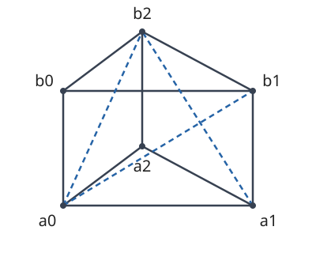

# ATOP17 鎖ホモトピーとホモトピー不変性

<!-- definition-example-audit: strict -->

前講の[特異ホモロジーの誘導準同型](../ATOP16/index.md#thm-atop16-induced-homology)により、連続写像 $f:X\to Y$ はホモロジー群の準同型 $H_n(f):H_n(X)\to H_n(Y)$ を定めます。ところが、写像を少しずつ動かすと、鎖の像は別の基底元に変わります。ホモロジー群上でも像が変わるのでしょうか。

[特異単体](../ATOP16/index.md#def-atop16-singular-simplex)では、0単体は点に対応し、1単体は区間上の道として表せます。例えば区間 $[0,1]$ の二つの端点は異なる0単体ですが、端点を結ぶ道の[特異境界](../ATOP16/index.md#def-atop16-singular-boundary)がその差です。従ってホモロジーでは区別されません。この「動いた跡の境界を取る」という考えを全ての次数に拡張します。係数は整数、負次数の鎖群は零とします。

## 1. 鎖の差を一つ上の次数で説明する

[特異鎖群](../ATOP16/index.md#def-atop16-singular-chains)を $C_n(X)$、[特異境界作用素](../ATOP16/index.md#def-atop16-singular-boundary)を $\partial^X_n$ と書きます。連続写像の誘導準同型は[境界と可換](../ATOP16/index.md#thm-atop16-chain-map)でした。各次数の整数線形写像の族 $F=(F_n)_{n\ge0}$ を考えます。各 $F_n:C_n(X)\to C_n(Y)$ が

$$
\partial^Y_n F_n=F_{n-1}\partial^X_n
$$

を満たすとき、この族を鎖写像と呼びます。負次数の写像は零とします。上付きの空間名と下付きの次数は作用対象から決まるとき省き、$F_n(z)$ を $F_nz$ とも書きます。[特異サイクルと特異境界鎖](../ATOP16/index.md#def-atop16-singular-cycles)のうち、サイクルは $\partial_nz=0$ を満たす鎖で、境界鎖は $\partial_{n+1}w$ と書ける鎖です。二つの鎖写像の差が、鎖を一つ上の次数に送る操作と境界との組合せで表されれば、サイクルの像の差は境界になります。

<!-- formal-statement-start -->
> **定義（特異鎖の鎖ホモトピー）**
> 位相空間 $X,Y$ の整数係数特異鎖群の間の二つの鎖写像 $F,G$ を取る。すなわち各次数の準同型は境界と可換である。
> 各 $n\ge0$ の準同型 $K_n:C_n(X)\to C_{n+1}(Y)$ が次式を満たすとき、$K$ を $F$ から $G$ への鎖ホモトピーという。$K_{-1}=0$ とする。

$$
G_n-F_n=\partial^Y_{n+1}K_n+K_{n-1}\partial^X_n.
$$
<!-- formal-statement-end -->

<!-- definition-example-start: def-atop17-chain-homotopy -->
**定義の確認**

$X=Y=\{p\}$ とし、唯一の特異 $n$ 単体を $k_n$ とします。各鎖群の恒等写像 $F_n=G_n=\mathrm{id}_{C_n(X)}$ は、両辺が $\partial_n$ となるため境界と可換です。偶数次数で $K_n(k_n)=k_{n+1}$、奇数次数で $K_n(k_n)=0$ と定め、整数線形に延長します。

[特異鎖群](../ATOP16/index.md#def-atop16-singular-chains)では各 $k_n$ が基底なので、この指定は準同型を一意に定めます。[特異境界作用素](../ATOP16/index.md#def-atop16-singular-boundary)により、各面が同じ定数単体であることから $n\ge1$ では

$$
\partial_n k_n=\left(\sum_{j=0}^n(-1)^j\right)k_{n-1}.
$$

隣り合う $+1,-1$ を組にすると、正の偶数次数では最後の $+1$ が残り、奇数次数では全て相殺します。0次の境界は定義により零です。

偶数 $n$ では $\partial K_n(k_n)=0$ です。さらに正次数では $K_{n-1}(k_{n-1})=0$、0次では $\partial_0=0$ です。

奇数 $n$ では $K_n(k_n)=0$ かつ $\partial_n(k_n)=0$ です。いずれも右辺は零、左辺も零です。各次数で基底上の等式が成立し、整数線形性により全鎖で成立します。よって非零の鎖ホモトピーの例が得られました。
<!-- definition-example-end -->

この条件は鎖写像が等しいことを要求していません。サイクル上では第二項が消え、第一項だけが残ることが本質です。

<!-- formal-statement-start -->
> **定理（鎖ホモトピーとホモロジー上の一致）**
> 位相空間 $X,Y$ の整数係数特異鎖群の間の鎖写像 $F,G$ が鎖ホモトピーで結ばれているなら、全ての $n\ge0$ でホモロジー群上の誘導準同型は一致する。
<!-- formal-statement-end -->

見取り図：代表サイクル $z$ の境界が零なので、鎖ホモトピーの式は像の差を具体的な境界として与えます。

<!-- proof-start -->
### 証明

鎖写像 $F$ は $\partial^Y F_n(z)=F_{n-1}\partial^X z$ によりサイクルをサイクルに送ります。また $z-z'=\partial^X w$ なら $F_n(z)-F_n(z')=\partial^Y F_{n+1}(w)$ ですから、境界の差を保ちます。$G$ についても同じ二つの等式が成り立ちます。従って両者は[特異ホモロジー群](../ATOP16/index.md#def-atop16-singular-homology)上の準同型を定めます。

$z\in C_n(X)$ をサイクルとすると、$\partial^X z=0$ なので、[鎖ホモトピーの定義](#def-atop17-chain-homotopy)から

$$
G_n(z)-F_n(z)=\partial^Y_{n+1}K_n(z).
$$

像の差は特異境界鎖です。従って $[G_n(z)]=[F_n(z)]$ となり、任意のホモロジー類 $[z]$ 上で一致します。
<!-- proof-end -->

残る問題は、空間上の連続変形から $K$ を実際に作れるかということです。

## 2. 動く単体の跡を単体に分ける

[ホモトピー](../ATOP2/index.md#def-atop2-homotopy) $H:X\times[0,1]\to Y$ により、$f_0(x)=H(x,0)$ と $f_1(x)=H(x,1)$ が結ばれているとします。特異単体 $\sigma:\Delta^n\to X$ を動かした跡は、連続写像

$$
Q_\sigma(x,t)=H(\sigma(x),t)
$$

です。ここで $x\in\Delta^n$、$t\in[0,1]$ です。定義域は単体と区間の積であって標準単体ではありません。そのままでは特異鎖群の基底にならないので、積を $n+1$ 次元単体に分けます。

前講の[特異単体](../ATOP16/index.md#def-atop16-singular-simplex)で用いた標準単体の座標 $x=(x_0,\ldots,x_n)$ は、各成分が非負で総和が1です。頂点を $e_0,\ldots,e_n$ とし、下端と上端の頂点をそれぞれ

$$
a_j=(e_j,0),\qquad b_j=(e_j,1)
$$

と書きます。角括弧 $[v_0,\ldots,v_m]$ は、$\Delta^m$ から積空間へのアフィン写像を表し、入力座標 $(s_0,\ldots,s_m)$ を $\sum_{\ell=0}^m s_\ell v_\ell$ に送ります。これは頂点の順番を含む写像であり、順序を忘れた集合ではありません。

$n=1$ のとき四角形を二つの三角形 $[a_0,b_0,b_1]$ と $[a_0,a_1,b_1]$ に分けます。$n=2$ では三角柱を三つの四面体に分けます。

破線は $a_0b_1,a_0b_2,a_1b_2$ です。頂点列は順に $(a_0,b_0,b_1,b_2)$、$(a_0,a_1,b_1,b_2)$、$(a_0,a_1,a_2,b_2)$ となります。順序を固定すると、隣り合う四面体の共通面が同じ写像として現れます。

一般に $0\le i\le n$ について

$$
T_i=[a_0,\ldots,a_i,b_i,\ldots,b_n]
$$

を取ります。この列には $n+2$ 個の頂点があるので $T_i$ の始域は $\Delta^{n+1}$ です。

### 分割が積全体を覆うことの確認

積空間の点を $(x,t)$ とし、$x=(x_0,\ldots,x_n)$ とします。後ろからの座標和 $s_i=\sum_{j=i}^n x_j$ を置き、$s_{n+1}=0$ とします。$s_0=1$ で、座標が非負だからこの列は単調非増加です。従ってある $i$ で $s_{i+1}\le t\le s_i$ となります。

このとき $T_i$ の頂点の係数を、$j<i$ では $a_j$ に $x_j$、$j>i$ では $b_j$ に $x_j$ と置き、残る二つを

$$
\lambda_{b_i}=t-s_{i+1},\qquad
\lambda_{a_i}=s_i-t
$$

と置きます。これらは非負で、和は $s_i-s_{i+1}=x_i$。全係数の和は1です。第1成分は $x$ となります。第2成分は上端の係数和なので

$$
s_{i+1}+t-s_{i+1}=t
$$

となります。逆に $T_i$ の像では $t=s_{i+1}+\lambda_{b_i}$ なので、この区間条件が必要です。係数は一意であるため各 $T_i$ はその像への全単射です。上の係数式は $(x,t)$ の連続関数でもあるので逆写像は連続です。従って各像は $\Delta^{n+1}$ と同相です。

次に単体どうしの交わりを確認します。$i<j$ の二つの単体が交わる場合、次の二条件が同時に成立します。

$$
s_{i+1}\le t\le s_i,\qquad s_{j+1}\le t\le s_j.
$$

単調性により $s_j\le s_{i+1}$ です。よって $t=s_{i+1}=s_j$ が必要です。

従って $x_{i+1},\ldots,x_{j-1}$ は全て零です。また $T_i$ の $b_i$ と $T_j$ の $a_j$ の係数も零です。残る共通頂点だけの面が交わりになります。隣接する単体では一つの面全体を共有します。

ここでは空間 $X$ や $Y$ 自体の三角形分割を仮定していません。標準単体と区間の積だけを分割しています。

## 3. プリズム作用素の構成

積を分けた各単体に $Q_\sigma$ を合成すれば、$Y$ の特異単体になります。符号を交互に付けることで、接着した面が境界を取ったときに消えます。

<!-- formal-statement-start -->
> **定義（プリズム作用素）**
> 位相空間 $X,Y$ の間のホモトピー $H:X\times[0,1]\to Y$ を取る。整数係数の特異鎖群について、準同型 $P_n:C_n(X)\to C_{n+1}(Y)$ を、特異 $n$ 単体 $\sigma$ 上で次のように定める。

$$
P_n\sigma=\sum_{i=0}^n(-1)^i Q_\sigma\circ T_i.
$$

> ここで $Q_\sigma(x,t)=H(\sigma(x),t)$、$a_j=(e_j,0)$、$b_j=(e_j,1)$ とし、$T_i$ は頂点列

$$
[a_0,\ldots,a_i,b_i,\ldots,b_n]
$$

> に対応するアフィン写像である。$e_j$ は $\Delta^n$ の第 $j$ 頂点である。$P_n$ は整数線形に延長し、$P_{-1}=0$ とする。
<!-- formal-statement-end -->

<!-- definition-example-start: def-atop17-prism -->
**定義の確認**

$X=[0,1]$、$Y=[0,1]^2$、$H(u,t)=(u,t)$ とします。[特異単体](../ATOP16/index.md#def-atop16-singular-simplex)の1次の区間表示では $(1-u,u)\in\Delta^1$ を $u$ と同一視するので、$\sigma(u)=u$ は連続な特異1単体です。$H$ も連続で、端点写像は $u\mapsto(u,0)$ と $u\mapsto(u,1)$ です。

$Q_\sigma$ はこの座標表示では $(u,t)\mapsto(u,t)$ です。四角形の頂点は下端の $(0,0),(1,0)$ と上端の $(0,1),(1,1)$ で、順に $a_0,a_1,b_0,b_1$ と対応します。ここで $(s_0,s_1,s_2)$ は前節の後ろからの座標和ではなく、$\Delta^2$ の入力座標です。頂点の係数付き和を取ると

$$
Q_\sigma T_0(s)=(s_2,s_1+s_2),
$$

$$
Q_\sigma T_1(s)=(s_1+s_2,s_2).
$$

どちらも座標の線形関数で連続であり、両成分が $[0,1]$ に入るため特異2単体です。従って $P_1\sigma$ はこの二つの写像の差です。有限支持の鎖を入力すれば、各基底の像が二項の有限和なので出力も有限支持です。一般次数でも各基底の像は $n+1$ 項の有限和であり、[自由加群の普遍性](../../../代数系/MOD/MOD1/index.md#thm-mod1-free-universal-property)によって整数線形に延長できます。
<!-- definition-example-end -->

この四角形の場合は $Q_\sigma$ を省いた頂点記法で境界を直接確認できます。

$$
P_1\sigma=[a_0,b_0,b_1]-[a_0,a_1,b_1].
$$

[特異境界作用素](../ATOP16/index.md#def-atop16-singular-boundary)を各三角形に適用すると

$$
\begin{aligned}
\partial P_1\sigma
={}&[b_0,b_1]-[a_0,b_1]+[a_0,b_0]\\
&-[a_1,b_1]+[a_0,b_1]-[a_0,a_1]\\
={}&[b_0,b_1]-[a_0,a_1]\\
&+[a_0,b_0]-[a_1,b_1].
\end{aligned}
$$

前講と同じく点 $u$ の0鎖を $\langle u\rangle$ と書くと、$\partial_1\sigma=\langle1\rangle-\langle0\rangle$ です。0次のプリズムは各点を動かす道なので

$$
P_0\partial_1\sigma=[a_1,b_1]-[a_0,b_0].
$$

これは最後の二辺と逆符号です。従ってこれを足せば上端の辺から下端の辺を引いた鎖になります。

以下、[特異鎖の誘導準同型](../ATOP16/index.md#def-atop16-induced-chain-map) $f_{\#,n}$ を $f_\#$ や $(f)_\#$ と略すときも、次数は入力鎖から決まります。

<!-- formal-statement-start -->
> **定理（プリズム恒等式）**
> 位相空間 $X,Y$ の間のホモトピー $H:X\times[0,1]\to Y$ の端点写像を $f_0,f_1$ とする。整数係数の特異鎖群の間のプリズム作用素は全ての $n\ge0$ で

$$
\partial^Y_{n+1}P_n+P_{n-1}\partial^X_n
=(f_1)_{\#,n}-(f_0)_{\#,n}
$$

> を満たす。ここで $(f_k)_{\#,n}$ は連続写像 $f_k$ による特異 $n$ 鎖の誘導準同型、$P_{-1}=0$ である。
<!-- formal-statement-end -->

見取り図：境界の各項は、上端・下端、隣り合う単体の共通面、積の側面のいずれかです。共通面は二度現れて消え、側面は元の境界に対するプリズム作用素と反対の符号になります。

<!-- proof-start -->
### 証明

$n=0$ では $P_0\sigma$ は $t\mapsto H(\sigma(e_0),t)$ という道です。その境界は終点から始点を引いた0鎖であり、$\partial_0=0$ と合わせて主張が成立します。

$n\ge1$ として基底 $\sigma$ を固定します。[プリズム作用素](#def-atop17-prism)と[特異境界作用素](../ATOP16/index.md#def-atop16-singular-boundary)を展開すると、各項は $T_i$ の面に $Q_\sigma$ を合成したものです。以下の頂点記法では各アフィン写像に $Q_\sigma$ を合成したものを表します。[面写像](../ATOP16/index.md#def-atop16-face-map)は頂点列から第 $k$ 頂点を除くので、$T_i$ の第 $k$ 頂点を除いた項の係数は $(-1)^{i+k}$ です。添字は0から数えます。

まず $T_0$ の $a_0$ を除くと全て上端の頂点が残り、係数は1です。$T_n$ の $b_n$ を除くと全て下端の頂点が残り、係数は $(-1)^{n+n+1}=-1$ です。二項の和は $(f_1)_\#\sigma-(f_0)_\#\sigma$ です。

次に $0\le i<n$ について $T_i$ の $b_i$ を除きます。除去位置は $i+1$ なので係数は $(-1)^{2i+1}=-1$。残る列は

$$
[a_0,\ldots,a_i,b_{i+1},\ldots,b_n].
$$

これは $T_{i+1}$ の $a_{i+1}$ を除いた列でもあります。後者の除去位置は $i+1$ なので係数は $(-1)^{2i+2}=1$。同じ順序の頂点列は同じアフィン写像を定め、$Q_\sigma$ を合成しても同じ特異単体になるため二項は相殺します。

残る項を二種類に分けます。

- $T_i$ の $a_j$ を除く場合（$j<i$）：除去位置は $j$、係数は $(-1)^{i+j}$ です。元の $\Delta^n$ の第 $j$ 頂点を除いた面では、切替頂点 $i$ は番号 $i-1$ になります。従って $P_{n-1}\partial_n\sigma$ で対応する項の係数は $(-1)^{j+i-1}$ で、逆符号です。
- $T_i$ の $b_j$ を除く場合（$j>i$）：除去位置は $j+1$、係数は $(-1)^{i+j+1}$ です。第 $j$ 頂点を除いた面で切替頂点の番号は $i$ のままなので、対応項の係数は $(-1)^{j+i}$ で、逆符号です。

いずれも第 $j$ 頂点を除いた元の面のプリズムです。実際、$\sigma\circ\delta_j^n$ の積に対する頂点写像を $\delta_j^n\times\mathrm{id}$ で元の積へ戻すと、残った順序付き頂点列と一致します。従って合成後の特異単体として等しく、単なる像の一致ではありません。

逆に $P_{n-1}\partial_n\sigma$ の任意の項は、除去頂点 $j$ と残った頂点列での切替位置 $r$（$0\le r\le n-1$）で指定されます。

- $r<j$ なら元の切替位置は $i=r$ で、$b_j$ 除去に対応します。
- $r\ge j$ なら元の切替位置は $i=r+1$ で、$a_j$ 除去に対応します。

この対応は一対一です。これで側面全体が $-P_{n-1}\partial_n\sigma$ であることが分かります。

頂点除去の全ての場合を数えたので

$$
\partial P_n\sigma
=(f_1)_\#\sigma-(f_0)_\#\sigma
-P_{n-1}\partial\sigma.
$$

両辺は整数線形であり、各鎖は有限和なので全鎖で成立します。
<!-- proof-end -->

## 4. 空間の形を連続的に変えても群が変わらない

[プリズム恒等式](#thm-atop17-prism-identity)は、連続写像が作る鎖写像を結ぶ鎖ホモトピーそのものです。従って連続変形で結ばれた写像は、ホモロジー群上では区別されなくなります。

<!-- formal-statement-start -->
> **定理（特異ホモロジーのホモトピー不変性）**
> 位相空間 $X,Y$ の間の連続写像 $f_0,f_1:X\to Y$ がホモトピーで結ばれているなら、全ての $n\ge0$ で

$$
H_n(f_0)=H_n(f_1):H_n(X)\to H_n(Y)
$$

> が成立する。係数は整数とする。
<!-- formal-statement-end -->

見取り図：与えられたホモトピーからプリズム作用素を作り、サイクルの像の差をその境界として表します。

<!-- proof-start -->
### 証明

ホモトピー $H$ を取ります。[特異鎖の誘導準同型と境界の可換性](../ATOP16/index.md#thm-atop16-chain-map)により $(f_0)_\#,(f_1)_\#$ は鎖写像です。[プリズム恒等式](#thm-atop17-prism-identity)で得られた $P$ は[特異鎖の鎖ホモトピー](#def-atop17-chain-homotopy)の条件を満たすので、[鎖ホモトピーとホモロジー上の一致](#thm-atop17-chain-homotopy-induced)を適用すれば結論が得られます。具体的にサイクル $z$ の像の差は $\partial P_n z$ です。
<!-- proof-end -->

二つの空間を比較するには、互いに逆の写像を厳密に作る必要はありません。[ホモトピー同値](../ATOP2/index.md#def-atop2-homotopy-equivalence)では二つの合成がそれぞれ恒等写像へ連続変形できれば十分でした。

<!-- formal-statement-start -->
> **系（ホモトピー同値と特異ホモロジー群）**
> 位相空間 $X,Y$ と連続写像 $f:X\to Y$、$g:Y\to X$ があり、$gf$ が $\mathrm{id}_X$ に、$fg$ が $\mathrm{id}_Y$ にホモトピックであるとする。全ての $n\ge0$ で $H_n(f)$ は整数係数特異ホモロジー群の同型であり、その逆写像は $H_n(g)$ である。
<!-- formal-statement-end -->

見取り図：合成は元の空間で恒等写像とは限りませんが、ホモロジー上では恒等写像になります。

<!-- proof-start -->
### 証明

[特異ホモロジーの誘導準同型](../ATOP16/index.md#thm-atop16-induced-homology)の合成・恒等写像の保存と[特異ホモロジーのホモトピー不変性](#thm-atop17-homotopy-invariance)を用いると

$$
\begin{aligned}
H_n(g)H_n(f)&=H_n(gf)=H_n(\mathrm{id}_X)\\
&=\mathrm{id}_{H_n(X)},\\
H_n(f)H_n(g)&=H_n(fg)=H_n(\mathrm{id}_Y)\\
&=\mathrm{id}_{H_n(Y)}.
\end{aligned}
$$

両側逆が得られたので同型です。
<!-- proof-end -->

例えば $X=\mathbb R^2\setminus\{0\}$ から単位円への動径写像 $r(x)=x/\|x\|$ と包含 $i$ を取ります。[動径方向の強変形レトラクト](../ATOP3/index.md#prop-atop3-radial-deformation)により $ir\simeq\mathrm{id}_X$、$ri=\mathrm{id}_{S^1}$ です。[ホモトピー同値と特異ホモロジー群](#cor-atop17-equivalence)から両者の特異ホモロジー群は各次数で同型です。円周の群を実際に計算する方法は次の数講で整えます。

## 5. 可縮空間と被約ホモロジー

一点空間 $\{p\}$ では各次数に唯一の定数単体 $k_n$ が存在します。正次数で境界を取ると

$$
\partial_n k_n
=\left(\sum_{j=0}^{n}(-1)^j\right)k_{n-1}.
$$

奇数 $n$ なら係数0、正の偶数 $n$ なら係数1です。$n=0$ では境界が零で、1次の境界も零。正の奇数次数ではサイクルが全体で境界も全体、正の偶数次数ではサイクルも境界も零です。従って

$$
H_0(\{p\})\cong\mathbb Z,\qquad
H_n(\{p\})=0\quad(n>0).
$$

[可縮性と一点空間](../ATOP3/index.md#thm-atop3-contractible-equivalence)により、非空可縮空間は一点空間とホモトピー同値です。従って[ホモトピー同値と特異ホモロジー群](#cor-atop17-equivalence)から同じ計算結果を持ちます。

[0次特異ホモロジーと道連結成分](../ATOP16/index.md#thm-atop16-h0-path-components)により、各道連結成分は独立な整数の基底を一つ与えます。非空空間では係数の総和を測る一つ分を取り除くと、成分どうしの差だけを測れます。0鎖は有限和であるため、係数の総和を取る準同型 $\varepsilon_X$ が定まります。[特異境界作用素](../ATOP16/index.md#def-atop16-singular-boundary)により1単体の境界は終点と始点の差なので、その係数和は必ず0です。従って境界群は係数和の核に含まれ、核を境界群で割った商を作れます。

<!-- formal-statement-start -->
> **定義（被約特異ホモロジー群）**
> 位相空間 $X$ の整数係数特異鎖群について、0鎖の係数和を与える準同型 $\varepsilon_X:C_0(X)\to\mathbb Z$ を

$$
\varepsilon_X\left(\sum_p m_p\langle p\rangle\right)
=\sum_p m_p
$$

> とする。非負次数の被約特異ホモロジー群を

$$
\widetilde H_0(X)=\ker\varepsilon_X/\operatorname{im}\partial_1,
$$

$$
\widetilde H_n(X)=H_n(X)\qquad(n\ge1)
$$

> と定める。
<!-- formal-statement-end -->

ここで商が作れることを確認します。任意の特異1単体 $\gamma$ の境界は $\langle\gamma(1)\rangle-\langle\gamma(0)\rangle$ であり、係数和は $1-1=0$ です。線形性から $\varepsilon_X\partial_1=0$ であり、境界群は $\ker\varepsilon_X$ に含まれます。従って商が定義されます。これは $C_0(X)$ の先に $\mathbb Z$ を付けて $\varepsilon_X$ で結んだ鎖列の非負次数のホモロジーに相当します。

<!-- definition-example-start: def-atop17-reduced-homology -->
**定義の確認**

二点離散空間 $D=\{p,q\}$ では、区間が連結でその連続像も連結であることから、連続な道は定数写像だけです。従って各1単体の境界は零で、整数線形性により1次境界群は零です。0鎖 $m\langle p\rangle+n\langle q\rangle$ の係数和が零である条件は $n=-m$。よって核は $\mathbb Z(\langle p\rangle-\langle q\rangle)$ であり、境界群はその零部分群です。従って $\widetilde H_0(D)\cong\mathbb Z$。一点空間ではここで定めた $\varepsilon_X$ が同型なので $\widetilde H_0(\{p\})=0$ になります。正次数は通常の群と同じです。
<!-- definition-example-end -->

連続写像 $f:X\to Y$ は点を点へ送り、係数の合流があっても総和を変えません。従って $\varepsilon_Y f_{\#,0}=\varepsilon_X$ です。0次の核を核へ送り、[境界との可換性](../ATOP16/index.md#thm-atop16-chain-map)から境界群も境界群へ送ります。よって被約群にも準同型を誘導します。$f_0\simeq f_1$ なら0次の核の任意の元 $z$ に対して[プリズム恒等式](#thm-atop17-prism-identity)から像の差は $\partial P_0z$ であり、被約群でも一致します。正次数では通常の群と同じです。

<!-- formal-statement-start -->
> **系（可縮空間の被約特異ホモロジー）**
> 非空可縮空間 $X$ の整数係数被約特異ホモロジー群は全ての $n\ge0$ で $\widetilde H_n(X)=0$ となる。
<!-- formal-statement-end -->

見取り図：正次数は一点空間との同型で消えます。0次は任意の係数和零の鎖を、収縮で生じる道の和の境界にできます。

<!-- proof-start -->
### 証明

[可縮性](../ATOP3/index.md#def-atop3-contractible)により、$\mathrm{id}_X$ から一点 $p\in X$ への定数写像 $c$ へのホモトピーが存在します。任意の $n>0$ で[ホモトピー同値と特異ホモロジー群](#cor-atop17-equivalence)を $X$ と $\{p\}$ に適用すると $H_n(X)\cong H_n(\{p\})=0$ です。

$n=0$ では $z\in\ker\varepsilon_X$ を任意に取ります。$c_\#z=\varepsilon_X(z)\langle p\rangle=0$ です。[プリズム恒等式](#thm-atop17-prism-identity)を収縮へ適用すると

$$
\partial_1 P_0z=c_\#z-z=-z.
$$

従って $z=\partial_1(-P_0z)$ であり、核の全ての元が境界です。逆の包含は係数和が境界上で零になることから成立します。商は零群になります。
<!-- proof-end -->

例えば凸集合 $A\subset\mathbb R^m$ が非空であれば、$p\in A$ に対して $H(x,t)=(1-t)x+tp$ は凸性で $A$ に値を持ち、連続で、始点が恒等、終点が定数写像です。従って[可縮空間の被約特異ホモロジー](#cor-atop17-contractible)が適用できます。閉球や線分の任意の正次数サイクルは境界になります。

## 6. 演習

### 演習 ATOP17-A1：点を動かす

- Level: A

$X=Y=[0,1]$、$H(u,t)=(1-t)u+t$ とし、0鎖 $z=2\langle0\rangle-\langle1/2\rangle$ を取る。$P_0z$ を道の和として書き、境界を求めよ。

<!-- solution-start -->
**詳細解答**

$H$ は連続で、各値は区間内にあります。[プリズム作用素](#def-atop17-prism)の0次では各点 $u$ の像は道 $\gamma_u(t)=(1-t)u+t$ です。従って

$$
P_0z=2\gamma_0-\gamma_{1/2}.
$$

[特異境界作用素](../ATOP16/index.md#def-atop16-singular-boundary)から

$$
\begin{aligned}
\partial P_0z
&=2(\langle1\rangle-\langle0\rangle)\\
&\quad-(\langle1\rangle-\langle1/2\rangle)\\
&=\langle1\rangle-2\langle0\rangle+\langle1/2\rangle.
\end{aligned}
$$

終点写像は定数1なので $(f_1)_\#z=(2-1)\langle1\rangle$。始点写像は恒等なので $(f_0)_\#z=z$。確かに境界は二つの像の差です。
<!-- solution-end -->

### 演習 ATOP17-A2：切替位置を探す

- Level: A

$\Delta^2\times[0,1]$ の点で $x=(1/5,3/10,1/2)$、$t=3/5$ とする。$T_i$ のどれに属するか判定し、その頂点係数を求めよ。

<!-- solution-start -->
**詳細解答**

後ろからの和は $s_0=1,s_1=4/5,s_2=1/2,s_3=0$。$s_2<t<s_1$ なので $i=1$ です。頂点列は $[a_0,a_1,b_1,b_2]$。係数は

$$
(1/5,\ 4/5-3/5,\ 3/5-1/2,\ 1/2)
=(1/5,1/5,1/10,1/2).
$$

非負で和は1です。第1成分の頂点1の係数は $1/5+1/10=3/10$、上端の係数和は $1/10+1/2=3/5$ となり、元の点に戻ります。
<!-- solution-end -->

### 演習 ATOP17-A3：サイクルの条件

- Level: A

特異鎖群の間の鎖写像 $F,G$ と鎖ホモトピー $K$ を取る。$z$ が $n$ 次サイクルであるとき、$G_nz-F_nz$ は境界であることを示せ。任意の鎖でも同じ結論が直ちに従うか。

<!-- solution-start -->
**詳細解答**

[特異鎖の鎖ホモトピー](#def-atop17-chain-homotopy)の条件から

$$
G_nz-F_nz=\partial K_nz+K_{n-1}\partial z.
$$

サイクルでは $\partial z=0$ なので第二項が零となり、差は $\partial(K_nz)$ です。任意の鎖では第二項が残り得ます。例えば区間 $X=[0,1]$ の恒等写像と定数0写像は $H(u,t)=(1-t)u$ で結ばれます。$F=(\mathrm{id}_X)_\#$、$G=c_\#$（$c(u)=0$）とすると、道 $\gamma(u)=u$ に対し $G_1\gamma$ は定数道、$F_1\gamma=\gamma$ です。[特異境界作用素](../ATOP16/index.md#def-atop16-singular-boundary)から

$$
\partial_1(G_1\gamma-F_1\gamma)
=0-(\langle1\rangle-\langle0\rangle)\ne0.
$$[特異鎖の二重境界の消滅](../ATOP16/index.md#thm-atop16-singular-boundary-square)により、この差は境界ではありません。サイクル条件が必要です。
<!-- solution-end -->

### 演習 ATOP17-A4：成分の余分な違い

- Level: A

三点離散空間 $D=\{p,q,r\}$ について $\widetilde H_0(D)$ の基底を求めよ。

<!-- solution-start -->
**詳細解答**

離散空間では道は定数なので $\operatorname{im}\partial_1=0$。[被約特異ホモロジー群](#def-atop17-reduced-homology)の0次では係数和が零の鎖を取ります。条件は $a+b+c=0$ なので $c=-a-b$。

$$
a\langle p\rangle+b\langle q\rangle+c\langle r\rangle
=a(\langle p\rangle-\langle r\rangle)
+b(\langle q\rangle-\langle r\rangle).
$$

右辺が零なら $p,q$ の係数から $a=b=0$ です。従って二つの差が独立な生成元で、$\widetilde H_0(D)\cong\mathbb Z^2$ です。
<!-- solution-end -->

### 演習 ATOP17-B1：三角柱の全境界

- Level: B

標準三角形を動かすプリズムについて、$Q_\sigma$ を省略した順序付き頂点記法で $P_2\sigma$ の境界を全て展開せよ。内部面の相殺と側面の符号を確認せよ。

<!-- solution-start -->
**詳細解答**

[プリズム作用素](#def-atop17-prism)から

$$
\begin{aligned}
P_2\sigma={}&[a_0,b_0,b_1,b_2]\\
&-[a_0,a_1,b_1,b_2]\\
&+[a_0,a_1,a_2,b_2].
\end{aligned}
$$

境界の各頂点除去に交代符号を付けると

$$
\begin{aligned}
\partial P_2\sigma={}&[b_0,b_1,b_2]-[a_0,b_1,b_2]\\
&+[a_0,b_0,b_2]-[a_0,b_0,b_1]\\
&-[a_1,b_1,b_2]+[a_0,b_1,b_2]\\
&-[a_0,a_1,b_2]+[a_0,a_1,b_1]\\
&+[a_1,a_2,b_2]-[a_0,a_2,b_2]\\
&+[a_0,a_1,b_2]-[a_0,a_1,a_2].
\end{aligned}
$$

共通面 $[a_0,b_1,b_2]$ と $[a_0,a_1,b_2]$ はそれぞれ正負一回ずつ現れます。元の境界は[特異境界作用素](../ATOP16/index.md#def-atop16-singular-boundary)により $\sigma\circ\delta_0^2-\sigma\circ\delta_1^2+\sigma\circ\delta_2^2$ です。ここで $[j,k]$ を元の頂点 $e_j,e_k$ を結ぶ面に $\sigma$ を合成した写像の略記とすると、境界は $[1,2]-[0,2]+[0,1]$ です。各面にプリズム作用素を適用すると

$$
\begin{aligned}
P_1\partial\sigma={}&[a_1,b_1,b_2]-[a_1,a_2,b_2]\\
&-[a_0,b_0,b_2]+[a_0,a_2,b_2]\\
&+[a_0,b_0,b_1]-[a_0,a_1,b_1].
\end{aligned}
$$

これは内部面を消した後の六つの側面と逆符号です。従って和は $[b_0,b_1,b_2]-[a_0,a_1,a_2]$ となり、[プリズム恒等式](#thm-atop17-prism-identity)の2次の場合を直接検算できました。
<!-- solution-end -->

### 演習 ATOP17-B2：積の余分な区間を消す

- Level: B

任意の位相空間 $X$ に対して $X\times[0,1]$ と $X$ の特異ホモロジー群が各次数で同型になることを、写像とホモトピーを明示して示せ。

<!-- solution-start -->
**詳細解答**

射影 $r(x,t)=x$ と包含 $i(x)=(x,0)$ は積位相で連続であり、$ri(x)=x$ です。もう一方の合成は $ir(x,t)=(x,0)$ です。

$$
H((x,t),s)=(x,(1-s)t)
$$

と置くと、第1成分は射影、第2成分は区間座標の積でいずれも連続です。また $0\le(1-s)t\le1$ なので値域内にあります。$H((x,t),0)=(x,t)$、$H((x,t),1)=ir(x,t)$。従って $ir$ は恒等写像とホモトピックです。

[ホモトピー同値と特異ホモロジー群](#cor-atop17-equivalence)を適用すれば $H_n(r)$ と $H_n(i)$ が互いに逆となり、全ての非負次数で同型が得られます。$X$ が空でも両空間は空で、同じ写像の関係が成立します。
<!-- solution-end -->

### 演習 ATOP17-B3：被約群に誘導される写像

- Level: B

離散空間 $X=\{p,q,r\}$、$Y=\{a,b\}$ とし、$f(p)=a,f(q)=b,f(r)=a$ とする。$X$ の被約0次群の基底を $(\langle p\rangle-\langle r\rangle,\langle q\rangle-\langle r\rangle)$、$Y$ の基底を $\langle b\rangle-\langle a\rangle$ としたとき、誘導準同型の行列、核、像を求めよ。

<!-- solution-start -->
**詳細解答**

離散空間間の写像は連続です。両空間で1次境界は零であり、被約0次群は係数和の核です。[特異鎖の誘導準同型](../ATOP16/index.md#def-atop16-induced-chain-map)は0鎖では各点をその像へ送るので

$$
f_\#(\langle p\rangle-\langle r\rangle)
=\langle a\rangle-\langle a\rangle=0,
$$

$$
f_\#(\langle q\rangle-\langle r\rangle)
=\langle b\rangle-\langle a\rangle.
$$

始域の指定基底を $d_1,d_2$、終域の基底を $e=\langle b\rangle-\langle a\rangle$ と書きます。境界群が零なのでこれらの鎖の等式はそのまま被約群での等式です。整数線形性により、任意の $u,v\in\mathbb Z$ に対して

$$
f_\#(ud_1+vd_2)=u\cdot0+v e.
$$

従って整数係数の自由加群の基底表示で、第1列が0、第2列が1の $1\times2$ 行列 $(0\ \ 1)$ が得られます。これは座標 $(u,v)$ を $v$ に送る準同型です。核は $v=0$、すなわち $\mathbb Z(\langle p\rangle-\langle r\rangle)$。任意の整数 $w$ は $(0,w)$ の像なので像は $\widetilde H_0(Y)$ 全体です。係数和が保存されるため両方の像は確かに被約群の元です。
<!-- solution-end -->

### 演習 ATOP17-B4：逆向きのホモトピー

- Level: B

ホモトピー $H$ の端点を $f_0,f_1$ とし、そのプリズム作用素を $P$ とする。

1. $-P$ がどちらからどちらへの鎖ホモトピーになるか示せ。
2. 逆向きのホモトピー $H'(x,t)=H(x,1-t)$ のプリズム作用素と $-P$ が常に等しいか調べよ。0次の場合に $X=\{p\}$、$Y=[0,1]$、$H(p,t)=t$ を用いよ。

<!-- solution-start -->
**詳細解答**

[プリズム恒等式](#thm-atop17-prism-identity)に負号を掛けると

$$
\partial(-P_n)+(-P_{n-1})\partial
=(f_0)_\#-(f_1)_\#.
$$

従って[鎖ホモトピーの定義](#def-atop17-chain-homotopy)から、$-P$ は $f_1$ の誘導鎖写像から $f_0$ の誘導鎖写像への鎖ホモトピーです。

指定の例では $P_0\langle p\rangle$ は道 $\alpha(t)=t$ です。一方、逆向きのホモトピーのプリズム作用素は道 $\beta(t)=1-t$ を与えます。

$\alpha(0)\ne\beta(0)$ なので異なる特異単体です。[特異鎖群](../ATOP16/index.md#def-atop16-singular-chains)では異なる写像は独立な基底元なので

$$
\beta\ne-\alpha=-P_0\langle p\rangle
$$

です。ただし両鎖の境界はともに $\langle0\rangle-\langle1\rangle$ となります。同じ鎖ホモトピーの条件を満たしても作用素自体は一意ではありません。
<!-- solution-end -->

### 演習 ATOP17-C1：収縮から境界を作る

- Level: C

$X$ を非空位相空間とし、ある点 $p\in X$ への収縮 $H(x,0)=x,\ H(x,1)=p$ が存在するとする。$P$ をそのプリズム作用素とする。

1. $z=\sum_i m_i\langle x_i\rangle$ の係数和が零なら、境界が $z$ となる1鎖を $P$ で表せ。
2. $n>0$ のサイクル $z$ に対し、定数写像 $c$ の像 $c_\#z$ を $z$ の係数和と定数単体 $k_n$ で表せ。
3. $n$ が正の偶数の場合と奇数の場合に分けて、境界が $z$ となる $(n+1)$ 鎖を具体的に構成せよ。
4. 以上から被約特異ホモロジー群の消滅を直接示せ。

<!-- solution-start -->
**詳細解答**

収縮は恒等写像から定数写像へのホモトピーなので、[プリズム恒等式](#thm-atop17-prism-identity)は任意のサイクル $z$ について

$$
\partial P_n z=c_\#z-z
$$

となります。

0次では $c_\#z=(\sum_i m_i)\langle p\rangle=0$ です。従って $\partial(-P_0z)=z$。具体的には各道 $t\mapsto H(x_i,t)$ に係数 $-m_i$ を付けて足した1鎖です。

正次数では $z=\sum_\sigma m_\sigma\sigma$ と書き、$M=\sum_\sigma m_\sigma$ と置きます。$k_n:\Delta^n\to X$ は全点を収縮先 $p$ に送る定数単体とします（一点空間の場合と異なり、$X$ の唯一の特異単体とは限りません）。[特異鎖の誘導準同型](../ATOP16/index.md#def-atop16-induced-chain-map)により各 $\sigma$ の定数写像との合成は同じ $k_n$ なので $c_\#z=Mk_n$ です。

[特異境界作用素](../ATOP16/index.md#def-atop16-singular-boundary)を定数単体に適用すると、全ての面は同じ定数単体なので、第1節と同じ交代和が得られます。$n$ が正の偶数なら $\partial k_n=k_{n-1}$ です。定数写像の誘導鎖写像は[境界と可換](../ATOP16/index.md#thm-atop16-chain-map)なので

$$
Mk_{n-1}=\partial(c_\#z)=c_\#\partial z=0.
$$

$k_{n-1}$ は自由な基底元であるため $M=0$。よって $w=-P_nz$ と置けば $\partial w=z$ です。

$n$ が奇数なら $n+1$ は正の偶数で $\partial k_{n+1}=k_n$ となります。この場合は

$$
w=Mk_{n+1}-P_nz
$$

と取れば

$$
\partial w=Mk_n-(Mk_n-z)=z.
$$

従って全ての正次数のサイクルは境界です。また0次では係数和零の鎖が全て境界で、逆に境界の係数和は零でした。[被約特異ホモロジー群](#def-atop17-reduced-homology)の定義に従うと、全ての非負次数で零群になります。これは収縮の跡を使った具体的な境界構成です。
<!-- solution-end -->

## 7. まとめと次講

ホモトピーによって単体が動いた跡をプリズムに分け、交代符号を付けると、内部面は相殺し、側面は元の境界を動かした跡と逆符号になります。これがプリズム恒等式であり、サイクルの像の差を境界として表します。従ってホモトピー同値な空間の特異ホモロジー群は同型です。可縮空間の非負次数の被約群は全て零になります。

次講では部分空間を指定し、その内部の鎖を零として扱うと何が計算できるかを考えます。

## 参考文献

- A. Hatcher, [*Algebraic Topology*](https://pi.math.cornell.edu/~hatcher/AT/ATchapters.html), Section 2.1.
- J. R. Munkres, *Elements of Algebraic Topology*, singular homology.
