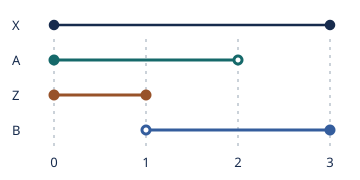

# ATOP19 切除定理

[相対ホモロジー群](../ATOP18/index.md#def-atop18-relative-homology)では、部分空間 $A$ の中の鎖を零としました。それなら $A$ の奥にある部分を空間そのものから取り除いても、相対群は変わらないのでしょうか。個々の特異単体は非常に大きな像を持ち得るので、単にその一部分を消すことはできません。

本講では単体の定義域を細かく分割し、各小単体の像が指定された領域の一つに収まるようにします。細分前後の鎖の差は境界として制御できるため、局所的な鎖だけでも相対群を計算できます。係数は整数、負次数の鎖群・ホモロジー群は零とします。

## 1. 領域ごとに収まる鎖

位相空間 $X$ を部分集合の族 $\mathcal U$ で覆います。各領域にまたがる単体を避け、像全体が一つの領域に入るものだけを選びます。領域は開集合とは限りませんが、後でその内部が $X$ を覆うと仮定します。

[特異単体](../ATOP16/index.md#def-atop16-singular-simplex) $\sigma:\Delta^n\to X$ は標準単体からの連続写像です。[特異鎖群](../ATOP16/index.md#def-atop16-singular-chains) $C_n(X)$ の元は異なる特異単体の有限整数係数和です。基底の一意性から、非零係数の単体を一つずつ調べれば、選んだ基底の部分集合が生成する部分群に属するか判定できます。

以下、部分空間 $Y\subset X$ の鎖群 $C_n(Y)$ は包含で $C_n(X)$ の部分群とみなします。包含との合成は異なる特異単体を異なる基底元へ送るので単射であり、像が $Y$ に含まれる特異単体全体がその部分群の基底になります。$\partial$ は [特異境界作用素](../ATOP16/index.md#def-atop16-singular-boundary) $\partial_n$ の次数を省略した記法です。点 $x$ への唯一の特異0単体を $\langle x\rangle$ と書きます。

<!-- formal-statement-start -->
> **定義（小さい鎖の複体）**
> 位相空間 $X$ と部分集合の族 $\mathcal U$ に対し、各 $n\ge0$ で像がある $U\in\mathcal U$ に含まれる特異 $n$ 単体を基底とする $C_n(X)$ の部分群を $C_n^{\mathcal U}(X)$ とする。境界作用素は $C_n(X)$ の境界作用素の制限とする。
<!-- formal-statement-end -->

[特異境界作用素](../ATOP16/index.md#def-atop16-singular-boundary)は面への制限の交代和です。元の単体の像が $U$ に入れば各面の像も $U$ に入るので、この部分群は境界で閉じています。[特異鎖の二重境界の消滅](../ATOP16/index.md#thm-atop16-singular-boundary-square)は制限しても成立し、鎖複体になります。

<!-- definition-example-start: def-atop19-small-chains -->
**定義の確認**

$X=[0,1]$、$U=[0,2/3)$、$V=(1/3,1]$、$\mathcal U=\{U,V\}$ とします。1次の標準単体の重心座標 $(1-t,t)$ を $t\in[0,1]$ で表します。$\sigma(t)=t$ の像はどちらにも含まれません。一方、$\alpha(t)=t/2$ と $\beta(t)=(1+t)/2$ の像はそれぞれ $U,V$ に含まれます。従って $\alpha+\beta$ は小さい鎖です。[特異境界作用素](../ATOP16/index.md#def-atop16-singular-boundary) は1次では終点の0単体から始点の0単体を引くので、その境界は

$$
\partial(\alpha+\beta)=
\langle1/2\rangle-\langle0\rangle+
\langle1\rangle-\langle1/2\rangle
=\langle1\rangle-\langle0\rangle.
$$

両点は被覆に含まれるので境界も小さい鎖です。元の $\sigma$ は自由基底の一元であり、小さい単体だけの線形結合に等しくありません。鎖群の等しさではなくホモロジー上の等しさを示す必要があります。
<!-- definition-example-end -->

## 2. 特異単体の定義域を細分する

[ATOP15の細分鎖写像の構成](../ATOP15/index.md#def-atop15-subdivision-chain)では、頂点を追加して単体鎖を細分しました。特異鎖でも定義域の標準単体の中で同じ幾何を使います。ただし、頂点の順序を変えた写像は一般に別々の特異単体です。向きの符号を付けただけで写像を同一視しないようにします。

Euclid 空間の凸集合 $K$（任意の二点を結ぶ線分を含む集合）の点 $b$ と特異 $k$ 単体 $\tau:\Delta^k\to K$ に対し、$b*\tau$ は新しい先頭頂点を $b$ に取る特異 $(k+1)$ 単体とします。[標準単体](../../../応用系/FIX/FIX1/index.md#def-fix1-standard-simplex) の重心座標 $(t_0,\ldots,t_{k+1})$ は全て非負で和は1です。$t_0<1$ なら残りの座標の和は $1-t_0>0$ なので、それで割った座標は $\Delta^k$ に入ります。このとき

$$
(b*\tau)(t)=t_0 b+
(1-t_0)\tau\left(\frac{t_1}{1-t_0},\ldots,
\frac{t_{k+1}}{1-t_0}\right),
$$

$t_0=1$ なら $b$ と定めます。凸性から値は $K$ に入ります。$\tau$ の像はコンパクトなので、ある有限な $M$ で全ての $u\in\Delta^k$ について $\|\tau(u)-b\|\le M$ となります。従って

$$
\|(b*\tau)(t)-b\|\le(1-t_0)M\longrightarrow0
\quad(t_0\to1).
$$

これで先頭頂点での連続性も確認できました。線形に鎖へ拡張します。

この操作で境界を計算すると、追加した頂点に接する面の符号が元の境界の符号と反対になります。これを錐の境界公式としてまとめます。

<!-- formal-statement-start -->
> **補題（特異錐の境界公式）**
> Euclid 空間の凸集合 $K$、点 $b\in K$、特異鎖 $c\in C_k(K)$ を取る。$k\ge1$ では

$$
\partial(b*c)=c-b*(\partial c).
$$

> $k=0$ では

$$
\partial(b*c)=c-\varepsilon(c)\langle b\rangle,
$$

> ただし $\varepsilon(c)$ は0鎖の係数の総和である。
<!-- formal-statement-end -->

<!-- proof-start -->
### 証明

[特異単体の面写像](../ATOP16/index.md#def-atop16-face-map) は指定した頂点の座標に0を挿入します。特異単体 $\tau$ について先頭頂点を除く面は $\tau$ で符号は正です。第 $i+1$ 頂点を除く面は $b*(\tau|_{\text{第 }i\text{ 面}})$ で、符号は $(-1)^{i+1}$ です。従って $k\ge1$ なら

$$
\partial(b*\tau)=\tau-
\sum_{i=0}^{k}(-1)^i b*(\tau|_{\text{第 }i\text{ 面}})
=\tau-b*(\partial\tau).
$$

線形性から鎖についても成立します。$k=0$ では $\partial(b*\langle x\rangle)=\langle x\rangle-\langle b\rangle$ です。$c=\sum_j a_j\langle x_j\rangle$ に適用して足すと $\partial(b*c)=c-(\sum_j a_j)\langle b\rangle$ となります。
<!-- proof-end -->

標準単体の恒等写像を $e_n:\Delta^n\to\Delta^n$ と書きます（頂点を表す標準基底ベクトルではありません）。$n\ge1$ で第 $i$ 面の包含を $d_i:\Delta^{n-1}\to\Delta^n$ と書きます。これは [特異単体の面写像](../ATOP16/index.md#def-atop16-face-map) の $\delta_i^n$ と同じ写像で、第 $i$ 座標に0を挿入します。全頂点の重心 $b_n$ の各座標は $1/(n+1)$ です。写像 $f$ に対する $f_\#$ は [特異鎖の誘導準同型](../ATOP16/index.md#def-atop16-induced-chain-map)、すなわち写像との合成です。まず各面を細分し、その小単体に重心を先頭頂点として追加します。

<!-- formal-statement-start -->
> **定義（特異鎖の細分作用素）**
> 標準単体上の鎖 $s_n\in C_n(\Delta^n)$ を $s_0=e_0$ と、$n\ge1$ に対する再帰式
>
$$
s_n=b_n*\sum_{i=0}^n(-1)^i(d_i)_\#s_{n-1}
$$
>
> で定める。任意の位相空間 $X$ の特異単体 $\sigma:\Delta^n\to X$ に対し $S\sigma=\sigma_\#s_n$ とし、線形に $S:C_n(X)\to C_n(X)$ を定める。
<!-- formal-statement-end -->

この定義から、任意の連続写像 $f:X\to Y$ と特異単体 $\sigma:\Delta^n\to X$ に対して

$$
f_\# S\sigma=(f\circ\sigma)_\#s_n=S(f_\#\sigma)
$$

となり、線形性により全ての鎖について $f_\# S=S f_\#$ が成立します（両側の $S$ はそれぞれの空間上の細分作用素です）。

各面の重心と全体の重心を順に加えるので、各項は包含関係を持つ非空面の重心を頂点に持ちます。これは [重心細分複体](../ATOP15/index.md#def-atop15-subdivision-complex) の小単体を、頂点順序を指定して標準単体から写したものです。

<!-- definition-example-start: def-atop19-singular-subdivision -->
**定義の確認**

$\Delta^1$ を $[0,1]$ と同一視し、$[a,b]$ を $t\mapsto(1-t)a+tb$ と書きます。面写像 $d_0$ は終点1を、$d_1$ は始点0を選ぶ写像です。再帰式に代入すると

$$
s_1=[1/2,1]-[1/2,0].
$$

どちらの項も始点は重心です。負符号の項を $[0,1/2]$ に勝手に置換してはいけません。境界を取れば

$$
\partial s_1=
(\langle1\rangle-\langle1/2\rangle)
-(\langle0\rangle-\langle1/2\rangle)
=\partial e_1.
$$

また $S\sigma$ は $\sigma\circ[1/2,1]-\sigma\circ[1/2,0]$ であり、いずれの像も $\sigma$ の像の部分集合です。
<!-- definition-example-end -->

<!-- formal-statement-start -->
> **定理（特異細分と境界の可換性）**
> 任意の位相空間 $X$ に対し細分作用素 $S$ は $\partial S=S\partial$ を満たす。任意の部分空間 $Y\subset X$ に対して $S(C_n(Y))\subset C_n(Y)$ である。
<!-- formal-statement-end -->

<!-- proof-start -->
### 証明

$n=0$ は両辺零です。$n=1$ の標準単体では直前の計算から $\partial s_1=(d_0)_\#s_0-(d_1)_\#s_0$ です。

$n\ge2$ とし、低次数での可換性を仮定します。$q=S(\partial e_n)$ と置きます。境界の各項 $d_i$ を細分する定義から

$$
q=\sum_{i=0}^n(-1)^i S d_i
=\sum_{i=0}^n(-1)^i(d_i)_\#s_{n-1}.
$$

従って再帰式は $s_n=b_n*q$ です。帰納仮定と [特異鎖の二重境界の消滅](../ATOP16/index.md#thm-atop16-singular-boundary-square)より

$$
\partial q=S(\partial^2 e_n)=0.
$$

$q$ の次数は $n-1\ge1$ です。[特異錐の境界公式](#lem-atop19-cone-boundary)より

$$
\partial s_n=q-b_n*(\partial q)=q.
$$

任意の $\sigma$ に対し、[特異鎖の誘導準同型と境界の可換性](../ATOP16/index.md#thm-atop16-chain-map)と [特異鎖の細分作用素](#def-atop19-singular-subdivision) を用いると

$$
\partial S\sigma=\sigma_\#\partial s_n
=\sigma_\# S(\partial e_n)
=S(\partial\sigma).
$$

各項は $\sigma$ と $\Delta^n$ 内の写像との合成です。$\sigma$ の像が $Y$ に含まれれば、細分された各項の像も $Y$ に含まれます。
<!-- proof-end -->

## 3. 細分前後の差を埋める

細分が境界を保存するだけでは、元の鎖と同じホモロジー類を表すとは言えません。[特異鎖の鎖ホモトピー](../ATOP17/index.md#def-atop17-chain-homotopy)を作り、恒等写像と $S$ の差を境界の形に書きます。今回は単体の像から外へ出ないことが重要です。

<!-- formal-statement-start -->
> **定理（特異細分の鎖ホモトピー）**
> 任意の位相空間 $X$ に対し準同型 $D:C_n(X)\to C_{n+1}(X)$ が存在し、
>
$$
\partial D+D\partial=1-S
$$
>
> を満たす。また任意の部分空間 $Y\subset X$ に対し $D(C_n(Y))\subset C_{n+1}(Y)$ である。
<!-- formal-statement-end -->

<!-- proof-start -->
### 証明

$D=0$ を負次数と0次で定めます。$S$ は0次で恒等なので要求式を満たします。式の $1$ は各 $C_n(X)$ の恒等写像です。合成は右から作用し、$\partial D$ と $D\partial$ はともに次数を変えません。$n\ge1$ とし、低次数で構成済みとします。標準単体内の $n$ 鎖を

$$
w_n=e_n-s_n-D(\partial e_n)
$$

と置きます。ここで $D$ は低次数に適用しています。先ほどの [特異細分と境界の可換性](#thm-atop19-subdivision-chain) と低次数の帰納仮定により

$$
\begin{gathered}
\partial w_n=\partial e_n-S(\partial e_n)
-\partial D(\partial e_n),\\
\partial D(\partial e_n)
=(1-S)\partial e_n-D(\partial^2 e_n)
=(1-S)\partial e_n.
\end{gathered}
$$

従って $\partial w_n=0$ です。$n\ge1$ なので [特異錐の境界公式](#lem-atop19-cone-boundary) を適用して、$h_n=b_n*w_n$ と置けば $\partial h_n=w_n$ となります。特異単体 $\sigma$ に対し $D\sigma=\sigma_\#h_n$ と定めて線形に拡張します。

低次数の $D$ も同じ合成による定義です。$h_0=0$ とすれば、面ごとに

$$
\sigma_\#D(d_i)=\sigma_\#(d_i)_\#h_{n-1}
=(\sigma\circ d_i)_\#h_{n-1}
=D(\sigma\circ d_i)
$$

が成り立ちます。境界の交代和を取ると $\sigma_\#D(\partial e_n)=D(\partial\sigma)$ です。[特異鎖の誘導準同型と境界の可換性](../ATOP16/index.md#thm-atop16-chain-map) も使うと

$$
\begin{gathered}
\partial D\sigma=\sigma_\#\partial h_n\\
=\sigma-S\sigma-D(\partial\sigma).
\end{gathered}
$$

これが要求式です。$h_n$ は全て $\Delta^n$ 内の特異単体からなるため、$D\sigma$ の各項の像は $\sigma(\Delta^n)$ に含まれます。従って $Y$ 内の鎖を外へ出しません。
<!-- proof-end -->

$r$ 回の細分と恒等写像の差は、一回ずつの差を足して表せます。$S^j$ は $j$ 回の合成で $S^0=1$ とします。$r\ge1$ に対して次数を1上げる写像 $K_r=\sum_{j=0}^{r-1}DS^j$ を置き、$K_0=0$ とします。[特異細分と境界の可換性](#thm-atop19-subdivision-chain) から $\partial S^j=S^j\partial$ なので、[特異細分の鎖ホモトピー](#thm-atop19-subdivision-homotopy) を使うと

$$
\partial DS^j+DS^j\partial
=(\partial D+D\partial)S^j
=(1-S)S^j.
$$

これを足し合わせると

$$
\partial K_r+K_r\partial
=\sum_{j=0}^{r-1}(S^j-S^{j+1})=1-S^r.
$$

$S$ と $D$ がどの部分空間の鎖も保存するので $K_r$ も保存します。特に、小さい鎖の複体を保存します。

## 4. 有限回の細分で領域に収める

$X$ が距離空間でなくても、特異単体の定義域 $\Delta^n$ はコンパクトな Euclid 空間の部分集合です。その定義域上で距離と開被覆を利用できます。

<!-- formal-statement-start -->
> **補題（有限鎖の小鎖化）**
> 位相空間 $X$ の部分集合族 $\mathcal U$ が

$$
\bigcup_{U\in\mathcal U}\operatorname{int}_X U=X
$$

> を満たすとする。任意の $n\ge0$ と $c\in C_n(X)$ に対し、ある非負整数 $r$ が存在し

$$
S^r c\in C_n^{\mathcal U}(X)
$$

> となる。
<!-- formal-statement-end -->

<!-- proof-start -->
### 証明

まず一つの特異単体 $\sigma$ を取ります。$\{\sigma^{-1}(\operatorname{int}_X U):U\in\mathcal U\}$ は $\Delta^n$ の開被覆です。連続性により各逆像は開で、内部が $X$ を覆うので逆像全体が定義域を覆います。

[Lebesgue数補題](../ATOP5/index.md#lem-atop5-lebesgue-number)から、この被覆に対する正数 $\delta$ を選べます。$n\ge1$ なら [重心細分によるメッシュ縮小](../../../応用系/FIX/FIX1/index.md#prop-fix1-barycentric-mesh) により $r$ 回後の小単体の直径は

$$
\left(\frac{n}{n+1}\right)^r
\operatorname{diam}(\Delta^n)
$$

以下です。これは $r\to\infty$ で零に近づきます。$S$ の各項は小単体のアフィン写像なので、反復合成の像は反復重心細分の小単体です。重心はアフィン写像で保たれるため、この対応は各反復で成り立ちます。

従って上の評価が $\delta$ 未満となる $r$ を取れば、小単体はどれか一つの逆像に収まります。$\sigma$ で写した像は対応する $U$ に入ります。$n=0$ では各点が最初からどれかの $U$ に入ります。

一般の鎖 $c$ は有限個の特異単体の整数係数和です。それぞれについて必要な反復回数を取り、その最大値を選べば全ての項が小さくなります。すでに小さい単体の細分は同じ領域内に留まるので、余分に細分しても問題ありません。零元 $c=0$ には $r=0$ で十分です。
<!-- proof-end -->

## 5. 小さい鎖だけで相対群を計算する

部分空間 $A\subset X$ について、$C_n^{\mathcal U}(A)=C_n(A)\cap C_n^{\mathcal U}(X)$ と書きます。これは $A$ 上の鎖のうち各項の像が被覆の一領域にも入るものです。両方とも境界で閉じています。

[相対特異鎖群](../ATOP18/index.md#def-atop18-relative-chain) と同様に、小さい鎖の商では差が $C_n^{\mathcal U}(A)$ に入る鎖を同一視します。$C_*$ は全次数の鎖群と境界をまとめた鎖複体を表し、$H_n(C_*)$ はその $n$ 次の境界の核を一つ上の次数からの境界の像で割った群です。従って小さい商のサイクルの代表元 $c$ は、小さい鎖であって $\partial c\in C_{n-1}^{\mathcal U}(A)$ を満たすものです。

<!-- formal-statement-start -->
> **定理（小さい鎖によるホモロジー同型）**
> 位相空間 $X$、部分空間 $A$、内部が $X$ を覆う部分集合族 $\mathcal U$ を取る。各 $n\ge0$ で包含から誘導される写像
>
$$
H_n\big(C_*^{\mathcal U}(X)/C_*^{\mathcal U}(A)\big)
\longrightarrow H_n(X,A)
$$
>
> は同型である。特に $A=\varnothing$ とすれば絶対ホモロジーについても成立する。
<!-- formal-statement-end -->

証明では、相対サイクルを細分して小さい代表元を作ることで全射性を示し、小さいサイクルを埋める鎖も細分できることから単射性を示します。

<!-- proof-start -->
### 証明

小さい鎖の商から相対鎖群への写像は、包含で定まります。核は零です。実際 $c\in C_n^{\mathcal U}(X)$ が $C_n(A)$ に入るなら定義により $C_n^{\mathcal U}(A)$ に入ります。境界と可換なのでホモロジーへ写像を誘導します。

**全射性。** [相対ホモロジー群](../ATOP18/index.md#def-atop18-relative-homology) の類を代表する $c\in C_n(X)$ を取ります。相対サイクルの条件は $\partial c\in C_{n-1}(A)$ です。[有限鎖の小鎖化](#lem-atop19-eventually-small) から $S^r c$ が小さくなる $r$ を選びます。

$$
\partial S^r c=S^r\partial c\in C_{n-1}(A).
$$

左辺は小さい鎖でもあるので $C_{n-1}^{\mathcal U}(A)$ に入ります。従って $S^r c$ は小さい商でサイクルです。また

$$
c-S^r c=\partial K_r c+K_r\partial c.
$$

右辺第2項は $C_n(A)$ に入るので相対群では差は境界です。よって元の類は小さい商の類から来ます。

**単射性。** 小さい相対サイクル $c$ が $H_n(X,A)$ で零とします。相対鎖の商で境界という意味から、$b\in C_{n+1}(X)$、$a\in C_n(A)$ が存在して

$$
c=\partial b+a
$$

と書けます。[有限鎖の小鎖化](#lem-atop19-eventually-small) から $b,a$ の両方が小さくなる共通の $r$ を選びます。[特異細分と境界の可換性](#thm-atop19-subdivision-chain) から

$$
S^r c=\partial S^r b+S^r a.
$$

ここで $S^r a$ は $A$ の中にあり、小さいので $C_n^{\mathcal U}(A)$ に入ります。従って小さい商で $S^r c$ の類は零です。さらに $c$ は小さいので $K_r c$ も小さく、$\partial c$ は $C_{n-1}^{\mathcal U}(A)$ に入るので $K_r\partial c\in C_n^{\mathcal U}(A)$ です。

$$
c-S^r c=\partial K_r c+K_r\partial c
$$

を小さい商で読めば差は境界となります。従って $c$ の類も小さい商で零です。
<!-- proof-end -->

## 6. 切除定理

[空間の対](../ATOP18/index.md#def-atop18-pair) $(X,A)$ で、$A$ の内側に余裕を持って入っている集合 $Z$ を取り除きます。$\overline Z$ は $X$ における閉包、$\operatorname{int}_X A$ は $X$ における内部です。閉包まで内部に入るという条件は、$Z$ の境界近くも $A$ に含まれることを保証します。

<!-- formal-statement-start -->
> **定理（切除定理）**
> 位相空間 $X$ と部分集合 $Z\subset A\subset X$ が
>
$$
\overline Z\subset\operatorname{int}_X A
$$
>
> を満たすとする。このとき対の包含 $(X\setminus Z,A\setminus Z)\hookrightarrow(X,A)$ が誘導する写像
>
$$
H_n(X\setminus Z,A\setminus Z)\longrightarrow H_n(X,A)
$$
>
> は全ての $n\ge0$ で同型である。
<!-- formal-statement-end -->

<!-- proof-start -->
### 証明

$B=X\setminus Z$、$\mathcal U=\{A,B\}$ と置きます。$X\setminus\overline Z$ は開集合で $B$ に含まれます。従って仮定より

$$
X=\operatorname{int}_X A\cup(X\setminus\overline Z)
=\operatorname{int}_X A\cup\operatorname{int}_X B.
$$

[小さい鎖の複体](#def-atop19-small-chains)の基底は像が $A$ または $B$ に含まれる単体です。従って

$$
C_n^{\mathcal U}(X)=C_n(A)+C_n(B),\qquad
C_n^{\mathcal U}(A)=C_n(A).
$$

また、自由基底の独立性から

$$
C_n(A)\cap C_n(B)=C_n(A\cap B).
$$

実際、両方に属する鎖の非零係数を持つ単体は両方の基底集合に属します。その像は $A\cap B$ に入るので右辺の鎖になります。逆包含は部分空間の包含から従います。

包含 $C_n(B)\to C_n(A)+C_n(B)$ に商写像を合成すると、任意の $a+b$ の剰余類は $b$ の剰余類に等しいので全射です。核は $C_n(A)\cap C_n(B)$ です。従って次の写像は全単射です。

$$
C_n(B)/C_n(A\cap B)
\longrightarrow
(C_n(A)+C_n(B))/C_n(A),\qquad
[b]\longmapsto[b].
$$

ここで $[b]$ はホモロジー類ではなく鎖群の剰余類です。[相対特異鎖群](../ATOP18/index.md#def-atop18-relative-chain) の商の境界は代表元の境界の剰余類を取るので、どちらの側でも $[b]$ は $[\partial b]$ に移ります。従ってサイクル・境界の対応が全単射であり、ホモロジーにも同型を誘導します。$A\cap B=A\setminus Z$ ですから、[小さい鎖によるホモロジー同型](#thm-atop19-small-chain-isomorphism) と合成すると、鎖の代表元 $b$ をそのまま $X$ の鎖へ送ります。これは [対の写像が誘導する相対ホモロジー準同型](../ATOP18/index.md#thm-atop18-relative-map) を包含に適用した写像です。
<!-- proof-end -->

### 具体例：区間の片側を短くする

$X=[0,3]$、$A=[0,2)$、$Z=[0,1]$ とします。部分空間位相で $\operatorname{int}_X A=A$、$\overline Z=Z$ なので仮定を満たします。領域の配置は次の通りです。黒丸（塗りつぶし）は端点を含むこと、白丸は端点を含まないことを表します。

$B=(1,3]$、$A\cap B=(1,2)$ です。従って [切除定理](#thm-atop19-excision)から $H_n((1,3],(1,2))\cong H_n([0,3],[0,2))$ です。どちらの対も相対群は全次数で零です。例えば右辺では両空間が凸で可縮であり、[可縮空間の被約特異ホモロジー](../ATOP17/index.md#cor-atop17-contractible) によって正次数群は零です。[0次特異ホモロジーと道連結成分](../ATOP16/index.md#thm-atop16-h0-path-components) により0次群はともに $\mathbb Z$ で、包含は成分の生成元を生成元へ送ります。

[対のホモロジー長完全列](../ATOP18/index.md#thm-atop18-long-exact) の低次数部分では

$$
0\to H_1(X,A)\to H_0(A)
\to H_0(X)\to H_0(X,A)\to0
$$

となります。中央の写像が同型なので両端の相対群は零です。高次数では両隣の群が零なので $H_n(X,A)=0$ となります。

### 反例：閉包の条件を外す

$X=[0,1]$、$A=Z=(0,1)$ とします。$Z\subset\operatorname{int}_X A$ ですが $\overline Z=X$ なので閉包条件は失われます。切除後は $(\{0,1\},\varnothing)$ です。

[0次特異ホモロジーと道連結成分](../ATOP16/index.md#thm-atop16-h0-path-components) から $H_0(X\setminus Z,A\setminus Z)\cong\mathbb Z^2$ です。一方 $A,X$ は道連結で、包含 $H_0(A)\to H_0(X)$ は生成元を生成元へ送る同型です。[対のホモロジー長完全列](../ATOP18/index.md#thm-atop18-long-exact) の末端から $H_0(X,A)=0$ となり、同型ではありません。

この場合 $\operatorname{int}_X(X\setminus Z)=\varnothing$ です。二領域の内部は端点を覆いません。端点から内部へ伸びる任意の非定数の小区間は $A$ にも $\{0,1\}$ にも収まらず、恒等道の細分をどれほど反復しても端点に接する項が残ります。これが証明で用いた小鎖化が失敗する具体的な理由です。

## 7. 演習

### 演習 ATOP19-A1：小さい鎖の判定

- Level: A

$X=[0,1]$、$\mathcal U=\{[0,3/4),(1/4,1]\}$ とする。$\sigma(t)=t$、$\tau(t)=t/4$、$\eta(t)=1/2+t/2$ とする。$\sigma-\tau$ と $\tau+\eta$ のどちらが小さい鎖か。後者の境界を計算せよ。

<!-- solution-start -->
**詳細解答**

[小さい鎖の複体](#def-atop19-small-chains) では非零係数の各単体の像を確認します。$\sigma$ の像は全区間でどちらにも入りません。$\tau$ の像は $[0,1/4]$、$\eta$ の像は $[1/2,1]$ です。それぞれ第1、第2領域に入ります。$\sigma,\tau$ は異なる基底元なので $\sigma-\tau$ は小さくありません。$\tau+\eta$ は小さい鎖です。

$$
\partial(\tau+\eta)=\langle1/4\rangle-\langle0\rangle+
\langle1\rangle-\langle1/2\rangle.
$$

全ての点は被覆のいずれかに入るので、この0鎖も小さい鎖です。
<!-- solution-end -->

### 演習 ATOP19-A2：細分の向き

- Level: A

$[a,b]$ を $[0,1]$ から実数直線へのアフィン写像とする。$S[2,6]$ とその境界を求めよ。

<!-- solution-start -->
**詳細解答**

[特異鎖の細分作用素](#def-atop19-singular-subdivision)の1次の再帰式は重心を先頭にして終点への辺から始点への辺を引きます。重心は $(2+6)/2=4$ なので

$$
S[2,6]=[4,6]-[4,2].
$$

境界は

$$
\partial S[2,6]=
\langle6\rangle-\langle4\rangle
-\langle2\rangle+\langle4\rangle
=\langle6\rangle-\langle2\rangle.
$$

これは元の辺の境界と一致します。負の辺を逆向き写像へ置き換える操作はしていません。
<!-- solution-end -->

### 演習 ATOP19-A3：必要な細分回数

- Level: A

直径3の2次元単体で、開被覆のLebesgue数を $1/2$ とする。メッシュの評価だけから各小単体の直径が $1/2$ 未満となることを保証する最小の非負整数 $r$ を求めよ。

<!-- solution-start -->
**詳細解答**

[重心細分によるメッシュ縮小](../../../応用系/FIX/FIX1/index.md#prop-fix1-barycentric-mesh) の $n=2$ の評価を使います。

$$
3(2/3)^4=16/27>1/2,\qquad
3(2/3)^5=32/81<1/2.
$$

評価の右辺は $r$ に関して狭義単調減少なので、保証できる最小回数は5です。実際の小単体は上界より小さいこともあり、この値は評価から得られる保証です。
<!-- solution-end -->

### 演習 ATOP19-A4：切除条件

- Level: A

$X=[0,4]$、$A=[0,3)$ とする。$Z_1=[0,2]$ と $Z_2=[0,3)$ について切除の仮定を判定し、仮定を満たす方の切除後の対を書け。

<!-- solution-start -->
**詳細解答**

部分空間位相において $A$ は開です。$\overline{Z_1}=[0,2]\subset A$ なので [切除定理](#thm-atop19-excision) を適用できます。差集合は

$$
X\setminus Z_1=(2,4],\qquad A\setminus Z_1=(2,3).
$$

一方 $\overline{Z_2}=[0,3]$ で $3\notin A$ なので仮定を満たしません。後者では定理から同型性を結論できません。
<!-- solution-end -->

### 演習 ATOP19-B1：1次の鎖ホモトピー

- Level: B

$\Delta^1=[0,1]$ とし、$[a,b,c]$ を三つの頂点を順に $a,b,c$ へ送るアフィン特異2単体、すなわち $(t_0,t_1,t_2)\mapsto t_0a+t_1b+t_2c$ とする。$m=1/2$ と置き、$D e_1$ を構成して境界を求めよ。

<!-- solution-start -->
**詳細解答**

[特異細分の鎖ホモトピー](#thm-atop19-subdivision-homotopy) の構成で $D$ は0次では零なので、$w_1=e_1-s_1$ です。従って

$$
D e_1=[m,0,1]-[m,m,1]+[m,m,0].
$$

境界を第0、第1、第2面の順に取ると

$$
\begin{gathered}
\partial[m,0,1]=[0,1]-[m,1]+[m,0],\\
\partial[m,m,1]=[m,1]-[m,1]+[m,m]=[m,m],\\
\partial[m,m,0]=[m,0]-[m,0]+[m,m]=[m,m].
\end{gathered}
$$

第2、第3の境界は反対符号で相殺されます。従って $\partial D e_1=[0,1]-[m,1]+[m,0]=e_1-S e_1$ です。退化した頂点列の項も特異鎖では自動的に零としない点に注意します。
<!-- solution-end -->

### 演習 ATOP19-B2：二回の細分の差

- Level: B

$K_2=D+DS$ とする。$\partial K_2+K_2\partial=1-S^2$ を展開せよ。$\partial c\in C_{n-1}(A)$ なら $c$ と $S^2c$ が同じ相対類を表すことを示せ。

<!-- solution-start -->
**詳細解答**

[特異細分と境界の可換性](#thm-atop19-subdivision-chain) によって $S\partial=\partial S$ です。[特異細分の鎖ホモトピー](#thm-atop19-subdivision-homotopy) を代入すると

$$
\begin{gathered}
\partial K_2+K_2\partial
=(\partial D+D\partial)+(\partial D+D\partial)S\\
=(1-S)+(1-S)S=1-S^2.
\end{gathered}
$$

従って $c-S^2 c=\partial K_2 c+K_2\partial c$ です。$D,S$ は $A$ 内の鎖を保存するので第2項は $C_n(A)$ に入ります。$S^2c$ の境界も $S^2\partial c\in C_{n-1}(A)$ です。[相対ホモロジー群](../ATOP18/index.md#def-atop18-relative-homology) の定義から両者は相対サイクルで、その差は商で境界なので同じ類です。
<!-- solution-end -->

### 演習 ATOP19-B3：二領域の鎖の商

- Level: B

部分空間 $U,V\subset X$ について、加法写像 $C_n(U)\oplus C_n(V)\to C_n(U)+C_n(V)$ の核を求めよ。さらに、この核の記述が境界と両立することを示せ。

<!-- solution-start -->
**詳細解答**

加法写像は $(u,v)\mapsto u+v$ です。核に属するなら $u=-v$ であり $u$ は両方の鎖群に属します。自由基底の独立性からその交わりは $C_n(U\cap V)$ です。よって核は

$$
\{(w,-w):w\in C_n(U\cap V)\}.
$$

逆にこの形の元は和が零なので核に属します。写像 $w\mapsto(w,-w)$ は第1成分を取れば元に戻るので単射です。境界は線形で交わりの中の鎖を保存するため

$$
\partial(w,-w)=(\partial w,-\partial w).
$$

また $\partial(u+v)=\partial u+\partial v$ です。従って両写像は境界と可換です。内部が $X$ を覆う場合、右辺は [小さい鎖の複体](#def-atop19-small-chains) と一致します。これは次講で二領域の情報を結合する出発点になります。
<!-- solution-end -->

### 演習 ATOP19-B4：閉包条件と0次群

- Level: B

$X=[-2,2]$、$A=Z=(-1,1)$ とする。切除後の対とその0次相対群を求め、切除前と比較せよ。

<!-- solution-start -->
**詳細解答**

$\overline Z=[-1,1]$ で両端 $\pm1$ は $A$ に入りません。従って閉包条件は失われています。切除後は

$$
(X\setminus Z,A\setminus Z)
=([-2,-1]\cup[1,2],\varnothing).
$$

[0次特異ホモロジーと道連結成分](../ATOP16/index.md#thm-atop16-h0-path-components) より、二つの道連結成分を持つため0次群は $\mathbb Z^2$ です。切除前は $A,X$ ともに非空で道連結なので、$H_0(A)\to H_0(X)$ は整数1を整数1へ送る同型です。[対のホモロジー長完全列](../ATOP18/index.md#thm-atop18-long-exact) の末端

$$
H_0(A)\to H_0(X)\to H_0(X,A)\to0
$$

から $H_0(X,A)=0$ です。二つの群は同型ではありません。境界点 $\pm1$ が二領域のどちらの内部にも入らないため、内部による被覆条件が失われています。
<!-- solution-end -->

### 演習 ATOP19-C1：一点の周りだけで計算する

- Level: C

$X=\mathbb R$、$A=\mathbb R\setminus\{0\}$、$Z=\mathbb R\setminus(-1,1)$ とする。[切除定理](#thm-atop19-excision)を用いて $H_n(X,A)$ を全非負次数で求めよ。また、区間内のアフィン道 $\gamma(t)=t-1/2$ が1次の相対群の生成元であることを示せ。

<!-- solution-start -->
**詳細解答**

$Z=(-\infty,-1]\cup[1,\infty)$ は閉で $A$ は開です。$\overline Z=Z\subset A=\operatorname{int}_X A$ なので [切除定理](#thm-atop19-excision) の条件を満たします。$B=(-1,1)$、$E=B\setminus\{0\}$ と置けば $H_n(B,E)\cong H_n(X,A)$ です。

$B$ は凸で可縮です。$E$ は二つの開区間の和であり、各特異単体の像は連結なのでどちらか一方に入ります。各区間は凸で可縮です。特異単体はどちらか一方の区間に含まれるので、$E$ の鎖複体は二つの区間の鎖複体の直和です。境界も成分ごとに作用し、核と像の商を取るとホモロジーも直和になります。

[可縮空間の被約特異ホモロジー](../ATOP17/index.md#cor-atop17-contractible) と [0次特異ホモロジーと道連結成分](../ATOP16/index.md#thm-atop16-h0-path-components) から

$$
H_k(B)=H_k(E)=0\ (k\ge1),\qquad
H_0(B)=\mathbb Z,\quad H_0(E)=\mathbb Z^2.
$$

[対のホモロジー長完全列](../ATOP18/index.md#thm-atop18-long-exact) により、$n\ge2$ では $H_n(B)$ と $H_{n-1}(E)$ がともに零なので $H_n(B,E)=0$ です。残る部分は

$$
0\to H_1(B,E)\xrightarrow{\delta}\mathbb Z^2
\xrightarrow{i_*}\mathbb Z\to H_0(B,E)\to0.
$$

左、右の成分をこの順に基底とすると $i_*(a,b)=a+b$ です。全射であり、その核は $\{(-k,k):k\in\mathbb Z\}$ です。従って $H_0(B,E)=0$、$H_1(B,E)\cong\mathbb Z$ です。

道 $\gamma$ の像は $[-1/2,1/2]\subset B$ で、境界は

$$
\partial\gamma=\langle1/2\rangle-\langle-1/2\rangle
\in C_0(E).
$$

従って相対サイクルです。$\bar\gamma=\gamma+C_1(E)$ は相対鎖、$[\bar\gamma]$ はそのホモロジー類です。[相対ホモロジーの接続準同型](../ATOP18/index.md#thm-atop18-connecting) より $\delta[\bar\gamma]=(-1,1)$ です。これは核の生成元で、$\delta$ は核への同型なので $[\bar\gamma]$ は相対群の生成元です。切除の同型が包含から誘導されるため、同じ道の相対類が $H_1(X,A)$ の生成元になります。
<!-- solution-end -->

## 8. まとめと次講

切除定理の背後には、単体の定義域を細分すれば小さい鎖にできることと、細分が像の外へ出ない鎖ホモトピーで恒等写像と結ばれることがあります。二領域の内部が空間を覆うという条件が、定義域上の開被覆を保証します。

次講では二領域の小さい鎖の和を使い、各領域・共通部分・空間全体のホモロジー群を一つの長完全列で結びます。
