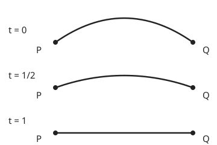
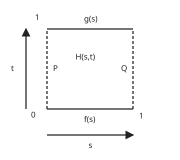

# ATOP2 ホモトピー：写像を連続的に変形する

[ATOP1](../ATOP1/index.md) では図形の点を一対一に対応させる同相を学びました。しかし、円板を一点へ縮めるような変形では途中や最後に点が重なっても構いません。そこで今度は、同じ二空間の間の写像を、時間を動かしながら連続的に変えることを考えます。

前提は ATOP1 と、[TOP1](../../../基礎科目/TOP/TOP1/index.md) の積空間、[TOP3](../../../基礎科目/TOP/TOP3/index.md) の連結性です。以下では $I=[0,1]$ に実数の部分空間位相を、直積には [積位相](../../../基礎科目/TOP/TOP1/index.md#def-top1-product-topology) を入れます。

<!-- definition-example-audit: strict -->

## 1. 写像を時間で動かす

曲線の両端を固定して弓なりの曲線を直線に近づける例を考えます。端点を $P=(0,0)$、$Q=(1,0)$ とし、横位置を $s\in I$、時刻を $t\in I$ として、

$$
H(s,t)=(s,4(1-t)s(1-s))
$$

と置きます。$4s(1-s)=1-4(s-1/2)^2$ なので、高さの最大値は $s=1/2$ で $1-t$ になります。時刻0では放物線の弧、時刻1では横線です。曲線上のどの位置も連続的に動きます。

図の各段は同じ座標系の別時刻で、縦横の表示倍率は異なります。[図を拡大](assets/curves.svg)

写像を時刻ごとに並べるだけでなく、入力点と時刻を同時に動かしたときも連続であることを要求します。

<!-- formal-statement-start -->
> **定義（ホモトピー）**
> 位相空間 $X,Y$ と連続写像 $f,g:X\to Y$ を取る。$I=[0,1]$ とし、積位相を入れた $X\times I$ から $Y$ への連続写像 $H$ で

$$
H(x,0)=f(x),\qquad H(x,1)=g(x)
$$

> を全ての $x\in X$ について満たすものを $f$ から $g$ へのホモトピーという。このような $H$ が存在するとき $f\simeq g$ と書く。
<!-- formal-statement-end -->

<!-- definition-example-start: def-atop2-homotopy -->
**定義の確認**

上の曲線の例で $X=I$、$Y=\mathbb R^2$ とします。両成分は $(s,t)$ の多項式なので連続であり、値は常に平面に属します。端の時刻を代入すると

$$
f(s)=(s,4s(1-s)),\qquad g(s)=(s,0).
$$

従ってこの $H$ は $f$ から $g$ へのホモトピーです。
<!-- definition-example-end -->

各時刻の写像 $H_t(x)=H(x,t)$ は連続です。実際、$x\mapsto(x,t)$ の成分は恒等写像と定数写像であり、[積位相の普遍性](../../../基礎科目/TOP/TOP1/index.md#thm-top1-product-universal) から連続で、その後に $H$ を合成しています。

逆に各時刻の連続性だけでは足りません。$X=Y=\mathbb R$ とし、$t=0$ では全点を0へ、$t>0$ では $x\mapsto1$ とする写像族は各時刻で連続ですが、任意の固定点 $x$ で $t\downarrow0$ とすると値は1のままであり、$H(x,0)=0$ に近づきません。

また、時間に区間を選ぶ意味もあります。例えば二点の離散空間 $Y=\{0,1\}$ で、一点空間からの値0と値1の写像はホモトピーを持ちません。もし持てば一点を固定して $I\to Y$ の連続写像を得ますが、その像は両点を含み非連結です。[実数の区間は連結](../../../基礎科目/TOP/TOP3/index.md#thm-top3-real-interval) であり、[連結空間の連続像は連結](../../../基礎科目/TOP/TOP3/index.md#thm-top3-continuous-image) なので矛盾します。

## 2. 動かさない部分を指定する

[道（区間から空間への連続写像）](../../../基礎科目/TOP/TOP3/index.md#def-top3-path-connected)を変形するとき、出発点と到着点を動かしたくないことがあります。端点に限らず、定義域の部分集合 $A$ 上の値を全時刻で固定する条件を追加します。

<!-- formal-statement-start -->
> **定義（相対ホモトピー）**
> 位相空間 $X,Y$、部分集合 $A\subseteq X$ と連続写像 $f,g:X\to Y$ を取る。$f$ から $g$ へのホモトピー $H$ が

$$
H(a,t)=f(a)=g(a)
\quad (a\in A,\ t\in I)
$$

> を満たすとき、$A$ に相対的なホモトピーという。存在するとき $f\simeq g\ \mathrm{rel}\ A$ と書く。
<!-- formal-statement-end -->

<!-- definition-example-start: def-atop2-relative-homotopy -->
**定義の確認**

第1節の放物線と直線の例では $A=\{0,1\}$ とします。連続性と初終時刻の条件は確認済みです。さらに

$$
H(0,t)=(0,0),\qquad H(1,t)=(1,0)
$$

は $t$ に依存せず、両端の値は $f,g$ に共通です。従って端点に相対的なホモトピーです。
<!-- definition-example-end -->

この正方形は写像の定義域であり、平面内の曲線を描いた図ではありません。下辺は時刻0、上辺は時刻1、左右の破線は固定端点に送られます。[図を拡大](assets/square.svg)

端の時刻に $f(a)=g(a)$ が成立するだけでは、選んだ $H$ が途中で $a$ を動かさないとは限りません。例えば $X=I$、$Y=\mathbb R$ で $H(x,t)=x+t(1-t)$ は $H(x,0)=H(x,1)=x$ ですが、$H(0,1/2)=1/4$ なので $\{0\}$ に相対的ではありません。恒等写像を全時間で固定する別のホモトピーなら相対条件を満たします。

## 3. 直線で結ぶ方法と、値が入る空間

Euclid 空間の部分集合 $C$ が凸であるとは、任意の $u,v\in C$ と $t\in I$ について $(1-t)u+tv\in C$ となることです。つまり二点間の線分が全て集合 $C$ に含まれます。[ATOP1](../ATOP1/index.md) と同じく $D^2=\{z\in\mathbb R^2:\|z\|\le1\}$ を閉円板、$S^1=\{z\in\mathbb R^2:\|z\|=1\}$ を円周とします。$u,v\in D^2$ なら三角不等式から

$
\|(1-t)u+tv\|\le(1-t)\|u\|+t\|v\|\le1
$

なので閉円板は凸です。

<!-- formal-statement-start -->
> **命題（直線ホモトピー）**
> 位相空間 $X$、凸な部分集合 $C\subseteq\mathbb R^n$（部分空間位相）と連続写像 $f,g:X\to C$ を取る。このとき

$$
H(x,t)=(1-t)f(x)+tg(x)
$$

> は $f$ から $g$ へのホモトピーである。$A\subseteq X$ 上で $f=g$ なら $A$ に相対的でもある。
<!-- formal-statement-end -->

凸性は式が連続かどうかではなく、その値を終域に入れるために働きます。

<!-- proof-start -->
### 証明

凸性により任意の $(x,t)\in X\times I$ で $H(x,t)\in C$ です。$X\times I$ の座標射影は連続であるため、$f(x),g(x),t$ はいずれも $(x,t)$ の連続な関数です。実数の連続関数の積・和を成分ごとに取ると

$$
H_j(x,t)=(1-t)f_j(x)+tg_j(x)
$$

が連続です。[積位相の普遍性](../../../基礎科目/TOP/TOP1/index.md#thm-top1-product-universal) より Euclid 空間への写像として連続で、値が $C$ に入るので [部分空間位相の連続性判定](../../../基礎科目/TOP/TOP1/index.md#prop-top1-subspace-universal) から $C$ への写像としても連続です。

$t=0,1$ の代入でそれぞれ $f(x),g(x)$ を得ます。さらに $a\in A$ では

$$
H(a,t)=(1-t)f(a)+tf(a)=f(a).
$$

従って [相対ホモトピー](#def-atop2-relative-homotopy) の条件も成立します。
<!-- proof-end -->

例えば $C=D^2$ で $f(z)=z$、$g(z)=0$ とすると $H(z,t)=(1-t)z$ です。全時刻で $\|H(z,t)\|=(1-t)\|z\|\le1$ となり、原点は固定されます。

一方、$C=S^1$ に同じ方法を無条件で使うことはできません。例えば一点からの二写像の値を $(1,0)$ と $(-1,0)$ にすると、中間時刻の値は $(0,0)$ となり円周の外へ出ます。これはホモトピーが存在しないことを意味しません。$t\mapsto(\cos\pi t,\sin\pi t)$ はノルムが常に1で、二点を結ぶ別のホモトピーです。

## 4. ホモトピーを逆向きにし、つなぐ

ホモトピーで結べる写像をまとめるには、同じ写像を結べること、逆向きに戻れること、二つの変形をつなげられることが必要です。相対条件を保ったままこれらが成立することを示します。

<!-- formal-statement-start -->
> **定理（ホモトピー関係の同値関係性）**
> 位相空間 $X,Y$、部分集合 $A\subseteq X$ と連続写像 $u:A\to Y$ を固定する。$A$ 上で $u$ に一致する連続写像 $X\to Y$ の集合で、$A$ に相対ホモトピーが存在するという関係は同値関係である。特に $A=\varnothing$ の場合、全ての連続写像 $X\to Y$ の集合でホモトピー関係は同値関係である。
<!-- formal-statement-end -->

静止、時間の反転、時間を半分ずつ使った連結という三操作に対応します。最後の操作で時刻 $1/2$ の継ぎ目が連続であることが核心です。

<!-- proof-start -->
### 証明

反射律：$H(x,t)=f(x)$ と置きます。射影と $f$ の合成なので連続で、全時間で値は $f(x)$ です。特に $A$ 上で $u$ に一致します。

対称律：$H$ が $f$ から $g$ への相対ホモトピーなら $K(x,t)=H(x,1-t)$ と置きます。$(x,t)\mapsto(x,1-t)$ は [積位相の普遍性](../../../基礎科目/TOP/TOP1/index.md#thm-top1-product-universal) から連続です。$K$ は連続で、$K(x,0)=g(x)$、$K(x,1)=f(x)$ です。また $K(a,t)=u(a)$ です。

推移律：$H$ が $f$ から $g$、$K$ が $g$ から $h$ への相対ホモトピーであるとします。

$$
L(x,t)=
\begin{cases}
H(x,2t),&0\le t\le1/2,\\
K(x,2t-1),&1/2\le t\le1
\end{cases}
$$

と置きます。前半の $2t$ も後半の $2t-1$ も $I$ に入り、継ぎ目では $H(x,1)=g(x)=K(x,0)$ なので一つの値に定まります。

$D_-=X\times[0,1/2]$ と $D_+=X\times[1/2,1]$ は時刻への射影による閉集合の逆像なので $X\times I$ で閉です。各部分で $L$ は連続写像の合成です。任意の閉集合 $B\subseteq Y$ に対して $L^{-1}(B)$ は各部分での逆像二つの合併です。それぞれ $D_-,D_+$ で閉で、これら自体が全体で閉なので、合併も全体で閉です。よって $L$ は連続です。

端の時刻で $L(x,0)=f(x)$、$L(x,1)=h(x)$ です。$a\in A$ ではどちらの式も $u(a)$ なので相対条件を保ちます。以上で三つの性質を確認しました。
<!-- proof-end -->

相対ホモトピーを利用すれば端点を変えない道の変形を一つの類にまとめられます。後に基本群を作る際にもこの性質が必要になります。

## 5. 写像の合成と両立する

ある変形の前に連続写像を通して入力を選んでも、後に連続写像を通して観測しても、連続的な変形は失われません。

<!-- formal-statement-start -->
> **命題（ホモトピーと合成の両立）**
> 位相空間 $W,X,Y,Z$ と連続写像 $p:W\to X$、$f,g:X\to Y$、$q:Y\to Z$ を取る。$f\simeq g$ なら

$$
q\circ f\circ p\simeq q\circ g\circ p.
$$

> 部分集合 $A\subseteq X$ に対し $f\simeq g\ \mathrm{rel}\ A$ なら、上の関係は $p^{-1}(A)$ に相対的にも成立する。
<!-- formal-statement-end -->

<!-- proof-start -->
### 証明

$f$ から $g$ へのホモトピーを $H$ とし、

$$
L(w,t)=q(H(p(w),t))
$$

と置きます。$(w,t)\mapsto(p(w),t)$ は成分が連続なので [積位相の普遍性](../../../基礎科目/TOP/TOP1/index.md#thm-top1-product-universal) から連続です。従って $H,q$ との合成 $L$ も連続です。

$$
L(w,0)=q(f(p(w))),\quad
L(w,1)=q(g(p(w))).
$$

さらに $w\in p^{-1}(A)$ なら $p(w)\in A$ なので、$H(p(w),t)=f(p(w))$ が全時刻で成立し、$L(w,t)=q(f(p(w)))$ です。
<!-- proof-end -->

例えば第1節の変形を高さだけ観測する射影 $q(x,y)=y$ と合成すれば、実数値の放物線 $4s(1-s)$ から零関数への変形 $4(1-t)s(1-s)$ になります。両端では全時刻で0です。

## 6. 空間を比較する：写像の逆を弱める

[同相](../../../基礎科目/TOP/TOP2/index.md#def-top2-homeomorphism) では二つの連続写像の合成が恒等写像と厳密に等しいことを求めました。ここでは合成が恒等写像へ連続変形できればよい、と条件を弱めます。

<!-- formal-statement-start -->
> **定義（ホモトピー同値）**
> 位相空間 $X,Y$ の間に連続写像 $f:X\to Y$ と $g:Y\to X$ が存在して

$$
g\circ f\simeq\mathrm{id}_X,\qquad
f\circ g\simeq\mathrm{id}_Y
$$

> を満たすとき、$X$ と $Y$ はホモトピー同値であるという。ここで $\mathrm{id}_X,\mathrm{id}_Y$ はそれぞれの空間の恒等写像である。
<!-- formal-statement-end -->

<!-- definition-example-start: def-atop2-homotopy-equivalence -->
**定義の確認**

$X=D^2$、$Y=\{*\}$ とし、$f(z)=*$、$g(*)=0$ とします。$f$ は定数写像、$g$ は一点空間からの写像なのでどちらも連続です。

$$
(f\circ g)(*)=*,\qquad (g\circ f)(z)=0.
$$

前者は恒等写像そのものです。後者から $\mathrm{id}_{D^2}$ へのホモトピーは $H(z,t)=tz$ で、ノルムは $t\|z\|\le1$、各成分は連続、端の値は0と $z$ です。従って両条件を満たします。円板は二点以上を持つため一点空間とは全単射を持たず、同相ではありません。
<!-- definition-example-end -->

<!-- formal-statement-start -->
> **定理（ホモトピー同値の同値関係性）**
> 位相空間の間のホモトピー同値は反射律・対称律・推移律を満たす。同相な二空間はホモトピー同値である。
<!-- formal-statement-end -->

推移律があることで、複雑な空間を一段ずつ簡単な空間に置き換えられます。合成の両立を二度使うことで、途中の空間を取り除けます。

<!-- proof-start -->
### 証明

反射律は両写像に恒等写像を選べば成立します。合成は恒等写像そのものなので [ホモトピー関係の反射律](#thm-atop2-homotopy-equivalence-relation) で必要な変形を得ます。対称律は $f,g$ の役割を交換すれば二条件が入れ替わるので成立します。

推移律を示します。$X,Y$ の間の写像を $f:X\to Y$、$g:Y\to X$、$Y,Z$ の間を $p:Y\to Z$、$q:Z\to Y$ とします。

$$
gf\simeq\mathrm{id}_X,\quad fg\simeq\mathrm{id}_Y,
$$

$$
qp\simeq\mathrm{id}_Y,\quad pq\simeq\mathrm{id}_Z.
$$

ここでは合成記号を省略して右から先に適用します。$X,Z$ の間に $F=pf:X\to Z$ と $G=gq:Z\to X$ を選びます。どちらも連続です。[ホモトピーと合成の両立](#prop-atop2-homotopy-composition) を $qp\simeq\mathrm{id}_Y$ の左に $g$、右に $f$ を置いて適用すると

$$
GF=g(qp)f\simeq g\mathrm{id}_Y f=gf.
$$

そして $gf\simeq\mathrm{id}_X$ と [ホモトピー関係の推移律](#thm-atop2-homotopy-equivalence-relation) を使えば $GF\simeq\mathrm{id}_X$ です。逆側も $fg\simeq\mathrm{id}_Y$ の左に $p$、右に $q$ を置いて

$$
FG=p(fg)q\simeq p\mathrm{id}_Y q=pq
\simeq\mathrm{id}_Z.
$$

最後の連結も同じ推移律です。従って $X,Z$ はホモトピー同値です。

同相の場合は $f$ とその連続な逆写像 $g$ が存在し、二つの合成は恒等写像に等しいので、静止ホモトピーを選べます。
<!-- proof-end -->

この講でホモトピー同値は同相より弱いことが分かりました。次講では、部分空間への写像と実際の変形を組み合わせて、具体的な空間の比較をさらに進めます。

## 7. 演習

### 演習 ATOP2-A1：途中の曲線

- Level: A

第1節の $H(s,t)=(s,4(1-t)s(1-s))$ について $H(1/4,1/2)$ と $H(1/2,3/4)$ を求め、左右の端点が固定されることを示せ。

<!-- solution-start -->
**詳細解答**

第2成分に代入すると $4(1/2)(1/4)(3/4)=3/8$、$4(1/4)(1/2)(1/2)=1/4$ です。従って

$$
H(1/4,1/2)=(1/4,3/8),
\quad H(1/2,3/4)=(1/2,1/4).
$$

$s=0$ または $s=1$ では積 $s(1-s)=0$ ですから、全時刻で $H(0,t)=(0,0)$、$H(1,t)=(1,0)$ です。[相対ホモトピー](#def-atop2-relative-homotopy) の固定条件が成立します。
<!-- solution-end -->

### 演習 ATOP2-A2：逆向きの変形

- Level: A

$H(x,t)=(1-t)x+t x^2$（$x,t\in I$）の逆向きのホモトピーを作り、定義域、終域、端の時刻を確かめよ。

<!-- solution-start -->
**詳細解答**

[ホモトピー関係の対称律](#thm-atop2-homotopy-equivalence-relation) の時間反転を使い、$K(x,t)=H(x,1-t)=tx+(1-t)x^2$ とします。$0\le x,x^2\le1$、係数は非負で和は1なので $0\le K(x,t)\le1$ です。多項式で連続、$K(x,0)=x^2$、$K(x,1)=x$ です。さらに $K(0,t)=0$、$K(1,t)=1$ なので両端に相対的です。
<!-- solution-end -->

### 演習 ATOP2-A3：直線ホモトピーの値域

- Level: A

$f(x)=x$、$g(x)=2-x$ を $[0,2]$ の自己写像とする。直線ホモトピーを求め、固定される点を全て求めよ。

<!-- solution-start -->
**詳細解答**

区間 $[0,2]$ は凸で、両写像は連続かつ値域は区間内です。[直線ホモトピー](#prop-atop2-linear-homotopy) より

$$
H(x,t)=(1-2t)x+2t.
$$

元の凸結合の形から $0\le H(x,t)\le2$ です。全時刻で $H(x,t)=x$ となるには $t=1$ で $2-x=x$、従って $x=1$ が必要です。逆に $H(1,t)=1$ なので十分でもあります。
<!-- solution-end -->

### 演習 ATOP2-A4：終域を間違えた変形

- Level: A

$f,g:I\to\mathbb R\setminus\{0\}$ をそれぞれ定数1、定数 $-1$ とする。直線ホモトピーの失敗を示し、別のホモトピーが存在するか判定せよ。

<!-- solution-start -->
**詳細解答**

直線の式は $1-2t$ です。$t=1/2$ で0となり終域から外れます。任意のホモトピーがあると仮定し、$x=0$ を固定すると $t\mapsto H(0,t)$ は連続です。像は1と $-1$ を含み、0を含まないため、正の部分と負の部分に分離されます。しかし [実数の区間は連結](../../../基礎科目/TOP/TOP3/index.md#thm-top3-real-interval) であり [連結空間の連続像は連結](../../../基礎科目/TOP/TOP3/index.md#thm-top3-continuous-image) なので矛盾します。別のホモトピーも存在しません。
<!-- solution-end -->

### 演習 ATOP2-B1：二つの変形をつなぐ

- Level: B

$I$ の自己写像について $H(x,t)=(1-t)x+tx^2$、$K(x,t)=(1-t)x^2+tx^3$ をつなぎ、時刻 $1/4,1/2,3/4$ の写像を求め、連続性と端点固定を確認せよ。

<!-- solution-start -->
**詳細解答**

$x,x^2,x^3$ は全て $I$ に入るので、$H,K$ も凸結合により $I$ に入り、多項式なので連続です。初終時刻で順に $x,x^2,x^3$ となり、いずれも $x=0,1$ を固定します。[ホモトピー関係の推移律](#thm-atop2-homotopy-equivalence-relation) の式へ代入すると

$$
L(x,t)=
\begin{cases}
(1-2t)x+2tx^2,&t\le1/2,\\
(2-2t)x^2+(2t-1)x^3,&t\ge1/2.
\end{cases}
$$

各枝で係数は非負で和は1です。継ぎ目で両式が $x^2$ になるので、二つの閉部分上で連続な写像が一致し、全体で連続となります。

$$
L(x,1/4)=(x+x^2)/2,\qquad L(x,1/2)=x^2,
$$

$$
L(x,3/4)=(x^2+x^3)/2.
$$

初終時刻は $x,x^3$、$x=0$ では0、$x=1$ では係数の和1になるため全時刻で固定です。
<!-- solution-end -->

### 演習 ATOP2-B2：各変数ごとの連続性

- Level: B

$X=I$、$Y=\mathbb R$ とし、$(x,t)\ne(0,0)$ で $H(x,t)=xt/(x^2+t^2)$、原点で $H(0,0)=0$ とする。各時刻で連続、各入力点を固定しても時間について連続であることを示し、ホモトピーではない理由を述べよ。

<!-- solution-start -->
**詳細解答**

$t>0$ を固定すると分母が $t^2$ 以上で正なので $x$ の連続関数です。$t=0$ では原点も含め全て0なので連続です。$x>0$ を固定しても分母が $x^2$ 以上で正、$x=0$ では全時刻0なので時間について連続です。

ところが $x=t=1/n$（$n\ge1$）では

$$
H(1/n,1/n)=\frac{1/n^2}{2/n^2}=\frac12.
$$

$(1/n,1/n)$ は原点へ収束しますが値は0へ収束しません。連続写像なら収束列を収束列へ移すため、$H$ は原点で連続でありません。従って初終時刻の写像は連続であっても [ホモトピーの定義](#def-atop2-homotopy) の積空間上の連続性を満たしません。
<!-- solution-end -->

### 演習 ATOP2-B3：合成と固定集合

- Level: B

第1節の変形 $H$ に対し $p:I\to I$ を $p(w)=w^2$、$q:\mathbb R^2\to\mathbb R$ を $q(a,b)=a+b$ とする。合成した変形を求め、固定される入力点を全て求めよ。

<!-- solution-start -->
**詳細解答**

$p$ は多項式で $w^2\in I$、$q$ は成分の和で連続です。[ホモトピーと合成の両立](#prop-atop2-homotopy-composition) により

$$
L(w,t)=w^2+4(1-t)w^2(1-w^2).
$$

初時刻は $w^2+4w^2(1-w^2)$、終時刻は $w^2$ です。全時刻で値が等しいためには初終値の一致、すなわち $4w^2(1-w^2)=0$ が必要です。$0\le w\le1$ より $w=0,1$ となります。代入するとそれぞれ0と1で一定なので十分です。これは $p^{-1}(\{0,1\})=\{0,1\}$ と一致します。
<!-- solution-end -->

### 演習 ATOP2-C1：円筒と円周の比較

- Level: C

$X=S^1\times I$、$Y=S^1$ とする。$f:X\to Y$ を射影、$g:Y\to X$ を $g(z)=(z,1/2)$ と定める。両者が連続であることとホモトピー同値の二条件を検証し、$S^1\times\{1/2\}$ 上では変形中も点が固定されることを示せ。$f$ 自体は同相写像か。

<!-- solution-start -->
**詳細解答**

$f(z,s)=z$ は積の射影で連続です。$g$ の成分は恒等写像と定数写像なので [積位相の普遍性](../../../基礎科目/TOP/TOP1/index.md#thm-top1-product-universal) で連続です。

まず $(f\circ g)(z)=z$ なので $Y$ の恒等写像です。静止ホモトピーが成立します。一方

$$
(g\circ f)(z,s)=(z,1/2).
$$

$X$ から $X$ への時間変化を

$$
L((z,s),t)=(z,(1-t)/2+ts)
$$

と置きます。第1成分は円周の点で、第2成分は $1/2$ と $s$ の凸結合なので $I$ に属します。第1成分は射影、第2成分は実数の連続関数の積・和です。従って [積位相の普遍性](../../../基礎科目/TOP/TOP1/index.md#thm-top1-product-universal) により連続です。

$t=0$ で $(z,1/2)$、$t=1$ で $(z,s)$ となるため $g\circ f\simeq\mathrm{id}_X$ です。二条件が揃い [ホモトピー同値](#def-atop2-homotopy-equivalence) を得ます。

さらに $s=1/2$ を代入すれば $(1-t)/2+t/2=1/2$ なので $L((z,1/2),t)=(z,1/2)$ です。従ってこの変形は中央の円周に相対的です。

しかし $f(z,0)=f(z,1)=z$ であり、$f$ は単射ではありません。[同相写像の定義](../../../基礎科目/TOP/TOP2/index.md#def-top2-homeomorphism) の全単射条件に反するので、$f$ 自体は同相写像ではありません。この結論は別の同相写像の不存在まで主張するものではありません。
<!-- solution-end -->

## 8. まとめ

- ホモトピーは入力と時間を合わせた積空間からの連続写像です。
- 相対ホモトピーは指定した部分集合の値を全時刻で固定します。
- 直線ホモトピーでは終域に値が入ることが必要です。凸性はその保証になります。
- 静止・時間反転・貼り合わせによってホモトピー関係は同値関係になり、連続写像の合成とも両立します。
- 空間のホモトピー同値では合成が恒等写像へ変形できれば十分です。次講ではレトラクトと変形レトラクトを学びます。
