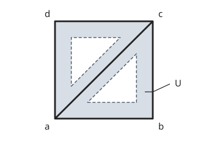

# ATOP21 単体ホモロジーと特異ホモロジーの比較

三角形分割があれば、有限個の境界行列を使って穴を数えられます（[単体ホモロジー群](../ATOP14/index.md#def-atop14-simplicial-homology)）。一方、[特異ホモロジー群](../ATOP16/index.md#def-atop16-singular-homology) は三角形分割を選ばず、標準単体からの連続写像をすべて使います。例えば三角形の周囲には三つの辺しかなくても、そこへの特異1単体は無数にあります。有限個の辺だけで本当にすべてのホモロジー類を捉えられるのでしょうか。

本講では整数係数、有限単体複体に限って、単体をそのまま特異単体として読む写像が同型を誘導することを証明します。次元の低い部分から単体を一層ずつ加え、相対ホモロジーで新しく加わった部分だけを調べます。負次数の鎖群・ホモロジー群は零とします。

## 1. 単体を連続写像として読む

有限単体複体 $K$ の頂点集合に全順序を固定し、[幾何学的実現](../ATOP10/index.md#def-atop10-realization) を $X=|K|$ とします。[単体鎖群](../ATOP13/index.md#def-atop13-simplicial-chains) を $C_n^\triangle(K)$、[特異鎖群](../ATOP16/index.md#def-atop16-singular-chains) を $C_n(X)$ と区別します。前者の基底は頂点を昇順に並べた向き付き単体、後者の基底は連続写像 $\Delta^n\to X$ です。

頂点列 $v_0<\cdots<v_n$ の単体を読むには、標準単体の頂点を対応する頂点に送るアフィン写像を使えばよいのです。[標準単体](../../../応用系/FIX/FIX1/index.md#def-fix1-standard-simplex) $\Delta^n$ の点を

$$
t=(t_0,\ldots,t_n),\qquad t_i\ge0,\quad \sum_{i=0}^n t_i=1
$$

と書きます。実現の座標空間 $\mathbb R^V$ では、頂点 $v$ 自身をその座標だけが1のベクトルと同一視します。

したがって $\sum_i t_iv_i$ は非負で座標和が1、正の座標を持つ頂点の集合は元の単体の面です。[幾何学的実現の定義](../ATOP10/index.md#def-atop10-realization) により像は $|K|$ に入り、座標ごとに線形な式なので連続です。

この連続写像は [特異単体](../ATOP16/index.md#def-atop16-singular-simplex) です。昇順基底の像を指定すれば、整数係数の任意の鎖の像は同じ係数の和として一意に決まります。以下、$\partial$ は作用する鎖の種類と次数に対応する境界作用素、$[z]$ はサイクル $z$ のホモロジー類（頂点列を囲む角括弧とは別の意味）を表します。

<!-- formal-statement-start -->
> **定義（単体・特異鎖の比較写像）**
> 頂点に全順序を持つ有限単体複体 $K$ に対し、各次数の群準同型 $J_n:C_n^\triangle(K)\to C_n(|K|)$ を昇順の基底単体について

$$
J_n[v_0,\ldots,v_n]=\sigma_{v_0\ldots v_n},
\qquad
\sigma_{v_0\ldots v_n}(t)=\sum_{i=0}^n t_i v_i
$$

> と定め、整数線形に拡張する。
<!-- formal-statement-end -->

<!-- definition-example-start: def-atop21-comparison-map -->
**定義の確認**：例えば辺 $[a,b]$（$a<b$）は、$s=t_1$ と置けば次の道です。

$$
\sigma_{ab}(s)=(1-s)a+sb.
$$

$\langle v\rangle$ を点 $v$ への特異0単体と書くと、[特異境界作用素](../ATOP16/index.md#def-atop16-singular-boundary) による端点の差は

$$
\partial\sigma_{ab}=\langle b\rangle-\langle a\rangle
=J_0([b]-[a]).
$$

これは単体境界を読んだものです。[向き付き単体](../ATOP13/index.md#def-atop13-oriented-simplex) の逆向きの記号 $[b,a]=-[a,b]$ は $-\sigma_{ab}$ に送ります。

逆走する道 $\sigma_{ba}$ は別の特異単体で、鎖として $-\sigma_{ab}$ と等しいわけではありません。

$0\le s\le1$ なら像は辺上にあり、道は連続で、端点は順に $a,b$ です。したがって昇順の基底を特異単体に送るという定義の条件を満たします。整数線形拡張により、例えば $2[a,b]$ の像は $2\sigma_{ab}$ です。
<!-- definition-example-end -->

<!-- formal-statement-start -->
> **定理（比較写像と境界の可換性）**
> 頂点に全順序を持つ有限単体複体 $K$ の比較写像 $J$ は各次数で単射であり、境界と可換である。従って単体ホモロジーから特異ホモロジーへの準同型 $J_*[z]=[Jz]$ を誘導する。
<!-- formal-statement-end -->

見取り図：昇順の基底単体を一つ選び、面を先に取る場合と特異単体を先に作る場合とを比べます。

<!-- proof-start -->
### 証明

異なる基底単体の像は異なる連続写像です。実際、標準単体の各頂点での値を比較すれば頂点列を復元できます。自由基底の独立性から $J_n$ は単射です。

[面写像](../ATOP16/index.md#def-atop16-face-map) $\delta_i=\delta_i^n:\Delta^{n-1}\to\Delta^n$ は第 $i$ 重心座標に零を挿入します（$0\le i\le n$、$n\ge1$）。$\widehat v_i$ は頂点列から第 $i$ 頂点を除く記号です。そのため

$$
\sigma_{v_0\ldots v_n}\circ\delta_i
=\sigma_{v_0\ldots\widehat v_i\ldots v_n}.
$$

[特異境界作用素](../ATOP16/index.md#def-atop16-singular-boundary) と [単体境界作用素](../ATOP13/index.md#def-atop13-boundary) の交代和を比較すると、$n\ge1$ で

$$
\partial J_n[v_0,\ldots,v_n]
=\sum_{i=0}^n(-1)^iJ_{n-1}[v_0,\ldots,\widehat v_i,\ldots,v_n]
=J_{n-1}\partial[v_0,\ldots,v_n].
$$

$n=0$ では両辺とも零です。線形性から全鎖について成立します。従ってサイクルをサイクルへ、境界を境界へ送ります。$z'=z+\partial b$ なら $Jz'=Jz+\partial Jb$ となるため、代表元の選択に依存しません。
<!-- proof-end -->

三角形 $a<b<c$ なら $\partial J[a,b,c]=\sigma_{bc}-\sigma_{ac}+\sigma_{ab}$ です。境界を取ってから読む場合と一致します。しかし鎖群の単射だけからホモロジーの単射・全射は従いません。特異鎖でだけ埋まる単体サイクルがないことも、特異サイクルを単体サイクルで代表できることもまだ証明していないからです。

## 2. 相対群で比較を行う

部分複体 $L\subset K$ を選びます。$L$ の単体はすべて $K$ の単体であり、面を取っても $L$ に属します。[単体鎖複体](../ATOP13/index.md#def-atop13-simplicial-chain-complex) の境界は面の交代和なので、$C_*^\triangle(L)$ は部分鎖複体です。

ここで添字 $*$ は全次数の鎖群をまとめて表します。[相対特異鎖群](../ATOP18/index.md#def-atop18-relative-chain) と同じように商を取れば、$L$ 内の鎖を零とする計算ができます。$\bar c$ は鎖 $c$ の商での類を表し、$L$ 内の鎖だけ異なる二つの鎖を同一視します。

[単体サイクルと単体境界鎖](../ATOP14/index.md#def-atop14-cycles-boundaries) と同じく、商の境界作用素の核がサイクル群、次の次数からの像が境界群です。

<!-- formal-statement-start -->
> **定義（相対単体ホモロジー群）**
> 有限単体複体 $K$ と部分複体 $L$ に対し、相対単体鎖群とその境界を

$$
C_n^\triangle(K,L)=C_n^\triangle(K)/C_n^\triangle(L),
\qquad \bar\partial\bar c=\overline{\partial c}
$$

> とする。相対単体ホモロジー群 $H_n^\triangle(K,L)$ はこの鎖複体の $n$ 次サイクル群を $n$ 次境界群で割った群である。
<!-- formal-statement-end -->

$L$ 内の鎖を加えても境界の差は $L$ 内に残るので商の境界は定まります。[二重境界の消滅](../ATOP13/index.md#thm-atop13-boundary-square) により商でも二重境界は零です。 

<!-- definition-example-start: def-atop21-relative-simplicial -->
**定義の確認**：例えば $K$ が一辺と両端点、$L$ が両端点だけなら、相対1鎖群は $\mathbb Z\,\overline{[a,b]}$（辺の商での類を基底とする自由アーベル群）、相対0鎖群と2鎖群は零です。従って相対1次群は $\mathbb Z$ となり、通常の1次群が零なのとは異なります。

両端点は部分複体をなし、辺の境界 $[b]-[a]$ はその0鎖群に属します。よって商での境界は零です。相対2鎖群も零なので、1次の核は相対1鎖群全体、像は零であり、上の相対1次群が得られます。
<!-- definition-example-end -->

比較写像は $L$ の単体を $|L|$ 内の特異単体に送るので、商に $J^{\rm rel}(\bar c)=\overline{Jc}$ を誘導します。[比較写像と境界の可換性](#thm-atop21-comparison-chain) により商でも境界と可換であるため相対ホモロジー上にも写像が得られます。

[対のホモロジー長完全列](../ATOP18/index.md#thm-atop18-long-exact) の証明は部分鎖複体の包含、商、境界だけで行われています。ここではその証明に単体鎖複体を入れます。

[接続準同型](../ATOP18/index.md#thm-atop18-connecting) と同じ構成で、$n\ge1$ の接続を次のように書きます。

$$
\delta=\delta_n:H_n^\triangle(K,L)\to H_{n-1}^\triangle(L),
\qquad \delta[\bar c]=[\partial c].
$$

第1節の面写像 $\delta_i^n$ とは作用対象が異なります。相対サイクルなら $\partial c$ は $L$ 内の鎖であり、二重境界が零なのでサイクルです。代表元を変更して

$$
c'=c+a+\partial b,\qquad a\in C_n^\triangle(L),\quad b\in C_{n+1}^\triangle(K)
$$

としても、境界の差は $\partial a$ であり、$L$ 内の境界なので類は変わりません。

[完全列](../../../基礎論系/CATB/CATB1-05/index.md#def-catb1-05-exact) の条件はアーベル群では直前の写像の像と直後の写像の核が等しいことです。まず隣接する二写像の合成は零です。包含した $L$ の鎖は商で零になり、絶対サイクルの境界は零であり、接続で得た境界鎖は $K$ で境界だからです。逆の包含を三つの位置で確認します。

- 絶対サイクルが商で境界なら、適当な鎖 $b$ に対して $z-\partial b\in C_n^\triangle(L)$ となり、元の類は包含の像です。
- 相対サイクルの接続が零なら、$L$ の鎖 $a$ を $\partial c=\partial a$ となるように選べます。$c-a$ は絶対サイクルで、その商は $\bar c$ です。
- $L$ のサイクルが $K$ で境界なら $a=\partial c$ と書けます。$\bar c$ は相対サイクルで、その接続は $[a]$ です。

0次末端では任意の0鎖がサイクルなので商への写像は全射です。

単体側と特異側で長完全列ができました。包含と商は $J$ と可換であり、$n\ge1$ で接続も

$$
J_*[\partial c]=[\partial Jc]=\delta[J^{\rm rel}\bar c]
$$

となります。従って二つの完全列を縦につなぐと、どちらの経路でも同じ結果になります。

## 3. 完全列の比較に必要な代数

次の補題は、長完全列のうち周囲の四つの群の比較が済んでいるときに中央の比較を終わらせる道具です。例えば骨格の古い部分と新しい相対部分の比較が済めば、空間全体へ進めます。

<!-- formal-statement-start -->
> **補題（完全列の中央の比較）**
> アーベル群の二つの完全列 $A_1\to A_2\to A_3\to A_4\to A_5$ と $B_1\to B_2\to B_3\to B_4\to B_5$ があり、縦の準同型 $f_i:A_i\to B_i$ がすべての四角形を可換にするとする。$f_1,f_2,f_4,f_5$ が同型なら $f_3$ も同型である。
<!-- formal-statement-end -->

見取り図：単射では中央の核を左側へ戻し、全射では中央の目標を右側で合わせてから左側で誤差を補正します。

<!-- proof-start -->
### 証明

上段の横写像を $a_i:A_i\to A_{i+1}$、下段を $b_i:B_i\to B_{i+1}$ とします。可換性は $f_{i+1}a_i=b_if_i$ です。

単射性：$f_3(x)=0$ とすると $f_4a_3(x)=0$、$f_4$ の単射性から $a_3(x)=0$ です。完全性により $x=a_2(y)$ と書けます。すると $b_2f_2(y)=0$ なので $f_2(y)=b_1(w)$ となる $w\in B_1$ が存在します。$f_1$ の全射性で $w=f_1(v)$ とすれば

$$
f_2(y-a_1(v))=0.
$$

$f_2$ は単射なので $y=a_1(v)$、従って $x=a_2a_1(v)=0$ です。

全射性：任意の $u\in B_3$ を取ります。$f_4$ の全射性で $f_4(t)=b_3(u)$ となる $t\in A_4$ を取ります。$f_5a_4(t)=b_4b_3(u)=0$ なので $a_4(t)=0$ です。よって $t=a_3(x)$ と書けます。このとき

$$
b_3(u-f_3(x))=b_3(u)-f_4(t)=0.
$$

完全性から $u-f_3(x)=b_2(w)$ と書けます。$w=f_2(y)$ となる $y\in A_2$ を取れば $u=f_3(x+a_2(y))$ です。以上で全単射です。
<!-- proof-end -->

例えば $0\to\mathbb Z\to\mathbb Z^2\to\mathbb Z\to0$ で中央の前後の写像を $t\mapsto(t,0)$、$(x,y)\mapsto y$ とすると、上段と下段を同じ列にし、中央の縦写像を $(x,y)\mapsto(x+2y,y)$、他を恒等写像とした場合に適用できます。逆写像は $(u,v)\mapsto(u-2v,v)$ です。

## 4. 骨格の新しい単体を切除で分離する

$K^{(m)}$ を $m$ 次以下の単体だけからなる部分複体（$m$ 次骨格）と呼びます。例えば一つの三角形では0次骨格は三頂点、1次骨格は三辺と頂点、2次骨格は三角形全体です。

$m\ge1$、$K$ の次元を $m$ 以下とし、

$$
A=|K^{(m-1)}|,\qquad X=|K|
$$

とします。$m$ 単体 $\tau$ の実現を $D_\tau$、そのすべての真の面の和集合を $\partial D_\tau$ と書きます。

[実現の共通面性](../ATOP10/index.md#prop-atop10-intersection) により異なる $m$ 単体の交わりは真の共通面に限られます。従って新しく加わる部分は互いに交わらない $m$ 単体の内部です。ここで内部は各単体のアフィン包における相対内部で、全重心座標が正となる部分を指します。

<!-- formal-statement-start -->
> **定理（骨格対の相対特異ホモロジーの分解）**
> $m\ge1$ とし、次元が $m$ 以下の有限単体複体 $K$ を取る。$X=|K|$、$A=|K^{(m-1)}|$ とすると、各 $m$ 単体 $\tau$ の対 $(D_\tau,\partial D_\tau)$ からの包含が誘導する写像の和

$$
\bigoplus_{\dim\tau=m}H_n(D_\tau,\partial D_\tau)
\longrightarrow H_n(X,A)
$$

> はすべての $n\ge0$ で同型である。
<!-- formal-statement-end -->

見取り図：骨格は閉集合なのでそのまま切除することはできません。まず骨格を各単体内の薄い帯へ広げ、骨格へ戻る変形を作ります。その後、帯の内部にある骨格を切除すれば新しい単体の内部が分離します。

<!-- proof-start -->
### 証明

各 $D_\tau$ の重心座標を $(t_0,\ldots,t_m)$ とし、

$$
s=\min_{0\le i\le m}t_i,\qquad 0<\epsilon<1/(m+1)
$$

を選びます。$A$ と各 $m$ 単体内の $s<\epsilon$ の部分の和集合を $U$ とします。

補集合は有限個の閉集合 $\{t_i\ge\epsilon\text{ for all }i\}$ の和なので $U$ は開集合です。$A$ も有限個の閉単体の和なので閉集合です。

各帯上で

$$
r_i(t)=\frac{t_i-s}{1-(m+1)s}
$$

と置きます。最小値 $s$ は有限個の連続な座標関数の最小値なので連続です。$s<\epsilon<1/(m+1)$ より分母は正で、各成分は非負です。成分和を確認すると

$$
\sum_{i=0}^m r_i(t)
=\frac{\sum_{i=0}^m t_i-(m+1)s}{1-(m+1)s}=1.
$$

最小値を取る成分は零です。従って $r(t)$ は境界にあり、$s=0$ なら $r(t)=t$ です。時刻 $h\in[0,1]$ の変形を

$$
F(t,h)=(1-h)t+hr(t)
$$

とします。成分は非負で和は1です。各 $t_i\ge s$、$r_i\ge0$ なので

$$
F_i(t,h)\ge(1-h)s.
$$

$t_j=s$ の成分では $r_j=0$ なので等号が成り立ちます。従って最小成分は $(1-h)s<\epsilon$ で、帯から出ません。

各単体の共通面では $s=0$ なので恒等写像になります。$A$ 上も恒等写像とし、$U\times[0,1]$ を覆う有限個の閉集合 $(U\cap D_\tau)\times[0,1]$ と $A\times[0,1]$ 上で連続な写像が一致するため、貼り合わせは連続です。

また端点と骨格上の値は

$$
F(t,0)=t,\qquad F(t,1)=r(t)\in A,
$$

$$
F(a,h)=a\quad(a\in A,\ h\in[0,1])
$$

なので [強変形レトラクト](../ATOP3/index.md#def-atop3-strong-deformation-retract) の全条件を満たします。

[変形レトラクトによるホモトピー同値](../ATOP3/index.md#thm-atop3-deformation-equivalence) から包含 $A\to U$ と $r$ は互いにホモトピー逆写像です。[ホモトピー同値と特異ホモロジー群](../ATOP17/index.md#cor-atop17-equivalence) より $H_n(A)\to H_n(U)$ は同型です。対 $(X,A)\to(X,U)$ の [対の長完全列の自然性](../ATOP18/index.md#thm-atop18-naturality) を使い、上段に

$$
H_n(A)\to H_n(X)\to H_n(X,A)
\to H_{n-1}(A)\to H_{n-1}(X)
$$

を、下段に $A$ を $U$ に置き換えた完全列を並べます。相対群を中央に置いた五項の縦写像のうち他の四つは $A\to U$ が誘導する同型または $X$ 上の恒等写像です。[完全列の中央の比較](#lem-atop21-exact-comparison) から $H_n(X,A)\to H_n(X,U)$ も同型です。$n=0$ では右端二つを零群とします。

$A=\overline A\subset U=\operatorname{int}_X U$ だから [切除定理](../ATOP19/index.md#thm-atop19-excision) により

$$
H_n(X\setminus A,U\setminus A)\longrightarrow H_n(X,U)
$$

は同型です。$X\setminus A$ は互いに交わらない各単体の内部 $D_\tau^\circ=D_\tau\setminus\partial D_\tau$ の和で、各内部はこの空間で開かつ閉です（他の単体は有限個の閉単体に含まれるため）。標準単体は連結なので特異単体は一つの内部にしか入りません。$U\setminus A$ でも同じ分解が成立します。従って相対鎖群と境界が成分別直和に分かれ、ホモロジーも

$$
H_n(X\setminus A,U\setminus A)
=\bigoplus_{\dim\tau=m}H_n(D_\tau^\circ,U\cap D_\tau^\circ)
$$

と分かれます。

個々の $D_\tau$ についても、帯 $U_\tau=U\cap D_\tau$ は同じ変形で $\partial D_\tau$ へ戻ります。先ほどと同じ [完全列の中央の比較](#lem-atop21-exact-comparison)（単体上の恒等写像と境界から帯への同型）により

$$
H_n(D_\tau,\partial D_\tau)\to H_n(D_\tau,U_\tau)
$$

は同型です。

さらに $\partial D_\tau$ は $D_\tau$ の閉部分集合で、$U_\tau$ は単体内で開いてそれを含むため、[切除定理](../ATOP19/index.md#thm-atop19-excision) により

$$
H_n(D_\tau^\circ,U_\tau\setminus\partial D_\tau)
\to H_n(D_\tau,U_\tau)
$$

は同型です。

これらの写像はいずれも対の包含から誘導されます。各単体の相対群から全体への包含の和を、広げた対へ送ったものは、単体内部への切除同型の逆、直和分解、全体への切除同型を合成したものと一致します。これは包含の合成が一致することと [相対ホモロジーの誘導準同型](../ATOP18/index.md#thm-atop18-relative-map) によります。各段階は同型なので目的の写像も同型です。
<!-- proof-end -->

例えば三角形二枚が一辺を共有している場合、1次骨格を帯に広げてから切除すると、二枚の内部は完全に分離します。下図は $m=2$、$\epsilon=1/6$ の場合です。太い実線が骨格、灰色の帯が $U$ で、破線とその内側は $U$ に含まれません。骨格の太い実線を除くと、各三角形の内部が分かれます。

共有辺があっても相対群では各三角形を独立に調べられるのがこの定理の意味です。

## 5. 低次元から帰納する

単体側で骨格対の鎖群を取れば、$m$ 次の基底単体だけが残り、他の次数は零です。第4節の分解は特異側でも新しい単体だけを独立に比較できることを保証します。

<!-- formal-statement-start -->
> **定理（単体ホモロジーと特異ホモロジーの比較定理）**
> 頂点に全順序を持つ有限単体複体 $K$ に対し、比較写像 $J_n$ が誘導する写像

$$
J_*:H_n^\triangle(K)\longrightarrow H_n(|K|)
$$

> はすべての $n\ge0$ で同型である。また任意の部分複体 $L\subset K$ に対する相対比較写像も同型である。
<!-- formal-statement-end -->

見取り図：0次複体から出発します。次の次元では、まず一つの単体とその境界の相対比較を終え、切除で全体の相対比較を終えます。最後に骨格対の長完全列で絶対群へ戻ります。

<!-- proof-start -->
### 証明

**基底段階。** 空複体では両群とも零です。0次複体は有限離散点集合です。単体鎖は0次だけに存在します。特異側では [0次特異ホモロジーと道連結成分](../ATOP16/index.md#thm-atop16-h0-path-components) により各点が0次の基底です。正次数について、各特異単体は一つの点に入るので点ごとの直和です。点は可縮だから [可縮空間の被約特異ホモロジー](../ATOP17/index.md#cor-atop17-contractible) により正次数群は零です。$J$ は点の基底を対応させるので全次数で同型です。

**単体一枚の比較。** 次元 $m-1$ 以下で主張が成立すると仮定し、$m$ 単体 $\tau$ を全ての面込みで考えます。単体側の正次数のホモロジー群は零です。

これを確認するため頂点 $v$ を固定します。どの面に $v$ を加えても同じ単体の面なので、[単体鎖の頂点追加操作](../ATOP15/index.md#def-atop15-vertex-cone) が使えます。これを

$$
P=P_n:C_n^\triangle(\tau)\to C_{n+1}^\triangle(\tau)
$$

と書き、基底単体 $c=[v_0,\ldots,v_n]$ に対し

$$
P(c)=[v,v_0,\ldots,v_n]
$$

と定めます。ただし $v$ が既に頂点列にあれば零とします。[頂点追加と境界の恒等式](../ATOP15/index.md#lem-atop15-cone-boundary) の符号をここでも確かめます。$v$ が列にないときは

$$
\partial Pc=c+\sum_{i=0}^n(-1)^{i+1}[v,v_0,\ldots,\widehat v_i,\ldots,v_n]
=c-P\partial c
$$

が $n\ge1$ で成り立ちます。$v=v_j$ のとき $Pc=0$ です。$P\partial c$ のうち第 $j$ 面だけが残り、

$$
(-1)^j[v,v_0,\ldots,\widehat v_j,\ldots,v_n]=c.
$$

従って正次数では $\partial P+P\partial$ は恒等写像で、サイクルは $c=\partial Pc$ として埋まります。

0次では各辺 $[v,w]$ の境界が $[w]-[v]$ なので、すべての頂点の類が一致し、係数和は境界で変化しないため $H_0^\triangle(\tau)=\mathbb Z$ です。

特異側 $D_\tau$ は凸集合で $v$ への直線収縮があり、[可縮空間の被約特異ホモロジー](../ATOP17/index.md#cor-atop17-contractible) により正次数は零、[0次特異ホモロジーと道連結成分](../ATOP16/index.md#thm-atop16-h0-path-components) により0次は $\mathbb Z$ です。

従って一枚の単体の絶対比較は同型です。境界複体は次元 $m-1$ なので帰納仮定で比較は同型です。第2節の可換な長完全列から、特異側の五項を

$$
\begin{gathered}
H_n(\partial D_\tau)\to H_n(D_\tau)\\
\to H_n(D_\tau,\partial D_\tau)\\
\to H_{n-1}(\partial D_\tau)\to H_{n-1}(D_\tau)
\end{gathered}
$$

と取ります。単体側では対応する単体ホモロジー群を並べます。[完全列の中央の比較](#lem-atop21-exact-comparison) を適用すると $(\tau,\partial\tau)$ の相対比較が同型になります。ここで $\partial\tau$ は真の面からなる部分複体です。

単体側の相対鎖群は $m$ 次に $\mathbb Z$、他は零なので特異側の相対ホモロジー群も $m$ 次にのみ $\mathbb Z$ となり、$J[\tau]$ の相対類が生成元です。単に群が同じというだけでなく、どの鎖が生成元かが分かりました。

**骨格から全体へ。** 次元 $m$ の $K$ と $L_0=K^{(m-1)}$ を取ります。単体側では

$$
C_n^\triangle(K,L_0)
=\bigoplus_{\dim\tau=m} C_n^\triangle(\tau,\partial\tau)
$$

と包含の和で同一視できます。両辺とも $n=m$ のときに限り各 $m$ 単体の基底を一つずつ持ち、境界は零だからです。[骨格対の相対特異ホモロジーの分解](#thm-atop21-skeleton-relative) により特異側の包含の和も同型です。各 $J$ は単体を同じアフィン写像へ送るのでこれらの包含と可換です。一枚ごとの相対比較が同型であることから $H_n^\triangle(K,L_0)\to H_n(X,|L_0|)$ は同型となります。

今度は [対のホモロジー長完全列](../ATOP18/index.md#thm-atop18-long-exact) の五項を

$$
H_{n+1}(X,A)\to H_n(A)\to H_n(X)
\to H_n(X,A)\to H_{n-1}(A)
$$

と選び、その上段を単体側にします。中央以外の四つの縦写像は帰納仮定と相対比較で同型なので、[完全列の中央の比較](#lem-atop21-exact-comparison) により中央も同型です。$n=0$ の最後の群は零です。これで絶対群について帰納が閉じました。

一般の部分複体 $L\subset K$ では、絶対比較が $K,L$ の双方で全次数について成立しています。第2節の可換な長完全列で相対群を中央に選び、[完全列の中央の比較](#lem-atop21-exact-comparison) を適用すれば一般の相対比較も同型となります。
<!-- proof-end -->

この定理により、有限三角形分割の境界行列を計算すれば特異ホモロジーを計算できます。三角形分割が異なっても同じ空間の特異ホモロジーを経由して比較できるため、分割の選択に依存しません。

## 6. 写像と頂点順序について

[単体写像](../ATOP13/index.md#def-atop13-simplicial-map) $f:K\to M$ は頂点の対応で、各単体の像も単体となる写像です。その実現 $|f|:|K|\to|M|$ は各頂点の重みを像の頂点へ足し合わせる連続写像です。

$H_n(|f|)$ と $H_n^\triangle(f)$ はそれぞれ [特異ホモロジーの誘導準同型](../ATOP16/index.md#thm-atop16-induced-homology) と [単体写像の誘導ホモロジー準同型](../ATOP14/index.md#thm-atop14-induced-homology) を表します。

$J_{K,*}$ は $K$ の比較写像がホモロジーに誘導する写像であり、$M$ についても同様です。

包含写像と、各単体上で頂点を重ねず順序を保つ単体写像では、アフィン写像を合成すれば鎖レベルで比較写像と可換です。ただし頂点が重なると単体側では退化した像は零、特異側では定数などの連続写像が残ります。また順序を反転すると第1節の逆走の問題が生じます。これらは鎖として同じとは限りませんが、ホモロジー上で一致することを次に示します。

<!-- formal-statement-start -->
> **定理（比較同型の自然性と頂点順序への非依存性）**
> 有限単体複体間の任意の単体写像 $f:K\to M$ と、両複体の頂点全順序に対して

$$
H_n(|f|)J_{K,*}=J_{M,*}H_n^\triangle(f)
$$

> がすべての $n\ge0$ で成立する。特に同じ複体に異なる頂点全順序を選んでも、向き付き単体の鎖群を同一視したときの比較同型は一致する。
<!-- formal-statement-end -->

見取り図：二つの鎖写像の差を、各単体の像の中で境界として埋める操作を低次数から構成します。

<!-- proof-start -->
### 証明

$f_\#^\triangle$ は [単体写像の誘導鎖準同型](../ATOP13/index.md#def-atop13-induced-chain-map)、$|f|_\#$ は [特異鎖の誘導準同型](../ATOP16/index.md#def-atop16-induced-chain-map) とします。次の二つの合成を考えます。

$$
F=|f|_\#J_K,\qquad G=J_M f_\#^\triangle.
$$

両者は [単体写像と境界の可換性](../ATOP13/index.md#thm-atop13-chain-map)、[特異鎖の誘導準同型と境界の可換性](../ATOP16/index.md#thm-atop16-chain-map)、および [比較写像と境界の可換性](#thm-atop21-comparison-chain) により鎖写像です。各単体 $\sigma$ の $F\sigma,G\sigma$ は像単体の実現 $D=|f(\sigma)|$ に収まります。退化した像では $G\sigma=0$ ですが、これも $C_n(D)$ の元です。

ここで構成する

$$
P_n:C_n^\triangle(K)\to C_{n+1}(|M|)
$$

は第5節の頂点追加とは別の写像です。0次では $F[v]=G[v]$ なので $P_0=0$、$P_{-1}=0$ とします。

次数 $n-1$ まで

$$
F-G=\partial P+P\partial
$$

が成立し、各基底単体 $c$ で $Pc$ がその像単体の実現内に収まると仮定します。次数 $n\ge1$ の基底単体 $\sigma$ について

$$
w=F\sigma-G\sigma-P_{n-1}\partial\sigma
$$

と置きます。面の像は $\sigma$ の像単体の面またはその全体なので、$w\in C_n(D)$ です。境界は鎖写像性と帰納仮定から

$$
\begin{aligned}
\partial w
&=(F-G)\partial\sigma-\partial P_{n-1}\partial\sigma\\
&=P_{n-2}\partial^2\sigma=0.
\end{aligned}
$$

$D$ は凸で可縮、$n\ge1$ なので [可縮空間の被約特異ホモロジー](../ATOP17/index.md#cor-atop17-contractible) により $w$ は $D$ 内の境界です。$\partial b=w$ となる $b\in C_{n+1}(D)$ を選び $P_n\sigma=b$ とし、線形に拡張します。これで帰納条件が維持されます。任意の単体サイクル $z$ について $Fz-Gz=\partial Pz$ なので二つの誘導写像は一致します。

頂点順序を変えた場合は $f$ を同じ複体の恒等単体写像と考えます。単体側は向き付き鎖の恒等写像、特異側は空間の恒等写像なので比較同型は一致します。
<!-- proof-end -->

例えば辺 $a<b$ を $d>c$ という逆順の頂点に送る場合、二つの特異1鎖の差は $\sigma_{dc}+\sigma_{cd}$ です。境界は $\langle c\rangle-\langle d\rangle+\langle d\rangle-\langle c\rangle=0$、像の辺は可縮なのでこの差は境界になります。

## 7. 分割に依存しない穴の計算

三角形の周囲を $K$ とし、辺を $[a,b],[a,c],[b,c]$ と並べます。1鎖 $x[a,b]+y[a,c]+z[b,c]$ の境界は [単体境界作用素](../ATOP13/index.md#def-atop13-boundary) により

$$
(-x-y)[a]+(x-z)[b]+(y+z)[c].
$$

サイクル条件から $y=-x,z=x$ です。2単体がないので $H_1^\triangle(K)$ は $[a,b]-[a,c]+[b,c]$ で生成される $\mathbb Z$ です。[比較定理](#thm-atop21-comparison) によって三辺のアフィン道を同じ符号で足した鎖が $H_1(|K|)$ の生成元になります。三角形を埋めた複体ではその鎖は三角形の境界となり、1次群は零になります。

有限複体 $K,M$ の実現が同相なら、同相写像と逆写像が [特異ホモロジーの誘導準同型](../ATOP16/index.md#thm-atop16-induced-homology) によって互いに逆の同型を与えます。比較定理と合成すれば単体ホモロジー群も同型です。[Euler–Poincaré の鎖レベル恒等式](../ATOP14/index.md#thm-atop14-euler-poincare) によって単体数の交代和はホモロジー群の階数の交代和に等しいので、有限三角形分割の選び方を変えても Euler 標数は変わりません。

## 8. 演習

### 演習 ATOP21-A1：三角形を読む

- Level: A

頂点 $a<b<c$ の2単体 $[a,b,c]$ の比較写像の像と、その特異境界を求めよ。境界を先に取った場合と比較せよ。

<!-- solution-start -->
**詳細解答**

[単体・特異鎖の比較写像](#def-atop21-comparison-map) により像は

$$
\sigma(t_0,t_1,t_2)=t_0a+t_1b+t_2c.
$$

各面への制限は

$$
\begin{aligned}
t_0=0&:\ \sigma_{bc},\\
t_1=0&:\ \sigma_{ac},\\
t_2=0&:\ \sigma_{ab}
\end{aligned}
$$

です。[特異境界作用素](../ATOP16/index.md#def-atop16-singular-boundary) の符号は順に $+,-,+$ だから

$$
\partial\sigma=\sigma_{bc}-\sigma_{ac}+\sigma_{ab}.
$$

[単体境界作用素](../ATOP13/index.md#def-atop13-boundary) によれば $\partial[a,b,c]=[b,c]-[a,c]+[a,b]$ で、その比較写像の像は上式と一致します。
<!-- solution-end -->

### 演習 ATOP21-A2：相対鎖の計算

- Level: A

$K$ を一つの三角形と全ての面、$L$ をその境界複体とする。相対単体ホモロジー群を全次数で求め、比較定理を使って相対特異ホモロジー群の生成元を示せ。

<!-- solution-start -->
**詳細解答**

[相対単体ホモロジー群](#def-atop21-relative-simplicial) の定義で $L$ 内の全頂点・全辺を零とします。相対2鎖群は三角形一枚を基底とする自由アーベル群 $\mathbb Z$、それ以外は零です。境界の三辺は商で零だから2次の核は $\mathbb Z$、3鎖群は零だから2次の境界群は零です。従って $H_2^\triangle(K,L)=\mathbb Z$、他の次数は零です。[比較定理](#thm-atop21-comparison) の相対版により $H_2(|K|,|L|)=\mathbb Z$ の生成元はアフィン特異三角形の相対類で、他の次数は零です。
<!-- solution-end -->

### 演習 ATOP21-A3：帯から境界へ戻す

- Level: A

2単体上の点 $t=(1/10,3/10,6/10)$ に、第4節の変形を $\epsilon=1/5$ で適用せよ。$r(t)$ と変形の中間時刻 $h=1/2$ の点を求め、帯に残ることを確認せよ。

<!-- solution-start -->
**詳細解答**

$s=1/10<1/5$ なので点は帯にあります。分母は $1-3/10=7/10$、分子は $(0,2/10,5/10)$ です。従って

$$
r(t)=(0,2/7,5/7).
$$

成分は非負、和は1で第0成分が零なので境界点です。中間時刻では第4節の $F(t,h)$ に $h=1/2$ を代入し、

$$
F(t,1/2)=\frac{t+r(t)}2
=\frac12(1/10,3/10+2/7,6/10+5/7)
$$

$$
=(7/140,41/140,92/140).
$$

和は $140/140=1$、最小成分は $7/140=1/20<1/5$ です。従って帯の中に残ります。
<!-- solution-end -->

### 演習 ATOP21-A4：円周の分割

- Level: A

4頂点 $a<b<c<d$ と四辺 $ab,bc,cd,ad$ からなる複体 $K$ の $H_1(|K|)$ を求めよ。各辺の向きは昇順とする。

<!-- solution-start -->
**詳細解答**

1鎖を $c_1=x[a,b]+y[b,c]+z[c,d]+w[a,d]$ とすると [単体境界作用素](../ATOP13/index.md#def-atop13-boundary) により

$$
\partial c_1=(-x-w)[a]+(x-y)[b]+(y-z)[c]+(z+w)[d].
$$

サイクル条件から $y=x,z=x,w=-x$ となり、最後の条件 $z+w=0$ も満たされます。2単体がないため境界群は零です。従って $H_1^\triangle(K)=\mathbb Z$ で、[比較定理](#thm-atop21-comparison) により $H_1(|K|)=\mathbb Z$ です。生成元は $\sigma_{ab}+\sigma_{bc}+\sigma_{cd}-\sigma_{ad}$ の類です。
<!-- solution-end -->

### 演習 ATOP21-B1：骨格対と接続の符号

- Level: B

$K$ を $a<b<c<d$ の三角形 $abc,acd$ とその面からなる複体とし、$L=K^{(1)}$ とする。相対2次群の基底を与え、接続準同型でその基底の差と和がどの鎖に送られるか求めよ。

<!-- solution-start -->
**詳細解答**

相対鎖群には2単体 $p=[a,b,c]$、$q=[a,c,d]$ だけが残り、1鎖群も3鎖群も零です。従って相対2次群は $\mathbb Z^2$ で基底は相対ホモロジー類 $[\bar p],[\bar q]$ です。[比較定理](#thm-atop21-comparison) によって対応する特異三角形の相対類も基底です。

接続は [相対ホモロジーの接続準同型](../ATOP18/index.md#thm-atop18-connecting) により代表元の境界の類を取ります。単体側で

$$
\partial p=[b,c]-[a,c]+[a,b],\qquad
\partial q=[c,d]-[a,d]+[a,c].
$$

ゆえに和の境界は

$$
\partial(p+q)=[a,b]+[b,c]+[c,d]-[a,d],
$$

差の境界は

$$
\partial(p-q)=[a,b]+[b,c]-2[a,c]-[c,d]+[a,d].
$$

共有辺の係数は和では零、差では $-2$ です。両鎖は[二重境界の消滅](../ATOP13/index.md#thm-atop13-boundary-square)から $L$ 内のサイクルであり、接続の値はこれらの類です。特異側では各辺をアフィン特異単体として読めばよいです。
<!-- solution-end -->

### 演習 ATOP21-B2：退化した像の扱い

- Level: B

辺 $[a,b]$ を一つの点 $p$ へ送る単体写像を考える。比較写像と誘導鎖写像の合成が鎖レベルでは一致しないことを示し、その差を特異2鎖の境界として明示せよ。

<!-- solution-start -->
**詳細解答**

[単体写像の誘導鎖準同型](../ATOP13/index.md#def-atop13-induced-chain-map) は重複頂点を持つ像を零とするため、単体側を先に通ると零です。特異側を先に通ると $k_1:\Delta^1\to\{p\}$ という定数単体になり、自由基底の一つなので零鎖ではありません。差を埋めるには $k_2:\Delta^2\to\{p\}$ を取ります。[特異境界作用素](../ATOP16/index.md#def-atop16-singular-boundary) により

$$
\partial k_2=k_1-k_1+k_1=k_1.
$$

従って差は境界です。これは [比較同型の自然性と頂点順序への非依存性](#thm-atop21-naturality) の構成における最小の退化例です。
<!-- solution-end -->

### 演習 ATOP21-B3：完全列の中央の比較

- Level: B

整数群の二つの完全列を $0\to\mathbb Z\xrightarrow{i}\mathbb Z^2\xrightarrow{q}\mathbb Z\to0$ とし、$i(t)=(2t,t)$、$q(x,y)=x-2y$ とする。中央の縦写像を $f(x,y)=(x+6q(x,y),y+3q(x,y))$、他を恒等写像とする。完全性と可換性を確認し、中央の逆写像を具体的に求めよ。

<!-- solution-start -->
**詳細解答**

$i$ は第2座標から単射、$q$ は $q(u,0)=u$ から全射です。$q(x,y)=0$ は $x=2y$ と同値で、核は $(2t,t)=i(t)$ の全体です。よって完全です。

$q(i(t))=2t-2t=0$ なので $f(i(t))=(2t+6\cdot0,t+3\cdot0)=i(t)$ です。また

$$
q(f(x,y))=x+6q(x,y)-2(y+3q(x,y))=q(x,y).
$$

従って可換です。[完全列の中央の比較](#lem-atop21-exact-comparison) により $f$ は同型です。$f(x,y)=(u,v)$ とすると $q(x,y)=q(u,v)$ だから

$$
(x,y)=(u-6q(u,v),v-3q(u,v)).
$$

この逆候補に $q$ を適用すると

$$
u-6q(u,v)-2(v-3q(u,v))=u-2v=q(u,v)
$$

です。従って $f$ を合成すると $(u,v)$ に戻ります。逆に $f(x,y)$ にこの候補を適用すると、$q(f(x,y))=q(x,y)$ なので $(x,y)$ に戻ります。
<!-- solution-end -->

### 演習 ATOP21-C1：二枚の三角形を貼る

- Level: C

演習B1の $K,L$ を用いて、$H_1(|L|)$ の基底を三角形二枚の境界として与えよ。その後、骨格対の長完全列を使って $H_2(|K|)$ と $H_1(|K|)$ を求めよ。$K$ の可縮性は仮定しないこと。

<!-- solution-start -->
**詳細解答**

$L$ の1鎖を

$$
z=x[a,b]+y[a,c]+w[a,d]+u[b,c]+v[c,d]
$$

と書きます。[単体境界作用素](../ATOP13/index.md#def-atop13-boundary) よりその境界は

$$
(-x-y-w)[a]+(x-u)[b]+(y+u-v)[c]+(w+v)[d].
$$

従ってサイクル条件は $u=x,w=-v,y=v-x$ であり、残る第0頂点の条件は $-x-(v-x)+v=0$ です。これを鎖へ代入すると

$$
z=x([a,b]-[a,c]+[b,c])
+v([a,c]-[a,d]+[c,d]).
$$

この二つは係数 $x,v$ が独立なので基底です。$L$ は2単体を持たず境界群は零です。従って [比較定理](#thm-atop21-comparison) により $H_1(|L|)$ は、二つの三角形の境界を特異鎖として読んだ類で生成される $\mathbb Z^2$ です。また単体側の2鎖群が零なので $H_2(|L|)=0$ です。

演習B1の計算では $H_2(|K|,|L|)=\mathbb Z^2$、相対1次群は単体側の相対1鎖群が零なので $H_1(|K|,|L|)=0$ です。[対のホモロジー長完全列](../ATOP18/index.md#thm-atop18-long-exact) は

$$
0\to H_2(|K|)\to\mathbb Z^2
\xrightarrow{\delta}\mathbb Z^2\to H_1(|K|)\to0
$$

を与えます。比較写像 $J$ による特異鎖の相対基底を $[\overline{Jp}],[\overline{Jq}]$、絶対1次基底を $[J\partial p],[J\partial q]$ とします。[接続準同型](../ATOP18/index.md#thm-atop18-connecting) と [比較写像と境界の可換性](#thm-atop21-comparison-chain) により、任意の整数 $\alpha,\beta$ について

$$
\delta(\alpha[\overline{Jp}]+\beta[\overline{Jq}])
=\alpha[J\partial p]+\beta[J\partial q].
$$

従って二つの基底での係数列は $(\alpha,\beta)$ のままです。[基底から行列を作る方法](../ATOP13/index.md#boundary-matrix-coordinates) と同様に各基底元の像の係数を列に並べると、接続の行列は $2\times2$ の単位行列です。その核は零、像は全体です。完全性により $H_2(|K|)=0$、$H_1(|K|)=0$ です。これは二つの独立な1次サイクルが、それぞれ新しい2単体によって埋まることを意味します。
<!-- solution-end -->

## 9. まとめ

単体をアフィン特異単体として読む写像は境界と可換です。骨格を帯へ広げ、切除で新しい単体を分離し、長完全列を比較することで、有限複体の単体ホモロジーと特異ホモロジーが同型になることを証明しました。次講では、この骨格と相対群の方法をさらに広い図形の組み立て方へ発展させます。
