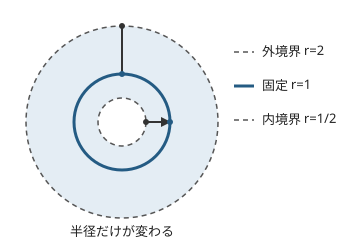
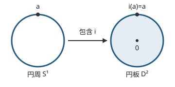

# ATOP3 レトラクト・変形レトラクト・可縮性

[ATOP2](../ATOP2/index.md) では二空間の間に [ホモトピー同値](../ATOP2/index.md#def-atop2-homotopy-equivalence) を与える二つの写像を作りました。今回は一方がもう一方の部分空間であるとき、元の図形をその部分だけで代表させる方法を考えます。例えば原点を除いた平面には原点に向かって縮められないという制約がありますが、円周までは動径方向に縮められます。

前提は ATOP2、[TOP1](../../../基礎科目/TOP/TOP1/index.md) の部分空間・積位相、[TOP3](../../../基礎科目/TOP/TOP3/index.md) の連結性です。$I=[0,1]$ とし、変形の時刻を $t\in I$ で表します。部分空間と直積にはそれぞれ [部分空間位相](../../../基礎科目/F0/F0-00B1/index.md#def-f0-00b1-subspace) と [積位相](../../../基礎科目/TOP/TOP1/index.md#def-top1-product-topology) を入れます。

$\|z\|$ は Euclid ノルム（原点からの距離）、$\mathrm{id}_X(x)=x$ は恒等写像です。$f\circ g$ は先に $g$、次に $f$ を適用する合成を表します。円周と閉円板をそれぞれ

$$
S^1=\{z\in\mathbb R^2:\|z\|=1\},
\qquad D^2=\{z\in\mathbb R^2:\|z\|\le1\}
$$

と書きます。

<!-- definition-example-audit: strict -->

## 1. 部分空間へ戻す写像

平面上の点 $(x,y)$ から横軸上の点 $(x,0)$ を選ぶことを考えます。横軸上の点は最初から目的地にあるので、移す必要はありません。このように部分空間の点をそのままにして全空間を部分空間へ写すことを要求します。部分空間 $A\subseteq X$ の点を同じ点として $X$ で見る写像 $i:A\to X$、$i(a)=a$ を包含写像といいます。部分空間位相により連続です。

<!-- formal-statement-start -->
> **定義（レトラクションとレトラクト）**
> 位相空間 $X$ と部分空間 $A\subseteq X$ を取る。連続写像 $r:X\to A$ がすべての $a\in A$ について $r(a)=a$ を満たすとき、$r$ をレトラクションといい、$A$ を $X$ のレトラクトという。包含写像 $i:A\to X$ を用いれば条件は

$$
r\circ i=\mathrm{id}_A
$$

> である。
<!-- formal-statement-end -->

<!-- definition-example-start: def-atop3-retraction -->
**定義の確認**

$X=\mathbb R^2$、$A=\mathbb R\times\{0\}$ とし、$r(x,y)=(x,0)$ と置きます。

第1成分は座標射影、第2成分は定数0なので連続です。[積位相の普遍性](../../../基礎科目/TOP/TOP1/index.md#thm-top1-product-universal) により平面への写像として連続で、第2座標が0なので値は $A$ に入ります。[部分空間位相の連続性判定](../../../基礎科目/TOP/TOP1/index.md#prop-top1-subspace-universal) により $A$ への写像として連続です。

$a=(x,0)$ なら $r(a)=(x,0)=a$ です。したがって $A$ は $X$ のレトラクトです。
<!-- definition-example-end -->

$r$ の終域は $A$ です。$i\circ r$ は $X$ の自己写像になりますが、一般に $\mathrm{id}_X$ とは等しくありません。例えば $(1,2)$ は $(1,0)$ に移ります。また $r(a)=a$ から $r$ は全射です。

任意の非空空間 $X$ では一点部分空間 $\{p\}$ への定数写像がレトラクションになります。したがってレトラクトであるというだけでは、元の空間の形をどれだけ保持しているかは分かりません。

## 2. 変形そのものを作る

部分空間へ戻す写像に加えて、全空間の点が途中もその空間の中にあり、最後に部分空間へ集まる変形を求めます。さらに部分空間の点を全時間で固定できる場合を区別します。[ホモトピーの定義](../ATOP2/index.md#def-atop2-homotopy) に従い、$f\simeq g$ は同じ定義域・終域を持つ写像 $f,g$ の間に積空間上の連続な変形が存在することを表します。

<!-- formal-statement-start -->
> **定義（変形レトラクト）**
> 位相空間 $X$、部分空間 $A\subseteq X$、包含写像 $i:A\to X$ を取る。あるレトラクション $r:X\to A$ に対して

$$
\mathrm{id}_X\simeq i\circ r
$$

> が成立するとき、$A$ は $X$ の変形レトラクトであるという。
<!-- formal-statement-end -->

<!-- definition-example-start: def-atop3-deformation-retract -->
**定義の確認**

第1節の横軸へのレトラクションに対し、

$$
H((x,y),t)=(x,(1-t)y)
$$

と置きます。ここで $H:\mathbb R^2\times I\to\mathbb R^2$ です。第1成分は座標射影、第2成分は座標射影と時刻の連続関数の積なので、[積位相の普遍性](../../../基礎科目/TOP/TOP1/index.md#thm-top1-product-universal) により $H$ は連続です。値は平面内にあります。$H((x,y),0)=(x,y)$、$H((x,y),1)=(x,0)$ です。従って [ホモトピーの定義](../ATOP2/index.md#def-atop2-homotopy) を満たし、横軸は変形レトラクトです。
<!-- definition-example-end -->

この定義だけでは途中の $A$ の点が動いても構いません。次の条件は変形中にも $A$ がその場にとどまることを要求します。すなわち、$\mathrm{id}_X$ と $i\circ r$ を結ぶ [相対ホモトピー](../ATOP2/index.md#def-atop2-relative-homotopy) を $A$ に相対的に取ります。

<!-- formal-statement-start -->
> **定義（強変形レトラクト）**
> 位相空間 $X$ と部分空間 $A\subseteq X$ に対し、レトラクション $r:X\to A$ と連続写像 $H:X\times I\to X$ が存在して

$$
H(x,0)=x,\quad H(x,1)=i(r(x))
\quad(x\in X),
$$

$$
H(a,t)=a\quad(a\in A,\ t\in I)
$$

> を満たすとき、$A$ を $X$ の強変形レトラクトという。ここで $i:A\to X$ は包含写像である。
<!-- formal-statement-end -->

<!-- definition-example-start: def-atop3-strong-deformation-retract -->
**定義の確認**

$X=[-2,2]$、$A=[-1,1]$ とし、$r(x)=\max(-1,\min(x,1))$ と置きます。

この式は $x<-1$ では $-1$、$-1\le x\le1$ では $x$、$x>1$ では $1$ を返します。

最小値・最大値を取る演算は連続で、値は $A$ に入るので [部分空間位相の連続性判定](../../../基礎科目/TOP/TOP1/index.md#prop-top1-subspace-universal) により $r:X\to A$ は連続です。$a\in A$ では $r(a)=a$ なのでレトラクションです。

$$
H(x,t)=(1-t)x+t r(x)
$$

は連続です。二点 $x,r(x)$ は $[-2,2]$ に属し、係数が非負で和が1なので値も $[-2,2]$ に属します。[部分空間位相の連続性判定](../../../基礎科目/TOP/TOP1/index.md#prop-top1-subspace-universal) により $H:X\times I\to X$ として連続です。初終時刻の値は $x,r(x)$ で、$a\in A$ なら $H(a,t)=(1-t)a+ta=a$ です。従って全条件を満たします。
<!-- definition-example-end -->

本講では途中の固定条件のない場合とある場合を区別します。文献によっては固定条件を含むものを単に変形レトラクトと呼びます。

<!-- formal-statement-start -->
> **定理（変形レトラクトによるホモトピー同値）**
> 位相空間 $X$ の部分空間 $A$ が変形レトラクトであるなら、$X$ と $A$ はホモトピー同値である。特に強変形レトラクトの場合も成立する。
<!-- formal-statement-end -->

片方の合成は厳密に恒等写像で、もう片方は変形によって恒等写像と結ばれます。

<!-- proof-start -->
### 証明

定義を満たすレトラクションを $r:X\to A$、包含写像を $i:A\to X$ とします。包含は部分空間位相の定義により連続です。$r$ も連続です。

[レトラクションの定義](#def-atop3-retraction) より $r\circ i=\mathrm{id}_A$ です。[ホモトピー関係の反射律](../ATOP2/index.md#thm-atop2-homotopy-equivalence-relation) の静止ホモトピー $(a,t)\mapsto a$ で $r\circ i\simeq\mathrm{id}_A$ を得ます。

[変形レトラクトの定義](#def-atop3-deformation-retract) より $\mathrm{id}_X\simeq i\circ r$ です。[ホモトピー関係の対称律](../ATOP2/index.md#thm-atop2-homotopy-equivalence-relation) により $i\circ r\simeq\mathrm{id}_X$ となります。

二条件がそろうので、[ホモトピー同値の定義](../ATOP2/index.md#def-atop2-homotopy-equivalence) が適用できます。強変形レトラクトなら固定条件を忘れれば変形レトラクトです。
<!-- proof-end -->

逆に、単なるレトラクションではこの証明の二つ目の合成に必要なホモトピーが手に入りません。ここが両概念の違いです。

## 3. 円環と穴あき平面を円周へ縮める

円環 $X=\{z\in\mathbb R^2:1/2\le\|z\|\le 2\}$ を考えます。角度は変えず、半径だけを1へ近づけます。

図の矢印は内側からは外向き、外側からは内向きです。実線の単位円周上に到達した点は固定されます。[図を拡大](assets/annulus.svg)

<!-- formal-statement-start -->
> **命題（動径方向の強変形レトラクト）**
> $J\subseteq(0,\infty)$ を1を含む区間とする。部分空間

$$
X_J=\{z\in\mathbb R^n:\|z\|\in J\},
\qquad n\ge1,
$$

> の単位球面 $S^{n-1}=\{z:\|z\|=1\}$ は $X_J$ の強変形レトラクトである。
<!-- formal-statement-end -->

半径を $s=\|z\|$、方向を $u=z/s$ と分けると、$z=su$ です。変形中の半径を $(1-t)s+t$ にします。$J$ が区間なので二つの半径の間を移動しても $J$ を出ません。

<!-- proof-start -->
### 証明

$z\in X_J$ では $s=\|z\|>0$ です。従って

$$
r(z)=\frac{z}{\|z\|}
$$

が定義できます。ノルムの斉次性から $\|r(z)\|=\|z\|/\|z\|=1$ なので球面に値を取ります。

$z=(z_1,\ldots,z_n)$ の第 $j$ 座標を $z_j$（$1\le j\le n$）とすると、$r$ の第 $j$ 成分は $z_j/\|z\|$ です。分子・分母は連続、分母は正なので各成分は連続です。[積位相の普遍性](../../../基礎科目/TOP/TOP1/index.md#thm-top1-product-universal) により $\mathbb R^n$ への写像として連続です。[部分空間位相の連続性判定](../../../基礎科目/TOP/TOP1/index.md#prop-top1-subspace-universal) により球面への連続写像です。

$\|a\|=1$ なら $r(a)=a$ です。

$$
H(z,t)=(1-t)z+t\frac{z}{\|z\|}
$$

と置きます。第 $j$ 成分は

$$
(1-t)z_j+t\frac{z_j}{\|z\|}
$$

で、積空間上の連続関数の積・和なので [積位相の普遍性](../../../基礎科目/TOP/TOP1/index.md#thm-top1-product-universal) により $\mathbb R^n$ への写像として連続です。$s=\|z\|$、$u=z/s$ と書けば

$$
H(z,t)=((1-t)s+t)u.
$$

係数 $(1-t)s+t$ は正で、$s$ と1の間の値です。$\|u\|=1$ より

$$
\|H(z,t)\|=(1-t)s+t\in J.
$$

したがって値が $X_J$ に入るので、[部分空間位相の連続性判定](../../../基礎科目/TOP/TOP1/index.md#prop-top1-subspace-universal) により $H:X_J\times I\to X_J$ は連続です。$H(z,0)=z$、$H(z,1)=r(z)$ であり、球面上の $a$ では $H(a,t)=(1-t)a+ta=a$ です。[強変形レトラクトの定義](#def-atop3-strong-deformation-retract) を満たします。
<!-- proof-end -->

$J=[1/2,2]$ とすれば円環、$J=(0,\infty)$ とすれば穴あき平面です。どちらも $n=2$ として円周への変形を得ます。[変形レトラクトによるホモトピー同値](#thm-atop3-deformation-equivalence) をそれぞれに適用し、[ホモトピー同値の推移律](../ATOP2/index.md#thm-atop2-space-equivalence-relation) を使えば、円環と穴あき平面もホモトピー同値です。

例えば $z=(0,2)$ なら $r(z)=(0,1)$ で、時刻 $t=1/2$ の位置は $(0,3/2)$ です。$z=(1/2,0)$ なら同じ時刻で $(3/4,0)$ です。内側と外側で移動方向が反対になります。

## 4. 一点に縮める

円板では中心へ向かう直線を使えます。空間全体を一点に縮める変形が存在するかどうかは、空間の性質を調べる第一歩になります。点 $p\in X$ を固定した定数写像を $c_p:X\to X$、$c_p(x)=p$ と書きます。

<!-- formal-statement-start -->
> **定義（可縮性）**
> 位相空間 $X$ について、ある点 $p\in X$ への定数写像 $c_p:X\to X$ が存在して

$$
\mathrm{id}_X\simeq c_p
$$

> が成立するとき、$X$ は可縮であるという。
<!-- formal-statement-end -->

<!-- definition-example-start: def-atop3-contractible -->
**定義の確認**

$X=D^2$、$p=0$ とし、$H(z,t)=(1-t)z$ と置きます。各成分は連続で、

$$
\|H(z,t)\|=(1-t)\|z\|\le1
$$

なので円板から出ません。[積位相の普遍性](../../../基礎科目/TOP/TOP1/index.md#thm-top1-product-universal) と [部分空間位相の連続性判定](../../../基礎科目/TOP/TOP1/index.md#prop-top1-subspace-universal) により $H:D^2\times I\to D^2$ は連続です。$H(z,0)=z$、$H(z,1)=0$ です。よって円板は可縮です。さらに $r:D^2\to\{0\}$ を定数0のレトラクションとすれば $H(0,t)=0$ なので、$\{0\}$ は [強変形レトラクト](#def-atop3-strong-deformation-retract) にもなっています。
<!-- definition-example-end -->

<!-- formal-statement-start -->
> **定理（可縮性と一点空間）**
> 位相空間 $X$ が可縮であることと、$X$ が一点空間とホモトピー同値であることは同値である。
<!-- formal-statement-end -->

<!-- proof-start -->
### 証明

$X$ が可縮なら、定義を満たす点を $p$ とし、$f:X\to\{*\}$、$g:\{*\}\to X$ を $f(x)=*$、$g(*)=p$ とします。どちらも連続です。

$$
f\circ g=\mathrm{id}_{\{*\}},\qquad
g\circ f=c_p\simeq\mathrm{id}_X.
$$

前者については [ホモトピー関係の反射律](../ATOP2/index.md#thm-atop2-homotopy-equivalence-relation) により恒等写像から恒等写像へのホモトピーが存在します。後者は [ホモトピー関係の対称律](../ATOP2/index.md#thm-atop2-homotopy-equivalence-relation) で向きを変えました。[ホモトピー同値の定義](../ATOP2/index.md#def-atop2-homotopy-equivalence) より結論を得ます。

逆に一点空間とホモトピー同値なら、その二写像を $f,g$ とします。$p=g(*)$ が $X$ の点として存在し、全ての $x\in X$ に対し

$$
(g\circ f)(x)=g(*)=p.
$$

同値の条件より $c_p=g\circ f\simeq\mathrm{id}_X$ です。[ホモトピー関係の対称律](../ATOP2/index.md#thm-atop2-homotopy-equivalence-relation) で向きを反転して [可縮性の定義](#def-atop3-contractible) を満たします。
<!-- proof-end -->

[直線ホモトピー](../ATOP2/index.md#prop-atop2-linear-homotopy) で扱った凸集合とは、二点を結ぶ線分を全て含む集合でした。凸な非空集合 $C\subseteq\mathbb R^n$ は可縮です。

点 $p\in C$ を選び、[直線ホモトピー](../ATOP2/index.md#prop-atop2-linear-homotopy) を $\mathrm{id}_C$ と $c_p$ に適用します。両写像は連続で値が $C$ に入り、$H(x,t)=(1-t)x+tp$ は凸性から $C$ に入ります。

$r:C\to\{p\}$ を定数写像とすれば $r(p)=p$ でレトラクションです。$H(p,t)=p$ なので $\{p\}$ は [強変形レトラクト](#def-atop3-strong-deformation-retract) です。

<!-- formal-statement-start -->
> **命題（可縮空間のレトラクト）**
> 位相空間 $X$ が可縮であり、$A\subseteq X$ がそのレトラクトなら、$A$ も可縮である。
<!-- formal-statement-end -->

$X$ の縮め方をそのまま $A$ に制限すると途中で $A$ から出るかもしれません。そこで各時刻の値にレトラクションを適用し、値を $A$ へ戻します。

<!-- proof-start -->
### 証明

$H:X\times I\to X$ を $\mathrm{id}_X$ から定数写像 $c_p$ へのホモトピー、$r:X\to A$ をレトラクションとします。

$$
K(a,t)=r(H(i(a),t))
$$

と置きます。[ホモトピーと合成の両立](../ATOP2/index.md#prop-atop2-homotopy-composition) を前合成 $i:A\to X$、後合成 $r:X\to A$ に適用すれば、$K$ は $A\times I\to A$ の連続写像です。端の値は

$$
K(a,0)=r(i(a))=a,\qquad
K(a,1)=r(p).
$$

$r(p)\in A$ は $a$ に依存しないので、$K$ は $\mathrm{id}_A$ から点 $r(p)$ への定数写像へのホモトピーです。[可縮性の定義](#def-atop3-contractible) により $A$ は可縮です。
<!-- proof-end -->

## 5. 円板とその境界は同じではない

円周から円板への包含は定義できますが、円板全体から円周へ戻す連続なレトラクションが存在するかは別問題です。[図を拡大](assets/disk-boundary.svg)

動径方向の式 $r(z)=z/\|z\|$ を円板全体へ使おうとすると、原点で分母が0になります。仮に原点に何か値を割り当てても、正整数 $k$ を大きくすると $(1/k,0)$ と $(-1/k,0)$ はともに原点へ近づきます。ところが像はそれぞれ $(1,0)$ と $(-1,0)$ の定数列です。[連続写像は収束列を収束列へ送る](../../../基礎科目/F0/F0-00B1/index.md#prop-f0-00b1-continuity-sequences) ので、両方が原点に割り当てた同じ値へ収束する必要があります。Euclid 距離では極限が一意なので矛盾します。

この計算は動径方向の式が延長できないことを示すだけです。あらゆる連続レトラクションが存在しないことは ATOP24 で証明します。[可縮空間のレトラクト](#prop-atop3-retract-contractible) によれば、もし円板から円周へのレトラクションが存在すれば、円周も可縮でなければなりません。この条件が実際には成立しないことを後続講義で明らかにします。

最後に可縮性と道の関係を見ます。二点を結ぶ連続写像 $I\to X$ を道といい、任意の二点を道で結べる空間を道連結といいます（[道連結性](../../../基礎科目/TOP/TOP3/index.md#def-top3-path-connected)）。

可縮なら、$\mathrm{id}_X$ から $c_p$ へのホモトピー $H$ を取れます。

点 $x$ を固定すると $t\mapsto(x,t)$ は定数写像と恒等写像を成分に持つため [積位相の普遍性](../../../基礎科目/TOP/TOP1/index.md#thm-top1-product-universal) から連続で、$t\mapsto H(x,t)$ は $x$ と $p$ を結ぶ道です。

任意の二点 $x,y$ について、前半で $x$ から $p$、後半で $p$ から $y$ に進む道を

$$
\gamma(t)=
\begin{cases}
H(x,2t),&0\le t\le1/2,\\
H(y,2-2t),&1/2\le t\le1
\end{cases}
$$

と置きます。各枝の時刻引数は $I$ にあり、連続写像の合成なので各閉区間で連続です。継ぎ目は $H(x,1)=p=H(y,1)$ なので、[ホモトピー関係の推移律の証明](../ATOP2/index.md#thm-atop2-homotopy-equivalence-relation) と同じ閉集合の貼り合わせで連続です。$\gamma(0)=x$、$\gamma(1)=y$ より道連結です。

次講以降で扱う単連結性は、道連結性に加えて、閉じた道を端点を固定して縮められるかを問う性質です。これに対して可縮性は空間全体の恒等写像に関する条件です。両者の関係は基点と道のホモトピーを整備してから扱います。

## 6. 演習

### 演習 ATOP3-A1：射影と包含

- Level: A

$X=\mathbb R^3$、$A=\{(x,y,0):x,y\in\mathbb R\}$ とする。レトラクションを構成し、包含との二つの合成を求めよ。

<!-- solution-start -->
**詳細解答**

$r(x,y,z)=(x,y,0)$ とする。各成分は射影または定数で連続です。[積位相の普遍性](../../../基礎科目/TOP/TOP1/index.md#thm-top1-product-universal) により空間への写像として連続で、値が $A$ に入るため [部分空間位相の連続性判定](../../../基礎科目/TOP/TOP1/index.md#prop-top1-subspace-universal) により $A$ への写像として連続です。$a=(x,y,0)$ に対して $r(a)=a$ なので [レトラクション](#def-atop3-retraction) です。

$$
(r\circ i)(x,y,0)=(x,y,0),
$$

$$
(i\circ r)(x,y,z)=(x,y,0).
$$

前者は $\mathrm{id}_A$、後者は例えば $(0,0,1)$ を原点に写すので $\mathrm{id}_X$ ではありません。
<!-- solution-end -->

### 演習 ATOP3-A2：固定集合を求める

- Level: A

$H(x,t)=(1-t)x+t/3$ を $I\times I\to I$ とする。一点部分空間への強変形レトラクションを与えることを確かめ、全時刻で固定される点を求めよ。

<!-- solution-start -->
**詳細解答**

$x,1/3\in I$ で係数は非負、和は1なので値は $I$ 内にあります。式は連続で $H(x,0)=x$、$H(x,1)=1/3$ です。

終時刻の定数写像 $r:I\to\{1/3\}$ は連続で $r(1/3)=1/3$ なのでレトラクションです。[部分空間位相の連続性判定](../../../基礎科目/TOP/TOP1/index.md#prop-top1-subspace-universal) により $H:I\times I\to I$ としても連続です。

全時刻で固定なら特に時刻1で $x=1/3$ です。逆に

$$
H(1/3,t)=(1-t)/3+t/3=1/3.
$$

従って固定集合は $\{1/3\}$ で、[強変形レトラクト](#def-atop3-strong-deformation-retract) の全条件が成立します。
<!-- solution-end -->

### 演習 ATOP3-A3：円環の途中時刻

- Level: A

第3節の円環で $z=(0,-2)$ と $w=(3/10,2/5)$ を取り、時刻 $t=3/4$ の位置を求めよ。

<!-- solution-start -->
**詳細解答**

$\|z\|=2$、$r(z)=(0,-1)$ です。[動径方向の強変形レトラクト](#prop-atop3-radial-deformation) の式に入れると

$$
H(z,3/4)=(0,-2/4-3/4)=(0,-5/4).
$$

$w$ のノルムは $\sqrt{9/100+4/25}=1/2$ です。従って $r(w)=(3/5,4/5)$ となり、

$$
H(w,3/4)=\frac14(3/10,2/5)+
\frac34(3/5,4/5)
=(3/40+9/20,1/10+3/5)
=(21/40,7/10).
$$

半径はそれぞれ $5/4$ と $7/8$（後者は $w$ の方向に半径 $1/8+3/4$）で、いずれも円環内です。
<!-- solution-end -->

### 演習 ATOP3-A4：レトラクトだが変形できない例

- Level: A

離散位相を入れた $X=\{0,1\}$ の部分空間 $A=\{0\}$ がレトラクトだが変形レトラクトでないことを示せ。

<!-- solution-start -->
**詳細解答**

定数写像 $r:X\to A$ は連続で $r(0)=0$ なのでレトラクションです。変形レトラクトなら $H(1,0)=1$、$H(1,1)=0$ となる写像 $t\mapsto H(1,t)$ が存在します。$t\mapsto(1,t)$ は [積位相の普遍性](../../../基礎科目/TOP/TOP1/index.md#thm-top1-product-universal) により連続なので $H$ との合成も連続です。

[実数の区間は連結](../../../基礎科目/TOP/TOP3/index.md#thm-top3-real-interval) であり、[連結空間の連続像は連結](../../../基礎科目/TOP/TOP3/index.md#thm-top3-continuous-image) です。しかしこの像は離散二点を両方含むため非連結です。矛盾するので変形は存在しません。レトラクションだけでは時間方向の連続性を保証できないことが原因です。
<!-- solution-end -->

### 演習 ATOP3-A5：原点での延長

- Level: A

$D^2\setminus\{0\}$ 上の写像 $r(z)=z/\|z\|$ が $D^2\to S^1$ の連続写像へ延長できないことを、二つの点列を用いて示せ。この結果だけで円板から円周へのすべてのレトラクションが否定できるか。

<!-- solution-start -->
**詳細解答**

正整数 $k$ に対して $z_k=(1/k,0)$、$w_k=(0,1/k)$ を取ると、両点列は円板内で原点へ収束します。像は

$$
r(z_k)=(1,0),\qquad r(w_k)=(0,1).
$$

連続な延長 $R$ があるなら、[連続写像は収束列を収束列へ送る](../../../基礎科目/F0/F0-00B1/index.md#prop-f0-00b1-continuity-sequences) ので、どちらの像の列も $R(0)$ へ収束するはずです。しかし Euclid 距離での極限は一意であり、二つの定数列は別の点に収束します。よって延長は存在しません。

否定したのは指定された動径写像の延長だけです。任意のレトラクションがこの動径写像に一致する必要はないため、全レトラクションの不存在には別の論証が必要です。
<!-- solution-end -->

### 演習 ATOP3-B1：球面の外側

- Level: B

$X=\{z\in\mathbb R^3:\|z\|\ge2\}$、$A=\{z:\|z\|=2\}$ とする。半径を2へ移す強変形レトラクションを構成せよ。

<!-- solution-start -->
**詳細解答**

各点の方向を保存して半径を2にするため $r(z)=2z/\|z\|$ とします。分母は2以上で、各成分は連続関数の商です。$\|r(z)\|=2\|z\|/\|z\|=2$ なので [積位相の普遍性](../../../基礎科目/TOP/TOP1/index.md#thm-top1-product-universal) と [部分空間位相の連続性判定](../../../基礎科目/TOP/TOP1/index.md#prop-top1-subspace-universal) により $r:X\to A$ は連続です。$a\in A$ では $r(a)=a$ です。

$$
H(z,t)=(1-t)z+t\frac{2z}{\|z\|}.
$$

$s=\|z\|\ge2$、$u=z/s$ とすると $H(z,t)=((1-t)s+2t)u$ で、係数は2以上です。従って

$$
\|H(z,t)\|=(1-t)s+2t\ge2.
$$

各成分は積空間上の連続関数の和・積です。[積位相の普遍性](../../../基礎科目/TOP/TOP1/index.md#thm-top1-product-universal) により連続で、値が $X$ に入るため [部分空間位相の連続性判定](../../../基礎科目/TOP/TOP1/index.md#prop-top1-subspace-universal) により $X$ への写像として連続です。端では $H(z,0)=z$、$H(z,1)=r(z)$ となり、$a\in A$ では $H(a,t)=a$ です。よって [強変形レトラクト](#def-atop3-strong-deformation-retract) です。
<!-- solution-end -->

### 演習 ATOP3-B2：可縮空間から道を作る

- Level: B

$H$ が $X$ の恒等写像から点 $p$ への定数写像へのホモトピーであるとする。任意の $x,y\in X$ を結ぶ道を明示的に構成せよ。

<!-- solution-start -->
**詳細解答**

最初の半分で $x$ から $p$、後半で $p$ から $y$ へ動かすため

$$
\gamma(t)=
\begin{cases}
H(x,2t),&0\le t\le1/2,\\
H(y,2-2t),&1/2\le t\le1
\end{cases}
$$

と置きます。両枝の時間引数は $I$ に入ります。点を固定した $t\mapsto(x,2t)$、$t\mapsto(y,2-2t)$ は [積位相の普遍性](../../../基礎科目/TOP/TOP1/index.md#thm-top1-product-universal) により各閉区間上で連続であり、$H$ との合成も連続です。継ぎ目は $H(x,1)=p=H(y,1)$ です。両閉区間上で連続で一致するので、[ホモトピー関係の推移律の証明](../ATOP2/index.md#thm-atop2-homotopy-equivalence-relation) と同じ閉集合の貼り合わせで連続です。端は $\gamma(0)=x$、$\gamma(1)=y$。従って道連結です。
<!-- solution-end -->

### 演習 ATOP3-B3：レトラクションを合成する

- Level: B

$B\subseteq A\subseteq X$ とする。$r:X\to A$、$s:A\to B$ がそれぞれレトラクションなら、$B$ が $X$ のレトラクトであることを示せ。さらに $X$ が可縮なら $B$ も可縮であることを示せ。

<!-- solution-start -->
**詳細解答**

合成 $s\circ r:X\to B$ は連続です。$b\in B$ は $A$ に属するので $r(b)=b$、さらに $s(b)=b$ です。よって $(s\circ r)(b)=b$ となり [レトラクション](#def-atop3-retraction) です。

$X$ が可縮なら、恒等写像から定数点 $p$ へのホモトピー $H$ を取ります。[可縮空間のレトラクト](#prop-atop3-retract-contractible) の証明にこの合成を代入すると、

$$
K(b,t)=s(r(H(b,t)))
$$

は $B$ に値を取る連続写像で、$K(b,0)=s(r(b))=b$、$K(b,1)=s(r(p))$ です。終時刻の値は $b$ に依存しないので $B$ は可縮です。
<!-- solution-end -->

### 演習 ATOP3-B4：凸でない可縮空間

- Level: B

$X=\{(x,0):|x|\le1\}\cup\{(0,y):|y|\le1\}$ とする。$X$ が凸でないことを示し、原点への強変形レトラクションを構成せよ。

<!-- solution-start -->
**詳細解答**

$(1,0),(0,1)$ は $X$ に属しますが、中点 $(1/2,1/2)$ は両座標が非零なので $X$ に属しません。従って凸ではありません。

一方、$z\in X$ に対し $H(z,t)=(1-t)z$ とします。$z=(x,0)$ の場合は $H(z,t)=((1-t)x,0)$ で、$|(1-t)x|\le1$ です。$z=(0,y)$ の場合は $H(z,t)=(0,(1-t)y)$ で、$|(1-t)y|\le1$ です。よって両場合で値が $X$ に属します。

各成分は連続であり、[積位相の普遍性](../../../基礎科目/TOP/TOP1/index.md#thm-top1-product-universal) と [部分空間位相の連続性判定](../../../基礎科目/TOP/TOP1/index.md#prop-top1-subspace-universal) により $H:X\times I\to X$ は連続です。$r:X\to\{0\}$ は定数写像で $r(0)=0$ なのでレトラクションです。初終時刻で $z,0$ となり、原点は全時刻で固定です。従って $\{0\}$ は [強変形レトラクト](#def-atop3-strong-deformation-retract) であり、$X$ は可縮です。凸性は直線による縮約の十分条件ですが必要条件ではありません。
<!-- solution-end -->

### 演習 ATOP3-C1：二段階の強変形

- Level: C

$B\subseteq A\subseteq X$ とする。$A$ は $X$ の強変形レトラクトであり、$B$ は $A$ の強変形レトラクトであるとする。二つの変形をつなぎ、$B$ が $X$ の強変形レトラクトであることを示せ。

<!-- solution-start -->
**詳細解答**

レトラクションを $r:X\to A$、$s:A\to B$、対応する変形を $H:X\times I\to X$、$K:A\times I\to A$ とします。包含写像を $i:A\to X$、$j:B\to A$ とします。

B3 で確かめたように $s\circ r:X\to B$ は連続で、$b\in B$ では $s(r(b))=s(b)=b$ なので [レトラクション](#def-atop3-retraction) です。時刻1/2までに $A$ へ移し、後半で $A$ の中を $B$ へ移します。

$$
L(x,t)=
\begin{cases}
H(x,2t),&0\le t\le1/2,\\
i(K(r(x),2t-1)),&1/2\le t\le1.
\end{cases}
$$

二つの時刻引数はそれぞれ $I$ に入り、前半の値は $X$、後半の値も包含によって $X$ に入ります。前半の $(x,t)\mapsto(x,2t)$ と後半の $(x,t)\mapsto(r(x),2t-1)$ は、成分が連続なので [積位相の普遍性](../../../基礎科目/TOP/TOP1/index.md#thm-top1-product-universal) によりそれぞれの閉部分空間上で連続です。従って $H$ または $K,i$ との合成も連続です。継ぎ目では

$$
H(x,1)=i(r(x))=i(K(r(x),0)).
$$

従って [ホモトピー関係の推移律の証明](../ATOP2/index.md#thm-atop2-homotopy-equivalence-relation) に従い、二つの閉部分上の写像を貼り合わせた $L$ は連続です。

端では

$$
L(x,0)=x,\qquad
L(x,1)=i(j(s(r(x)))).
$$

$b\in B$ なら $b\in A$ であるため前半では $H(b,2t)=b$ です。後半では $r(b)=b$ かつ $K(b,2t-1)=b$ なので、包含後も $b$ です。従って全時刻で $B$ が固定され、[強変形レトラクト](#def-atop3-strong-deformation-retract) の全条件を満たします。
<!-- solution-end -->

## 7. まとめ

- レトラクションは部分空間上で恒等写像になる連続写像です。
- 変形レトラクトは元の空間とホモトピー同値です。強変形では部分空間を全時刻で固定します。
- 円環と穴あき平面は円周へ動径方向に強変形できます。半径が正であることと区間条件が値域の保証になります。
- 可縮性は一点空間とのホモトピー同値と同値です。可縮空間のレトラクトも可縮です。
- 次講では、道と閉じた道の変形を用いて空間の性質を調べます。
