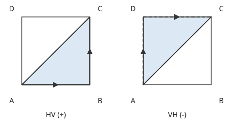

# ATOP30 積空間とKünneth公式

## 1. 二つの空間を組み合わせる

円周を二つ掛け合わせたトーラスには、二方向の1次の穴だけでなく、面全体を一周する2次のサイクルがあります。各因子の鎖を掛ければ積空間の鎖を得られそうですが、二つの単体の積は一般には単体ではありません。また、前講で見たようにテンソル積は単射を保存しない場合があります。

この講では、まず単体の積を分割して鎖を作り、逆向きの写像も作ります。その後、積空間の問題を鎖複体の代数の問題に置き換えます。係数は原則として単位元を持つ可換[主イデアル整域（PID）](../../../代数系/RNG/RNG3/index.md#def-rng3-pid) $R$ とし、整数と体が主な例です。通常の鎖複体では負次数は零とし、第6節の次数反転の際だけ整数全体の次数を使います。

[アーベル群のテンソル積](../ATOP29/index.md#def-atop29-abelian-tensor) を $R$ 上で使うときは、対を基底とする[自由加群](../../../代数系/MOD/MOD1/index.md#def-mod1-free-module-basis)を出発点とし、二変数の加法性に加えて次の関係を課します。

$$
(ra)\otimes b=a\otimes(rb)=r(a\otimes b).
$$

前講の[テンソル積の右完全性](../ATOP29/index.md#prop-atop29-tensor-right-exact)の商による証明はこの関係を加えても成立します。

自由加群 $F$ の基底を $(e_i)$ とすると、

$$
F\otimes_R G\cong\bigoplus_iG
$$

です。写像は $e_i\otimes g$ を第 $i$ 成分の $g$ に送ります。

任意の元 $f=\sum_i r_i e_i$ に対して $f\otimes g$ は有限台の族 $(r_i g)_i$ に対応し、逆写像は $(g_i)_i\mapsto\sum_i e_i\otimes g_i$ です。

加法性と係数を移す関係から両写像は良定義で、両合成は恒等です。このため自由加群を掛ける操作は完全列を保ちます。以下、テンソルはすべて $R$ 上とします。

## 2. 積の鎖複体

[特異鎖群](../ATOP16/index.md#def-atop16-singular-chains) の係数を $R$ にしたものを $C_*(X)$ と書きます。

一般の鎖複体 $C,D$ についても、一方の $p$ 次と他方の $q$ 次を掛けたものを $p+q$ 次に置きます。

各鎖複体の境界を $d_C,d_D$ と書きます（特異鎖での $\partial$ と同じ役割です）。第二因子の境界を取るときには第一因子の次数に応じて符号を変える必要があります。

ここで $d$ は座標や時間による微分ではなく、鎖の次数を1下げる線形写像です。

<!-- formal-statement-start -->
> **定義（テンソル積鎖複体）**
>
> 非負次数の $R$ 加群の鎖複体 $C,D$ に対して、テンソル積鎖複体 $T=C\otimes D$ を次で定める。
>
$$
T_n=\bigoplus_{p+q=n}C_p\otimes D_q,
$$

$$
d(c\otimes e)=d_Cc\otimes e+(-1)^p c\otimes d_De
\qquad(c\in C_p,\ e\in D_q).
$$
<!-- formal-statement-end -->

<!-- definition-example-start: def-atop30-tensor-complex -->
**定義の確認**。二つの区間の端点を $v_0,v_1$ と $w_0,w_1$、辺を $a,b$ とします。$da=v_1-v_0,\ db=w_1-w_0$ です。2次の $a\otimes b$ の境界は

$$
d(a\otimes b)=(v_1-v_0)\otimes b-a\otimes(w_1-w_0).
$$

各項は次数 $0+1$ または $1+0$ なので $T_1$ に属します。この式にもう一度 $d$ を作用させると第一項から $(v_1-v_0)\otimes(w_1-w_0)$、第二項からその負が生じます。従って $d^2(a\otimes b)=0$ です。

一般に、固定した二重次数 $(p,q)$ で境界の右辺は両変数に線形で、係数を一方から他方へ移す関係も保ちます。

例えば $d_C(rc)=r d_Cc$ なので、$(rc)\otimes e$ と $c\otimes(re)$ の境界は同じです。

従ってテンソル積の商上に境界が定まり、像は $T_{p+q-1}$ に入ります。二度作用させると

$$
\begin{aligned}
d^2(c\otimes e)
&=d_C^2c\otimes e
+(-1)^{p-1}d_Cc\otimes d_De\\
&\quad+(-1)^p d_Cc\otimes d_De
+c\otimes d_D^2e\\
&=0.
\end{aligned}
$$

混合項の符号が逆で、両因子は鎖複体だからです。次数0の因子の境界は零であり、その場合も同じ式が成立します。これで鎖複体の条件を確認できました。
<!-- definition-example-end -->

ここで二つの区間の辺の積を図にすると、正方形の対角線で二つの三角形に分けられます。

左の経路 H,V は $(0,0),(1,0),(1,1)$、右の V,H は $(0,0),(0,1),(1,1)$ です。両者を符号付きで足すと対角線が消え、外周だけが残ります。

## 3. 単体の積を鎖へ変える

$p+q$ 個の文字からなり、H が $p$ 個、V が $q$ 個ある語を shuffle と呼びます。

$(0,0)$ から始め、H で第一座標、V で第二座標を一つ増やすと、頂点列 $(i_k,j_k)$ が得られます。

$I(w)$ を V が H より先に出る組の数とします。例えば HV は $I=0$、VH は $I=1$ です。

[特異単体](../ATOP16/index.md#def-atop16-singular-simplex)の定義域である標準単体 $\Delta^p,\Delta^q$ の頂点をそれぞれ $v_i,w_j$ とし、$\lambda_w:\Delta^{p+q}\to\Delta^p\times\Delta^q$ を頂点 $k$ を $(v_{i_k},w_{j_k})$ に送るアフィン写像とします。

具体的には重心座標 $t_k\ge0$、$\sum_{k=0}^{p+q}t_k=1$ に対して

$$
\lambda_w(t)=\left(\sum_k t_k v_{i_k},\sum_k t_k w_{j_k}\right).
$$

各座標は頂点の凸結合なので積に値を取り、連続です。$\sigma\times\tau$ は $(x,y)\mapsto(\sigma(x),\tau(y))$ を意味します。各特異鎖群は特異単体を基底とする自由加群なので、テンソル積の基底である特異単体の対に値を指定すれば $R$ 線形写像が一意に定まります。

<!-- formal-statement-start -->
> **定義（shuffle写像）**
>
> 特異単体 $\sigma:\Delta^p\to X,\ \tau:\Delta^q\to Y$ に対して
>
$$
S(\sigma\otimes\tau)=
\sum_{w}(-1)^{I(w)}(\sigma\times\tau)\circ\lambda_w
$$
>
> と定め、各次数で $R$ 線形に延長する。和は H が $p$ 個、V が $q$ 個の全ての語について取る。
<!-- formal-statement-end -->

<!-- definition-example-start: def-atop30-shuffle -->
**定義の確認**。$p=q=1$ では語は HV と VH の二つだけです。$A=(0,0),B=(1,0),C=(1,1),D=(0,1)$ と書くと、区間の恒等単体の積は $[A,B,C]-[A,D,C]$ になります。

各括弧 $[P_0,\ldots,P_m]$ は重心座標 $t$ を $\sum_k t_kP_k$ に送るアフィン特異 $m$ 単体であり、符号は V が H に先行するか否かで決まります。境界の交代和は

$$
[B,C]-[A,C]+[A,B]
-[D,C]+[A,C]-[A,D]
$$

で、中央の対角辺が相殺します。外周の符号は第2節の境界と一致します。
<!-- definition-example-end -->

逆向きには積空間の特異単体を二つの射影へ分けます。$\rho=(\sigma,\tau):\Delta^n\to X\times Y$ に対し、$\sigma[0,\ldots,i]$ は[面写像](../ATOP16/index.md#def-atop16-face-map)を用いた指定頂点の面への制限を意味します。

一般に $\sigma[j_0,\ldots,j_m]$ は $\Delta^m$ の頂点 $\ell$ を $\Delta^n$ の頂点 $j_\ell$ に送る写像と $\sigma$ の合成です。

演習では $[0,1,2]$ を $[012]$ とも略記します（頂点番号が1桁の場合）。

<!-- formal-statement-start -->
> **定義（Alexander–Whitney写像）**
>
> 特異単体 $\rho=(\sigma,\tau):\Delta^n\to X\times Y$ に対し、
>
$$
A(\rho)=\sum_{i=0}^{n}\sigma[0,\ldots,i]
\otimes\tau[i,\ldots,n]
$$
>
> と定め、$R$ 線形に延長する。各項はテンソル積鎖複体の $n$ 次に属する。
<!-- formal-statement-end -->

<!-- definition-example-start: def-atop30-aw -->
**定義の確認**。$n=1$ の道 $\rho$ では
$A(\rho)=\sigma[0]\otimes\tau[0,1]+\sigma[0,1]\otimes\tau[1]$ です。次数はそれぞれ $0+1$ と $1+0$。境界を取ると

$$
\sigma[0]\otimes(\tau[1]-\tau[0])
+(\sigma[1]-\sigma[0])\otimes\tau[1]
$$

となり、混合項が消えて $\sigma[1]\otimes\tau[1]-\sigma[0]\otimes\tau[0]$ です。これは $A(d\rho)$ に一致します。前面と後面は同じ頂点で接続しています。
<!-- definition-example-end -->

<!-- formal-statement-start -->
> **定理（積の二つの鎖写像）**
>
> 任意の空間 $X,Y$ と係数環 $R$ に対し、上の $S:C_*(X)\otimes C_*(Y)\to C_*(X\times Y)$ と $A:C_*(X\times Y)\to C_*(X)\otimes C_*(Y)$ は、それぞれ境界と可換な鎖写像である。いずれも両空間の連続写像に関して自然（誘導される鎖写像と可換）である。
<!-- formal-statement-end -->

境界を取ると、内部面の寄与は二つの shuffle から出て消え、外側の面だけが残ります。Alexander–Whitney写像では切替頂点の寄与が隣接する切替位置と相殺します。

<!-- proof-start -->
### 証明

[特異境界作用素](../ATOP16/index.md#def-atop16-singular-boundary)は正次数で面の交代和、0次では零です。全次数0では両写像の鎖写像条件は両辺零なので、以下は正次数で確認します。

まず $S$ を考えます。語の頂点 $k$ を削除する境界項の符号は $(-1)^{I(w)+k}$ です。内部頂点で前後が HV または VH なら、二文字を交換した語でも同じ削除後頂点列が得られます。交換は $I$ を1だけ変え、$k$ を変えないので項は相殺します。

前後が HH の内部頂点、または端点で接する文字が H の場合は、第一因子のある頂点 $r$ の削除に対応します。頂点までに通った V の個数を $s$ とすると $k=r+s$。

内部の場合は隣接する二つの H を一つに縮め、端点では最初または最後の H を取り去ります。消した H と先行する V の組は $s$ 個なので $I(w)=I(w')+s$。従って

$$
I(w)+k=I(w')+r+2s.
$$

符号は第一因子の面の符号 $(-1)^r$ と縮めた語の符号の積です。逆に第一因子の削除頂点と縮めた語から元の語が復元できます。内部の削除なら該当 H を二つにし、端点なら H を端に挿入します。

VV または V の端点の場合も、第二因子の削除頂点を $s$、先行する H を $r$ とすると $k=r+s$。消した V は後続する H との $p-r$ 個の組を失うので

$$
I(w)+k=I(w')+p+s.
$$

これは第二因子の面の符号にテンソル境界の $(-1)^p$ を掛けたものです。復元は第二因子で V を増やすことで一意です。片方の次数が零ならその文字の削除項は存在せず、次数0の境界は零です。以上で全境界項を尽くし、

$$
dS(\sigma\otimes\tau)
=S(d\sigma\otimes\tau+(-1)^p\sigma\otimes d\tau)
$$

が成立します。

次に $A$ の $i$ 番目の項の境界を取ります。前面の頂点 $j<i$ を除く項は、元の $\rho$ から $j$ を除いて切替位置を $i-1$ とした $A(d\rho)$ の項です。

後面の頂点 $j>i$ を除く項は、元の $\rho$ から $j$ を除いて切替位置を $i$ とした項です。

両方の符号は $(-1)^j$（後者では $(-1)^i(-1)^{j-i}$）です。この対応は $A(d\rho)$ の各項をちょうど一度数えます。

残る前面の末尾削除（$i\ge1$）は

$$
(-1)^i\sigma[0,\ldots,i-1]\otimes\tau[i,\ldots,n].
$$

一つ前の切替位置 $i-1$ の後面の先頭削除は同じテンソルで符号 $(-1)^{i-1}$ なので消えます。次数0の面の境界は零であり、残る項はありません。よって $dA=Ad$ です。

連続写像 $f:X\to X',g:Y\to Y'$ を後から合成しても、アフィン写像との合成や面への制限と可換です。生成元ごとに両写像の自然性が従います。
<!-- proof-end -->

## 4. 鎖ホモトピーで逆写像にする

[積の二つの鎖写像](#thm-atop30-product-chain-maps)ができても、合成が恒等写像になるとは限りません。例えば次数0では恒等ですが、次数1では積の道を分けてから戻すと二つの道の和になります。この違いを一つ上の次数の境界で説明します。

有限次元実ベクトル空間の凸集合 $P$（二点を結ぶ線分を含む集合）の点 $v$ を選び、特異単体 $\sigma$ の錐 $h\sigma:\Delta^{n+1}\to P$ を最初の頂点が $v$、残る面が $\sigma$ となるように作ります。重心座標 $(t_0,\ldots,t_{n+1})$ に対し、$t_0\ne1$ では

$$
h\sigma(t)=t_0v+(1-t_0)
\sigma\left(\frac{t_1}{1-t_0},\ldots,\frac{t_{n+1}}{1-t_0}\right).
$$

$t_0=1$ では $v$ とします。単体の像がコンパクトで有界なのでこの点でも連続です。頂点0を削除した面は $\sigma$、頂点 $j\ge1$ の削除は $\sigma$ の $j-1$ 番目の面の錐です。頂点を除く記号を帽子で表すと、$n>0$ で

$$
d(h\sigma)=\sigma+\sum_{j=1}^{n+1}(-1)^j h(\sigma[0,\ldots,\widehat{j-1},\ldots,n])
=\sigma-h(d\sigma).
$$

従って正次数で $dh+hd=1$（右辺は恒等写像）。次数0では $dh(\sigma)=\sigma-v$ です。0次鎖の係数和を $\epsilon$、$1\mapsto[v]$ を $\eta$ とすれば全次数で

$$
dh+hd=1-\eta\epsilon.
$$

$\eta\epsilon$ は正次数では零とします。特に係数和零の0次サイクルと正次数サイクルは錐の境界です。

テンソル積 $C_*(\Delta^p)\otimes C_*(\Delta^q)$ にもこの性質があります。各因子の錐を $h_1,h_2$、$P_i=\eta_i\epsilon_i$ として

$$
K(c\otimes e)=h_1c\otimes e+(-1)^{\deg c}P_1c\otimes h_2e.
$$

$\deg c=p$ とします。$P_1$ は次数を保つ鎖写像です（1次境界の係数和が零なので $P_1d=dP_1=0$）。[テンソル積鎖複体](#def-atop30-tensor-complex)の境界で展開すると

$$
\begin{aligned}
dK(c\otimes e)
&=dh_1c\otimes e+(-1)^{p+1}h_1c\otimes de\\
&\quad+(-1)^p dP_1c\otimes h_2e+P_1c\otimes dh_2e,\\
Kd(c\otimes e)
&=h_1dc\otimes e+(-1)^p h_1c\otimes de\\
&\quad+(-1)^{p-1}P_1dc\otimes h_2e+P_1c\otimes h_2de.
\end{aligned}
$$

二種類の混合項が相殺します。残りは $(1-P_1)c\otimes e+P_1c\otimes(1-P_2)e$ なので $dK+Kd=1-P_1\otimes P_2$ です。

二つの鎖写像が互いに鎖ホモトピー逆であるとは、両方向の合成がそれぞれの恒等写像と[鎖ホモトピー](../ATOP17/index.md#def-atop17-chain-homotopy)で結ばれることです。ここでは同じ恒等式を一般の係数環上の鎖複体に用います。

<!-- formal-statement-start -->
> **定理（Eilenberg–Zilber定理）**
>
> 任意の空間 $X,Y$ と可換係数環 $R$ に対して、shuffle写像とAlexander–Whitney写像は互いに鎖ホモトピー逆である。従って
>
$$
H_n(C_*(X)\otimes C_*(Y))
\cong H_n(X\times Y;R)
$$
>
> が両空間について自然に成立する。
<!-- formal-statement-end -->

証明の鍵は、任意の特異単体を標準単体から写したものとして扱うことです。標準単体の積で誤差を埋め、実際の空間に写せば、全空間で同じ構成を使えます。

<!-- proof-start -->
### 証明

$SA-1$ に対して次数を上げる作用素 $H$ を帰納的に作ります。次数0では合成は恒等なので $H_0=0$ とします。

次数 $n$ の生成元 $\rho=(\sigma,\tau)$ の模型は $\Delta^n\times\Delta^n$ の対角単体 $u:t\mapsto(t,t)$ です。模型を $\sigma\times\tau$ で写せば $\rho$ になります。

以下 $f_*$ は連続写像 $f$ による[特異鎖の誘導準同型](../ATOP16/index.md#def-atop16-induced-chain-map)で、単体との後合成を線形に延長したものです。

次数 $n-1$ まで構成済みとし、模型の $u$ について

$$
z=(SA-1)u-H_{n-1}du
$$

と置きます。鎖写像性、帰納仮定 $dH+Hd=SA-1$、$d^2=0$ から

$$
dz=(SA-1)du-(SA-1)du+H_{n-2}d^2u=0.
$$

$n=1$ では最後の項は零と読みます。模型は凸で $n>0$ なので $d(hz)=z$ です。$\rho$ に対する $H_n$ を $(\sigma\times\tau)_*(hz)$ と定め、生成元から線形に延長します。

次数を下げた $H$ は既に自然なので $H_{n-1}d\rho=(\sigma\times\tau)_*H_{n-1}du$。従って $dH_n\rho+H_{n-1}d\rho=(SA-1)\rho$。

またこの定義は $\sigma,\tau$ の後からの合成と可換し、自然性を次の帰納段階へ渡します。

$AS-1$ にはテンソル積の生成元 $\sigma\otimes\tau$ に対応する模型 $\operatorname{id}_{\Delta^p}\otimes\operatorname{id}_{\Delta^q}$ を使います。全次数0では恒等です。正の全次数 $n=p+q$ で模型の生成元を $u$ とし、既に定義した低次数作用素を $L$ と置けば $z=(AS-1)u-Ldu$ は

$$
dz=(AS-1)du-(AS-1)du+Ld^2u=0.
$$

模型のテンソル積の収縮 $K$ は正次数サイクルに対して $dKz=z$ を満たします。そこで $L_n(\sigma\otimes\tau)=(\sigma_*\otimes\tau_*)Kz$ と置けば、低次数の自然性から $dL+Ld=AS-1$。この構成も後合成に関して自然です。

以上は [特異鎖の鎖ホモトピー](../ATOP17/index.md#def-atop17-chain-homotopy) の恒等式そのものです。[鎖ホモトピーとホモロジー上の一致](../ATOP17/index.md#thm-atop17-chain-homotopy-induced) により、ホモロジー上で $S_*A_*=1$ と $A_*S_*=1$ が成立します。
<!-- proof-end -->

## 5. 自由鎖複体から積のホモロジーを計算する

以後 $R$ は PID とします。前講の [任意階数の自由アーベル群の部分群](../ATOP29/index.md#lem-atop29-subgroup-free) の証明は $R$ に拡張できます。

整列基底の最後の座標の像は主イデアル $r_iR$ なので、$r_i\ne0$ のとき逆像を一つ選び、最大座標の係数 $ar_i$ を消します。

整列性により有限回で終了し、独立性は最大座標で $ar_i=0$ なら $a=0$ となる整域性から従います。

従って自由鎖複体 $C$ について $Z_i=\ker d_i$ と $B_i=\operatorname{im}d_{i+1}$ は自由です。$d:C_i\to B_{i-1}$ の切断 $s_i:B_{i-1}\to C_i$（$ds_i=1$）を基底の逆像で選ぶと、$c=(c-s_i(dc))+s_i(dc)$ で第一項がサイクルであるため

$$
C_i\cong Z_i\oplus B_{i-1}.
$$

また $0\to B_i\xrightarrow{u_i}Z_i\to H_i(C)\to0$ は自由分解です。

[Tor](../ATOP29/index.md#def-atop29-tor) の定義を $R$ 上で使い、$\operatorname{Tor}_1^R(M,N)$ を自由分解 $F_1\xrightarrow{u}F_0\to M$ の $u\otimes1_N$ の核とします。

[Tor の分解独立性](../ATOP29/index.md#thm-atop29-tor-independent) の証明で使う基底の持上げと $u$ の単射性は PID でも成立します。

まず積のサイクルを作ります。$dc=de=0$ なら $d(c\otimes e)=0$。

$c$ を $c+da$ に変えた差は $d(a\otimes e)$、$e$ を $e+db$ に変えた差は $(-1)^p d(c\otimes b)$ です。

従って $[c]\otimes[e]\mapsto[c\otimes e]$ が定まり、$S_*$ を通して空間の外積になります。しかし、因子の境界にねじれがあると、これ以外のサイクルも生じます。

<!-- formal-statement-start -->
> **定理（ホモロジーのKünneth公式）**
>
> PID $R$ 上の非負次数の自由鎖複体 $C,D$ について、各 $n\ge0$ で自然な短完全列
>
$$
0\to\bigoplus_{p+q=n}H_p(C)\otimes H_q(D)
\xrightarrow{\kappa}H_n(C\otimes D)
$$
$$
\xrightarrow{\pi}
\bigoplus_{p+q=n-1}\operatorname{Tor}_1^R(H_p(C),H_q(D))
\to0
$$
>
> が成立する。$\kappa([c]\otimes[e])=[c\otimes e]$ である。列は加群として分裂するが、分裂の選択は一般に自然ではない。特異鎖複体を入力した場合、中央を $H_n(X\times Y;R)$ と同一視できる。
<!-- formal-statement-end -->

Tor の添字和が $n-1$ なのは、自由分解の第一項が一つ高い鎖次数にあるからです。

<!-- proof-start -->
### 証明

$Z(C)$ は各次数 $Z_p$ に零境界を入れた複体、$Q(C)$ は各次数 $p+1$ に $B_p$ を置き零境界とした複体です。包含と $d$ を像に値を取る写像として扱うことで、次数ごとに分裂する短完全列

$$
0\to Z(C)\to C\to Q(C)\to0
$$

が得られます。$D$ とテンソルしても完全です（各次数の切断をテンソルする）。$Q(C)$ の $p+1$ 次成分のテンソル境界は $(-1)^{p+1}d_D$、$Z(C)$ の $p$ 次成分では $(-1)^pd_D$ ですが、核と像は符号で変わりません。両者は自由加群なので

$$
H_n(Z(C)\otimes D)=
\bigoplus_{p+q=n}Z_p\otimes H_q(D),
$$

$$
H_n(Q(C)\otimes D)=
\bigoplus_{p+q=n-1}B_p\otimes H_q(D).
$$

短完全列からの接続写像は、商のサイクルを持ち上げて境界を取り、左端の複体に戻す写像です。これは [対の長完全列](../ATOP18/index.md#thm-atop18-long-exact) の証明と同じ代数的構成です。完全性も、左端のサイクルが中央で境界ならその持上げ鎖の商がサイクルになること、中央のサイクルの商が境界ならその境界の持上げを引いて左端に入ること、商のサイクルの接続像が境界なら左端の鎖を引いて中央のサイクルに直せることから従います。

$b\in B_p,\ [e]\in H_q(D)$ に対し持上げ $a\in C_{p+1}$ を $da=b$ となるよう選ぶと、$d(a\otimes e)=b\otimes e$。従って接続写像は直和成分ごとに $u_p\otimes1$ です。長完全列の中央部分は

$$
H_{n+1}(Q(C)\otimes D)\to H_n(Z(C)\otimes D)
\to H_n(C\otimes D)
$$
$$
\to H_n(Q(C)\otimes D)\to H_{n-1}(Z(C)\otimes D).
$$

最初の矢印の余核は [テンソル積の右完全性](../ATOP29/index.md#prop-atop29-tensor-right-exact)（第1節の $R$ 上への拡張）により $H_p(C)\otimes H_q(D)$ の直和（$p+q=n$）であり、最後の矢印の核は自由分解による Tor の直和（$p+q=n-1$）です。

完全性から主張の短完全列が得られ、左の射はサイクルのテンソルを送る写像、右の射は商への鎖写像から誘導されるものです。これらの構成は鎖写像と可換します。

分裂の存在を確認します。$C$ の切断を全次数で選ぶと、次の二項複体の直和と鎖同型になります。

$$
C^{(p)}=(B_p\xrightarrow{u_p}Z_p)
\qquad(\text{次数 }p+1,p).
$$

$D$ についても $D^{(q)}$ に分解します。テンソル積は $C^{(p)}\otimes D^{(q)}$ の直和です。各二項複体のホモロジーは下の次数だけに存在します。

今得た短完全列を一つの組に適用すると、全次数 $p+q$ では左端だけ、$p+q+1$ では右端だけが非零になり得ます。他の次数は両端が零です。

従って $p+q+1=n$ の組の右射は同型です。その逆を各直和成分で取ると $\pi$ の切断になります。元の鎖複体に戻す同型には切断の選択が必要です。

自然な分裂が一般にないことも確認できます。$R=\mathbb Z$、整数 $m\ge2$ として、複体 $C$ を

$$
C_1=\mathbb Za\oplus\mathbb Zb,\quad C_0=\mathbb Ze,
\qquad da=me,\quad db=0
$$

と定めます。$D$ は次数1,0の複体 $\mathbb Z\xrightarrow{m}\mathbb Z$ とし、その基底をそれぞれ $v,w$ とします。従って $dv=mw$ です。

全次数1では $a\otimes w,b\otimes w,e\otimes v$ の三つが基底です。境界は順に $me\otimes w,0,me\otimes w$ ですから、核は次の二つが張ります。

$$
x=a\otimes w-e\otimes v,\qquad y=b\otimes w.
$$

次数2の二つの境界は

$$
d(a\otimes v)=-mx,\qquad d(b\otimes v)=-my.
$$

従って $H_1=(\mathbb Z/m)^2$ です。右射は $C\to Q(C)$ で誘導されます。$Q(C)_1=B_0=\mathbb Z(me)$ なので $x$ は $me\otimes w$、$y$ は零に移ります。前者は $B_0\otimes H_0(D)\cong\mathbb Z/m$ の生成元で、$u_0\otimes1$ は $m$ 倍（零写像）なので Tor の生成元です。

$a\mapsto a+b$ とし他の基底を固定する鎖写像は、因子のホモロジーでは恒等です。しかし $x\mapsto x+y$ となります。右端の生成元の持上げ $[x]+k[y]$ は固定されないので、自然な切断はありません。

最後に空間の特異鎖は自由なので [Eilenberg–Zilber定理](#thm-atop30-eilenberg-zilber) で中央を積空間に置き換えます。
<!-- proof-end -->

### 体の場合と整数の場合

体 $k$ では全てのベクトル空間が自由なので Tor は零です。従って外積が同型になり、有限次元の場合には次元が畳み込みで計算できます。

例えば [胞体ホモロジー定理](../ATOP22/index.md#thm-atop22-cellular-comparison) で円周の整数ホモロジーは0次、1次にそれぞれ $\mathbb Z$、他は零です。

[ホモロジーの普遍係数定理](../ATOP29/index.md#thm-atop29-homology-uct) で係数を $R$ の加法群へ変えると、整数ホモロジーは自由なので Tor は零で、0次、1次は $R$ になります。

$S^1\times S^1$ ではテンソル項のみで $H_0=R,\ H_1=R^2,\ H_2=R$ です。2次の生成元は二つの1次生成元の外積です。

整数では $\mathbb Z/m\otimes\mathbb Z/l\cong\mathbb Z/g$ と $\operatorname{Tor}_1(\mathbb Z/m,\mathbb Z/l)\cong\mathbb Z/g$（$g=\gcd(m,l)$）です。

前講の[Torの分解独立性と巡回群の計算](../ATOP29/index.md#thm-atop29-tor-independent)では $\mathbb Z/l$ 上の $m$ 倍写像の余核と核を取ればよく、$m=g m',l=g l'$ とすると $l\mid mk$ は $l'\mid k$ と同値なので核は $g$ 元です。

像は $l/g$ 元なので余核も位数 $g$ の巡回群です。

## 6. コホモロジーの積と有限型

コチェインは鎖への線形評価です。[特異コチェイン](../ATOP28/index.md#def-atop28-cochain) の構成を $R$ 上で使い、$\phi\in\operatorname{Hom}_R(C_p,R)$、$\psi\in\operatorname{Hom}_R(D_q,R)$ に対して、全次数 $p+q$ のテンソル鎖への評価を

$$
(\phi\boxtimes\psi)(c\otimes e)=\phi(c)\psi(e)
$$

と置き、異なる

二重次数の成分では零にします。[余境界](../ATOP28/index.md#def-atop28-coboundary) $\delta$ は鎖境界 $d$ との前合成、すなわち $(\delta\phi)(c)=\phi(dc)$ です。二重次数 $(p+1,q)$ では $\phi(dc)\psi(e)$、$(p,q+1)$ では $(-1)^p\phi(c)\psi(de)$ となるので

$$
\delta(\phi\boxtimes\psi)=
(\delta\phi)\boxtimes\psi+(-1)^p\phi\boxtimes(\delta\psi).
$$

よってコサイクルを掛けてコサイクルができ、片方がコバウンダリなら積もコバウンダリです。$A$ によって積空間の鎖をテンソル鎖へ移し、これに評価すればコホモロジーの外積ができます。

<!-- formal-statement-start -->
> **定理（有限型コホモロジーのKünneth公式）**
>
> PID $R$ 上で各次数の $H_i(X;R),H_i(Y;R)$ が有限生成であるとする。各 $n\ge0$ で自然な短完全列
>
$$
0\to\bigoplus_{p+q=n} H^p(X;R)\otimes H^q(Y;R)
\to H^n(X\times Y;R)
$$
$$
\to\bigoplus_{p+q=n+1}\operatorname{Tor}_1^R(H^p(X;R),H^q(Y;R))
\to0
$$
>
> が存在し、加群として分裂する。左の射はコホモロジーの外積である。特に体係数では左の射が同型となる。
<!-- formal-statement-end -->

ホモロジー版と違い Tor の添字和は $n+1$ です。余境界は次数を増やすため、自由分解の上側の項を使うと全次数は一つ下がります。

<!-- proof-start -->
### 証明

まず自由鎖複体 $C$ の各 $H_p(C)$ が有限生成とします。有限個の生成元を選び有限階数自由加群 $F_0^p$ から全射を作り、その核 $F_1^p$ は有限階数自由です（PID の部分加群の自由性と、最大座標による証明で基底候補が有限個になることによる）。

この分解を次数 $p+1,p$ に置き、直和 $E$ を作ります。

第5節の分解

$$
C\cong\bigoplus_p(B_p\to Z_p)
$$

と比較します。各二項複体は同じ $H_p(C)$ の自由分解です。

二つの分解を $F_1\xrightarrow{u}F_0$ と $G_1\xrightarrow{v}G_0$ とします。$F_0$ の基底の像を $G_0$ へ持ち上げて $a_0$ を作ります。$a_0u$ は $v$ の像にあるため、次の写像が定まります。

$$
a_1=v^{-1}a_0u.
$$

逆向きにも同じ構成ができます。合成と恒等写像の差を $b_0,b_1$ とします。商上で零なので、$b_0=ut$ となる写像 $t:F_0\to F_1$ が存在します。

鎖写像の条件と $u$ の単射性から

$$
ub_1=b_0u=utu,\qquad b_1=tu
$$

です。これは $b=dt+td$ を意味します。逆向きの合成でも、差の次数0成分を $v$ の像に持ち上げれば鎖ホモトピーを得ます。

次数 $p$ ごとに直和を取れば $E$ と $C$ は鎖ホモトピー同値です。各次数の模型は

$$
E_n=F_0^n\oplus F_1^{n-1}
$$

という有限階数自由加群です。$D$ に対しても有限階数模型 $F$ を作ります。

鎖ホモトピーはテンソルした後も保存されます。例えば $f-g=dh+hd$ なら、第一因子に $h$ を作用させた $h\otimes1$ を使います。二つの混合項の符号 $(-1)^{p+1},(-1)^p$ が相殺して

$$
(f-g)\otimes1=d(h\otimes1)+(h\otimes1)d
$$

となります。第二因子の場合は $c\otimes e\mapsto(-1)^pc\otimes h(e)$ を使います。従って $E\otimes F$ と $C\otimes D$ は鎖ホモトピー同値です。

双対は $E^i=\operatorname{Hom}_R(E_i,R)$ のように書き、写像の向きを前合成で逆にします。鎖写像 $f,g$ の差が $dh+hd$ なら、コチェイン $\phi$ に対して

$$
(f^*-g^*)\phi=\phi dh+\phi hd.
$$

$\phi d=0$ のコサイクルでは前者は零、後者は $\delta(\phi h)$ なので同じコホモロジー類を定めます。従って鎖ホモトピー同値の双対はコホモロジー同型を誘導します。

有限階数自由加群 $E_p,F_q$ では双対基底 $e_i^*,f_j^*$（$e_i^*(e_a)=\delta_{ia}$、$\delta_{ia}$ は添字が等しいとき1、それ以外は0のKroneckerのデルタ）が存在し、$e_i^*\boxtimes f_j^*$ は $e_a\otimes f_b$ に $\delta_{ia}\delta_{jb}$ を返します。

これはテンソル基底の双対基底です。従って各全次数で

$$
E^*\otimes F^*\cong (E\otimes F)^*
$$

が成り立ち、先ほどの余境界計算で余鎖同型でもあります。

最後に [ホモロジーのKünneth公式](#thm-atop30-kunneth-homology) の代数的証明を次数を逆にして適用します。すなわち余鎖複体 $E^i,F^j$ を鎖次数 $-i,-j$ とみなします。第5節の証明は整数次数に対しても成立します。実際、次数ごとの切断、サイクルと境界の自由性、直和への分解は負次数でも同じであり、ここでは全ての鎖次数が非正なので固定した全次数での次数対は有限個です。

$\delta$ は鎖次数を1下げ、符号 $(-1)^{-i}=(-1)^i$ は変わりません。次数条件を余鎖の次数へ戻すと

$$
-i-j=-n\iff i+j=n,
$$

$$
-i-j=-n-1\iff i+j=n+1
$$

です。従って短完全列は主張の次数となり分裂も得られます。

自然性については、有限階数模型の選択と鎖写像に対して模型間の写像を、元の鎖写像と模型への鎖ホモトピー逆の合成で作ります。模型 $E$ から $C$ への同値を $i_C$、逆を $r_C$ と書きます。

鎖写像 $f:C\to C'$ に対応する模型間写像は

$$
r_{C'}fi_C
$$

です。合成に挟まる $i_{C'}r_{C'}$ は恒等と鎖ホモトピーで結ばれるので、合成を保つのは鎖ホモトピーを除いてです。

同じ同値 $i_C$ の二つの逆 $a,b$ についても

$$
a\simeq ai_Cb\simeq b
$$

です（$\simeq$ は鎖ホモトピーで結ばれること）。従って逆の選択を変えてもコホモロジー上の写像は同じです。異なる模型もこの比較写像によって互いに鎖ホモトピー同値になり、元のコホモロジーとの同一視を保ちます。

テンソル・双対・評価の写像は鎖写像と可換し、代数的短完全列は自然なので模型の選択を変えても同じ短完全列を得ます。

$A$ の双対は [Eilenberg–Zilber定理](#thm-atop30-eilenberg-zilber) によりコホモロジー同型を誘導し、左射は上で構成した外積です。
<!-- proof-end -->

有限型の仮定には意味があります。例えば体 $k$ 上で $X=Y=\mathbb N$ を離散空間とすると $H^0(X;k)=k^{\mathbb N}$（任意の関数）です。

外積の像は有限和 $\sum_{a=1}^r f_a(i)g_a(j)$ の形なので、行ベクトルが $g_1,\ldots,g_r$ の張る有限次元空間に入ります。

しかし $H^0(X\times Y;k)$ の関数 $\delta_{ij}$ は任意個の異なる行が線形独立です。従って外積は全射ではありません。

ホモロジー版は有限生成性を仮定しなかったのに対し、双対では無限直和が無限直積に変わる点が失敗の原因です。

## 7. 演習

### ATOP30-A1：テンソル境界の符号

- Level: A

$d_C a=c$（$a$ は2次）、$d_D b=e$（$b$ は1次）、$dc=de=0$ とする。$d(a\otimes b)$ と $d^2(a\otimes b)$ を求めよ。

<!-- solution-start -->
**詳細解答**。[テンソル積鎖複体](#def-atop30-tensor-complex) により $d(a\otimes b)=c\otimes b+a\otimes e$。$c$ は1次なので $d(c\otimes b)=-c\otimes e$、$a$ は2次で $d(a\otimes e)=c\otimes e$。和は零である。符号なしでは $2c\otimes e$ が残る。
<!-- solution-end -->

### ATOP30-A2：三つのshuffle

- Level: A

$p=2,q=1$ の全ての語と頂点列、符号を求めよ。

<!-- solution-start -->
**詳細解答**。[shuffle写像](#def-atop30-shuffle) の定義では V の位置は三通り。
HHV は $(0,0),(1,0),(2,0),(2,1)$、先行 V の組は0なので正。
HVH は $(0,0),(1,0),(1,1),(2,1)$、V の後の H は1なので負。
VHH は $(0,0),(0,1),(1,1),(2,1)$、V の後の H は2なので正。各列は三次のアフィン特異単体を定める。
<!-- solution-end -->

### ATOP30-A3：前面と後面

- Level: A

$\rho=(\sigma,\tau):\Delta^2\to X\times Y$ に対して $A(\rho)$ を書き、二重次数 $(0,1)$ の境界成分を求めよ。

<!-- solution-start -->
**詳細解答**。[Alexander–Whitney写像](#def-atop30-aw) で切替位置は0,1,2。

$$
A\rho=\sigma[0]\otimes\tau[012]
+\sigma[01]\otimes\tau[12]
+\sigma[012]\otimes\tau[2].
$$

$(0,1)$ に入るのは第一項の第二因子の境界と第二項の第一因子の境界だけである。

$$
\sigma[0]\otimes(\tau[12]-\tau[02]+\tau[01])
+(\sigma[1]-\sigma[0])\otimes\tau[12].
$$

$\sigma[0]\otimes\tau[12]$ が相殺して、$\sigma[1]\otimes\tau[12]-\sigma[0]\otimes\tau[02]+\sigma[0]\otimes\tau[01]$。これは元の三つの面に $A$ を適用した $(0,1)$ 成分である。
<!-- solution-end -->

### ATOP30-A4：体係数の積

- Level: A

体 $k$ 上で $X,Y$ のホモロジー次元がそれぞれ $(1,2,1)$、$(1,1)$（記載外の次数は零）とする。積の全次数の次元を求めよ。

<!-- solution-start -->
**詳細解答**。[ホモロジーのKünneth公式](#thm-atop30-kunneth-homology) の Tor は体上で零。各次数のテンソル項の次元の和を取ると、

$$
\begin{aligned}
\dim H_0&=1\cdot1=1,\\
\dim H_1&=1\cdot1+2\cdot1=3,\\
\dim H_2&=2\cdot1+1\cdot1=3,\\
\dim H_3&=1\cdot1=1.
\end{aligned}
$$

4次以上ではどの次数対も片方が零である。
<!-- solution-end -->

### ATOP30-B1：錐の境界で誤差を埋める

- Level: B

凸集合 $P$ の三つの点 $u_0,u_1,u_2$ の間のアフィン辺から作る $z=[u_0,u_1]+[u_1,u_2]-[u_0,u_2]$ がサイクルであることを確認し、任意の $v\in P$ を使って境界が $z$ になる2鎖を作れ。

<!-- solution-start -->
**詳細解答**。点そのものと0単体を区別して $[u_i]$ と書く。[特異境界作用素](../ATOP16/index.md#def-atop16-singular-boundary)により

$$
dz=([u_1]-[u_0])+([u_2]-[u_1])-([u_2]-[u_0])=0.
$$

第4節の錐を適用した鎖は

$$
hz=[v,u_0,u_1]+[v,u_1,u_2]-[v,u_0,u_2].
$$

各三角形の境界は順に $[u_0,u_1]-[v,u_1]+[v,u_0]$、$[u_1,u_2]-[v,u_2]+[v,u_1]$、$[u_0,u_2]-[v,u_2]+[v,u_0]$。第三の式を引けば $v$ に接する辺が全て消え、$d(hz)=z$ となる。凸性により各三角形は $P$ に値を取る。
<!-- solution-end -->

### ATOP30-B2：二つのねじれ境界

- Level: B

整数鎖複体 $C=(\mathbb Z\xrightarrow{6}\mathbb Z)$、$D=(\mathbb Z\xrightarrow{4}\mathbb Z)$ を次数1,0に置く。テンソル積鎖複体のホモロジーを直接計算し公式と比較せよ。

<!-- solution-start -->
**詳細解答**。基底を $a,c$ と $b,e$（上から下）とする。全次数2の基底は $a\otimes b$、1次は $a\otimes e,c\otimes b$、0次は $c\otimes e$。[テンソル積鎖複体](#def-atop30-tensor-complex) により境界は

$$
d_2(t)=(-4t,6t),\qquad d_1(x,y)=6x+4y.
$$

$d_1d_2(t)=-24t+24t=0$。$d_2$ は単射なので $H_2=0$。$6x+4y=0$ は $3x=-2y$、従って $(x,y)=s(-2,3)$。$d_2$ の像はその2倍なので $H_1\cong\mathbb Z/2$。$d_1$ の像は $2\mathbb Z$（$6-4=2$）なので $H_0\cong\mathbb Z/2$。

各因子は0次にだけ $\mathbb Z/6,\mathbb Z/4$ を持つ。[ホモロジーのKünneth公式](#thm-atop30-kunneth-homology) では0次のテンソルは $\mathbb Z/2$、1次の Tor は $\mathbb Z/2$。次数2以上は零で直接計算と一致する。
<!-- solution-end -->

### ATOP30-B3：余鎖の次数とTor

- Level: B

B2の複体の整数双対を取り、全次数1,2のコホモロジーを直接計算し、余鎖版の次数と比較せよ。

<!-- solution-start -->
**詳細解答**。B2の基底の順を保ち、双対基底による座標を0次で $t$、1次で $(u,v)$ とする。

[余境界](../ATOP28/index.md#def-atop28-coboundary)は前合成なので、1次の基底に評価すると $\delta^0(t)$ の二成分は $6t,4t$。また1次コチェイン $\phi$ の座標が $(u,v)$ なら

$$
(\delta^1\phi)(a\otimes b)
=\phi(-4a\otimes e+6c\otimes b)=-4u+6v.
$$

従って座標表示は $\delta^0(t)=(6t,4t)$、$\delta^1(u,v)=-4u+6v$。$\delta^0$ は単射で $H^0=0$。$\delta^1(u,v)=0$ は $2u=3v$、従って $(u,v)=s(3,2)$。$\operatorname{im}\delta^0$ はその2倍なので $H^1=\mathbb Z/2$。$\operatorname{im}\delta^1=2\mathbb Z$ なので $H^2=\mathbb Z/2$。

因子の余鎖は整数の6倍、4倍であり、各因子は1次にのみ $\mathbb Z/6,\mathbb Z/4$ を持つ。[有限型コホモロジーのKünneth公式](#thm-atop30-kunneth-cohomology) の代数的証明を適用するとテンソルは $1+1=2$ 次、Tor は $1+1-1=1$ 次に現れ、直接計算と一致する。
<!-- solution-end -->

### ATOP30-B4：有限型を外すと何が起きるか

- Level: B

離散空間 $X=Y=\mathbb N$ と体 $k$ に対し、関数 $f(i,j)=1$（$i=j$）、それ以外は0が有限個の外積の和で表せないことを、有限部分行列で証明せよ。

<!-- solution-start -->
**詳細解答**。もし $f=\sum_{a=1}^r u_a(i)v_a(j)$ なら最初の $r+1$ 個の点に制限した行列の第 $j$ 列は

$$
(f(i,j))_{i=1}^{r+1}
=\sum_{a=1}^r v_a(j)(u_a(i))_{i=1}^{r+1}.
$$

従って列空間は高々 $r$ 本のベクトルで生成され、階数は高々 $r$。一方、制限した $f$ は $(r+1)$ 次単位行列で階数 $r+1$ である。矛盾する。

離散空間の道は定数なので0次コホモロジーは全関数の空間であり、$f$ は積空間の正当な0次コサイクルである。有限型の仮定がなく、双対テンソルの比較が全射でなくなった。
<!-- solution-end -->

### ATOP30-C1：実射影平面の積

- Level: C

$X=\mathbb{RP}^2$ とする。整数係数の $H_i(X)$、$H^i(X)$ から $X\times X$ の全ホモロジー群とコホモロジー群を求めよ。さらに体 $\mathbb F_2$ 上のホモロジー次元を求め、整数結果から係数変更したものと一致するか確かめよ。

<!-- solution-start -->
**詳細解答**。[実射影空間の胞体境界](../ATOP22/index.md#prop-atop22-projective-boundary) で整数胞体境界は $d_2=2,d_1=0$。よって

$$
(H_0,H_1,H_2)=(\mathbb Z,\mathbb Z/2,0).
$$

前講の [コホモロジーの普遍係数定理](../ATOP29/index.md#thm-atop29-cohomology-uct) により、0次は $\mathbb Z$ である。1次の短完全列の両端は

$$
\operatorname{Ext}^1(\mathbb Z,\mathbb Z)=0,
\qquad \operatorname{Hom}(\mathbb Z/2,\mathbb Z)=0
$$

となる。2次の両端は

$$
\operatorname{Ext}^1(\mathbb Z/2,\mathbb Z)=\mathbb Z/2,
\qquad \operatorname{Hom}(0,\mathbb Z)=0.
$$

Ext は整数の2倍写像の余核として得られる。従って

$$
(H^0,H^1,H^2)=(\mathbb Z,0,\mathbb Z/2)
$$

で、高次は零である。

[ホモロジーのKünneth公式](#thm-atop30-kunneth-homology) のテンソル項は0次に $\mathbb Z$、1次に $\mathbb Z/2$ が二つ、2次に $\mathbb Z/2$ が一つ。

Tor は $p=q=1$ の組だけなので3次に $\mathbb Z/2$。従って

$$
(H_0,H_1,H_2,H_3,H_4)=
(\mathbb Z,(\mathbb Z/2)^2,\mathbb Z/2,\mathbb Z/2,0).
$$

[有限型コホモロジーのKünneth公式](#thm-atop30-kunneth-cohomology) ではテンソルは0次に $\mathbb Z$、2次に $(\mathbb Z/2)^2$、4次に $\mathbb Z/2$。Tor は $p=q=2$ から3次に $\mathbb Z/2$。従って

$$
(H^0,H^1,H^2,H^3,H^4)=
(\mathbb Z,0,(\mathbb Z/2)^2,\mathbb Z/2,\mathbb Z/2).
$$

いずれも5次以上は零。特に余鎖の Tor は4次ではなく3次である。

$\mathbb F_2$ を係数とした各因子のホモロジーは、整数胞体鎖の2倍境界を係数変更すると零になることと対応する。ここでは特異鎖に[ホモロジーの普遍係数定理](../ATOP29/index.md#thm-atop29-homology-uct)を直接適用して確認する。各次数で非零となる項は順に

$$
\begin{aligned}
\mathbb Z\otimes\mathbb F_2&=\mathbb F_2,\\
(\mathbb Z/2)\otimes\mathbb F_2&\cong\mathbb F_2,\\
\operatorname{Tor}_1(\mathbb Z/2,\mathbb F_2)&\cong\mathbb F_2.
\end{aligned}
$$

各次数のもう一方の項は零である。次数対を数えると積の次元は $(1,2,3,2,1)$ となる。

積の整数結果に [ホモロジーの普遍係数定理](../ATOP29/index.md#thm-atop29-homology-uct) を適用して比較する。同じ次数のテンソル次元と一つ前の次数の Tor 次元を足すと

$$
(1,2,1,1,0)+(0,0,2,1,1)=(1,2,3,2,1)
$$

で一致する。
<!-- solution-end -->

## 8. まとめ

積空間の特異鎖は、shuffle写像とAlexander–Whitney写像によってテンソル積鎖複体と鎖ホモトピー同値になります。PID 上の積のホモロジーには同じ全次数のテンソルと一つ前の全次数の Tor が現れます。コホモロジーでは有限型を確かめた上で、Tor は一つ後の全次数から寄与します。次講では Alexander–Whitney写像と対角写像を使い、一つの空間のコホモロジーに積を導入します。

## 参考文献

- Allen Hatcher, Algebraic Topology, §3.2, §3.B.
- Edwin H. Spanier, Algebraic Topology, Chapter 4.
