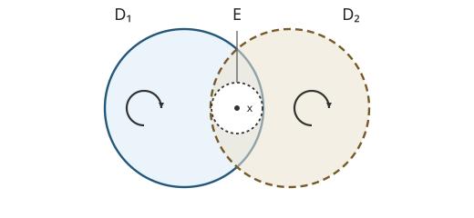
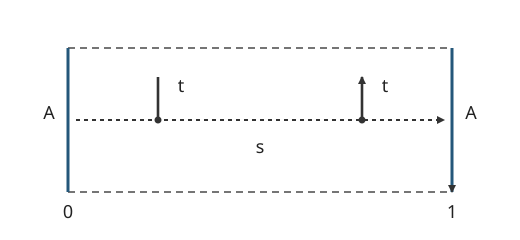

# ATOP34 局所向き・向き付け・基本類

[ATOP25](../ATOP25/index.md) では一点を取り除いたときの相対群が次元を記録することを学びました。今回はその群の二つの生成元に注目します。平面で時計回りと反時計回りを区別するように、各点で符号を選び、隣の点と矛盾なくつなげたいのです。さらに、全体がコンパクトなら、点ごとの選択を一つの大域的なホモロジー類で表せます。これが次講以降の双対性の入力になります。

直接の前提は [ATOP25](../ATOP25/index.md)、[ATOP29](../ATOP29/index.md)、[ATOP23](../ATOP23/index.md) です。三角形分割可能性や双対性は仮定しません。

## 1. 点で選ぶ符号

本講の多様体 $M$ は Hausdorff、第二可算な位相空間で、各点が $\mathbb R^n$ の開集合と同相な開近傍（座標近傍）を持つものです。境界はないとします。開球に座標近傍を縮めれば、その開球は $\mathbb R^n$ と同相なので、座標近傍全体を $\mathbb R^n$ とみなせます。閉多様体とはコンパクトで境界のない多様体です。

係数 $R$ は $\mathbb Z$ または $\mathbb F_2=\mathbb Z/2\mathbb Z$ とします。

[相対特異鎖群](../ATOP18/index.md#def-atop18-relative-chain) は次の商です。

$$
C_k(X,A)=C_k(X)/C_k(A).
$$

$C_k(A)$ は像が $A$ に含まれる単体を基底とする部分群なので、商は残りの単体を基底とする自由アーベル群です。

係数を $R$ に変更するとは、この基底の係数を $R$ に取り、境界の整数係数も $R$ で読むことです。得られる鎖複体を $C_*(X,A;R)$、そのホモロジーを $H_k(X,A;R)$ と書き、絶対群では $A=\varnothing$ を省略します。負次数は零です。

$R$ 加群の生成元とは、その元の $R$ 倍だけで加群の全元が表せる元です。[ホモロジーの普遍係数定理](../ATOP29/index.md#thm-atop29-homology-uct) はこの自由な相対複体にも適用できます。整数相対群が一つの次数にだけ自由群を持つなら [Tor の定義](../ATOP29/index.md#def-atop29-tor) から Tor 項は全て零で、係数変更はその自由群を $R$ に置き換えます。特に [Euclid 空間の局所ホモロジー](../ATOP25/index.md#thm-atop25-euclidean) と [局所ホモロジーの近傍不変性](../ATOP25/index.md#thm-atop25-neighborhood) より

$$
L_x(R):=H_n(M,M\setminus\{x\};R)\cong R.
$$

ここで ATOP25 の $L_k(M,x)$ は整数係数の $H_k(M,M\setminus\{x\};\mathbb Z)$ です。本講の $L_x(R)$ はその最高次 $k=n$ の係数 $R$ 版を表します。他の次数の局所群は零です。$R=\mathbb Z$ なら $L_x(R)$ の生成元は二つあり、$R=\mathbb F_2$ なら非零元は一つです。生成元のどちらを選ぶかが点の向きを表します。

<!-- formal-statement-start -->
> **定義（局所向き）**
> 境界のない $n$ 次元多様体 $M$ の点 $x$ における係数 $R=\mathbb Z$ または $\mathbb F_2$ の局所向きとは、$R$ 加群 $L_x(R)=H_n(M,M\setminus\{x\};R)$ の生成元である。
<!-- formal-statement-end -->

<!-- definition-example-start: def-atop34-local-orientation -->
直線 $M=\mathbb R$ の点 $x$ を取り、$a<x<b$ とします。線分を左から右へたどる特異1単体を $s(t)=a+(b-a)t$（$0\le t\le1$）とします。

[特異境界作用素](../ATOP16/index.md#def-atop16-singular-boundary) では終点から始点を引きます。

$$
\partial s=[b]-[a].
$$

ここで $[a],[b]$ は点を表す0単体であり、ホモロジー群ではその類も同じ記号で表します。両端は $x$ 以外にあるので、$s$ は相対サイクルを表します。以下 $[s]$ はその相対ホモロジー類です。

直線は可縮で [可縮空間の被約特異ホモロジー](../ATOP17/index.md#cor-atop17-contractible) により $H_1(\mathbb R;\mathbb Z)=0$ です。[対のホモロジー長完全列](../ATOP18/index.md#thm-atop18-long-exact) の該当部分は

$$
0\longrightarrow L_x(\mathbb Z)\xrightarrow{\delta}
\mathbb Z[a]\oplus\mathbb Z[b]\xrightarrow{(u,v)\mapsto u+v}
\mathbb Z\longrightarrow0.
$$

**定義の確認**：ここで二成分の $H_0$ は [0次特異ホモロジーと道連結成分](../ATOP16/index.md#thm-atop16-h0-path-components) で計算しました。核は $(-1,1)$ の整数倍です。

[相対ホモロジーの接続準同型](../ATOP18/index.md#thm-atop18-connecting) $\delta$ は相対類 $[s]$ を境界の絶対類 $[\partial s]$ に送ります。左成分、右成分の順の基底で

$$
[\partial s]=-[a]+[b]\quad\longleftrightarrow\quad(-1,1)
$$

となります。$\delta$ は完全性から核への同型なので、$[s]$ は相対群の生成元です。逆向きの単体は $(1,-1)$ へ送られるので反対の局所向きを与えます。

局所群は自由な階数1の整数群なので、[ホモロジーの普遍係数定理](../ATOP29/index.md#thm-atop29-homology-uct) により係数を mod 2 に移した生成元は非零です。$-1=1$ となるため両者は同じ局所向きです。
<!-- definition-example-end -->

## 2. 点だけでなくコンパクト集合に制限する

閉集合 $K\subset M$ の周囲を調べるために、次の略記を導入します。一般の位相空間 $X$ でも上付きの $M$ を $X$ に替えて同じ記法を使います。

$$
H_k^M(K;R)=H_k(M,M\setminus K;R).
$$

$L\subset K$ なら $M\setminus K\subset M\setminus L$ なので、対の包含 $(M,M\setminus K)\to(M,M\setminus L)$ が誘導する準同型を $\rho_{K,L}$ と書きます。係数 $R$ と次数 $k$ は文脈で固定し、添字は制限元 $K$、制限先 $L$ の順です。$L=\{x\}$ のとき $\rho_{K,x}$ と略します。これは鎖のうち $L$ から離れた部分をさらに零とする操作です。[相対ホモロジーの誘導準同型](../ATOP18/index.md#thm-atop18-relative-map) の合成則から、$J\subset L\subset K$ なら

$$
\rho_{L,J}\rho_{K,L}=\rho_{K,J}.
$$

点ごとの情報をつなぐには、二つの閉集合の重なりで相対類が一致することが必要です。通常の Mayer–Vietoris 完全列とは異なり、集合の合併から各集合へ制限する向きの列を作ります。

<!-- formal-statement-start -->
> **補題（閉集合に対する相対 Mayer–Vietoris 列）**
> 位相空間 $X$ の閉集合 $K,L$ と $R=\mathbb Z$ または $\mathbb F_2$ に対し、次の列は完全である。

$$
\begin{gathered}
\cdots\to H_{k+1}^X(K\cap L;R)
\to H_k^X(K\cup L;R)\\
\xrightarrow{(\rho_{K\cup L,K},\rho_{K\cup L,L})}
H_k^X(K;R)\oplus H_k^X(L;R)\\
\xrightarrow{\rho_{K,K\cap L}-\rho_{L,K\cap L}}
H_k^X(K\cap L;R)\to\cdots .
\end{gathered}
$$

> 最後の表示は $(u,v)\mapsto\rho_{K,K\cap L}u-\rho_{L,K\cap L}v$ を意味する。
<!-- formal-statement-end -->

見取り図：補集合は開集合になります。鎖群の商の短完全列を作り、小さい鎖による比較で最後の項を相対群へ戻します。

<!-- proof-start -->
### 証明

$U=X\setminus K$、$V=X\setminus L$ と置き、係数 $R$ の鎖群を $C=C_*(X;R)$、$A=C_*(U;R)$、$B=C_*(V;R)$ と略します。各鎖群は特異単体を基底とするため $A\cap B=C_*(U\cap V;R)$ です。各次数で

$$
0\to C/(A\cap B)\xrightarrow{i}C/A\oplus C/B
\xrightarrow{d} C/(A+B)\to0
$$

を作ります。写像は $i([c])=([c]_A,[c]_B)$、$d([p]_A,[q]_B)=[p-q]_{A+B}$ です。ここで $d$ は短完全列の右の写像で、鎖の境界 $\partial$ とは異なります。$[p]_A=p+A$ など、下付き文字はどの部分複体で割るかを示します。代表元の変更はそれぞれの商で消えます。$i([c])=0$ なら $c\in A\cap B$ なので単射、任意の $[z]_{A+B}$ は $d([z]_A,[0]_B)$ なので $d$ は全射です。

$d([p],[q])=0$ なら $p-q=a+b$（$a\in A,b\in B$）と書けます。$c=p-a=q+b$ と置けば $i([c])=([p]_A,[q]_B)$ です。逆に $d i([c])=[c-c]=0$ なので中央も完全です。境界は各部分複体を保つので両写像は鎖写像です。

$A+B$ は $U\cup V$ を開被覆 $\{U,V\}$ で覆ったときの小さい鎖の複体です。[小さい鎖によるホモロジー同型](../ATOP19/index.md#thm-atop19-small-chain-isomorphism) により $A+B\hookrightarrow C_*(U\cup V;R)$ はホモロジー同型です。細分・鎖ホモトピーの整数係数の恒等式は mod 2 へ写しても成り立つため、この小鎖化の証明は両係数で成立します。

二つの短完全列 $0\to A+B\to C\to C/(A+B)\to0$ と $0\to C_*(U\cup V;R)\to C\to C/C_*(U\cup V;R)\to0$ を包含で比較します。

ここで使う長完全列の作り方を確認します。一般の鎖複体の短完全列

$$
0\to E\xrightarrow{j}F\xrightarrow{\pi}G\to0
$$

で、$g\in G_k$ をサイクルとし、$\pi f=g$ となる $f\in F_k$ を取ります。$\pi\partial f=\partial g=0$ なので一意な $e\in E_{k-1}$ によって $je=\partial f$ と書けます。$j\partial e=\partial^2 f=0$ なので $e$ もサイクルです。[相対ホモロジーの接続準同型](../ATOP18/index.md#thm-atop18-connecting) と同様、接続写像は $[g]\mapsto[e]$ です。持上げを $f+ja$ に変えると $e$ は $\partial a$ だけ変わり、$g$ を境界だけ変えても持上げに境界を足せば $e$ は変わりません。

完全性も持上げで確認できます。

- $\pi_*[f]=0$ なら $\pi f=\partial g'$ であり、$g'$ の持上げ $f'$ を引く操作 $f-\partial f'$ により $j(E)$ 内のサイクルを得ます。
- $[e]=0$ なら $e=\partial a$ なので $f-ja$ は $g$ を持ち上げるサイクルです。
- $j_*[e]=0$ なら $je=\partial f$ となる $f$ があり、$\pi f$ はサイクルで、その接続像は $[e]$ です。

逆向きの包含は各合成が零であることから従います。したがって全ての位置で直前の準同型の像が直後の準同型の核に一致します。鎖写像で短完全列を比較すると持上げと境界も対応するので、得られる長完全列の四角形は可換です。この議論は両係数で成立します。

二つの長完全列の $H_k$ の商の項の周囲四項は、小鎖化の同型または恒等写像なので、[完全列の中央の比較](../ATOP21/index.md#lem-atop21-exact-comparison) より商同士も全次数でホモロジー同型です（0次では負次数を零とする）。

最初の短完全列に長完全列を適用し、その最後の商の群をこの同型で置き換えます。$U\cap V=X\setminus(K\cup L)$、$U\cup V=X\setminus(K\cap L)$ を代入すると表示した列になります。$i,d$ の定義から二つの制限写像の符号も確定します。
<!-- proof-end -->

したがって重なりの $(k+1)$ 次群が零なら、合併上の $k$ 次類は二つの制限で一意に決まります。逆に二つの類が重なりで一致すれば、完全性によって合併上の類が存在します。

## 3. コンパクト集合上の類は点で判定できる

まず座標内のコンパクト凸集合を扱います。凸とは二点を結ぶ線分が全て集合に含まれることです。閉球だけでなく、閉球の有限個の共通部分も凸です。

<!-- formal-statement-start -->
> **補題（コンパクト凸集合の相対群）**
> 非空コンパクト凸集合 $K\subset\mathbb R^n$ と $x\in K$ に対して、全次数で制限

$$
H_k^{\mathbb R^n}(K;R)\xrightarrow{\rho_{K,x}}
H_k^{\mathbb R^n}(\{x\};R)
$$

> は同型である。
<!-- formal-statement-end -->

<!-- proof-start -->
### 証明

$n=0$ では $K=\{x\}$ です。$n\ge1$ では $K$ の全ての点が中心 $x$、半径 $r>0$ の開球内に入るように $r$ を選びます。半径 $r$ の球面を $S_x(r)$ と書きます。補集合 $\mathbb R^n\setminus K$ の点 $y$ は $y\ne x$ なので

$$
F(y,t)=x+\left(1-t+\frac{tr}{\|y-x\|}\right)(y-x)
$$

が定まります。$\|y-x\|\ge r$ なら変形中の半径は $r$ 以上で、$K$ の外に留まります。$\|y-x\|<r$ なら半径は増加します。もし途中で $K$ に入ったとすると、$x$ とその点との線分上に $y$ があるので凸性に反します。従って変形は補集合の中で実行できます。$0\le t\le1$ で $F(y,0)=y$、$F(y,1)\in S_x(r)$ であり、$\|y-x\|=r$ のとき係数は $1-t+t=1$ です。球面を各時刻で固定するため、これは強変形レトラクションです。

同じ式は穿孔空間 $\mathbb R^n\setminus\{x\}$ でも球面への強変形レトラクションです。両方で球面の包含が [ホモトピー同値と特異ホモロジー群](../ATOP17/index.md#cor-atop17-equivalence) による同型を誘導し、一方の包含は他方の包含と可換します。従って補集合から穿孔空間への包含は全次数の整数ホモロジー同型です。

[対の長完全列の自然性](../ATOP18/index.md#thm-atop18-naturality) で二つの対を比較すると、全空間は恒等、第二成分は上の同型です。[完全列の中央の比較](../ATOP21/index.md#lem-atop21-exact-comparison) により相対群も整数係数で同型です。係数 $R$ に対しては [ホモロジーの普遍係数定理](../ATOP29/index.md#thm-atop29-homology-uct) の自然性を使います。両相対鎖複体は自由で、整数群は局所群と同型なので Tor 項は零です。制限のテンソル積が同型であることから $R$ でも同型です。
<!-- proof-end -->

従って凸集合全体で一つの生成元を選べば、集合内のどの点でも局所向きが定まります。ただし一般のコンパクト集合は凸とは限りません。凸集合を有限個貼り合わせ、さらに任意のコンパクト集合へ移る手順を示します。

<!-- formal-statement-start -->
> **定理（コンパクト集合上の相対類の検出）**
> 境界のない $n$ 次元多様体 $M$ のコンパクト集合 $K$ と $R=\mathbb Z$ または $\mathbb F_2$ に対し、
>
> 1. $H_k^M(K;R)=0$（$k>n$）。
> 2. 全ての点への制限を集めた写像

$$
H_n^M(K;R)\longrightarrow\prod_{x\in K}L_x(R),
\qquad u\longmapsto(\rho_{K,x}u)_{x\in K}
$$

> は単射である。
<!-- formal-statement-end -->

見取り図：有限個の凸集合では相対 Mayer–Vietoris 列で帰納します。任意のコンパクト集合では、相対鎖とそれを零にする鎖が有限和であることから、適切な閉球の有限合併まで集合を拡大できます。最後に座標近傍を有限個貼り合わせます。

<!-- proof-start -->
### 証明

**第1段階：Euclid 空間での有限個のコンパクト凸集合の合併。** 空集合では相対鎖群が零です。一つの非空凸集合では [コンパクト凸集合の相対群](#lem-atop34-convex-support) と局所群の計算から二つの主張を得ます。

$m$ 個の凸集合の合併を $P\cup Q$（$P$ は最初の $m-1$ 個の合併、$Q$ は最後の一個）と書きます。$P\cap Q$ は最初の各集合と $Q$ の交わりの合併なので高々 $m-1$ 個のコンパクト凸集合の合併です。帰納仮定は $P,Q,P\cap Q$ に適用できます。[閉集合に対する相対 Mayer–Vietoris 列](#thm-atop34-relative-gluing) の一部は

$$
H_{k+1}^M(P\cap Q;R)\to H_k^M(P\cup Q;R)
\to H_k^M(P;R)\oplus H_k^M(Q;R).
$$

$k>n$ では両端が零なので中央も零です。$k=n$ では左端が零なので右への写像は単射です。点への制限が全て零の類 $u$ を取ると、制限の合成則によって $P,Q$ への制限もそれぞれ全ての点で零です。帰納仮定から両制限は零となり、単射性によって $u=0$ です。

**第2段階：Euclid 空間の任意のコンパクト集合。** 相対 $k$ サイクルを表す有限鎖 $c\in C_k(\mathbb R^n;R)$ を取ります。$\partial c$ の台（非零係数を持つ単体の像の合併）はコンパクトで $K$ と交わりません。従って各 $x\in K$ の周囲に、$\partial c$ の台を避け、$x$ を内部に含む閉球を選べます。内部で $K$ を覆い、コンパクト性から有限個 $D_1,\ldots,D_m$ を選びます。$P=\bigcup_i D_i$ は $K$ を含み、$c$ は $P$ に対しても相対サイクルです。

$k>n$ なら第1段階から $[c]_P=0$ であり、その制限 $[c]_K=0$ です。

次に $k=n$ とし、全ての点で $[c]_x=0$ と仮定します。相対類が零であるということは、各 $x\in K$ に対してある有限 $(n+1)$ 鎖 $b_x$ と $x$ を避ける有限 $n$ 鎖 $a_x$ が存在して

$$
c=\partial b_x+a_x
$$

と書けることです。$x$ を内部に含む閉球 $D_x$ を $\partial c$ と $a_x$ の台の両方を避けるように選びます。再び有限個の内部が $K$ を覆うように選び、その合併を $P$ とします。$[c]_P$ は定まり、各 $D_x$ への制限は上の等式により零です。従って $P$ の任意の点は少なくとも一つの $D_x$ に含まれるため、点への制限は全て零です。第1段階の単射性から $[c]_P=0$、従って $[c]_K=0$ です。

**第3段階：多様体。** $K$ が一つの座標近傍 $W\cong\mathbb R^n$ に含まれるとします。$M\setminus W$ は閉集合であり、コンパクト集合 $K$ は Hausdorff 空間で閉なので、$M\setminus W\subset M\setminus K$ は開な第二成分の内部に含まれます。[切除定理](../ATOP19/index.md#thm-atop19-excision) により

$$
H_k(W,W\setminus K;R)\cong H_k^M(K;R).
$$

係数が $\mathbb F_2$ の場合も、第2節で述べたように整数係数の細分と鎖ホモトピーの等式を係数還元して使えます。点への制限とこの包含による同型は合成則により可換です。座標で第2段階を適用すればよいことになります。

一般の $K$ について、各点の座標でその点を内部に含み座標近傍内に収まる閉球を取ります。逆像はコンパクトです。内部の有限被覆を選び、各閉球と $K$ の交わりを $K_1,\ldots,K_m$ とします。各集合は一つの座標近傍に含まれるコンパクト集合であり、

$$
K=\bigcup_{i=1}^m K_i
$$

です。帰納段階で

$$
P=\bigcup_{i<m}K_i,\qquad Q=K_m
$$

と置けば、$P\cap Q$ はコンパクトで $Q$ と同じ座標近傍に含まれます。第1段階と同じ完全列で帰納すると、$k>n$ の両端は零、$k=n$ の左端も零です。

点への制限が零なら $P,Q$ への制限は帰納仮定で零となり、合併での類は零です。
<!-- proof-end -->

この定理は「各点で零なら全体で零」を保証します。任意に選んだ点の類が実現できるという全射性は主張していません。実現には局所的な整合性が必要です。

## 4. 向きを連続に選ぶ

座標近傍内の閉球 $D$ に対し、切除と [コンパクト凸集合の相対群](#lem-atop34-convex-support) から $H_n^M(D;R)\cong R$ であり、その生成元の各点への制限も生成元です。これが近隣の点を比較する道具になります。

<!-- formal-statement-start -->
> **定義（向き付け）**
> 境界のない $n$ 次元多様体 $M$ の $R$ 向き付けとは、各点 $x$ の局所向き $o_x$ の選択であって、各 $x$ に対し $x$ を内部に含む座標内のコンパクト閉球 $D$ と $u_D\in H_n^M(D;R)$ が存在し、全ての $y\in D$ で

$$
\rho_{D,y}u_D=o_y
$$

> となるものである。そのような選択が存在するとき $M$ は $R$ 向き付け可能という。特に整数係数のとき単に向き付け可能という。
<!-- formal-statement-end -->

<!-- definition-example-start: def-atop34-orientation -->
$\mathbb R$ では各点 $x$ の局所向きを右向きとします。閉区間 $D=[x-1,x+1]$ を取り、$D$ の少し外側の点 $a=x-2,b=x+2$ を結ぶ右向き特異1単体 $s$ を選びます。

**定義の確認**：両端は $D$ の外にあるので $u_D=[s]$ は $H_1^{\mathbb R}(D;\mathbb Z)$ の元です。任意の $y\in D$ で $a<y<b$ が成立し、接続準同型による第1節の計算から $\rho_{D,y}[s]$ はその点の右向き生成元です。$x$ は $D$ の内部にあるので全ての定義条件を満たします。
<!-- definition-example-end -->

一方、$\mathbb R$ の負の点で左向き、非負の点で右向きを選ぶと、0 の周囲で整合しません。0 を内部に含む任意の閉区間の相対群は $\mathbb Z$ で、両端より外側を結ぶ右向き鎖が全点の右向きを与えます。その整数倍は途中で符号を変えられないからです。

点ごとに異なる群の間の対応を記録する仕組みも作れます。まず各座標閉球 $D$ の整数生成元 $u_D$ を一つ選び、その内部 $W$ の各点で

$$
g_y=\rho_{D,y}u_D
$$

とします。これは $L_y(\mathbb Z)$ の基底です。

二つのこうした開集合が重なる点 $x$ で、小さな座標閉球 $E$ を両方の内部に含めます。両生成元の $E$ への制限は $H_n^M(E;\mathbb Z)$ の生成元です。実際、その点 $x$ への制限は生成元で、$E$ から $x$ への制限は同型だからです。

従って両者は $E$ 上で一つの符号 $\varepsilon=\pm1$ だけ異なり、全ての $y\in E$ でも同じ符号で異なります。

図は2次元の座標模型です。実線の $D_1$ と破線の $D_2$ の共通部分に小閉球 $E$ を取り、中心 $x$ で二つの基底を比較します。図の矢印は両方で同じ向きを選んだ場合です。片方を逆に選ぶなら、$E$ の全点で符号差は $-1$ になります。

<!-- formal-statement-start -->
> **定義（向きの局所系）**
> 境界のない $n$ 次元多様体 $M$ に対し、各点 $x$ に群 $L_x(\mathbb Z)$ を対応させ、座標閉球の内部ではその相対生成元を用いて各群を $\mathbb Z$ と同一視する。重なりでは局所的に一定な符号 $\pm1$ の掛け算で同一視を変換する。この群と局所的な同一視の仕組みを向きの局所系という。
<!-- formal-statement-end -->

<!-- definition-example-start: def-atop34-orientation-local-system -->
直線で $D_1=[-2,1]$、$D_2=[-1,2]$ を取ります。$D_1$ には右向き、$D_2$ には左向きの相対生成元を選びます。

**定義の確認**：各内部の点では第1節の接続写像によって、それぞれの基底は確かに $(-1,1)$ と $(1,-1)$ です。重なり $(-1,1)$ 上では座標変換は常に $m\mapsto-m$ です。局所的に一定であり、逆向きの変換も $-1$ 倍なので合成は恒等です。三つの区間を使う場合も、同じ点の基底の比較なので符号は掛け合わせられます。
<!-- definition-example-end -->

局所系の意味は、異なる点の群を無条件に同じ群とするのではなく、座標内の基底を経由して比較することです。三つの局所基底 $g_i,g_j,g_k$ の比較が $g_i=\varepsilon_{ij}g_j$、$g_j=\varepsilon_{jk}g_k$ なら $g_i=\varepsilon_{ij}\varepsilon_{jk}g_k$ となり、重なりの変換は合成と整合します。

局所向きの二つの選択を比較すると、同じ局所基底で書いた符号の比は局所的に一定です。よって非空で連結な $M$ 上で整数向き付けが存在する場合はちょうど二つです。実際、二つの向き付けの比が $+1$ となる点集合と $-1$ となる点集合はともに開で互いに素なので、一方は空です。任意の向き付けとその全点での符号反転は非空性により異なるので、実際に二つ存在します。mod 2 では局所生成元が一つだけなので座標内の選択は必ず一致し、どの多様体にも一意な mod 2 向き付けがあります。

### 具体例：Möbius 帯の芯を一周する

境界のない開 Möbius 帯を $\mathbb R\times(-1,1)$ の商

$$
(s,t)\sim(s+1,-t)
$$

で作ります。商写像を $q$ とします。任意の開集合 $V$ に対して、その像の逆像は

$$
q^{-1}(q(V))=\bigcup_{j\in\mathbb Z}\{(s+j,(-1)^jt):(s,t)\in V\}
$$

です。各変換は同相写像なので右辺は開です。商位相の定義から $q(V)$ も開です。従って $s$ 方向の長さが1未満の小さな開長方形では $q$ が像への同相写像となり、局所座標が取れます。

異なる同値類は互いの整数平行移動と反転を避ける小近傍で分離できます。具体的には、両代表点の第1座標の差が整数でなければその距離を整数から離す幅を選び、整数なら第1座標を一致させた後で異なる第2座標を分離します。可算基底は元の空間の可算基底の各要素の像から得られます。従ってこれは境界のない2次元多様体です。

図の上下の破線は除外した端 $t=\pm1$ です。辺 $A$ 同士は逆向きの矢印に従って貼ります。芯に沿って上向きの横断方向を保って進むと、右端から左端へ戻るときには下向きになります。

芯 $t=0$ を $s=0$ から $s=1$ までたどる間に使う平面の基底を先に構成します。原点中心の半径 $2$ の閉円板 $D\subset\mathbb R^2$ は芯の持上げ全体を内部に含みます。

[コンパクト凸集合の相対群](#lem-atop34-convex-support) により $H_2^{\mathbb R^2}(D;\mathbb Z)\cong\mathbb Z$ なので、生成元 $u_D$ を一つ選びます。各点 $y=(s,0)$ で

$$
g_y=\rho_{D,y}u_D
$$

と置けば、芯の持上げに沿う整合した基底が得られます。開帯内の小円板への制限でも同じ基底となり、切除で商の局所座標の基底と比較できます。

両端の基底を円周で具体的に比較します。半径 $r>2$ の原点中心の円周を $S_0(r)$ とします。全空間 $\mathbb R^2$ の1次・2次群が零なので、[対のホモロジー長完全列](../ATOP18/index.md#thm-atop18-long-exact) により接続写像は補集合の1次群への同型です。補集合は第3節の変形により $S_0(r)$ に強変形レトラクトします。よって $\delta u_D$ は円周の包含で写したある生成元 $\alpha\in H_1(S_0(r);\mathbb Z)$ です。

各 $y=(s,0)$ について円周を中心 $y$ へ平行移動するホモトピーを考えます。途中も中心と $y$ の距離は $1$ 以下で半径 $r$ より小さいため、円周は $y$ を通りません。

従って [特異ホモロジーのホモトピー不変性](../ATOP17/index.md#thm-atop17-homotopy-invariance) により、原点中心の円周から穿孔平面への包含と、中心 $y$ への平行移動は $\alpha$ を同じ1次類へ送ります。

[対の長完全列の自然性](../ATOP18/index.md#thm-atop18-naturality) により、この1次類は $\delta g_y$ です。従って平行移動で対応させた円周の生成元を介して両端の局所基底を比較できます。

出発点と到着点の座標の比較は

$$
(s,t)\longmapsto(s+1,-t)
$$

です。平行移動は局所向きを保ち、横断方向の反転は向きを逆転します。

後者は [反射と対蹠写像の写像度](../ATOP23/index.md#thm-atop23-reflection-antipodal) を点の周りの円周に適用すると次数 $-1$ であり、[対の長完全列の自然性](../ATOP18/index.md#thm-atop18-naturality) で局所2次群への作用も $-1$ となることから分かります。平行移動も、同じ半径の円周を同じパラメータで移すので接続準同型で比較すれば $+1$ です。

したがって一周後の基底は出発時の負です。もし整数向き付けがあれば、その平面への引き戻しは芯に沿って局所基底に対する一定の符号を持ちます。しかし同じ商の点に戻る際には符号が逆でなければならず、$1=-1$ を要求することになります。整数では不可能です。mod 2 では符号差は消えます。

## 5. 基本類を局所から作る

$M$ が閉多様体なら、集合 $K=M$ に対応する相対群は $H_n(M,\varnothing;R)=H_n(M;R)$ です。従って大域的な一つの類から各点の局所群への制限ができます。向き付けを全て実現する類に名前を付けます。

<!-- formal-statement-start -->
> **定義（基本類）**
> $R$ 向き付け $(o_x)_{x\in M}$ を備えた閉 $n$ 次元多様体 $M$ の基本類とは、全ての $x\in M$ で

$$
\rho_{M,x}[M]_R=o_x
$$

> を満たすホモロジー類 $[M]_R\in H_n(M;R)$ である。
<!-- formal-statement-end -->

<!-- definition-example-start: def-atop34-fundamental-class -->
一点空間 $M=\{p\}$ は閉0次元多様体です。[0次特異ホモロジーと道連結成分](../ATOP16/index.md#thm-atop16-h0-path-components) と係数変更により $H_0(M;R)=R[p]$ であり、$M\setminus\{p\}=\varnothing$ なので制限は恒等です。

**定義の確認**：局所向き $o_p=[p]$ を選ぶと、制限は恒等であるため $\rho_{M,p}[p]=[p]=o_p$ となります。一点を閉0次元球として取り、相対類 $[p]$ を選べば向き付けの整合条件も満たします。従って $[M]_R=[p]$ は条件を満たします。整数で逆向きを選べば基本類は $-[p]$ になります。
<!-- definition-example-end -->

<!-- formal-statement-start -->
> **定理（基本類の存在一意性）**
> $M$ を非空の閉 $n$ 次元多様体、$R=\mathbb Z$ または $\mathbb F_2$ とする。
>
> 1. 任意の $R$ 向き付けに対して基本類 $[M]_R$ は一意に存在する。
> 2. $M$ が連結かつ $R$ 向き付け可能なら、一つの向き付けを選んだとき $H_n(M;R)=R[M]_R$ であり、任意の点への制限は同型である。
> 3. $M$ が連結で整数向き付け不可能なら $H_n(M;\mathbb Z)=0$。全ての連結閉多様体で $H_n(M;\mathbb F_2)\cong\mathbb F_2$ である。
<!-- formal-statement-end -->

見取り図：局所向き付けの定義から閉球上の類を選びます。重なりで全ての点への制限が一致するので、[コンパクト集合上の相対類の検出](#thm-atop34-compact-detection) により相対類そのものが一致します。[閉集合に対する相対 Mayer–Vietoris 列](#thm-atop34-relative-gluing) で貼り合わせます。連結な場合は大域類の局所基底に対する係数が一定になることを使います。

<!-- proof-start -->
### 証明

各点に対して向き付けの定義の閉球 $D$ と相対類 $u_D$ を選びます。閉球の内部が $M$ を覆い、コンパクト性から有限個 $D_1,\ldots,D_m$ で十分です。$P=\bigcup_{i=1}^{j-1}D_i$ 上の類 $u_P$ が全ての点で指定された局所向きを与えると仮定します。$Q=D_j$ とし、$u_Q=u_{D_j}$ と置きます。

$P\cap Q$ はコンパクトです。差

$$
w=\rho_{P,P\cap Q}u_P-\rho_{Q,P\cap Q}u_Q
$$

を考えます。任意の $x\in P\cap Q$ で $\rho_{P\cap Q,x}w=o_x-o_x=0$ です。[コンパクト集合上の相対類の検出](#thm-atop34-compact-detection) の単射性によって $w=0$ です。

[閉集合に対する相対 Mayer–Vietoris 列](#thm-atop34-relative-gluing) の完全性により $(u_P,u_Q)$ は $H_n^M(P\cup Q;R)$ の元 $u$ から来ます。さらに

$$
H_{n+1}^M(P\cap Q;R)=0
$$

なのでこの元は一意です。制限の合成則から $u$ は合併の全点で指定された局所向きを与えます。

初めの $u_{D_1}$ から有限回帰納して $H_n^M(M;R)$ の類を得ます。二つの大域類の差が全点で零なら [コンパクト集合上の相対類の検出](#thm-atop34-compact-detection) により差は零です。これで1を示しました。

次に任意の $z\in H_n(M;R)$ を取ります。向き付けの存在のもとで各点に一意な係数 $a_x\in R$ があり、

$$
\rho_{M,x}z=a_x o_x
$$

と書けます。向き付けを実現する閉球 $D$ では $u_D$ は生成元です。従ってある係数 $a_D\in R$ を用いて

$$
\rho_{M,D}z=a_Du_D,\qquad
\rho_{M,y}z=a_D o_y\quad(y\in D)
$$

と書けます。よって $a_x$ は局所的に一定で、連結性から一つの $a$ です。

全ての点で $z-a[M]_R$ の制限が零なので [コンパクト集合上の相対類の検出](#thm-atop34-compact-detection) により $z=a[M]_R$ です。また $a[M]_R=0$ なら任意の点で $ao_x=0$ となります。$o_x$ が自由な $R$ 加群の基底なので $a=0$ です。従って $a\mapsto a[M]_R$ は同型です。各点での制限はこの同型と $a\mapsto ao_x$ の同型を結ぶため、任意の点への制限も同型です。これで2を示しました。

整数向き付けを仮定しない場合は、座標閉球の任意の基底で $\rho_{M,D}z$ の整数係数を取ります。その絶対値は基底の符号によらず、閉球内で一定です。連結性により全点で同じ非負整数 $m$ です。$m=0$ なら検出定理から $z=0$ です。もし $m>0$ なら、各点の自由な整数群で

$$
o_x=\frac{1}{m}\rho_{M,x}z
$$

を定められます。ここで分数は有理係数への変更ではなく、整数群の中で $m$ 倍して $\rho_{M,x}z$ になる唯一の元を意味します。各閉球で $\rho_{M,D}z$ の係数は $\pm m$ なので、その類を $m$ で割った相対生成元が全点の $o_y$ を実現します。これは整数向き付けであり、向き付け不可能という仮定に反します。従って全ての $z$ が零です。mod 2 の向き付けは既に一意に存在すると示したので、2を適用して3の最後の主張も従います。
<!-- proof-end -->

例えば円周の整数向き付けは一周する向きを選ぶことです。角度を局所座標とすれば重なりでは $2\pi$ の整数倍だけ角度がずれるので、右向きの局所基底は一致します。特異1単体 $s(t)=(\cos(2\pi t),\sin(2\pi t))$ は両端が同じなので絶対サイクルです。$t=0$ でない点を除くと、短い弧に $s$ を切り分け、[特異細分の鎖ホモトピー](../ATOP19/index.md#thm-atop19-subdivision-homotopy) により細分した鎖は元の鎖と同じ絶対類を表し、その点を含む弧以外は相対群で零となります。点が細分の端点に当たるときは始点を少しずらしてから細分します。始点の変更は円周の回転によるホモトピーであり、[特異ホモロジーのホモトピー不変性](../ATOP17/index.md#thm-atop17-homotopy-invariance) により絶対類を変えません。その弧は第1節の計算で正の局所生成元です。始点の点でも、始点を半周ずらしたループは回転によるホモトピーで同じ絶対類を与え、同じ議論を適用できます。従って $[s]$ は円周の基本類です。

一方、実射影平面は連結閉2次元多様体ですが、[実射影空間の胞体境界](../ATOP22/index.md#prop-atop22-projective-boundary) では整数2次境界が2倍写像です。3次胞体はないので [胞体ホモロジー定理](../ATOP22/index.md#thm-atop22-cellular-comparison) により $H_2=\ker(2:\mathbb Z\to\mathbb Z)=0$ です。[基本類の存在一意性](#thm-atop34-fundamental-class) から整数向き付け不可能と分かります。mod 2 の基本類は上の定理により存在し、係数変更後の最高次群の計算は演習B4で確認します。コンパクト性も重要です。直線は向き付け可能でも可縮なので [可縮空間の被約特異ホモロジー](../ATOP17/index.md#cor-atop17-contractible) より $H_1(\mathbb R;\mathbb Z)=0$ です。有限個の特異単体の像はコンパクトであり、全点で非零な局所類を与える鎖を持てないことが、貼り合わせの失敗する理由です。

## 6. 演習

### A1. 直線の局所向き
- Level: A

$x=0$ とし、$s$ を $-2$ から $3$ へ向かう線分、$t$ を $3$ から $-2$ へ向かう線分とする。相対類 $2[s]+[t]$ は整数局所向きか。mod 2 ではどうか。

<!-- solution-start -->
**詳細解答**

[局所向き](#def-atop34-local-orientation) の計算と同じく接続写像は $[s]\mapsto(-1,1)$、$[t]\mapsto(1,-1)$ です。よって

$$
2(-1,1)+(1,-1)=(-1,1).
$$

接続写像は核への同型で、このベクトルは核の生成元なので整数局所向きです。mod 2 では $(-1,1)$ は $(1,1)$ となり、核の唯一の非零元なので局所向きです。
<!-- solution-end -->

### A2. 制限写像の向き
- Level: A

$D=[-2,2]$、$E=[-1,1]$、$x=0$ とする。$3$ から $-3$ へ向かう線分を $c$ とし、$\rho_{E,x}\rho_{D,E}[c]$ を右向き基底で表せ。

<!-- solution-start -->
**詳細解答**

両端は $D$ の外なので $\partial c=[-3]-[3]$ は相対鎖で零となり、$[c]$ が定まります。$E\subset D$、$x\in E$ なので合成則は $\rho_{E,x}\rho_{D,E}[c]=\rho_{D,x}[c]$ を与えます。[局所向き](#def-atop34-local-orientation) の直接例と同じ左・右成分の順で、点での接続写像は $[c]\mapsto(1,-1)$、右向き基底は $(-1,1)$ です。したがって係数は $-1$ です。
<!-- solution-end -->

### A3. 貼り合わせの符号
- Level: A

重なりの群を $\mathbb Z$ とし、二つの類の制限が $3$ と $-3$ だったとする。整数と mod 2 でそれぞれ [閉集合に対する相対 Mayer–Vietoris 列](#thm-atop34-relative-gluing) の差の写像の値を求め、貼り合わせが可能か判定せよ。

<!-- solution-start -->
**詳細解答**

整数係数の差は $3-(-3)=6$ です。零でないのでこの組は差の写像の核に入らず、合併から来ることはありません。mod 2 への自然な係数変更では、整数生成元の像を $g$ と書くと二つの制限はともに $g$ です（$3g=g$、$-3g=g$）。差は $g-g=0$ です。完全性により mod 2 では合併の類が存在します。重なりの一つ上の次数の相対群が零なら、一意性も保証されます。
<!-- solution-end -->

### A4. 二点空間
- Level: A

$M=\{p,q\}$ を離散位相の閉0次元多様体とし、整数向き $o_p=[p],o_q=-[q]$ を選ぶ。基本類と向き付けの総数を求めよ。

<!-- solution-start -->
**詳細解答**

[0次特異ホモロジーと道連結成分](../ATOP16/index.md#thm-atop16-h0-path-components) より

$$
H_0(M;\mathbb Z)=\mathbb Z[p]\oplus\mathbb Z[q]
$$

です。$a[p]+b[q]$ の $p$ での制限は $a[p]$、$q$ での制限は $b[q]$ です。よって $a=1,b=-1$、基本類は $[p]-[q]$ です。

各一点を閉0次元球とする相対類がそれぞれの向きを実現するため、この選択は実際に向き付けです。各点は開なのでそれぞれ独立に二つの向きを選べ、総数は $2^2=4$ です。連結性がなければ向き付けは二つに限りません。
<!-- solution-end -->

### B1. 二つの閉区間を貼る
- Level: B

$M=\mathbb R$、$K=[-2,0]$、$L=[0,2]$ とする。右向きの基底を各相対1次群に選ぶとき、$H_1^M(K\cup L;\mathbb Z)$ の二つの制限の像を求めよ。$(2,2)$ と $(2,-2)$ は実現するか。

<!-- solution-start -->
**詳細解答**

$K\cap L=\{0\}$ の局所2次群は [Euclid 空間の局所ホモロジー](../ATOP25/index.md#thm-atop25-euclidean) により零です。[コンパクト凸集合の相対群](#lem-atop34-convex-support) と右向きの線分の接続写像の計算から、各区間の基底は重なりの右向き基底へ写ります。[閉集合に対する相対 Mayer–Vietoris 列](#thm-atop34-relative-gluing) は

$$
0\to H_1^M(K\cup L;\mathbb Z)\to
\mathbb Z^2\xrightarrow{(a,b)\mapsto a-b}\mathbb Z
$$

です。核は $\{(a,a):a\in\mathbb Z\}$ なので像もこの対角部分群です。$(2,2)$ は一意に実現し、$(2,-2)$ は差が4なので実現しません。
<!-- solution-end -->

### B2. 局所系を一周する
- Level: B

円周に沿う三つの局所基底の比較符号が順に $-1,-1,-1$ だとする。局所基底を一つ反転すると何が変わるか。一周の符号と整数向き付けの可否を判定せよ（この符号列を持つ局所系を考え、円周自身の接向きの局所系であるとは仮定しない）。

<!-- solution-start -->
**詳細解答**

[向きの局所系](#def-atop34-orientation-local-system) の比較と同じく $g_i=\varepsilon_{ij}g_j$ と書きます。基底 $g_1$ を $-g_1$ に変えると、$\varepsilon_{12}$ と $\varepsilon_{31}$ は反転し、$\varepsilon_{23}$ は不変です。従って一周の積は

$$
(-1)(-1)(-1)=-1
$$

のままです。整合する整数生成元があれば各局所基底での係数 $\eta_i=\pm1$ が比較符号を掛けて移るため、$\eta_2=\varepsilon_{12}\eta_1$、$\eta_3=\varepsilon_{23}\eta_2$、$\eta_1=\varepsilon_{31}\eta_3$ となります。従って

$$
\eta_1=\varepsilon_{31}\varepsilon_{23}\varepsilon_{12}\eta_1=-\eta_1
$$

です。整数ではこれは不可能です。mod 2 では各符号が1になり整合します。これは Möbius 帯の芯で生じる現象で、円周そのものの局所1次群の向きとは異なります。
<!-- solution-end -->

### B3. コンパクト性を使う位置
- Level: B

$\mathbb R^n$（$n\ge1$）上の任意の絶対特異 $n$ サイクル $c$ に対し、少なくとも一点でその局所類が零であることを、可縮性を使わず鎖の台から示せ。

<!-- solution-start -->
**詳細解答**

$c$ は有限個の特異単体の線形結合です。各定義域はコンパクトなので各像もコンパクトで、有限合併 $S$ もコンパクトです。$\mathbb R^n$ は非コンパクト（例えば半径が自然数の開球の被覆に有限部分被覆がない）なので $S\ne\mathbb R^n$ です。

$x\notin S$ を取ると $c$ の全単体は $\mathbb R^n\setminus\{x\}$ に入ります。従って相対鎖群における像は零鎖で、

$$
\rho_{\mathbb R^n,x}[c]=0
$$

です。どんな絶対類も全点で局所生成元を与えることはできません。閉多様体の存在証明で内部の有限被覆を取った箇所が非コンパクトの場合には保証されません。
<!-- solution-end -->

### B4. 実射影平面の最高次群
- Level: B

実射影平面の胞体鎖複体の境界 $d_2=2$、$d_1=0$ を用い、整数と mod 2 の2次ホモロジーを求め、向き付けの可否を判定せよ。

<!-- solution-start -->
**詳細解答**

[実射影空間の胞体境界](../ATOP22/index.md#prop-atop22-projective-boundary) と [胞体ホモロジー定理](../ATOP22/index.md#thm-atop22-cellular-comparison) により整数では $H_2=\ker(2:\mathbb Z\to\mathbb Z)/0=0$、$H_1=\mathbb Z/2\mathbb Z$ です。特異鎖に [ホモロジーの普遍係数定理](../ATOP29/index.md#thm-atop29-homology-uct) を適用すると

$$
0\to0\to H_2(\mathbb{RP}^2;\mathbb F_2)
\to\operatorname{Tor}_1(\mathbb Z/2,\mathbb F_2)\to0.
$$

[Tor の定義](../ATOP29/index.md#def-atop29-tor) に従って、第一引数 $\mathbb Z/2$ の自由分解を取ります。

$$
0\to\mathbb Z\xrightarrow{2}\mathbb Z\to\mathbb Z/2\to0.
$$

二つの自由群を $\mathbb F_2$ とテンソル積すると、写像 $2\otimes1$ は $\mathbb F_2\xrightarrow{0}\mathbb F_2$ となります。その核が $\operatorname{Tor}_1^{\mathbb Z}(\mathbb Z/2,\mathbb F_2)=\mathbb F_2$ です。よって mod 2 の最高次群は $\mathbb F_2$。実射影平面は球面の対蹠商でコンパクトかつ連結で、各点の十分小さい開球面近傍がその対蹠像と交わらないため局所的に2次元 Euclid 空間です。異なる対蹠軌道は互いに素な開近傍の対蹠不変な合併で分離でき、球面上の開集合の商での像は開集合です（像の逆像はその開集合と対蹠像の合併）。従ってこれらの開近傍の像は商で互いに素な開近傍となり、Hausdorff 性が従います。また球面の可算基底の像が商の可算基底になります。従って境界のない閉多様体です。[基本類の存在一意性](#thm-atop34-fundamental-class) により整数向き付けは不可能ですが、mod 2 向き付けと基本類は存在します。
<!-- solution-end -->

### C1. コンパクト集合上の相対基本類
- Level: C

$M$ は境界のない（コンパクトとは限らない）$R$ 向き付き $n$ 次元多様体とし、$K\subset M$ は任意のコンパクト集合とする。全ての $x\in K$ で指定された局所向きへ制限される類 $u_K\in H_n^M(K;R)$ が一意に存在することを示せ。また $J\subset K$ がコンパクトなら $\rho_{K,J}u_K=u_J$ を示せ。

<!-- solution-start -->
**詳細解答**

空集合では相対鎖群が零なので $u_\varnothing=0$ です。非空の場合、[向き付け](#def-atop34-orientation) により各 $x\in K$ を内部に含む座標閉球 $D_x$ と、指定された全局所向きに制限される $u_{D_x}$ が存在します。$K$ はコンパクトなので有限個の内部で覆えます。$K_i=K\cap D_i$ と置き、$v_i=\rho_{D_i,K_i}u_{D_i}$ とします。各 $K_i$ はコンパクトで、全点で指定された向きに制限されます。

$P=K_1\cup\cdots\cup K_{j-1}$ 上の類 $v_P$ が得られたと仮定し、$Q=K_j$ とします。差

$$
\rho_{P,P\cap Q}v_P-\rho_{Q,P\cap Q}v_j
$$

は任意の $x\in P\cap Q$ に制限すると $o_x-o_x=0$ です。[コンパクト集合上の相対類の検出](#thm-atop34-compact-detection) から差は零です。[閉集合に対する相対 Mayer–Vietoris 列](#thm-atop34-relative-gluing) により $(v_P,v_j)$ は合併の類に持ち上がります。重なりの $(n+1)$ 次相対群が零なので持ち上げは一意です。制限の合成則から全点で指定向きを与えます。これを有限回繰り返すと $K$ 上の類 $u_K$ を得ます。任意の二候補の差は全点で零となるので検出定理により一致します。

最後に $J\subset K$ では全ての $x\in J$ で

$$
\rho_{J,x}\rho_{K,J}u_K=\rho_{K,x}u_K=o_x=\rho_{J,x}u_J.
$$

差を検出定理に適用すると $\rho_{K,J}u_K=u_J$ が得られます。ここではコンパクト性は $M$ でなく $K$ に必要でした。この両立する相対類の族は非コンパクト多様体の双対性を扱うときにも役立ちます。
<!-- solution-end -->

## 7. まとめ

局所ホモロジーの生成元を整合的に選ぶことが向き付けです。コンパクト集合に制限した相対類を点で検出できることと、二領域の相対完全列を組み合わせれば、閉多様体の基本類の存在と一意性が証明できます。次講ではコチェインを鎖に作用させる cap 積を作り、基本類からコホモロジーをホモロジーへ移す準備をします。
