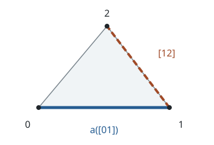
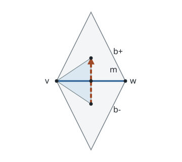

# ATOP35 cap積と鎖レベルの双対写像

[ATOP31](../ATOP31/index.md) では二つのコチェインを掛け合わせ、[ATOP34](../ATOP34/index.md) では向き付けられた閉多様体の基本類を作りました。今回はコチェインを鎖に作用させ、次数を下げた鎖を取り出します。例えば向き付き三角形の前の辺を評価すると、残った後ろの辺にその評価値が付きます。この操作が境界と両立すれば、基本類から低次のホモロジー類を作れます。

直接の前提講座は [ATOP31](../ATOP31/index.md) と [ATOP34](../ATOP34/index.md) です。

## 1. 前面を評価して後面を残す

係数は整数環または二元体 $R=\mathbb Z,\mathbb F_2$ とします。$C_n(X;R)$ は特異単体を基底とする自由 $R$ 加群、$C^p(X;R)$ はその $p$ 次部分の $R$ 線形評価全体です。[特異コチェイン](../ATOP28/index.md#def-atop28-cochain) と [特異余境界作用素](../ATOP28/index.md#def-atop28-coboundary) の規約に従い、$(\delta a)(c)=a(\partial c)$ とします。負次数の鎖・コチェインは零です。

特異単体 $\sigma$ の頂点を $0,\ldots,n$ と番号付けし、$\sigma[i_0,\ldots,i_k]$ をその頂点を指定順に取った面への制限とします。[cup積](../ATOP31/index.md#def-atop31-cup) では頂点 $p$ を共有する二つの面をそれぞれ評価しました。今度は前面だけを評価し、後面そのものを残します。

<!-- formal-statement-start -->
> **定義（cap積）**
>
> 位相空間 $X$、係数 $R=\mathbb Z$ または $\mathbb F_2$、非負整数 $p,n$ に対し、次の双線形写像を cap積とする。
>
$$
\frown:C^p(X;R)\times C_n(X;R)\longrightarrow C_{n-p}(X;R).
$$
>
> $p\le n$ のとき基底となる特異単体 $\sigma$ に対して
>
$$
a\frown\sigma
=a(\sigma[0,\ldots,p])\,\sigma[p,\ldots,n]
$$
>
> と定めて鎖について線形に延長する。$p>n$ のときは零とする。
<!-- formal-statement-end -->

<!-- definition-example-start: def-atop35-cap -->
三角形 $\sigma=[012]$ を平面内のアフィン単体とし、1コチェイン $a$ の値を $a([01])=3$、それ以外の特異1単体上では零とします（ここでは整数係数）。自由鎖群の基底上の値を指定したので確かに線形評価が存在します。前面は $[01]$、後面は $[12]$ で、

$$
a\frown[012]=3[12].
$$

別の三角形 $\tau$ を取ると $a\frown(2\sigma-\tau)=2(a\frown\sigma)-a\frown\tau$ です。また $(a+b)\frown\sigma=(a(\sigma[01])+b(\sigma[01]))\sigma[12]$ なので評価についても加法的です。スカラー倍は係数の積に移るため両変数で線形です。
<!-- definition-example-end -->

図では頂点1を二つの面が共有します。前面と後面は互いに素ではなく、共有頂点が境界公式で重要になります。

## 2. 境界との符号

サイクルをコサイクルで評価した結果がサイクルになるかを調べます。面のうち頂点 $p$ を境に前後で項を分けると、余境界の最後の項と後面の最初の項が対応します。

<!-- formal-statement-start -->
> **定理（cap積の境界公式）**
>
> 位相空間 $X$、係数 $R=\mathbb Z$ または $\mathbb F_2$、$a\in C^p(X;R)$、$c\in C_n(X;R)$ に対し
>
$$
\partial(a\frown c)
=(-1)^p\{a\frown\partial c-(\delta a)\frown c\}.
$$
<!-- formal-statement-end -->

### 証明の見取り図

$n>p$ の単体で、境界の頂点削除を $i\le p$ と $i>p$ に分けます。前者は $\delta a$ の評価に吸収され、残りは後面の境界になります。共有頂点を削除する項を忘れないことが符号の鍵です。

<!-- proof-start -->
### 証明

線形性により $c=\sigma$ で示せば十分です。面の記号を簡潔にするため $\widehat i$ は頂点 $i$ を除く操作とします。[特異境界作用素](../ATOP16/index.md#def-atop16-singular-boundary) により $n>p$ では

$$
\begin{aligned}
a\frown\partial\sigma
={}&\sum_{i=0}^{p}(-1)^i
 a(\sigma[0,\ldots,\widehat i,\ldots,p+1])\,
 \sigma[p+1,\ldots,n]\\
&+\sum_{i=p+1}^{n}(-1)^i
 a(\sigma[0,\ldots,p])\,
 \sigma[p,\ldots,\widehat i,\ldots,n].
\end{aligned}
$$

一方、余境界の定義から

$$
(\delta a)\frown\sigma
=\sum_{i=0}^{p+1}(-1)^i
 a(\sigma[0,\ldots,\widehat i,\ldots,p+1])\,
 \sigma[p+1,\ldots,n].
$$

引き算すると $i\le p$ の項がすべて消え、

$$
\begin{aligned}
a\frown\partial\sigma-(\delta a)\frown\sigma
={}&(-1)^p a(\sigma[0,\ldots,p])\sigma[p+1,\ldots,n]\\
&+\sum_{i=p+1}^{n}(-1)^i
 a(\sigma[0,\ldots,p])\sigma[p,\ldots,\widehat i,\ldots,n]\\
={}&(-1)^p a(\sigma[0,\ldots,p])\,\partial\sigma[p,\ldots,n].
\end{aligned}
$$

後面での頂点 $i$ の位置は $i-p$ なので、最後の等号では $(-1)^i=(-1)^p(-1)^{i-p}$ を使いました。これが主張です。$n=p$ では左辺は0鎖の境界で零、右辺の二つのcap積も次数不足で零です。$n<p$ も三項とも零です。二元体では符号は1に一致します。
<!-- proof-end -->

例えば三角形で $p=1$ とし、$a([01])=u,a([12])=v,a([02])=w$ とします。

$$
\begin{aligned}
\partial(a\frown[012])&=u([2]-[1]),\\
a\frown\partial[012]&=(v-w)[2]+u[1],\\
(\delta a)\frown[012]&=(v-w+u)[2].
\end{aligned}
$$

後二式の差の符号を反転すると第一式になります。

## 3. 類への降下

境界公式があれば代表元の選択を忘れられます。以下ではホモロジー・コホモロジーの商の定義を使います。

<!-- formal-statement-start -->
> **定理（cap積の類への降下）**
>
> 位相空間 $X$、係数 $R=\mathbb Z$ または $\mathbb F_2$、非負整数 $p,n$ に対し、cap積は双線形写像
>
$$
H^p(X;R)\times H_n(X;R)\longrightarrow H_{n-p}(X;R),
\qquad ([a],[c])\longmapsto[a\frown c]
$$
>
> を誘導する。
<!-- formal-statement-end -->

<!-- proof-start -->
### 証明

$\delta a=0,\partial c=0$ なら [cap積の境界公式](#thm-atop35-boundary) から $\partial(a\frown c)=0$ です。$c$ を $c+\partial d$ に変更した差は

$$
a\frown\partial d=(-1)^p\partial(a\frown d).
$$

$a$ を $a+\delta b$ に変更した差は、$b$ の次数が $p-1$ であるため

$$
(\delta b)\frown c=(-1)^p\partial(b\frown c).
$$

$p=0$ では変更すべき $b$ は零です。いずれの差も境界なので商で消えます。片方ずつ変更すれば同時変更にも対応でき、双線形性は鎖レベルから引き継がれます。
<!-- proof-end -->

## 4. 相対鎖と相対コチェイン

[相対特異鎖群](../ATOP18/index.md#def-atop18-relative-chain) は部分空間に含まれる鎖を零にした商です。これに対し [相対特異コホモロジー群](../ATOP28/index.md#def-atop28-relative-cohomology) のコチェインは部分空間上で零になる評価として実現されます。実際、商鎖群からの線形評価を元の鎖群に引き戻すと部分空間の鎖を消し、逆にそのような評価は商上に一意に定まります。

相対サイクル $c$ は $\partial c$ が部分空間に入っても許されます。その境界を消すにはコチェインの方を相対にするか、出力の方を相対にします。

<!-- formal-statement-start -->
> **定義（相対cap積）**
>
> 位相空間 $X$、部分空間 $A,B$、係数 $R=\mathbb Z$ または $\mathbb F_2$、非負整数 $p,n$ を取る。cap積を次の商と部分加群に制限した双線形写像を相対cap積とする。
>
$$
C^p(X,A;R)\times
\frac{C_n(X;R)}{C_n(A;R)+C_n(B;R)}
\longrightarrow C_{n-p}(X,B;R).
$$
>
> 入力を $a,[c]$ としたとき、出力は $a\frown c$ の相対鎖である。
<!-- formal-statement-end -->

<!-- definition-example-start: def-atop35-relative-cap -->
$I=[0,1]$、$A=\{0,1\}$、$B=\varnothing$ とします。相対1コチェイン $a$ を、恒等線分 $\sigma$ 上で1、他の特異1単体上で0と指定します。$A$ に含まれる特異単体は $\sigma$ ではないため、その上では零です。$c=\sigma$ は相対1鎖を表し、定義により $a\frown\sigma=[1]$ です。

$c$ に $A$ 内の任意の1鎖を足しても、その前面は $A$ 内にあるので $a$ が消します。従って出力は同じ絶対0鎖になります。$A=B$ の場合も定義できますが、$B$ 内の鎖は評価が零でなくても後面が $B$ 内なので商で消えます。
<!-- definition-example-end -->

<!-- formal-statement-start -->
> **定理（相対cap積の誘導写像）**
>
> 位相空間 $X$ と部分空間 $A,B$、係数 $R=\mathbb Z$ または $\mathbb F_2$ を取る。$D_*$ を鎖複体 $C_*(X;R)/(C_*(A;R)+C_*(B;R))$ とする。非負整数 $p,n$ に対し相対cap積は
>
$$
H^p(X,A;R)\times H_n(D_*)\longrightarrow H_{n-p}(X,B;R)
$$
>
> を誘導する。特に次の二つが任意の部分空間 $A$ に対して成立する。
>
$$
H^p(X,A;R)\times H_n(X,A;R)\longrightarrow H_{n-p}(X;R),
$$
>
$$
H^p(X;R)\times H_n(X,A;R)\longrightarrow H_{n-p}(X,A;R).
$$
<!-- formal-statement-end -->

<!-- proof-start -->
### 証明

$A$ 内の単体を加えても前面が $A$ 内なので評価は0です。$B$ 内の単体を加えても後面は $B$ 内なので出力の商で0です。よって鎖代表元に依存しません。$\delta a$ も $A$ 内の鎖を消すので相対コチェインです。

相対サイクルの代表 $c$ は $\partial c\in C_{n-1}(A)+C_{n-1}(B)$ を満たします。従って $a\frown\partial c$ は出力商で零です。$\delta a=0$ なら [cap積の境界公式](#thm-atop35-boundary) の右辺は商で零になります。

$c$ の変更が商の境界なら、代表の差は $\partial d+u+v$ と書けます。ただし $u$ は $A$ 内、$v$ は $B$ 内です。$u,v$ のcap積は既に消え、$\partial d$ との差は $(-1)^p\partial(a\frown d)$ です。コチェインの変更が $\delta b$ なら $b$ も $A$ 内の鎖を消します。境界公式により

$$
(\delta b)\frown c
=b\frown\partial c-(-1)^{p-1}\partial(b\frown c).
$$

第一項は出力商で零、第二項は境界です（$p=0$ の変更は零）。これで降下が示されました。第一の特別な場合は $B=\varnothing$、第二は定理中の $A=\varnothing,B$ を与えられた部分空間と置けば得られます。
<!-- proof-end -->

一般の $A,B$ について $C_*(A)+C_*(B)$ と $C_*(A\cup B)$ は同じとは限りません。例えば $A=[0,1/2]$、$B=[1/2,1]$ では恒等線分は後者に入りますが前者の基底に含まれません。従って鎖の段階で勝手に同一視してはいけません。両集合の $A\cup B$ における内部が $A\cup B$ を覆うときは、[小さい鎖によるホモロジー同型](../ATOP19/index.md#thm-atop19-small-chain-isomorphism) により、$C_*(A)+C_*(B)\hookrightarrow C_*(A\cup B)$ はホモロジー同型です。係数が二元体の場合にも同じ細分・鎖ホモトピーを係数変更して使えます。

二つの部分複体をそれぞれ $C_*(X)$ に含めた短完全列を比較すると、商のホモロジーを結ぶ写像

$
H_n(D_*)\longrightarrow H_n(X,A\cup B;R)
$

も同型です。実際、長完全列の中央に商を置くと、その左右の四項は部分複体のホモロジー同型と $H_*(X;R)$ の恒等写像で対応するからです。したがってこの被覆条件下では上の相対cap積を

$
H^p(X,A;R)\times H_n(X,A\cup B;R)
\longrightarrow H_{n-p}(X,B;R)
$

として使えます。鎖代表をそのまま評価するのではなく、商の比較同型の逆で入力を移す点が重要です。

具体的に $a(\sigma)$ を終点での値から始点での値を引いたものとします。ただし点 $t$ の値は $t$ です。三角形の辺の差の和は

$$
(t_2-t_1)-(t_2-t_0)+(t_1-t_0)=0
$$

なので $a$ はコサイクルです。$A=\{0,1\}$ 上の特異1単体は連結な区間から離散な二点への写像なので定数、従って $a$ は相対コチェインです。恒等線分を $c$ とすれば $\partial c=[1]-[0]$ は $A$ 内にあり、$a\frown c=[1]$ です。よって相対1次の類のcap積から絶対0次の非零類が得られます。

## 5. 写像と評価との両立

連続写像 $f:X\to Y$ は鎖を前方へ、コチェインを逆方向へ送ります。$f$ が面への制限と可換なのでcap積にも対応する式があります。

<!-- formal-statement-start -->
> **定理（cap積の自然性）**
>
> 連続写像 $f:X\to Y$、係数 $R=\mathbb Z$ または $\mathbb F_2$、$a\in C^p(Y;R)$、$c\in C_n(X;R)$ に対し
>
$$
f_\#(f^*a\frown c)=a\frown f_\#c.
$$
>
> 類についても同じ式が成り立つ。部分空間 $A,B\subset X$ と $A',B'\subset Y$ が $f(A)\subset A'$、$f(B)\subset B'$ を満たすときは、相対cap積の商でも同じ式が成立する。
<!-- formal-statement-end -->

<!-- proof-start -->
### 証明

[誘導鎖写像](../ATOP16/index.md#def-atop16-induced-chain-map) と [コホモロジーの誘導準同型](../ATOP28/index.md#thm-atop28-pullback) の鎖レベルの定義から

$$
\begin{aligned}
f_\#(f^*a\frown\sigma)
&=(f^*a)(\sigma[0,\ldots,p])\,f_\#\sigma[p,\ldots,n]\\
&=a((f\circ\sigma)[0,\ldots,p])\,(f\circ\sigma)[p,\ldots,n]\\
&=a\frown f_\#\sigma.
\end{aligned}
$$

$p>n$ では両辺零で、線形に延長できます。相対の場合は $f_\#$ が各部分空間内の鎖を対応する部分空間内へ送り、$f^*$ が $A'$ 上で零の評価を $A$ 上で零の評価へ送ります。従って商でも式が成立し、[cap積の類への降下](#thm-atop35-descend) および [相対cap積の誘導写像](#thm-atop35-relative-descend) から類へ移ります。
<!-- proof-end -->

<!-- formal-statement-start -->
> **定理（cup積とcap積の評価関係）**
>
> 位相空間 $X$、係数 $R=\mathbb Z$ または $\mathbb F_2$、$a\in C^p(X;R)$、$b\in C^q(X;R)$、$c\in C_{p+q}(X;R)$ に対し
>
$$
b(a\frown c)=(a\smile b)(c).
$$
>
> また $n\ge p+q$、$d\in C_n(X;R)$ に対し
>
$$
b\frown(a\frown d)=(a\smile b)\frown d.
$$
>
> いずれもコサイクルとサイクルから得る類に対して成立する。
<!-- formal-statement-end -->

<!-- proof-start -->
### 証明

[cup積の定義](../ATOP31/index.md#def-atop31-cup) に従い、$p+q$ 単体 $\sigma$ で評価すると

$$
\begin{aligned}
b(a\frown\sigma)
&=a(\sigma[0,\ldots,p])b(\sigma[p,\ldots,p+q])\\
&=(a\smile b)(\sigma).
\end{aligned}
$$

$n$ 単体なら、最初のcap積が残す面は $\sigma[p,\ldots,n]$ です。その前面を $b$ で評価すると

$$
\begin{aligned}
b\frown(a\frown\sigma)
&=a(\sigma[0,\ldots,p])b(\sigma[p,\ldots,p+q])
  \sigma[p+q,\ldots,n]\\
&=(a\smile b)\frown\sigma.
\end{aligned}
$$

鎖の線形性で一般化できます。類の式では [ホモロジー類への評価](../ATOP28/index.md#prop-atop28-evaluation)、[cup積のコホモロジーへの降下](../ATOP31/index.md#thm-atop31-descend) と [cap積の類への降下](#thm-atop35-descend) により代表元の選択が消えます。
<!-- proof-end -->

順序に注意してください。先に作用させる $a$ が cup積の左因子です。ここで次数付き可換性を仮定して順序を交換すると鎖レベルでは一般に正しくありません。

## 6. 基本類から次数を下げる

閉向き付き $n$ 次元多様体 $M$ の [基本類](../ATOP34/index.md#def-atop34-fundamental-class) を $[M]$ とします。[基本類の存在一意性](../ATOP34/index.md#thm-atop34-fundamental-class) により局所向きを指定するとこの類が得られます。二元体なら向き付けの選択なしに基本類が得られます。

<!-- formal-statement-start -->
> **定義（基本類による双対写像）**
>
> 閉 $n$ 次元多様体 $M$ と係数 $R=\mathbb Z$ または $\mathbb F_2$ を取る。整数係数の場合は向き付けを指定する。基本類 $[M]\in H_n(M;R)$ に対し、次の $R$ 線形写像を基本類による双対写像とする。
>
$$
D_M:H^p(M;R)\longrightarrow H_{n-p}(M;R),
\qquad D_M([a])=[a]\frown[M].
$$
<!-- formal-statement-end -->

<!-- definition-example-start: def-atop35-duality-map -->
円周 $M=S^1$ の向きを反時計回りに選び、その基本類を $[M]$ とします。各点で1を取る0コチェイン $u$ は、任意の道の両端での差が $1-1=0$ なのでコサイクルです。任意の1単体 $\sigma$ に対し $u\frown\sigma=1\cdot\sigma$ です。基本類を表す1サイクル $c$ へ線形に延長すれば

$$
D_M([u])=[u\frown c]=[c]=[M].
$$

入力類を変更しても [cap積の類への降下](#thm-atop35-descend) により同じ値になり、$D_M$ は線形です。向きを逆にすれば $[M]$ が $-[M]$ になるので写像も符号反転します。
<!-- definition-example-end -->

### 局所的な双対辺の模型

三角形分割された平面の二つの三角形 $T_+,T_-$ が辺 $e=[v,w]$ を共有するとします。各三角形を反時計回りに向き付けます。辺の中点 $m$ と三角形の重心 $b_+,b_-$ を取ると、$[b_-,m]$ と $[m,b_+]$ は共有辺を横切る折れ線を作ります。これがこの辺に対応する局所的な双対辺の模型です。

$v=(0,0),w=(2,0)$、第三頂点を $(1,2),(1,-2)$ とすると、$m=(1,0)$、$b_\pm=(1,\pm2/3)$ です。重心細分で頂点を元の面の次元順に並べた三角形 $[v,m,b_+]$ と $[v,m,b_-]$ の符号はそれぞれ正と負です。実際、第一の辺ベクトルは $(1,0)$、第二の辺ベクトルは $(1,\pm2/3)$ なので行列式は $\pm2/3$ です。

この二つの三角形だけの鎖を

$$
s=[v,m,b_+]-[v,m,b_-]
$$

とし、1コチェイン $a$ を $[v,m]$ 上で1、その他の特異1単体上で0と指定すると、

$$
a\frown s=[m,b_+]-[m,b_-].
$$

この鎖の境界は $[b_+]-[b_-]$ です。従って符号付きの残りの辺は $b_-$ から $m$ を経て $b_+$ へ向かう折れ線の向きと整合します（特異鎖では負号付きの辺と逆向きにパラメータ付けた辺は同じ基底元ではありません）。

一般には、この局所コチェインはコサイクルではなく、この二つの小三角形の鎖も閉じていません。これは双対セルの局所的な配置とcap積の出力の対応を見る計算です。大域的な双対写像が同型になることは、この図だけではなく次講で証明します。

## 7. 演習

### A1. 前面の評価
- Level: A

標準3単体 $\sigma=[0123]$ に対し、2コチェイン $a$ が $a([012])=-2$ を満たす。$a\frown\sigma$ とその境界を整数係数で求めよ。

<!-- solution-start -->
**詳細解答**

[cap積](#def-atop35-cap) では前面が $[012]$、後面が $[23]$ なので

$$
a\frown\sigma=-2[23].
$$

辺の境界は終点から始点を引くため、

$$
\partial(a\frown\sigma)=-2([3]-[2])=2[2]-2[3].
$$
<!-- solution-end -->

### A2. 0次の評価
- Level: A

任意の位相空間の0コチェイン $u$ を全ての点で整数 $4$ とする。$\delta u=0$ を示し、任意の鎖 $c$ のcap積を求めよ。

<!-- solution-start -->
**詳細解答**

1単体 $\sigma$ について

$$
(\delta u)(\sigma)=u(\sigma[1])-u(\sigma[0])=4-4=0.
$$

基底上で零なので $\delta u=0$ です。任意の $n$ 単体 $\tau$ について [cap積](#def-atop35-cap) で $p=0$ とすると前面は点 $\tau[0]$、後面は $\tau$ 全体です。従って $u\frown\tau=4\tau$。任意の鎖は基底の有限線形結合なので $u\frown c=4c$ です。
<!-- solution-end -->

### A3. 境界の符号
- Level: A

整数係数の三角形 $[012]$ に対し $a([01])=2,a([12])=5,a([02])=1$ とする。$a$ は1コチェインである。[cap積の境界公式](#thm-atop35-boundary) の両辺を計算せよ。

<!-- solution-start -->
**詳細解答**

左辺は $\partial(2[12])=2[2]-2[1]$ です。右辺では

$$
\begin{aligned}
a\frown\partial[012]&=5[2]-[2]+2[1]=4[2]+2[1],\\
(\delta a)\frown[012]&=(5-1+2)[2]=6[2].
\end{aligned}
$$

$p=1$ なので差を反転して

$$
-((4[2]+2[1])-6[2])=2[2]-2[1].
$$

両辺は一致します。
<!-- solution-end -->

### A4. 二度のcap積
- Level: A

$\sigma=[0123]$、$a,b$ を整数係数の1コチェインとし、$a([01])=2,b([12])=-3$ とする。$b\frown(a\frown\sigma)$ と $(a\smile b)\frown\sigma$ を直接求めよ。

<!-- solution-start -->
**詳細解答**

初めのcap積で $2[123]$ が残るので、次に $b$ で前面 $[12]$ を評価すれば

$$
b\frown(2[123])=2(-3)[23]=-6[23].
$$

[cup積](../ATOP31/index.md#def-atop31-cup) は $(a\smile b)([012])=2(-3)=-6$。従って2次の評価を行うcap積は $-6[23]$ で、同じ結果です。
<!-- solution-end -->

### B1. コチェイン代表の変更
- Level: B

$\delta a=0,\partial c=0$ とし、$a$ の次数を2、$c$ の次数を4とする。1コチェイン $b$、5鎖 $d$ を用いて $(a+\delta b)\frown(c+\partial d)-a\frown c$ を一つの境界として表せ。

<!-- solution-start -->
**詳細解答**

まず展開して

$$
a\frown\partial d+(\delta b)\frown c+(\delta b)\frown\partial d
$$

を得ます。[cap積の境界公式](#thm-atop35-boundary) を次数2の $a$ と $d$ に適用すると第一項は $\partial(a\frown d)$ です。次数1の $b$ とサイクル $c$ では

$$
\partial(b\frown c)=-\{0-(\delta b)\frown c\}
=(\delta b)\frown c.
$$

$\partial^2d=0$ なので $c$ を $\partial d$ に置き換えた式も成立し、第三項は $\partial(b\frown\partial d)$。従って差は

$$
\partial\{a\frown d+b\frown c+b\frown\partial d\}.
$$

中括弧内はすべて3鎖で、その境界は2鎖です。
<!-- solution-end -->

### B2. 相対から絶対へのcap積
- Level: B

$I=[0,1]$、$A=\{0,1\}$、$c(t)=t$ とする。整数係数の0コチェイン $g$ を $g(1)=1$、他の点で0とし、$a=\delta g$ とする。$a$ が相対コサイクルであること、$[a]\frown[c]$ が絶対ホモロジーの非零類であることを示せ。

<!-- solution-start -->
**詳細解答**

$A$ 内の特異1単体は定数なので両端の $g$ の値は同じです。従って $a$ は $C^1(I,A;\mathbb Z)$ に属します。さらに $\delta^2=0$ より $\delta a=0$。$g$ 自身は $A$ 上で零ではないので、$a=\delta g$ という絶対の等式は相対の余境界であることを意味しません。

$\partial c=[1]-[0]$ は $A$ 内の鎖なので $c$ は相対サイクルです。[相対cap積の誘導写像](#thm-atop35-relative-descend) の $B=\varnothing$ の場合により出力は絶対0次の類です。

$$
a(c)=g(1)-g(0)=1,\qquad a\frown c=[1].
$$

0鎖の係数和を取ると任意の1単体の境界で $1-1=0$ になります。従って境界の係数和は0ですが、$[1]$ の係数和は1です。これは非零類です。
<!-- solution-end -->

### B3. 自然性と相対条件
- Level: B

$I=[0,1]$、$A=\{0,1\}$、$f(t)=1-t$、$c(t)=t$ とする。$g$ と $a$ はB2と同じとする。$f_\#(f^*a\frown c)$ と $a\frown f_\#c$ を鎖として求めよ。相対条件を確認せよ。

<!-- solution-start -->
**詳細解答**

$f(A)=A$ なので相対コチェインの引戻しと相対鎖の押出しが定義されます。$f_\#c$ は始点1、終点0の道です。$a$ は $g$ の終点と始点の値の差なので

$$
(f^*a)(c)=a(f_\#c)=g(0)-g(1)=-1.
$$

従って $f^*a\frown c=-[1]$、これを $f_\#$ で送れば $-[0]$ です。反対側では、$f_\#c$ の後面は終点0なので $a\frown f_\#c=-[0]$ です。[cap積の自然性](#thm-atop35-naturality) の式と一致し、相対から絶対への写像に対しても成り立ちます。
<!-- solution-end -->

### B4. 二つの部分空間の商
- Level: B

$X=[0,1]$、$A=[0,1/2]$、$B=[1/2,1]$ とし、整数係数で考える。恒等線分 $\sigma$ が $C_1(X)/(C_1(A)+C_1(B))$ の非零元であること、および $C_1(X,A\cup B)$ の零元であることを示せ。これは両複体のホモロジーが異なることまで示すか。

<!-- solution-start -->
**詳細解答**

自由鎖群の基底は連続写像としての特異1単体です。$C_1(A)+C_1(B)$ は像が $A$ または $B$ に含まれる基底元の張る部分群です。$\sigma$ の像は $X$ 全体で、そのどちらにも含まれません。従ってその基底係数1は部分群のどの元にも現れず、商で非零です。

しかし $A\cup B=X$ なので $C_1(X,A\cup B)=C_1(X)/C_1(X)=0$ です。

これで分かったのは鎖群が異なることだけです。ホモロジーはさらに境界による商を取るため、非零鎖が非零ホモロジー類を表すとは限りません。
<!-- solution-end -->

### C1. 基本類と評価
- Level: C

閉向き付き $n$ 次元多様体 $M$、整数係数、$0\le p\le n$ とする。$a,b$ をそれぞれ $p,n-p$ 次のコサイクル、$z$ を基本類を表すサイクルとする。(i) $b(a\frown z)=(a\smile b)(z)$ を単体ごとに確認せよ。(ii) $a,b,z$ のそれぞれを同じ類の代表へ変更しても数値が変わらないことを、境界公式と余境界の定義から示せ。(iii) 基本類の符号を反転したときの数値を求めよ。

<!-- solution-start -->
**詳細解答**

(i) $z=\sum_i r_i\sigma_i$ と展開します。[cap積](#def-atop35-cap) と [cup積](../ATOP31/index.md#def-atop31-cup) の定義から

$$
\begin{aligned}
b(a\frown z)
&=\sum_i r_i a(\sigma_i[0,\ldots,p])b(\sigma_i[p,\ldots,n])\\
&=\sum_i r_i(a\smile b)(\sigma_i)
=(a\smile b)(z).
\end{aligned}
$$

(ii) [cap積の境界公式](#thm-atop35-boundary) によると $\delta a=0,\partial z=0$ なので $\partial(a\frown z)=0$ です。$p>0$ の場合、$a$ を $a+\delta u$ に変更するとcap積の差は $(-1)^p\partial(u\frown z)$ です。$b$ で評価すると

$$
(-1)^p b(\partial(u\frown z))
=(-1)^p(\delta b)(u\frown z)=0.
$$

$p=0$ ならその変更はありません。$b$ を $b+\delta v$ に変更したときの差は $n-p>0$ なら

$$
(\delta v)(a\frown z)=v(\partial(a\frown z))=0.
$$

$n-p=0$ なら変更はありません。最後に $z$ を $z+\partial w$ に変更した差は

$$
b(a\frown\partial w)
=(-1)^p b(\partial(a\frown w))
=(-1)^p(\delta b)(a\frown w)=0.
$$

片方ずつ変更してもコサイクル・サイクルの性質は保たれるため、同時変更でも値は変わりません。

(iii) $-z$ を選ぶと鎖の線形性から $b(a\frown(-z))=-b(a\frown z)$ です。整数係数の向きの反転は評価を反転させます。以上は双対写像が同型であることを仮定せずに成立します。
<!-- solution-end -->

## 8. 次講へ

本講では基本類を入力として、コホモロジーから低い次数のホモロジーへ写像を作りました。次講は、この写像が閉向き付き多様体で同型になる理由を局所から組み立てます。相対cap積の絶対出力は、その局所計算の重要な道具です。

参考文献：[Hatcher, Algebraic Topology, Chapter 3, §3.3](https://pi.math.cornell.edu/~hatcher/AT/ATchapters.html)。
