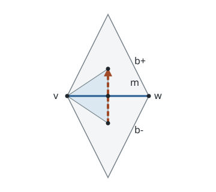
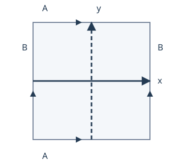

# ATOP36 Poincaré双対性

[ATOP34](../ATOP34/index.md) で向きと基本類を作り、[ATOP35](../ATOP35/index.md) でコホモロジーの次数を反転するcap積を作りました。今回は、なぜその写像が同型になるのかを調べます。例えば円周では、定数を表す0次の類が円周全体の1次の類に、円周を一周したことを測る1次の類が点の0次の類に対応します。トーラスでは二つの独立な方向を互いに交換するような対応が現れます。

直接の前提は [ATOP35](../ATOP35/index.md) と [ATOP32](../ATOP32/index.md) です。多様体は Hausdorff、第二可算、境界なしとし、閉多様体とはコンパクトで境界のない多様体を指します。[向き付け](../ATOP34/index.md#def-atop34-orientation) は各点の局所ホモロジーの生成元を座標閉球内で整合するよう選ぶことです。係数は $R=\mathbb Z$ または $\mathbb F_2$ とします。整数係数の場合には向き付けを固定します。二元体では各点の局所群の非零元を選べば整合的な向きが得られます。負次数の群は零とします。$H_q$ はホモロジー、$H^p$ はコホモロジーで、下付き $q$ と上付き $p$ は次数です。空間と係数が明らかな箇所では引数を省略します。

## 1. コンパクトな範囲だけで測る

直線は可縮なので、通常の1次ホモロジーは零です。しかし任意の有限区間を左から右へ進むと、局所的な1次の向きは存在します。全空間を覆う有限鎖がないため、閉多様体と同じ基本類を使うことはできません。

一般の局所コンパクト Hausdorff 空間（各点がコンパクトな近傍を持つ Hausdorff 空間）でも、コンパクトな範囲に限ったコホモロジーを作れます。多様体では座標閉球がその近傍になります。

そこで、まずコンパクト集合 $K\subset M$ を固定して、$M\setminus K$ の中に含まれる単体の評価を零にする [相対特異コホモロジー群](../ATOP28/index.md#def-atop28-relative-cohomology) を使います。$K\subset L$ なら $M\setminus L\subset M\setminus K$ なので、相対コチェインの包含が

$$
H^p(M,M\setminus K;R)\longrightarrow H^p(M,M\setminus L;R)
$$

を誘導します。評価を許す範囲を広げても、同じ評価を使えることを意味します。

コンパクト集合の有限合併はコンパクトなので、二つの範囲を一つのより大きな範囲に入れられます。このような拡大の系を一つの群へまとめる構成を直極限と呼びます。ここでは具体的な同値類で作ります。

<!-- formal-statement-start -->
> **定義（コンパクト支持コホモロジー）**
>
> 局所コンパクト Hausdorff 空間 $X$ と係数 $R=\mathbb Z$ または $\mathbb F_2$ に対して
>
$$
H_c^p(X;R)=\varinjlim_{K\subset X,\ K\text{ compact}}
 H^p(X,X\setminus K;R)
$$
>
> と定める。元は組 $(K,a)$ の同値類であり、$a\in H^p(X,X\setminus K;R)$ とする。二つの組は、両方の支持集合を含むあるコンパクト集合への像が一致するとき同値とする。和は共通のコンパクト集合へ移して加える。
<!-- formal-statement-end -->

<!-- definition-example-start: def-atop36-compact-cohomology -->
**定義の確認**：直線 $X=\mathbb R$ で $K=[-1,1]$ を取ります。補集合は二つの可縮な成分を持ちます。[相対コホモロジー長完全列](../ATOP28/index.md#thm-atop28-relative-exact) と [特異コホモロジーのホモトピー不変性](../ATOP28/index.md#thm-atop28-homotopy) によって

$$
R\xrightarrow{t\mapsto(t,t)}R^2
 \longrightarrow H^1(\mathbb R,\mathbb R\setminus K;R)
 \longrightarrow0
$$

が完全です。ここで $R^2$ の座標は補集合の左成分・右成分での0次コホモロジーの値です。直線上の定数 $t$ を制限すると両成分で $t$ となるので、対角写像になります。完全性により

$$
H^1(\mathbb R,\mathbb R\setminus K;R)
\cong R^2/\{(t,t):t\in R\}.
$$

差を取る準同型 $(s,t)\mapsto t-s$ は対角部分群を核とし、$(0,r)$ を $r$ に送るため全射です。従って商は $R$ と同型で、$(0,1)$ の類が生成元です。$K$ を $[-2,2]$ に広げると、左右の成分への制限はそれぞれ恒等であるため、長完全列の自然性によりこの生成元は同じ $(0,1)$ の類へ移ります。二つの組は拡大先で一致し、定義の同値条件を満たします。一般のコンパクト集合への拡大でこの類が零になることもありません。その集合をさらに大きな閉区間に含めれば、そこでの像は先ほどの非零な生成元になるからです。

一般に同値関係の推移律は、二つの比較に使ったコンパクト集合の合併へ移して確認できます。和の独立性も同じ操作で従います。例えば上の生成元を表す二組を加えると、共通の区間 $[-2,2]$ で $(0,2)$ の類になります。係数が二元体ならこの和は零です。零は空集合に対応する零類で表せます。
<!-- definition-example-end -->

直線の任意のコンパクト集合はある $[-m,m]$ に入るので、上の区間だけで全ての類と同値関係を調べられます。これを部分系が共終であるといいます。各区間の生成元がそのまま次へ移ることから $H_c^1(\mathbb R;R)=R$、また上の対角写像は単射なので $H_c^0(\mathbb R;R)=0$ です。通常の $H^0(\mathbb R;R)=R$ と逆になっています。

## 2. 有限の相対類から双対写像を作る

任意のコンパクト集合 $K$ に対し、各点で指定された局所向きになる相対類を

$$
u_K\in H_n(M,M\setminus K;R)
$$

と書きます。[ATOP34のコンパクト集合上の相対基本類](../ATOP34/index.md#ex-atop34-c1) が示すように、$K$ と有限個の座標閉球との交差に相対類を制限し、それらを貼り合わせると存在し、全点への制限で一意です。$K\subset L$ のとき $u_L$ の $K$ への制限は $u_K$ です。空集合では零です。

[相対cap積の誘導写像](../ATOP35/index.md#thm-atop35-relative-descend) によって

$$
D_K(a)=a\frown u_K\in H_{n-p}(M;R)
$$

を作れます。$a$ は $M\setminus K$ 上で零であるコサイクルであり、$u_K$ の代表鎖の境界は $M\setminus K$ に入ります。[cap積の境界公式](../ATOP35/index.md#thm-atop35-boundary) ではこの境界の寄与と余境界の寄与がともに消えるので、出力は絶対サイクルです。

$K\subset L$ とし、拡大したコホモロジー類を $a'$ とします。対の包含を $f:(M,M\setminus L)\to(M,M\setminus K)$ と書くと、$a'=f^*a$、$f_*u_L=u_K$ です。[cap積の自然性](../ATOP35/index.md#thm-atop35-naturality) により、絶対ホモロジーでは $f_*$ が恒等なので

$$
D_L(a')=f^*a\frown u_L=a\frown f_*u_L=D_K(a).
$$

よってコンパクト支持の類 $[(K,a)]$ に対して

$$
D_M([(K,a)])=D_K(a),
\qquad D_M:H_c^p(M;R)\to H_{n-p}(M;R)
$$

が定まります。共通の支持集合へ移してから足せば cap積の線形性により加法的で、係数倍とも可換です。$p<0$ のときは零群からの写像、$p>n$ のときは負次数の零群への写像とします。これは [閉多様体での基本類による双対写像](../ATOP35/index.md#def-atop35-duality-map) を拡張したものです。以後、支持集合が明らかなら入力を単に $a$ とも書きます。

開集合 $j:U\hookrightarrow M$ にも対応が必要です。$K\subset U$ がコンパクトなら、$K$ は $M$ でも閉じており、$M\setminus U$ の閉包は開集合 $M\setminus K$ に含まれます。

[切除定理](../ATOP19/index.md#thm-atop19-excision) から対の包含

$$
(U,U\setminus K)\longrightarrow(M,M\setminus K)
$$

は整数ホモロジー同型を誘導します。相対鎖群は整数自由群で、[コホモロジーの普遍係数定理](../ATOP29/index.md#thm-atop29-cohomology-uct) の自然な短完全列の両端が同型になるため、相対コホモロジーでも引戻しは同型です（係数群 $R$ を用いる）。

この逆を支持集合 $K$ ごとに取り、拡大との可換性を使うと、開集合からの延長

$$
j_!:H_c^p(U;R)\longrightarrow H_c^p(M;R)
$$

が定まります。通常のコホモロジーの引戻しとは向きが逆です。$u_K$ も切除による像と一致します。各点で局所向きが一致するためです。したがって [cap積の自然性](../ATOP35/index.md#thm-atop35-naturality) より

$$
D_M j_!=j_*D_U.
$$

この等式が領域を貼り合わせる鍵です。ここで $j_*$ はホモロジーの誘導写像、$j_!$ はコンパクト支持コホモロジーの延長であり、どちらも小さい空間から大きい空間へ向かいます。

同相 $h:X\to Y$ の場合も双対写像を比較できます。$Y$ の向きを $h$ で $X$ に移すとは、各点の局所生成元を $h_*$ の逆で選ぶことです。$h^{-1}$ も連続なのでコンパクト集合は両方向でコンパクト集合へ移り、対の引戻し $h^*$ はコンパクト支持コホモロジーの同型になります。相対基本類の一意性から $h_*u_K^X=u_{h(K)}^Y$ であり、[cap積の自然性](../ATOP35/index.md#thm-atop35-naturality) により

$$
h_*D_X(h^*a)=D_Y(a).
$$

したがって一方の双対写像が同型なら他方も同型です。

## 3. 局所模型：Euclid空間

<!-- formal-statement-start -->
> **補題（Euclid空間のコンパクト支持双対性）**
>
> 標準の向きまたはその反対の向きを選んだ $X=\mathbb R^n$ と $R=\mathbb Z$ または $\mathbb F_2$ に対し、全次数で $D_X$ は同型である。
<!-- formal-statement-end -->

見取り図：支持集合を原点中心の閉球へ拡大します。閉球の相対群は最高次数だけ非零で、その生成元を1と評価するコサイクルをcap積に入れれば点の類になります。

<!-- proof-start -->
### 証明

$n>0$ とします。閉球 $K_m$（半径 $m=1,2,\ldots$）はコンパクト集合の共終な部分系です。[コンパクト凸集合の相対群](../ATOP34/index.md#lem-atop34-convex-support) と [Euclid空間の局所ホモロジー](../ATOP25/index.md#thm-atop25-euclidean) より、整数相対ホモロジーは $k=n$ で $\mathbb Z$、それ以外で零です。$K_m$ への制限も各点への制限を合成して比較すれば同型です。[コホモロジーの普遍係数定理](../ATOP29/index.md#thm-atop29-cohomology-uct) では全ての Ext 項が零（自由群または零群）で、評価による同型が得られます。

$$
H^p(X,X\setminus K_m;R)
=\begin{cases}R&p=n,\\0&p\ne n.\end{cases}
$$

ここで $p=n$ の生成元は $u_{K_m}$ を1と評価する類 $a_m$ です。整数相対生成元を向きに合わせて選び、係数を $R$ に変えればこの評価が成立します。$K_m\subset K_{m+1}$ で相対類が制限により一致するため、コホモロジーの拡大写像は $a_m$ を $a_{m+1}$ へ送ります。従って直極限は同じ群です。

一方、$X$ は可縮なので [可縮空間の被約特異ホモロジー](../ATOP17/index.md#cor-atop17-contractible) により $H_0(X;R)=R$、それ以外は零です。

$p=n$ のとき特異 $n$ 単体のcap積は係数 $a_m(\sigma)$ を最後の頂点へ付けます。出力0鎖の係数の総和は

$$
a_m(u_{K_m})=1
$$

です。[0次特異ホモロジーと道連結成分](../ATOP16/index.md#thm-atop16-h0-path-components) によりその類は点の生成元です。従って $D_X$ は $R$ から $R$ への生成元を送る写像で、同型です。他の次数は零群同士です。

$n=0$ では $X$ は一点であり $K=X$ が最大の支持集合です。$u_K$ は選んだ点の生成元で、0コチェインの評価1により点の生成元を得ます。これも同型です。
<!-- proof-end -->

向き付き開座標球は $\mathbb R^n$ と同相です。座標で誘導された向きは連結な球内で一定の符号を持つので、どちらの向きでもこの補題が適用できます。[同相に対する双対写像の自然性](#atop36-duality-construction) により開座標球の双対写像も同型です。

## 4. 二つの開集合を貼り合わせる

$M=U\cup V$ とし、$W=U\cap V$ と置きます。$K\subset U,L\subset V$ をコンパクト集合とします。共通の支持集合ではなく、重なり $K\cap L$ に対応する評価が二つの領域の差を測ります。

<!-- formal-statement-start -->
> **定理（コンパクト支持のMayer–Vietoris列）**
>
> 境界のない $R$ 向き付き多様体 $M=U\cup V$ を二つの開集合で覆う。$W=U\cap V$ とし、開包含に対する延長写像を $j_!$ と書く。次の列は完全である。
>
$$
\begin{gathered}
\cdots\to H_c^p(W;R)
 \xrightarrow{(j_!,-j_!)}
 H_c^p(U;R)\oplus H_c^p(V;R)\\
 \xrightarrow{j_!+j_!}H_c^p(M;R)
 \xrightarrow{\Delta} H_c^{p+1}(W;R)\to\cdots.
\end{gathered}
$$
>
> 通常のホモロジーのMayer–Vietoris接続写像を $\partial_{\rm MV}$ とする。上の符号規約では
>
$$
\partial_{\rm MV}D_M=(-1)^{p+1}D_W\Delta.
$$
<!-- formal-statement-end -->

### 証明の見取り図

相対鎖の商を双対化すると、共通部分の評価を符号付きで二領域へ入れ、二つの評価の和を取る短完全列になります。接続写像は評価の持上げの余境界を取ります。その余境界とcap積の境界を比較することで、上の符号が得られます。最後に支持集合を拡大して全てのコンパクト支持の類を扱います。

<!-- proof-start -->
### 証明

**(i) 固定した支持集合の列。** まず整数特異鎖の複体を $C=C_*(M;\mathbb Z)$、$A=C_*(M\setminus K;\mathbb Z)$、$B=C_*(M\setminus L;\mathbb Z)$ と書きます。係数 $R$ のコチェインは整数鎖から $R$ への線形評価です。添字 $*$ は全次数の鎖複体を表し、$\partial$ は鎖の次数を1下げる境界です。[余境界](../ATOP28/index.md#def-atop28-coboundary) $\delta$ はコチェインの次数を1上げ、$(\delta\alpha)(c)=\alpha(\partial c)$ と作用します。部分複体 $E$ に対し、$E^\perp$ は各次数の $E$ 上で零になるコチェインからなる部分複体を表します。これは内積による直交補空間ではなく、評価が零になる条件です。

各次数で次の短完全列を作ります。

$$
0\to (A+B)^\perp
 \xrightarrow{\gamma\mapsto(\gamma,-\gamma)}
 A^\perp\oplus B^\perp
 \xrightarrow{(\alpha,\beta)\mapsto\alpha+\beta}
 (A\cap B)^\perp\to0.
$$

最初の写像は単射です。和が零なら $\beta=-\alpha$ かつ $\alpha$ は $A,B$ の双方で零なので $\alpha\in(A+B)^\perp$ です。最後の全射性は特異単体の基底で確かめます。$(A\cap B)^\perp$ の元 $a$ に対し、$\alpha(\sigma)=a(\sigma)$ を $\sigma\notin A$ の基底上で定め、$\sigma\in A$ では零とします。$\beta=a-\alpha$ は $B$ 内の基底上で零です。実際 $B$ に属し $A$ に属さないなら $\alpha=a$、双方に属するなら $a=0$ です。従って $a=\alpha+\beta$ という持上げを得ます。各写像は余境界と可換です。

$A\cap B=C_*(M\setminus(K\cup L);\mathbb Z)$ です。また $A+B$ から $C_*(M\setminus(K\cap L);\mathbb Z)$ への包含は、二つの開補集合による [小さい鎖によるホモロジー同型](../ATOP19/index.md#thm-atop19-small-chain-isomorphism) です。$C/(A+B)$ から $C/C_*(M\setminus(K\cap L);\mathbb Z)$ への商写像についても、部分複体と全複体の短完全列に付随する長完全列を比較します。部分複体の写像は上の同型、全複体の写像は恒等なので、[完全列の中央の比較](../ATOP21/index.md#lem-atop21-exact-comparison) により商複体のホモロジーも同型です。どちらの商も単体の部分集合で割った自由な整数鎖複体なので、[コホモロジーの普遍係数定理](../ATOP29/index.md#thm-atop29-cohomology-uct) により双対のコホモロジーも同型です。特に $(A+B)^\perp$ のコホモロジーを支持 $K\cap L$ の相対コホモロジーと同一視できます。

短完全列のコホモロジー長完全列の接続は、コサイクル $a=\alpha+\beta$ を持ち上げ、

$$
\delta\alpha=-\delta\beta
$$

を取って $[\delta\alpha]$ とするものです。$\delta^2=0$ なのでコサイクルです。

持上げを $(\alpha+\gamma,\beta-\gamma)$ と変えれば $\delta\gamma$ だけ変わります。$a$ を $a+\delta d$ に変える場合、$d=d_A+d_B$ と持ち上げると新しい持上げは $(\alpha+\delta d_A,\beta+\delta d_B)$ です。その第1成分の余境界は $\delta\alpha+\delta^2d_A=\delta\alpha$ なので接続類は変わりません。

完全性は [相対コホモロジー長完全列](../ATOP28/index.md#thm-atop28-relative-exact) と同じ持上げで確認できます。接続像が零なら持上げを $\gamma$ で調整してコサイクルにできます。従って前の写像の像が接続写像の核に一致します。

共通部分のコサイクルが中央で余境界になるなら、その原始コチェインの和はコサイクルであり、接続で元の類を与えます。中央のコサイクルの和が余境界なら、その原始コチェインを持ち上げて余境界を引けば、和が零の持上げに変えられます。

**(ii) 符号。** $u_{K\cup L}$ の代表 $z$ は、次の開被覆に対して小さい鎖として選びます。

$$
\{U\cap V,\ U\setminus L,\ V\setminus K,\
 M\setminus(K\cup L)\}.
$$

実際、点が $K\cap L$ に入れば第1、$K$ だけなら第2、$L$ だけなら第3、両方の外なら第4に入ります。[小さい鎖によるホモロジー同型](../ATOP19/index.md#thm-atop19-small-chain-isomorphism) を対 $(M,M\setminus(K\cup L))$ に適用すれば、$\partial z$ は補集合内のまま、このような代表が得られます。

$a=\alpha+\beta$ がコサイクルとします。$\alpha\in A^\perp$、$\beta\in B^\perp$ なので、$\alpha\frown z$ は $U$ 内の鎖、$\beta\frown z$ は $V$ 内の鎖です。例えば $\alpha$ は $V\setminus K$ または第4の開集合内の単体の前面を零と評価します。残る単体は $U$ 内にあります。$\delta\alpha=-\delta\beta$ は $A,B$ の双方を消すので $(\delta\alpha)\frown z$ は $W$ 内の鎖です。

$\partial z$ は $A\cap B$ に入るため $\alpha\frown\partial z=\beta\frown\partial z=0$ です（cap積の係数は $R$ に変えて計算する）。[cap積の境界公式](../ATOP35/index.md#thm-atop35-boundary) により

$$
\partial(\alpha\frown z)
=(-1)^{p+1}(\delta\alpha)\frown z,
$$

$$
\partial(\beta\frown z)
=-(-1)^{p+1}(\delta\alpha)\frown z.
$$

[二領域の小さい鎖の短完全列](../ATOP20/index.md#thm-atop20-small-chain-sequence) の左写像を $(w,-w)$ とすると、[Mayer–Vietoris接続準同型](../ATOP20/index.md#thm-atop20-connecting) は、二領域に分けた鎖の第1成分の境界を重なりで読む操作です。従って上の符号が得られます。

ここで $\delta\alpha$ は $A+B$ を消しますが、一般には補集合 $M\setminus(K\cap L)$ の全単体を消すとは限りません。(i) の比較同型により、そのコホモロジー類を補集合全体で零になるコサイクル $\eta$ で代表できます。

$$
\delta\alpha-\eta=\delta\lambda,\qquad
\lambda\in(A+B)^\perp
$$

です。小さい鎖 $z$ では $\lambda\frown z$ が $W$ に入り、$\lambda\frown\partial z=0$ です。$\lambda$ の次数は $p$ なので [cap積の境界公式](../ATOP35/index.md#thm-atop35-boundary) から

$$
(\delta\alpha-\eta)\frown z
=(\delta\lambda)\frown z
=(-1)^{p+1}\partial(\lambda\frown z).
$$

よって差のcap積は $W$ 内の境界です。

さらに $z$ を $K\cap L$ 上の相対鎖として見たとき、$W$ に含まれない被覆要素の単体は全て $M\setminus(K\cap L)$ 内にあり捨てられます。残る $W$ 内の鎖は切除と相対類の制限によって $u_{K\cap L}$ を表します。

従って

$$
[(\delta\alpha)\frown z]=D_W[\eta]
$$

です。

係数 $R=\mathbb F_2$ についても ATOP20 の鎖の短完全列は単体基底により完全であり、細分と鎖ホモトピーの恒等式を係数変更して使えます。接続写像を第1成分の境界で定義する持上げの議論は同じです。

非接続の四角形は [開包含に対する双対写像の自然性](#atop36-duality-construction) で可換です。上の符号は整数では重要で、二元体では $-1=1$ なので消えます。

**(iii) 支持集合を拡大する。** 任意のコンパクト集合 $T\subset M$ は、内部が $T$ を覆う有限個の座標閉球で、各球が $U$ または $V$ に収まるように覆えます。$U$ に収まる球の合併を $K$、$V$ のものを $L$ とすれば $T\subset K\cup L$ です。従って合併の支持系は共終です。$W$ 内のコンパクト集合 $J$ には $K=L=J$ を選べるので、交わりの支持系も共終です。対 $(K,L)$ は成分ごとの合併で共通の拡大先を持ちます。

各固定支持の完全列の写像は拡大に対して可換です。直極限である類の像が零なら、定義により有限の拡大先で像が零になります。その段階で完全性を用いて前の群の元に持ち上げ、その元の直極限での類を取れば元の類を得ます。逆に連続する写像の合成は各段階で零です。これで完全性を得ました。二成分の直和についても二つの代表の支持集合を同時に拡大すればよいので、表示した列そのものになります。
<!-- proof-end -->

## 5. 任意の多様体へ

<!-- formal-statement-start -->
> **定理（Poincaré双対性）**
>
> $M$ を境界のない Hausdorff、第二可算な $n$ 次元多様体とし、$R=\mathbb Z$ または $\mathbb F_2$ の向き付けを固定する。全ての整数 $p$ について、コンパクト集合上の相対類とのcap積は同型
>
$$
D_M:H_c^p(M;R)\xrightarrow{\ \cong\ }H_{n-p}(M;R)
$$
>
> を与える。特に $M$ が閉多様体なら
>
$$
D_M(a)=a\frown[M]_R:
H^p(M;R)\xrightarrow{\ \cong\ }H_{n-p}(M;R).
$$
>
> 二元体では向き付け可能性に追加の仮定は不要である。
<!-- formal-statement-end -->

### 証明の見取り図

局所模型で成立したことを二領域の完全列で合併へ移します。座標が一つなら開球の有限合併を経て任意の開集合へ、座標が複数ならその結果を使って有限個の座標近傍の合併へ進みます。最後に可算個の座標近傍の増大合併を扱います。

<!-- proof-start -->
### 証明

**二領域の合併。** [コンパクト支持のMayer–Vietoris列](#thm-atop36-compact-mv) と [Mayer–Vietoris完全列](../ATOP20/index.md#thm-atop20-mayer-vietoris) を比較します。上の五項は

$$
H_c^p(W)\to H_c^p(U)\oplus H_c^p(V)
 \to H_c^p(M)\to H_c^{p+1}(W)
 \to H_c^{p+1}(U)\oplus H_c^{p+1}(V)
$$

です。下の五項の次数は順に $n-p,n-p,n-p,n-p-1,n-p-1$ です。接続の符号を吸収するため、最初の三つの縦写像を $D$、後ろ二つを $(-1)^{p+1}D$ とすると全ての四角形が可換です。$U,V,W$ で全次数の双対性が成立するなら周囲四項の縦写像は同型です。[完全列の中央の比較](../ATOP21/index.md#lem-atop21-exact-comparison) により中央も同型です。空集合の場合は零群同士です。

**増大合併。** 開集合 $M_1\subset M_2\subset\cdots$ の合併を $M$ とします。各コンパクト集合 $K\subset M$ は有限部分被覆を取り、最大の添字を選べばある $M_i$ に収まります。切除による開包含の延長を用いると

$$
\varinjlim_i H_c^p(M_i;R)\cong H_c^p(M;R).
$$

実際、右の代表の支持集合はある $M_i$ に入り、その相対類は切除により左で代表できます。右で零になる左の代表は、より大きなコンパクト集合 $L\subset M$ への拡大で零になります。$L$ と最初の支持集合を含む $M_j$ を選ぶと、切除により $M_j$ 内でも零になります。

同様に

$$
\varinjlim_i H_q(M_i;R)\cong H_q(M;R)
$$

です。任意の有限サイクルの単体像の合併はコンパクトなのである $M_i$ 内にあります。あるサイクルが $M$ で境界なら、その境界を与える有限鎖の像もコンパクトなのでより大きな $M_j$ 内で境界になります。自然性により各 $D_{M_i}$ はこの二つの系の写像と可換です。各段階の $D$ が同型なら、その逆写像も可換であるため直極限で同型です。

**一つの座標内。** $\mathbb R^n$ の任意の開集合 $O$ を考えます。開球の有限交差は開凸集合です。非空の開凸集合は $\mathbb R^n$ と同相であることを次のように確認できます。

内部点を原点へ平行移動して $Q$ とし、$|x|$ を Euclid ノルムと書き、

$$
g(x)=\inf\{t>0:x\in tQ\}
$$

と定めます。$Q$ が原点の半径 $\epsilon$ の球を含むため、

$$
0\le g(x)\le |x|/\epsilon
$$

です。凸性より次の二つが成り立ちます。

$$
g(x+y)\le g(x)+g(y),\qquad g(sx)=sg(x)\quad(s>0).
$$

実際、$x\in aQ,y\in bQ$ なら $(x+y)/(a+b)\in Q$ です。正の実数倍の式は定義で拡大率を置換すれば得られます。

劣加法性を $x=y+(x-y)$ と $y=x+(y-x)$ に適用すると

$$
g(x)-g(y)\le g(x-y)\le |x-y|/\epsilon,
$$

$$
g(y)-g(x)\le g(y-x)\le |x-y|/\epsilon.
$$

従って

$$
|g(x)-g(y)|\le |x-y|/\epsilon
$$

となり連続です。また $Q=\{g<1\}$ です。$g(x)<1$ なら凸性で $x\in Q$、逆に $x\in Q$ なら開性で少し拡大した点も $Q$ に入ります。従って

$$
x\mapsto\frac{x}{1+g(x)},\qquad
y\mapsto\frac{y}{1-g(y)}
$$

は互いに逆の連続写像です。前者の像の $g$ は $g(x)/(1+g(x))<1$ であり、後者の分母は正です。正の斉次性により、前者の像 $y=x/(1+g(x))$ について $1-g(y)=1/(1+g(x))$ ですから $y/(1-g(y))=x$ です。逆に $x=y/(1-g(y))$ なら $1+g(x)=1/(1-g(y))$ となり $x/(1+g(x))=y$ です。原点を戻せば同相を得ます。$n=0$ では非空開集合は一点です。よって [Euclid空間のコンパクト支持双対性](#lem-atop36-local-duality) と [同相に対する自然性](#atop36-duality-construction) により全ての非空有限交差で双対性が成立します。

有限個の開球の合併について個数で帰納します。最後の球とそれ以前の合併の重なりは、それ以前の各球と最後の球との交差の合併です。この交差族の任意の有限交差は開凸集合（または空集合）です。より一般に全ての有限交差で双対性が成立する有限開被覆なら、同じ帰納でその合併でも成立します。これを適用すれば有限個の球の合併で成立します。$O$ 内に収まる有理中心・有理半径の開球で $O$ を覆い、その最初の有限個の合併を増大列にすれば、上の増大合併の議論で $O$ 全体に成立します。

**多様体全体。** 座標近傍は $\mathbb R^n$ の開集合と同相です。有限個の座標近傍の交差は、一つの座標近傍の開部分集合と見なせるため、直前の結果を適用できます。有限被覆に関する帰納により有限個の座標近傍の合併で成立します。第二可算性により座標被覆から可算部分被覆を取れます。実際、可算基底の元のうち座標近傍に含まれるものごとに一つの座標近傍を選ぶと、全点がいずれかに含まれます。有限合併の増大列により $M$ でも成立します。

最後に $M$ が閉多様体なら $K=M$ が支持集合の最大元なので $H_c^p(M;R)=H^p(M;R)$ です。[基本類の存在一意性](../ATOP34/index.md#thm-atop34-fundamental-class) で $u_M=[M]_R$ となります。二元体の向き付けは局所生成元が一つしかないため、ATOP34の構成で常に得られます。
<!-- proof-end -->

この論証では三角形分割を仮定していません。三角形分割がある場合には、[ATOP35](../ATOP35/index.md) の双対辺の局所模型のように、元の辺を横切る双対辺が1次の評価を1次の鎖へ変えることを図で理解できます。

ただし任意の位相多様体でその図のような分割を選べると仮定する必要はありません。

## 6. トーラスで符号を読む

閉向き付きトーラス $T^2=S^1\times S^1$ を考えます。積の角度座標の重なりは各座標での平行移動なので、標準の向きは整合します。二方向に一周するサイクルを $x,y$ とし、それぞれの方向を測る1次のコホモロジー類を $a,b$ とします。

[トーラスの整数係数コホモロジー環](../ATOP32/index.md#thm-atop32-torus-ring) により $a\smile b$ は2次の生成元で、

$$
b\smile a=-a\smile b,\qquad a^2=b^2=0
$$

です。ここで $a(x)$ と $\langle a,x\rangle$ はどちらも [ホモロジー類への評価](../ATOP28/index.md#prop-atop28-evaluation) を意味し、代表コチェインと代表サイクルから計算します。基底は

$$
a(x)=b(y)=1,\qquad a(y)=b(x)=0
$$

となるものを使います。[ホモロジーのKünneth公式](../ATOP30/index.md#thm-atop30-kunneth-homology) により

$$
H_1=\mathbb Z x\oplus\mathbb Z y,\qquad H_2=\mathbb Z
$$

です。$H_1$ が自由なので [コホモロジーの普遍係数定理](../ATOP29/index.md#thm-atop29-cohomology-uct) の評価写像は同型となり、

$$
\langle a\smile b,[T^2]\rangle=1
$$

となる向きを選びます。

[cup積とcap積の評価関係](../ATOP35/index.md#thm-atop35-cup-evaluation) から

$$
\begin{aligned}
a(D(a))&=\langle a\smile a,[T^2]\rangle=0,\\
b(D(a))&=\langle a\smile b,[T^2]\rangle=1,\\
a(D(b))&=\langle b\smile a,[T^2]\rangle=-1,\\
b(D(b))&=\langle b\smile b,[T^2]\rangle=0.
\end{aligned}
$$

任意の1次ホモロジー類を $ux+vy$ と書けば、評価の線形性と基底の条件から $a(ux+vy)=u$、$b(ux+vy)=v$ です。従って上の四つの評価は像の整数座標そのものを与えます。

$$
D(a)=y,\qquad D(b)=-x.
$$

さらに入力を $sa+tb$ とすれば $D(sa+tb)=-tx+sy$ です。コホモロジーの基底 $(a,b)$ とホモロジーの基底 $(x,y)$ に対して、列に像の座標を並べると

$$
[D]=\begin{pmatrix}0&-1\\1&0\end{pmatrix},
\qquad \det[D]=1.
$$

整数係数なので実数上で逆行列があるだけでは十分ではありません。ここでは行列式が1で、逆行列も整数成分です。

$$
[D]^{-1}=\begin{pmatrix}0&1\\-1&0\end{pmatrix}.
$$

実際、出力座標 $(u,v)$ に対し入力 $(s,t)=(v,-u)$ が一意に決まるため、整数上でも同型です。評価する方向と、評価をcap積で鎖へ戻した方向は同じとは限りません。向きを反転すると両方の像の符号が逆になります。

図の正方形は対辺を同一視したトーラスです。実線は $x$ の正方向、破線は $y$ の正方向です。横方向を評価する $a$ の双対は縦方向の $y$、縦方向を評価する $b$ の双対は横方向の逆向き $-x$ です。図の交点は模式的な代表の交点であり、同型の証明は第5節の局所からの論証で行いました。

閉多様体の整数版には向きが必要です。例えば実射影平面では [基本類の存在一意性](../ATOP34/index.md#thm-atop34-fundamental-class) により $H_2(\mathbb{RP}^2;\mathbb Z)=0$ ですが、連結なので $H^0(\mathbb{RP}^2;\mathbb Z)=\mathbb Z$ です。同型は不可能です。二元体に変更すれば両群は $\mathbb F_2$ になります。

## 7. 演習

### A1. 支持集合を広げる
- Level: A

$X=\mathbb R$、$K=[0,1]$、$L=[-1,2]$ とする。$H^1(X,X\setminus K;\mathbb Z)$ の生成元は、支持を $L$ へ広げると何になるか。

<!-- solution-start -->
**詳細解答**

[相対コホモロジー長完全列](../ATOP28/index.md#thm-atop28-relative-exact) の $H^0(X)\to H^0(X\setminus K)\to H^1(X,X\setminus K)\to0$ で、初めの写像は対角写像 $t\mapsto(t,t)$ です。[コンパクト支持コホモロジーの定義例](#def-atop36-compact-cohomology) と同様に、差 $t-s$ が対角部分群を核とする全射なので、生成元は $(0,1)$ の剰余類です。$L$ の補集合の左成分は $K$ の補集合の左成分に、右成分も右成分に含まれます。よって制限は $(s,t)\mapsto(s,t)$ です。対角部分群を保存するため商でも恒等となり、$(0,1)$ の剰余類が生成元に移ります。
<!-- solution-end -->

### A2. 最高次のcap積
- Level: A

連結閉向き付き $n$ 次元多様体 $M$ で $a\in H^n(M;\mathbb Z)$ が $\langle a,[M]\rangle=3$ を満たすとする。$D_M(a)$ を点の類で表せ。

<!-- solution-start -->
**詳細解答**

[cap積](../ATOP35/index.md#def-atop35-cap) で $p=n$ とすると各 $n$ 単体は最後の頂点に $a(\sigma)$ 倍の係数を付けた0鎖になります。基本類の代表を $z=\sum_i m_i\sigma_i$ とすれば出力の係数総和は

$$
\sum_i m_i a(\sigma_i)=a(z)=3.
$$

連結多様体は局所道連結なので道連結です。[0次特異ホモロジーと道連結成分](../ATOP16/index.md#thm-atop16-h0-path-components) より0鎖の係数和がそのホモロジー類を決めるため、任意の点 $q$ に対して

$$
D_M(a)=3[q].
$$
<!-- solution-end -->

### A3. 円周と直線
- Level: A

整数係数で $S^1$ と $\mathbb R$ の通常およびコンパクト支持コホモロジーを0次・1次で比較せよ。

<!-- solution-start -->
**詳細解答**

円周は閉向き付き1次元多様体です。[胞体ホモロジー定理](../ATOP22/index.md#thm-atop22-cellular-comparison) で0胞体と1胞体が各一つ、1胞体の両端は同じ点なので境界は零です。従って $H_0=H_1=\mathbb Z$ です。[Poincaré双対性](#thm-atop36-poincare-duality) により

$$
H_c^0(S^1)\cong H_1(S^1)\cong\mathbb Z,
\qquad H_c^1(S^1)\cong H_0(S^1)\cong\mathbb Z.
$$

閉多様体なので通常の群と一致します。直線は可縮なので [特異コホモロジーのホモトピー不変性](../ATOP28/index.md#thm-atop28-homotopy) より

$$
H^0(\mathbb R)\cong\mathbb Z,\qquad H^1(\mathbb R)=0.
$$

一方、[Euclid空間のコンパクト支持双対性](#lem-atop36-local-duality) では1次元なので

$$
H_c^0(\mathbb R)\cong H_1(\mathbb R)=0,
\qquad H_c^1(\mathbb R)\cong H_0(\mathbb R)\cong\mathbb Z.
$$
<!-- solution-end -->

### A4. 離散空間
- Level: A

可算無限個の点の離散空間 $M$ を0次元多様体とする。$H_c^0(M;R)$ と $H^0(M;R)$ を求めよ。各点の向きは正とする。

<!-- solution-start -->
**詳細解答**

コンパクト集合は有限集合です（各一点の開被覆を考える）。相対0コチェインはその有限集合の各点に値を付け、他を零にする関数です。特異1単体は連結な区間から離散空間への写像なので定数、余境界は零です。従って有限支持の列を全て集めると

$$
H_c^0(M;R)\cong\bigoplus_{j\ge1}R
$$

です。ここで点を $q_j$ と番号付けすると、cap積は有限支持の列 $(a_j)$ を0鎖 $\sum_j a_j[q_j]$ に送ります。[0次特異ホモロジーと道連結成分](../ATOP16/index.md#thm-atop16-h0-path-components) により各点の類が独立な生成元なので、$H_0(M;R)$ との同型を具体化します。

通常の0コチェインには有限支持の制約がないので

$$
H^0(M;R)\cong\prod_{j\ge1}R.
$$

例えば全成分1の列は後者に属しますが前者には属しません。
<!-- solution-end -->

### B1. 二つの半直線で貼る
- Level: B

$U=(-\infty,1),V=(-1,\infty)$ で $\mathbb R=U\cup V$ を覆う。向きは右向きとする。1次のコンパクト支持のMayer–Vietoris列の三つの非零群と写像を求めよ。

<!-- solution-start -->
**詳細解答**

$U,V,W=(-1,1)$ はいずれも直線と同相で、右向きの同相を選べます。[Euclid空間のコンパクト支持双対性](#lem-atop36-local-duality) より各空間の $H_c^1=R$、$H_c^0=H_c^2=0$ です。生成元をcap積で正の点の類へ移るよう選びます。開包含は点の類を点の類へ送るので、[開包含に対する双対写像の自然性](#atop36-duality-construction) により延長は生成元を生成元に送ります。[コンパクト支持のMayer–Vietoris列](#thm-atop36-compact-mv) は

$$
0\to R\xrightarrow{t\mapsto(t,-t)}R^2
 \xrightarrow{(s,t)\mapsto s+t}R\to0
$$

となります。和の核は $(t,-t)$ の全体、和は $(r,0)$ から任意の $r$ を得るので全射です。接続先は零です。
<!-- solution-end -->

### B2. 向き付け不可能な場合
- Level: B

実射影平面で整数係数の双対性が失敗する次数を一つ示し、二元体では全次数の群を求めて双対性と照合せよ。

<!-- solution-start -->
**詳細解答**

実射影平面の胞体は0、1、2次に各一つで、[実射影空間の胞体境界](../ATOP22/index.md#prop-atop22-projective-boundary) より整数2次境界は2倍、1次境界は零です。胞体鎖複体の該当部分は

$$
0\longrightarrow\mathbb Z
\xrightarrow{\times 2}\mathbb Z
\xrightarrow{0}\mathbb Z\longrightarrow0.
$$

2倍写像は整数上で単射なので $H_2=0$ ですが、連結であるため $H^0=\mathbb Z$ です。従って $p=0$ で同型が成立しません。これは整数向きが存在しないことと一致します。

二元体では2倍写像も零です。[胞体ホモロジー定理](../ATOP22/index.md#thm-atop22-cellular-comparison) の係数変更版では各次数0,1,2の鎖群は $\mathbb F_2$、全ての境界写像は零です。従って $H_k=\mathbb F_2$（$k=0,1,2$）、他の次数は零です。[実射影空間の mod 2 コホモロジー環](../ATOP32/index.md#thm-atop32-projective-ring) より $H^*=\mathbb F_2[t]/(t^3)$、$t$ は1次なので $1,t,t^2$ がそれぞれ0、1、2次の基底です。閉多様体で二元体の向きがあるため [Poincaré双対性](#thm-atop36-poincare-duality) はこれらをそれぞれ $H_2,H_1,H_0$ の非零元へ送ります。$p$ が範囲外なら両側とも零です。
<!-- solution-end -->

### B3. 接続写像の符号
- Level: B

第4節で $p=0,1,2$ のときの符号を求めよ。また $\partial z$ が支持集合の補集合にあるという条件を外すと、どの計算が成立しなくなるか。

<!-- solution-start -->
**詳細解答**

[cap積の境界公式](../ATOP35/index.md#thm-atop35-boundary) に $\alpha$ と $z$ を入れると

$$
\partial(\alpha\frown z)
=(-1)^p\alpha\frown\partial z
 +(-1)^{p+1}(\delta\alpha)\frown z.
$$

$\partial z$ が補集合にあり $\alpha$ がそこを零と評価するので第1項は零です。接続は第1成分の境界を読むため、$\Delta[a]=[\delta\alpha]$ に対応する符号は $p=0$ で $-1$、$p=1$ で $+1$、$p=2$ で $-1$ です。条件を外すと第1項が残り得ます。すると境界が $\delta\alpha$ のcap積だけで表される保証がなく、重なり内の鎖として比較する議論が壊れます。
<!-- solution-end -->

### B4. 円周の非零な接続写像
- Level: B

円周を二つの開弧 $U,V$ で覆い、重なり $W$ が二つの開弧 $W_1,W_2$ の非交和になるようにする。整数係数でコンパクト支持のMayer–Vietoris列を用い、$H_c^0(S^1)$ の接続像を求めよ。ただし円周の向きを選び、各開弧の最高次のコホモロジーの基底はその向きに合わせる。

<!-- solution-start -->
**詳細解答**

各開弧は直線と同相です。[Euclid空間のコンパクト支持双対性](#lem-atop36-local-duality) より $H_c^0$ は零、$H_c^1$ は整数群です。二成分の重なりではコンパクト支持の類は成分別に分かれ、$H_c^1(W)=\mathbb Z^2$ です。円周はコンパクトかつ連結なので $H_c^0(S^1)=H^0(S^1)=\mathbb Z$ です。

各重なりの生成元をcap積で正の点の類に送るよう選びます。点の包含と [開包含に対する双対写像の自然性](#atop36-duality-construction) により、各重なりの生成元の延長はそれぞれの開弧の生成元です。従って [コンパクト支持のMayer–Vietoris列](#thm-atop36-compact-mv) の該当部分は

$$
0\to\mathbb Z\xrightarrow{\Delta}\mathbb Z^2
 \xrightarrow{(s,t)\mapsto(s+t,-s-t)}\mathbb Z^2.
$$

最後の核は $s+t=0$ で与えられる $\mathbb Z(1,-1)$ です。完全性から $\Delta$ はこの核への同型なので、生成元1の像は $(1,-1)$ または $(-1,1)$ です。

重なりの番号の付け方で符号が変わります。例えば向き付き円周のサイクルを $U$ 内の鎖 $u$ と $V$ 内の鎖 $v$ に分け、

$$
\partial u=[q_2]-[q_1],\qquad q_i\in W_i
$$

となるよう番号を選びます。[Mayer–Vietoris接続準同型](../ATOP20/index.md#thm-atop20-connecting) は $(-1,1)$ を返します。

[コンパクト支持のMayer–Vietoris列の接続符号](#thm-atop36-compact-mv) に $p=0$ を代入すると

$$
\partial_{\rm MV}D=-D\Delta
$$

であり、$\Delta(1)=(1,-1)$ です。
<!-- solution-end -->

### C1. トーラスの二つの方向
- Level: C

第6節の向きと基底を用いる。$c=2a-3b$ の双対類を求め、$a+b$ による評価を直接cup積でも計算せよ。向きを反転した場合も求めよ。

<!-- solution-start -->
**詳細解答**

[Poincaré双対性](#thm-atop36-poincare-duality) の写像はcap積の線形性により $D(c)=2D(a)-3D(b)$ です。[トーラスの双対写像の計算](#atop36-torus-duality-example) から $D(a)=y,D(b)=-x$ なので

$$
D(c)=3x+2y.
$$

$a(x)=1,a(y)=0,b(x)=0,b(y)=1$ より $(a+b)(D(c))=3+2=5$ です。

[トーラスの整数係数コホモロジー環](../ATOP32/index.md#thm-atop32-torus-ring) の積の規則を用いて

$$
\begin{aligned}
c\smile(a+b)
 &=2a^2+2a\smile b-3b\smile a-3b^2\\
 &=2a\smile b+3a\smile b=5a\smile b.
\end{aligned}
$$

基本類で評価すれば5となり、[cup積とcap積の評価関係](../ATOP35/index.md#thm-atop35-cup-evaluation) と一致します。基本類が $-[T^2]$ になるとcap積の線形性により双対類は $-3x-2y$、評価は $-5$ です。cup積そのものの規則は変わりません。
<!-- solution-end -->

## 8. 次講へ

閉多様体では次数を反転するcap積が同型になりました。非コンパクト多様体では、通常のコホモロジーでなくコンパクト支持のものが必要です。次講は境界を持つ多様体で、境界上の情報を相対群に入れることで二種類の双対性を作ります。

参考文献：[Hatcher, Algebraic Topology, Chapter 3, §3.3](https://pi.math.cornell.edu/~hatcher/AT/ATchapters.html)。
