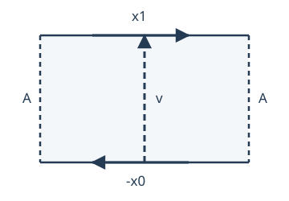

# ATOP37 境界付き多様体とPoincaré–Lefschetz双対性

[ATOP36のPoincaré双対性](../ATOP36/index.md#thm-atop36-poincare-duality) は、境界のない多様体では局所の向きを使ってコホモロジーをホモロジーに変える定理でした。ところが円板には境界円があり、円板全体を表す2鎖の境界は消えません。円板の通常の2次ホモロジーも零です。それでも内部の面積を測る2次の相対コホモロジーは残ります。今回は境界を零とみなす側を切り替えることで、二種類の双対性を得ます。

直接の前提は [ATOP36](../ATOP36/index.md) と、積鎖を扱う [ATOP30](../ATOP30/index.md) です。以下、多様体は Hausdorff、第二可算とし、係数は $R=\mathbb Z$ または $\mathbb F_2$ とします。整数係数では内部の向き付けを固定し、二元体では局所生成元を唯一の非零元とします。負次数の群は零とします。

## 1. 境界と内部を分ける

[半空間の局所ホモロジー](../ATOP25/index.md#thm-atop25-halfspace) で見た半空間の座標を使います。$n\ge1$ とし、半空間を

$$
\mathbb H^n=\mathbb R^{n-1}\times[0,\infty)
$$

と書きます。境界付き多様体 $M$ はこの半空間の相対開集合を座標近傍とする空間です。最後の座標が0の点を集めた集合を $B=\partial M$ とし、それ以外を $N=\operatorname{Int}M$ とします。局所ホモロジーは内部点の最高次では $R$、境界点では零なので、座標によらずこの区別が定まります。境界は閉集合で、境界座標を制限すると $B$ 自身は境界のない $(n-1)$ 次元多様体です。

境界の全体を一度に扱うには、境界に沿って細い帯を取れると便利です。このような帯をカラー近傍と呼びます。

<!-- formal-statement-start -->
> **定義（カラー近傍）**
>
> 境界付き多様体 $M$ の境界 $B$ のカラー近傍とは、$B$ を含む開集合 $U\subset M$ と同相写像
>
$$
c:B\times[0,1)\longrightarrow U
$$
>
> であって、全ての $b\in B$ に対し $c(b,0)=b$ を満たすものをいう。
<!-- formal-statement-end -->

<!-- definition-example-start: def-atop37-collar -->
**定義の確認**：単位円板 $D^2$ で $B=S^1$ とすると、$c(b,t)=(1-t/2)b$ は $U=\{x\in D^2:|x|>1/2\}$ への写像です。逆は $x\mapsto(x/|x|,2(1-|x|))$ であり、分母は零にならず、両方向が連続です。$U$ は円板内で相対開であり、$c(b,0)=b$ も満たします。
<!-- definition-example-end -->

コンパクトな位相多様体の境界にはカラー近傍が存在します（Brownのカラー近傍定理）。ここではこの位相幾何学の結果を外部定理として用います。滑らかな座標や全空間の三角形分割を仮定する必要はありません。参考：A. Hatcher, *Algebraic Topology*, Proposition 3.42（[教科書](https://pi.math.cornell.edu/~hatcher/AT/ATpage.html)）、M. Brown, *Locally flat imbeddings of topological manifolds*, Annals of Mathematics 75 (1962), 331–341.

以後 $M$ をコンパクトとします。境界が空なら前講そのものなので、まず $B\ne\varnothing$ とします。$0<s<1/2$ に対し

$$
U_s=c(B\times[0,s)),\qquad K_s=M\setminus U_s
$$

と置きます。$U_s$ は $B$ に変形レトラクトします。実際、帯の座標を $(b,t)\mapsto(b,(1-\lambda)t)$ とすれば、$\lambda=1$ で境界に達します。

一方 $M$ と $N$ の包含 $i:N\to M$ はホモトピー同値です。カラー内の $t\le 2s$ だけを $t\mapsto s+t/2$ へ移し、$t\ge 2s$ とカラー外は固定します。$t=2s$ で値は $2s$ なので連続な写像 $r:M\to N$ になります。元の高さと移動先の高さの線形補間が $ir\simeq 1_M$ を与え、その制限は正の高さを保つので $ri\simeq1_N$ も与えます。境界から離れる方向に押し込むことで、絶対ホモロジーは変わらないことが分かります。

## 2. 相対基本類と境界の誘導向き

境界を持つ場合、面全体の鎖をサイクルにするには境界上の鎖を零とみなします。内部点 $x\in N$ への制限とは、包含 $B\subset M\setminus\{x\}$ から得られる相対ホモロジーの写像です。前講までの [局所向き](../ATOP34/index.md#def-atop34-local-orientation) を $u_x$ と書きます。

<!-- formal-statement-start -->
> **定義（相対基本類）**
>
> コンパクトな境界付き $R$ 向き付き $n$ 次元多様体 $M$ において、全ての内部点 $x$ への制限が指定された局所向き $u_x$ となる類
>
$$
[M,B]_R\in H_n(M,B;R)
$$
>
> を相対基本類という。
<!-- formal-statement-end -->

<!-- definition-example-start: def-atop37-relative-fundamental -->
**定義の確認**：区間 $I=[0,1]$ の内部を右向きに向き付けます。恒等線分 $\sigma$ は $\partial\sigma=[1]-[0]$ が端点集合 $B$ に含まれるので相対サイクルです。任意の $x\in(0,1)$ を挟む $0<a<x<b<1$ で線分を三分割すると、細分と元の鎖は相対ホモロジーで同じ類を表します。$I\setminus\{x\}$ 内に入る最初と最後の線分は零となり、中央の右向き線分だけが残ります。その境界は右成分の点から左成分の点を引いたもので、[相対ホモロジーの長完全列](../ATOP18/index.md#thm-atop18-long-exact) で $H_0(I\setminus\{x\})\to H_0(I)$ の核の生成元です。従って全ての内部点で右向きの局所生成元を与えます。
<!-- definition-example-end -->

境界上では内部の向きをどう受け継ぐかも決める必要があります。局所座標で、外向きの法線方向を第1方向に置いたときに残りの順序が全体の向きと一致するよう、境界の向きを選びます。位相多様体では微分を仮定せず、次の定理の局所ホモロジーによる操作をその意味とします。

<!-- formal-statement-start -->
> **定理（相対基本類の存在一意性と境界の誘導向き）**
>
> コンパクトな境界付き $R$ 向き付き $n$ 次元多様体 $M$（$n\ge1$）に相対基本類 $[M,B]_R$ が一意に存在する。対 $(M,B)$ の接続準同型は
>
$$
\partial[M,B]_R=[B]_R
$$
>
> を満たす。右辺は各点に非零の局所生成元を与える境界の基本類であり、この向きを誘導向きとする。向き付きの積座標 $(t,y_1,\ldots,y_{n-1})$ で $t$ が内向きに増えるなら、境界の向きは $-(y_1,\ldots,y_{n-1})$ の向きである。
<!-- formal-statement-end -->

### 証明の見取り図

内部のコンパクト集合上の相対類を、境界の近くを除いた対から移します。境界への接続写像は代表鎖の境界を取るので、境界近くの小さな直方体に制限すると向きと符号が分かります。

<!-- proof-start -->
### 証明

**存在と一意性。** 包含 $B\subset U_s$ はホモトピー同値です。[相対ホモロジーの長完全列](../ATOP18/index.md#thm-atop18-long-exact) とその自然性を用いると、中央の相対群の前後4項は $H_*(M)$ の恒等写像および $H_*(B)\cong H_*(U_s)$ で結ばれます。[完全列の中央の比較](../ATOP21/index.md#lem-atop21-exact-comparison) により

$$
H_n(M,B;R)\xrightarrow{\ \cong\ }H_n(M,U_s;R).
$$

さらに $B$ は閉で $U_s$ の内部に含まれるため、[切除定理](../ATOP19/index.md#thm-atop19-excision) により

$$
H_n(N,N\setminus K_s;R)\xrightarrow{\ \cong\ }H_n(M,U_s;R).
$$

[コンパクト集合上の相対基本類](../ATOP34/index.md#ex-atop34-c1) を $K_s\subset N$ に適用して得る $u_{K_s}$ を、この二つの同型で戻した類を $z$ とします。$K_s$ の各点での制限は指定された向きです。$0<s'<s$ なら $K_s\subset K_{s'}$ であり、$u_{K_{s'}}$ の制限は $u_{K_s}$ です。上の比較写像も対の包含で可換なので、どちらの $s$ で構成しても $z$ は同じです。任意の内部点は十分小さい $s$ で $K_s$ に入るため、$z$ は全内部点で指定された向きになります。

逆に全内部点で指定された向きになる類は、$K_s$ へ移すと [コンパクト集合上の相対類の検出](../ATOP34/index.md#thm-atop34-compact-detection) により $u_{K_s}$ と一致します。比較写像が同型なので元の類も $z$ に一致します。

**境界の局所計算。** $b\in B$ を固定し、カラー座標内の閉直方体を $Q=[0,1]\times[-1,1]^{n-1}$ とします（カラーの高さは適当に縮めてこの記号で書きます）。$b$ は下面 $t=0$ の相対内部にあるとします。$O$ を $Q$ の $M$ における内部、$C=M\setminus O$、$A=B\cup C$ とします。

対 $(Q,\partial Q)\to(M,A)$ の包含はホモロジー同型を誘導します。実際、$Q$ を含む少し大きい開直方体座標 $V$ を取り、$M\setminus V$ を切除できます。これは閉集合で $C$ の内部に含まれるからです。$V$ 内では各座標を $Q$ の区間へ切り詰める写像を取り、恒等写像との線形補間を考えます。$A\cap V$ の点は下面にあるか、少なくとも一つの座標が $Q$ の側面または上面より外にあるため、補間中も $A\cap V$ に留まります。終点は $\partial Q$ に入ります。従って $(V,A\cap V)$ は $(Q,\partial Q)$ に変形レトラクトします。

$[M,B]_R$ の $(M,A)$ への像は、内部の一点への制限を比較すれば $Q$ の向き付き相対生成元と一致します。ここで直方体は閉球と同相で、境界から内部一点を除いた空間への包含は動径変形によりホモトピー同値なので、相対最高次群から局所群への写像は同型です。

接続写像の自然性を、$(M,B)\to(M,A)$ と $(Q,\partial Q)\to(M,A)$ に適用すると、$[M,B]_R$ の境界を $H_{n-1}(A)$ へ移した類は $Q$ の向き付き境界の像です。さらに $H_{n-1}(A,A\setminus\{b\})$ へ制限します。$b$ の近傍では $A$ は $B$ のみであり、$\partial Q$ も下面のみです。従って両者からの局所群への写像は切除により同型です。こうして $B$ の $b$ での局所境界類は、$Q$ の下面の局所境界類と一致します。

符号を計算します。直方体を座標順 $(t,y_1,\ldots,y_{n-1})$ で向き付けると、積の境界は

$$
\partial([0,1]\times Y)
=([1]-[0])\times Y-[0,1]\times\partial Y
$$

です。ここで $Y=[-1,1]^{n-1}$ は座標順で向き付けた鎖です。具体的には各軸の正方向の線分を取り、shuffle写像による積鎖を反復します。単位立方体の各単体は座標方向を一つずつ進む経路に対応し、その向きの符号は方向の置換の符号です。shuffle係数も同じ符号なので、各単体の局所向きは正になります。隣接単体の共有面は逆向きに二度現れて相殺し、外周だけが境界に残ります。内部の一つの単体内の点へ制限すれば正の局所生成元になり、直方体の相対最高次群からその局所群への写像は同型です。よって積鎖は選んだ向きの相対生成元を表します。$n=1$ のとき $Y$ は一点の0鎖です。[積の二つの鎖写像](../ATOP30/index.md#thm-atop30-product-chain-maps) の第1因子の次数は1なので、第2項の符号は負になります。下面の相対内部の点では上面と側面は局所相対群で消え、下面の $-\{0\}\times Y$ だけが残ります。従って下面の局所類は $-Y$ の生成元です。座標の向きが逆なら両者の符号が反転し、二元体なら符号は消えます。

この計算は同じ帯の全ての点に適用でき、局所生成元は座標近傍ごとに整合します。よって境界への接続像は誘導向きの基本類です。[基本類の存在一意性](../ATOP34/index.md#thm-atop34-fundamental-class) により $\partial[M,B]_R=[B]_R$ です。境界が空の場合は同じ定理を $M$ に適用すればよく、接続像は零です。
<!-- proof-end -->

円筒 $S^1\times[0,1]$ を $(t,\theta)$ の順に向き付けると、上端は $\theta$ の増える向き、下端は減る向きになります。二つの境界は同じ円周に見えても、誘導向きの符号は逆です。

## 3. 相対と絶対の二つの双対写像

相対コサイクルは境界上の単体を消します。そのため相対基本類の代表の境界が残っていても、相対コサイクルをcap積に入れると絶対サイクルになります。逆に絶対コサイクルを用いるなら、出力で境界上の鎖を零にします。

<!-- formal-statement-start -->
> **定理（Poincaré–Lefschetz双対性）**
>
> $M$ をコンパクトな境界付き $R$ 向き付き $n$ 次元多様体、$B=\partial M$ とする。全ての整数 $p$ について相対基本類とのcap積は次の二つの同型を与える。
>
$$
D_r:H^p(M,B;R)\xrightarrow{\ \cong\ }H_{n-p}(M;R),
$$
>
$$
D_a:H^p(M;R)\xrightarrow{\ \cong\ }H_{n-p}(M,B;R).
$$
>
> 両写像は $a\mapsto a\frown[M,B]_R$ である。二元体係数では向き付け可能性の仮定は不要である。
<!-- formal-statement-end -->

### 証明の見取り図

第1の写像は内部のコンパクト支持コホモロジーに移すと前講の双対写像そのものです。第2の写像は境界の双対性を含む長完全列を比較して得ます。接続写像とcap積の符号を確かめてから完全列を使います。

<!-- proof-start -->
### 証明

**(i) 写像が定まること。** [相対cap積の誘導写像](../ATOP35/index.md#thm-atop35-relative-descend) の二つの特別な場合を $X=M,A=B$ に適用します。代表鎖 $z$ の境界は $B$ にあり、相対コサイクルはそれを消すため $D_r$ の出力は絶対サイクルです。絶対コサイクルの場合は境界が $B$ に含まれ、相対サイクルになるので $D_a$ が定まります。

**(ii) 第1の同型。** まず $K_s$ は $N$ のコンパクト集合の共終な系です。任意のコンパクト集合 $K\subset N$ が全ての $U_s$ と交わると仮定すれば、$K$ とコンパクトな閉カラーの交差内で高さ0に近づく点列の集積点が存在し、それは $B$ に属して矛盾します。

第2節と同じ対の比較をコホモロジーで行います。[相対コホモロジー長完全列](../ATOP28/index.md#thm-atop28-relative-exact) と $B\simeq U_s$ から

$$
H^p(M,B;R)\cong H^p(M,U_s;R).
$$

この同型の向きに注意すると、実際の包含による写像は右から左です。切除により $H^p(M,U_s;R)\cong H^p(N,N\setminus K_s;R)$ です。コホモロジーの切除は整数鎖の切除同型と [コホモロジーの普遍係数定理](../ATOP29/index.md#thm-atop29-cohomology-uct) の自然性から従います。相対鎖群は単体基底の一部で割った自由群です。

$s$ を小さくする写像はこの比較で $H^p(M,B;R)$ の恒等写像に対応します。従って [コンパクト支持コホモロジー](../ATOP36/index.md#def-atop36-compact-cohomology) の直極限を取ると

$$
H^p(M,B;R)\cong H_c^p(N;R)
$$

となります。$a\in H^p(M,B)$ を $a_s\in H^p(M,U_s)$ に持ち上げます。第2節の構成で $[M,B]$ の $(M,U_s)$ への像は $u_{K_s}$ の切除による像でした。[cap積の自然性](../ATOP35/index.md#thm-atop35-naturality) を対の包含と切除の包含に適用すると

$$
a\frown[M,B]=i_*(a_s|_N\frown u_{K_s})
$$

です。右辺は前講の双対写像の値を $M$ に含めたものです。[Poincaré双対性](../ATOP36/index.md#thm-atop36-poincare-duality) と第1節の $i$ のホモトピー同値性から

$$
H_c^p(N;R)\cong H_{n-p}(N;R)
\cong H_{n-p}(M;R)
$$

となり、第1の写像は同型です。

**(iii) 第2の同型。** $j:B\to M$ を包含、$q_*$ を相対群への商写像、$k^*$ を相対コホモロジーから絶対コホモロジーへの写像、$\Delta$ をコホモロジーの接続写像とします。境界の双対写像を $D_B(b)=b\frown[B]_R$ とします。第2節の定理と [cap積の境界公式](../ATOP35/index.md#thm-atop35-boundary) によって次の三式が成り立ちます。

$$
D_a k^*=q_*D_r,\qquad
\partial D_a=(-1)^pD_B j^*,\qquad
D_r\Delta=j_*D_B.
$$

第1式は同じ鎖を出力の相対群へ移す操作です。第2式では絶対 $p$ コサイクル $a$ に対し $\delta a=0$ なので

$$
\partial(a\frown z)=(-1)^p a\frown\partial z
$$

であり、右辺は境界上のコサイクル $j^*a$ と $[B]$ のcap積です。

第3式では $b$ を境界上の $p$ コサイクルとし、$M$ 上の $p$ コチェイン $\widetilde b$ に延長します。特異単体の基底を使い、境界内の単体には $b$ の値を、それ以外には0を指定すれば延長できます。$\delta\widetilde b$ は境界上で零なので、$\Delta[b]$ の相対コサイクルを表します。境界公式を移項して

$$
(\delta\widetilde b)\frown z
=\widetilde b\frown\partial z-(-1)^p\partial(\widetilde b\frown z)
$$

です。最後は絶対境界なのでホモロジーでは消え、最初の項は境界上のcap積の包含像です。これで符号も確定しました。

コホモロジー長完全列の五項

$$
\begin{gathered}
H^{p-1}(B)\xrightarrow{\Delta} H^p(M,B)
\xrightarrow{k^*}H^p(M)\\
\xrightarrow{j^*}H^p(B)\xrightarrow{\Delta}H^{p+1}(M,B)
\end{gathered}
$$

を、ホモロジー長完全列の五項

$$
\begin{gathered}
H_{n-p}(B)\xrightarrow{j_*}H_{n-p}(M)
\xrightarrow{q_*}H_{n-p}(M,B)\\
\xrightarrow{\partial}H_{n-p-1}(B)
\xrightarrow{j_*}H_{n-p-1}(M)
\end{gathered}
$$

と比較します。縦写像を左から $D_B,D_r,D_a,(-1)^pD_B,(-1)^pD_r$ とすれば全四角形が可換です。特に最後の四角形では両辺に同じ $(-1)^p$ が付きます。第1の同型と、閉多様体 $B$ に対する [Poincaré双対性](../ATOP36/index.md#thm-atop36-poincare-duality) により中央以外の4項は同型です。[完全列の中央の比較](../ATOP21/index.md#lem-atop21-exact-comparison) により $D_a$ も同型です。

境界が空の場合は二つとも前講の定理です。$n=0$ の場合も境界は空であり、有限個の点ごとの前講の双対性になります。
<!-- proof-end -->

## 4. 円板と円筒で計算する

**円板。** $M=D^2,B=S^1$、整数係数を取ります。円板は可縮で、$H_0(M)=\mathbb Z$ 以外の絶対ホモロジーは零です。[相対ホモロジー長完全列](../ATOP18/index.md#thm-atop18-long-exact) において

$$
0\to H_2(M,B)\xrightarrow{\partial}H_1(B)\to0
$$

となり、$H_2(M,B)=\mathbb Z$ です。低次では $H_0(B)\to H_0(M)$ が生成元を生成元に移す同型なので、$H_1(M,B)=H_0(M,B)=0$ です。コホモロジーの [普遍係数定理](../ATOP29/index.md#thm-atop29-cohomology-uct) で Ext 項は全て零なので、相対コホモロジーは2次だけ $\mathbb Z$ になります。

従って $D_r$ は相対2次の生成元を絶対0次の点へ移し、$D_a$ は絶対0次の定数1を相対2次の基本類へ移します。実際、2コサイクル $a$ を $a(z)=1$ と選べば $a\frown z$ の0鎖の係数和は1です。定数1とのcap積は鎖 $z$ 自身です。

**円筒。** $M=S^1\times[0,1]$、$B=B_0\sqcup B_1$ とし、$t$ を高さ、$\theta$ を円周の角度として $(t,\theta)$ の順に向き付けます。両端の円を同じ角度増加方向で $x_0,x_1$ と書きます。$M$ は円周に変形レトラクトするので $H_1(M)=\mathbb Z x$ です。包含は両端の生成元を $x$ へ移し、

$$
j_*:H_1(B)=\mathbb Z^2\to H_1(M)=\mathbb Z,
\quad (a,b)\mapsto a+b.
$$

$H_0$ の包含も同じ和です。相対長完全列の完全性から

$$
\begin{aligned}
H_2(M,B)&\cong\ker(j_*:H_1(B)\to H_1(M)),\\
H_1(M,B)&\cong\ker(j_*:H_0(B)\to H_0(M)).
\end{aligned}
$$

第2式では $H_1(B)\to H_1(M)$ が全射であるため、直前の商写像は零で接続写像が単射になります。どちらの核も $(-1,1)$ が生成元です。$H_0(M,B)=0$ です。

相対基本類の境界は $x_1-x_0$、下端から上端へ向かう縦線分 $v$ の相対類の境界は $[b_1]-[b_0]$ です。従って $[v]$ は相対1次の生成元になります。

円筒を角度方向に一度切り開いた図で、左右の破線の辺 A を同じ高さ同士で貼り合わせます。上端は角度増加方向、下端はその逆方向です。縦の破線 $v$ は端点が境界にある相対サイクルであり、絶対サイクルではありません。

図で $x_0,x_1$ は同じ角度増加方向の生成元を意味するので、誘導向きでは下端の符号だけが負になります。

高さを区別する0コチェイン $g$ を $B_0$ で0、$B_1$ で1、それ以外で0と定め、$a=\delta g$ とします。コチェインは連続関数である必要はありません。境界内の線分は同じ成分に入るので $a$ はそれらを消します。$a(v)=1-0=1$ なので相対1次の生成元です。第3節の接続写像の式に $p=0$ を代入すると

$$
D_r[a]=j_*(g|_B\frown[B])=j_*(x_1)=x.
$$

一方、絶対1次の生成元 $b$ を $b(x)=1$ と選びます。$j^*b$ は両端で1を評価します。境界の誘導向きを使うと

$$
D_Bj^*b=[b_1]-[b_0].
$$

第3節の境界公式に $p=1$ を代入すれば $\partial D_a[b]=-[b_1]+[b_0]$ です。接続写像は相対1次で単射なので $D_a[b]=-[v]$ となります。この負符号は全体の向き $(t,\theta)$ と前面を評価するcap積の規約に由来します。

## 5. 演習

### A1. 円板のカラー近傍
- Level: A

単位円板 $D^2$ で $c(b,t)=(1-t/3)b$ がカラー近傍を与えることを確認し、その像と逆写像を求めよ。

<!-- solution-start -->
**詳細解答**

$0\le t<1$ なので半径は $2/3<1-t/3\le1$ です。従って像は $U=\{x\in D^2:|x|>2/3\}$ です。これは相対開集合で境界を含みます。$x$ の方向は $b=x/|x|$、高さは $t=3(1-|x|)$ と一意に復元できます。$x$ は零ではなく、これらは連続です。合成は $(b,t)$ と $x$ をそれぞれ元に戻し、$c(b,0)=b$ です。[カラー近傍の定義](#def-atop37-collar) の全条件を満たします。
<!-- solution-end -->

### A2. 区間の境界の向き
- Level: A

右向きの区間 $I=[0,1]$ の相対基本類と境界の基本類を求めよ。二元体係数でも答えよ。

<!-- solution-start -->
**詳細解答**

恒等線分 $\sigma$ の境界は $[1]-[0]$ です。これは $B=\{0,1\}$ の0鎖なので $\sigma$ は相対サイクルです。第2節の [相対基本類の定義例](#def-atop37-relative-fundamental) で全内部点の局所向きが右向きになることを確認しました。[相対基本類の存在一意性と境界の誘導向き](#thm-atop37-relative-fundamental) により $[I,B]=[\sigma]$、$[B]=[1]-[0]$ です。二元体では $-1=1$ のため $[B]=[1]+[0]$ となります。
<!-- solution-end -->

### A3. 3次元球の二つの双対性
- Level: A

$M=D^3$、$B=S^2$ として整数係数で $H^p(M,B)$ と $H_{3-p}(M,B)$ を全次数で求めよ。

<!-- solution-start -->
**詳細解答**

$M$ は可縮なので絶対ホモロジー・コホモロジーは0次の $\mathbb Z$ のみ非零です。標準の向きを固定し [Poincaré–Lefschetz双対性](#thm-atop37-pl-duality) の第1式に代入すると $H^p(M,B)\cong H_{3-p}(M)$ は $p=3$ だけ $\mathbb Z$ です。第2式から $H_{3-p}(M,B)\cong H^p(M)$ は $p=0$ だけ $\mathbb Z$ です。後者の生成元は定数1とのcap積、すなわち $[M,B]$ です。長完全列でも $H_3(M,B)\to H_2(B)=\mathbb Z$ が同型になるので最高次の結果が一致します。
<!-- solution-end -->

### A4. 符号付き境界
- Level: A

向き付き3次元多様体でカラー座標 $(t,y_1,y_2)$ の順が正であるとする。下面の向きは何か。全体の向きを逆にするとどうなるか。

<!-- solution-start -->
**詳細解答**

$t$ は内向きなので、外向き方向は $-t$ です。$( -t,y_1,y_2)$ の順は元の順序から第1方向の符号を反転しており負の向きです。従って境界側をさらに反転した $(-y_1,y_2)$ の順、すなわち $-(y_1,y_2)$ を選びます。これは [境界の誘導向き](#thm-atop37-relative-fundamental) の下面の局所計算と一致します。全体の向きを逆にすると相対基本類も負になり、その境界も負になるため下面の向きは $(y_1,y_2)$ となります。
<!-- solution-end -->

### B1. コンパクト支持と相対コホモロジー
- Level: B

$I=[0,1]$、$N=(0,1)$、$K_s=[s,1-s]$（$0<s<1/2$）とする。$H^1(N,N\setminus K_s;\mathbb Z)$ と $H_c^1(N;\mathbb Z)$ を計算し、$H^1(I,\{0,1\};\mathbb Z)$ との対応を求めよ。

<!-- solution-start -->
**詳細解答**

補集合は左右の二成分で、それぞれ可縮です。$N$ も可縮なので [相対コホモロジー長完全列](../ATOP28/index.md#thm-atop28-relative-exact) の該当部分は

$$
\mathbb Z\xrightarrow{m\mapsto(m,m)}
\mathbb Z^2\to H^1(N,N\setminus K_s)\to0.
$$

従って相対群は $\mathbb Z^2/\{(m,m)\}$ です。$(u,v)\mapsto v-u$ の核は対角部分群で、$(0,1)$ の像は1なので商は $\mathbb Z$ です。$s$ を小さくすると左右の補集合はそれぞれ同じ側の成分に含まれるので制限は $(u,v)\mapsto(u,v)$ です。商も恒等となります。任意のコンパクト集合は端点から正の距離を持つため、ある $K_s$ に入ります。従って直極限も $\mathbb Z$ です。

対 $(I,\{0,1\})$ の長完全列も全く同じ対角写像を持ちます。左成分を端点0、右成分を端点1へ縮める比較で $(0,1)$ は $(0,1)$ へ対応します。よって相対群の生成元はコンパクト支持の生成元へ移ります。
<!-- solution-end -->

### B2. 円筒の相対群を完全列から求める
- Level: B

第4節の円筒について、整数係数の相対ホモロジーを双対性を使わず求めよ。縦線分が相対1次の生成元になる理由も示せ。

<!-- solution-start -->
**詳細解答**

円筒は円周に変形レトラクトし、境界は二つの円周の非交和です。従って $H_2(M)=0$、$H_1(M)=H_0(M)=\mathbb Z$、$H_1(B)=H_0(B)=\mathbb Z^2$ です。両端の円を同じ方向に取ると包含はどちらの次数でも $(u,v)\mapsto u+v$ です。[相対ホモロジー長完全列](../ATOP18/index.md#thm-atop18-long-exact) を書くと

$$
\begin{gathered}
0\to H_2(M,B)\to\mathbb Z^2
\xrightarrow{+}\mathbb Z\to H_1(M,B)\\
\to\mathbb Z^2\xrightarrow{+}\mathbb Z
\to H_0(M,B)\to0.
\end{gathered}
$$

最初の和写像は全射、核は $\mathbb Z(-1,1)$ です。従って $H_2(M,B)=\mathbb Z$ です。その全射性から $\mathbb Z\to H_1(M,B)$ は零なので、次の接続写像は単射です。像は2番目の和写像の核であり、これも $\mathbb Z(-1,1)$ です。よって $H_1(M,B)=\mathbb Z$、最後の和写像も全射なので $H_0(M,B)=0$ です。高次は周囲の群が零です。

縦線分 $v$ の境界は $[b_1]-[b_0]$ であり、接続写像はその類を $(-1,1)$ へ送ります。この接続写像が核への同型なので $[v]$ は生成元です。
<!-- solution-end -->

### B3. 接続写像の二種類の符号
- Level: B

相対基本類の代表を $z$、絶対 $p$ コサイクルを $a$、境界上の $p$ コサイクルを $b$ とする。$\partial D_a[a]$ と $D_r\Delta[b]$ を鎖の式から導け。

<!-- solution-start -->
**詳細解答**

$z$ は $\partial z\in C_{n-1}(B)$ を満たします。[cap積の境界公式](../ATOP35/index.md#thm-atop35-boundary) から $\delta a=0$ を代入すれば

$$
\partial(a\frown z)=(-1)^p a\frown\partial z.
$$

$\partial z$ の前面は境界内にあり、$a$ の評価は $j^*a$ の評価です。$\partial z$ は $[B]$ を表すため $\partial D_a[a]=(-1)^p D_Bj^*[a]$ です。

次に $b$ を $\widetilde b$ へ延長すると、$\delta\widetilde b$ の境界上の制限は $\delta b=0$ です。従って相対コサイクルであり、接続像 $\Delta[b]$ を表します。境界公式を移項して

$$
(\delta\widetilde b)\frown z
=\widetilde b\frown\partial z-(-1)^p\partial(\widetilde b\frown z).
$$

第2項は絶対境界なので消えます。第1項は $b\frown[B]$ の包含像です。従って $D_r\Delta[b]=j_*D_B[b]$ であり、こちらに追加の符号はありません。
<!-- solution-end -->

### B4. 境界を忘れると何が壊れるか
- Level: B

$D^2$ に境界なしの閉多様体の双対公式 $H^0(D^2)\cong H_2(D^2)$ を適用できない理由を、群と鎖の両方から説明せよ。

<!-- solution-start -->
**詳細解答**

円板は可縮で連結なので $H^0(D^2)=\mathbb Z$、$H_2(D^2)=0$ です。従ってこの二群は同型ではありません。円板を向き付けた2鎖 $z$ の境界は向き付き円周の1鎖であり、絶対鎖では零になりません。定数1とのcap積は $z$ 自身なので絶対サイクルを得られないことが、群の不一致の原因です。

一方、$z$ の境界は $S^1$ に含まれるので相対サイクルです。正しい [Poincaré–Lefschetz双対性](#thm-atop37-pl-duality) では $H^0(D^2)\cong H_2(D^2,S^1)$ となり、定数1を相対基本類に送ります。内部 $N$ については前講のコンパクト支持双対性が使えますが、$H_c^0(N)=0$ であり、通常の $H^0(N)$ とは区別する必要があります。
<!-- solution-end -->

### C1. 三つの境界を持つ曲面
- Level: C

球面から互いに交わらない三つの開円板を除いたコンパクト向き付き曲面 $M$ を考える。境界成分を誘導向き付きで $c_1,c_2,c_3$ とし、$M$ は二つの円の一点和に変形レトラクトすること、および最初の二境界の像が $H_1(M;\mathbb Z)$ の基底になることを用いてよい。相対ホモロジーを全次数で求め、$c_3$ の絶対類と、境界上の0コサイクル $(0,0,1)$ の接続像の双対を求めよ。

<!-- solution-start -->
**詳細解答**

$H_2(M)=0$、$H_1(M)=\mathbb Z^2$、$H_0(M)=\mathbb Z$ です。境界の3成分は円周なので $H_1(B)=H_0(B)=\mathbb Z^3$ です。[相対基本類の存在一意性と境界の誘導向き](#thm-atop37-relative-fundamental) により $\partial[M,B]=c_1+c_2+c_3$ です。長完全列で $j_*\partial=0$ なので

$$
j_*c_3=-j_*c_1-j_*c_2.
$$

最初の二境界の像を基底にすると $H_1$ の包含は

$$
(u,v,w)\longmapsto(u-w,v-w)
$$

です。全射で核は $u=v=w$、すなわち $(1,1,1)$ の整数倍です。[相対ホモロジー長完全列](../ATOP18/index.md#thm-atop18-long-exact) によって $H_2(M,B)\cong\mathbb Z$ です。

$H_1(B)\to H_1(M)$ が全射なので $H_1(M)\to H_1(M,B)$ は零です。従って接続写像は単射で、その像は $H_0(B)\to H_0(M)$ の核です。後者は $(u,v,w)\mapsto u+v+w$ であり、核は $(-1,1,0),(-1,0,1)$ を基底とします。よって $H_1(M,B)=\mathbb Z^2$、また和写像が全射なので $H_0(M,B)=0$ です。3次以上の群も周囲の絶対群が零なので零です。

境界上の0コサイクル $b=(0,0,1)$ と境界の基本類のcap積は、成分ごとに定数を掛けるため $c_3$ だけを残します。第3節の [双対性の証明](#thm-atop37-pl-duality) で導いた接続式から

$$
D_r\Delta[b]=j_*D_B[b]=j_*c_3
=-j_*c_1-j_*c_2.
$$

この計算は境界の誘導向きによる符号を保存しています。
<!-- solution-end -->

## 6. 次講へ

境界付きコンパクト多様体の相対群は、内部のコンパクト支持コホモロジーと結び付きました。次の ATOP38 では球面の中のコンパクト集合を除き、残った開集合に前講の双対性を適用します。除いた集合のコホモロジーと補集合のホモロジーを結ぶ Alexander 双対性へ進みます。
