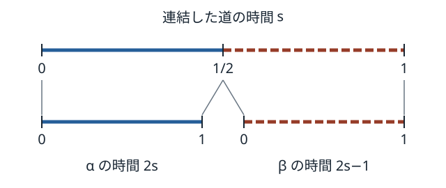
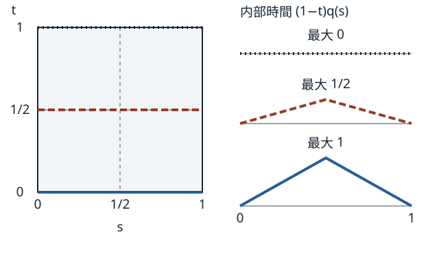

# ATOP4 道・ループ・基本群

[ATOP3](../ATOP3/index.md) では空間全体を変形しました。今回は空間を固定し、その中を通る道を変形します。穴の周囲を回る道と、その場で静止する道を同じものとして扱えるでしょうか。端点を固定した変形を使って道を分類し、道を順につなぐ操作から群を作ります。

$I=[0,1]$ とし、直積には[積位相](../../../基礎科目/TOP/TOP1/index.md#def-top1-product-topology)を入れます。特に $I^2=I\times I$ です。道を表す写像の変数を $s$、道を変形する際の変形の進み具合を $t$ とし、ともに $I$ を動かします。道の積は左から右へ進む順序で書きます。

<!-- definition-example-audit: strict -->

## 1. 道をつなぐ

[道と弧状連結性](../../../基礎科目/TOP/TOP3/index.md#def-top3-path-connected) に従い、点 $x$ から $y$ への道は端の値が $x,y$ である連続写像 $I\to X$ です。単射である必要はありません。道の始点と終点が一致する場合には、出発点へ戻る移動を表します。その出発点を指定しておくことが重要になります。

<!-- formal-statement-start -->
> **定義（ループと基点）**
> 位相空間 $X$ と指定した点 $x\in X$ に対し、連続写像 $\alpha:I\to X$ が次を満たすとき、$\alpha$ を $x$ を基点とするループという。

$$
\alpha(0)=\alpha(1)=x.
$$
<!-- formal-statement-end -->

<!-- definition-example-start: def-atop4-loop -->
**定義の確認**

単位円周 $S^1\subset\mathbb R^2$ で $\alpha(s)=(\cos 2\pi s,\sin 2\pi s)$ とします。成分の余弦と正弦は連続なので、[積位相の普遍性](../../../基礎科目/TOP/TOP1/index.md#thm-top1-product-universal)により実平面への写像として連続です。また、$\cos^2 2\pi s+\sin^2 2\pi s=1$ より値は円周にあります。[部分空間位相の連続性判定](../../../基礎科目/TOP/TOP1/index.md#prop-top1-subspace-universal) により円周への道として連続です。両端の値は $(1,0)$ なのでこの点を基点とするループです。
<!-- definition-example-end -->

ある道の到着点から次の道が始まるなら、二つの道を半分ずつの時間で進めます。この連結を $*$ で表します。また、時間を逆向きにたどる道を $\bar\alpha$、点 $x$ から動かない道を $c_x$ と書きます。

<!-- formal-statement-start -->
> **定義（道の連結・逆走・定値道）**
> 位相空間 $X$ で道 $\alpha:x\to y$ と $\beta:y\to z$ を取る。この記法は道の始点と終点を表す。以下の式で、連結した道、逆走する道、点 $x$ にとどまる定値道を定める。

$$
(\alpha*\beta)(s)=
\begin{cases}
\alpha(2s)&0\le s\le 1/2,\\
\beta(2s-1)&1/2\le s\le1,
\end{cases}
$$

$$
\bar\alpha(s)=\alpha(1-s),\qquad c_x(s)=x.
$$
<!-- formal-statement-end -->

<!-- definition-example-start: def-atop4-path-operations -->
**定義の確認**

$X=\mathbb R$ で $\alpha(s)=s$、$\beta(s)=1+2s$ とします。到着点と出発点はともに1です。連結した道は前半で $2s$、後半で $4s-1$ です。境界 $s=1/2$ では両式の値が1で一致します。両区間は閉集合で、各式は連続です。任意の閉集合の逆像は両区間での閉逆像の有限合併なので全体で閉です。従って連結した道は連続で、端点は0と3です。

逆走は $1-s$ で連続、端点は1と0です。$c_0(s)=0$ は連続で両端とも0です。
<!-- definition-example-end -->

一般の場合も同じ閉集合の逆像による貼り合わせが適用できます。接続点では $\alpha(1)=y=\beta(0)$ です。逆走は連続写像の合成、定値道も連続です。以後、有限個の閉部分集合上の連続写像が共通部分で一致すれば、それらを貼り合わせた写像も連続であることを、上の逆像の議論で用います。

前半は $\alpha$ の時間、後半は $\beta$ の時間を進めます。二つの区間の接続点の値が一致するため、切れ目はありません。[図を拡大](assets/concatenation.svg)

## 2. 速度の違いを無視する

同じ道でも、早く進んだり一時停止したりできます。道の各時刻の値が完全に等しいことを要求すると、この違いのため群を構成できません。そこで両端を固定して道を連続的に変形します。これは [相対ホモトピー](../ATOP2/index.md#def-atop2-relative-homotopy) の固定部分を道の時間区間の両端に選んだものです。

<!-- formal-statement-start -->
> **定義（道ホモトピー）**
> 位相空間 $X$ の同じ二点 $x,y$ を始点・終点とする道 $\alpha,\beta:I\to X$ を取る。連続写像 $H:I\times I\to X$ が次を満たすとき、二つの道は道ホモトピックであるといい $\alpha\simeq_p\beta$ と書く。

$$
H(s,0)=\alpha(s),\quad H(s,1)=\beta(s),
$$

$$
H(0,t)=x,\quad H(1,t)=y
\qquad(s,t\in I).
$$
<!-- formal-statement-end -->

<!-- definition-example-start: def-atop4-path-homotopy -->
**定義の確認**

実区間 $I$ で $\alpha(s)=s$、$\beta(s)=s^2$ とし、

$$
H(s,t)=(1-t)s+ts^2
$$

と置きます。両項の重みは非負で和が1なので値は $I$ 内です。実数値の多項式だから連続で、値域が $I$ 内にあることと [部分空間位相の連続性判定](../../../基礎科目/TOP/TOP1/index.md#prop-top1-subspace-universal) により $I$ への写像として連続です。$t=0,1$ ではそれぞれ $\alpha,\beta$ になります。$s=0$ では常に0、$s=1$ では常に1です。四辺の条件をすべて満たします。
<!-- definition-example-end -->

[ホモトピー関係の同値関係性](../ATOP2/index.md#thm-atop2-homotopy-equivalence-relation) では、始点と終点の指定を固定写像 $u:\{0,1\}\to X$（$u(0)=x$、$u(1)=y$）として適用します。$\{0,1\}$ は離散部分空間なので $u$ は連続です。この定理により、始点と終点を固定した道の集合上で反射律・対称律・推移律が成立します。$\alpha$ と道ホモトピックな道全体を $[\alpha]$ と書きます。これは同値類であり、道そのものとは別の対象です。

<!-- formal-statement-start -->
> **命題（道の再パラメータ化）**
> 位相空間 $X$ の道 $\alpha:I\to X$ と連続写像 $\varphi:I\to I$ を取る。$\varphi(0)=0$、$\varphi(1)=1$ なら、次が成立する。

$$
\alpha\circ\varphi\simeq_p\alpha.
$$
<!-- formal-statement-end -->

時間変換が単調である必要さえありません。区間内に値を保ちながら恒等写像に変形できれば十分です。

<!-- proof-start -->
### 証明

$$
H(s,t)=\alpha((1-t)\varphi(s)+ts)
$$

と置きます。内部の式は連続であり、$0\le (1-t)\varphi(s)+ts\le (1-t)+t=1$ なので $I$ に値を取ります。そのため $\alpha$ との合成も連続です。

$$
H(s,0)=\alpha(\varphi(s)),\quad H(s,1)=\alpha(s),
$$

$$
H(0,t)=\alpha(0),\quad H(1,t)=\alpha(1).
$$

従って [道ホモトピーの定義](#def-atop4-path-homotopy) を満たします。
<!-- proof-end -->

たとえば $\varphi(s)=\min(2s,1)$ は前半だけで移動を終え、後半は停止する時間変換です。

## 3. 道の連結から演算を作る

道を同値類にまとめても、代表元の選び方によって連結の結果が変わらないことを確かめます。

<!-- formal-statement-start -->
> **命題（道の連結と道ホモトピーの両立）**
> 位相空間 $X$ の点 $x,y,z$ について、道 $\alpha,\alpha':x\to y$ と $\beta,\beta':y\to z$ を取る。

$$
\alpha\simeq_p\alpha',\qquad\beta\simeq_p\beta'
$$

> ならば次が成立する。

$$
\alpha*\beta\simeq_p\alpha'*\beta'.
$$
<!-- formal-statement-end -->

<!-- proof-start -->
### 証明

二つの道ホモトピーを $H,K:I^2\to X$ とします。各時刻で道をつなぎます。

$$
L(s,t)=
\begin{cases}
H(2s,t)&s\le1/2,\\
K(2s-1,t)&s\ge1/2.
\end{cases}
$$

各閉長方形上で、成分が連続な時間変換と $H,K$ の合成は連続です。境界では $H(1,t)=y=K(0,t)$ です。第1節の貼り合わせにより全体が連続です。

$t=0$ で $\alpha*\beta$、$t=1$ で $\alpha'*\beta'$ になります。$s=0$ では $H(0,t)=x$、$s=1$ では $K(1,t)=z$ なので端点も固定です。
<!-- proof-end -->

[道の連結と道ホモトピーの両立](#prop-atop4-concatenation-compatible) により、端点の合う道の類についても $[\alpha]*[\beta]=[\alpha*\beta]$ と定められます。左辺の $*$ は類同士の演算、右辺の $*$ は道そのものの連結です。次に道を三本つなぐ順序と、逆走の効果を調べます。

<!-- formal-statement-start -->
> **定理（道ホモトピー類の演算律）**
> 位相空間 $X$ で、点 $x,y,z,w$ を順に結ぶ道を $\alpha,\beta,\gamma$ とする。連結・定値道・逆走について次の道ホモトピーが存在する。

$$
(\alpha*\beta)*\gamma\simeq_p\alpha*(\beta*\gamma),
$$

$$
c_x*\alpha\simeq_p\alpha\simeq_p\alpha*c_y,
$$

$$
\alpha*\bar\alpha\simeq_p c_x,\qquad
\bar\alpha*\alpha\simeq_p c_y.
$$
<!-- formal-statement-end -->

三本の道をつなぐ括弧の違いは、各道へ割り当てた時間の違いです。往復する道は、折り返し点を出発点へ近づけて縮めます。

<!-- proof-start -->
### 証明

まず $d=(\alpha*\beta)*\gamma$ は区間を $1/4,1/4,1/2$ の長さに分けます。$e=\alpha*(\beta*\gamma)$ は $1/2,1/4,1/4$ に分けます。$e$ の境界を $d$ の境界へ対応させる時間変換を

$$
\varphi(s)=
\begin{cases}
s/2&0\le s\le1/2,\\
s-1/4&1/2\le s\le3/4,\\
2s-1&3/4\le s\le1
\end{cases}
$$

とします。接続点での値は順に $1/4,1/2$ で一致し、端点は0と1です。連続で $I$ に値を取ります。各区間で $d(\varphi(s))$ はそれぞれ $\alpha(2s)$、$\beta(4s-2)$、$\gamma(4s-3)$ となり、これは $e(s)$ です。[道の再パラメータ化](#prop-atop4-reparametrization) により $e\simeq_p d$ となり、対称律で所望の向きに直せます。

次に

$$
(c_x*\alpha)(s)=\alpha(\max(2s-1,0)),
$$

$$
(\alpha*c_y)(s)=\alpha(\min(2s,1)).
$$

二つの時間変換は連続で $I$ に値を取り、0と1を固定します。同じ [道の再パラメータ化](#prop-atop4-reparametrization) を適用すれば単位の式を得ます。

最後に $q(s)=1-|2s-1|$ とします。前半で $2s$、後半で $2-2s$ です。従って $0\le q(s)\le1$ です。

$$
(\alpha*\bar\alpha)(s)=\alpha(q(s)).
$$

これを縮める写像は

$$
M(s,t)=\alpha((1-t)q(s)).
$$

内部の値は0以上1以下で連続なので $M$ も連続です。$t=0$ では往復道、$t=1$ では $c_x$ です。$q(0)=q(1)=0$ より両端で常に $x$ です。従って所望の道ホモトピーです。

同じ構成を道 $\bar\alpha$ に適用します。$\overline{\bar\alpha}(s)=\alpha(1-(1-s))=\alpha(s)$ なので $\bar\alpha*\alpha\simeq_p c_y$ を得ます。
<!-- proof-end -->

図の下辺は $q(s)$、上辺は0です。横方向の中央で最大になる内部時間は高さ $t$ とともに $1-t$ へ減ります。左右の辺は常に0です。[図を拡大](assets/backtracking.svg)

## 4. 基本群

基点 $x$ を固定すると、[ループ](#def-atop4-loop) 同士は常に連結できます。[道の連結と道ホモトピーの両立](#prop-atop4-concatenation-compatible) により類の積が定まり、[道ホモトピー類の演算律](#thm-atop4-path-laws) から結合律・単位元・逆元の候補が得られます。[群の定義](../../../代数系/GRP/GRP1/index.md#def-grp1-group) に照らし、類の集合を群として扱います。以下では同じ基点のループの類の積に限り、$*$ を省いて $[\alpha][\beta]$ と書きます。

<!-- formal-statement-start -->
> **定義（基本群）**
> 位相空間 $X$ と基点 $x\in X$ に対し、$x$ を基点とするループの道ホモトピー類全体を $\pi_1(X,x)$ と書く。次の積を備えたこの集合を基本群という。

$$
[\alpha][\beta]=[\alpha*\beta].
$$
<!-- formal-statement-end -->

<!-- definition-example-start: def-atop4-fundamental-group -->
**定義の確認**

一点空間 $X=\{x\}$ ではループは $c_x$ だけです。その類の積は $[c_x*c_x]=[c_x]$ です。唯一の元を $e=[c_x]$ とすると $ee=e$ です。任意の三元はすべて $e$ なので $(ee)e=e=e(ee)$、左右の単位元の条件と逆元の条件も $ee=e$ に帰着します。従って [群の定義](../../../代数系/GRP/GRP1/index.md#def-grp1-group) の全条件を満たします。
<!-- definition-example-end -->

<!-- formal-statement-start -->
> **定理（基本群の群構造）**
> 任意の位相空間 $X$ と基点 $x\in X$ について、$\pi_1(X,x)$ は群であり、単位元は $[c_x]$、元 $[\alpha]$ の逆元は $[\bar\alpha]$ である。
<!-- formal-statement-end -->

<!-- proof-start -->
### 証明

定値道が存在するので集合は非空です。二つのループの連結もループで、[道の連結と道ホモトピーの両立](#prop-atop4-concatenation-compatible) により積の値は代表元に依存しません。

[道ホモトピー類の演算律](#thm-atop4-path-laws) の結合律を使うと

$$
([\alpha][\beta])[\gamma]=[(\alpha*\beta)*\gamma]
=[\alpha*(\beta*\gamma)]
=[\alpha]([\beta][\gamma]).
$$

同定理の単位と逆走の式から

$$
[c_x][\alpha]=[\alpha]=[\alpha][c_x],
$$

$$
[\alpha][\bar\alpha]=[c_x]=[\bar\alpha][\alpha].
$$

従って [群の定義](../../../代数系/GRP/GRP1/index.md#def-grp1-group) の全条件を満たします。
<!-- proof-end -->

基本群が一元だけなら、基点を固定したまま全ループを静止させられます。空間が [弧状連結](../../../基礎科目/TOP/TOP3/index.md#def-top3-path-connected)（任意の二点を道で結べる）であり、この性質がどの基点でも成り立つ場合に名前を付けます。

<!-- formal-statement-start -->
> **定義（単連結性）**
> 非空な位相空間 $X$ が弧状連結で、任意の $x\in X$ において $\pi_1(X,x)=\{[c_x]\}$ であるとき、$X$ は単連結であるという。
<!-- formal-statement-end -->

<!-- definition-example-start: def-atop4-simply-connected -->
**定義の確認**

$n\ge1$ とします。$\mathbb R^n$ の任意の二点 $a,b$ に対し、$(1-s)a+sb$ は各成分が連続で、$s=0,1$ で $a,b$ に一致する道です。従って非空かつ弧状連結です。基点 $x\in\mathbb R^n$ とループ $\alpha$ を任意に取ります。

$$
H(s,t)=(1-t)\alpha(s)+tx
$$

は $\mathbb R^n$ に値を取り、各成分が連続なので [積位相の普遍性](../../../基礎科目/TOP/TOP1/index.md#thm-top1-product-universal) により連続です。$t=0,1$ では $\alpha,c_x$、左右端では常に $x$ です。従って任意の基点で全ループが定値道と道ホモトピックであり、$\mathbb R^n$ は単連結です。
<!-- definition-example-end -->

円周で同様の直線式を使うと円の内部に入ることがあります。円周の基本群の計算は ATOP5・ATOP6 で行います。ここでは円周のループが非自明だとはまだ仮定しません。

## 5. 基点を移す

基点を別の点に変えるとループの集合そのものは異なります。しかし二点を結ぶ道があれば、往路と復路を付けて比較できます。その対応を $T_u$ と書きます。積を保つ全単射、すなわち [群同型](../../../代数系/GRP/GRP2/index.md#def-grp2-homomorphism) になることを示します。

<!-- formal-statement-start -->
> **定理（基本群の基点変更）**
> 位相空間 $X$ で道 $u:x\to y$ が存在するなら、次の写像は群同型である。

$$
T_u:\pi_1(X,x)\to\pi_1(X,y),\qquad
T_u([\alpha])=[\bar u*\alpha*u].
$$

> 逆写像は $T_{\bar u}$ である。三本以上の連結の括弧は道ホモトピー類で省略する。
<!-- formal-statement-end -->

<!-- proof-start -->
### 証明

$y$ を出発し $\bar u$ で $x$ に着き、$\alpha$ を回り $u$ で $y$ へ帰るのでループです。[連結との両立](#prop-atop4-concatenation-compatible) を二度適用すると代表元から独立です。

以下の各等号は [道ホモトピー類の演算律](#thm-atop4-path-laws) によります。端点の合う道の類に対してもこの演算律を使えます。

$$
T_u([\alpha])T_u([\beta])
=[\bar u*\alpha*u*\bar u*\beta*u]
$$

$$
=[\bar u*\alpha*c_x*\beta*u]
=[\bar u*(\alpha*\beta)*u].
$$

従って積を保ちます。逆向きの操作では

$$
T_{\bar u}(T_u([\alpha]))
=[u*\bar u*\alpha*u*\bar u]=[\alpha].
$$

途中で $u*\bar u$ をそれぞれ $c_x$ に置き換え、左右の定値道を除いています。また $y$ のループ $\delta$ について

$$
T_u(T_{\bar u}([\delta]))
=[\bar u*u*\delta*\bar u*u]=[\delta].
$$

こちらでは $\bar u*u$ を $c_y$ に置き換えて左右から除きます。両側逆を持つので全単射です。[群同型](../../../代数系/GRP/GRP2/index.md#def-grp2-homomorphism) より群同型です。
<!-- proof-end -->

基点変更は選んだ道に依存し得ます。もう一本の道 $v:x\to y$ を選び、$k=[\bar v*u]\in\pi_1(X,y)$ と置きます。[演算律](#thm-atop4-path-laws) から $k^{-1}=[\bar u*v]$ です。従って

$$
k^{-1}T_v([\alpha])k
=[\bar u*v*\bar v*\alpha*v*\bar v*u]
$$

$$
=[\bar u*c_x*\alpha*c_x*u]=T_u([\alpha]).
$$

これは [群の共役作用](../../../代数系/GRP/GRP3/index.md#def-grp3-conjugation) で作用させる元を $k^{-1}$ に選んだ操作です。二つの基点変更の違いはこの共役で表されます。可換群なら $k^{-1}gk=k^{-1}kg=g$ なので共役は恒等操作です。[弧状連結](../../../基礎科目/TOP/TOP3/index.md#def-top3-path-connected) な非空の空間ではどの二点にも道があるので、[基本群の基点変更](#thm-atop4-basepoint-change) により基本群の同型型は基点によって変わりません。この仮定の下では単連結性を調べる際、一つの基点で基本群が一元群であることを確認すれば十分です。

## 6. 連続写像が基本群を移す

位相空間の連続写像はループをループに移します。さらに変形を写すこともできるので、群の演算を保つ写像、すなわち [群準同型](../../../代数系/GRP/GRP2/index.md#def-grp2-homomorphism) を得ます。連続写像 $f$ そのものと区別し、ループの類に作用する写像を $f_*$ と書きます。

<!-- formal-statement-start -->
> **定理（基本群の誘導準同型）**
> 位相空間 $X,Y$ の連続写像 $f:X\to Y$ と $x\in X$ に対し、次の写像は群準同型である。

$$
f_*:\pi_1(X,x)\to\pi_1(Y,f(x)),\qquad
f_*([\alpha])=[f\circ\alpha].
$$

> 位相空間 $Z$ への連続写像 $g:Y\to Z$ について $(g\circ f)_*=g_*\circ f_*$ が成立し、恒等写像は基本群の恒等写像を誘導する。
<!-- formal-statement-end -->

<!-- proof-start -->
### 証明

$f\circ\alpha$ は連続で両端が $f(x)$ です。もし $\alpha\simeq_p\beta$ なら [ホモトピーと合成の両立](../ATOP2/index.md#prop-atop2-homotopy-composition) を後合成 $f$ に適用できます。変形 $f(H(s,t))$ は連続で、両端では常に $f(x)$ です。従って類に対して $f_*$ は定まります。

$$
(f\circ(\alpha*\beta))(s)=
\begin{cases}
f(\alpha(2s))&s\le1/2,\\
f(\beta(2s-1))&s\ge1/2.
\end{cases}
$$

これは $(f\circ\alpha)*(f\circ\beta)$ そのものです。よって

$$
f_*([\alpha][\beta])
=[f\circ(\alpha*\beta)]
=f_*([\alpha])f_*([\beta]).
$$

さらに $[g\circ(f\circ\alpha)]=[(g\circ f)\circ\alpha]$ から合成の式が従います。恒等写像については $[\mathrm{id}_X\circ\alpha]=[\alpha]$ です。
<!-- proof-end -->

例えば同相 $f$ の連続な逆写像を $g$ とすれば、[誘導準同型の合成の式](#thm-atop4-induced-homomorphism) から $g_*f_*=\mathrm{id}$、$f_*g_*=\mathrm{id}$ となるので基本群は同型です。空間の形を代数の対象で比較できるようになりました。

特に [強変形レトラクト](../ATOP3/index.md#def-atop3-strong-deformation-retract) では、部分空間の点を固定した変形があるため、基点を動かさずにループを比較できます。

<!-- formal-statement-start -->
> **命題（強変形レトラクトと基本群）**
> 位相空間 $X$ の強変形レトラクト $A$ と $a\in A$ を取る。包含 $i:A\to X$ とレトラクション $r:X\to A$ が誘導する写像 $i_*,r_*$ は互いに逆な群同型である。
<!-- formal-statement-end -->

<!-- proof-start -->
### 証明

[強変形レトラクト](../ATOP3/index.md#def-atop3-strong-deformation-retract) の条件により $r(a)=a$ であり、両写像は指定された基点を保ちます。[誘導準同型](#thm-atop4-induced-homomorphism) の合成の式と $r\circ i=\mathrm{id}_A$ により $r_*i_*=\mathrm{id}_{\pi_1(A,a)}$ です。

強変形を $H:X\times I\to X$ とします。$a$ を基点とする任意のループ $\alpha$ に対して

$$
K(s,t)=H(\alpha(s),t)
$$

は、[積位相の普遍性](../../../基礎科目/TOP/TOP1/index.md#thm-top1-product-universal) により連続な $(s,t)\mapsto(\alpha(s),t)$ と $H$ の合成なので連続です。$K(s,0)=\alpha(s)$、$K(s,1)=i(r(\alpha(s)))$ で、両端は $H(a,t)=a$ です。従って [道ホモトピー](#def-atop4-path-homotopy) で両ループの類は一致し、$i_*r_*([\alpha])=[\alpha]$ です。
<!-- proof-end -->

[動径方向の強変形レトラクト](../ATOP3/index.md#prop-atop3-radial-deformation) で $n=2$、$J=(0,\infty)$ と選ぶと $X_J=\mathbb R^2\setminus\{0\}$、$A=S^1$ です。$a=(1,0)\in A$ を基点に [強変形レトラクトと基本群](#prop-atop4-deformation-fundamental-group) を適用すると、穴あき平面と円周の基本群は同型です。具体的な群の計算は後続へ進みます。

[可縮性](../ATOP3/index.md#def-atop3-contractible) により空間全体を縮められるなら、ループも縮められるはずです。ただし変形中に基点が動くことがあるため、そのままでは道ホモトピーになりません。動いた基点まで往復する道を付け加えて固定します。

<!-- formal-statement-start -->
> **命題（可縮空間は単連結）**
> 可縮な位相空間 $X$ は単連結である。
<!-- formal-statement-end -->

<!-- proof-start -->
### 証明

[可縮性](../ATOP3/index.md#def-atop3-contractible) により $H:X\times I\to X$ を恒等写像から点 $p\in X$ への定値写像へのホモトピーとします。この定義には点の存在が含まれるので $X$ は非空です。

任意の $a,b\in X$ に対し、次の二本の道を取ります。

$$
h_a(s)=H(a,s),\qquad h_b(s)=H(b,s).
$$

それぞれ $a,b$ から $p$ への道です。[道の連結・逆走](#def-atop4-path-operations) により $h_a*\bar h_b$ は $a$ から $b$ への道なので弧状連結です。

$x$ を任意の基点とし、ループ $\alpha$ を取ります。$u(t)=H(x,t)$ と置きます。各時刻を固定して次の二本の道を考えます。

$$
F_t(s)=H(\alpha(s),t),\qquad u_t(s)=u(ts).
$$

添字 $t$ は固定した変形時刻を表します。$F_t$ は $u(t)$ を基点とするループです。もう一本の道の両端は

$$
u_t(0)=x,\qquad u_t(1)=u(t).
$$

従って $u_t$ を前に、その逆走を後に付けた道

$$
(u_t*F_t)*\bar u_t
$$

は基点 $x$ のループになります。連結を二回行うので時間区間の長さは $1/4,1/4,1/2$ です。これを一つの式に書くと次のようになります。

$$
L(s,t)=
\begin{cases}
u(4ts)&0\le s\le1/4,\\
H(\alpha(4s-1),t)&1/4\le s\le1/2,\\
u(2t(1-s))&1/2\le s\le1.
\end{cases}
$$

前半の $4ts$、中央の $4s-1$、後半の $2t(1-s)$ はそれぞれの区間で $I$ 内にあり、各式は連続です。接続点 $s=1/4$ では $u(t)=H(\alpha(0),t)$、$s=1/2$ では $H(\alpha(1),t)=u(t)$ です。閉長方形上の貼り合わせにより連続となり、左右端では $u(0)=x$ です。

$t=0$ では前後の式が $u(0)=x$、中央が $\alpha(4s-1)$ です。$t=1$ では前半が $u(4s)$、中央が $p$、後半が $u(2-2s)$ です。従って変形の前後の道は

$$
L(s,0)=((c_x*\alpha)*c_x)(s),
$$

$$
L(s,1)=((u*c_p)*\bar u)(s).
$$

ここで $c_p$ は本章の定値道 $I\to X$ であり、可縮性の定義で用いた定数写像 $X\to X$ とは定義域が異なります。[道ホモトピー類の演算律](#thm-atop4-path-laws) によって前者の類は $[\alpha]$ です。後者については

$$
[(u*c_p)*\bar u]=[u*\bar u]=[c_x].
$$

従って任意の $x$ で基本群は一元群であり、[単連結性の定義](#def-atop4-simply-connected) を満たします。
<!-- proof-end -->

## 7. 演習

### 演習 ATOP4-A1：道の連結

- Level: A

実直線上の道 $\alpha(s)=2s$、$\beta(s)=2-s$ を取る。連結した道の式、接続点の値、両端の値を求めよ。

<!-- solution-start -->
**詳細解答**

$\alpha(1)=2=\beta(0)$ なので [道の連結](#def-atop4-path-operations) が定義できます。

$$
(\alpha*\beta)(s)=
\begin{cases}
4s&s\le1/2,\\
3-2s&s\ge1/2.
\end{cases}
$$

接続点では $4(1/2)=2=3-2(1/2)$ です。両端の値は0と1です。各区間の式は連続で接続点の値が一致するので全体で連続です。
<!-- solution-end -->

### 演習 ATOP4-A2：再パラメータ化

- Level: A

$\alpha(s)=s$ を $I$ の道とする。$\alpha$ と $\beta(s)=s^3$ を結ぶ道ホモトピーを作れ。

<!-- solution-start -->
**詳細解答**

$\varphi(s)=s^3$ は $I$ に値を取り、連続で両端を固定します。[道の再パラメータ化](#prop-atop4-reparametrization) の式を使い、向きを $\alpha$ から $\beta$ に選ぶと

$$
H(s,t)=(1-t)s+ts^3.
$$

$0\le s,s^3\le1$ かつ $0\le t\le1$ より、$0\le H(s,t)\le (1-t)+t=1$ です。式は連続です。$H(s,0)=s$、$H(s,1)=s^3$、$H(0,t)=0$、$H(1,t)=1$ を確認できます。
<!-- solution-end -->

### 演習 ATOP4-A3：逆走を縮める

- Level: A

実直線の道 $\alpha(s)=3s$ について、$\alpha*\bar\alpha$ を定値道 $c_0$ に変形せよ。時刻 $t=2/3$ の最大値も求めよ。

<!-- solution-start -->
**詳細解答**

[演算律の逆走の構成](#thm-atop4-path-laws) で $q(s)=1-|2s-1|$ を使います。

$$
M(s,t)=3(1-t)(1-|2s-1|).
$$

連続で、$t=0$ では $s\le1/2$ のとき $6s$、後半では $6-6s$ です。これは $\alpha*\bar\alpha$ です。$t=1$ で0、左右端も全時刻で0です。$q$ の最大値は $s=1/2$ における1なので、時刻 $2/3$ の最大値は $3(1-2/3)=1$ です。
<!-- solution-end -->

### 演習 ATOP4-A4：円板内のループ

- Level: A

閉単位円板 $D^2=\{z\in\mathbb R^2:\|z\|\le1\}$ で基点 $x=(1,0)$ を取る。任意のループ $\alpha:I\to D^2$ を基点を固定して縮めよ。

<!-- solution-start -->
**詳細解答**

$H(s,t)=(1-t)\alpha(s)+tx$ とします。三角不等式より

$$
\|H(s,t)\|\le(1-t)\|\alpha(s)\|+t\|x\|
\le1.
$$

値は円板内であり、各成分は連続なので [積位相の普遍性](../../../基礎科目/TOP/TOP1/index.md#thm-top1-product-universal) と [部分空間位相の連続性判定](../../../基礎科目/TOP/TOP1/index.md#prop-top1-subspace-universal) により円板への写像として連続です。$t=0$ では $\alpha$、$t=1$ では $x$ です。$\alpha(0)=\alpha(1)=x$ から両端で $(1-t)x+tx=x$ となります。[道ホモトピー](#def-atop4-path-homotopy) の条件を満たすので $[\alpha]=[c_x]$ です。
<!-- solution-end -->

### 演習 ATOP4-B1：括弧の違い

- Level: B

実直線の道 $\alpha(s)=s$、$\beta(s)=1+s$、$\gamma(s)=2+s$ に対し、二通りの括弧による連結を $s=1/2$ で比較せよ。道ホモトピーを構成せよ。

<!-- solution-start -->
**詳細解答**

$d=(\alpha*\beta)*\gamma$ では $s=1/2$ が $\gamma$ の開始点なので $d(1/2)=2$ です。一方 $e=\alpha*(\beta*\gamma)$ では $\alpha$ の終了点なので $e(1/2)=1$ です。写像としては等しくありません。

[演算律](#thm-atop4-path-laws) で使った時間変換は $s/2,\ s-1/4,\ 2s-1$ をそれぞれ区間 $[0,1/2],[1/2,3/4],[3/4,1]$ で使います。接続点の値は $1/4,1/2$ で一致し、両端を固定します。この $\varphi$ に対し $e=d\circ\varphi$ です。

$$
H(s,t)=d((1-t)\varphi(s)+ts)
$$

は連続で、内部時間は $I$ 内です。$H(s,0)=e(s)$、$H(s,1)=d(s)$、$H(0,t)=0$、$H(1,t)=3$ となり道ホモトピーです。
<!-- solution-end -->

### 演習 ATOP4-B2：基点変更の合成

- Level: B

位相空間 $X$ の道 $u:x\to y$、$v:y\to z$ に対し $T_v\circ T_u=T_{u*v}$ を証明せよ。

<!-- solution-start -->
**詳細解答**

[基本群の基点変更](#thm-atop4-basepoint-change) により

$$
T_v(T_u([\alpha]))=[\bar v*\bar u*\alpha*u*v].
$$

[逆走の定義](#def-atop4-path-operations) を代入すると

$$
\overline{u*v}(s)=
\begin{cases}
v(1-2s)&s\le1/2,\\
u(2-2s)&s\ge1/2.
\end{cases}
$$

前半は $\bar v(2s)$、後半は $\bar u(2s-1)$ です。従って写像として $\overline{u*v}=\bar v*\bar u$ です。[演算律の結合律](#thm-atop4-path-laws) で括弧を移せば

$$
[\bar v*\bar u*\alpha*u*v]
=[\overline{u*v}*\alpha*(u*v)]
=T_{u*v}([\alpha]).
$$

すべての $x$ 基点の類で一致します。
<!-- solution-end -->

### 演習 ATOP4-B3：レトラクションと単射

- Level: B

位相空間 $X$ のレトラクト $A$ と $a\in A$ を取る。包含 $i$ の誘導準同型 $i_*$ が単射であることを示せ。強変形の存在は仮定しない。

<!-- solution-start -->
**詳細解答**

[レトラクション](../ATOP3/index.md#def-atop3-retraction) $r$ に対して $r\circ i=\mathrm{id}_A$ であり、$r(a)=a$ です。[誘導準同型の合成の式](#thm-atop4-induced-homomorphism) により

$$
r_*i_*=(r\circ i)_*=\mathrm{id}_{\pi_1(A,a)}.
$$

$i_*([\alpha])=i_*([\beta])$ と仮定し、両辺へ $r_*$ を適用すれば $[\alpha]=[\beta]$ です。従って単射です。この議論で得られるのは左逆だけであり、強変形による $i_*r_*=\mathrm{id}$ は仮定からは導けません。
<!-- solution-end -->

### 演習 ATOP4-B4：基点を固定するホモトピー

- Level: B

連続写像 $f,g:X\to Y$ がホモトピー $H$ で結ばれ、$H(x,t)=y$ が全時刻で成立するとする。$f_*=g_*:\pi_1(X,x)\to\pi_1(Y,y)$ を示せ。

<!-- solution-start -->
**詳細解答**

$t=0,1$ の値から $f(x)=g(x)=y$ です。任意の $x$ 基点のループ $\alpha$ に対し

$$
K(s,t)=H(\alpha(s),t)
$$

と置きます。[積位相の普遍性](../../../基礎科目/TOP/TOP1/index.md#thm-top1-product-universal) により連続な $(s,t)\mapsto(\alpha(s),t)$ と $H$ の合成なので連続です。$K(s,0)=f(\alpha(s))$、$K(s,1)=g(\alpha(s))$ です。また $K(0,t)=H(x,t)=y=K(1,t)$ です。

[道ホモトピーの定義](#def-atop4-path-homotopy) より両ループは同じ類に属します。[誘導準同型](#thm-atop4-induced-homomorphism) の式に代入すると全元について $f_*([\alpha])=g_*([\alpha])$ です。
<!-- solution-end -->

### 演習 ATOP4-C1：基点が動くホモトピー

- Level: C

連続写像 $f,g:X\to Y$ のホモトピー $H$ と $x\in X$ に対し、$u(t)=H(x,t)$ とする。次を証明せよ。

$$
g_*=T_u\circ f_*.
$$

<!-- solution-start -->
**詳細解答**

$u$ は $f(x)$ から $g(x)$ への連続な道です。任意の $x$ 基点のループ $\alpha$ に対し、時刻 $t$ で $u(t)$ を基点とするループ $F_t(s)=H(\alpha(s),t)$ を取ります。

$g(x)=u(1)$ から $u(t)$ へ戻る道を

$$
v_t(s)=u(1-(1-t)s)
$$

とします。$v_t(0)=u(1)$、$v_t(1)=u(t)$ です。添字 $t$ は変形時刻を固定して得られる一本の道を表し、道の変数は $s$ です。$v_t,F_t,\bar v_t$ の順に各道を三分の一ずつの時間で進めると、次のホモトピー $L:I^2\to Y$ が得られます。

$$
L(s,t)=
\begin{cases}
u(1-(1-t)3s)&s\le1/3,\\
H(\alpha(3s-1),t)&1/3\le s\le2/3,\\
u(t+(1-t)(3s-2))&s\ge2/3.
\end{cases}
$$

各式の内部時間は $I$ 内で連続です。$s=1/3$ では前後とも $u(t)$、$s=2/3$ でも前後とも $u(t)$ です。閉長方形で貼り合わせられるので全体は連続で、左右端は常に $u(1)$ です。

$t=0$ では三等分した時間で $\bar u,f\circ\alpha,u$ を進みます。$t=1$ では定値道、$g\circ\alpha$、定値道を進みます。三等分と通常の二項連結を繰り返した区間割りは、対応する区間の端を結ぶ区分線形な時間変換で移り合います。例えば通常の連結で進む道を $d=(v_t*F_t)*\bar v_t$、三等分で進む道を $e(s)=L(s,t)$ と固定した $t$ ごとに書きます。三等分の時刻を通常の連結の時刻に移す写像は

$$
\varphi(s)=
\begin{cases}
3s/4&0\le s\le1/3,\\
3s/4&1/3\le s\le2/3,\\
(3s-1)/2&2/3\le s\le1.
\end{cases}
$$

接続点で $1/4,1/2$ に一致し、両端を固定します。通常の連結の局所時間に代入すると、前半・中央・後半でそれぞれ

$$
4\varphi(s)=3s,
$$

$$
4\varphi(s)-1=3s-1,
$$

$$
2\varphi(s)-1=3s-2
$$

となります。従って $d\circ\varphi=e$ となり、[再パラメータ化](#prop-atop4-reparametrization) によって両者の類は一致します。特に $t=0,1$ の道にこの結果を適用できます。

従って $L$ が与える類の等式は

$$
[\bar u*(f\circ\alpha)*u]
=[c_{g(x)}*(g\circ\alpha)*c_{g(x)}]
=[g\circ\alpha].
$$

最後の等号は [演算律の単位の式](#thm-atop4-path-laws) です。左辺は [基本群の基点変更](#thm-atop4-basepoint-change) による $T_u(f_*([\alpha]))$、右辺は [誘導準同型](#thm-atop4-induced-homomorphism) による $g_*([\alpha])$ です。
<!-- solution-end -->

## 8. 次の講義へ

道の連結を代数の積に変えることで、ループが縮むかどうかを基本群の元として記述できました。次講では、円周を実直線で覆うような写像の上に道を持ち上げる方法を学びます。それにより円周を回るループを具体的な整数で区別する準備が整います。
