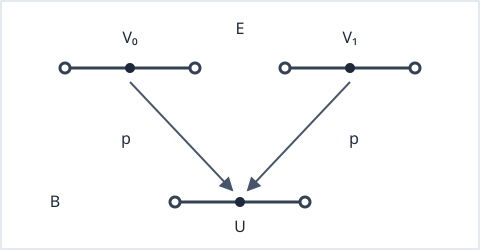
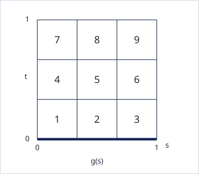

# ATOP5 被覆空間・道とホモトピーの持上げ

[ATOP4](../ATOP4/index.md) では、ループを端点を固定して変形できるかを基本群で表しました。しかし円周を何周したかは、円周上の終点だけを見ても分かりません。円周を実直線へ展開すると、同じ円周上の点に対応する実数が何個もあり、出発する実数を選べば道の行き先を記録できます。今回はこの仕組みを一般の位相空間で構成します。

$I=[0,1]$ とし、$I^2$ には通常の積位相を入れます。

<!-- definition-example-audit: strict -->

## 1. 局所的には同じ形、全体では異なる空間

同じ地図を何枚も重ね、各地図の点を元の地図の点に対応させることを考えます。元の地図の小さな領域を選ぶと、その真上には互いに交わらないコピーが並びます。全体で地図を分離できる必要はありません。[TOP2の被覆写像](../../../基礎科目/TOP/TOP2/index.md#def-top2-covering-map) の条件をここで再確認します。

<!-- formal-statement-start -->
> **定義（被覆写像の再掲）**
> 位相空間 $E,B$ の連続全射 $p:E\to B$ を取る。任意の $b\in B$ に対し、$b$ を含む開集合 $U\subset B$ が存在し、その逆像が互いに素な非空開集合族で

$$
p^{-1}(U)=\bigsqcup_{\lambda\in\Lambda}V_\lambda
$$

> と表され、各制限

$$
p|_{V_\lambda}:V_\lambda\to U
$$

> が同相写像であるとき、$p$ を被覆写像、$E$ を被覆空間、$U$ を均等被覆近傍、各 $V_\lambda$ をそのシートという。
<!-- formal-statement-end -->

<!-- definition-example-start: def-atop5-covering-map -->
**定義の確認**

$B=\mathbb R$、$E=\mathbb R\times\{0,1\}$ とし、二点集合には離散位相、直積には積位相を入れます。$p(x,i)=x$ は射影なので連続であり、任意の $x$ に $(x,0)$ が対応するので全射です。任意の $b$ で $U=(b-1,b+1)$ を取れば

$$
p^{-1}(U)=(U\times\{0\})\sqcup(U\times\{1\}).
$$

両シートは開で非空、第二成分が異なるため互いに素です。各制限の逆写像は $x\mapsto(x,i)$ で、恒等写像と定値写像の組なので連続です。[同相写像の定義](../../../基礎科目/TOP/TOP2/index.md#def-top2-homeomorphism) に従い各制限は同相です。
<!-- definition-example-end -->

図の二つの黒点は異なるシートに属しますが、矢印の先の同じ点に写ります。各開区間の白丸は区間に含まれない端を表します。

一つの点の逆像を $p^{-1}(\{b\})$ と書きます。各シートには $b$ の逆像がただ一つあります。従ってこの逆像に部分空間位相を入れると、各点が開な離散空間になります。実際、その点を含むシートとの共通部分が一点だけになるからです。

円周では、$p:\mathbb R\to S^1$ を $p(u)=(\cos 2\pi u,\sin 2\pi u)$ とします。各点の近くで角度を一意に選べる幅半周の開弧があり、その逆像は整数だけずれた互いに素な開区間です。厳密な同相の確認は第2節で行います。直線は連結ですが、局所的には円周のコピーを無数に重ねた形を持ちます。

## 2. 円周を実直線で覆う

<!-- formal-statement-start -->
> **命題（円周の実直線による被覆）**
> 単位円周 $S^1\subset\mathbb R^2$ への写像

$$
p:\mathbb R\to S^1,\qquad
p(u)=(\cos 2\pi u,\sin 2\pi u)
$$

> は被覆写像である。任意の $a\in\mathbb R$ について $p^{-1}(\{p(a)\})=a+\mathbb Z$ である。
<!-- formal-statement-end -->

<!-- proof-start -->
### 証明

三角関数の連続性と $\cos^2+\sin^2=1$ より、部分空間への写像として連続です。角度表示により円周の任意の点は像に入ります。三角関数の周期性と、同じ正弦・余弦を持つ角の差が $2\pi$ の整数倍であることから $p(u)=p(a)$ と $u-a\in\mathbb Z$ は同値です。

$b=p(a)$、$c=(-\sin 2\pi a,\cos 2\pi a)$ と置きます。$b,c$ は互いに直交する単位ベクトルです。円周上の開半円

$$
U=\{z\in S^1:b\cdot z>0\}
$$

は $b$ を含みます。加法定理から

$$
b\cdot p(u)=\cos(2\pi(u-a)).
$$

従って逆像は

$$
p^{-1}(U)=\bigsqcup_{k\in\mathbb Z}
(a+k-1/4,a+k+1/4).
$$

これらの区間は開で非空、中心の間隔が1で長さは $1/2$ なので互いに素です。$z\in U$ に対し

$$
v_k(z)=a+k+\frac{1}{2\pi}\arctan
\frac{c\cdot z}{b\cdot z}
$$

と置きます。分母は正であり、逆正接の値は $(-\pi/2,\pi/2)$ に入るため $v_k(z)$ は第 $k$ 区間の点です。$\theta=\arctan((c\cdot z)/(b\cdot z))$ とすると、$z$ の長さが1で $b\cdot z>0$ なので

$$
\cos\theta=b\cdot z,\qquad
\sin\theta=c\cdot z.
$$

よって加法定理から $p(v_k(z))=b\cos\theta+c\sin\theta=z$ です。逆に第 $k$ 区間の $u$ について $2\pi(u-a-k)\in(-\pi/2,\pi/2)$ なので逆正接はこの角を返し、$v_k(p(u))=u$ となります。$v_k$ は連続な式なので各制限は同相です。[被覆写像](#def-atop5-covering-map) の条件をすべて満たします。
<!-- proof-end -->

この写像で $p(0)=p(1)=p(2)$ です。円周上で同じ点に戻っても、実直線上では異なる終点に到達することがあります。

## 3. 道を持ち上げるための準備

[道](../../../基礎科目/TOP/TOP3/index.md#def-top3-path-connected) $\alpha:I\to B$ が与えられたとき、上の空間で同じ動きを投影する道を探します。

<!-- formal-statement-start -->
> **定義（持上げ）**
> 位相空間 $X,E,B$ の連続写像 $p:E\to B$、$f:X\to B$ に対し、連続写像 $\widetilde f:X\to E$ が

$$
p\circ\widetilde f=f
$$

> を満たすとき、$\widetilde f$ を $f$ の $p$ による持上げという。
<!-- formal-statement-end -->

<!-- definition-example-start: def-atop5-lift -->
**定義の確認**

第2節の写像 $p$ について $\alpha(s)=p(2s)$ とすると、$\widetilde\alpha(s)=2s$ は連続な実数値の道で、$p(\widetilde\alpha(s))=p(2s)=\alpha(s)$ です。$\widetilde\beta(s)=2s+1$ も連続で、周期1より $p(\widetilde\beta(s))=\alpha(s)$ です。出発点は0と1で異なります。持上げの一意性には出発点の指定が必要です。
<!-- definition-example-end -->

道の像全体が一つの均等被覆近傍に収まるなら、指定したシートの逆写像を合成すれば持上げが得られます。一般には道を短い区間に分ける必要があります。ここで [開被覆](../../../基礎科目/TOP/TOP5/index.md#def-top5-open-cover) は空間を覆う開集合族です。分割を有限回で済ませるため、コンパクト性を使います。

<!-- formal-statement-start -->
> **補題（Lebesgue数補題）**
> 非空コンパクト距離空間 $(K,d)$ の開被覆 $\mathcal U$ に対し、正数 $\delta$ が存在し、直径が $\delta$ 未満の任意の非空部分集合 $A\subset K$ は、ある $U\in\mathcal U$ に含まれる。ここで直径は $\sup\{d(x,y):x,y\in A\}$ である。
<!-- formal-statement-end -->

証明の要点は、各点で選んだ小さな球を有限個に減らし、その半径の最小値を使うことです。

<!-- proof-start -->
### 証明

各 $x\in K$ に対し $x\in U_x\in\mathcal U$ を選びます。$U_x$ が開なので、ある $r_x>0$ について $B(x,2r_x)\subset U_x$ です。$B(x,r_x)$ 全体は $K$ を覆うため、[コンパクト性](../../../基礎科目/TOP/TOP5/index.md#def-top5-compact) から有限個 $B(x_i,r_i)$（$1\le i\le m$）で覆えます。

$$
\delta=\min_{1\le i\le m}r_i>0
$$

と置きます。直径が $\delta$ 未満の非空集合 $A$ から $a$ を一つ選び、$a\in B(x_i,r_i)$ となる $i$ を取ります。任意の $y\in A$ について

$$
d(y,x_i)\le d(y,a)+d(a,x_i)
<\delta+r_i\le2r_i.
$$

従って $y\in B(x_i,2r_i)\subset U_{x_i}$ です。$y$ は任意だったので $A\subset U_{x_i}$ です。
<!-- proof-end -->

例えば $K=I$、開被覆が $[0,2/3)$ と $(1/3,1]$ の場合、$\delta=1/3$ で十分です。どちらにも含まれない集合は $1/3$ 以下と $2/3$ 以上の点を持つため、直径が少なくとも $1/3$ になります。有限の等分割の各閉区間がいずれかの開集合に収まるようになります。

## 4. 道の持上げ：存在と一意性

存在を示す前に、二つの持上げを比較します。指定した一点で一致すれば、その点の近くでは同じシートの逆写像を使うため一致し続けます。異なるシートに入った場合も局所的に不一致が続くことが重要です。

<!-- formal-statement-start -->
> **補題（連結空間上の持上げの一意性）**
> 被覆写像 $p:E\to B$、非空連結空間 $X$、連続写像 $f:X\to B$ を取る。二つの持上げ $g,h:X\to E$ がある一点で一致すれば、$g=h$ である。
<!-- formal-statement-end -->

<!-- proof-start -->
### 証明

$C=\{x\in X:g(x)=h(x)\}$ と置きます。任意の $x\in X$ に対し、$f(x)$ の均等被覆近傍 $U$ を取り、$g(x),h(x)$ が属するシートをそれぞれ $V,W$ とします。

$$
N=g^{-1}(V)\cap h^{-1}(W)
$$

は連続性とシートの開性から $x$ の開近傍です。$V=W$ の場合、任意の $y\in N$ では $p(g(y))=p(h(y))=f(y)$ であり、制限の単射性から $g(y)=h(y)$ です。$V\ne W$ の場合、シートは互いに素なので $N$ の全点で不一致です。

従って $C$ と $X\setminus C$ はともに開です。仮定より $C$ は非空です。[連結性と非自明な開閉集合の不存在](../../../基礎科目/TOP/TOP3/index.md#prop-top3-clopen) から $C=X$ です。
<!-- proof-end -->

<!-- formal-statement-start -->
> **定理（道の持上げ）**
> 被覆写像 $p:E\to B$、道 $\alpha:I\to B$、$p(e_0)=\alpha(0)$ を満たす $e_0\in E$ を取る。次を満たす道 $\widetilde\alpha:I\to E$ が一意に存在する。

$$
p\circ\widetilde\alpha=\alpha,\qquad
\widetilde\alpha(0)=e_0.
$$
<!-- formal-statement-end -->

逆像のシートを選ぶ手順は、最初の区間では出発点で決まり、次の区間では前の区間の到着点で決まります。

<!-- proof-start -->
### 証明

均等被覆近傍 $U$ 全体の逆像 $\alpha^{-1}(U)$ は $I$ の開被覆です。閉区間 $I$ は通常の距離で [Heine–Borel の定理](../../../基礎科目/F0/F0-00C1/index.md#thm-f0-00c1-02) によりコンパクトなので [Lebesgue数補題](#lem-atop5-lebesgue-number) を適用し、$\delta>0$ を取ります。$1/n<\delta$ となる正整数 $n$ を選び、$s_i=i/n$ と置きます。各 $J_i=[s_{i-1},s_i]$ は直径 $1/n$ なのである $\alpha^{-1}(U_i)$ に含まれます。

最初の区間で $e_0$ は $p^{-1}(U_1)$ に属するので、ただ一つのシート $V_1$ に入ります。

$$
\widetilde\alpha_1(s)=(p|_{V_1})^{-1}(\alpha(s))
\quad(s\in J_1).
$$

この写像は連続で、$s=0$ の値は $e_0$、投影は $\alpha$ です。第 $i-1$ 区間まで作ったとし、$e_{i-1}=\widetilde\alpha_{i-1}(s_{i-1})$ とします。$p(e_{i-1})=\alpha(s_{i-1})\in U_i$ なので $e_{i-1}$ を含む唯一のシート $V_i$ を選べます。

$$
\widetilde\alpha_i(s)=(p|_{V_i})^{-1}(\alpha(s))
\quad(s\in J_i).
$$

左端は $e_{i-1}$ と一致します。こうして有限個の連続写像が隣接区間の共通端点で一致します。[ATOP4第1節の道の連結で示した有限閉集合上の貼り合わせ](../ATOP4/index.md#def-atop4-path-operations)を適用すると $I$ 全体で連続な写像になります。各区間で投影は $\alpha$ なので全体でも投影は $\alpha$ です。

$I$ は [連結](../../../基礎科目/TOP/TOP3/index.md#thm-top3-real-interval) であり、二つの持上げは $0$ で一致するため [一意性補題](#lem-atop5-lift-uniqueness) により等しくなります。
<!-- proof-end -->

円周の道 $\alpha(s)=p(-3s/2)$ を $e_0=2$ から持ち上げると、候補 $2-3s/2$ は連続、初期値2、投影 $\alpha$ です。一意性によりこれが求める道で、終点は $1/2$ です。

## 5. ホモトピーを持ち上げる

道を変形しても、持上げの終点は変わらないのでしょうか。各時刻の道だけを個別に持ち上げても、二変数全体で連続とはまだ分かりません。正方形を小さな閉長方形へ分割して、全体を一つの連続写像として組み立てます。

<!-- formal-statement-start -->
> **定理（正方形上のホモトピーの持上げ）**
> 被覆写像 $p:E\to B$、連続写像 $H:I^2\to B$ と、下辺の連続な持上げ $g:I\to E$ を取る。すなわち $p(g(s))=H(s,0)$ とする。このとき次を満たす連続写像 $\widetilde H:I^2\to E$ が一意に存在する。

$$
p\circ\widetilde H=H,\qquad
\widetilde H(s,0)=g(s).
$$
<!-- formal-statement-end -->

太線の下辺 $g(s)$ から番号順に進みます。各小長方形で左下の点が属するシートを選び、既に定めた下辺と左辺との一致を確認します。これが連続性の核心です。

<!-- proof-start -->
### 証明

$K=I^2$ を通常の Euclid 距離で考えると閉有界なので [Heine–Borel の定理](../../../基礎科目/F0/F0-00C1/index.md#thm-f0-00c1-02) によりコンパクトです。均等被覆近傍 $U$ の逆像 $H^{-1}(U)$ 全体は $K$ の開被覆なので、[Lebesgue数補題](#lem-atop5-lebesgue-number) から $\delta>0$ を取れます。$\sqrt2/n<\delta$ となる $n$ を選び、

$$
R_{ij}=[i/n,(i+1)/n]\times[j/n,(j+1)/n]
$$

（$0\le i,j<n$）と分けます。各長方形の直径は対角線の長さ $\sqrt2/n$ なので、ある均等被覆近傍 $U_{ij}$ に対して $H(R_{ij})\subset U_{ij}$ です。

$j=0$ の段から始め、各段で $i=0,1,\ldots,n-1$ の順に進みます。初めの段の下辺には $g$ があり、次の段の下辺は前段で定められています。従って任意の $R_{ij}$ の左下の点 $q=(i/n,j/n)$ では既に値 $e$ が決まっています。$p(e)=H(q)\in U_{ij}$ なので $e$ を含む唯一のシート $V$ を選び、

$$
F_{ij}=(p|_V)^{-1}\circ H|_{R_{ij}}
$$

と定めます。これは連続で、投影は $H$ の制限、左下での値は $e$ です。

既に定めた下辺と $F_{ij}$ の下辺への制限は、同じ写像の持上げで左下において一致します。下辺は区間と同相で連結なので [連結空間上の持上げの一意性](#lem-atop5-lift-uniqueness) により下辺全体で一致します。$i>0$ の場合は既に定めた左辺についても同じ補題が使えます。左辺も区間と同相で、左下で一致するからです。前段または左側の長方形とのその他の共通点はこれらの辺に含まれます。従って新しい写像は既存のすべての値と矛盾しません。

有限回の操作で全長方形を覆えます。各長方形は閉集合で、共通部分で写像が一致するので有限閉集合上の貼り合わせによって連続な $\widetilde H$ を得ます。投影と下辺の条件は構成から従います。

$I^2$ は任意の二点を線分で結べるので弧状連結であり、[弧状連結なら連結](../../../基礎科目/TOP/TOP3/index.md#thm-top3-path-implies-connected) です。二つの候補は $(0,0)$ で一致するため [一意性補題](#lem-atop5-lift-uniqueness) によって等しいです。
<!-- proof-end -->

<!-- formal-statement-start -->
> **系（道ホモトピーによる持上げの終点不変性）**
> 被覆写像 $p:E\to B$ と、同じ始点 $x$、終点 $y$ を持つ道 $\alpha,\beta:I\to B$ を取る。$\alpha$ と $\beta$ が道ホモトピックであるなら、同じ $e_0\in p^{-1}(\{x\})$ からの持上げは道ホモトピックであり、特に終点が等しい。
<!-- formal-statement-end -->

<!-- proof-start -->
### 証明

[道ホモトピー](../ATOP4/index.md#def-atop4-path-homotopy) $H$ は下辺 $\alpha$、上辺 $\beta$、左辺 $x$、右辺 $y$ を持ちます。[道の持上げ](#thm-atop5-path-lifting) で $\alpha$ を $e_0$ から持ち上げ、その道を下辺として [正方形上の持上げ](#thm-atop5-homotopy-lifting) を適用します。

左辺 $t\mapsto\widetilde H(0,t)$ は定値道 $c_x$ の持上げであり、$e_0$ から始まります。定値道 $c_{e_0}$ も条件を満たすので一意性により左辺は常に $e_0$ です。右辺も $e_1=\widetilde H(1,0)$ から始まる $c_y$ の持上げであり、同じ理由で常に $e_1$ です。

上辺は $\beta$ の $e_0$ からの持上げなので一意性から $\widetilde\beta$ です。左右の端が固定されているため $\widetilde H$ は二つの持上げの道ホモトピーであり、特に $\widetilde\beta(1)=e_1=\widetilde\alpha(1)$ となります。
<!-- proof-end -->

円周のループ $\alpha(s)=p(s)$ を0から持ち上げると $s$ で終点1、定値ループの持上げは0で終点0です。従って両者は道ホモトピックではありません。円周の基本群をまだ計算せず、非自明な元の存在を証明できました。

## 6. 基本群との接続

<!-- formal-statement-start -->
> **定理（被覆写像が誘導する基本群準同型）**
> 被覆写像 $p:E\to B$ と $e\in E$、$b=p(e)$ を取る。誘導準同型

$$
p_*:\pi_1(E,e)\to\pi_1(B,b)
$$

> は単射である。その像は、$e$ からの持上げが $e$ に戻る $b$ 基点のループの道ホモトピー類全体である。
<!-- formal-statement-end -->

<!-- proof-start -->
### 証明

$p$ は連続なので [基本群の誘導準同型](../ATOP4/index.md#thm-atop4-induced-homomorphism) により $p_*([\gamma])=[p\circ\gamma]$ は群準同型です。$p_*([\gamma])=[c_b]$ と仮定します。$\gamma$ 自身は $p\circ\gamma$ の $e$ からの持上げです。一方 $c_e$ は $c_b$ の $e$ からの持上げです。[終点不変性の系](#cor-atop5-endpoint-invariance) の道ホモトピーの結論により $\gamma\simeq_p c_e$ です。従って核は単位元だけです。もし $p_*(u)=p_*(v)$ なら $p_*(uv^{-1})=1$、従って $uv^{-1}=1$ なので $u=v$ です。

像について、$[\alpha]=p_*([\gamma])$ なら $\alpha$ と $p\circ\gamma$ は道ホモトピックで、その持上げの終点は同じです。$\gamma$ は $e$ に戻るため $\alpha$ の持上げも $e$ に戻ります。逆に $\alpha$ の持上げ $\widetilde\alpha$ が $e$ に戻れば、それは $e$ 基点のループで、$p_*([\widetilde\alpha])=[\alpha]$ です。
<!-- proof-end -->

各点の十分小さい開近傍を制限して同相にできるだけでは、この議論は成立しません。例えば $(0,2)\to S^1$ に $p$ を制限した写像は連続全射で、各点 $u$ の近傍は $(0,2)$ に収まるよう第2節のシートを縮めれば像と同相になります。しかし、$p(1)$ の逆像は1だけで、どの小開弧にも0に近い点の逆像が現れます。仮に均等被覆近傍があれば、$p(1)$ の逆像が一点なのでシートは一枚だけとなり、近傍内の全点の逆像も一点でなければなりません。しかし十分小さい $\varepsilon>0$ では $p(\varepsilon)=p(1+\varepsilon)$ がその近傍に入ります。この矛盾が均等被覆条件の失敗です。実際、$p(1-s)$ の持上げを1から始めると、実直線への包含と合成して [道の持上げの一意性](#thm-atop5-path-lifting) を使えば全区間で $1-s$ となり、終点0が必要ですが定義域にありません。

## 7. 演習

### 演習 ATOP5-A1：三枚のシート

- Level: A

$E=\mathbb R\times\{1,2,3\}$、$B=\mathbb R$ とし、第二成分を離散位相とする。射影が被覆写像であることを確認し、点4の逆像を求めよ。

<!-- solution-start -->
**詳細解答**

射影は連続で、任意の $x$ は $(x,1)$ の像なので全射です。$b$ の開近傍 $U=(b-1,b+1)$ に対し逆像は三つの $U\times\{i\}$ の互いに素な合併です。各集合は積位相で開、非空です。制限の逆は連続な $x\mapsto(x,i)$ なので同相です。[被覆写像の定義](#def-atop5-covering-map) を満たします。$p(x,i)=4$ は $x=4$ と同値なので逆像は $\{(4,1),(4,2),(4,3)\}$ です。
<!-- solution-end -->

### 演習 ATOP5-A2：円周上の点の逆像

- Level: A

第2節の $p$ に対し $p^{-1}(\{(0,-1)\})$ を求めよ。

<!-- solution-start -->
**詳細解答**

$a=-1/4$ とすれば $p(a)=(\cos(-\pi/2),\sin(-\pi/2))=(0,-1)$ です。[円周の実直線による被覆](#prop-atop5-circle-cover) の逆像の式から

$$
p^{-1}(\{(0,-1)\})=\{-1/4+k:k\in\mathbb Z\}.
$$

他の実数は同じ正弦・余弦を持たないのでこれで尽くされます。
<!-- solution-end -->

### 演習 ATOP5-A3：等分割の大きさ

- Level: A

$[0,1]^2$ の開被覆に対して Lebesgue 数として $\delta=1/5$ が得られたとする。直径条件によって各閉正方形がある被覆要素に入ることを保証する最小の等分割数 $n$ を求めよ。

<!-- solution-start -->
**詳細解答**

一辺が $1/n$ の正方形の直径は $\sqrt2/n$ です。[Lebesgue数補題](#lem-atop5-lebesgue-number) の十分条件は $\sqrt2/n<1/5$、すなわち $n>5\sqrt2$ です。$7^2=49<50<64=8^2$ より $7<5\sqrt2<8$、従ってこの直径条件を満たす最小整数は8です。実際の被覆によってはより粗い分割でも足りることがあります。
<!-- solution-end -->

### 演習 ATOP5-A4：出発点と終点

- Level: A

$\alpha(s)=p(1/4-2s)$ を $e_0=9/4$ から持ち上げよ。終点を求めよ。

<!-- solution-start -->
**詳細解答**

$e_0-1/4=2$ は整数なので初期点は正しい逆像です。候補

$$
\widetilde\alpha(s)=9/4-2s
$$

は連続で初期値 $9/4$、周期1より $p(9/4-2s)=p(1/4-2s)$ です。[道の持上げ](#thm-atop5-path-lifting) の一意性からこれが解です。終点は $9/4-2=1/4$ となります。
<!-- solution-end -->

### 演習 ATOP5-B1：逆走と持上げ

- Level: B

被覆写像 $p:E\to B$ に対して道 $\alpha$ の $e$ からの持上げを $\widetilde\alpha$ とし、その終点を $e'$ とする。逆走 $\bar\alpha$ の $e'$ からの持上げを求めよ。

<!-- solution-start -->
**詳細解答**

[逆走の定義](../ATOP4/index.md#def-atop4-path-operations) を用いて $\gamma(s)=\widetilde\alpha(1-s)$ と置きます。連続写像の合成なので連続です。$\gamma(0)=e'$ であり、

$$
p(\gamma(s))=\alpha(1-s)=\bar\alpha(s).
$$

従って [道の持上げの一意性](#thm-atop5-path-lifting) により $\gamma$ が求める持上げです。終点は $\gamma(1)=e$ です。
<!-- solution-end -->

### 演習 ATOP5-B2：連結と持上げ

- Level: B

道 $\alpha:x\to y$、$\beta:y\to z$ と被覆写像 $p:E\to B$ を取る。$\alpha$ を $e$ から持ち上げ、その終点 $e'$ から $\beta$ を持ち上げる。連結した道の持上げがこれらの連結であることを証明せよ。

<!-- solution-start -->
**詳細解答**

持上げを $\widetilde\alpha,\widetilde\beta$ とします。$\widetilde\alpha(1)=e'=\widetilde\beta(0)$ なので [道の連結](../ATOP4/index.md#def-atop4-path-operations) が定義できます。連結道の初期値は $e$ です。各半区間で

$$
p((\widetilde\alpha*\widetilde\beta)(s))=
\begin{cases}
\alpha(2s)&0\le s\le1/2,\\
\beta(2s-1)&1/2\le s\le1
\end{cases}
$$

となり、これは $\alpha*\beta$ です。中点では両方の値が $y$ です。連結した道は連続なので [道の持上げ](#thm-atop5-path-lifting) により唯一の解になります。
<!-- solution-end -->

### 演習 ATOP5-B3：均等被覆条件を失う例

- Level: B

$p$ の制限 $q:(0,2)\to S^1$ について、$p(1-s)$ を1から始める持上げが存在しないことを、区間上の一意性を使って証明せよ。

<!-- solution-start -->
**詳細解答**

仮に $\gamma:I\to(0,2)$ がそのような持上げだとします。包含 $(0,2)\subset\mathbb R$ と合成して $\gamma$ を実数値の道と見れば、$p\circ\gamma(s)=p(1-s)$ です。第2節の $p$ は [被覆写像](#prop-atop5-circle-cover) なので、連続な $s\mapsto1-s$ も同じ初期値1を持つ持上げとして [道の持上げ](#thm-atop5-path-lifting) の一意性を適用できます。よって $\gamma(s)=1-s$ が全区間で成り立ち、$\gamma(1)=0$ です。これは値域 $(0,2)$ と矛盾します。$q$ が局所的に同相であっても、道全体を持ち上げる保証は得られません。
<!-- solution-end -->

### 演習 ATOP5-B4：ホモトピーの具体的な持上げ

- Level: B

$H(s,t)=p(s+t s(1-s))$ とする。下辺の持上げを $g(s)=s$ として、正方形上の持上げとその左右端を求めよ。

<!-- solution-start -->
**詳細解答**

$g$ は連続で $p(g(s))=H(s,0)$ です。候補

$$
\widetilde H(s,t)=s+t s(1-s)
$$

は多項式なので連続です。投影は $H$ そのもので下辺は $s$ です。[正方形上のホモトピーの持上げ](#thm-atop5-homotopy-lifting) によりこの候補が唯一です。左辺の値は $0+t\cdot0=0$、右辺の値は $1+t\cdot1\cdot0=1$ です。上辺の道 $s+s(1-s)$ と下辺の道 $s$ は同じ端点を持ちます。これは終点不変性を具体的に確認する例です。
<!-- solution-end -->

### 演習 ATOP5-C1：ループと持上げの終点

- Level: C

円周の $b=(1,0)$ 基点のループ $\alpha_m(s)=p(ms)$（$m\in\mathbb Z$）を取る。$\alpha_m$ と $\alpha_n$ が道ホモトピックであるための必要十分条件を示し、$\alpha_m*\alpha_n$ が $\alpha_{m+n}$ と道ホモトピックであることを証明せよ。

<!-- solution-start -->
**詳細解答**

$m,n$ は整数なので両端で $p(0)=p(m)=p(n)=b$ となり、連続なループです。$0$ からの持上げはそれぞれ $ms,ns$ で、連続性・初期値・投影を直接満たします。[道の持上げ](#thm-atop5-path-lifting) により唯一です。道ホモトピックなら [終点不変性](#cor-atop5-endpoint-invariance) より $m=n$ です。逆に $m=n$ ならループそのものが等しく、定値変形で道ホモトピックです。

$\alpha_m$ の持上げは $ms$、$m$ からの $\alpha_n$ の持上げは $m+ns$ です。後者の投影は $p(m+ns)=p(ns)$ です。連結道の持上げは B2 の構成により

$$
L(s)=
\begin{cases}
2ms&0\le s\le1/2,\\
m+n(2s-1)&1/2\le s\le1.
\end{cases}
$$

中点で両式は $m$、端点は0と $m+n$ です。各区間の式が連続で中点で一致するため $L$ は連続です。実直線上で

$$
K(s,t)=(1-t)L(s)+t(m+n)s
$$

と置けば連続で、左右端は常に0と $m+n$ です。投影 $p(K(s,t))$ は連続で、下辺は $\alpha_m*\alpha_n$、上辺は $\alpha_{m+n}$、左右端は常に $b$ です。[道ホモトピーの定義](../ATOP4/index.md#def-atop4-path-homotopy) を満たします。これで整数で指定したループの積を整数の加法として記述できました。
<!-- solution-end -->

## 8. 次の講義へ

持上げの終点を調べることで、円周上では同じ点に帰る道を区別できました。次講では任意の円周上のループを実直線に持ち上げ、その終点差が整数になることを使い、基本群全体が整数の加法群に同型であることを証明します。
