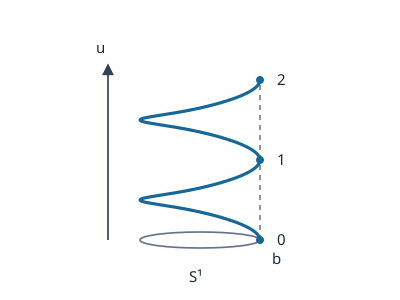
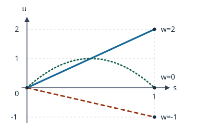

# ATOP6 円周の基本群と巻き数

[ATOP4](../ATOP4/index.md) でループの連結を群の演算にし、[ATOP5](../ATOP5/index.md) で円周の道を実直線へ持ち上げました。今回は円周上の任意のループが、向きを込めて何周したかという整数だけで分類できることを証明します。途中で引き返したり止まったりしても構いません。

$I=[0,1]$、$S^1=\{(x,y)\in\mathbb R^2:x^2+y^2=1\}$ とします。円周には部分空間位相を入れます。直接の前提は [ATOP4](../ATOP4/index.md) と [ATOP5](../ATOP5/index.md) です。

<!-- definition-example-audit: strict -->

## 1. 円周をほどいて回転を記録する

[円周の実直線による被覆](../ATOP5/index.md#prop-atop5-circle-cover) は次の写像です。

$$
p(u)=(\cos(2\pi u),\sin(2\pi u)).
$$

実数 $u$ はラジアンではなく回転数を表します。$u$ を増やすと反時計回り、減らすと時計回りです。既習の被覆の計算により

$$
p^{-1}(\{p(a)\})=a+\mathbb Z.
$$

特に $b=p(0)=(1,0)$ の逆像は整数全体です。円周だけでは一周前の点と一周後の点を区別できませんが、持上げでは異なる実数になります。

図は $u=2s$ の持上げを高さ $u$ の螺旋で表した模式図です。水平面への投影が円周上のループであり、高さが実直線上の持上げを記録します。高さ0と1と2では水平面への投影は同じ点 $b$ です。

ある点 $x=p(a)$ を基点とする [ループ](../ATOP4/index.md#def-atop4-loop) $\alpha:I\to S^1$ を取ります。[道の持上げ](../ATOP5/index.md#thm-atop5-path-lifting) により、実数 $a$ から出発する持上げ $\widetilde\alpha_a$ が一意に存在します。終点の投影は $x$ なので終点は $a+\mathbb Z$ に属します。そこで終点と始点の差を整数として取り出します。

<!-- formal-statement-start -->
> **定義（巻き数）**
> 円周 $S^1$ の点 $x$ を基点とする連続なループ $\alpha:I\to S^1$ を取る。上記の被覆写像 $p:\mathbb R\to S^1$ に対して $p(a)=x$ となる $a$ を選び、$a$ からの持上げを $\widetilde\alpha_a$ とする。整数

$$
w(\alpha)=\widetilde\alpha_a(1)-a
$$

> を $\alpha$ の巻き数という。正の向きは反時計回りとする。
<!-- formal-statement-end -->

<!-- definition-example-start: def-atop6-winding-number -->
**定義の確認**

$\alpha(s)=p(1/4-2s)$ を考えます。連続な写像の合成なので連続です。始点は $p(1/4)=(0,1)$ です。終点は $p(-7/4)=p(1/4)$ なのでループです。$a=1/4$ を選びます。

$$
L(s)=1/4-2s.
$$

$L$ は連続で初期値は $a$、投影は $p(L(s))=\alpha(s)$ です。[道の持上げ](../ATOP5/index.md#thm-atop5-path-lifting) の一意性からこれが持上げです。よって

$$
w(\alpha)=-7/4-1/4=-2.
$$

時計回りに二周しました。始点の別の逆像 $a'=5/4$ を選べば持上げは $5/4-2s$ で、終点は $-3/4$ です。差はやはり $-2$ となります。
<!-- definition-example-end -->

巻き数は道の長さではありません。正の回転と負の回転を相殺した結果です。

図の三曲線は $2s$、$-s$、$4s(1-s)$ です。最後の曲線は時刻 $1/2$ で高さ1に達した後に0へ戻ります。投影したループは一周してから逆向きに一周し、巻き数は0になります。

## 2. 選び方と変形によらない整数

巻き数の定義には出発点 $a$ の選択が含まれます。さらにループを変形しても同じ整数になることが、基本群の元に整数を割り当てるために必要です。

<!-- formal-statement-start -->
> **命題（巻き数の不変性）**
> 円周の任意の点を基点とするループ $\alpha$ の巻き数は、持上げの出発点の選択に依存しない。また、同じ点を基点とするループ $\alpha,\beta$ が道ホモトピックなら

$$
w(\alpha)=w(\beta).
$$
<!-- formal-statement-end -->

<!-- proof-start -->
### 証明

基点を $x$ とします。$p(a)=p(a')=x$ なら [円周の実直線による被覆](../ATOP5/index.md#prop-atop5-circle-cover) により $a'=a+k$ となる整数 $k$ があります。

$L(s)=\widetilde\alpha_a(s)+k$ と置きます。これは連続で、初期値は $a'$ です。周期1より

$$
p(L(s))=p(\widetilde\alpha_a(s))=\alpha(s).
$$

[道の持上げ](../ATOP5/index.md#thm-atop5-path-lifting) の一意性から $L=\widetilde\alpha_{a'}$ です。従って

$$
\widetilde\alpha_{a'}(1)-a'
=\widetilde\alpha_a(1)+k-(a+k)
=\widetilde\alpha_a(1)-a.
$$

次に $\alpha$ と $\beta$ が道ホモトピックだとします。同じ $a$ を選んで両者を持ち上げます。[道ホモトピーによる持上げの終点不変性](../ATOP5/index.md#cor-atop5-endpoint-invariance) の仮定は、同じ始点・終点を持つことと同じ持上げの出発点を指定することです。今はどちらも満たされているので

$$
\widetilde\alpha_a(1)=\widetilde\beta_a(1).
$$

両辺から $a$ を引くと所望の等式になります。
<!-- proof-end -->

端点を固定した連続変形で整数が変わらないため、一周したループをその場で静止するループに変形することはできません。

## 3. 連結したループの巻き数

道の連結は左から右へ進む順序とします。一つ目の持上げが高さ $a+m$ に着いたら、二つ目の持上げは高さ $a+m$ から始めなければなりません。

<!-- formal-statement-start -->
> **命題（巻き数の加法性）**
> 円周の同じ点を基点とするループ $\alpha,\beta$ の連結、逆走、定値ループについて次が成り立つ。定値ループの値を $x$ とする。

$$
w(\alpha*\beta)=w(\alpha)+w(\beta),
$$

$$
w(\bar\alpha)=-w(\alpha),\qquad w(c_x)=0.
$$
<!-- formal-statement-end -->

<!-- proof-start -->
### 証明

$p(a)=x$ とし、$a$ からの持上げを $A,B$ と書きます。$m=w(\alpha)$、$n=w(\beta)$ とすると $A(1)=a+m$、$B(1)=a+n$ です。

[道の連結](../ATOP4/index.md#def-atop4-path-operations) の時間配分に合わせて

$$
L(s)=\begin{cases}
A(2s)&0\le s\le 1/2,\\
m+B(2s-1)&1/2\le s\le1
\end{cases}
$$

と置きます。中点では前半は $A(1)=a+m$、後半は $m+B(0)=m+a$ です。両式が一致するので閉区間上の貼り合わせにより連続です。

初期値は $a$ です。前半の投影は $\alpha(2s)$、後半は整数 $m$ の周期性から $\beta(2s-1)$ となります。従って [道の持上げ](../ATOP5/index.md#thm-atop5-path-lifting) の一意性により $L$ が連結道の持上げです。

$$
L(1)-a=m+B(1)-a=m+n.
$$

逆走には $R(s)=A(1-s)-m$ を使います。連続で $R(0)=a$、投影は $p(A(1-s))=\bar\alpha(s)$ なので一意な持上げです。

$$
R(1)-a=A(0)-m-a=-m.
$$

定値ループの持上げは定値 $a$ であり、差は0です。
<!-- proof-end -->

## 4. 同じ整数なら変形できる

これまで、道ホモトピックなら巻き数が等しいことを示しました。逆向きも成立します。円周上で直接補間すると円周から外れることがありますが、実直線上ならどの二点の間も直線で結べます。そこで実直線上で変形を作ってから円周へ投影します。

<!-- formal-statement-start -->
> **定理（円周の基本群）**
> 円周の点 $x$ を基点とする基本群に対し、巻き数が定める写像

$$
W:\pi_1(S^1,x)\longrightarrow(\mathbb Z,+),
\qquad W([\alpha])=w(\alpha)
$$

> は群同型である。特に、同じ基点の二つのループは巻き数が等しい場合に限り道ホモトピックである。
<!-- formal-statement-end -->

証明の見取り図：不変性で代表元によらない写像を得て、加法性で群演算を保つことを確認します。任意の整数を一定速度で回るループとして実現し、同じ整数の持上げどうしを直線補間します。

<!-- proof-start -->
### 証明

$x=p(a)$ とします。[基本群の群構造](../ATOP4/index.md#thm-atop4-fundamental-group) により $\pi_1(S^1,x)$ は群で、積は代表ループの連結で与えられます。

**代表元からの独立性と準同型性。** [巻き数の不変性](#prop-atop6-winding-invariance) より $[\alpha]=[\beta]$ なら $w(\alpha)=w(\beta)$ です。従って $W$ は一つの写像として定まります。[巻き数の加法性](#prop-atop6-winding-additivity) により

$$
W([\alpha][\beta])=w(\alpha*\beta)
=w(\alpha)+w(\beta).
$$

従って群準同型です。

**全射性。** 任意の整数 $n$ に対して次のループを取ります。

$$
\gamma_n(s)=p(a+ns).
$$

これは連続で、両端の投影は $x$ です。$a+ns$ は連続で初期値 $a$、投影は $\gamma_n$ なので [道の持上げ](../ATOP5/index.md#thm-atop5-path-lifting) の一意性からその持上げです。従って

$$
W([\gamma_n])=(a+n)-a=n.
$$

**単射性。** $W([\alpha])=W([\beta])=n$ とします。同じ $a$ からの持上げ $A,B$ は両方とも始点 $a$、終点 $a+n$ を持ちます。実直線上で

$$
K(s,t)=(1-t)A(s)+tB(s)
$$

と置きます。積と和からなるので $K:I^2\to\mathbb R$ は連続です。その四辺では

$$
K(s,0)=A(s),\quad K(s,1)=B(s),
$$

$$
K(0,t)=a,\quad K(1,t)=a+n.
$$

よって $H=p\circ K:I^2\to S^1$ は連続です。下辺と上辺は $\alpha,\beta$ になります。左辺の値は $p(a)=x$、右辺も整数周期性により $p(a+n)=x$ です。

[道ホモトピーの定義](../ATOP4/index.md#def-atop4-path-homotopy) の四辺の条件をすべて満たすので $[\alpha]=[\beta]$ です。以上から $W$ は全単射な群準同型、従って群同型です。
<!-- proof-end -->

任意のループはその巻き数を $n$ とすれば $\gamma_n$ と道ホモトピックです。特に $\gamma_1$ の類が生成元であり、逆写像は $n\mapsto[\gamma_n]$ です。単に円周の一周を数えるだけではなく、任意の連続なループをこの形に還元できたことが重要です。

補間を円周上で行うことは一般にはできません。例えば $p(0)$ と $p(1/2)$ の中点は原点で、円周には属しません。上の証明では実直線上で値域の制約なく補間し、その後に $p$ を合成することでこの問題を回避しています。

## 5. 演習

以下では $p$ は第1節の被覆写像、$b=p(0)$ とします。

### 演習 ATOP6-A1：正負の向き

- Level: A

$\alpha(s)=p(-3s)$ の基点と巻き数を求めよ。

<!-- solution-start -->
**詳細解答**

始点は $p(0)=b$、終点は $p(-3)=b$ です。$-3s$ は連続で初期値0、投影が $\alpha$ なので [道の持上げ](../ATOP5/index.md#thm-atop5-path-lifting) の一意性により持上げです。

$$
w(\alpha)=-3-0=-3.
$$

時計回りに三周します。
<!-- solution-end -->

### 演習 ATOP6-A2：別の出発点

- Level: A

$\alpha(s)=p(1/3+2s)$ を $a=7/3$ から持ち上げ、終点と巻き数を求めよ。

<!-- solution-start -->
**詳細解答**

$7/3-1/3=2$ は整数なので指定した初期値は基点の逆像です。$L(s)=7/3+2s$ は連続で、投影は整数周期性から $\alpha(s)$ です。[道の持上げ](../ATOP5/index.md#thm-atop5-path-lifting) によりこれが唯一の持上げです。

$$
L(1)=13/3,\qquad w(\alpha)=13/3-7/3=2.
$$
<!-- solution-end -->

### 演習 ATOP6-A3：往復するループ

- Level: A

$\alpha(s)=p(8s(1-s))$ の巻き数を求めよ。時刻 $1/2$ までに何周するか。

<!-- solution-start -->
**詳細解答**

$L(s)=8s(1-s)$ は連続で両端が0、投影が $\alpha$ です。[道の持上げ](../ATOP5/index.md#thm-atop5-path-lifting) により0からの持上げです。

$$
L(1/2)=8(1/2)(1/2)=2.
$$

$L(s)=2-8(s-1/2)^2$ は前半では増加し、後半では減少します。前半で反時計回りに二周し、後半で時計回りに二周します。$L(1)-L(0)=0$ なので巻き数は0です。
<!-- solution-end -->

### 演習 ATOP6-A4：連結と逆走

- Level: A

同じ基点のループ $\alpha,\beta$ の巻き数をそれぞれ4、-2とする。$(\alpha*\bar\beta)*\bar\alpha$ の巻き数を求めよ。

<!-- solution-start -->
**詳細解答**

[巻き数の加法性](#prop-atop6-winding-additivity) により逆走の巻き数はそれぞれ $-4,2$ です。従って

$$
w((\alpha*\bar\beta)*\bar\alpha)
=(4+2)-4=2.
$$
<!-- solution-end -->

### 演習 ATOP6-B1：代表ループへの変形

- Level: B

$\alpha(s)=p(2s+3s(1-s))$ と $\beta(s)=p(2s)$ の道ホモトピーを具体的に構成せよ。

<!-- solution-start -->
**詳細解答**

実数値の候補 $A(s)=2s+3s(1-s)$ と $B(s)=2s$ は連続で初期値0、投影が指定のループです。[道の持上げ](../ATOP5/index.md#thm-atop5-path-lifting) により持上げで、両方とも終点2です。

$$
K(s,t)=2s+3(1-t)s(1-s)
$$

は両者の線形補間です。$H(s,t)=p(K(s,t))$ とします。連続で、$t=0$ では $\alpha$、$t=1$ では $\beta$ です。$s=0$ では $p(0)=b$、$s=1$ では $p(2)=b$ です。

[道ホモトピーの定義](../ATOP4/index.md#def-atop4-path-homotopy) により所望の変形です。
<!-- solution-end -->

### 演習 ATOP6-B2：変形できないことの証明

- Level: B

$\alpha(s)=p(s)$ と $\beta(s)=p(-s)$ は同じ点集合を通る。道ホモトピックでないことを示せ。

<!-- solution-start -->
**詳細解答**

それぞれの0からの持上げは $s$ と $-s$ です。どちらも連続、初期値0、投影が指定のループなので [道の持上げ](../ATOP5/index.md#thm-atop5-path-lifting) で一意です。

$$
w(\alpha)=1,\qquad w(\beta)=-1.
$$

[巻き数の不変性](#prop-atop6-winding-invariance) により道ホモトピックなら巻き数が一致しなければなりません。$1\ne-1$ なのでそのような変形はありません。通過する点集合だけでは道の向きを区別できないことが分かります。
<!-- solution-end -->

### 演習 ATOP6-B3：開いた道では整数とは限らない

- Level: B

$\eta(s)=p(s/4)$ を0から持ち上げよ。終点差が整数でない理由を説明せよ。また $p(a)$ から $p(c)$ への任意の道を $a$ から持ち上げるとき、終点の取り得る集合を求めよ。

<!-- solution-start -->
**詳細解答**

$L(s)=s/4$ は連続で初期値0、投影 $\eta$ を満たすため [道の持上げ](../ATOP5/index.md#thm-atop5-path-lifting) により持上げです。終点差は $1/4$ です。$\eta(0)=b$ と $\eta(1)=(0,1)$ が異なり、ループではないため巻き数の定義の仮定を失っています。

一般の道の持上げ $M$ では $p(M(1))=p(c)$ です。[円周の実直線による被覆](../ATOP5/index.md#prop-atop5-circle-cover) により $M(1)\in c+\mathbb Z$ です。

逆に任意の整数 $k$ について

$$
M_k(s)=(1-s)a+s(c+k)
$$

は連続で両端が $a,c+k$ です。その投影は所望の二点を結ぶ道で、$M_k$ は指定初期値からの持上げです。従って終点の取り得る集合はちょうど $c+\mathbb Z$ です。
<!-- solution-end -->

### 演習 ATOP6-C1：円周の自己写像が基本群に及ぼす作用

- Level: C

整数 $d$ に対し $F_d:S^1\to S^1$ を $F_d(p(u))=p(du)$ で定めたい。代表値 $u$ によらないこと、連続性、$F_d(b)=b$ を証明せよ。任意の $b$ 基点のループ $\alpha$ に対して $w(F_d\circ\alpha)=d\,w(\alpha)$ を示し、誘導準同型が単射、全射となる条件を求めよ。

<!-- solution-start -->
**詳細解答**

$p(u)=p(v)$ なら [円周の実直線による被覆](../ATOP5/index.md#prop-atop5-circle-cover) により $v=u+k$ となる整数 $k$ があります。従って $dv=du+dk$ です。$d$ も整数なので $p(dv)=p(du)$ となり、代表値に依存しません。

任意の円周上の点で均等被覆近傍 $U$ と一つのシート $V$ を選べます。$q=(p|_V)^{-1}:U\to V$ は連続です。$z\in U$ で $p(q(z))=z$ なので

$$
F_d(z)=p(dq(z)).
$$

これは連続写像の合成です。各点の開近傍で制限が連続なので $F_d$ は連続です。$F_d(b)=p(d\cdot0)=b$ です。

$\alpha$ の0からの持上げを $A$ とします。$dA(s)$ は連続で初期値0です。投影は

$$
p(dA(s))=F_d(p(A(s)))=F_d(\alpha(s)).
$$

[道の持上げ](../ATOP5/index.md#thm-atop5-path-lifting) により $dA$ が合成ループの持上げです。従って

$$
w(F_d\circ\alpha)=dA(1)=d\,w(\alpha).
$$

[基本群の誘導準同型](../ATOP4/index.md#thm-atop4-induced-homomorphism) は $[\alpha]\mapsto[F_d\circ\alpha]$ で定まります。[円周の基本群](#thm-atop6-fundamental-group-circle) の同型 $W$ で整数に移せば $n\mapsto dn$ です。

$d\ne0$ なら $dn=dm$ から $n=m$ が従い単射です。$d=0$ なら0と1が同じ0に写るので単射ではありません。全射なら1が像に入り、整数 $n$ が $dn=1$ を満たす必要があります。従って $d=1$ または $d=-1$ です。この二つの場合には任意の整数 $m$ に対し $n=dm$ と取れば $dn=d^2m=m$ となり、実際に全射です。
<!-- solution-end -->

## 6. 次の講義へ

円周の基本群を整数として完全に計算しました。次は複数の開集合を組み合わせて空間を作ったとき、それぞれの基本群から全体の基本群を求める方法を学びます。
