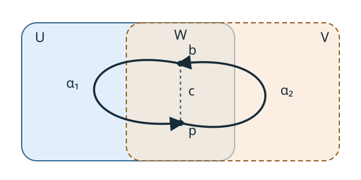
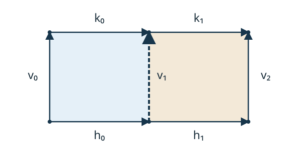

# ATOP7 van Kampen定理と群の表示

[ATOP6](../ATOP6/index.md) では円周の穴を整数で数えました。穴が二つある空間では、左の穴、右の穴を回る順序も重要になります。局所的なループを組み合わせ、どの関係を課せば全体の基本群になるかを明らかにします。

直接の前提は [ATOP4](../ATOP4/index.md)、[ATOP5](../ATOP5/index.md)、[ATOP6](../ATOP6/index.md) です。$I=[0,1]$ とします。[道の連結・逆走・定値道](../ATOP4/index.md#def-atop4-path-operations) に従い、$\alpha*\beta$ は左の道から右の道へ進む連結、$\bar\alpha(s)=\alpha(1-s)$ は逆走を表します。

$[\alpha]_A$ は空間 $A$ 内での基点付き道ホモトピー類です。[基本群](../ATOP4/index.md#def-atop4-fundamental-group) の積は $[\alpha][\beta]=[\alpha*\beta]$ です。

<!-- definition-example-audit: strict -->

## 1. 生成元と関係式で群を作る

円周を一周するループの類を $a$ とすると、[円周の基本群](../ATOP6/index.md#thm-atop6-fundamental-group-circle) の各元は $a^n$ と書けました。二つの円周から来る類 $a,b$ があるとき、$aba^{-1}$ や $ab^{-1}a$ のように有限個の記号を並べた列を考えます。$ab=ba$ は勝手には課しません。

既習の [群](../../../代数系/GRP/GRP1/index.md#def-grp1-group) と [生成部分群](../../../代数系/GRP/GRP1/index.md#def-grp1-generated-subgroup) の考え方を、まだ群が与えられていない場合にも使えるようにします。

文字集合 $S$ の各文字 $s$ に対し逆元を表す別の記号 $s^{-1}$ を用意します。この文字と逆文字からなる有限列を語とし、空の語を $1$ と書きます。語の逆は順序を逆転し、各文字の符号を反転して得ます。

関係式 $u=v$ は語 $uv^{-1}$ を空の語と同一視することに対応します。

語 $u$ の同値類を $[u]$ と書き、文脈が明らかなときは文字 $s$ とその類 $[s]$ を同じ記号で表します。

<!-- formal-statement-start -->
> **定義（群の表示）**
> 集合 $S$ とその文字・逆文字からなる語の集合 $R$ を取る。すべての語について、任意の前後の語を付けた位置で、隣り合う $ss^{-1},s^{-1}s$ または $r,r^{-1}$（$r\in R$）の挿入・削除を許す。有限回の操作で移り合う語を同一視する。
> この同値類の集合を連結を積として群としたものを

$$
\langle S\mid R\rangle
$$

> と書く。$S$ は生成元の集合、$R$ の各語を単位元に等しいとする式を関係式とする。
<!-- formal-statement-end -->

<!-- definition-example-start: def-atop7-presentation -->
**定義の確認**

$S=\{a\}$、$R=\{a^3\}$ とします。語 $a^5a^{-1}$ では逆文字を一組削除して $a^4$、さらに $a^3$ を削除して $a$ になります。逆に $a$ に $a^3$ を挿入して $a^4$ に戻せるので、両者は同値です。

任意の語の指数和を3で割った余りは挿入・削除で変わりません。逆文字の対の指数和は0、$a^3$ とその逆はそれぞれ3と $-3$ だからです。任意の語は逆文字の対を消して $a^k$ にでき、さらに $a^{\pm3}$ の挿入・削除で $1,a,a^2$ のいずれかにできます。余りが異なる三つは同値ではありません。二つの語の連結では指数和が加算されます。従って $[a^k]\mapsto k+3\mathbb Z$ は代表語によらず、積を加法へ移し、三つの余りの確認から全単射です。[群同型](../../../代数系/GRP/GRP2/index.md#def-grp2-homomorphism) の条件を満たすので、この群は $\mathbb Z/3\mathbb Z$ と同型です。
<!-- definition-example-end -->

[群の定義](../../../代数系/GRP/GRP1/index.md#def-grp1-group) に照らし、群になる理由を確認します。同値関係は操作0回、操作列の逆転、操作列の連結により反射的・対称的・推移的です。操作は前後に別の語が付いても行えるので、$u\sim u'$、$v\sim v'$ なら $uv\sim u'v\sim u'v'$ です。従って積は代表語に依存しません。語の連結は結合的で、空の語が左右の単位元です。$u=s_1^{\epsilon_1}\cdots s_n^{\epsilon_n}$（各 $s_i\in S$、$\epsilon_i\in\{1,-1\}$）と書くと、$u$ と逆順・逆符号の語との積は中央の逆文字対から順に消去して空の語になります。左右とも同様に消去できるので群の条件を満たします。

関係式はその文字列の削除だけでなく、例えば $r=1$ なら $uru^{-1}=1$ も意味します。中央の $r$ を削除して $uu^{-1}$ を消せるからです。このことが、空間の貼り合わせで生じる関係を任意のループの途中に適用できる理由です。

<!-- formal-statement-start -->
> **命題（群の表示からの準同型）**
> 群 $K$ と表示 $P=\langle S\mid R\rangle$ を取る。各 $s\in S$ に $k_s\in K$ を指定する。すべての $r\in R$ がこの代入により $1_K$ になるとき、各 $s$ の類を $k_s$ に送る群準同型 $P\to K$ が一意に存在する。逆にそのような準同型が存在するなら、すべての関係式が代入先で成立する。
<!-- formal-statement-end -->

見取り図：文字の指定を語全体の積に延長し、語の同一視を通しても値が変わらないことを確認します。

<!-- proof-start -->
### 証明

語 $u=s_1^{\epsilon_1}\cdots s_n^{\epsilon_n}$ の値を

$$
E(u)=k_{s_1}^{\epsilon_1}\cdots k_{s_n}^{\epsilon_n}
$$

とし、空の語の値は $1_K$ とします。ここで各 $\epsilon_j$ は $1$ または $-1$ です。

[群の定義](../../../代数系/GRP/GRP1/index.md#def-grp1-group) にある結合律に従って、二つの語を続けた積を計算すると

$$
E(uv)=E(u)E(v)
$$

となります。逆の語は文字の逆元を逆順に並べるため、

$$
E(u^{-1})=E(u)^{-1}
$$

も成立します。

逆文字対を削除する場合、前後の語を $u,v$ とすると

$$
E(uss^{-1}v)=E(u)k_sk_s^{-1}E(v)=E(uv).
$$

関係語を削除する場合も

$$
E(ur^{\pm1}v)=E(u)1_KE(v)=E(uv).
$$

従って有限回の挿入・削除で値が変わらず、$[u]\mapsto E(u)$ が定まります。連結に関する式から群準同型です。[群準同型の基本性質](../../../代数系/GRP/GRP2/index.md#prop-grp2-hom-basic) により任意の準同型は積と逆元を保存するので、文字の像が決まれば語全体の像も決まり、一意です。逆に存在する場合は $[r]=1_P$ の像が $1_K$ なので条件が必要です。
<!-- proof-end -->

例として $\langle a,b\mid aba^{-1}b^{-1}\rangle$ から整数加法群への準同型は、$a,b$ の像を任意の整数 $m,n$ として作れます。関係語の像は $m+n-m-n=0$ です。一方、$\langle a\mid a^3\rangle$ から整数加法群への準同型では $3m=0$ が必要で、$m=0$ しかありません。

## 2. 二つの群を混ぜる

群 $G,H$ の元を文字として扱います。元が同じ記号で書かれても出身を区別し、$g$ に対応する文字を $x_g$、$h$ に対応する文字を $y_h$ とします。

$G$ 内部では $x_gx_{g'}=x_{gg'}$ を課し、$H$ 内部にも積の関係を課します。しかし異なる出身の文字間には新しい関係を課しません。以下、一般の群 $G,H$ の単位元を $1_G,1_H$ とし、表示で作る群の単位元を $1$ と書きます。

<!-- formal-statement-start -->
> **定義（自由積）**
> 二つの群 $G,H$ に対し、互いに区別された文字 $x_g$（$g\in G$）と $y_h$（$h\in H$）を生成元に取り、関係式

$$
x_{1_G}=y_{1_H}=1,\qquad
x_gx_{g'}=x_{gg'},\qquad
y_hy_{h'}=y_{hh'}
$$

> のみを課した群の表示を自由積 $G*H$ とする。各文字の類への写像を $j_G:G\to G*H$、$j_H:H\to G*H$ とする。
<!-- formal-statement-end -->

<!-- definition-example-start: def-atop7-free-product -->
**定義の確認**

$G=H=(\mathbb Z,+)$ を取ります。加法群の単位元は整数 $0$ なので、一般の定義の $x_{1_G},y_{1_H}$ はここでは $x_0,y_0$ です。どちらも空の語と同一視します。内部関係は $x_mx_n=x_{m+n}$、$y_my_n=y_{m+n}$ です。

この例で $a=x_1$、$b=y_1$（下付きの $1$ は整数の1）とすると、内部関係から $x_n=a^n$、$y_n=b^n$ となります。負の指数については $x_nx_{-n}=x_0=1$ と $y_ny_{-n}=y_0=1$ を使います。例えば

$$
x_2x_{-1}y_3x_0=a b^3.
$$

逆に $a,b$ を任意に指定した群へ送るとき、その群の元 $A,B$ に対し $x_n\mapsto A^n$、$y_n\mapsto B^n$ はすべての内部関係を保存します。従って [群の表示からの準同型](#prop-atop7-presentation-maps) が適用できます。

より具体的には $P=\langle a,b\mid\ \rangle$ と置きます。$P\to\mathbb Z*\mathbb Z$ では文字 $a,b$ を $x_1,y_1$ の類に送ります。逆向きの写像では内部関係を保つ次の代入を使います。

$$
x_n\mapsto a^n,\qquad y_n\mapsto b^n.
$$

合成はそれぞれ $a,b$ と全ての $x_n,y_n$ を固定するので恒等写像です。従って二つの表示は同型で、$a,b$ に追加の関係式は必要ありません。
<!-- definition-example-end -->

ここで群の間の記号 $G*H$ は自由積を表し、道の連結の記号とは対象が異なります。

<!-- formal-statement-start -->
> **命題（自由積の普遍性）**
> 群 $G,H,K$ と群準同型 $f:G\to K$、$g:H\to K$ に対し、次を満たす群準同型 $F:G*H\to K$ が一意に存在する。

$$
F\circ j_G=f,\qquad F\circ j_H=g.
$$

> また $j_G,j_H$ は単射な群準同型である。
<!-- formal-statement-end -->

<!-- proof-start -->
### 証明

内部関係から $j_G(1_G)=1$、$j_G(a)j_G(b)=j_G(ab)$ です。$j_H$ も $j_H(1_H)=1$、$j_H(c)j_H(d)=j_H(cd)$ を満たします。従って両者は群準同型です。

文字の像を $x_a\mapsto f(a)$、$y_b\mapsto g(b)$ と指定します。$f(1_G)=g(1_H)=1_K$、$f(a)f(a')=f(aa')$、$g(b)g(b')=g(bb')$ なので関係式はすべて保存されます。[群の表示からの準同型](#prop-atop7-presentation-maps) が求める一意な $F$ を与えます。

$K=G$、$f=\mathrm{id}_G$、$g$ を定値 $1_G$ の準同型として選ぶと、$F\circ j_G=\mathrm{id}_G$ です。$j_G(a)=j_G(a')$ なら $F$ を作用させて $a=a'$ なので単射です。$K=H$、$f$ を定値 $1_H$、$g=\mathrm{id}_H$ として $j_H$ の単射性も得られます。
<!-- proof-end -->

自由積と直積群の違いを具体的に見ます。二つの整数加法群から[実直線の全単射の群](../../../代数系/GRP/GRP1/index.md#def-grp1-symmetric-group)（積は写像の合成で、右側の写像から作用させる）へ $a$ を $A(t)=t+1$、$b$ を $B(t)=2t$ に送れます。それぞれ $n$ を $A^n,B^n$ に送る準同型です。[自由積の普遍性](#prop-atop7-free-product-property) により全体の準同型が得られます。

$$
(A\circ B)(0)=1,\qquad (B\circ A)(0)=2.
$$

従って $ab$ と $ba$ は自由積で異なります。[群の直積](../../../代数系/GRP/GRP1/index.md#def-grp1-direct-product) では $(g,1_H)(1_G,h)=(g,h)=(1_G,h)(g,1_H)$ なので、この自由積を直積群で置き換えることはできません。

## 3. 貼り合わせから生まれる関係

空間 $X=U\cup V$ を開集合二つで覆い、$W=U\cap V$ とします。基点 $b$ を $W$ に取ります。$U,V,W$ がすべて [弧状連結](../../../基礎科目/TOP/TOP3/index.md#def-top3-path-connected)（任意の二点を道で結べる）であれば、部分路を基点に戻すための補助の道を各集合内で選べます。

以下、$G=\pi_1(U,b)$、$H=\pi_1(V,b)$、$L=\pi_1(W,b)$ とします。[基本群の誘導準同型](../ATOP4/index.md#thm-atop4-induced-homomorphism) によって包含から $i:L\to G$、$j:L\to H$ と $k_U:G\to\pi_1(X,b)$、$k_V:H\to\pi_1(X,b)$ を得ます。

$W$ 内のループは $U$ と $V$ のどちらから見ても $X$ 内の同じループです。そこで $G*H$ の中で、各 $\ell\in L$ について $j_G(i(\ell))=j_H(j(\ell))$ を追加します。

これを商群として書くため、関係を課したい元の集合 $T$ に対し、それを含むすべての [正規部分群](../../../代数系/GRP/GRP2/index.md#def-grp2-normal-subgroup) の共通部分を $N_T$ とします。

群全体が候補に含まれます。各候補が単位元を含み、積・逆元で閉じるので共通部分も部分群です。また任意の $n\in N_T$ と群の元 $p$ について $pnp^{-1}$ はすべての候補に属します。[正規部分群の同値条件](../../../代数系/GRP/GRP2/index.md#prop-grp2-normal-equivalences) により $N_T$ は正規部分群です。これは $T$ を含む最小の正規部分群です。

$T$ の元をすべて単位元に送る準同型について [核は正規部分群](../../../代数系/GRP/GRP2/index.md#prop-grp2-kernel-normal-image-subgroup) であり、$T$ を含むので $N_T$ も核に含まれます。

従って [商群](../../../代数系/GRP/GRP2/index.md#def-grp2-quotient-group) $P/N_T$ へ準同型が一意に降ります。実際、

$$
pN_T=p'N_T
$$

なら [剰余類の等値条件](../../../代数系/GRP/GRP2/index.md#prop-grp2-coset-partition) により $p^{-1}p'\in N_T$ なので、

$$
f(p)^{-1}f(p')=1.
$$

よって $f(p)=f(p')$ です。従って $\tilde f(pN_T)=f(p)$ は代表元によらず、商群の積について

$$
\tilde f((pN_T)(p'N_T))=f(pp')=f(p)f(p')
$$

となります。すべての剰余類はある $p$ の像なので、この降下は一意です。

<!-- formal-statement-start -->
> **定理（van Kampen定理）**
> 位相空間 $X$ が開集合 $U,V$ の和であり、$U,V,W=U\cap V$ が弧状連結、$b\in W$ とする。包含が誘導する準同型を

$$
i:\pi_1(W,b)\to\pi_1(U,b),\qquad
j:\pi_1(W,b)\to\pi_1(V,b)
$$

> とする。$G=\pi_1(U,b)$、$H=\pi_1(V,b)$、$L=\pi_1(W,b)$ と置く。$N$ を $G*H$ の元

$$
j_G(i(\ell))j_H(j(\ell))^{-1}\quad(\ell\in L)
$$

> をすべて含む最小の正規部分群とする。このとき包含から誘導される準同型は群同型

$$
(G*H)/N\ \cong\ \pi_1(X,b)
$$

> を与える。特に $L$ が一元群なら $\pi_1(X,b)\cong G*H$ である。
<!-- formal-statement-end -->

証明の見取り図：ループを小さく分割すると、それぞれの部分路が $U$ か $V$ に収まります。分割点へ基点から向かう道を付けることで部分路をループに直せます。変形の正方形も小さく分割し、各小正方形の境界が消えることを示します。この操作で現れる違いは、交わりのループの像を一致させる関係でちょうど吸収されます。

| 場所 | 補助の道を選ぶ場所 |
| --- | --- |
| $U$ の部分路が隣り合う分割点 | $U$ |
| $V$ の部分路が隣り合う分割点 | $V$ |
| $U$ と $V$ の部分路が接する分割点 | $W$ |

[図を拡大](assets/cover.svg)

この模式図では左の部分路は $U$、右の部分路は $V$ 内にあります。補助の道 $c$ は $W$ 内にあり、それを往復することで二つの基点付きループに分けられます。

各部分路を $e$、始点への補助の道を $c_p$、終点への補助の道を $c_q$ とすると、$c_p*e*\bar c_q$ は基点付きループです。隣接する部分路の積では $\bar c_q*c_q$ が消えます。

<!-- proof-start -->
### 証明

まず任意の群 $K$ と準同型 $f_U:G\to K$、$f_V:H\to K$ が $f_Ui=f_Vj$（写像の合成を省略記法で表し、$f_U\circ i=f_V\circ j$ の意味）を満たす場合に、それらを延長する準同型 $\pi_1(X,b)\to K$ が一意に存在することを示します。

**(1) 部分路の分割と補助の道。**

ループ $\alpha:I\to X$ に対し $\alpha^{-1}(U),\alpha^{-1}(V)$ は $I$ の開被覆です。[Lebesgue数補題](../ATOP5/index.md#lem-atop5-lebesgue-number) をコンパクト距離空間 $I$ に適用し、各閉区間の長さがその正数より小さくなるよう分割します。従って

$$
0=t_0<t_1<\cdots<t_m=1
$$

の各部分路 $\alpha_r$ は一つの集合 $A_r\in\{U,V\}$ に収まります。各部分路のパラメータを $s\in I$ として

$$
\alpha_r(s)=\alpha(t_{r-1}+(t_r-t_{r-1})s)
$$

と定めます。従って $\alpha_r$ は $\alpha(t_{r-1})$ から $\alpha(t_r)$ へ向かう道です。

$x_r=\alpha(t_r)$ とし、$c_r$ を $b$ から $x_r$ への道とします。内部の分割点では $c_r$ を $A_r\cap A_{r+1}$ 内に選びます。同じ集合ならその集合内、異なる集合なら $W$ 内に選べます。いずれも弧状連結だからです。$c_0,c_m$ は定値道とします。

$$
\lambda_r=c_{r-1}*\alpha_r*\bar c_r
$$

は $A_r$ 内の $b$ 基点のループになります。$f_{A_r}$ は $A_r=U$ なら $f_U$、$A_r=V$ なら $f_V$ とし、

$$
E(\alpha)=\prod_{r=1}^m f_{A_r}([\lambda_r]_{A_r})
$$

を候補とします。積は添字順です。

**(2) 選択に依存しないこと。**

補助の道を $c_r'$ に変え、$\eta_r=c_r'*\bar c_r$ とします。これは両側の集合の共通部分に属するループです。[道ホモトピー類の演算律](../ATOP4/index.md#thm-atop4-path-laws) によって $A_r$ 内で

$$
[\lambda'_r]=[\eta_{r-1}][\lambda_r][\eta_r]^{-1}
$$

となります。実際、右辺に代表道を代入すると $\bar c_{r-1}*c_{r-1}$ と $\bar c_r*c_r$ がそれぞれ定値道に変形されます。隣接する因子での $f$ による $[\eta_r]$ の値は、同じ集合なら同じであり、異なる集合でも $f_Ui=f_Vj$ から同じです。積の中で逆元と相殺し、両端は定値道なので $E$ は変化しません。

一つの部分路を途中で二分し、分割点への補助の道 $d$ を元の集合内に取ると、

$$
[c_{r-1}*\alpha_{r,1}*\bar d]\,
[d*\alpha_{r,2}*\bar c_r]=[\lambda_r]
$$

となります。中央の往復を消し、[道の再パラメータ化](../ATOP4/index.md#prop-atop4-reparametrization) を使った等式です。よって分割を細かくしても値は変わりません。

二つの分割の分割点をすべて合わせれば共通の細分が得られます。この細分の各区間が二つの割当てで異なる集合に属するなら、その部分路は $W$ 内です。各分割点の補助の道を、左右の区間に現れるすべての集合の共通部分内に選び直します。候補は $U,V,W$ のいずれかで弧状連結です。割当てが異なる区間の補助付きループは $W$ 内なので、$f_Ui=f_Vj$ によって値が一致します。以上で分割、割当て、補助の道の選び方から独立になりました。

**(3) 道ホモトピーで値が変わらないこと。**

基点を固定した [道ホモトピー](../ATOP4/index.md#def-atop4-path-homotopy) $D:I^2\to X$ を取り、下辺を $\alpha$、上辺を $\beta$、左右の辺を定値 $b$ とします。

正方形の開被覆 $D^{-1}(U),D^{-1}(V)$ に再び [Lebesgue数補題](../ATOP5/index.md#lem-atop5-lebesgue-number) を使います。得られた正数 $\delta$ に対し、

$$
\frac{\sqrt{2}}{n}<\delta
$$

となる整数 $n$ を選べば、幅 $1/n$ の各閉小正方形の直径は $\delta$ 未満です。各小正方形の像が入る集合を一つずつ割り当てます。

格子の頂点 $v$ に対し、$b$ から $D(v)$ への道 $c_v$ を、その頂点に接するすべての小正方形の割当て集合の共通部分内で選びます。これは $U,V,W$ のいずれかです。左右の境界の頂点では定値道を選びます。

向き付き格子辺 $e:p\to q$ の像を $D_e$ と書きます。補助付きループ $c_p*D_e*\bar c_q$ を、辺に接する小正方形の集合内のループとして評価し、値を $z(e)\in K$ とします。辺の両側で割当てが異なるときはループ全体が $W$ に収まり、値は一致します。逆向きの辺の値は逆元です。

一つの小正方形について、下辺と右辺を順に通る道と左辺と上辺を順に通る道を比較します。どちらも左下から右上へ向かう正方形内の道です。二つの道を $u(s),v(s)$（$s\in I$）と書きます。小正方形は凸なので

$$
H(s,t)=(1-t)u(s)+tv(s)
$$

は小正方形内に留まります。$u,v$ の始点・終点が等しいので、$H(0,t),H(1,t)$ はそれぞれ一定です。これは [直線ホモトピー](../ATOP2/index.md#prop-atop2-linear-homotopy) の構成による端点固定のホモトピーです。$D$ を合成すればその小正方形に割り当てられた集合内の道ホモトピーです。両側に共通の補助の道を付け、途中の補助の道の往復を消すと、

$$
z(\text{下})z(\text{右})=z(\text{左})z(\text{上})
$$

が成立します。これが格子を通じて値を保存する局所関係です。

格子点 $(i/n,j/n)$ から右への水平辺の値を $h_{i,j}$（$0\le i<n,\ 0\le j\le n$）、上への縦辺の値を $v_{i,j}$（$0\le i\le n,\ 0\le j<n$）と書きます。左下の格子点が $(i/n,j/n)$ である各セルについて、$0\le i,j<n$ に対し

$$
h_{i,j}v_{i+1,j}=v_{i,j}h_{i,j+1}.
$$

従って

$$
h_{i,j}=v_{i,j}h_{i,j+1}v_{i+1,j}^{-1}.
$$

[図を拡大](assets/grid.svg)

図は隣接する二セルを抜き出した模式図です。下辺を $h_0,h_1$、上辺を $k_0,k_1$、縦辺を $v_0,v_1,v_2$ と略記しました。中央の縦辺は二つのセルで共有され、左セルの式の末尾には逆元、右セルの式の先頭には元そのものが現れます。

固定した $j$ について左から右へ積を取ります。例えば連続する二因子では

$$
h_{i,j}h_{i+1,j}
=v_{i,j}h_{i,j+1}v_{i+1,j}^{-1}
v_{i+1,j}h_{i+1,j+1}v_{i+2,j}^{-1}
$$

となり、中央の逆元対を消すと

$$
h_{i,j}h_{i+1,j}=v_{i,j}h_{i,j+1}h_{i+1,j+1}v_{i+2,j}^{-1}
$$

です。この相殺を左から順に繰り返すと、

$$
\prod_{i=0}^{n-1}h_{i,j}
=v_{0,j}\left(\prod_{i=0}^{n-1}h_{i,j+1}\right)v_{n,j}^{-1}.
$$

左右の境界では $D$ と補助の道が定値なので $v_{0,j}=v_{n,j}=1_K$ です。従って隣の行の積が一致し、$j=0$ から $n-1$ まで順に使えば下辺の積と上辺の積が一致します。(2) によりこれらは $E(\alpha),E(\beta)$ そのものです。群の可換性は一度も使っていません。

**(4) 準同型と一意性。**

(2)(3) から $[\alpha]\mapsto E(\alpha)$ が定まります。連結した二つのループを評価するときは前半に一つ目の分割、後半に二つ目の分割を時間調整して使い、中央の補助を定値道に取れます。従って $E(\alpha*\beta)=E(\alpha)E(\beta)$ です。ループ全体が一方の集合に入る場合は分割を一つだけにでき、$E$ は $f_U$ または $f_V$ に一致します。

一意性には、(1) の補助付きループの積が $X$ の中で元のループの類になることを使います。隣接する $\bar c_r*c_r$ を [道ホモトピー類の演算律](../ATOP4/index.md#thm-atop4-path-laws) により順に消し、[道の再パラメータ化](../ATOP4/index.md#prop-atop4-reparametrization) を適用すれば

$$
[\alpha]=k_{A_1}([\lambda_1])\cdots k_{A_m}([\lambda_m]).
$$

よってどの延長準同型も右辺の像が定まるため一意です。

**(5) 商群との同型。**

$P=G*H$、$Q=P/N$ とし、[商群の標準射影](../../../代数系/GRP/GRP2/index.md#def-grp2-projection) を $q:P\to Q$ とします。

包含の誘導準同型 $k_U,k_V$ は $L$ 上で一致するので、[自由積の普遍性](#prop-atop7-free-product-property) から準同型

$$
P\to\pi_1(X,b)
$$

が存在します。指定した関係元はすべて単位元へ写るので $N$ は核に含まれ、商群から準同型

$$
T:Q\to\pi_1(X,b)
$$

が定まります。

逆に $qj_G,qj_H$ は $L$ 上で一致するので (1)〜(4) を $K=Q$ に適用して $S:\pi_1(X,b)\to Q$ を得ます。

$TS$ は $k_U,k_V$ の各像上で恒等写像です。(4) の生成性から $\pi_1(X,b)$ 全体で恒等写像です。$ST$ は $qj_G(G),qj_H(H)$ の元を固定します。$P$ はこれらの射影前の文字で生成され、$q$ は全射なので $Q$ はこれらの像で生成されます。従って $ST$ も恒等写像です。両写像は互いに逆で、$T$ は群同型です。

$L$ が一元群なら指定関係元は単位元のみなので $N=\{1\}$ です。この場合 $Q$ は自由積そのものになります。
<!-- proof-end -->

## 4. 二つの円周の貼り合わせ

二つの円周 $C_a,C_b$ が平面内で一点 $o$ に外接している空間 $X=C_a\cup C_b$ を考えます。各円周の $o$ と異なる点を $p_a,p_b$ とし、$U=X\setminus\{p_b\}$、$V=X\setminus\{p_a\}$ と取ります。点は閉なので $U,V$ は開、和は $X$ です。

円周から一点を除いたものは実開区間と同相です。実際、平行移動・拡大縮小・回転で単位円周に移し、除いた点を角度0に合わせます。

[円周の実直線による被覆](../ATOP5/index.md#prop-atop5-circle-cover) の写像を $0<s<1$ に制限すると、一点を除いた円周への全単射になります。被覆の局所逆写像が各点の開近傍で連続なので、制限の逆写像も連続です。従って開区間と同相です。

区間内の $o$ の座標を $s_o$ とすれば

$$
(1-t)s+ts_o
$$

によってその弧を $o$ に縮められます。変形中の座標は開区間内に留まります。

$U$ では $C_a$ を固定し、$C_b\setminus\{p_b\}$ をこの方法で縮めます。二つの部分は $U$ 内で閉じており $o$ で変形が一致するので貼り合わせは連続です。従って $C_a$ は $U$ の強変形レトラクトです。

$V$ では $C_b$ を固定し、$C_a\setminus\{p_a\}$ の区間座標を $o$ の座標へ線形補間します。同じ閉集合上の貼り合わせが成立し、$C_b$ は $V$ の強変形レトラクトです。

$W$ では二つの弧を同時に $o$ へ縮めます。

各集合は弧状連結で基点 $o$ を含みます。[強変形レトラクトと基本群](../ATOP4/index.md#prop-atop4-deformation-fundamental-group) と [円周の基本群](../ATOP6/index.md#thm-atop6-fundamental-group-circle) により

$$
\pi_1(U,o)\cong\mathbb Z,\qquad
\pi_1(V,o)\cong\mathbb Z.
$$

$W$ は可縮なので [可縮空間は単連結](../ATOP4/index.md#prop-atop4-contractible-simply-connected) により $\pi_1(W,o)=\{1\}$ です。[van Kampen定理](#thm-atop7-van-kampen) から

$$
\pi_1(X,o)\cong \mathbb Z*\mathbb Z.
$$

$a,b$ を各円周の正向き一周の類とすれば第2節の例から、これは関係式を追加しない表示 $\langle a,b\mid\ \rangle$ です。$ab$ と $ba$ は第2節の写像への代入で区別できます。

交わりにループがあると何が変わるでしょうか。例えば円環の外側へもう一つの円環を重ねて全体を広い円環にした場合、両方の円環の一周は同じ交わりの一周を表します。次の具体例でその関係を計算します。

## 5. 演習

### 演習 ATOP7-A1：関係式による簡約

- Level: A

$\langle a\mid a^4\rangle$ の元 $a^{-3}a^9$ を $1,a,a^2,a^3$ のいずれかに簡約せよ。この四つが異なることも示せ。

<!-- solution-start -->
**詳細解答**

[群の表示](#def-atop7-presentation) に従い、隣り合う逆文字対を三組削除すると $a^6$ です。$a^4$ を削除すれば $a^2$ になります。指数和を4で割った余りは逆文字対（指数和0）と関係語（指数和 $\pm4$）の挿入・削除で保存されます。四つの候補の余りはそれぞれ0、1、2、3で異なるため、互いに同値ではありません。
<!-- solution-end -->

### 演習 ATOP7-A2：関係式を保存するか

- Level: A

$P=\langle a,b\mid a^2b^{-1}\rangle$ から整数加法群へ $a\mapsto3$ とする準同型を作るため、$b$ の像を求めよ。

<!-- solution-start -->
**詳細解答**

$b$ の像を $n$ とします。関係語の像は $3+3-n=6-n$ なので、単位元0に等しい条件は $n=6$ です。このときすべての関係式が保存されるため、[群の表示からの準同型](#prop-atop7-presentation-maps) により一意な準同型が存在します。
<!-- solution-end -->

### 演習 ATOP7-A3：補助の道の相殺

- Level: A

$b$ を基点とするループ $\alpha=\alpha_1*\alpha_2$ を $U$ 内の道と $V$ 内の道に分け、中間点を $x\in W$ とする。$b$ から $x$ への $W$ 内の道 $c$ を使って二つの基点付きループを作り、その積が $X$ 内で $[\alpha]$ になることを示せ。

<!-- solution-start -->
**詳細解答**

$\lambda_1=\alpha_1*\bar c$ は $U$ 内で $b$ から出て $b$ に戻り、$\lambda_2=c*\alpha_2$ は $V$ 内で同じ基点を持ちます。$X$ 内では [道ホモトピー類の演算律](../ATOP4/index.md#thm-atop4-path-laws) により

$$
[\lambda_1][\lambda_2]=[\alpha_1*\bar c*c*\alpha_2]
=[\alpha_1*\alpha_2].
$$

中央の $\bar c*c$ は $x$ での定値道へ変形できるからです。
<!-- solution-end -->

### 演習 ATOP7-A4：格子の二つのセル

- Level: A

隣接する二つの小正方形の下辺の値を $h_0,h_1$、上辺を $k_0,k_1$、縦辺を左から $v_0,v_1,v_2$ とする。$h_i v_{i+1}=v_i k_i$ が成り立つなら $h_0h_1=v_0k_0k_1v_2^{-1}$ を示せ。

<!-- solution-start -->
**詳細解答**

右から逆元を掛けて $h_0=v_0k_0v_1^{-1}$、$h_1=v_1k_1v_2^{-1}$ を得ます。よって

$$
h_0h_1=v_0k_0v_1^{-1}v_1k_1v_2^{-1}
=v_0k_0k_1v_2^{-1}.
$$

$v_1^{-1}v_1=1$ が隣接しているため消せます。積の順序は変えていません。
<!-- solution-end -->

### 演習 ATOP7-B1：自由積で順序が効く例

- Level: B

$\mathbb Z*(\mathbb Z/2\mathbb Z)$ の各因子の生成元を $a,b$ とする。$ab\ne ba$ を、実直線上の全単射 $A(t)=t+1$、$B(t)=-t$ を使って示せ。

<!-- solution-start -->
**詳細解答**

$A$ の逆は $t\mapsto t-1$、$B$ は $B^2=\mathrm{id}$ なので全単射です。$n\mapsto A^n$ は整数加法群からの準同型です。$B^2=\mathrm{id}$ により $[n]_2\mapsto B^n$ も代表元に依存せず準同型です。[自由積の普遍性](#prop-atop7-free-product-property) で両者を延長できます。像を点0で比較すると

$$
(A\circ B)(0)=1,\qquad (B\circ A)(0)=-1.
$$

像が異なるので元も異なります。
<!-- solution-end -->

### 演習 ATOP7-B2：重なる円環

- Level: B

$X=\{z\in\mathbb R^2:1<\|z\|<4\}$ とし、$U$ を半径が $(1,3)$、$V$ を半径が $(2,4)$ の開円環とする。基点 $b=(5/2,0)$ で基本群を求め、関係式を具体的に書け。

<!-- solution-start -->
**詳細解答**

$W$ の半径は $(2,3)$ です。三つの集合は開で、角度を変えてから半径を変える道で任意の二点を結べるため弧状連結です。$b$ は $W$ に属します。

各集合で

$$
D(z,t)=\left((1-t)\|z\|+t\frac52\right)\frac{z}{\|z\|}
$$

を使うと半径は元の半径と $5/2$ の間に留まります。半径 $5/2$ の円周上の点は固定されるので、同じ円周への強変形レトラクトです。[強変形レトラクトと基本群](../ATOP4/index.md#prop-atop4-deformation-fundamental-group) と [円周の基本群](../ATOP6/index.md#thm-atop6-fundamental-group-circle) により三つの基本群は整数加法群です。円周の正向き一周の類をそれぞれ $a,b'$、$\ell$ とします。包含は実際に同じ半径 $5/2$ のループを送るため $i(\ell)=a$、$j(\ell)=b'$ です。

[van Kampen定理](#thm-atop7-van-kampen) により $a^n=(b')^n$（$n\in\mathbb Z$）を課します。$n=1$ の関係 $a=b'$ があればすべて従うため、表示は $\langle a,b'\mid a(b')^{-1}\rangle$ です。

$a,b'$ をともに1に送る整数加法群への準同型を考えます。関係語の像は $1-1=0$ なので [群の表示からの準同型](#prop-atop7-presentation-maps) により存在します。逆向きの $n\mapsto a^n$ は $a^{m+n}=a^ma^n$ により準同型です。両者の合成は整数上では恒等写像、表示群上でも生成元 $a,b'$ を固定します。従って同型で、基本群は $\mathbb Z$ です。
<!-- solution-end -->

### 演習 ATOP7-B3：交わりの弧状連結性を失うと

- Level: B

円周から相異なる点 $p,q$ を一つずつ除いて $U=S^1\setminus\{p\}$、$V=S^1\setminus\{q\}$ とする。なぜ両者の基本群が一元群でも van Kampen定理の結論をそのまま使えないか。証明のどの操作が失敗するか説明せよ。

<!-- solution-start -->
**詳細解答**

$U,V$ は円周の開部分集合で、各々は一点を除いた円周なので開区間と同相、従って可縮です。[可縮空間は単連結](../ATOP4/index.md#prop-atop4-contractible-simply-connected) から基本群は一元群です。

しかし $W$ は二点を除いた円周で、二つの互いに素な開弧に分かれます。各弧は $W$ の中で開かつ閉で、一方の弧から他方へ連続な道で到達できません。基点を一方に取ると、もう一方の弧にある切替点へ $W$ 内の補助の道を選ぶことができません。第3節の証明 (1) の選択が破綻します。

例えば $p,q$ を円の反対側の点として、基点をその間の一方の弧に置き、一周する道を考えると、もう一方の弧で使用集合を切り替える必要があります。[円周の基本群](../ATOP6/index.md#thm-atop6-fundamental-group-circle) は整数加法群なので、一元群二つの自由積とは異なります。交わりの条件が本質的である反例です。
<!-- solution-end -->

### 演習 ATOP7-C1：二点を除いた平面

- Level: C

$X=\mathbb R^2\setminus\{(-1,0),(1,0)\}$、基点 $o=(0,0)$ とする。$U=X\cap\{x<1/2\}$、$V=X\cap\{x>-1/2\}$ を用いて $\pi_1(X,o)$ を計算せよ。半平面を平面に移す写像を具体的に作り、各穴を回る生成元の順序が区別されることも示せ。

<!-- solution-start -->
**詳細解答**

$U,V$ は開で和は $X$ です。交わりは穴を含まない帯 $-1/2<x<1/2$ であり、凸なので任意の点から $o$ へ線形補間で縮められます。$W$ は可縮かつ弧状連結です。

$U$ の半平面から平面への写像を

$$
F(x,y)=\left(\log\frac{3/2}{1/2-x},\,y\right)
$$

とします。第1座標を $u$ とすると逆写像は

$$
F^{-1}(u,v)=\left(\frac12-\frac32e^{-u},v\right).
$$

分母 $1/2-x$ は正であり、逆写像の第1座標は常に $1/2$ より小さいので定義域が合います。実際、

$$
\frac12-\frac32\exp\left(-\log\frac{3/2}{1/2-x}\right)=x,
$$

$$
\log\frac{3/2}{(3/2)e^{-u}}=u.
$$

第2座標も変わらず、両写像は連続なので互いに逆な同相写像です。除いた点 $(-1,0)$ は原点に写り、従って $U$ は原点を除いた平面と同相です。

$o$ の像は $(\log3,0)$ です。[動径方向の強変形レトラクト](../ATOP3/index.md#prop-atop3-radial-deformation) を $n=2$、$J=(0,\infty)$ で使います。

ただしその命題は単位円周への変形なので、先に同相写像

$$
z\mapsto z/\log3
$$

で拡大縮小します。基点の像は $(1,0)$ となり、単位円周への変形で固定されます。

$V$ では

$$
J(x,y)=\left(\log\frac{x+1/2}{3/2},\,y\right)
$$

を使います。ここで $J$ は半平面から平面への写像名です。逆写像は $J^{-1}(u,v)=(3e^u/2-1/2,v)$ であり、第1座標は常に $-1/2$ より大きくなります。合成では

$$
\frac32\exp\left(\log\frac{x+1/2}{3/2}\right)-\frac12=x,
\qquad
\log(e^u)=u
$$

となるので、こちらも連続な逆写像を持ちます。除いた点 $(1,0)$ は原点に写ります。$o$ の像は $(-\log3,0)$ です。同じ拡大縮小を使うと基点の像は $(-1,0)$ となり、こちらも単位円周への変形で固定されます。

両方とも穴あき平面と同相なので、円周へ動径方向に移動し円周上を進む道から弧状連結性が分かります。[基本群の誘導準同型](../ATOP4/index.md#thm-atop4-induced-homomorphism) により同相写像とその逆の誘導写像は互いに逆です。[強変形レトラクトと基本群](../ATOP4/index.md#prop-atop4-deformation-fundamental-group)、[円周の基本群](../ATOP6/index.md#thm-atop6-fundamental-group-circle) により $\pi_1(U,o)$ と $\pi_1(V,o)$ は整数加法群です。$W$ は可縮なので [可縮空間は単連結](../ATOP4/index.md#prop-atop4-contractible-simply-connected) により基本群は一元群です。

従って [van Kampen定理](#thm-atop7-van-kampen) のすべての仮定が成立し、

$$
\pi_1(X,o)\cong\mathbb Z*\mathbb Z.
$$

$F,J$ で移した円周の正向き一周を元へ戻したループの類を $a,b$ とします。これは各因子の生成元です。第2節のように $a$ を $t\mapsto t+1$、$b$ を $t\mapsto2t$ に送り、[自由積の普遍性](#prop-atop7-free-product-property) で準同型を得ます。積 $ab,ba$ の像は点0をそれぞれ1と2に送るので、元の基本群でも異なります。穴の個数だけでなく回る順序を記録する必要があります。
<!-- solution-end -->

## 6. 次の講義へ

次はグラフを位相空間として扱い、木の部分を縮めることで、どの辺が基本群の独立な生成元になるかを調べます。
