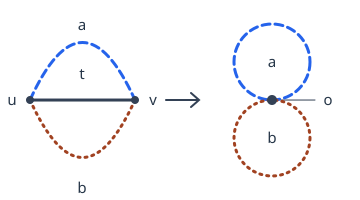

# ATOP8 グラフと自由群

[ATOP7](../ATOP7/index.md) では二つの円周を一点で貼り合わせると、二つの生成元の間に新しい関係式がないことを見ました。今回は複数の交差点を持つ道路網のような空間を扱います。すべての道路を独立な生成元にする必要はありません。どの道路を残せば穴の情報が保たれるかを調べましょう。

直接の前提は [ATOP2](../ATOP2/index.md)、[ATOP3](../ATOP3/index.md)、[ATOP4](../ATOP4/index.md)、[ATOP5](../ATOP5/index.md)、[ATOP6](../ATOP6/index.md)、[ATOP7](../ATOP7/index.md) です。道の積は左から右へ進む順序とします。

<!-- definition-example-audit: strict -->

## 1. 辺を区間として扱う

頂点の集合だけを見ても、二つの交差点間の道路が一本か三本かは分かりません。そこで各辺を独立した閉区間として用意し、その端点だけを指定された頂点に貼ります。辺の内部には連続的に動けます。

<!-- formal-statement-start -->
> **定義（グラフの幾何学的実現）**
> 空でない有限頂点集合 $V$、有限辺集合 $E$、端点写像 $s,t:E\to V$ を取る。離散位相を持つ $V$ と各辺の区間 $I_e=[0,1]$ の非交和で、$0_e$ を $s(e)$、$1_e$ を $t(e)$ と同一視した商空間を幾何学的実現 $X$ とする。各区間からの写像を $e:[0,1]\to X$ と書く。端点の順序は辺をたどる正向きを指定するだけである。
<!-- formal-statement-end -->

<!-- definition-example-start: def-atop8-graph-realization -->
**定義の確認**

$V=\{u,v\}$、$E=\{t,a,b\}$ とし、各辺の始点を $u$、終点を $v$ とします。三つの区間の左端はすべて $u$、右端はすべて $v$ になります。一方 $a(1/2)$ と $b(1/2)$ は同一視されないので、別の点です。三本の辺を持つこの空間を以下では例として用います。端点が同じ一辺だけなら両端を同一視した円周になります。
<!-- definition-example-end -->

有限グラフの幾何学的実現はコンパクトで Hausdorff です。コンパクト性は有限個のコンパクト区間と点の非交和の連続像であることから従います。各内部点の近傍にはその辺の小開区間を、頂点の近傍には接続する各辺の短い端点区間と頂点自身を取れます。これらは商位相の定義から開です。異なる二点に対して十分短い区間を選ぶと互いに交わらないので Hausdorff 性も成り立ちます。有限個の辺と頂点は閉集合であり、この上で一致する連続写像を貼り合わせられます。

辺を正向きまたは逆向きに有限回たどり、隣接する端点を一致させた列を辺の道とします。任意の二頂点をこのような列で結べるグラフをここでは連結として扱います。この条件なら任意の内部点も端点を経由して結べるので幾何学的実現は弧状連結です。逆に頂点の到達可能性による分類は、各類に属する頂点と接続する辺の実現を合わせた互いに素な開閉集合への分割となるため、位相的連結性からも条件が従います。

グラフでは端点が等しい辺も、同じ二頂点を結ぶ複数の辺も許します。重みや距離は基本群の計算には必要ありません。

## 2. 穴を作らない辺を選ぶ

連結性を保ったまま余分な辺を取り去り、すべての頂点をつなぐ最小限の部分を探します。辺を一つも重複して通らず、始点・終点以外の頂点も重複しない非空の閉じた辺の道をサイクルとします。自己ループは長さ1、異なる平行辺の往復は長さ2のサイクルです。同じ辺を行ってすぐ戻るだけではサイクルではありません。

<!-- formal-statement-start -->
> **定義（全域木）**
> 有限連結グラフ $(V,E,s,t)$ に対し、頂点をすべて含み、辺集合が $E_T\subseteq E$ である部分グラフが連結でサイクルを持たないとき、これを全域木 $T$ とする。以下ではその幾何学的実現も $T$ と書く。
<!-- formal-statement-end -->

<!-- definition-example-start: def-atop8-spanning-tree -->
**定義の確認**

三辺の例で $E_T=\{t\}$ とします。$u,v$ の両方が含まれ、$t$ により結ばれます。サイクルを作るには異なる辺が少なくとももう一本必要ですが $t$ しかありません。したがって全域木です。$t,a$ の両方を残すと $ta^{-1}$ が長さ2のサイクルになり、全域木の条件を失います。
<!-- definition-example-end -->

<!-- formal-statement-start -->
> **定理（全域木の存在と辺数）**
> 有限連結グラフの頂点数を $n$ とする。全域木が存在し、任意の全域木の辺数は $n-1$ である。全域木の任意の二頂点を結ぶ、頂点を重複しない辺の道は一意である（同一点間では空の道）。
<!-- formal-statement-end -->

見取り図：基点から未訪問の頂点へ一本ずつ辺を伸ばすと、新しい頂点を加えるたびに辺が一本増えます。サイクルがないことは、後から別の経路を追加できないことに対応します。

<!-- proof-start -->
### 証明

一つの頂点 $o$ を選び、頂点集合 $S=\{o\}$、辺集合を空集合として始めます。$S\ne V$ なら、連結性により $o$ から $V\setminus S$ の頂点へ向かう辺の道があります。その道で初めて $S$ の外へ出る辺を選び、外側の端点とこの辺を加えます。新しい頂点は追加した部分の中で次数1です。よって追加した辺を含むサイクルは作れず、以前の部分にもサイクルはありません。連結性も保たれます。これを $n-1$ 回繰り返すと全域木になります。

任意の全域木 $T$ についてもこの構成を $T$ の辺に限定して行えます。得た $n-1$ 本の辺はすべての頂点を結びます。もし $T$ にそれ以外の辺 $e$ が残れば、両端をすでに結ぶ道から、繰り返した頂点間の部分を削除して頂点の重複のない道を得ます。そこに $e$ を加えるとサイクルになります。両端が同じ場合は $e$ 自体がサイクルです。これは仮定に反するので、$T$ の辺数は $n-1$ です。

二頂点間に二つの異なる重複のない道が存在すると仮定します。始点から共通の辺をたどり、最初に分かれる頂点を $w$ とします。一方の道を $w$ から進み、他方の $w$ より後の部分と最初に出会う頂点を $z$ とします。終点は共通なので $z$ は存在します。二つの $w$ から $z$ への部分は端点以外で交わらず、異なる辺を用います。一方を順に、他方を逆にたどればサイクルが生じます。よって二つの道は一致します。
<!-- proof-end -->

図の左側では実線 $t$ が全域木であり、破線 $a$ と点線 $b$ は全域木に属さない辺です。右側では $u,v,t$ が基点（図の $o$、以下の商空間では $*$）一点になり、二本の非木辺がそれぞれ円周になります。次節ではこの操作が基本群を変えない理由を証明します。

## 3. 全域木を一点に縮約する

木の内部には戻り道の選択肢がありません。基点を根にして、各点を根へ向けて移動させると木を一点へ縮められます。しかしグラフ全体で木の端点だけを動かすと、他の辺とのつなぎ目が切れてしまいます。そこで他の辺の両端に、移動した端点から元の端点までの道を付け足します。

<!-- formal-statement-start -->
> **定理（全域木の縮約）**
> 有限連結グラフの幾何学的実現を $X$、全域木を $T$、頂点である基点を $o$ とする。$T$ 全体を一点 $*$ と同一視する商写像 $q:X\to X/T$ は、基点を固定するホモトピーの意味でホモトピー同値である。従って

$$
q_*:\pi_1(X,o)\longrightarrow\pi_1(X/T,*)
$$

> は群同型である。
<!-- formal-statement-end -->

見取り図：$q$ でつぶした木の代わりに、根から各非木辺の始点まで進み、その辺を渡り、終点から根へ戻る道を対応させます。商空間の各円周をこの道に送ることで逆写像をホモトピーの意味で構成します。

<!-- proof-start -->
### 証明

各辺の長さを1とし、木を根 $o$ から見ます。[全域木の存在と辺数](#thm-atop8-spanning-tree) の一意性により、木の各点 $x$ へは根からただ一つの重複のない道があります。内部点なら所属辺の根に近い端点まで進み、その辺を必要なだけたどります。

その長さを $d_x$、根から長さの割合 $r$ の位置を $p_x(r)$ とし、$p_o(r)=o$ とします。

木の辺を根から遠い向きに座標 $z\in[0,1]$ で表すと、手前の端点の根からの長さを $k$ として $d_x=k+z$ です。

根から $(1-h)(k+z)$ の位置が手前の端点以前にある場合は根からその端点への道を、以後なら当該辺をたどります。

境目の長さ $k$ では両者が同一点なので連続です。$k=0$ の場合は当該辺の座標が $(1-h)z$ となります。

従って木の各辺上で連続な

$$
H(x,h)=p_x(1-h)
$$

が定まり、頂点で一致するので木全体で連続です。$H(x,0)=x$、$H(x,1)=o$、$H(o,h)=o$ です。

次に木に属さない辺 $e$ の始点を $u$、終点を $v$ とします。時間 $h$ で辺の座標 $z$ を三つに分けて次の写像を定めます。

$$
H(e(z),h)=
\begin{cases}
p_u(1-h+3z),&0\le z\le h/3,\\
e\left(\dfrac{z-h/3}{1-2h/3}\right),
 &h/3\le z\le 1-h/3,\\
p_v(1-3(z-1+h/3)),&1-h/3\le z\le1.
\end{cases}
$$

第一部分の引数は $1-h$ から1へ、第三部分の引数は1から $1-h$ へ動きます。中央の分母は $h\in[0,1]$ で $1/3$ 以上なので零になりません。

境界 $z=h/3$ では第一・第二部分が $u$、境界 $z=1-h/3$ では第二・第三部分が $v$ となります。

各領域は閉集合で式は連続なので貼り合わせも連続です。$z=0,1$ では木の変形と一致し、自己ループの場合も矛盾しません。$h=0$ では中央部分が $e(z)$ です。

有限個の閉じた辺および頂点と時間区間の積に対して貼り合わせを使うと、全体の連続な $H:X\times[0,1]\to X$ が得られます。

$h=1$ では木全体が $o$ に写り、非木辺の像は三等分した道

$$
\ell_e=p_u*e*p_v^{-1}
$$

です。ここで $p_u,p_v$ は根からそれぞれの端点への道であり、三等分と二項の道の積のパラメータ差は [道の再パラメータ化](../ATOP4/index.md#prop-atop4-reparametrization) で吸収されます。

$H(-,1)$ は $q$ の各ファイバー上で一定なので商位相の定義により連続写像 $g:X/T\to X$ を誘導し、$g(*)=o$、$gq=H(-,1)$ です。従って $gq$ は基点を固定して恒等写像とホモトピックです。

$X/T$ は非木辺の区間の両端をすべて一点へ同一視した空間です。二段階の同一視は直接同一視と同じ商位相を与えます。各円周上で $qg$ は両端の三分の一を基点に置き、中央の三分の一で円周を一周します。商の各辺の座標を用い、

$$
f(z)=\max(0,\min(1,3z-1))
$$

とすれば $qg$ の辺上の値は $q(e(f(z)))$ です。$f(0)=0$、$f(1)=1$ なので、座標 $(1-h)f(z)+hz$ による変形は両端を保ちます。各円周の変形は基点で一致するため、$qg$ と恒等写像を結ぶ連続な基点固定ホモトピーになります。非木辺がないときは商が一点であり、こちらの条件も成立します。

以上より [ホモトピー同値の定義](../ATOP2/index.md#def-atop2-homotopy-equivalence) を満たします。[基本群の誘導準同型](../ATOP4/index.md#thm-atop4-induced-homomorphism) により誘導写像は積と合成を保存し、基点固定ホモトピーで等しい誘導写像を与えます。よって $g_*q_*=\mathrm{id}$、$q_*g_*=\mathrm{id}$ であり $q_*$ は同型です。
<!-- proof-end -->

ここで $T$ を一点に縮約することは、元のグラフ内の強変形レトラクトを取ることとは違います。例えば円周の頂点を二つに分けて一方の辺を縮約しても、残る円周は元の空間の部分集合ではありません。商写像とそのホモトピー逆を構成したことが重要です。

## 4. 円周の集まりと自由群

一点で円周をいくつか貼り合わせた空間では、それぞれの円周を正向き・逆向きに回る操作ができます。円周の順序は一般に交換できません。

<!-- formal-statement-start -->
> **定義（円周の花束）**
> $r$ を非負整数とする。$r$ 個の円周のそれぞれの指定点をただ一つの点 $*$ に同一視した商空間を円周の花束 $B_r$ とする。$r=0$ では一点空間を取る。
<!-- formal-statement-end -->

<!-- definition-example-start: def-atop8-bouquet -->
**定義の確認**

$r=2$ では二つの区間の四端点をすべて $*$ とし、区間内部の点はすべて別の点として残します。一方の円周の内部点を他方の内部点と同一視しないので、両者の交わりは $\{*\}$ だけです。これが上図右側の空間です。$r=1$ では一つの円周、$r=0$ では基点だけです。
<!-- definition-example-end -->

[群の表示](../ATOP7/index.md#def-atop7-presentation) で関係語の集合を空にすると、文字とその逆文字の隣接対を挿入・削除する操作だけが残ります。

<!-- formal-statement-start -->
> **定義（自由群）**
> 集合 $S$ に対し、関係語の集合が空である群の表示

$$
F(S)=\langle S\mid\varnothing\rangle
$$

> を $S$ 上の自由群とする。各文字 $s\in S$ の類が自由生成元である。有限集合 $S$ の要素数が $r$ のとき $F_r$ と書く。隣接する逆文字対を持たない語を既約語とする。
<!-- formal-statement-end -->

<!-- definition-example-start: def-atop8-free-group -->
**定義の確認**

$S=\{a,b\}$ とし、関係語は一つも指定しません。$abb^{-1}a^{-1}b$ では中央の $bb^{-1}$ を消すと $aa^{-1}b$、さらに $aa^{-1}$ を消すと $b$ です。最後の $b$ は既約語です。$ab$ も $ba$ も既約語ですが、文字の順番が違います。次の命題によりこの二つは異なる群の元です。
<!-- definition-example-end -->

<!-- formal-statement-start -->
> **命題（自由群の既約語の一意性）**
> 自由群 $F(S)$ の各元はただ一つの既約語で表される。任意の群 $K$ への準同型は、各 $s\in S$ の像を任意に指定することと一対一に対応する。
<!-- formal-statement-end -->

見取り図：左から文字を読み、最後の文字が次の文字の逆なら消し、そうでなければ末尾に足します。途中に逆文字対を挿入しても、読み終わった状態が変わらないことを示します。

<!-- proof-start -->
### 証明

空の語から始め、入力の文字を一つずつ処理します。保持している既約語の末尾が入力文字 $c$ の逆 $c^{-1}$ なら末尾を削除し、それ以外なら $c$ を末尾に加えます。各段階の語は既約で、読んだ部分の語と自由群で同値です。従って出力は入力を表す既約語になります。

任意の既約語 $w$ を保持している状態で $cc^{-1}$ を処理します。$w$ が $c^{-1}$ で終わらない場合、$c$ が追加されて直後に消えるので $w$ に戻ります。$w=w'c^{-1}$ の場合、最初の $c$ で末尾が消えます。$w$ が既約であるため $w'$ の末尾は $c$ ではありません。よって次の $c^{-1}$ は追加され、やはり $w$ に戻ります。$c^{-1}c$ についても $c$ を逆文字に置き換えた同じ議論が成り立ちます。

従って任意の前後の語の間に逆文字対を挿入・削除しても、残りの文字の処理結果まで一致します。自由群で同値な語は同じ出力を持ちます。一方、既約語を入力した場合は削除が起きずその語自身が出力されます。従って同値な二つの既約語は文字列として同一です。

準同型については [群の表示からの準同型](../ATOP7/index.md#prop-atop7-presentation-maps) を適用します。関係語が空集合なので、各生成元の像を選ぶ際に確認すべき追加条件はありません。指定した像への準同型が一意に存在します。
<!-- proof-end -->

例えば $ab$ と $ba$ は別々の既約語なので $F_2$ は非可換です。指数和がともに0になる語 $aba^{-1}b^{-1}$ も四文字の既約語であり、単位元ではありません。穴を回った順番を記憶することが基本群の特徴です。

<!-- formal-statement-start -->
> **定理（花束の基本群）**
> 非負整数 $r$ に対し、円周の花束 $B_r$ の各円周の正向き一周を $a_i$ とすると

$$
\pi_1(B_r,*)\cong F_r
$$

> であり、同型では各一周の類が対応する自由生成元に写る。
<!-- formal-statement-end -->

見取り図：円周を一本ずつ加え、交わりが基点へ縮められる開被覆を作れば、既習の van Kampen 定理で関係式を増やさず生成元を一つ加えられます。

<!-- proof-start -->
### 証明

$r=0$ は一点の基本群と空集合上の自由群で、どちらも単位元のみです。$r=1$ は [円周の基本群](../ATOP6/index.md#thm-atop6-fundamental-group-circle) と、既約語が $a^n$ の形になることから従います。

$r\ge2$ とし、$B_{r-1}$ の結果を仮定します。各円周の基点と異なる点 $b_i$ を取り、$U=B_r\setminus\{b_r\}$、$V=B_r\setminus\{b_1,\dots,b_{r-1}\}$ とします。有限点集合は閉なので両方開です。除去した点の集合が互いに素なので $U\cup V=B_r$ です。

[円周の実直線による被覆](../ATOP5/index.md#prop-atop5-circle-cover) を一周分の開区間に制限すると、指定点を除いた円周と開区間との同相を得ます。基点の座標を $s_*$ とすると、$(1-h)s+hs_*$ によってその弧を基点へ縮められます。$U$ では最後の円周から一点を除いた弧を縮めて $B_{r-1}$ を固定し、$V$ では最初の $r-1$ 本から一点ずつ除いた弧を縮めて最後の円周を固定します。各円周との交わりはそれぞれの開集合内で閉であり、基点上で変形が一致するので貼り合わせは連続です。$U\cap V$ ではすべての弧を同時に基点へ縮めます。三集合はすべて弧状連結で基点を含みます。

[強変形レトラクトと基本群](../ATOP4/index.md#prop-atop4-deformation-fundamental-group)、帰納法の仮定および円周の基本群から、$\pi_1(U,*)\cong F_{r-1}$、$\pi_1(V,*)\cong\mathbb Z$ です。[可縮空間は単連結](../ATOP4/index.md#prop-atop4-contractible-simply-connected) により交わりの基本群は自明です。[van Kampen定理](../ATOP7/index.md#thm-atop7-van-kampen) では交わりから来る関係式が自明なので

$$
\pi_1(B_r,*)\cong F_{r-1}*\mathbb Z.
$$

この自由積から任意の群への準同型は、[自由積の普遍性](../ATOP7/index.md#prop-atop7-free-product-property) により二つの因子からの準同型に対応します。最初の因子からの準同型は最初の $r-1$ 文字の像、整数加法群からの準同型は1の像で一意に定まります。そこで $F_r$ から自由積へ、各文字を対応する因子の生成元へ送る準同型を作ります。逆向きには二因子の生成元を $F_r$ の対応する文字へ送り、自由積の普遍性で延長します。合成は各文字または各因子上で恒等写像なので、これらの準同型は互いに逆です。帰納法により結論が従います。
<!-- proof-end -->

## 5. 頂点数と辺数だけで階数を求める

全域木を縮約すれば、非木辺の本数だけ円周が残ります。従って空間にどれだけ独立した一周があるかを、辺と頂点を数えるだけで計算できます。

<!-- formal-statement-start -->
> **定理（連結グラフの基本群と階数）**
> 有限連結グラフの幾何学的実現を $X$、頂点数を $n$、辺数を $m$、基点を頂点 $o$ とする。このとき

$$
\pi_1(X,o)\cong F_{m-n+1}.
$$

> 任意の全域木を選び、木に属さない各辺 $e$ に対し根から端点への木の道を $p_{s(e)},p_{t(e)}$ とすると、一周の類

$$
[p_{s(e)}*e*p_{t(e)}^{-1}]
$$

> が自由生成元をなす。自由生成元の個数 $m-n+1$ は、基本群を生成するのに必要な最小個数に等しい。
<!-- formal-statement-end -->

見取り図：全域木の辺数が $n-1$、縮約後の円周数が $m-(n-1)$ であることを順に使います。最小性は各生成元を二元群に送る写像の数から確かめます。

<!-- proof-start -->
### 証明

[全域木の存在と辺数](#thm-atop8-spanning-tree) により、全域木を選べばその辺数は $n-1$ です。[全域木の縮約](#thm-atop8-tree-collapse) により $q_*$ は同型であり、$X/T$ は非木辺の本数

$$
r=m-(n-1)=m-n+1
$$

だけの円周の花束です。[花束の基本群](#thm-atop8-bouquet-group) から $\pi_1(X/T,*)\cong F_r$ です。各ループの像は木の道が基点に縮み、残る辺を正向きに一周するので、$q_*$ とこの同型の合成で対応する文字へ写ります。よって与えたループの類が自由生成元です。

最小性を示します。二元加法群 $\mathbb Z/2\mathbb Z$ を取ると、[自由群の既約語の一意性](#prop-atop8-reduced-word) の準同型に関する部分から、各文字の像は0または1の二通りで独立に選べます。従って $F_r$ から二元群への準同型は $2^r$ 個です。

一方 $F_r$ が $k$ 個の元で生成されるなら準同型はその $k$ 個の像で一意に決まり、選択肢は最大 $2^k$ 個です。

ゆえに

$$
2^r\le 2^k,\qquad r\le k.
$$

自由生成元 $r$ 個は実際に生成するため、これが最小個数であり階数と呼べます。
<!-- proof-end -->

三辺の例では $n=2,m=3$ なので階数は $3-2+1=2$ です。全域木を $t$、基点を $u$、各辺の正向きを $u$ から $v$ とすると生成元は

$$
A=[a*t^{-1}],\qquad B=[b*t^{-1}].
$$

例えば $a*b^{-1}$ という閉じた道は

$$
AB^{-1}=[a*t^{-1}*t*b^{-1}]
         =[a*b^{-1}]
$$

となります。途中の往復は [道ホモトピー類の演算律](../ATOP4/index.md#thm-atop4-path-laws) によって消えます。別の全域木を選べば生成元の表示は変わりますが、必要な個数は同じです。

辺数を増やしても、既存頂点に新しい頂点を一本の枝でつないだだけなら $m$ と $n$ が一つずつ増えるので階数は変わりません。逆に既存の二頂点間に新しい辺を付け足せば、階数は一つ増えます。円周を円板で埋める操作はグラフの辺の追加ではなく、内部の二次元領域を加えるため、この公式をそのまま使えません。

## 6. 演習

### 演習 ATOP8-A1：端点の同一視

- Level: A

頂点が一つ $o$、辺が二つ $a,b$ で、ともに始点・終点が $o$ であるとする。幾何学的実現で $a(1/3)$ と $b(1/3)$ は同一点か。各辺の端点はどうなるか。

<!-- solution-start -->
**詳細解答**

[グラフの幾何学的実現](#def-atop8-graph-realization) では端点だけを指定された頂点へ同一視します。従って $a(0)=a(1)=b(0)=b(1)=o$ です。両方の $1/3$ は各区間の内部にあるので同一視されず、異なる点です。各辺が円周となり、二つの円周は $o$ だけを共有します。
<!-- solution-end -->

### 演習 ATOP8-A2：全域木の判定

- Level: A

頂点 $u,v,w$、辺 $uv,vw,wu$ および頂点 $w$ の自己ループ $d$ を持つグラフを考える。辺集合 $\{uv,vw\}$ は全域木か。これに $d$ を加えた場合はどうか。

<!-- solution-start -->
**詳細解答**

$\{uv,vw\}$ は三頂点を含み、$u$ から $w$ へ $v$ を経由して進めるので連結です。$u,w$ はいずれも次数1であり、サイクルに含めるには異なる二辺が必要ですが存在しません。$v$ だけの自己ループもありません。よって [全域木](#def-atop8-spanning-tree) の条件を満たします。$d$ を加えると $w$ から $w$ に戻る一辺のサイクルが生まれるので全域木ではありません。
<!-- solution-end -->

### 演習 ATOP8-A3：既約語

- Level: A

$F(\{a,b\})$ で語 $ab^{-1}baa^{-1}b$ を簡約し、$ba$ と同じ元か判定せよ。

<!-- solution-start -->
**詳細解答**

隣接する $b^{-1}b$ を削除すると $aaa^{-1}b$、次に隣接する $aa^{-1}$ を削除すると $ab$ です。隣接逆文字対は残っていないため既約です。$ba$ も既約ですが文字列が異なります。[自由群の既約語の一意性](#prop-atop8-reduced-word) により別の元です。
<!-- solution-end -->

### 演習 ATOP8-A4：枝と穴の数

- Level: A

有限連結グラフの頂点数が5、辺数が7である。全域木の辺数、非木辺数、基本群を求めよ。さらに頂点を一つ増やして既存頂点と一本の辺でつなぐとどう変わるか。

<!-- solution-start -->
**詳細解答**

[全域木の存在と辺数](#thm-atop8-spanning-tree) により木の辺数は $5-1=4$、非木辺数は $7-4=3$ です。[連結グラフの基本群と階数](#thm-atop8-graph-fundamental-group) により基本群は $F_3$ です。追加後は連結性を保ち、頂点数6、辺数8なので非木辺数は $8-(6-1)=3$ です。基本群は再び $F_3$ であり、新しい枝は独立な一周を増やしません。
<!-- solution-end -->

### 演習 ATOP8-B1：三角形と自己ループ

- Level: B

頂点 $u,v,w$、向き付き辺 $a:u\to v$、$b:v\to w$、$c:w\to u$、$d:w\to w$ を持つグラフを考える。基点 $u$、全域木 $\{a,b\}$ の自由生成元を明示し、ループ $abcd$ が基点付きループか判定せよ。さらにループ $abdc$ を自由生成元の積で表せ。

<!-- solution-start -->
**詳細解答**

木の根からの道は $p_u$ が定値道、$p_v=a$、$p_w=a*b$ です。非木辺は $c,d$ なので [連結グラフの基本群と階数](#thm-atop8-graph-fundamental-group) の式に代入して

$$
C=[a*b*c],\qquad D=[a*b*d*b^{-1}*a^{-1}]
$$

を得ます。$abc$ は $u$ に戻りますが $d$ の始点は $w$ です。従って $abcd$ は連結できずループではありません。$abdc$ は $u\to v\to w\to w\to u$ なのでループです。

$$
DC=[a*b*d*b^{-1}*a^{-1}*a*b*c].
$$

[道ホモトピー類の演算律](../ATOP4/index.md#thm-atop4-path-laws) で中央の $a^{-1}*a$、続いて $b^{-1}*b$ を消すと $DC=[a*b*d*c]$ となります。階数は $4-3+1=2$ です。
<!-- solution-end -->

### 演習 ATOP8-B2：木の変更

- Level: B

三辺 $t,a,b$ をすべて $u$ から $v$ に向ける。全域木 $\{t\}$ の生成元 $A=[at^{-1}], B=[bt^{-1}]$ と、全域木 $\{a\}$ の生成元 $P=[ta^{-1}], Q=[ba^{-1}]$ の相互変換を求めよ。

<!-- solution-start -->
**詳細解答**

両者とも二頂点を一本の辺で結ぶ全域木なので [連結グラフの基本群と階数](#thm-atop8-graph-fundamental-group) により自由生成元です。[道ホモトピー類の演算律](../ATOP4/index.md#thm-atop4-path-laws) を使うと

$$
A^{-1}=[ta^{-1}]=P,
$$

$$
BA^{-1}=[bt^{-1}ta^{-1}]=[ba^{-1}]=Q.
$$

逆向きには $A=P^{-1}$ であり、$Q=BP$ の両辺を右から $P^{-1}$ 倍して $B=QP^{-1}$ です。二つの変換を合成すると $Q P^{-1}=(BA^{-1})A=B$ となり、$P=A^{-1}$ の逆も一致します。階数2は不変ですが、生成元の選び方は一意ではありません。
<!-- solution-end -->

### 演習 ATOP8-B3：辺の細分と非連結性

- Level: B

有限連結グラフの一辺を二辺に分け、その中間に新頂点を一つ置く。基本群の階数が変わらないことを示せ。次に二つの互いに素な円周を頂点一つ・自己ループ一つずつで表した非連結グラフで、全体の $m-n+1$ をそのまま基点の基本群へ使えるか調べよ。

<!-- solution-start -->
**詳細解答**

細分後も元の辺を二つの辺で連続してたどれるので連結性が保たれます。頂点数は $n+1$、辺数は $m-1+2=m+1$ です。[連結グラフの基本群と階数](#thm-atop8-graph-fundamental-group) に代入すると

$$
(m+1)-(n+1)+1=m-n+1.
$$

実際に元の辺の座標の前半を新しい第一辺、後半を第二辺へ線形に対応させれば同相も構成できます。非連結な場合は、基点のある成分から他成分へ向かう道がないので全体をつなぐ全域木を構成できません。この例では偶然 $m-n+1=2-2+1=1$ が各成分の階数1と一致しますが、公式の仮定は満たされません。例えばさらに二番目の成分に自己ループを加えると全体の式は2になり、第一成分の基本群は依然として $\mathbb Z$ です。[連結グラフの基本群と階数](#thm-atop8-graph-fundamental-group) は基点を含む成分に適用します。
<!-- solution-end -->

### 演習 ATOP8-B4：縮約中の辺の座標

- Level: B

三本の辺 $t,a,b$ をすべて $u$ から $v$ に向ける。根 $u$、木 $\{t\}$ とし、木を縮約する第3節のホモトピーを用いる。時間 $h=1/2$ における非木辺 $a$ の像を三つの座標区間で求め、つなぎ目と両端の一致を確認せよ。

<!-- solution-start -->
**詳細解答**

根から $u$ への道は定値道、根から $v$ への道は $p_v(r)=t(r)$ です。[全域木の縮約](#thm-atop8-tree-collapse) の構成に $h=1/2$ を代入すると、分割点は $h/3=1/6$、$1-h/3=5/6$ です。中央の分母は $1-2h/3=2/3$ なので中央の座標は $(3/2)z-1/4$ となります。従って

$$
H(a(z),1/2)=
\begin{cases}
u,&0\le z\le 1/6,\\
a(3z/2-1/4),&1/6\le z\le5/6,\\
t(7/2-3z),&5/6\le z\le1.
\end{cases}
$$

中央の式に $z=1/6$ を入れると座標0、$z=5/6$ を入れると座標1です。後者では第三部分の座標も $7/2-5/2=1$ なので、つなぎ目はいずれも一致します。$z=0$ では根 $u$ に留まり、$z=1$ では第三部分の座標が $1/2$ となり、木の端点 $v$ の移動先 $t(1/2)$ に一致します。このように非木辺の両端に木の部分路を付けることで、辺と木のつなぎ目を保ちます。
<!-- solution-end -->

### 演習 ATOP8-C1：完全グラフの生成元と最小性

- Level: C

頂点 $0,1,2,3$ の各異なる二頂点間に一本の辺を持つグラフを考える。辺 $e_{ij}$ は $i<j$ のとき $i$ から $j$ に向ける。基点0、全域木 $\{e_{01},e_{02},e_{03}\}$ を使って自由生成元を列挙し、ループ $e_{01}e_{12}e_{23}e_{03}^{-1}$ を生成元で表せ。さらに二つの元だけでは基本群を生成できないことを準同型の個数を使って示せ。

<!-- solution-start -->
**詳細解答**

木は0から他の三頂点へ一本ずつ辺を伸ばした部分で、連結であるうえ他の頂点の次数が1なのでサイクルを持ちません。根からの道は $p_i=e_{0i}$（$i=1,2,3$）です。六辺のうち非木辺は $e_{12},e_{13},e_{23}$ の三本であり、[連結グラフの基本群と階数](#thm-atop8-graph-fundamental-group) に従って

$$
A=[e_{01}e_{12}e_{02}^{-1}],
$$

$$
B=[e_{01}e_{13}e_{03}^{-1}],
$$

$$
C=[e_{02}e_{23}e_{03}^{-1}]
$$

を得ます。$6-4+1=3$ なので基本群は $F_3$ です。積 $AC$ は

$$
AC=[e_{01}e_{12}e_{02}^{-1}e_{02}e_{23}e_{03}^{-1}]
$$

です。[道ホモトピー類の演算律](../ATOP4/index.md#thm-atop4-path-laws) で $e_{02}^{-1}e_{02}$ を消して、求めるループの類になります。

[自由群の既約語の一意性](#prop-atop8-reduced-word) の準同型に関する部分を使うと、二元加法群への準同型は $A,B,C$ の像を独立に0または1へ指定して $2^3=8$ 個あります。仮に二元で生成できれば、それらの像の組は高々 $2^2=4$ 通りで、準同型は生成元の像で決まるため高々4個です。$8>4$ は矛盾です。よって三元が必要であり、上で作った三元が最小です。
<!-- solution-end -->

## 7. 次の講義へ

有限連結グラフの基本群を計算できるようになりました。次の講義では、この群の部分群がどのように被覆空間を記述するかを調べます。木であるグラフには非自明な一周がないという事実が、円周の花束を覆う空間を理解する手がかりになります。

## 参考文献

- A. Hatcher, [Algebraic Topology](https://pi.math.cornell.edu/~hatcher/AT/ATchapters.html), Chapter 1, §1.A（Graphs and Free Groups）。
