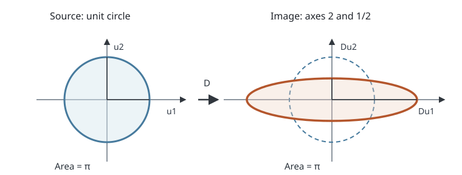

# GEOD13 地図投影の幾何・歪み

[GEOD12の測地線](../GEOD12/index.md#def-geod12-direct-inverse)は楕円体上の距離と方位を与えました。しかし、緯度・経度を二つの平面座標に変えても、その距離と角度がそのまま紙面上へ移るとは限りません。同じ地形を描いても、地域の測量図では角度の扱いやすさが、世界の統計地図では面積の比較が重要になります。どの量を保存し、どの量が変形するかを**投影の微分**で判定しましょう。

既習の[回転楕円体の第一基本形式](../GEOD4/index.md#thm-geod4-ellipsoid-metric)は、緯度・経度の微小変化を地表の実際の長さへ換算します。この章ではそれと平面上の微小変化を比較します。

到達目標は次の五つです。

1. 投影のJacobianを計算し、緯度・経度の単位を考慮して実際の局所縮尺を出す。
2. 等角・等積・一方向の等距離を、異なる数学的条件として判定する。
3. Tissotの指示楕円を構成し、主方向の伸縮と任意方向の伸縮を読む。
4. 球面上の二つの具体的な投影を、Jacobianと面積要素で検算する。
5. 一点での等長性と、開いた領域での等長性・有限距離保存の違いを説明する。

以下、楕円体の長半径を $a>0$、短半径を $0<b\le a$、第一離心率の二乗を $e^2=1-b^2/a^2$ とします。角度は**微分時にはラジアン**で測ります。緯度は測地緯度 $\phi$、経度は $\lambda$ とし、原則として極を含まない滑らかな座標領域で議論します。

<!-- definition-example-audit: strict -->

---

## 1. 緯度・経度を平面へ写したとき、微小な矢印はどうなるか

地図の座標を、東向きに増える座標 $E$ と、北向きに増える座標 $N_p$ の順で書きます。添字 $p$ は、楕円体の卯酉線曲率半径 $N(\phi)$ と投影平面の北座標を区別するためです。座標の名前に「東」「北」が入っていても、投影された経緯線が常に紙面の軸と平行とは限りません。

微小な緯度差・経度差を地図上の矢印へ変えるには、各座標の偏微分を並べます。この $2\times2$ 行列がJacobianです。局所的な話なので、日付変更線での経度の切れ目や極の座標退化を含む一枚の式を、地球全体の滑らかな一対一写像とみなすことはしません。

<!-- formal-statement-start -->
> **定義（地図投影とJacobian）**
> $0<b\le a$ の回転楕円体の非極点を、測地緯度 $\phi$ と経度 $\lambda$ で表す。開いた座標領域 $U$ から平面 $\mathbb R^2$ への $C^1$ 級写像

$$
F:U\longrightarrow\mathbb R^2,\qquad
F(\phi,\lambda)=
\begin{pmatrix}E(\phi,\lambda)\\N_p(\phi,\lambda)\end{pmatrix}
$$

> を、ここでは**局所的な地図投影**という。そのJacobianを、入力を $(\phi,\lambda)$、出力を $(E,N_p)$ の順にして

$$
J_F=
\begin{pmatrix}
\partial_\phi E&\partial_\lambda E\\
\partial_\phi N_p&\partial_\lambda N_p
\end{pmatrix}
$$

> とする。$\det J_F\ne0$ の点では[逆関数定理](../../../基礎科目/RA/RA6A/index.md#thm-ra6a-inverse-function)により、その点の近くで局所的な逆写像がある。$J_F$ の列は、それぞれ緯度・経度を1ラジアンだけ変える方向の**一次の変化率**であって、有限角度の移動の矢印そのものではない。
<!-- formal-statement-end -->

<!-- definition-example-start: def-geod13-projection-jacobian -->
**定義の確認**。$a=5,b=4$（長さの単位は任意）の楕円体の赤道近くで

$$
F(\phi,\lambda)=\begin{pmatrix}5\lambda\\(16/5)\phi\end{pmatrix},
\qquad
J_F=\begin{pmatrix}0&5\\16/5&0\end{pmatrix}
$$

とします。これは滑らかな写像で、$\det J_F=-16\ne0$ なので赤道を含む小領域で局所的に逆を持ちます。例えば $d\phi=0.01$ rad、$d\lambda=0.02$ rad を入力すると、微小投影変位は $(dE,dN_p)=(0.10,0.032)$ です。これは線形な写像なので有限差についても同じ値になりますが、**楕円体上の有限経路長との一致まで主張していません**。後で、この写像が赤道の**一点では**長さを保存することを確かめます。
<!-- definition-example-end -->

---

## 2. 角度の微分を「地表で1 m」の変位へ正規化する

[GEOD4の二つの曲率半径](../GEOD4/index.md#def-geod4-curvature-radii)を

$$
M(\phi)=\frac{a(1-e^2)}{(1-e^2\sin^2\phi)^{3/2}},
\qquad
N(\phi)=\frac{a}{\sqrt{1-e^2\sin^2\phi}},
\qquad r(\phi)=N(\phi)\cos\phi
$$

と置きます。非極点では $M,r>0$ です。[第一基本形式](../GEOD4/index.md#thm-geod4-ellipsoid-metric)より、入力の微小変化 $v=(d\phi,d\lambda)^\mathsf T$ の地表での長さの二乗は

$$
ds^2=M^2d\phi^2+r^2d\lambda^2
=v^\mathsf Tgv,\qquad
g=\begin{pmatrix}M^2&0\\0&r^2\end{pmatrix}.
$$

一方、投影平面の通常のEuclid距離では、$dF=J_Fv$ の長さの二乗は $v^\mathsf T J_F^\mathsf TJ_Fv$ です。**同じ入力の接方向**を両方で測り、比を取れば初めて地図の縮尺が分かります。

緯度の変化を $M$ 倍した地表の北向き変位を $u_{\mathrm N}$、経度の変化を $r$ 倍した東向き変位を $u_{\mathrm E}$ とします。物理的な直交座標 $u=(u_{\mathrm N},u_{\mathrm E})^\mathsf T$ に直す行列と、その逆は

$$
u=Bv,\quad B=\begin{pmatrix}M&0\\0&r\end{pmatrix},
\qquad
v=B^{-1}u.
$$

従って物理的な単位ベクトルを直接投影する行列は $J_F$ 自体ではなく $D=J_FB^{-1}$ です。この正規化を忘れると、緯度・経度の度数や座標軸の単位に依存する偽の「歪み」が出ます。

以下、偏微分を成分の下付き添字でも略記します。例えば $E_\phi=\partial E/\partial\phi$ は経度 $\lambda$ を固定した偏微分、$(N_p)_\lambda=\partial N_p/\partial\lambda$ は緯度 $\phi$ を固定した偏微分です。$E_\lambda$ と $(N_p)_\phi$ も同様です。これは曲線の媒介変数による全微分とは区別します。

<!-- formal-statement-start -->
> **定義（方向別局所縮尺と面積縮尺）**
> 上の非極点 $p$ で $F$ が $C^1$ 級とする。$v\ne0$ に対応する接方向の**局所長さ縮尺**を

$$
k_p(v)=\frac{\|J_F(p)v\|}{\sqrt{v^\mathsf Tg(p)v}}
$$

> と定める。$p$ における**面積縮尺**は、地表の微小面積に対する投影像の面積の比

$$
A_p=\frac{|\det J_F(p)|}{\sqrt{\det g(p)}}
=\frac{|\det J_F(p)|}{M(p)r(p)}
$$

> とする。縮尺は無次元である。$k_p(v)$ は方向の正の定数倍では変わらない。$A_p=0$ は投影がその点で面積を一次的に潰すことを意味する。
<!-- formal-statement-end -->

<!-- definition-example-start: def-geod13-scales -->
**定義の確認**。第1節の $a=5,b=4$ の赤道では $e^2=9/25$、$M(0)=b^2/a=16/5$、$r(0)=a=5$ です。緯度方向 $v=(1,0)$ では投影長も地表長も $16/5$、経度方向 $v=(0,1)$ では双方 $5$。さらに一般方向に対して

$$
J_F^\mathsf TJ_F
=\begin{pmatrix}(16/5)^2&0\\0&5^2\end{pmatrix}=g(0)
$$

なので $k_0(v)=1$ です。面積比も $|\det J_F|/(Mr)=16/16=1$。これらは赤道の**一点**での判定です。緯度が変われば $M(\phi),r(\phi)$ が変わるため、同じ $J_F$ でも一般には $k_p(v)=1$ ではありません。
<!-- definition-example-end -->

<!-- formal-statement-start -->
> **定理（投影の計量比較と縮尺式）**
> $0<b\le a$ の楕円体の非極点 $p$ で、$F$ を $C^1$ 級とし、$J=J_F(p)$、$g=\operatorname{diag}(M^2,r^2)$、$B=\operatorname{diag}(M,r)$、$D=JB^{-1}$ とする。投影が引き戻す平面の計量を $H=J^\mathsf TJ$ とすれば、任意の $v\ne0$ について

$$
k_p(v)^2=\frac{v^\mathsf THv}{v^\mathsf Tgv}
=\frac{\|Du\|^2}{\|u\|^2},\qquad u=Bv,
$$

> また面積縮尺は

$$
A_p=|\det D|=\frac{|\det J|}{Mr}.
$$

> 特に北向き・東向きの単位方向をそれぞれ $e_{\mathrm N}=(1,0)^\mathsf T$、$e_{\mathrm E}=(0,1)^\mathsf T$ とすれば

$$
k_{\mathrm N}=\frac{\sqrt{E_\phi^2+(N_p)_\phi^2}}M,\qquad
k_{\mathrm E}=\frac{\sqrt{E_\lambda^2+(N_p)_\lambda^2}}r.
$$
<!-- formal-statement-end -->

**証明の見取り図。** まず地表変位を $u=Bv$ に換算し、地図の変位を $Jv=Du$ と書き直します。面積は、両方の変換で微小な平行四辺形の面積が行列式の絶対値倍されることを使います。

<!-- proof-start -->
### 証明

地表側では $g=B^\mathsf TB=B^2$ なので

$$
v^\mathsf Tgv=v^\mathsf TB^\mathsf TBv=\|Bv\|^2=\|u\|^2.
$$

平面側では $dF=Jv=JB^{-1}u=Du$ だから

$$
\|dF\|^2=v^\mathsf TJ^\mathsf TJv=\|Du\|^2.
$$

両式の比を取ると長さ縮尺を得ます。また $B$ の列で張る地表微小平行四辺形の面積は $|\det B|\,|d\phi\,d\lambda|=Mr|d\phi\,d\lambda|$ です。地図上では列 $J$ が張る面積が $|\det J||d\phi\,d\lambda|$ となり、比は

$$
\frac{|\det J|}{|\det B|}
=|\det(JB^{-1})|=|\det D|.
$$

最後に $u=e_{\mathrm N}$ なら $v=(1/M,0)$、$u=e_{\mathrm E}$ なら $v=(0,1/r)$ を代入し、$D$ の第一列・第二列の長さをそれぞれ計算すれば北・東の縮尺式を得ます。
<!-- proof-end -->

有限の距離を求めるときは、[GEOD4の楕円体上の経路長の命題](../GEOD4/index.md#prop-geod4-curve-length)に沿って地表の速さを積分し、投影像では $\int\|J_F(\gamma(t))\gamma'(t)\|dt$ を積分します。**一地点の $k$ を有限区間全体へ掛けるだけ**では一般に正しい距離になりません。また、像の経路長と投影平面上の二点間の直線距離も区別します。

---

## 3. 「等角」「等積」「等距離」は異なる約束

小さな正方形を投影して考えると、二辺の長さ、二辺のなす角、面積の三つは別々に変わり得ます。例えば幅を2倍・高さを半分にすれば面積は保たれますが、斜めの線どうしの角度は変わります。一方向の長さが保たれても、別方向の長さが保たれるとは限りません。

<!-- formal-statement-start -->
> **定義（等角・等積・方向別等距離）**
> 楕円体の非極点 $p$ で、局所逆を持つ $C^1$ 級投影 $F$ を考える。$p$ のすべての非零接方向の組について、計量 $g$ で測った角度と投影平面の角度が等しいとき、$F$ は $p$ で**等角**という。面積縮尺 $A_p=1$ のとき $p$ で**等積**という。指定した非零方向 $v$ で $k_p(v)=1$ のとき、その方向に**局所的に等距離**という。
>
> 開いた領域で各条件が成立するとき、それぞれその領域で等角・等積・指定方向に等距離という。**全方向に等距離**とはすべての $v\ne0$ で $k_p(v)=1$ となることであり、これは点での等長性である。「等距離図法」という名称だけで、全方向・全点間の距離保存を意味するわけではない。
<!-- formal-statement-end -->

ここからの $D$ を直接指定する例は、地表の物理的な正規直交座標での一次変換を指定しています。実際、非極点 $p=(\phi_0,\lambda_0)$ を固定し、そこでの $B(p)=\operatorname{diag}(M(p),r(p))$ を用いれば、任意の正則な $2\times2$ 行列 $D_0$ に対して局所投影

$$
F(\phi,\lambda)=D_0B(p)
\begin{pmatrix}\phi-\phi_0\\\lambda-\lambda_0\end{pmatrix}
$$

を構成できます。このとき $J_F(p)=D_0B(p)$ だから $J_F(p)B(p)^{-1}=D_0$ です。従って、次の行列例でも元の地表計量を無視したわけではありません。

<!-- definition-example-start: def-geod13-preservation -->
**定義の確認**。地表の正規直交座標で $D=\operatorname{diag}(2,1/2)$ とします。第一方向 $e_1$ の縮尺は2、第二方向 $e_2$ は $1/2$ で、その積は1だから等積です。しかし $e_1+e_2$ と $e_1-e_2$ は元は直交しているのに、投影後の内積は $4-1/4=15/4\ne0$ で等角ではありません。また $D=\operatorname{diag}(1,2)$ では $e_1$ 方向だけ等距離で、面積縮尺は2です。これで三種類の条件が混同できないことを直接確認できます。
<!-- definition-example-end -->

<!-- formal-statement-start -->
> **定理（等角・等積の行列判定）**
> $0<b\le a$ の楕円体の非極点 $p$ で、$C^1$ 級投影 $F$ の $J=J_F(p)$ が正則とする。$g$ と $D=J\operatorname{diag}(M^{-1},r^{-1})$ を上記のように置く。
>
> **等角条件。** $F$ が $p$ で等角である必要十分条件は、ある $k>0$ に対して

$$
J^\mathsf TJ=k^2g
\quad\Longleftrightarrow\quad
D^\mathsf TD=k^2I
$$

> が成り立つことである。このとき全方向の局所縮尺は $k$、面積縮尺は $A_p=k^2$。
> **等積条件。** $F$ が $p$ で等積である必要十分条件は

$$
|\det J|=Mr
\quad\Longleftrightarrow\quad
|\det D|=1
$$

> である。
> **全方向の等距離条件。** $F$ が $p$ で全方向に等距離である必要十分条件は $J^\mathsf TJ=g$、すなわち $D^\mathsf TD=I$ である。この場合は等角かつ等積である。等角かつ等積なら逆に $k=1$ なので全方向に等距離である。
<!-- formal-statement-end -->

**証明の見取り図。** 長さと角度の比較はすべて地表側を正規直交座標 $u$ へ直して行います。等角なら互いに直交する基底の像も直交し、45°方向も調べると両基底の像の長さが等しくなります。逆向きは内積の式で確認します。

<!-- proof-start -->
### 証明

$D$ の列を $w_1=De_1,w_2=De_2$ と書きます。$D$ が正則なので両者は非零です。等角であれば $e_1\perp e_2$ の像も直交して $w_1\cdot w_2=0$ です。さらに $e_1+e_2$ と $e_1-e_2$ は直交するので

$$
0=(w_1+w_2)\cdot(w_1-w_2)
=\|w_1\|^2-\|w_2\|^2.
$$

従って $\|w_1\|=\|w_2\|=k>0$ であり、$D^\mathsf TD$ の対角成分はともに $k^2$、非対角成分は0です。逆に $D^\mathsf TD=k^2I$ なら任意の $u,v$ に対し

$$
(Du)\cdot(Dv)=u^\mathsf TD^\mathsf TDv
=k^2u\cdot v,\qquad \|Du\|=k\|u\|.
$$

内積を長さで割った余弦が元の角度と一致し、等角です。$D=JB^{-1}$、$g=B^\mathsf TB$ により $D^\mathsf TD=k^2I$ と $J^\mathsf TJ=k^2g$ も同値です。

このとき $\det(D^\mathsf TD)=\det(D)^2=k^4$ なので、面積縮尺は $A_p=|\det D|=k^2$ です。等積条件は[面積縮尺の定義](#def-geod13-scales)そのものです。全方向等距離なら $u^\mathsf T(D^\mathsf TD-I)u=0$ がすべての $u$ で成立し、$u=e_1,e_2,e_1+e_2$ を順に代入すれば対角成分・非対角成分はすべて0です。逆向きは直ちに成り立ちます。最後に等角かつ等積なら $k^2=1$、$k>0$ なので $k=1$ です。
<!-- proof-end -->

等角といっても、$k$ が1とは限りません。例えば $D=2I$ はどの角度も保ちますが、長さは2倍、面積は4倍です。また $\det D<0$ のときは向きを反転しますが、角度の大きさは保存できます。ここでは等角性と向きの保存を別々に判定しています。

---

## 4. 円がどの楕円になるか：Tissotの指示楕円

北と東だけを測ると、斜め方向の歪みを見落とすことがあります。例えば $D$ がせん断を含むと、北・東の像の長さが同じでも、その二方向は直交しなくなります。そこで、地表の接平面で**すべての方向へ同じ微小距離**だけ動く円を考え、一次近似で投影します。その像は一般に楕円です。

正方行列 $D^\mathsf TD$ は実対称で、任意の $u$ に対し $u^\mathsf TD^\mathsf TDu=\|Du\|^2\ge0$ です。[実対称行列のスペクトル定理](../../../基礎科目/F0/F0-00F1/index.md#thm-real-symmetric-spectral)をこの $2\times2$ 行列に適用すると正規直交固有基底が存在し、各固有値は固有方向での上記二次形式の値なので非負です。その平方根が、伸びが最大・最小となる方向の倍率です。

<!-- formal-statement-start -->
> **定義（Tissotの指示楕円と主伸縮率）**
> $0<b\le a$ の楕円体の非極点 $p$ で、$C^1$ 級投影 $F$ の正規化Jacobianを

$$
D=J_F\operatorname{diag}(M^{-1},r^{-1})
$$

> とする。地表の物理的な接平面にある半径 $\rho>0$ の円

$$
\{u\in\mathbb R^2:\|u\|=\rho\}
$$

> を $D$ で写した像を、$p$ における半径 $\rho$ の**Tissotの指示楕円**という。
>
> 対称行列 $D^\mathsf TD$ の固有値を $\mu_1\ge\mu_2\ge0$ とし、$\sigma_i=\sqrt{\mu_i}$ を**主伸縮率**という。$\sigma_1,\sigma_2$ は無次元であり、$\rho\sigma_1,\rho\sigma_2$ は投影像の半軸長である。$\det D=0$ の場合、楕円は線分または一点へ退化する。
<!-- formal-statement-end -->

<!-- definition-example-start: def-geod13-tissot -->
**定義の確認**。$D=\operatorname{diag}(2,1/2)$ なら $D^\mathsf TD=\operatorname{diag}(4,1/4)$。固有値は $4,1/4$、主伸縮率は $2,1/2$ です。半径1の円 $u_1^2+u_2^2=1$ の像は $(x/2)^2+(2y)^2=1$ で、長半軸2、短半軸 $1/2$ を持ちます。面積は $\pi\cdot2\cdot(1/2)=\pi$ と元の円の面積に等しい一方、円形は保たれていません。

[図を拡大する](assets/tissot-local-stretch.svg)

図は地表を接平面の直交座標 $u_1,u_2$ に直した**厳密な線形写像の例**です。図上での見かけの縦横比は余白に依存しますが、明示した半軸の値は行列の固有値から決まります。右の破線円は比較用であって投影後の輪郭ではありません。

[測地学ラボD（横メルカトルのTissot指示楕円）](https://insuns21.github.io/toukei-kentei_grade1_preparation/simulation/geod.html)では、楕円体計量で正規化したJacobianから主縮尺と面積比を計算し、中央子午線や縮尺を変更できます。図の指示楕円は局所線形化した微小円の像で、地表の有限距離200 kmの円を厳密に投影した図形とは区別します。
<!-- definition-example-end -->

<!-- formal-statement-start -->
> **命題（Tissotの指示楕円の半軸と面積）**
> 前定義の条件の下で、主伸縮率 $\sigma_1\ge\sigma_2\ge0$ は、単位方向 $u$ の局所縮尺の最大値・最小値である。$D$ が正則ならTissotの指示楕円の面積は $\pi\rho^2\sigma_1\sigma_2$ で、

$$
\sigma_1\sigma_2=|\det D|=A_p.
$$

> $F$ が等角であることと $\sigma_1=\sigma_2>0$ は同値であり、等積であることと $\sigma_1\sigma_2=1$ は同値である。
<!-- formal-statement-end -->

**証明の見取り図。** $D^\mathsf TD$ の互いに直交する単位固有ベクトルを選び、それらの像が互いに直交することを内積で示します。円の各方向をこの二方向へ展開すると、像は半軸の長さが明らかな楕円になります。

<!-- proof-start -->
### 証明

対称行列 $D^\mathsf TD$ の単位固有ベクトル $v_1,v_2$ を正規直交に取ります。$i\ne j$ に対して

$$
(Dv_i)\cdot(Dv_j)=v_i^\mathsf TD^\mathsf TDv_j
=\mu_jv_i\cdot v_j=0
$$

です。また $\|Dv_i\|^2=\mu_i$ なので、$Dv_i$ の長さは $\sigma_i$ です。$\|u\|=1$ なる方向を $u=c_1v_1+c_2v_2$、$c_1^2+c_2^2=1$ と書くと

$$
\|Du\|^2=\sigma_1^2c_1^2+\sigma_2^2c_2^2.
$$

これは $\sigma_2^2$ と $\sigma_1^2$ の間にあり、両端はそれぞれ $u=v_2,v_1$ で達します。$\rho u$ の像は直交する長さ $\rho\sigma_1,\rho\sigma_2$ の軸で表す楕円であり、正則なら面積は $\pi\rho^2\sigma_1\sigma_2$ です。

さらに $\mu_1\mu_2=\det(D^\mathsf TD)=\det(D)^2$ で、$\sigma_1\sigma_2=|\det D|$ です。[等角・等積の行列判定](#thm-geod13-preservation-tests)により、等角性は二固有値がともに $k^2$ となること、等積性は $\sigma_1\sigma_2=1$ と同値です。
<!-- proof-end -->

**斜め方向も見ます。** $D=\operatorname{diag}(2,1/2)$ の二方向 $u_\pm=(1,\pm1)^\mathsf T/\sqrt2$ は地表側では直角ですが、像の内積と長さの二乗は

$$
Du_+\cdot Du_-=\frac12\left(4-\frac14\right)=\frac{15}8,
\qquad
\|Du_\pm\|^2=\frac12\left(4+\frac14\right)=\frac{17}8.
$$

よって投影後の角度 $\theta$ は $\cos\theta=15/17$ で、90°ではありません。**面積が同じ**という事実は**角度が同じ**という保証にはなりません。

### 4.1 行列を直接作ってTissotの指示楕円を計算する手順

ある地点で投影式の偏微分が求まったなら、次の順に処理します。

1. 緯度・経度の単位をラジアンに統一し、$M(\phi)$ と $r(\phi)=N(\phi)\cos\phi$ を計算する。
2. $(E,N_p)$ を行、$(\phi,\lambda)$ を列として $J_F$ を作る。
3. $D=J_F\operatorname{diag}(M^{-1},r^{-1})$ を作る。
4. $D^\mathsf TD$ の二固有値を計算し、平方根 $\sigma_1,\sigma_2$ を取る。
5. $A_p=|\det D|=\sigma_1\sigma_2$ を別計算し、等角なら $\sigma_1=\sigma_2$ を検査する。

実際のGISで表示する小円は、半軸を画面上で見えるように拡大することがあります。その**表示倍率**と、数学上の $\sigma_i$ とは分けて扱います。投影式の計算誤差や微分近似の刻みも、この理論上の縮尺とは別の量です。

---

## 5. 全方向・全地点で距離を保てるだろうか

第2節の例では、球面や楕円体の一点の接平面を平面へ等長に写せました。しかし、この性質が領域全体で成り立つとは限りません。地表の曲がり方は、紙面の平坦さと本質的に違うからです。

ここで「局所等長」とは、開いた領域の**各点のすべての接方向**で $J^\mathsf TJ=g$ が成立することです。一点だけの等長性と区別します。また、局所等長であっても、離れた二点間の**平面直線距離**と地表の最短距離との一致を、無条件に主張することはできません。

<!-- formal-statement-start -->
> **命題（球面から平面への局所等長投影の不可能性）**
> 半径 $R>0$ の球面の非空の開領域 $U$ から平面の開領域への $C^2$ 級局所微分同相 $F$ が、すべての点ですべての接ベクトルの長さを保存することはない。従って球面の開領域で、等角かつ等積な投影を同時に実現することもできない。
<!-- formal-statement-end -->

**証明の見取り図。** [Gaussの驚異の定理](../../GEO/GEO11/index.md#thm-geo11-egregium)は、曲面のGauss曲率が第一基本形式から決まり、局所等長写像で保存されることを述べています。球面の正の曲率と平面の0が矛盾します。

<!-- proof-start -->
### 証明

球面のGauss曲率は各点で $K_{\mathrm{sphere}}=1/R^2>0$ です。一方、Euclid平面の第一基本形式は直交座標で $\operatorname{diag}(1,1)$ で、Christoffel係数とその微分は0だから $K_{\mathrm{plane}}=0$ です。

仮に $F$ が局所等長なら、$F$ による平面計量の引き戻しが球面の第一基本形式 $g$ と等しく、[Gaussの驚異の定理](../../GEO/GEO11/index.md#thm-geo11-egregium)の適用条件（局所微分同相・計量保存）を満たします。従って対応点の曲率は等しく

$$
\frac1{R^2}=K_{\mathrm{sphere}}=K_{\mathrm{plane}}=0
$$

となり矛盾します。[等角・等積判定](#thm-geod13-preservation-tests)では両条件の同時成立から全方向等距離が従うので、後半も成り立ちます。
<!-- proof-end -->

これは地図投影の実装上の精度不足ではなく**曲率の障害**です。球面・楕円体の一点のTissot指示楕円を円にすること、有限の経路の一部の長さを保存することは可能です。しかし二次元の開いた領域で、面積も全方向の角度も同時に保存できません。極での経度の退化や180°経度の切れ目は**座標の問題**であり、曲率による不可能性とは別です。

---

## 6. 球面の二つの投影で歪みを実測する

半径 $R>0$ の球面は $a=b=R$ の特別な場合です。非極点では $M=R$、$r=R\cos\phi$ なので

$$
g=\operatorname{diag}(R^2,R^2\cos^2\phi),
\quad -\frac\pi2<\phi<\frac\pi2.
$$

この計量を使い、二つの簡単な写像を同じ方法で比較します。どちらも経度を連続に選んだ幅 $2\pi$ 未満の局所区間で考えます。

### 6.1 緯度をそのまま縦軸にする

$$
F_1(\phi,\lambda)=\begin{pmatrix}R\lambda\\R\phi\end{pmatrix},
\quad
J_1=\begin{pmatrix}0&R\\R&0\end{pmatrix},
\quad
D_1=\begin{pmatrix}0&1/\cos\phi\\1&0\end{pmatrix}.
$$

北向きの単位変位は $(d\phi,d\lambda)=(1/R,0)$、東向きは $(0,1/(R\cos\phi))$ です。これらを $J_1$ に入れると北縮尺は1、東縮尺は $\sec\phi$、面積縮尺は $\sec\phi$ です。赤道では両者が1ですが、緯度60°では東向きが2倍になります。これは緯線が球面上では短くなるのに、紙面上では同じ経度差の幅を変えないためです。縦軸の長さ保存をもって、全方向等距離とは呼べません。

### 6.2 緯度の正弦を縦軸にする

$$
F_2(\phi,\lambda)=\begin{pmatrix}R\lambda\\R\sin\phi\end{pmatrix},
\quad
J_2=\begin{pmatrix}0&R\\R\cos\phi&0\end{pmatrix},
\quad
D_2=\begin{pmatrix}0&1/\cos\phi\\\cos\phi&0\end{pmatrix}.
$$

北縮尺は $\cos\phi$、東縮尺は $\sec\phi$ です。だから面積縮尺は $\cos\phi\sec\phi=1$。これは等積投影の一例ですが、緯度60°では主伸縮率が2と $1/2$ で、Tissotの指示楕円は細長くなります。面積保存は、北方向の圧縮と東方向の引き伸ばしが相殺した結果です。

有限領域でも、$\phi_0<\phi_1$、$\lambda_0<\lambda_1$ の座標長方形が切れ目をまたがなければ、地表面積は

$$
\int_{\lambda_0}^{\lambda_1}\int_{\phi_0}^{\phi_1}
R^2\cos\phi\,d\phi\,d\lambda
=R^2(\lambda_1-\lambda_0)(\sin\phi_1-\sin\phi_0).
$$

$F_2$ の像は横幅 $R(\lambda_1-\lambda_0)$、縦幅 $R(\sin\phi_1-\sin\phi_0)$ の長方形で、同じ面積です。ここでは写像が座標長方形上で一対一なので、Jacobianの局所面積比を有限領域の面積へ積分できました。重なりのある写像なら、像の面積を重複計上しない注意が必要です。

この先、GEOD14では楕円体計量を等角にする緯度の再変数化、GEOD15以降では具体的な横メルカトル系を、GEOD19–20では正積緯度と全球等積図法を学びます。ここで確立した $J_F$、$D$、$\sigma_i$、$A_p$ が、それぞれの公式を判定する共通の物差しです。

---

## 7. 演習：縮尺を計算し、何を保存したか判定する

すべて角度はラジアン、座標の長さは同じ単位とします。各問で投影の定義域と非極点条件を確認し、Jacobianの入力列の順序 $(\phi,\lambda)$、出力行の順序 $(E,N_p)$ を明示してください。

### Level A：微分・正規化・三条件の区別

#### A1. Jacobianの入力順を確かめる

局所投影 $F(\phi,\lambda)=(3\lambda+\phi,\ 2\phi-\lambda)^\mathsf T$ のJacobianと行列式を求め、$d\phi=0.02,d\lambda=-0.01$ のときの一次投影変位を求めよ。

- Level: A
- ID: GEOD13-A1

<!-- solution-start -->
**詳細解答。** [Jacobianの定義](#def-geod13-projection-jacobian)に従い、第一列に緯度偏微分、第二列に経度偏微分を並べます。

$$
J=\begin{pmatrix}1&3\\2&-1\end{pmatrix},
\qquad \det J=1(-1)-3(2)=-7\ne0.
$$

従って局所逆を持ちます。変位は $J(0.02,-0.01)^\mathsf T=(-0.01,0.05)^\mathsf T$ です。この写像は線形なので一次変位が実際の差分と一致しますが、投影の長さ縮尺は地表計量を与えなければ決まりません。
<!-- solution-end -->

#### A2. 度数の微分と実距離を混ぜない

半径 $R=10$ km の球面の赤道で $F(\phi,\lambda)=(10\lambda,20\phi)^\mathsf T$ とする。北・東方向の局所縮尺および面積縮尺を求めよ。緯度が1度増えたときの投影北座標差も求めよ。

- Level: A
- ID: GEOD13-A2

<!-- solution-start -->
**詳細解答。** 球面赤道では $M=r=R=10$ kmです。緯度・経度の順に偏微分して

$$
J=\begin{pmatrix}0&10\\20&0\end{pmatrix},\qquad
B=\operatorname{diag}(10,10)
$$

を得ます。[縮尺式](#thm-geod13-metric-comparison)により、北・東方向の列をそれぞれ地表長で割ると

$$
k_{\mathrm N}=\frac{20}{10}=2,\qquad
k_{\mathrm E}=\frac{10}{10}=1,\qquad
A=\frac{|\det J|}{Mr}=\frac{200}{100}=2.
$$

緯度1度は $\pi/180$ radだから、投影北座標の差は

$$
\Delta N_p=20\frac{\pi}{180}=\frac{\pi}{9}\ \mathrm{km}.
$$

20 kmと答えるのは「1ラジアン」と「1度」の混同です。
<!-- solution-end -->

#### A3. 面積を保つが角度を変える行列

物理的な正規直交座標で $D=\operatorname{diag}(3,1/3)$ とする。面積縮尺・北と東の局所縮尺・等角性を判定せよ。

- Level: A
- ID: GEOD13-A3

<!-- solution-start -->
**詳細解答。** [面積縮尺](#def-geod13-scales)は $A=|\det D|=3(1/3)=1$ なので等積です。北縮尺は3、東縮尺は $1/3$。$D^\mathsf TD=\operatorname{diag}(9,1/9)$ であり正数 $k$ の $k^2I$ には等しくならないため、[等角判定](#thm-geod13-preservation-tests)により等角ではありません。等積から等角を推論してはいけません。
<!-- solution-end -->

#### A4. 等角でも距離と面積は変わる

物理的な正規直交座標で $D=\begin{pmatrix}0&-2\\2&0\end{pmatrix}$ とする。等角性・面積縮尺・全方向等距離性・向きの保存を判定せよ。

- Level: A
- ID: GEOD13-A4

<!-- solution-start -->
**詳細解答。** 行列積を計算すると

$$
D^\mathsf TD=\begin{pmatrix}4&0\\0&4\end{pmatrix}=2^2I.
$$

[等角判定](#thm-geod13-preservation-tests)から等角で縮尺は全方向2です。$\det D=4>0$ なので向きは保存し、面積縮尺は4です。$D^\mathsf TD\ne I$ なので全方向等距離ではありません。
<!-- solution-end -->

#### A5. 指示楕円の軸はどこから来るか

物理的な正規直交座標で $D=\operatorname{diag}(5/4,4/5)$ とし、元の円の半径を $\rho=2$ m とする。Tissotの指示楕円の半軸長と面積縮尺を求め、等角かどうか判定せよ。

- Level: A
- ID: GEOD13-A5

<!-- solution-start -->
**詳細解答。** $D^\mathsf TD=\operatorname{diag}(25/16,16/25)$ で固有値は対角成分です。従って[半軸命題](#prop-geod13-tissot-axes)から主伸縮率は $5/4,4/5$、半軸長は $2(5/4)=5/2$ m、$2(4/5)=8/5$ m。面積縮尺は $(5/4)(4/5)=1$ です。しかし二つの主伸縮率は等しくなく、等角ではありません。
<!-- solution-end -->

### Level B：楕円体計量・せん断・曲率を適用する

#### B1. 赤道に接する図法の縮尺

$a=5,b=4$ の楕円体の赤道近くで $F(\phi,\lambda)=(5\lambda,4\phi)^\mathsf T$ とする。赤道での $J,D$、北東両方向の局所縮尺、面積縮尺を求め、等角・等積・北方向等距離のいずれが成り立つか判定せよ。

- Level: B
- ID: GEOD13-B1

<!-- solution-start -->
**詳細解答。** [曲率半径](../GEOD4/index.md#def-geod4-curvature-radii)から赤道で $M=b^2/a=16/5$、$r=a=5$ です。投影を微分すると

$$
J=\begin{pmatrix}0&5\\4&0\end{pmatrix},
\quad
B^{-1}=\begin{pmatrix}5/16&0\\0&1/5\end{pmatrix},
\quad
D=JB^{-1}=\begin{pmatrix}0&1\\5/4&0\end{pmatrix}.
$$

北縮尺は $5/4$、東縮尺は1、面積縮尺は $|\det D|=5/4$ です。$D^\mathsf TD=\operatorname{diag}(25/16,1)$ で等角ではなく、$A\ne1$ なので等積ではありません。北方向も $5/4\ne1$ で等距離ではなく、**東方向だけ**等距離です。$J$ の成分4をそのまま北縮尺とせず、$M$ で割る必要があります。
<!-- solution-end -->

#### B2. せん断は二軸の伸びだけでは見えない

物理的な正規直交座標で $D=\begin{pmatrix}1&1\\0&1\end{pmatrix}$ とする。元の北・東方向の像の内積、面積縮尺、$D^\mathsf TD$ の固有値、主伸縮率を求めよ。等角かどうかも判定せよ。

- Level: B
- ID: GEOD13-B2

<!-- solution-start -->
**詳細解答。** $De_{\mathrm N}=(1,0)^\mathsf T$、$De_{\mathrm E}=(1,1)^\mathsf T$ なので内積は1で、元の直角を保存しません。$\det D=1$ より面積縮尺は1です。[Tissotの定義](#def-geod13-tissot)に必要な行列は

$$
D^\mathsf TD=\begin{pmatrix}1&1\\1&2\end{pmatrix}.
$$

固有多項式は $\det(D^\mathsf TD-\mu I)=(1-\mu)(2-\mu)-1=\mu^2-3\mu+1$ です。従って

$$
\mu_\pm=\frac{3\pm\sqrt5}{2},\qquad
\sigma_1=\sqrt{\frac{3+\sqrt5}{2}},\quad
\sigma_2=\sqrt{\frac{3-\sqrt5}{2}}.
$$

積は $\sigma_1\sigma_2=\sqrt{\mu_+\mu_-}=1$ と行列式に一致します。二固有値が異なるので等角ではありません。北と東の像が直交しないこと自体も反証です。
<!-- solution-end -->

#### B3. 一点の等長性と開領域の等長性

半径 $R$ の球面の赤道付近で $F(\phi,\lambda)=(R\lambda,R\phi)^\mathsf T$ とする。赤道では全方向に等距離であることを示し、任意の緯度 $\phi\ne0$ の小領域までその性質を延長できない理由を、(i)縮尺の直接計算、(ii)Gauss曲率の二通りで説明せよ。

- Level: B
- ID: GEOD13-B3

<!-- solution-start -->
**詳細解答。** 球面では $M=R,r=R\cos\phi$ です。投影を偏微分し、[計量比較と縮尺式](#thm-geod13-metric-comparison)に従って地表長で正規化すると

$$
J=\begin{pmatrix}0&R\\R&0\end{pmatrix},\qquad
D=J\operatorname{diag}\left(\frac1R,\frac1{R\cos\phi}\right)
=\begin{pmatrix}0&\sec\phi\\1&0\end{pmatrix},
$$

ゆえに

$$
D^\mathsf TD=\operatorname{diag}(1,\sec^2\phi).
$$

赤道 $\phi=0$ では $D^\mathsf TD=I$ なので全方向等距離です。$\phi\ne0$ なら $|\cos\phi|<1$（ここでは非極点で $\cos\phi>0$）だから $\sec^2\phi>1$、東方向の縮尺は1でなくなります。より一般に、別の投影を探しても[球面から平面への局所等長不可能性](#prop-geod13-no-sphere-flat-isometry)により、曲率 $1/R^2>0$ と0が一致しないため開領域では全方向等距離にできません。一点だけの判定は曲率の矛盾を生みません。
<!-- solution-end -->

#### B4. 縦方向の関数を選んで等積にする

半径 $R$ の球面の非極点領域で、$h$ を緯度 $\phi$ だけの $C^1$ 級関数とし、その通常の導関数 $h'(\phi)=dh/d\phi>0$ を仮定する。$F(\phi,\lambda)=(R\lambda,Rh(\phi))^\mathsf T$ の正規化Jacobianと面積縮尺を求めよ。すべての緯度で等積となる $h$ を定数の差まで求め、なぜ緯度0以外では等角にならないか説明せよ。

- Level: B
- ID: GEOD13-B4

<!-- solution-start -->
**詳細解答。** $J=\begin{pmatrix}0&R\\Rh'&0\end{pmatrix}$ と球面計量 $B=\operatorname{diag}(R,R\cos\phi)$ より

$$
D=\begin{pmatrix}0&\sec\phi\\h'(\phi)&0\end{pmatrix},
\qquad A=|\det D|=h'(\phi)\sec\phi.
$$

$h'>0,\cos\phi>0$ なので等積条件 $A=1$ は $h'(\phi)=\cos\phi$ と同値です。積分して $h(\phi)=\sin\phi+C$。その場合の北縮尺は $\cos\phi$、東縮尺は $\sec\phi$。等角なら[行列判定](#thm-geod13-preservation-tests)により両縮尺は等しく $\cos^2\phi=1$ が必要です。$|\phi|<\pi/2$ では $\phi=0$ に限られます。$C$ は地図の縦方向の平行移動なので歪みへ影響しません。
<!-- solution-end -->

### Level C：投影目的に合わせて候補を比較する

#### C1. 全球主題図と局所測距を同じ場所で比較する

半径 $R$ の球面の緯度 $\phi=\pi/3$（60°）付近で、経度の切れ目を含まない小領域を考える。二つの候補

$$
F_A(\phi,\lambda)=(R\lambda,R\phi)^\mathsf T,\qquad
F_B(\phi,\lambda)=(R\lambda,R\sin\phi)^\mathsf T
$$

について、次の4点を調べよ。

1. $J,D$ を求めよ。
2. 主伸縮率と面積縮尺を求めよ。
3. 地表で直角をなす $u_\pm=(1,\pm1)^\mathsf T/\sqrt2$ の像の角度を計算せよ。
4. 同じ緯度・経度の微小長方形の面積比較ならどちらを選ぶか、北方向の微小長さを保存するならどちらを選ぶかを説明せよ。

さらに、どちらの選択にも有限距離と局所縮尺の混同がないか述べよ。

- Level: C
- ID: GEOD13-C1

<!-- solution-start -->
**詳細解答。** 角度はラジアン、$-\pi/2<\phi<\pi/2$、$R>0$ なので球面計量は $B=\operatorname{diag}(R,R\cos\phi)$、$\cos(\pi/3)=1/2$ です。偏微分を計算すると

$$
J_A=\begin{pmatrix}0&R\\R&0\end{pmatrix},\qquad
J_B=\begin{pmatrix}0&R\\R\cos\phi&0\end{pmatrix}.
$$

それぞれに $B^{-1}=\operatorname{diag}(R^{-1},(R\cos\phi)^{-1})$ を右から掛け、

$$
D_A=\begin{pmatrix}0&\sec\phi\\1&0\end{pmatrix}
\stackrel{\phi=\pi/3}{=}\begin{pmatrix}0&2\\1&0\end{pmatrix},
\qquad
D_B=\begin{pmatrix}0&\sec\phi\\\cos\phi&0\end{pmatrix}
\stackrel{\phi=\pi/3}{=}\begin{pmatrix}0&2\\1/2&0\end{pmatrix}.
$$

従って

$$
D_A^\mathsf TD_A=\operatorname{diag}(1,4),\quad
D_B^\mathsf TD_B=\operatorname{diag}(1/4,4).
$$

[指示楕円の半軸](#prop-geod13-tissot-axes)から $F_A$ の主伸縮率は $(2,1)$、面積縮尺は2。$F_B$ は $(2,1/2)$、面積縮尺は1です。どちらも二つの主伸縮率が異なり、60°では等角ではありません。

$u_+$ と $u_-$ は物理的な正規直交座標の直角の二方向です。像の角度 $\theta$ はそれぞれの内積を長さで割ります。$D_A$ では

$$
D_Au_+=\frac1{\sqrt2}\binom{2}{1},\quad
D_Au_-=\frac1{\sqrt2}\binom{-2}{1},
\quad
\cos\theta_A=\frac{(-4+1)/2}{(4+1)/2}=-\frac35.
$$

$D_B$ では

$$
D_Bu_+=\frac1{\sqrt2}\binom{2}{1/2},\quad
D_Bu_-=\frac1{\sqrt2}\binom{-2}{1/2},
\quad
\cos\theta_B=\frac{(-4+1/4)/2}{(4+1/4)/2}=-\frac{15}{17}.
$$

よって $\theta_A=\arccos(-3/5)\simeq126.87^\circ$、$\theta_B=\arccos(-15/17)\simeq151.93^\circ$ です。ここで像の北軸・東軸が直角だからといって、**すべての直角が保たれる**とはいえません。

小領域の面積比較には $A_B=1$ の $F_B$ が適します。実際、球面の面積要素 $R^2\cos\phi\,d\phi d\lambda$ と $F_B$ の平面面積要素 $|\det J_B|\,d\phi d\lambda=R^2\cos\phi\,d\phi d\lambda$ は一致します。北向きの微小長さ保存には $k_{\mathrm N,A}=1$ である $F_A$ が適し、$F_B$ は $k_{\mathrm N,B}=1/2$ に縮みます。

どちらについても、地点60°で測った縮尺を遠方まで固定して掛けるのは誤りです。有限経路なら[楕円体上の経路長の式](../GEOD4/index.md#prop-geod4-curve-length)と投影像の速度をそれぞれ積分します。特に $F_A$ は北方向の子午線上の長さをこの座標帯で保ちますが、任意の二点の球面測地線距離と投影平面の**直線距離**を一致させる写像ではありません。
<!-- solution-end -->

---

## 8. 次章へ：等角を実現するには緯度をどう変えればよいか

地表の計量 $M^2d\phi^2+r^2d\lambda^2$ と、平面のJacobian $J_F$ を比較するところまで進みました。次のGEOD14では、**楕円体上で角度を保つ条件**を座標そのものの微分方程式に変え、等角緯度という新しい変数を導入します。地図の見た目の直角さだけでなく、すべての接方向に対する縮尺の一致を式で確かめることが鍵になります。
