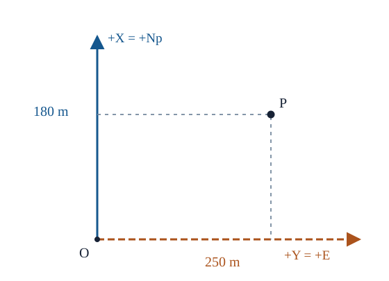

# GEOD21 日本の平面直角座標系と UTM の比較

[GEOD17のKrüger順変換](../GEOD17/index.md#def-geod17-forward-map)と[GEOD18の逆変換・点縮尺](../GEOD18/index.md#def-geod18-inverse-map)までで、楕円体上の経緯度を横メルカトルの平面へ出し入れする道具は揃いました。ところがGISの画面で「X=1000、Y=2000」と表示されたとき、Xが東なのか北なのか、緯度経度がどの測地基準系のものかまでは式だけでは分かりません。

日本の公共測量で使う**平面直角座標系**と、全球を帯に区切って使う **UTM** は、ともに楕円体横メルカトルを利用します。しかし原点、区域、縮尺、数値軸の順序が異なります。違いを暗記するだけでなく、既習の投影式に各パラメータを代入して説明しましょう。

到達目標は次の五つです。

1. 日本の19系の原点・適用区域・縮尺を国土地理院の規定から読み、JGD2024とGRS80を分けて指定する。
2. 日本式のX（北）・Y（東）と一般的なEasting・Northingの対応を行列で検算する。
3. 中央子午線上の原点補正と局所縮尺を導き、距離・面積への影響を計算する。
4. UTMの帯番号、6度幅、縮尺、偽東距・偽北距を具体的に使う。
5. CRSの識別子・軸順序・座標時点を確認し、投影換算と測地基準系間の座標変換を混同しない。

本章では緯度 $\phi$、経度 $\lambda$、原点緯度 $\phi_0$、中央子午線 $\lambda_0$ は角度で、投影の計算時にはラジアンを用います。北半球の楕円体 $a=6378137\ {\rm m}$、逆扁平率 $1/f=298.257222101$ のGRS80を日本の計算例とし、[子午線弧長](../GEOD11/index.md#def-geod11-meridian-arc)を

$$
s(\phi)=\int_0^\phi M(t)\,dt,\qquad
M(\phi)=\frac{a(1-e^2)}{(1-e^2\sin^2\phi)^{3/2}},\qquad e^2=f(2-f)
$$

と書きます。東・北の投影座標は既習章に合わせ $E,N_p$ とし、**日本式のX,Yとは記号を意識して分離**します。

<!-- definition-example-audit: strict -->

---

## 1. 日本の平面直角座標系：19の原点と一組の規則

### 1.1 測地基準系と投影法は別の指定である

[座標参照系](../GEOD2/index.md#def-geod2-crs)の定義によれば、「どの楕円体・測地基準系に付いた緯度経度か」と「それをどんな平面式・座標軸で表すか」は異なる指定です。国土地理院によると、測地成果2024の水平位置はJGD2024に基づき、GRS80楕円体を用います。2025年の標高成果改定に伴うJGD2011からJGD2024への名称変更は、**平面直角座標系の19の原点や投影定義を変更するものではなく**、既存基準点の水平位置成果値は引き継がれました。一方、鉛直成果・高さに関する変更は別途扱う必要があります。

出典：[国土地理院「日本の測地系」](https://www.gsi.go.jp/sokuchikijun/datum-main.html)、[「全国の標高成果の改定」](https://www.gsi.go.jp/sokuchikijun/hyoko2024rev.html)。

日本式の軸は計算機の通例と異なり、**Xが北向き、Yが東向き**です。法的な区域・原点表は[平成14年国土交通省告示第9号](https://www.gsi.go.jp/LAW/heimencho.html)にあります。系番号はUTM帯番号ともEPSGコードとも違います。

投影式そのものは[GEOD16の楕円体横メルカトルの局所構成](../GEOD16/index.md#def-geod16-ellipsoidal-transverse)を使います。まず楕円体上の点を東向き成分 $E$ と北向き成分 $N_p$ に写し、中央子午線上の原点緯度に対応する子午線弧長を北成分から引きます。その後、日本式では値を $(X,Y)=(N_p,E)$ の順に記録します。この順序交換は投影式や楕円体の変更ではありません。

<!-- formal-statement-start -->
> **定義（日本の平面直角座標系の投影パラメータと日本式軸）**  
> GRS80楕円体上で、指定した19系の一つの原点緯度 $\phi_0$、中央子午線 $\lambda_0$ を用いる。局所的に正則な楕円体横メルカトルの中央縮尺を $k_0=0.9999$、原点の日本式座標を $X=0,\ Y=0$ とする。Xは原点で真北を正、Yは原点で真東を正とする。これらのパラメータと日本式軸で定める投影座標を本章の日本の平面直角座標とする。
>
> なお実際の座標参照系の指定には、投影パラメータだけでなくJGD2024等の測地基準系も必要であり、適用する区域は各系の法定区域による。
<!-- formal-statement-end -->

<!-- definition-example-start: def-geod21-japan-crs -->
**定義の確認**（第IX系）。告示の第IX系は原点が北緯 $36^\circ$・東経 $139^\circ50'$、関東の1都6県と福島県などの指定区域です。これは法定19系のうち第IX系の原点・区域という条件を満たします。[GEOD16の中央子午線の式](../GEOD16/index.md#thm-geod16-metric-scale)を $k_0=0.9999$ にして原点へ代入すると

$$
E(\phi_0,\lambda_0)=0,\qquad
N_p(\phi_0,\lambda_0)=0.9999\bigl(s(\phi_0)-s(\phi_0)\bigr)=0.
$$

北または東へだけ動くときの楕円体上の微小長さは、[楕円体計量](../GEOD4/index.md#thm-geod4-ellipsoid-metric)から、それぞれ

$$
M(\phi_0)d\phi\quad(d\phi>0),\qquad
N(\phi_0)\cos\phi_0\,d\lambda\quad(d\lambda>0)
$$

です。ここで $N(\phi)$ は[卯酉線曲率半径](../GEOD4/index.md#def-geod4-curvature-radii)であり、平面の北成分 $N_p$ とは別物です。局所等角性と中央の縮尺・軸の向きから、原点において

$$
dN_p=0.9999M(\phi_0)d\phi>0,\qquad
dE=0.9999N(\phi_0)\cos\phi_0\,d\lambda>0.
$$

両式はそれぞれ南北だけ・東西だけに動いた場合です。したがって原点・両軸の正方向・中央縮尺の非自明な条件をそれぞれ検査でき、$X=N_p,\ Y=E$ にすれば日本式の定義と一致します。この判定は中央子午線の正則な局所領域で行っており、全球での正則性を意味しません。
<!-- definition-example-end -->

### 1.2 法定原点の一覧

次表は告示の19系について**原点の緯度・経度のみ**を抜き出したものです。区域の細かな例外を省略しているため、区域判定には必ず[告示の適用区域欄](https://www.gsi.go.jp/LAW/heimencho.html)を使います。特に離島を県名だけで分類してはいけません。

| 系 | 原点の北緯 | 原点の東経 | おもな位置・注意 |
| --- | ---: | ---: | --- |
| I | 33° | 129°30′ | 九州西方・一部島しょ |
| II | 33° | 131° | 九州 |
| III | 36° | 132°10′ | 中国地方 |
| IV | 33° | 133°30′ | 四国 |
| V | 36° | 134°20′ | 近畿西部・中国東部 |
| VI | 36° | 136° | 近畿中部・北陸など |
| VII | 36° | 137°10′ | 中部 |
| VIII | 36° | 138°30′ | 中部東部など |
| IX | 36° | 139°50′ | 関東・福島など |
| X | 40° | 140°50′ | 東北 |
| XI | 44° | 140°15′ | 北海道南西部 |
| XII | 44° | 142°15′ | 北海道の指定区域 |
| XIII | 44° | 144°15′ | 北海道東部 |
| XIV | 26° | 142° | 小笠原方面の指定区域 |
| XV | 26° | 127°30′ | 沖縄本島方面 |
| XVI | 26° | 124° | 沖縄西方 |
| XVII | 26° | 131° | 沖縄東方 |
| XVIII | 20° | 136° | 東京都の南方離島の一部 |
| XIX | 26° | 154° | 東京都の東方離島の一部 |

日本の平面直角座標系で原点・中央子午線は系ごとに変わりますが、**$k_0=0.9999$、日本式のX北・Y東、偽座標なし**という規則は共通です。地理院は、中央子午線から東西およそ130 km程度を想定し、投影距離の相対誤差をおよそ $10^{-4}$ 以内に抑える設計だと説明しています。これは使用可能性を一律に保証する数学上の硬い境界ではなく、区域指定・精度要求と併せて考えます。

### 1.3 XとEは同じ方向ではない

横メルカトルを通常のGIS軸で表せばEasting（東距）を $E$、Northing（北距）を $N_p$ とします。原点平行移動がともに0なら、日本式への**値の対応**は

$$
X=N_p,\qquad Y=E
$$

です。これは緯度経度の入れ替えではなく、投影後の二成分の表示順序の入れ替えです。

<!-- formal-statement-start -->
> **定理（日本式と東北式の軸交換）**  
> 同一の日本の平面直角座標系で計算した東・北成分を列ベクトル $(E,N_p)^{\mathsf T}$ とする。日本式の列ベクトル $(X,Y)^{\mathsf T}$ は

$$
\begin{pmatrix}X\\Y\end{pmatrix}
=\begin{pmatrix}0&1\\1&0\end{pmatrix}
\begin{pmatrix}E\\N_p\end{pmatrix}.
$$

> この成分順序交換は距離と面積の絶対値を変えないが、行列式の符号を反転する。**同一投影の東北成分と日本式成分を対応させる式**であり、datum変更や再投影ではない。保存する座標値の軸順はCRSの正式な座標軸定義に従わせる必要がある。
<!-- formal-statement-end -->

**証明の見取り図。** 一方の成分だけを負にするのではなく、2成分の場所を入れ替えます。行列の転置積で距離、行列式の絶対値で面積を判定します。

<!-- proof-start -->
### 証明

交換行列を $P$ と置くと

$$
P^{\mathsf T}P
=\begin{pmatrix}0&1\\1&0\end{pmatrix}
\begin{pmatrix}0&1\\1&0\end{pmatrix}
=I_2,\qquad\det P=-1.
$$

任意の2点の座標差 $v=(\Delta E,\Delta N_p)^{\mathsf T}$ に対し、$Pv=(\Delta X,\Delta Y)^{\mathsf T}$ なので

$$
\|Pv\|^2=v^{\mathsf T}P^{\mathsf T}Pv
=v^{\mathsf T}v
=(\Delta E)^2+(\Delta N_p)^2.
$$

2本の変位を列に並べた行列 $B$ では $\det(PB)=\det P\det B=-\det B$。従って符号付き面積は逆転しますが、面積の大きさ $|\det(PB)|=|\det B|$ は不変です。原点・楕円体・中央縮尺を一つも変更していないので、測地datum間の座標変換は行っていません。実装で軸の順序を変える場合も、CRSメタデータに宣言された軸と格納値を一致させます。
<!-- proof-end -->

例えばGISの値が $(E,N_p)=(250,-40)\ {\rm m}$ なら日本式 $(X,Y)=(-40,250)\ {\rm m}$ です。$(X,Y)=(250,-40)$ と記録するのは**同じ地物を別の場所へ置く誤り**で、座標値の大小だけからは検出できません。EPSGの第IX系の投影CRSの軸順序もNorthing (X)、Easting (Y)の順です。GISライブラリの内部配列順がそれに常に従うわけではないため、CRSの軸定義とAPIの引数規約を両方確認します。

下図では、原点から北へ180 m、東へ250 mの点 $P$ を示します。表示順を日本式にすれば $(X,Y)=(180,250)\ {\rm m}$、一般的な東・北の順にすれば $(E,N_p)=(250,180)\ {\rm m}$。これは**同一の点と同一の投影**の成分順序を交換しただけです。

[測地学ラボF（日本の平面直角19系）](https://insuns21.github.io/toukei-kentei_grade1_preparation/simulation/geod.html#lab-F)では $E,N_p$ と日本式 $X,Y$ の軸順序・符号、19系それぞれの原点を数値・格子で確認できます。[ラボD（横メルカトル）](https://insuns21.github.io/toukei-kentei_grade1_preparation/simulation/geod.html#lab-D)では原点・中央縮尺を自由に動かせます。どちらもJGD2024の実務的な座標変換や法定適用区域の自動判定は行いません。

---

## 2. 中央子午線の原点補正と縮尺を導く

[GEOD16の楕円体横メルカトルの局所構成](../GEOD16/index.md#def-geod16-ellipsoidal-transverse)は、中央子午線を直線へ写し、そこでは楕円体の子午線弧長に合うよう規格化します。原点緯度を変えるときは**子午線弧長を差し引く**のであり、緯度を単純に一定倍して引くわけではありません。

<!-- formal-statement-start -->
> **定理（中央子午線上の原点補正と距離）**  
> 長半径 $a>b>0$ の回転楕円体上で、正則な局所楕円体横メルカトルを中央子午線 $\lambda_0$、原点緯度 $\phi_0$、中央縮尺 $k_0>0$、偽東距・偽北距0として定める。中央子午線上で、北向き座標と東向き座標は次を満たす。

$$
N_p(\phi,\lambda_0)
=k_0\bigl(s(\phi)-s(\phi_0)\bigr),\qquad
E(\phi,\lambda_0)=0.
$$

> 特に日本式では $X=k_0(s(\phi)-s(\phi_0))$、$Y=0$。緯度を増すとXは狭義単調増加し、同じ中央子午線上の2点間の平面距離は楕円体の子午線弧長差の $k_0$ 倍である。
<!-- formal-statement-end -->

**証明の見取り図。** [楕円体の子午線弧長](../GEOD11/index.md#def-geod11-meridian-arc)は $s'(\phi)=M(\phi)>0$ です。中央上の投影距離はその微分へ中央縮尺を掛けたものなので、原点から積分します。

<!-- proof-start -->
### 証明

中央子午線上では東距の成分が0であり、[中央子午線に沿った縮尺条件](../GEOD16/index.md#thm-geod16-metric-scale)は、経度 $\lambda=\lambda_0$ を固定して北座標を緯度で偏微分した値について

$$
\frac{\partial N_p(\phi,\lambda_0)}{\partial\phi}
=k_0M(\phi)
$$

を与えます。原点の $N_p(\phi_0,\lambda_0)=0$ を用いて積分すれば

$$
\begin{aligned}
N_p(\phi,\lambda_0)-N_p(\phi_0,\lambda_0)
&=\int_{\phi_0}^{\phi}k_0M(t)\,dt\\
&=k_0\bigl(s(\phi)-s(\phi_0)\bigr).
\end{aligned}
$$

東距 $E$ は中央子午線の直線像の上で0です。経度を $\lambda_0$ に固定した一変数関数 $\phi\mapsto N_p(\phi,\lambda_0)$ の通常の導関数は、上の偏導関数の値と一致します。

$$
\frac{d}{d\phi}N_p(\phi,\lambda_0)
=\frac{\partial N_p}{\partial\phi}(\phi,\lambda_0)
=k_0M(\phi)>0.
$$

したがって緯度の一意な順序が保たれます。2点 $\phi_1,\phi_2$ の平面距離は $|N_p(\phi_2,\lambda_0)-N_p(\phi_1,\lambda_0)|=k_0|s(\phi_2)-s(\phi_1)|$ です。
<!-- proof-end -->

**計算例。** 第IX系の原点（北緯36°、東経139°50′）では $X=Y=0$。同じ中央子午線上で北へ緯度1分（$h=\pi/10800\ {\rm rad}$）動くと、一次近似では

$$
X=k_0\int_{36^\circ}^{36^\circ+h}M(t)\,dt
=k_0M(36^\circ)h+O(h^2)
\simeq 1849.13\ {\rm m}
$$

です。$M(36^\circ)\simeq 6\,357\,482.44\ {\rm m}$。この数値は**一次近似**であり、高精度の基準点成果そのものではありません。緯度を度の値のまま $M$ に掛けないでください。

### 2.1 東へ1秒動いたらどちらの座標が増えるか

原点から緯度 $\phi=\phi_0$ を固定して、経度差 $\varepsilon=\lambda-\lambda_0$ だけ動くとします。[GEOD4の曲率半径](../GEOD4/index.md#def-geod4-curvature-radii)によれば、卯酉線曲率半径は

$$
N(\phi)=\frac{a}{\sqrt{1-e^2\sin^2\phi}}
$$

です。これは平面の北座標 $N_p$ とは異なります。[楕円体計量](../GEOD4/index.md#thm-geod4-ellipsoid-metric)では東向きの微小長さが $N(\phi_0)\cos\phi_0\,d\lambda$ なので、[GEOD16の中央縮尺](../GEOD16/index.md#thm-geod16-metric-scale)を使うと、原点での経度偏微分は

$$
\frac{\partial E}{\partial\lambda}(\phi_0,\lambda_0)
=k_0N(\phi_0)\cos\phi_0,\qquad
\frac{\partial N_p}{\partial\lambda}(\phi_0,\lambda_0)=0
$$

です。後者は[GEOD17の東西対称性](../GEOD17/index.md#prop-geod17-axis-symmetry)からも分かります。経度差の符号を反転したときの東成分の奇性・北成分の偶性から、Taylor展開は

$$
Y=E=k_0N(\phi_0)\cos\phi_0\,\varepsilon+O(\varepsilon^3),
\qquad
X=N_p=O(\varepsilon^2).
$$

第IX系の原点で $\varepsilon=1''=\pi/648000$ を代入すると $N(36^\circ)\simeq6\,385\,525.66$ m なので

$$
Y\simeq25.043\ {\rm m},\qquad X\simeq0\ {\rm m}
$$

となります。正確なXは東への移動で一般に完全な0にはならず、2次の小量です。**東へ動いて増えるのは日本式Y**、という軸の検算が狙いです。[GEOD17の東西対称性](../GEOD17/index.md#prop-geod17-axis-symmetry)から、$\varepsilon$ の符号を反転するとYは反転し、Xは変わらないことも分かります。

### 2.2 中央縮尺0.9999の意味

原点・中央子午線で1 kmの楕円体上の微小距離は、投影平面では $0.9999\times1000=999.9$ mです。中央子午線から離れるにつれて点縮尺は一般に変化するので、**任意の場所の距離を一律0.9999倍とみなすことはできません**。投影座標間距離から楕円体距離を求めるには、経路に沿った点縮尺と地上から楕円体への距離還元も考える必要があります。

---

## 3. UTMの帯と日本の19系は何が異なるか

UTMは Universal Transverse Mercator の略です。[PROJのUTM仕様](https://proj.org/en/stable/operations/projections/utm.html)では、原則として世界を経度6度幅の60帯に区切り、各帯の中央子午線をもつ横メルカトルを使います。これは日本の法定19系と**別の区域割当**です。

UTMでは中央子午線上の縮尺を0.9996とし、北半球で偽東距500,000 m、偽北距0 mを与えます。偽東距とは投影東距へ一定値を加えることで、中心線でもEastingが正になるようにする平行移動です。南半球では通常、偽北距10,000,000 mを用います。偽座標は歪みを変えず、原点の数値を変えます。

<!-- formal-statement-start -->
> **定義（UTM帯と投影パラメータ）**  
> 通常の経度6度帯 $z=1,\ldots,60$ に対し、楕円体横メルカトルの中央子午線 $\lambda_0$ を帯の中央に置き、次の原点緯度・中央縮尺・偽東距と偽北距を採る。

$$
\begin{aligned}
\phi_0&=0,\qquad k_0=0.9996,\\
E_0&=500000\ {\rm m},\\
N_0&=
\begin{cases}
0\ {\rm m}&(\text{北半球}),\\
10000000\ {\rm m}&(\text{南半球}).
\end{cases}
\end{aligned}
$$

> 通常のUTMでは出力軸をEasting、Northingの順で扱う。
>
> 実際のUTMのCRSは、これらの投影パラメータに加え、WGS84等の**測地基準系・楕円体**、半球、適用区域を指定して確定する。
<!-- formal-statement-end -->

<!-- definition-example-start: def-geod21-utm -->
**定義の確認**（第54帯・北半球）。東経138°以上144°未満の帯は第54帯で、中央は東経141°です。WGS84を選んだUTM第54帯・北半球（EPSG:32654）で赤道と中央子午線の交点 $\phi=0,\ \lambda=141^\circ$ を投影すると、原点弧長と経度差がともに0なので

$$
(E,N_p)=(500000,\ 0)\ {\rm m}.
$$

この値は[GEOD17の原点補正と偽座標](../GEOD17/index.md#def-geod17-forward-map)で、原点の未平行移動成分がともに0になり、東成分に $E_0=500000$ m、北成分に $N_0=0$ mを加えた結果です。一点の座標値だけでは縮尺は検査できません。そこで[GEOD16の中央子午線の縮尺式](../GEOD16/index.md#thm-geod16-metric-scale)を、楕円体上の原点からの微小子午線弧長 $ds=M(0)d\phi$ に適用します。

$$
\frac{dN_p}{ds}
=\frac{dN_p/d\phi}{ds/d\phi}
=\frac{k_0M(0)}{M(0)}=0.9996.
$$

北半球・第54帯の中央子午線・赤道原点・二つの偽座標・中央縮尺と軸の向きを、こうして別々に確認できました。測地基準系としてWGS84を選ぶことは投影パラメータの検算とは別の指定であり、同じ出力数値だけではJGD2024との同一性は示せません。
<!-- definition-example-end -->

<!-- formal-statement-start -->
> **命題（UTM帯番号と中央子午線）**  
> 経度 $\lambda$ を東経正の度数で $-180^\circ\le\lambda<180^\circ$ とし、通常の6度境界規則（特殊な帯割当を行わない場合）を用いる。帯番号 $z$ とその中央子午線 $\lambda_0$ は

$$
z=\left\lfloor\frac{\lambda+180^\circ}{6^\circ}\right\rfloor+1,
\qquad
\lambda_0=6^\circ z-183^\circ.
$$

> 帯 $z$ の通常経度区間は $[-180^\circ+6^\circ(z-1),\,-180^\circ+6^\circ z)$ である。
<!-- formal-statement-end -->

**証明の見取り図。** 西端 $-180^\circ$ から6度ずつ数え、帯の両端の中点を取ります。$\lambda=180^\circ$ は経度の切れ目なので、先に $-180^\circ$ へ正規化します。

<!-- proof-start -->
### 証明

$t=(\lambda+180^\circ)/6^\circ$ とすると、指定範囲で $0\le t<60$。整数部分 $q=\lfloor t\rfloor$ は $0,\ldots,59$ であり、区間 $6^\circ q-180^\circ\le\lambda<6^\circ(q+1)-180^\circ$ を選びます。帯番号は $z=q+1$。その両端の平均は

$$
\lambda_0
=\frac{(-180^\circ+6^\circ(z-1))+(-180^\circ+6^\circ z)}{2}
=-183^\circ+6^\circ z.
$$

端点は左閉右開にしており、境界上の帯を二重指定しません。
<!-- proof-end -->

例えば東経140°なら $(140+180)/6=53\frac13$ で $z=54$、$\lambda_0=141^\circ$。東経144°は次の第55帯です。帯番号の指定が正しくても、北半球か南半球か、datumが何かはまだ別に指定しなければなりません。

### 3.1 まとめて比較する

| 項目 | 日本の第IX系 | UTM第54帯・北半球の例 |
| --- | --- | --- |
| 投影法 | 楕円体横メルカトル（Gauss–Krüger） | 楕円体横メルカトル |
| 中央子午線 | 東経139°50′ | 東経141° |
| 原点緯度 | 北緯36° | 0° |
| 中央縮尺 $k_0$ | 0.9999 | 0.9996 |
| 偽東距、偽北距 | 0 m、0 m | 500,000 m、0 m |
| 数値の第一軸 | 日本式 X＝北方向 | Easting＝東方向 |
| 数値の第二軸 | 日本式 Y＝東方向 | Northing＝北方向 |
| 区域 | 告示に基づく第IX系の区域 | 通常は経度138°～144°、北半球の適用緯度域 |
| 測地基準系例 | JGD2024／GRS80 | WGS84（EPSG:32654） |

日本の平面直角座標系は「JGD2024なら第IX系」という意味ではありません。同じJGD2024でも区域によって系が変わり、一方UTMは同じ第54帯でも測地基準系ごとに別のCRSになり得ます。地図投影法そのものと[座標参照系](../GEOD2/index.md#def-geod2-crs)の定義を区別しましょう。

### 3.2 局所面積比から縮尺の違いを見る

横メルカトルは非特異な点で等角です。等角とは局所的にすべての方向の長さが同じ点縮尺 $k$ で変化することで、面積まで保存するという意味ではありません。

<!-- formal-statement-start -->
> **定理（横メルカトルの局所面積比）**  
> 回転楕円体上の非特異点で、楕円体横メルカトルが等角で、その点の長さの点縮尺が $k>0$ であるとする。無限小図形の平面面積と楕円体面積の比は $k^2$ である。中央子午線上での両投影の面積比は次の通りである。

$$
\begin{aligned}
A_{\rm Japan}&=0.9999^2=0.99980001,\\
A_{\rm UTM}&=0.9996^2=0.99920016.
\end{aligned}
$$
<!-- formal-statement-end -->

**証明の見取り図。** 直交する単位ベクトルがいずれも長さ $k$ になり、直角は保たれるので微小な単位正方形は辺長 $k$ の正方形になります。ただし基準の面積は平面の緯度経度単位格子ではなく、楕円体の計量による面積です。

<!-- proof-start -->
### 証明

[GEOD13の計量比較](../GEOD13/index.md#thm-geod13-metric-comparison)に従い、楕円体の経緯度座標 $(\phi,\lambda)$ から投影東北成分 $(E,N_p)$ へのJacobianを $J$、同じ経緯度基底で表した楕円体計量を $g$ とします。[GEOD4の曲率半径](../GEOD4/index.md#def-geod4-curvature-radii)を用いると

$$
J=\frac{\partial(E,N_p)}{\partial(\phi,\lambda)},\qquad
g=\operatorname{diag}\bigl(M(\phi)^2,N(\phi)^2\cos^2\phi\bigr).
$$

非極点では $g$ は正定値です。等角性とは、経緯度の接方向成分 $v=(d\phi,d\lambda)^{\mathsf T}$ に対して、投影後の長さの二乗が元の長さの二乗の $k^2$ 倍になることです。すなわち

$$
\|Jv\|^2=k^2v^{\mathsf T}gv
$$

です。すべての接方向 $v$ で成立する対称行列の二次形式を比較して

$$
J^{\mathsf T}J=k^2g.
$$

両辺の行列式を取ると、2次元なので

$$
(\det J)^2=k^4\det g.
$$

$k>0$ と $g$ の正定値性から

$$
\frac{|\det J|}{\sqrt{\det g}}=k^2.
$$

左辺が[GEOD13の面積縮尺](../GEOD13/index.md#def-geod13-scales)です。中央子午線上で $k=k_0$ を代入して二つの値を得ます。軸交換は[前定理](#thm-geod21-axis-permutation)により行列式の符号しか変えないので、面積比は同じです。
<!-- proof-end -->

中心線上の1 kmは日本式で999.9 m、UTMで999.6 mです。しかし**異なる中央子午線上の1 km同士を比較した値**であり、同一地理地点での両者の縮尺差をそのまま0.3 m/kmと結論してはいけません。同じ点の比較では両投影での点縮尺を、その点において別々に計算します。

---

## 4. CRSの識別子・座標時点・投影換算を混同しない

JGD2024の地理座標・第IX系と、WGS84のUTM第54帯は、共通して横メルカトルを使っていても、そのまま数値を交換できません。

- **同一datum上の座標換算**：例えばJGD2024の経緯度からJGD2024の第IX系へ投影する操作は、[GEOD2の座標換算](../GEOD2/index.md#def-geod2-coordinate-conversion)に当たります。入力の座標軸順と単位は、投影する前に正しく解釈します。
- **座標変換（測地datum間）**：JGD2024からWGS84など測地基準系が異なる場合は、[GEOD2の座標変換](../GEOD2/index.md#def-geod2-coordinate-transformation)を挟む必要があるか、要求精度・実現系・座標時点を確認します。パラメータの一致や座標の見た目の近さだけでは、実用精度の同一性は証明できません。
- **座標時点（epoch）**：[GEOD2の座標時点](../GEOD2/index.md#def-geod2-coordinate-epoch)は、地殻変動を扱うときに必要です。観測時点と基準成果の時点が異なるまま、センチメートル級の位置比較をしないようにします。

**識別子の注意。** 第IX系の旧来のEPSG表記には EPSG:6677（2011系の識別子）が広く使われます。国土地理院の[JPGIS FAQ](https://www.gsi.go.jp/GIS/jpgis-faq.html)はJGD2024の第IX系を「JGD2024 / 9(X, Y)」と表記する例を示し、同院の[点群データ案内](https://www.gsi.go.jp/gazochosa/gazochosa41023.html)ではJGD2024の水平EPSG表記について更新を説明しています。一方、資料・ソフトウェア版によりコード6677の名称表示がJGD2011またはJGD2024になり得ます。**実装時は番号だけでなくCRSのWKT/PROJJSONの測地基準系・軸・単位・範囲・データの制作時点を照合**します。

具体的にGISへ渡す場合は次の順で検査すると安全です。

1. 入力が「緯度・経度」なのか「経度・緯度」なのかをAPI仕様で確認し、度・ラジアンを区別する。
2. その地理座標のdatum・楕円体・座標時点を確認する。
3. 第何系か、または何番のUTM帯かを区域と経度から決め、半球と適用範囲を確認する。
4. 投影パラメータ $(\phi_0,\lambda_0,k_0,E_0,N_0)$ を指定し、内部では東E・北$N_p$を明記する。
5. 日本式の出力には $(X,Y)=(N_p,E)$ を採用し、保存先のスキーマでも軸名を明記する。
6. 原点、東西反転、中央子午線上、順逆往復を試す。**往復が合うだけでは、両方向で同じ誤設定を使っている可能性を排除できない**ため、公的定義から独立にパラメータを照合する。

参考：[国土地理院の平面直角座標の計算式](https://vldb.gsi.go.jp/sokuchi/surveycalc/surveycalc/algorithm/bl2xy/bl2xy.htm)、[PROJのUTM解説](https://proj.org/en/stable/operations/projections/utm.html)、[国土交通省のCRS選択例（第IX系）](https://www.mlit.go.jp/toshi/park/content/001992594.pdf)。

---

## 5. 演習と詳細解答

### Level A：原点・軸・帯番号を手で検査する

#### A1. 系の選択と原点

告示に従い、(i) 東京23区、(ii) 沖縄本島、(iii) 南鳥島（東京都の東経143°より東の指定区域）について、適用される日本の平面直角座標系の系番号と原点緯度・経度を答えよ。いずれも第IX系だとする判断の誤りを説明せよ。

- Level: A
- ID: GEOD21-A1

<!-- solution-start -->
**詳細解答。** [告示の区域表](https://www.gsi.go.jp/LAW/heimencho.html)を使い、系番号と原点を個別に照合します。

1. 東京23区は東京都の本土なので第IX系、原点は $(36^\circ{\rm N},139^\circ50'{\rm E})$。
2. 沖縄本島は東経126°から130°までの範囲の第XV系、原点は $(26^\circ{\rm N},127^\circ30'{\rm E})$。
3. 南鳥島は東京都でも北緯28°より南・東経143°より東の第XIX系、原点は $(26^\circ{\rm N},154^\circ{\rm E})$。

県名「東京都」だけで系を選ぶと、告示で定めた島しょ例外を失います。
<!-- solution-end -->

#### A2. 軸と距離の入れ替え

同じ日本の第IX系の点A、BのGIS東北成分をそれぞれ $(E,N_p)_A=(120,40)$ m、$(E,N_p)_B=(150,80)$ mとする。日本式X,Yを両点について求め、両方の表記で距離を検算せよ。

- Level: A
- ID: GEOD21-A2

<!-- solution-start -->
**詳細解答。** [軸交換の定理](#thm-geod21-axis-permutation)より、Aの日本式成分は $(X,Y)=(40,120)$ m、Bは $(80,150)$ mです。東北式の座標差は $(30,40)$ m、日本式では $(40,30)$ mとなります。したがって平面上のユークリッド距離は

$$
\sqrt{30^2+40^2}
=\sqrt{40^2+30^2}=50\ {\rm m}.
$$

軸を入れ替えただけなので、平面上の距離は不変です。ただしこれは地球上の測地線距離を50 mと主張するものではありません。
<!-- solution-end -->

#### A3. 第IX系の原点から東へ1秒

GRS80上の第IX系原点で、緯度を $36^\circ$ に固定し、経度を東へ1秒だけ増やす。$N(36^\circ)=6\,385\,525.66$ m、$\cos36^\circ\simeq0.809017$ を使い、一次近似の日本式Y変化を小数第3位まで計算せよ。Xを厳密な0と断定できるか。

- Level: A
- ID: GEOD21-A3

<!-- solution-start -->
**詳細解答。** 1秒は $h=\pi/(180\cdot3600)=\pi/648000$ radです。中央子午線上の東向きの物理長は $N(36^\circ)\cos36^\circ\,h$、投影は[中央縮尺条件](../GEOD16/index.md#thm-geod16-metric-scale)からこの長さの0.9999倍です。従って

$$
\begin{aligned}
\Delta Y&\simeq0.9999(6385525.66)(0.809017)\frac{\pi}{648000}\\
&\simeq25.043\ {\rm m}>0.
\end{aligned}
$$

日本式で東方向はYの正方向です。Xの経度微分は中心線で0ですが、二次以上の項は一般に残るので、Xが厳密に0だとはいえません。
<!-- solution-end -->

#### A4. UTMの境界と偽東距

経度140°E、143.9°E、144°Eについて通常のUTM帯番号を求めよ。またWGS84／UTM第54帯北半球の $(0^\circ{\rm N},141^\circ{\rm E})$ のEasting、Northingを答えよ。

- Level: A
- ID: GEOD21-A4

<!-- solution-start -->
**詳細解答。** [帯番号の公式](#prop-geod21-utm-zone)により

$$
\begin{aligned}
z(140^\circ)&=\lfloor320/6\rfloor+1=54,\\
z(143.9^\circ)&=\lfloor323.9/6\rfloor+1=54,\\
z(144^\circ)&=\lfloor324/6\rfloor+1=55.
\end{aligned}
$$

第54帯の中央子午線は $6(54)-183=141^\circ$。赤道は原点緯度なので弧長補正は0、中央子午線上で未平行移動の東距も0です。[UTMの定義](#def-geod21-utm)の偽東距500000 mと北半球の偽北距0 mを加え、$(E,N_p)=(500000,0)$ mです。
<!-- solution-end -->

#### A5. 中央縮尺の距離補正

日本の平面直角座標系とUTMのそれぞれの中央子午線上で、楕円体上の短い弧長1000 mが平面では何mか求めよ。二つの答えの差0.3 mを「同じ地理地点での投影差」と解釈してよいか。

- Level: A
- ID: GEOD21-A5

<!-- solution-start -->
**詳細解答。** [中央子午線の距離定理](#thm-geod21-central-origin)を各投影の中央縮尺で使えば

$$
L_{\rm Japan}=0.9999(1000)=999.9\ {\rm m},
\qquad
L_{\rm UTM}=0.9996(1000)=999.6\ {\rm m}.
$$

各投影の**それぞれ異なる中央子午線**での値です。第IX系の中央は139°50′、UTM第54帯は141°なので、同じ地点での点縮尺の差は、この二数の差から直接は求められません。
<!-- solution-end -->

### Level B：曲率半径、面積、CRSの区別を再構成する

#### B1. 原点から北への増分と逆算

第IX系の中央子午線上で $36^\circ$ から $36^\circ+1'$ まで移動する。$M(36^\circ)=6\,357\,482.44$ mとして一次近似のXを導き、さらに中央子午線上でXが増えると緯度が一意に増えることを示せ。

- Level: B
- ID: GEOD21-B1

<!-- solution-start -->
**詳細解答。** [子午線弧長](../GEOD11/index.md#def-geod11-meridian-arc)を原点緯度からの差として評価すると

$$
\begin{aligned}
X&=0.9999\bigl(s(\phi_0+h)-s(\phi_0)\bigr)\\
&=0.9999\int_{\phi_0}^{\phi_0+h}M(t)\,dt\\
&=0.9999M(\phi_0)h+O(h^2).
\end{aligned}
$$

ここで $h=\pi/10800$ radです。数値を代入すると

$$
X\simeq0.9999(6357482.44)\frac{\pi}{10800}
\simeq1849.13\ {\rm m}.
$$

緯度が変わる範囲で $a>b>0$、$e^2<1$ なので $M(\phi)>0$ です。[中央子午線の距離定理](#thm-geod21-central-origin)を微分すると

$$
\frac{dX}{d\phi}=0.9999M(\phi)>0.
$$

連続かつ狭義単調なXから、中央子午線上の緯度は一意に復元できます。先ほどの数値計算は一次近似なので、厳密な投影座標が必要なら積分または十分高次のKrüger級数を評価します。
<!-- solution-end -->

#### B2. 等角性から面積比を証明する

平面投影のJacobianを $J$、楕円体計量を正定値対称行列 $g$ とし、点で次を満たすとする。

$$
J^{\mathsf T}J=k^2g,\qquad k>0.
$$

面積比が $k^2$ であることを示し、日本の平面直角座標系・UTMの各中央子午線上で楕円体面積1000000 m²に対応する平面の微小面積の一次近似値を求めよ。

- Level: B
- ID: GEOD21-B2

<!-- solution-start -->
**詳細解答。** 行列式を取ると $(\det J)^2=k^4\det g$。$\det g>0$ なので平方根を取り

$$
\frac{|\det J|}{\sqrt{\det g}}=k^2.
$$

分子と分母は同じ緯度経度座標から計算する平面面積要素と楕円体面積要素なので、これが局所面積比です（[面積縮尺の定義](../GEOD13/index.md#def-geod13-scales)）。各中央上で $k=k_0$ を代入すると

$$
\begin{aligned}
A_{\rm Japan}&\simeq1000000(0.9999)^2=999800.01\ {\rm m}^2,\\
A_{\rm UTM}&\simeq1000000(0.9996)^2=999200.16\ {\rm m}^2.
\end{aligned}
$$

有限の領域にわたってkが一定とは限らないため、この結果は**局所的な面積の近似**であって任意の大面積に対する厳密な値ではありません。
<!-- solution-end -->

#### B3. CRSが変わるときの手順

データAは「JGD2024、第IX系、日本式 $(X,Y)$、単位m」、データBは「WGS84／UTM第54帯北半球、$(E,N_p)$、単位m」である。Aの値をBで表す手順を、軸の解釈・逆投影・datum・順投影の順に記述せよ。「XをEasting、YをNorthingとしてUTMへ入力する」という処理がなぜ誤りか説明せよ。

- Level: B
- ID: GEOD21-B3

<!-- solution-start -->
**詳細解答。** 同じ地理的位置を保ちながら、次の順で操作します。

1. Aの二成分は日本式なので、同じ第IX系内で $(E,N_p)=(Y,X)$ と解釈します。これは投影ではなく軸順の読替えです。
2. [Krüger逆変換](../GEOD18/index.md#def-geod18-inverse-map)で第IX系の原点と中央縮尺を指定します。

   $$
   \phi_0=36^\circ,\quad\lambda_0=139^\circ50',\quad
   k_0=0.9999,\quad E_0=N_0=0.
   $$

   この逆投影で**JGD2024上の**測地緯度・経度を得ます。
3. 目標のWGS84との測地基準系の関係、実現系・座標時点と要求精度を確認し、必要な[座標変換](../GEOD2/index.md#def-geod2-coordinate-transformation)を適用します。
4. 目標の測地基準系上でUTM第54帯の投影を行い、出力を東・北の $(E,N_p)$ とします。順投影のパラメータは

   $$
   \phi_0=0,\quad\lambda_0=141^\circ,\quad k_0=0.9996,\quad
   E_0=500000\ {\rm m},\quad N_0=0.
   $$

誤った処理は、そもそもAのXは北でYは東という[軸の定義](#def-geod21-japan-crs)を無視し、さらに第IX系とUTMの原点・縮尺・測地基準系の違いを省いています。数字2個を並べ替えただけでは異なるCRS間の変換にはなりません。測地基準系間の具体的補正量は、ここで座標時点等が未指定なので断定できません。
<!-- solution-end -->

#### B4. 軸・原点・経度の取り違えをテストで切り分ける

第IX系の投影関数が正しく、原点から経度差 $h$ を与えた入力に対して、日本式の出力を $F(h)=(X(h),Y(h))$ とする。局所的な東西対称性から満たすべき等式を示し、(i) XとYの交換、(ii) 経度の符号反転、(iii) 偽東距500000 mの誤追加、の三つを検出するテストを設計せよ。

- Level: B
- ID: GEOD21-B4

<!-- solution-start -->
**詳細解答。** [GEOD17の東西対称性](../GEOD17/index.md#prop-geod17-axis-symmetry)と[日本式の軸交換](#thm-geod21-axis-permutation)から、同じ緯度で経度差を $h\mapsto-h$ と反転すると

$$
X(-h)=X(h),\qquad Y(-h)=-Y(h)
$$

です。原点では $F(0)=(0,0)$ です。

1. XとYの交換は、原点のすぐ東の $h>0$ で $Y(h)>0$、$X(h)=O(h^2)$ という微分判定に反します。基準値 $Y(1'')\simeq25.043$ mと比較します。
2. 経度差の符号反転は $Y(h)<0$ を返すので、東の $h>0$ と西の $-h$ を両方与えて符号を確認します。単に往復投影で元の値へ戻るだけでは、順逆の両方が誤った符号を採用している場合を見逃します。
3. 偽東距の誤追加は $F(0)$ のY成分を500000 mにしてしまいます。これは原点テストで検出できます。誤った平行移動は東西対称性の $Y(-h)=-Y(h)$ も壊します。

以上はそれぞれ軸順序、経度差の符号、偽座標という**異なる故障モード**を識別します。
<!-- solution-end -->

### Level C：一つの位置データを安全に扱う

#### C1. 第IX系の設計値とUTMの選択を統合検査する

GRS80、JGD2024の緯度経度を $(\phi,\lambda)=(36^\circ{\rm N},139^\circ50'01''{\rm E})$ とし、第IX系に投影する。必要な条件・座標・検算を次の順で述べよ。

1. 第IX系の原点・中央縮尺と日本式の出力軸を示す。
2. 同緯度で経度差1秒の一次近似から日本式X,Yを求める。$N(36^\circ)=6385525.66$ mを用いてよい。
3. この経度で使う通常UTM帯と中央子午線、北半球の原点・偽東距を求める。
4. この1点をWGS84／UTMへ出力するとき、どの作業がdatumの確認を必要とするか述べる。
5. 入力と計算の誤りを見つけるため、互いに異なる3つ以上の検査を提案する。

- Level: C
- ID: GEOD21-C1

<!-- solution-start -->
**詳細解答。**

**1.** [第IX系の定義](#def-geod21-japan-crs)と告示から $\phi_0=36^\circ,\ \lambda_0=139^\circ50',\ k_0=0.9999$、偽東距・偽北距0、X北・Y東です。入力がJGD2024上の経緯度であることも明記します。

**2.** 経度差は $\varepsilon=1''=\pi/648000$ rad、緯度差は0です。中央子午線上の縮尺と卯酉線曲率半径から

$$
\begin{aligned}
Y&=0.9999N(36^\circ)\cos36^\circ\,\varepsilon+O(\varepsilon^3)\\
&\simeq0.9999(6385525.66)(0.809017)\frac{\pi}{648000}
\simeq25.043\ {\rm m},\\
X&=O(\varepsilon^2)\simeq0\ {\rm m}.
\end{aligned}
$$

この $(X,Y)$ は**局所近似値**です。厳密な座標が必要なら[GEOD17のKrüger順変換](../GEOD17/index.md#def-geod17-forward-map)を、原点補正を含めて指定精度まで計算します。第IX系の座標のXとYを誤って交換すると東へ約25m進んだはずの点が北へ進んでしまいます。

**3.** 東経 $\lambda\simeq139.83361^\circ$ は138°以上144°未満なので[UTM第54帯](#prop-geod21-utm-zone)、中央子午線141°です。北半球で $\phi_0=0^\circ$、$k_0=0.9996$、偽東距500000 m、偽北距0 m、東北軸順です。第IX系の原点がUTM原点と一致するわけではありません。

**4.** JGD2024上の緯度経度をそのままWGS84のものとして投影する前に、測地基準系の実現・座標時点・要求精度を確認し、必要なら[座標変換](../GEOD2/index.md#def-geod2-coordinate-transformation)を行います。逆投影・UTM順投影はそれぞれの測地基準系内での座標換算ですが、JGD2024からWGS84への移行を自明なゼロ変換と宣言してはいけません。

**5.** 次の独立した性質を組み合わせて検査します。

1. 第IX系の原点で $(X,Y)=(0,0)$ となる。
2. 中央子午線から東西1秒の符号反転でXは偶・Yは奇となる。
3. 経度140°ならUTM第54帯、144°なら第55帯となる。
4. UTM第54帯の赤道・中央子午線で $(E,N_p)=(500000,0)$ mとなる。
5. 公的原点・投影パラメータと、WKTの軸順を照合する。

往復残差が小さいという一条件だけでは共通の設定誤りを検出し切れません。
<!-- solution-end -->

---

## 6. 要点

- 日本の19系は国土地理院の告示で原点・適用区域を選び、中央縮尺は0.9999。日本式は**X北・Y東**。
- UTMは通常6度帯で中央縮尺0.9996、北半球ではEastingの偽東距500000 m。第54帯の中央は東経141°。
- 両者は横メルカトルを使うが、**投影パラメータ・数値軸・区域・CRSの測地基準系**を一つずつ指定する。
- 等角な横メルカトルの局所面積比は $k^2$。縮尺の小さい中心線に限っても面積比は1ではない。
- JGD2024への呼称・標高成果の更新と、投影式の変更は別物。識別子やソフトウェアの名称表示は更新され得るので、実際のCRSメタデータを検査する。

次のGEOD22の総合演習では、観測と測地基準系・日本の地域図・全球図を一続きに検算します。
