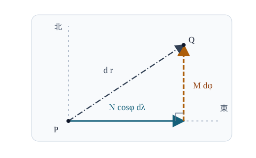

# GEOD4 曲率半径と楕円体の計量

測地緯度を $1^\circ$ 変えたときの移動距離と、経度を $1^\circ$ 変えたときの移動距離は同じでしょうか。球でも緯線は高緯度ほど短くなります。扁平な回転楕円体では、さらに南北方向と東西方向で曲がり方が異なります。

[GEOD3 の表面表示](../GEOD3/index.md#prop-geod3-surface-parameterization)は、測地緯度・経度から楕円体上の点を求めました。本章ではそれを微分して、座標の小さな変化が実際には何 m の移動に対応するかを調べます。目標は次の五つです。

1. 卯酉線曲率半径 $N$ と子午線曲率半径 $M$ の式を導き、符号・単位・赤道と極での値を確認する。
2. 表面表示の二つの偏微分から東・北の単位方向を作る。
3. 周囲の空間の内積から楕円体上の距離を決める計量を導き、距離と角度の意味を説明する。
4. $M,N$ がそれぞれの法截面での曲率半径であることを、曲面の方程式から確かめる。
5. 極で経度座標が退化することと、楕円体が滑らかであることを区別し、球面極限を検算する。

必要なのは微分、三角関数とベクトルの内積です。一般の曲面論の定理は仮定しません。角度の微分・距離の計算では、度ではなく**ラジアン**を使います。

<!-- definition-example-audit: strict -->

---

## 1. 緯度・経度で表した点をどれだけ動かせるか

中心を原点、赤道面を $XY$ 平面とし、赤道半径 $a$、極半径 $b$ は $a\ge b>0$ とします。[GEOD3 の形状定数](../GEOD3/index.md#def-geod3-shape-parameters)で定めた第一離心率の二乗を $e^2=1-b^2/a^2$ とおき、計算を短くするため

$$
q=1-e^2=\frac{b^2}{a^2}>0,
\qquad D(\phi)=\sqrt{1-e^2\sin^2\phi}>0
$$

と書きます。$-\pi/2\le\phi\le\pi/2$ は測地緯度、$\lambda$ は東向きを正に測る経度です。初めは極を除く $|\phi|<\pi/2$ で考えます。[GEOD3 の表面表示](../GEOD3/index.md#prop-geod3-surface-parameterization)を列ベクトルで書くと、

$$
\boldsymbol r(\phi,\lambda)
=\left(\frac{a\cos\phi\cos\lambda}{D},
\frac{a\cos\phi\sin\lambda}{D},
\frac{aq\sin\phi}{D}\right).
$$

緯度を固定すると緯線は半径 $a\cos\phi/D$ の円です。この半径を $\cos\phi$ と、残りの係数 $a/D$ に分けます。後者を **卯酉線曲率半径** $N$ と呼びます。もう一つの **子午線曲率半径** $M$ は、緯度を変えたときの南北の移動率を表します。後で、両者が単なる換算係数ではなく、対応する方向の曲がり方も表すことを証明します。

<!-- formal-statement-start -->
> **定義（回転楕円体の二つの曲率半径）**
> 赤道半径 $a$、極半径 $b$ が $a\ge b>0$ の回転楕円体で、$e^2=1-b^2/a^2$、測地緯度 $\phi\in[-\pi/2,\pi/2]$ とする。卯酉線曲率半径 $N(\phi)$、子午線曲率半径 $M(\phi)$ を次で定める。

$$
N(\phi)=\frac{a}{\sqrt{1-e^2\sin^2\phi}},
\qquad
M(\phi)=\frac{a(1-e^2)}{(1-e^2\sin^2\phi)^{3/2}}.
$$
<!-- formal-statement-end -->

<!-- definition-example-start: def-geod4-curvature-radii -->
**定義の確認**　$a=5$、$b=4$ なら $e^2=1-16/25=9/25$ です。赤道 $\phi=0$ では $D=1$ なので

$$
N(0)=5,\qquad M(0)=5\cdot\frac{16}{25}=\frac{16}{5}.
$$

両者とも長さの次元を持ち、正です。球 $a=b=R$ なら $e^2=0$ なので、あらゆる緯度で $M=N=R$ です。
<!-- definition-example-end -->

扁平な場合の赤道で $M<N$ になるのは、南北に沿う断面のほうが赤道の近くで強く曲がるためです。$N$ を**緯線そのものの半径**と取り違えないでください。緯線半径は $N\cos\phi$ であり、両者は赤道以外で異なります。

---

## 2. 偏微分から東・北・法線の方向を作る

緯度だけを変化させた速度ベクトルを $\boldsymbol r_\phi=\partial\boldsymbol r/\partial\phi$、経度だけの速度ベクトルを $\boldsymbol r_\lambda=\partial\boldsymbol r/\partial\lambda$ と書きます。偏微分は**他方の座標を固定**して行うものです。どちらも楕円体上の座標曲線に接する方向を表します。

まず $N=a/D$ を微分します。この節のプライム $D',N',\rho',z'$ は、いずれも経度 $\lambda$ を固定した緯度 $\phi$ による一変数微分（例えば $D'=dD/d\phi$）です。先ほどの偏微分 $\boldsymbol r_\phi$ も、$\lambda$ を固定して $\phi$ で微分するという意味です。$D^2=1-e^2\sin^2\phi$ なので

$$
2DD'=-2e^2\sin\phi\cos\phi,
\qquad
N'=-\frac{aD'}{D^2}
=\frac{ae^2\sin\phi\cos\phi}{D^3}.
$$

位置ベクトルの水平半径を $\rho=N\cos\phi$、高さを $z=qN\sin\phi$ とすると、積の微分により

$$
\begin{aligned}
\rho'&=N'\cos\phi-N\sin\phi\\
&=\frac{a\sin\phi(e^2\cos^2\phi-D^2)}{D^3}
=-\frac{aq\sin\phi}{D^3}=-M\sin\phi,\\
z'&=q(N'\sin\phi+N\cos\phi)\\
&=\frac{aq\cos\phi(e^2\sin^2\phi+D^2)}{D^3}
=\frac{aq\cos\phi}{D^3}=M\cos\phi.
\end{aligned}
$$

ここで $e^2\cos^2\phi-D^2=e^2-1=-q$ と、$e^2\sin^2\phi+D^2=1$ を使いました。南北方向の微分の**大きさ**はちょうど $M$ になります。

<!-- formal-statement-start -->
> **命題（測地緯度・経度の偏微分）**
> $a\ge b>0$ の回転楕円体で、$|\phi|<\pi/2$ と経度 $\lambda$ をとり、$\boldsymbol r(\phi,\lambda)$ を[表面表示](../GEOD3/index.md#prop-geod3-surface-parameterization)とする。[二つの曲率半径](#def-geod4-curvature-radii)を $M,N$ と書く。このとき

$$
\begin{aligned}
\boldsymbol r_\phi&=M\boldsymbol e_{\mathrm N},
&\boldsymbol e_{\mathrm N}&=(-\sin\phi\cos\lambda,-\sin\phi\sin\lambda,\cos\phi),\\
\boldsymbol r_\lambda&=N\cos\phi\,\boldsymbol e_{\mathrm E},
&\boldsymbol e_{\mathrm E}&=(-\sin\lambda,\cos\lambda,0).
\end{aligned}
$$

> $\boldsymbol e_{\mathrm N}$ は北向き、$\boldsymbol e_{\mathrm E}$ は東向きの長さ $1$ の接方向ベクトルで、互いに直交する。[GEOD3 の単位外向き法線](../GEOD3/index.md#def-geod3-geodetic-latitude)は

$$
\boldsymbol\nu=(\cos\phi\cos\lambda,\cos\phi\sin\lambda,\sin\phi)
$$

> であり、これら三方向は互いに直交する。
<!-- formal-statement-end -->

**証明の見取り図。** 緯度変化の速度は子午断面にあり、経度変化の速度は水平な緯線を向きます。上で計算した $\rho'$ と $z'$ を使って係数を分離し、内積で長さと直交を確かめます。

<!-- proof-start -->
### 証明

$\boldsymbol r=(\rho\cos\lambda,\rho\sin\lambda,z)$ を $\phi$ で偏微分すると、$\rho',z'$ の計算から

$$
\begin{aligned}
\boldsymbol r_\phi
&=(\rho'\cos\lambda,\rho'\sin\lambda,z')\\
&=M(-\sin\phi\cos\lambda,-\sin\phi\sin\lambda,\cos\phi).
\end{aligned}
$$

一方、$\lambda$ で偏微分すると $\rho,z$ は固定なので

$$
\boldsymbol r_\lambda=(-\rho\sin\lambda,\rho\cos\lambda,0)
=N\cos\phi(-\sin\lambda,\cos\lambda,0).
$$

$\boldsymbol e_{\mathrm E}$ の長さの二乗は $\sin^2\lambda+\cos^2\lambda=1$、$\boldsymbol e_{\mathrm N}$ については $\sin^2\phi(\cos^2\lambda+\sin^2\lambda)+\cos^2\phi=1$ です。内積は

$$
\boldsymbol e_{\mathrm E}\cdot\boldsymbol e_{\mathrm N}
=\sin\phi(\sin\lambda\cos\lambda-\cos\lambda\sin\lambda)=0.
$$

法線 $\boldsymbol\nu$ と東向きの内積は $\cos\phi(-\sin\lambda\cos\lambda+\cos\lambda\sin\lambda)=0$、北向きの内積は $-\cos\phi\sin\phi+\sin\phi\cos\phi=0$ です。法線の長さも $1$ です。以上で三方向の正規直交性を確かめました。
<!-- proof-end -->

**直接例。** 赤道上の点 $(\phi,\lambda)=(0,0)$ では

$$
\boldsymbol e_{\mathrm E}=(0,1,0),\qquad
\boldsymbol e_{\mathrm N}=(0,0,1),\qquad
\boldsymbol\nu=(1,0,0).
$$

東は $+Y$、北は $+Z$、法線は $+X$ を向きます。例えば $a=5,b=4$ の赤道上では、緯度を微小量 $d\phi$ 動かす変位は $(0,0,(16/5)d\phi)$、経度を $d\lambda$ 動かす変位は $(0,5d\lambda,0)$ です。いずれも角度の単位はラジアンです。

---

## 3. 二方向の移動を一つの距離にする

東西・南北を同時に動かす場合、$M$ と $N\cos\phi$ を単純に足すことはできません。直交するベクトルの二乗の和を使います。曲面上の座標の微小変化 $(d\phi,d\lambda)$ から生じる変位は

$$
d\boldsymbol r=\boldsymbol r_\phi\,d\phi+\boldsymbol r_\lambda\,d\lambda.
$$

点 $P$ の**接平面内の微小変位**として見ると、南北の成分 $M\,d\phi$ と東西の成分 $N\cos\phi\,d\lambda$ が直交し、その合成が $d\boldsymbol r$ になります。下図は両微小角が正の場合の模式図です。対角線は二点を有限に移動する経路を描いたものではなく、あくまで一点での微小変位を示します。

周囲の三次元空間の Euclid [内積](../../../基礎科目/F0/F0-00E1/index.md#def-f0-00e1-inner-product)を、この曲面に接する方向のベクトルに限って測ります。これによって座標の選び方によらない幾何的な長さを表したいのです。次でこの計量を定義します。

<!-- formal-statement-start -->
> **定義（楕円体上の第一基本形式）**
> $a\ge b>0$ の楕円体表面上の非極点を、測地緯度・経度の局所座標 $(\phi,\lambda)$ で表す。曲面に接する方向のベクトルを $\boldsymbol v=u_\phi\boldsymbol r_\phi+u_\lambda\boldsymbol r_\lambda$、$\boldsymbol w=v_\phi\boldsymbol r_\phi+v_\lambda\boldsymbol r_\lambda$ と表したとき、接方向ベクトル上の内積 $g$ を $g(\boldsymbol v,\boldsymbol w)=\boldsymbol v\cdot\boldsymbol w$ と定める。特に微小線素の二乗は

$$
ds^2=g(d\boldsymbol r,d\boldsymbol r)
=E\,d\phi^2+2F\,d\phi\,d\lambda+G\,d\lambda^2,
$$

> ただし $E=\boldsymbol r_\phi\cdot\boldsymbol r_\phi$、$F=\boldsymbol r_\phi\cdot\boldsymbol r_\lambda$、$G=\boldsymbol r_\lambda\cdot\boldsymbol r_\lambda$ とする。
<!-- formal-statement-end -->

この三つの係数が計量を表す理由を、定義に戻って確かめます。$\boldsymbol v=u_\phi\boldsymbol r_\phi+u_\lambda\boldsymbol r_\lambda$ を内積に代入して分配すると、内積の対称性から

$$
\begin{aligned}
g(\boldsymbol v,\boldsymbol v)
&=(u_\phi\boldsymbol r_\phi+u_\lambda\boldsymbol r_\lambda)
\cdot(u_\phi\boldsymbol r_\phi+u_\lambda\boldsymbol r_\lambda)\\
&=E u_\phi^2+2F u_\phi u_\lambda+G u_\lambda^2.
\end{aligned}
$$

したがって、接方向の座標係数 $(u_\phi,u_\lambda)$ に対する計量の係数行列は

$$
\begin{pmatrix}E&F\\F&G\end{pmatrix}
$$

です。これは**接方向のベクトルを二つの座標方向へ分解した内積の表示**であり、楕円体の方程式から突然行列を作ったものではありません。

<!-- definition-example-start: def-geod4-first-fundamental-form -->
**定義の確認**　赤道・経度 $0$ の $a=5,b=4$ の例で、先ほどの偏微分を使って $\boldsymbol v=\boldsymbol r_\phi+\boldsymbol r_\lambda=(0,5,16/5)$ を得ます。内積の定義から

$$
g(\boldsymbol v,\boldsymbol v)=0^2+5^2+(16/5)^2
=25+\frac{256}{25}.
$$

座標係数 $(u_\phi,u_\lambda)=(1,1)$ の二乗形式でも

$$
\begin{aligned}
E&=(16/5)^2,\qquad F=0,\qquad G=25,\\
Eu_\phi^2+2Fu_\phi u_\lambda+Gu_\lambda^2
&=\frac{256}{25}+25.
\end{aligned}
$$

となり一致します。この $(1,1)$ は接方向の大きさを試すための係数で、実際に一ラジアンずつ移動した弦や弧の長さと同一視しません。
<!-- definition-example-end -->

<!-- formal-statement-start -->
> **定理（回転楕円体の第一基本形式）**
> $a\ge b>0$ の回転楕円体の非極点で $|\phi|<\pi/2$ とし、測地緯度 $\phi$ と経度 $\lambda$ を局所座標とする。この座標の[第一基本形式](#def-geod4-first-fundamental-form)は、[曲率半径](#def-geod4-curvature-radii) $M(\phi),N(\phi)$ を用いて

$$
\boxed{ds^2=M(\phi)^2\,d\phi^2
+N(\phi)^2\cos^2\phi\,d\lambda^2}
$$

> と表される。計量の係数行列は $\operatorname{diag}(M^2,N^2\cos^2\phi)$（二つの値を対角成分に持ち、非対角成分が $0$ の行列）で、非極点では正定値である。
<!-- formal-statement-end -->

**証明の見取り図。** [測地緯度・経度の偏微分](#prop-geod4-tangent-vectors)により、南北方向と東方向は直交します。内積の交差項は $0$ となり、残りはそれぞれの速度ベクトルの長さの二乗です。

<!-- proof-start -->
### 証明

[測地緯度・経度の偏微分](#prop-geod4-tangent-vectors)を適用すると

$$
\begin{aligned}
E&=\boldsymbol r_\phi\cdot\boldsymbol r_\phi
=M^2(\boldsymbol e_{\mathrm N}\cdot\boldsymbol e_{\mathrm N})=M^2,\\
F&=\boldsymbol r_\phi\cdot\boldsymbol r_\lambda
=MN\cos\phi(\boldsymbol e_{\mathrm N}\cdot\boldsymbol e_{\mathrm E})=0,\\
G&=\boldsymbol r_\lambda\cdot\boldsymbol r_\lambda
=N^2\cos^2\phi(\boldsymbol e_{\mathrm E}\cdot\boldsymbol e_{\mathrm E})=N^2\cos^2\phi.
\end{aligned}
$$

これらを[第一基本形式の定義](#def-geod4-first-fundamental-form)の係数 $E,F,G$ に代入して表示式を得ます。また $a\ge b>0$ なら $D,q,M,N$ はすべて正で、非極点では $\cos\phi>0$ です。従って任意の $(u,v)\ne(0,0)$ に対して

$$
M^2u^2+N^2\cos^2\phi\,v^2>0
$$

となり、係数行列は正定値です。
<!-- proof-end -->

この結果から、緯度一定の移動では東西の長さの変化率が $N\cos\phi$、経度一定の移動では南北の長さの変化率が $M$ です。有限の大きさを移動するときは、一点の係数を固定した式ではなく、経路の各点で長さを足し合わせます。

ここからは経路のパラメータを $t$ と書きます。経路に沿う一変数微分は

$$
\phi'(t)=\frac{d\phi}{dt},\qquad
\lambda'(t)=\frac{d\lambda}{dt}
$$

です。第2節の $N'$ などは緯度による微分だったので、プライムの微分変数が切り替わります。一方、$\boldsymbol r_\phi,\boldsymbol r_\lambda$ は他方の座標を固定する偏微分のままです。この二種類を結ぶのが連鎖律です。

次の命題でいう「区分的 $C^1$ 級」とは、区間を有限個に分割した各部分で $\phi,\lambda$ が連続的に微分でき、分割点でも経路自体は連続してつながることです。この仮定の下で各部分の速さを積分して足し合わせます。

<!-- formal-statement-start -->
> **命題（楕円体上の曲線の長さ）**
> $a\ge b>0$ の回転楕円体の非極点の座標範囲内で、区分的 $C^1$ 級の経路 $t\mapsto(\phi(t),\lambda(t))$、$t\in[t_0,t_1]$ をとる。その表面上の長さ $L$ は

$$
L=\int_{t_0}^{t_1}\sqrt{M(\phi(t))^2\phi'(t)^2
+N(\phi(t))^2\cos^2\phi(t)\lambda'(t)^2}\,dt.
$$
<!-- formal-statement-end -->

**証明の見取り図。** 曲線の速度に連鎖律を使い、[第一基本形式](#thm-geod4-ellipsoid-metric)で速度の二乗を計算して積分します。

<!-- proof-start -->
### 証明

表面上の曲線 $\boldsymbol c(t)=\boldsymbol r(\phi(t),\lambda(t))$ に連鎖律を適用すると

$$
\boldsymbol c'(t)=\boldsymbol r_\phi\phi'(t)+\boldsymbol r_\lambda\lambda'(t).
$$

非極点では[計量の定理](#thm-geod4-ellipsoid-metric)から

$$
\|\boldsymbol c'(t)\|^2
=M^2\phi'(t)^2+N^2\cos^2\phi(t)\lambda'(t)^2.
$$

各滑らかな区間の弧長は $\int\|\boldsymbol c'(t)\|dt$ であり、区分点で和を取れば主張の積分になります。
<!-- proof-end -->

例えば経度を固定して緯度 $\phi_0$ から $\phi_1$ へ単調に進めば、[楕円体上の曲線の長さの命題](#prop-geod4-curve-length)は $\int_{\phi_0}^{\phi_1}M(\phi)\,d\phi$ の絶対値に簡約されます。これを数値積分・級数として扱うのが GEOD11 です。

---

## 4. なぜ $M,N$ を「曲率半径」と呼ぶのか

半径という語を長さ換算係数の別名で済ませないために、曲がり方を定義から確かめます。曲面上の点 $P$ と、そこで曲面に接する長さ $1$ の方向 $\boldsymbol u$ を選びます。接方向である条件は $\boldsymbol\nu\cdot\boldsymbol u=0$ で、$\boldsymbol\nu$ は[GEOD3 で導いた単位外向き法線](../GEOD3/index.md#def-geod3-geodetic-latitude)です。この二方向の張る平面で楕円体を切ります。

切り口は平面曲線になります。その曲線を弧長 $s$ でたどって得られる二階微分の大きさから、曲がり方を数値で測ります。この節の $\boldsymbol\gamma'(s)$ と $\boldsymbol\gamma''(s)$ は、それぞれ $d\boldsymbol\gamma/ds$ と $d^2\boldsymbol\gamma/ds^2$ を意味します。楕円体は凸なので、対応する曲率が正になることも後で計算して確かめます。

<!-- formal-statement-start -->
> **定義（法截面の曲率半径）**
> $a\ge b>0$ の回転楕円体上の点 $P$、長さ $1$ の接方向ベクトル $\boldsymbol u$、単位外向き法線 $\boldsymbol\nu$ をとる。$P$ を通り $\boldsymbol u,\boldsymbol\nu$ を含む平面を**法截面**、その平面と楕円体との交線を**法截線**と定義する。
>
> 法截線を $P$ の近くで弧長 $s$ により $\boldsymbol\gamma(0)=P$、$\boldsymbol\gamma'(0)=\boldsymbol u$ と表す。その点の曲率半径を

$$
R_{\boldsymbol u}=\frac{1}{\|\boldsymbol\gamma''(0)\|}
$$

> とする。
<!-- formal-statement-end -->

<!-- definition-example-start: def-geod4-normal-section-radius -->
**定義の確認**　球 $a=b=R$ で任意の表面点 $P$ と長さ $1$ の接方向 $\boldsymbol u$ を選ぶと、$\boldsymbol\nu=P/R$、$P\cdot\boldsymbol u=0$ です。法截面は球の中心を通る平面になり、交線は半径 $R$ の円です。具体的に弧長 $s$ による表示を

$$
\boldsymbol\gamma(s)=P\cos(s/R)+R\boldsymbol u\sin(s/R)
$$

とします。直交条件と $\|P\|=R$ より

$$
\|\boldsymbol\gamma(s)\|^2
=R^2\bigl(\cos^2(s/R)+\sin^2(s/R)\bigr)=R^2
$$

なので、この曲線は球面上にあります。また $\boldsymbol\gamma(0)=P$、$\boldsymbol\gamma'(0)=\boldsymbol u$、$\|\boldsymbol\gamma'(s)\|=1$ で、弧長表示の条件も満たします。さらに

$$
\boldsymbol\gamma''(0)=-P/R^2,\qquad
\|\boldsymbol\gamma''(0)\|=1/R,\qquad R_{\boldsymbol u}=R
$$

となり、方向によらないことも確かめられます。
<!-- definition-example-end -->

求めたいのは法截線を全部解くことではなく、**点での二階微分**です。第3節で混合係数に使った $F$ と区別するため、楕円体を定める関数をここでは $H$ と書き、

$$
H(X,Y,Z)=\frac{X^2+Y^2}{a^2}+\frac{Z^2}{b^2}-1
$$

とします。この関数について $H(\boldsymbol\gamma(s))=0$ を二度微分すると、法線方向の加速度を接方向だけで計算できます。$\nabla H$ は一階偏導関数を並べた勾配です。

また、$X_1=X,X_2=Y,X_3=Z$ と番号を付け、$\operatorname{Hess}H$ は二階偏導関数 $\partial^2 H/\partial X_i\partial X_j$ を $(i,j)$ 成分に持つ $3\times3$ 行列とします。勾配とこの行列を連鎖律で結ぶと、曲率を計算できます。

<!-- formal-statement-start -->
> **定理（子午・卯酉線方向の法截面曲率半径）**
> $a\ge b>0$ の回転楕円体の非極点 $(\phi,\lambda)$ において、[東・北の接方向](#prop-geod4-tangent-vectors)を表す長さ $1$ のベクトルを $\boldsymbol e_{\mathrm E}$、$\boldsymbol e_{\mathrm N}$ とする。[法截面の曲率半径](#def-geod4-normal-section-radius)は、それぞれ

$$
R_{\boldsymbol e_{\mathrm E}}=N(\phi),
\qquad R_{\boldsymbol e_{\mathrm N}}=M(\phi)
$$

> である。ここで $M,N$ は[二つの曲率半径](#def-geod4-curvature-radii)で定義された正の関数である。
<!-- formal-statement-end -->

**証明の見取り図。** $H(\boldsymbol\gamma(s))=0$ の二階微分は、曲面上の曲線の法線方向の加速度を固定します。法截線なら加速度は法截面内かつ接線と直交するため法線方向のみです。東と北の単位ベクトルを代入して、それぞれ逆半径を求めます。

<!-- proof-start -->
### 証明

点 $P=(X,Y,Z)=\boldsymbol r(\phi,\lambda)$ を固定し、[GEOD3 の法線の計算](../GEOD3/index.md#def-geod3-geodetic-latitude)と[表面表示](../GEOD3/index.md#prop-geod3-surface-parameterization)を使うと

$$
\nabla H(P)=\left(\frac{2X}{a^2},\frac{2Y}{a^2},\frac{2Z}{b^2}\right)
=\frac{2}{aD}\boldsymbol\nu,
\qquad
\operatorname{Hess}H=2\,\operatorname{diag}(a^{-2},a^{-2},b^{-2})
$$

です。ここでは $H$ が座標の二乗だけからなるため、二階偏導関数の行列の非対角成分は $0$ です。法截線を弧長 $s$ で表すと、$\boldsymbol\gamma'(0)=\boldsymbol u$、$\|\boldsymbol u\|=1$ です。まず連鎖律を適用すると

$$
\frac{d}{ds}H(\boldsymbol\gamma(s))
=\nabla H(\boldsymbol\gamma(s))\cdot\boldsymbol\gamma'(s)=0,
$$

$$
\frac{d}{ds}\nabla H(\boldsymbol\gamma(s))
=(\operatorname{Hess}H)\boldsymbol\gamma'(s)
$$

となります。一階微分を $s=0$ で評価すると $\nabla H(P)\cdot\boldsymbol u=0$ です。さらに積の微分を行って $s=0$ を代入すると

$$
0=\frac{d^2}{ds^2}H(\boldsymbol\gamma(s))\bigg|_{s=0}
=\boldsymbol u^{\mathsf T}(\operatorname{Hess}H)\boldsymbol u
+\nabla H(P)\cdot\boldsymbol\gamma''(0).
$$

弧長表示の $\|\boldsymbol\gamma'(s)\|^2=1$ を微分すると $\boldsymbol u\cdot\boldsymbol\gamma''(0)=0$ です。また法截線は $\boldsymbol u,\boldsymbol\nu$ の平面内にあるため、$\boldsymbol\gamma''(0)=k\boldsymbol\nu$ と書けます。ただし、これだけでは $k$ の符号は決まりません。上の二階微分式と $\nabla H(P)=2\boldsymbol\nu/(aD)$ から

$$
k=-\frac{aD}{2}\boldsymbol u^{\mathsf T}
(\operatorname{Hess}H)\boldsymbol u.
$$

$\boldsymbol u=(u_X,u_Y,u_Z)$ を $XYZ$ 座標での成分表示とします。$a,b,D>0$ かつ $\|\boldsymbol u\|=1$ なので

$$
\boldsymbol u^{\mathsf T}(\operatorname{Hess}H)\boldsymbol u
=2\left(\frac{u_X^2+u_Y^2}{a^2}+\frac{u_Z^2}{b^2}\right)>0.
$$

従って $k<0$、すなわち加速度は外向き法線の負方向で、定義中の分母も $0$ にはなりません。これにより

$$
\frac1{R_{\boldsymbol u}}=
-\boldsymbol\nu\cdot\boldsymbol\gamma''(0)
=\frac{aD}{2}\boldsymbol u^{\mathsf T}(\operatorname{Hess}H)\boldsymbol u.
$$

東向き $\boldsymbol u=\boldsymbol e_{\mathrm E}=(-\sin\lambda,\cos\lambda,0)$ では

$$
\frac1{R_{\boldsymbol e_{\mathrm E}}}
=aD\left(\frac{\sin^2\lambda+\cos^2\lambda}{a^2}\right)
=\frac Da=\frac1N.
$$

北向き $\boldsymbol u=\boldsymbol e_{\mathrm N}=(-\sin\phi\cos\lambda,-\sin\phi\sin\lambda,\cos\phi)$ では

$$
\begin{aligned}
\frac1{R_{\boldsymbol e_{\mathrm N}}}
&=aD\left(\frac{\sin^2\phi}{a^2}+\frac{\cos^2\phi}{b^2}\right)\\
&=\frac Da\left(\sin^2\phi+\frac{\cos^2\phi}{q}\right)\\
&=\frac Da\frac{q\sin^2\phi+\cos^2\phi}{q}
=\frac{D^3}{aq}=\frac1M.
\end{aligned}
$$

最後から二番目では $q\sin^2\phi+\cos^2\phi=1-e^2\sin^2\phi=D^2$ を使いました。両方の曲率は正なので逆数が定義され、主張を得ます。
<!-- proof-end -->

東に進む緯線は一般には法截線そのものではありません。それでも上の半径は東向きの**法截面**で定義した値です。この区別は、緯線半径 $N\cos\phi$ と卯酉線曲率半径 $N$ の違いに対応します。

---

## 5. 極・球面極限と局所距離の読み方

非極点では[計量の定理](#thm-geod4-ellipsoid-metric)の二つの係数は正です。しかし極に近づくと $\cos\phi\to0$ なので、経度にかかる係数だけが $0$ に近づきます。[GEOD3 の表面表示](../GEOD3/index.md#prop-geod3-surface-parameterization)で $\phi=\pm\pi/2$ とすると、すべての経度が同じ点 $(0,0,\pm b)$ を表します。そこで $\boldsymbol r_\lambda=0$ となるのは、**経度座標が一点に集まるため**です。曲面に接する方向の自由度が消えたわけではありません。

実際、極では $D=\sqrt q=b/a$ なので

$$
N\left(\pm\frac\pi2\right)=\frac{a^2}{b},
\qquad
M\left(\pm\frac\pi2\right)
=\frac{aq}{q^{3/2}}=\frac{a^2}{b}.
$$

法線は $\pm(0,0,1)$ で、この法線に垂直な方向はすべて水平です。極の周りで $X,Y$ を小さく動かすと、楕円体の方程式から

$$
Z=\pm b\sqrt{1-\frac{X^2+Y^2}{a^2}},
\qquad X^2+Y^2<a^2
$$

という一価で滑らかな局所表示が得られます。つまり極でも面は滑らかです。法截面の曲率半径も、すべての水平接方向で $a^2/b$ となります。一方、$\boldsymbol e_{\mathrm E},\boldsymbol e_{\mathrm N}$ は経度の選び方に依存して極へ近づくため、極で**一意な東・北方向**を定めることはできません。

球 $a=b=R$ では $D=q=1$、$M=N=R$ です。[計量の定理](#thm-geod4-ellipsoid-metric)は

$$
ds^2=R^2\,d\phi^2+R^2\cos^2\phi\,d\lambda^2
$$

へ戻ります。球でも極で経度は退化するので、これは扁平率が原因の問題ではありません。

### GRS80 の中緯度では何 m か

[GEOD3 の GRS80 の定数](../GEOD3/index.md#def-geod3-shape-parameters)と同じ $a=6\,378\,137$ m、$1/f=298.257222101$ を使い、$e^2=2f-f^2$ とします。$\phi=45^\circ$ では $D^2=1-e^2/2$ です。従って

$$
M(45^\circ)=\frac{a(1-e^2)}{(1-e^2/2)^{3/2}},
\qquad
N(45^\circ)=\frac a{\sqrt{1-e^2/2}}.
$$

数値は $M\simeq6\,367\,381.82$ m、$N\simeq6\,388\,838.29$ m となります。角度換算 $1^\circ=\pi/180$ rad を掛けると、

$$
\begin{aligned}
M(45^\circ)\frac{\pi}{180}&\simeq111\,131.78\ \mathrm m
\quad\text{（南北）},\\
N(45^\circ)\cos45^\circ\frac{\pi}{180}
&\simeq78\,846.84\ \mathrm m
\quad\text{（東西）}.
\end{aligned}
$$

これは**その点での一次近似**であり、有限の一度の弧長を厳密に与える式ではありません。

---

## 6. 演習：曲率半径から実際の距離へ

### Level A：定義・端点・方向の確認

#### A1. 赤道上の二つの半径

$a=10,b=8$ の回転楕円体について $e^2,q,N(0),M(0)$ を求め、どちらが大きいかを述べよ。

- Level: A
- ID: GEOD4-A1

<!-- solution-start -->
**詳細解答。** [形状定数](../GEOD3/index.md#def-geod3-shape-parameters)より $e^2=1-64/100=9/25$、$q=16/25$ です。赤道では $\sin0=0,D=1$ だから[二つの半径の定義](#def-geod4-curvature-radii)から

$$
N(0)=10,\qquad M(0)=10\cdot\frac{16}{25}=\frac{32}{5}=6.4.
$$

よって $N(0)>M(0)>0$ です。どちらの単位も元の $a,b$ と同じ長さです。
<!-- solution-end -->

#### A2. 緯線半径と卯酉線曲率半径を区別する

$a=5,b=4$ とし、測地緯度 $\phi=60^\circ$ での $D^2$、$N$、緯線半径 $\rho$ を求めよ。$\rho=N$ か。

- Level: A
- ID: GEOD4-A2

<!-- solution-start -->
**詳細解答。** $e^2=9/25$、$\sin^260^\circ=3/4$ なので

$$
D^2=1-\frac9{25}\frac34=\frac{73}{100},
\qquad N=\frac5{\sqrt{73}/10}=\frac{50}{\sqrt{73}}.
$$

[表面表示](../GEOD3/index.md#prop-geod3-surface-parameterization)の水平長は $\rho=N\cos60^\circ=N/2=25/\sqrt{73}$ です。$\cos60^\circ\ne1$ なので $\rho\ne N$ です。
<!-- solution-end -->

#### A3. 赤道の東・北・法線方向

$a=5,b=4$ の赤道上、$\lambda=\pi/2$ の点について、単位東ベクトル、単位北ベクトル、単位外向き法線を成分で求め、直交を検算せよ。

- Level: A
- ID: GEOD4-A3

<!-- solution-start -->
**詳細解答。** [測地緯度・経度の偏微分](#prop-geod4-tangent-vectors)へ $\sin\phi=0,\cos\phi=1,\sin\lambda=1,\cos\lambda=0$ を代入します。

$$
\boldsymbol e_{\mathrm E}=(-1,0,0),\qquad
\boldsymbol e_{\mathrm N}=(0,0,1),\qquad
\boldsymbol\nu=(0,1,0).
$$

それぞれ長さは $1$ で、異なる二ベクトルの内積は全て $0$ です。各方向を座標軸と直接比べても、東・北・外向きという意味に一致します。
<!-- solution-end -->

#### A4. 球の距離換算

半径 $R>0$ の球で緯度 $\phi=30^\circ$、経度 $\lambda=0$ の点を考える。緯度だけを微小量 $d\phi$、経度だけを微小量 $d\lambda$ 変えるときの距離要素を求めよ。

- Level: A
- ID: GEOD4-A4

<!-- solution-start -->
**詳細解答。** 球では $e^2=0$ だから $M=N=R$ です。[計量の定理](#thm-geod4-ellipsoid-metric)に $\cos30^\circ=\sqrt3/2$ を代入します。

$$
ds^2=R^2d\phi^2+\frac{3R^2}{4}d\lambda^2.
$$

緯度のみなら $|ds|=R|d\phi|$、経度のみなら $|ds|=(\sqrt3R/2)|d\lambda|$ です。これは球上でも東西と南北の換算率が異なることを示します。
<!-- solution-end -->

#### A5. 極でゼロになるもの

$a>b>0$ の楕円体で $\phi\to\pi/2$ としたとき、$M,N,N\cos\phi$ の極限を求めよ。何が退化するのか説明せよ。

- Level: A
- ID: GEOD4-A5

<!-- solution-start -->
**詳細解答。** $q=b^2/a^2$、$D\to\sqrt q=b/a$ です。[半径の定義](#def-geod4-curvature-radii)に代入すると

$$
N\to\frac a{b/a}=\frac{a^2}{b},\qquad
M\to\frac{aq}{q^{3/2}}=\frac{a^2}{b},\qquad
N\cos\phi\to0.
$$

二つの法截面の曲率半径は正の値に近づきます。消えるのは $\boldsymbol r_\lambda$ の長さ、すなわち経度座標を動かすときの速度です。極では全経度が同一点を表すためで、面そのものは滑らかです。
<!-- solution-end -->

### Level B：微分・曲率・計量を再構成する

#### B1. 南北微分の係数を導く

$a\ge b>0$、$q=b^2/a^2$、$D^2=1-(1-q)\sin^2\phi$ とする。表面表示の $\rho(\phi)=a\cos\phi/D$、$z(\phi)=aq\sin\phi/D$ を $\phi$ で微分し、$\rho'=-M\sin\phi,z'=M\cos\phi$ を導け。

- Level: B
- ID: GEOD4-B1

<!-- solution-start -->
**詳細解答。** $D^2=1-(1-q)\sin^2\phi$ を微分すると $D'=-(1-q)\sin\phi\cos\phi/D$ です。まず積の微分を使い

$$
\begin{aligned}
\rho'&=a\left(-\frac{\sin\phi}{D}-\frac{\cos\phi D'}{D^2}\right)\\
&=\frac{a\sin\phi\{(1-q)\cos^2\phi-D^2\}}{D^3}
=-\frac{aq\sin\phi}{D^3},\\
z'&=aq\left(\frac{\cos\phi}{D}-\frac{\sin\phi D'}{D^2}\right)\\
&=\frac{aq\cos\phi\{D^2+(1-q)\sin^2\phi\}}{D^3}
=\frac{aq\cos\phi}{D^3}.
\end{aligned}
$$

最初の括弧は $(1-q)\cos^2\phi-1+(1-q)\sin^2\phi=-q$、次の括弧は $1$ です。[半径の定義](#def-geod4-curvature-radii)から $M=aq/D^3$ と置けば指定の二式となります。
<!-- solution-end -->

#### B2. 法截面の曲率を二階微分で確かめる

$a=5,b=4$ の赤道 $\phi=0$ において、東向き・北向きの単位接方向それぞれの法截面曲率半径を、$H=(X^2+Y^2)/25+Z^2/16-1$ の二階微分から計算せよ。

- Level: B
- ID: GEOD4-B2

<!-- solution-start -->
**詳細解答。** 赤道・経度 $\lambda=0$ を選べば $P=(5,0,0)$、外向き法線は $(1,0,0)$、東は $\boldsymbol e_{\mathrm E}=(0,1,0)$、北は $\boldsymbol e_{\mathrm N}=(0,0,1)$ です。[法截面曲率の証明](#thm-geod4-normal-curvatures)で導いた二階微分式から

$$
\frac1{R_{\boldsymbol u}}=
\frac{\boldsymbol u^{\mathsf T}(\operatorname{Hess}H)\boldsymbol u}{\|\nabla H(P)\|}.
$$

$\|\nabla H(P)\|=2/5$、$\operatorname{Hess}H=\operatorname{diag}(2/25,2/25,2/16)$ なので、東は $(2/25)/(2/5)=1/5$、北は $(2/16)/(2/5)=5/16$ です。従って $R_{\boldsymbol e_{\mathrm E}}=5$、$R_{\boldsymbol e_{\mathrm N}}=16/5$ で、[半径の定義](#def-geod4-curvature-radii)と一致します。
<!-- solution-end -->

#### B3. 斜めの方向へ移動する

$a=5,b=4$ の赤道上で、経路の時刻 $t=0$ における角速度が $\phi'(0)=3/5$ rad/s、$\lambda'(0)=4/5$ rad/s だったとする。この点での地表速度の東・北成分と速さを求めよ。

- Level: B
- ID: GEOD4-B3

<!-- solution-start -->
**詳細解答。** 赤道では $M=16/5$、$N\cos\phi=5$ です。[測地緯度・経度の偏微分](#prop-geod4-tangent-vectors)を経路に適用すると

$$
\boldsymbol c'(0)=M\phi'(0)\boldsymbol e_{\mathrm N}
+N\cos\phi\,\lambda'(0)\boldsymbol e_{\mathrm E}.
$$

北成分は $(16/5)(3/5)=48/25$、東成分は $5(4/5)=4$（長さ/s）です。二方向は直交するので速さは

$$
\|\boldsymbol c'(0)\|=\sqrt{(48/25)^2+4^2}
=\frac{4\sqrt{769}}{25}.
$$

座標の角速度 $\sqrt{(3/5)^2+(4/5)^2}=1$ rad/s を、そのまま地表の速さとするのは誤りです。
<!-- solution-end -->

#### B4. 半径の大小関係はどこで等しくなるか

$a>b>0$ の回転楕円体で、全測地緯度における $M\le N$ を証明し、等号が成立する位置を求めよ。球 $a=b$ の場合と区別せよ。

- Level: B
- ID: GEOD4-B4

<!-- solution-start -->
**詳細解答。** $0<q=b^2/a^2<1$、$D^2=1-(1-q)\sin^2\phi$ なので

$$
D^2-q=(1-q)(1-\sin^2\phi)=(1-q)\cos^2\phi\ge0.
$$

[半径の定義](#def-geod4-curvature-radii)から、正数 $D^2$ で割って

$$
\frac MN=\frac{aq/D^3}{a/D}=\frac q{D^2}\le1.
$$

$a>b$ なら $1-q>0$ なので、等号は $\cos\phi=0$、すなわち南北両極だけです。球 $a=b$ なら $q=D=1$ で全緯度において $M=N=a$ です。
<!-- solution-end -->

### Level C：GISの経緯度の差から局所距離を推定する

#### C1. 一度をラジアンへ換算し、東西と南北を合わせる

GRS80 の赤道半径を $a=6\,378\,137$ m、逆扁平率を $1/f=298.257222101$ とし、同じ楕円体上で同じ基準・同じ座標時点にある二点を考える。基準点の測地緯度は $45^\circ$、経度差は $\Delta\lambda=+0.02^\circ$、緯度差は $\Delta\phi=+0.01^\circ$ とする。

両差が十分小さいとみなす**一次の局所近似**で次を求めよ。以下、$\Delta n$ は局所北向き距離、$\Delta e$ は局所東向き距離とし、後者の小文字 $e$ は離心率 $e$ と異なる距離の記号である。

1. $f,e^2$ から基準点の $M,N$ を表す式を作る。
2. 北成分 $\Delta n$ と東成分 $\Delta e$ を m 単位で求める式を立てる。
3. 合成した局所平面距離 $d_{\mathrm{loc}}$ を求める式を立て、角度を度のまま入れる誤りを説明する。
4. この近似値だけから有限の区間の楕円体上の最短経路の長さが厳密に求まったといえるか。理由を述べよ。

- Level: C
- ID: GEOD4-C1

<!-- solution-start -->
**詳細解答。**

1. [形状定数](../GEOD3/index.md#def-geod3-shape-parameters)を使い、$f=1/298.257222101$、$e^2=2f-f^2$ とします。$\phi_0=\pi/4$ で $\sin^2\phi_0=1/2$ だから

   $$
   D_0=\sqrt{1-e^2/2},\qquad
   M_0=\frac{a(1-e^2)}{D_0^3},\qquad
   N_0=\frac a{D_0}.
   $$

2. [測地緯度・経度の偏微分](#prop-geod4-tangent-vectors)と角度換算 $1^\circ=\pi/180$ rad より

   $$
   \Delta n\simeq M_0\frac{0.01\pi}{180},\qquad
   \Delta e\simeq N_0\cos\frac\pi4\frac{0.02\pi}{180}.
   $$

   北・東の単位ベクトルは直交し、各係数は長さを与えます。これらは正の変位です。

3. [第一基本形式](#thm-geod4-ellipsoid-metric)により

   $$
   d_{\mathrm{loc}}\simeq\sqrt{(\Delta n)^2+(\Delta e)^2}
   =\frac\pi{180}\sqrt{(0.01M_0)^2+(0.02N_0/\sqrt2)^2}.
   $$

   数値は $\Delta n\simeq1\,111.32$ m、$\Delta e\simeq1\,576.94$ m、$d_{\mathrm{loc}}\simeq1\,929.19$ m です。

   $M_0,N_0$ は m 単位なので、角度の数値をラジアンへ換算しないと距離を $180/\pi$ 倍してしまいます。

4. いいえ。$M,N,\cos\phi$ は緯度に応じて変化するので、有限区間の正確な経路長は[楕円体上の曲線の長さの命題](#prop-geod4-curve-length)のような積分で扱います。さらに二点間の最短経路を求めるには、単に端点座標の差を入れるだけではなく、経路の決定が必要です。ここで計算したのは基準点の二つの接方向で作る局所的な一次近似です。
<!-- solution-end -->

---

## 7. 次の章へ

楕円体上の位置を微分すると、東西の長さ換算率は $N\cos\phi$、南北の換算率は $M$ で、第一基本形式から斜め方向の距離も計算できます。また $M,N$ を法截面の曲率として確かめ、極の退化が座標に固有であることも分かりました。

GEOD5 では楕円体表面から外向き法線方向へ高さ $h$ だけ離れた点へ進み、地心直交座標と測地座標を往復します。そこでは本章の東・北・法線方向を、局所座標の基底として再利用します。
