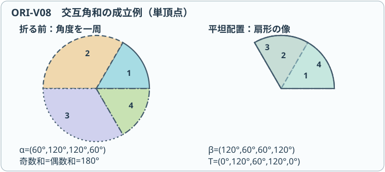

# ORI14 Kawasaki–Justinの定理

<!-- definition-example-audit: strict -->

[前講の内部頂点の偶数性](../ORI13/index.md#prop-ori13-even-valence)で、作動する折り目が奇数本集まる頂点は平らに畳めないと分かりました。しかし、折り目が四本なら何でも畳めるわけではありません。たとえば四つの角を順に $40^\circ,70^\circ,130^\circ,120^\circ$ とすると合計は一周の $360^\circ$ ですが、後で見る交互角の条件が崩れています。

折り目の本数に加えて、**周囲の角をどの順序で取るか**が決定的です。ここでは紙の厚さを0、面の伸縮をなしとし、紙の内部の**一つの頂点だけ**を小円板で切り取って考えます。山谷をあらかじめ指定せず、すべての折り目を作動させ、重なりを許して平らに畳めるかを判定します。

この講でできるようになることは、次の四つです。

1. 単頂点の角を巡回順に番号付けし、零角・同一直線の二本の半直線・境界頂点を区別する。
2. 面ごとの鏡映を一周合成して、交互角和が等しい**必要性**を証明する。
3. 角度の交互和が0なら、折り始めの位置と層順を選んで畳めるという**十分性**を構成する。
4. この判定が山谷指定、多頂点の大域整合、連続した折り運動まで保証するわけではないと説明する。

**動く図 ORI-V08**：[交互角歩行と扇形の重なりを工程送りで見る](assets/ori-v08-player.html)（[静止SVG](assets/ori-v08-poster.svg)）。四つの角 $60^\circ,120^\circ,120^\circ,60^\circ$ の交互和は0です。面を置く開始点を巡回変更し、扇形の幅を保ったまま順に鏡映して重ねます。比較用に交互和が0にならない例も切り替えられます。これは**平坦配置の構成手順を表示する図**であって、連続的な折り運動ではありません。判定の根拠は本講の[交互角歩行の命題](#prop-ori14-angular-walk)と[Kawasaki–Justinの定理](#thm-ori14-kawasaki-justin)です。

---

## 1. 角度は折り目の間の扇形に付ける

内部頂点 $v$ から互いに異なる方向へ出る正の長さの折り目を、反時計回りに $c_1,\ldots,c_m$ と並べます。$c_i$ と $c_{i+1}$ の間にある、紙の小円板内の扇形の内角を $\alpha_i$ とします。添字は巡回し、$c_{m+1}=c_1$ です。

角度は折り目そのものではなく**隣り合う二本の折り目の間**に付いています。すべての扇形の内部があるので $\alpha_i>0$ であり、円板を一周するので

$$
\alpha_1+\cdots+\alpha_m=360^\circ.
$$

ここでいう平坦折りは、[ORI13の面ごとの等長な配置](../ORI13/index.md#def-ori13-flat-placement)に加え、扇形を上下に重ねる順序を選び、紙を貫通させない**局所的な完成配置**が存在することを指します。折り線を動かさずに残す選択肢は含めません。山谷の記号は[ORI13の山谷割当て](../ORI13/index.md#def-ori13-mv-assignment)を使いますが、この講では入力として固定しません。

<!-- formal-statement-start -->
> **定義（山谷未指定の単頂点局所平坦折り可能性）**  
> 平面の内部点 $v$ の小円板に、相異なる $m\ge2$ 方向の直線折り目 $c_1,\ldots,c_m$ が $v$ から放射状に伸び、扇形角 $\alpha_i>0$ の和が $360^\circ$ であるとする。すべての折り目が作動する面ごとの等長な平坦配置候補が存在し、さらに重なった扇形を紙が互いを貫通しない層順に配置できるとき、この折り線図を**山谷未指定で局所平坦折り可能**という。山谷割当てと層順は存在量化され、事前には固定されていない。
<!-- formal-statement-end -->

<!-- definition-example-start: def-ori14-local-unassigned-flat-foldability -->
### 例1：一本の直線の両半直線

左向きと右向きの半直線を二本の折り目 $c_1,c_2$ と数えます。このとき $m=2$ ですが、二本の間の角は $\alpha_1=\alpha_2=180^\circ$ です。[ORI13の平坦配置候補の定義](../ORI13/index.md#def-ori13-flat-placement)に沿い、頂点を原点、二本に共通する直線を $x$ 軸に取って、上半円と下半円へ別々の等長変換を割り当てます。平行移動・回転でこの座標を選んでも、長さ・角・折り可能性は変わりません。具体的には

$$
T_1(x,y)=(x,y),\qquad T_2(x,y)=(x,-y)
$$

とします。各面は等長で、直線 $y=0$ 上では両写像が一致し、写像は互いに異なるため両折り目は作動します。両半円の像は上半円に重なります。上半円を上、下半円を下とする二層なら紙は貫通せず、山谷は一つの直線折りに対応して選べます。

**定義の確認**：内部頂点、正の二角、合計 $360^\circ$、作動する二本、面の等長性、共有辺一致、二層の非貫通を順に確認しました。「次数2」と「二本の異なる直線」は同義ではありません。
<!-- definition-example-end -->

### 何を除外するか

- $\alpha_i=0^\circ$ は、隣接する折り目の方向が重複します。別々の扇形にならないため、本講の定理の入力から除きます。
- $m$ が奇数のときは[偶数性の命題](../ORI13/index.md#prop-ori13-even-valence)で不可能です。
- 紙の**外周**の角や、複数の内部頂点にまたがる線図は本講の判定対象ではありません。
- $m\ge4$ で $\alpha_i=180^\circ$ となる場合は、後述する交互角和の必要条件に反します。合法な次数2の $180^\circ$ と混同しません。

## 2. 必要性：一周した鏡映が閉じるには

[ORI13の共有辺の相対鏡映](../ORI13/index.md#prop-ori13-seam-reflection)から、作動する折り目を横切るごとに、平坦配置の隣接面は鏡映でつながっています。そのため扇形を反時計回りに読むと、平面上に畳んだ像では向きが毎回反転します。

最初の折り目 $c_1$ の像の向きを角度 $\theta_0=0^\circ$ として固定します。最初の扇形の像は幅 $\alpha_1$ だけ正方向へ進みますが、次の扇形は裏返っているため幅 $\alpha_2$ だけ負方向へ戻ります。この**折り畳み後の折り線の向きの角度**を $\theta_j$ と書きます。途中では $360^\circ$ で割った余りに戻さず、増減を実数の角度として累積します。従って同じ半直線に戻っても値は $360^\circ$ の整数倍となりえます。漸化式は次のとおりです。

$$
\theta_0=0,\qquad
\theta_j-\theta_{j-1}=(-1)^{j-1}\alpha_j.
$$

<!-- formal-statement-start -->
> **命題（扇形像の交互角歩行）**  
> 正の扇形角 $\alpha_1,\ldots,\alpha_{2n}$ を持つ単頂点のすべての折り目が作動する面ごとの等長な平坦配置候補では、扇形の像を順に横切る角度の増分は符号が交替する。初めの折り線像の角度を0に取れば、$j=0,1,\ldots,2n$ について

$$
\theta_j=\sum_{i=1}^{j}(-1)^{i-1}\alpha_i
$$

> となる。最後に同じ折り目 $c_1$ の像へ戻るため、$\theta_{2n}=0$ が必要である。
<!-- formal-statement-end -->

**証明の見取り図。** 最初の面の向きを正とすると、折り線を渡るたびに面の向きが逆になり、正、負、正、負と角度を測ります。最後の条件では向きが一周で閉じるだけでなく、同じ半直線の像へ帰る必要があります。

<!-- proof-start -->
### 証明

各扇形の像は等長なので、その両境界のなす角の絶対値は元の $\alpha_j$ のままです。第一面の像の向きを正とすれば第一増分は $+\alpha_1$。隣接面は[相対鏡映](../ORI13/index.md#prop-ori13-seam-reflection)によって向きが反転するので、第二増分は $-\alpha_2$ です。繰り返すと第 $j$ 増分は $(-1)^{j-1}\alpha_j$ になり、和を取れば表示式を得ます。

最後には第 $2n$ 扇形の終辺が第一扇形の始辺 $c_1$ と同じ半直線の像にならねばならないので、$\theta_{2n}$ は $360^\circ$ の整数倍です。一方、奇数番目の角の和を $O$、偶数番目の角の和を $E$ とすると、全角が正で一周の合計が $360^\circ$ であることから

$$
0<O<360^\circ,\quad 0<E<360^\circ,\quad O+E=360^\circ,
$$

従って

$$
-360^\circ<O-E=\theta_{2n}<360^\circ.
$$

この範囲にある $360^\circ$ の整数倍は0だけであり、$\theta_{2n}=0$ です。
<!-- proof-end -->

<!-- formal-statement-start -->
> **定理（Kawasaki–Justinの定理：単頂点・山谷未指定）**  
> 平面の内部の単頂点 $v$ から、互いに異なる方向へ $2n\ge2$ 本の正の長さの直線折り目が出ているとする。折り目の間の扇形角を反時計回りに $\alpha_1,\ldots,\alpha_{2n}>0$ と並べ、合計が $360^\circ$ であるとする。すべての折り目を作動させる**山谷未指定の局所平坦折り**が存在するための必要十分条件は

$$
\alpha_1-\alpha_2+\alpha_3-\cdots-\alpha_{2n}=0^\circ
$$

> である。同値に、奇数番目と偶数番目の角の和はそれぞれ $180^\circ$ である。

$$
\sum_{j=1}^{n}\alpha_{2j-1}
=\sum_{j=1}^{n}\alpha_{2j}=180^\circ.
$$

> 山谷割当てをあらかじめ指定した場合、多頂点の場合、または開いた配置からの連続的な折り運動についての十分性は主張しない。
<!-- formal-statement-end -->

### 必要性を確認する

<!-- proof-start -->
### 証明

局所平坦折りがあると仮定します。[偶数性の命題](../ORI13/index.md#prop-ori13-even-valence)により本数は偶数です。[交互角歩行の命題](#prop-ori14-angular-walk)を $j=2n$ に適用すれば

$$
0=\theta_{2n}=\sum_{j=1}^{n}\alpha_{2j-1}-\sum_{j=1}^{n}\alpha_{2j}.
$$

奇数番目の和を $O$、偶数番目の和を $E$ と置きます。上式は $O-E=0$、一周の条件は $O+E=360^\circ$ です。二式を加えると $2O=360^\circ$、引くと $2E=360^\circ$。従って $O=E=180^\circ$ です。
<!-- proof-end -->

角度を一つ先から数え始めると交互和の符号が逆になりますが、0である条件は変わりません。反対向きに番号を付け直しても同じです。**角度の順序は必要ですが、どの折り目を1番と呼ぶかには依存しません。**

## 3. 十分性：折り始めを選んで順に重ねる

必要条件の式が正しくても、面の画像が閉じることだけで層順の存在を証明できません。十分性では、扇形の像がすべて一つの半平面に入るように始点を選び、その順に重ねます。

交互角和が0である $2n$ 個の角に対し、第2節の $\theta_j$ と同じ交互和を、角列だけから計算する途中和 $S_j$ として表します。最初の折り目の像を0に取れば $S_j=\theta_j$ ですが、以下では角列の巡回移動も扱うため記号を分けます。

$$
S_0=0,\qquad S_j=\alpha_1-\alpha_2+\cdots+(-1)^{j-1}\alpha_j
$$

と定めます。とくに $S_{2n}=0$ です。偶数番目の途中和 $S_0,S_2,\ldots,S_{2n-2}$ のうち、最小となる位置 $S_{2r}$ を一つ選びます。そして $\alpha_{2r+1}$ から始めるよう角の並びを巡回させ、再度0から交互和を測ったものを $T_j$ とします。つまり $T_j$ は、巡回後の角列に対する $S_j$（および折り線像の角度 $\theta_j$）に相当します。

<!-- formal-statement-start -->
> **補題（偶数番目の最小和から始める）**  
> $2n$ 個の正の角 $\alpha_i$ が $\sum\alpha_i=360^\circ$ および $S_{2n}=0$ を満たすとする。偶数番目の途中和が最小の $2r\in\{0,2,\ldots,2n-2\}$ を選び、$\beta_1,\ldots,\beta_{2n}$ を $\alpha_{2r+1},\ldots,\alpha_{2n},\alpha_1,\ldots,\alpha_{2r}$ と置く。このとき

$$
T_0=0,\qquad T_j=\sum_{i=1}^{j}(-1)^{i-1}\beta_i
$$

> はすべての $0\le j\le2n$ に対して $0\le T_j\le180^\circ$ を満たし、$T_{2n}=0$ となる。
<!-- formal-statement-end -->

**証明の見取り図。** 角の列を偶数個だけずらすと正負の交替は保たれます。選んだ最小の途中和との差として新しい偶数番目の和を書くと、すべて非負です。奇数番目はそこへ正の角を足したものなので負になりません。

<!-- proof-start -->
### 証明

角と符号を周期 $2n$ で延長します。$S_{2n}=0$ なので $S_{j+2n}=S_j$ です。ずらした列は偶数個移動したため、$\beta_i$ の交互和の符号は元と一致します。従って、添字を周期的に読んで

$$
T_j=S_{2r+j}-S_{2r}.
$$

$j=2h$ なら $2r+j$ も偶数であり、$S_{2r}$ の最小性から $T_{2h}\ge0$ です。$j=2h+1$ なら

$$
T_{2h+1}=T_{2h}+\beta_{2h+1}>T_{2h}\ge0.
$$

他方 $\beta_i>0$、奇数番目の和が $180^\circ$ なので、任意の $T_j$ は「一部の正の奇数番目の角の和」から「一部の正の偶数番目の角の和」を引いた数です。ゆえに $T_j\le\sum_{h=1}^{n}\beta_{2h-1}=180^\circ$。最後は $T_{2n}=S_{2r+2n}-S_{2r}=0$ です。
<!-- proof-end -->

### 例2：六つの扇形を実際に並べ替える

反時計回りの角度を $30^\circ,50^\circ,70^\circ,60^\circ,80^\circ,70^\circ$ とします。奇数番目は $30+70+80=180$、偶数番目は $50+60+70=180$ です。元の途中和は

$$
(S_0,S_1,\ldots,S_6)=(0,30,-20,50,-10,70,0)^\circ.
$$

偶数番目の最小は $S_2=-20^\circ$ なので、三番目の扇形から開始します。

| 順番 $j$ | 0 | 1 | 2 | 3 | 4 | 5 | 6 |
| --- | ---: | ---: | ---: | ---: | ---: | ---: | ---: |
| 新しい角 $\beta_j$ | — | 70 | 60 | 80 | 70 | 30 | 50 |
| 途中和 $T_j$ | 0 | 70 | 10 | 90 | 20 | 50 | 0 |

元の並びでは負になった値が、巡回開始位置の変更だけで $0^\circ$ から $90^\circ$ の間へ移りました。この表は角を大きさ順に並べ替えたものではありません。**元の隣接関係を保った巡回移動**だけをしています。

### 十分性を構成する：扇形を順番に一番下へ重ねる

<!-- proof-start -->
### 証明

交互和が0であるとします。[最小和から始める補題](#lem-ori14-minimum-start)の $\beta_i,T_j$ を使います。最初の折り目 $c_{2r+1}$ に沿って小円板を一時的に切り開き、$2n$ 個の扇形をつながった一続きの帯として考えます。これは**構成を説明するための仮の切れ目**であり、完成時には再接続します。

第一扇形の像を、始辺の方向 $T_0=0^\circ$ から終辺の方向 $T_1=\beta_1$ までに置きます。第二扇形はその終辺を挟んで鏡映し、像の角度区間を $T_1$ と $T_2=T_1-\beta_2$ の間へ置きます。一般に第 $j$ 扇形の像を、角度 $T_{j-1}$ と $T_j$ の間へ置きます。その幅は

$$
|T_j-T_{j-1}|=\beta_j,
$$

なので元の面の角度と長さを保ちます。連続する二扇形は共通折り目の像を共有し、一方の向きは反転します。従って[共有辺の相対鏡映](../ORI13/index.md#prop-ori13-seam-reflection)の作動する場合に当たり、すべての折り目が作動します。

面の貼り合わせも確認します。各閉扇形の像を定める等長写像は頂点を同じ原点へ写します。隣接する閉扇形は共有する半径上で像が一致し、隣接しない閉扇形の共通部分は頂点だけです（次数2では二つの境界半径を共有し、どちらでも一致します）。従ってどの共通部分でも写像は一致します。小円板の閉扇形は多角形とは限りませんが、[ORI13の有限閉集合の貼り合わせの証明](../ORI13/index.md#prop-ori13-gluing)と同じ部分列の議論を、有限個の閉扇形にそのまま適用でき、頂点を含めて連続な平坦配置候補を得ます。

ここで扇形を第一、第二、第三、…の順に**新しい扇形を常に既存の層の下側へ入れる**ように重ねます。[ORI13の層順の定義](../ORI13/index.md#def-ori13-layer-order)に従い、像の内部で複数の扇形が重なる点 $z$ では、番号が大きい扇形を下とします。重なる二面の番号が $i<j$ なら、順序は

$$
j\prec_z i
$$

です。番号の大小による順序なので循環せず、重なる領域を動いても二面の上下は変わりません。

任意の $2\le j\le2n$ について、第 $j-1$ 扇形と第 $j$ 扇形は、共通折り目の両側から鏡映で同じ側へ重なります。両者の番号の間に別の整数がないため、その接合辺の近傍では別の層が二面の間に挟まりません。ほかの層は二面の上側または下側にまとまって位置し、折り目を貫通せずに二面を接続できます。各像の角度は $0^\circ\le T_j\le180^\circ$ の間にあり、全ての扇形が角度0の半直線から同じ側の閉半平面に収まります。つまり仮の切れ目の**外側**（負の角度側）には紙がはみ出しません。

最後に $T_{2n}=T_0=0^\circ$ で両端の折り線の像が一致します。第一扇形と最終扇形は、番号順の層ではそれぞれ最上面と最下面にあり、角度0の半直線の負角度側は紙の外部です。よって束の**外側を回る折り目**として二つの端を再接続できます。途中で $T_j=0$ となって別の折り目もこの半直線に重なっても、それらは番号が隣り合う層の間の内側の折り返しです。負角度側の外側接続とは交差しません。再接続箇所にも伸縮や貫通はなく、そこも作動する折り目です。

これで小円板における全 $2n$ 本の折り目について、面の等長性、折り目での連続性、層の非貫通を満たす局所平坦配置を構成しました。最初から特定の山谷指定を入力にしていないため、定理の十分性が成立します。
<!-- proof-end -->

この構成の山谷の一例は、切り開いた開始折り目とその次をともに山折りとし、残りを谷・山・谷・山…と交替させるものです。$2n$ 本なら山が $n+1$ 本、谷が $n-1$ 本です。紙の表裏を反転すれば山谷は入れ替わります。山谷本数の一般的な必要条件と、**指定された別の割当てが可能か**の詳細は次講で扱います。

<!-- formal-statement-start -->
> **系（四本の折り目の判定）**  
> 平面内部の単頂点から四本の相異なる方向の折り目が出て、巡回順の正の扇形角が $\alpha_1,\alpha_2,\alpha_3,\alpha_4$ で合計 $360^\circ$ であるとする。山谷未指定で全四本が局所平坦折り可能であることと、向かい合う扇形角について

$$
\alpha_1+\alpha_3=\alpha_2+\alpha_4=180^\circ
$$

> が成立することは同値である。
<!-- formal-statement-end -->

**証明の見取り図。** 四本の場合の奇数・偶数の角和が、ちょうど向かい合う二角の和です。

<!-- proof-start -->
### 証明

[Kawasaki–Justinの定理](#thm-ori14-kawasaki-justin)に $n=2$ を代入します。交互和が0であれば $\alpha_1+\alpha_3=\alpha_2+\alpha_4$ です。一周の和が $360^\circ$ なので両者は $180^\circ$。逆に両和が $180^\circ$ なら交互和は0となり、定理の十分性から折れます。
<!-- proof-end -->

### 例3：成立と不成立は一つの角で変わる

四本の角 $60^\circ,80^\circ,120^\circ,100^\circ$ では向かい合う和が $60+120=180$ と $80+100=180$ なので折れます。$40^\circ,70^\circ,130^\circ,120^\circ$ なら一周の合計は同じ $360^\circ$ ですが、奇数和は $170^\circ$、偶数和は $190^\circ$ です。合計だけを見る判定は誤りです。

## 4. 使える範囲と、使ってはいけない結論

1. **必要と十分が一致するのは単頂点・山谷未指定の局所問題です。** 同じ角でも、山谷を固定すると折り重ね順と矛盾することがあります。
2. $m\ge4$ で角が正なら、定理成立時に各角は $180^\circ$ 未満です。たとえば奇数番目の角 $\alpha_1$ は同じ奇数群の他の正角と合わせて $180^\circ$ だからです。零角はそもそも定理の範囲外です。
3. 複数頂点で各頂点がこの条件を満たしても、頂点間の層順や干渉が一致するとは限りません。[ORI13の層順](../ORI13/index.md#def-ori13-layer-order)は、局所条件と別に検討する必要があります。
4. ここで構成したのは**平坦な完成形**であり、折る途中に必要な三次元運動、厚さ、弾性、剛体面の拘束は証明していません。

以下の演習では、角和を計算するだけでなく、証明で用いた「最小の偶数途中和」「巡回移動」「半平面への配置」も手で再現します。

---

## 5. 演習と詳細解答

### Level A：定義と角和を確かめる

**ORI14-A1（四本の成立例）**  
内部単頂点の四つの扇形角が巡回順に $60^\circ,80^\circ,120^\circ,100^\circ$ のとき、交互角和を求め、全折り目を作動させる山谷未指定の局所平坦折りがあるか判定してください。

- Level: A

<!-- solution-start -->
**詳細解答**

すべての角は正で、$60+80+120+100=360$ なので平面の内部頂点を一周します。奇数和は $60+120=180$、偶数和は $80+100=180$。よって交互和は $180-180=0^\circ$ です。[Kawasaki–Justinの定理](#thm-ori14-kawasaki-justin)の全仮定を満たすので、山谷を適切に選べば局所平坦折りが存在します。ただしどの山谷指定でもよいとは言えません。
<!-- solution-end -->

**ORI14-A2（合計360度でも失敗）**  
角が $40^\circ,70^\circ,130^\circ,120^\circ$ の四折り線について、角和と交互和を別々に計算し、成立しない理由を示してください。

- Level: A

<!-- solution-start -->
**詳細解答**

角の合計は $40+70+130+120=360^\circ$ ですが、奇数和は $40+130=170^\circ$、偶数和は $70+120=190^\circ$ です。交互和は $170-190=-20^\circ\ne0^\circ$。従って[必要条件](#thm-ori14-kawasaki-justin)が破れ、どんな山谷の選び方でも全四本を作動させる局所平坦折りはありません。「偶数本なら折れる」という推論はできません。
<!-- solution-end -->

**ORI14-A3（残る角を決める）**  
四折り線の正の扇形角が巡回順に $55^\circ,95^\circ,125^\circ,x^\circ$ です。平面の内部頂点として一周する条件と平坦折り条件をともに満たす $x$ を求めてください。

- Level: A

<!-- solution-start -->
**詳細解答**

一周条件から $55+95+125+x=360$、よって $x=85$ です。これは正です。奇数和 $55+125=180$、偶数和 $95+85=180$ となるので[四折り線の系](#cor-ori14-four-crease)から局所平坦折り可能です。一周条件だけで $x$ を求めた後、十分条件も別に検算するのが重要です。
<!-- solution-end -->

**ORI14-A4（巡回移動は並べ替えではない）**  
六つの角 $30^\circ,50^\circ,70^\circ,60^\circ,80^\circ,70^\circ$ で、偶数番目途中和 $S_0,S_2,S_4,S_6$ を求めて最小を特定し、そこから始まる巡回列を答えてください。

- Level: A

<!-- solution-start -->
**詳細解答**

偶数番目の途中和を順に計算すると

$$
S_0=0,\quad S_2=30-50=-20,\quad
S_4=-20+70-60=-10,\quad S_6=-10+80-70=0
$$

です。最小は $S_2=-20^\circ$。その直後の $\alpha_3=70^\circ$ から読み、新しい角列は

$$
(70,60,80,70,30,50)^\circ
$$

となります。角の隣接順を維持した巡回移動であり、数の昇順へのソートではありません。
<!-- solution-end -->

**ORI14-A5（次数2と零角）**  
単頂点で二本の折り目が一直線をなす場合の二角を求め、定理を使えるか述べてください。また四本と称して同じ方向の線を二重に数えた場合を区別してください。

- Level: A

<!-- solution-start -->
**詳細解答**

二本が互いに逆向きの半直線なら二角はともに $180^\circ$ です。正で合計 $360^\circ$、交互和は $180-180=0^\circ$。通常の一本の直線折りが成立します。同じ方向の半直線を重複して「四本」と数える場合は、隣り合う二方向の角に $0^\circ$ が生じます。定理が要求する相異なる方向、正の扇形角を欠くので、零角を含む四角列に定理をそのまま適用してはいけません。
<!-- solution-end -->

### Level B：証明の仕組みを使う

**ORI14-B1（大きすぎる扇形）**  
正の角をもつ $2n\ge4$ 本の単頂点折り線がKawasaki–Justin条件を満たすとする。すべての $\alpha_i$ が $180^\circ$ 未満であることを証明してください。

- Level: B

<!-- solution-start -->
**詳細解答**

[定理](#thm-ori14-kawasaki-justin)により奇数番目の和、偶数番目の和はいずれも $180^\circ$ です。$2n\ge4$ なので各群には $n\ge2$ 個の正の角があります。任意の奇数 $i$ について、他の奇数番目の正角を一つ以上足すと $180^\circ$ になるので $0<\alpha_i<180^\circ$。偶数 $i$ も同じ議論です。次数2では各群に一角だけなので、この厳密不等号は成立せず $180^\circ$ が許されます。
<!-- solution-end -->

**ORI14-B2（角の像を閉じる）**  
六角列 $30^\circ,50^\circ,70^\circ,60^\circ,80^\circ,70^\circ$ について、元の途中和 $S_0,\ldots,S_6$ を求め、最後に0へ戻っても途中の**折り線像の向きを表す和**が負になる理由と、その対処を説明してください。扇形そのものの角度とは区別してください。

- Level: B

<!-- solution-start -->
**詳細解答**

交互に加減すると

$$
(S_0,\ldots,S_6)=(0,30,-20,50,-10,70,0)^\circ
$$

となります。最後の0は面の鏡映の一周が閉じる条件ですが、$S_2,S_4$ が負なので、この始点のままでは像が角度0の半直線の左右へ広がります。偶数位置の最小 $S_2=-20^\circ$ を選んで三番目から巡回移動します。[最小和から始める補題](#lem-ori14-minimum-start)を適用し、順に $70,-60,+80,-70,+30,-50$ を加えると

$$
(T_0,\ldots,T_6)=(0,70,10,90,20,50,0)^\circ
$$

となり、全て同じ半平面に収まります。
<!-- solution-end -->

**ORI14-B3（四角列の最小開始位置）**  
巡回角 $40^\circ,70^\circ,140^\circ,110^\circ$ の途中和を求め、最小の偶数途中和から始めた新しい角列と途中和をすべて示してください。

- Level: B

<!-- solution-start -->
**詳細解答**

正の角の和は $360^\circ$、奇数和は $40+140=180$、偶数和は $70+110=180$ です。元の途中和は

$$
(S_0,\ldots,S_4)=(0,40,-30,110,0)^\circ.
$$

偶数位置の $S_0=0,S_2=-30$ の最小は $S_2$ です。第三角から巡回させると

$$
(\beta_1,\ldots,\beta_4)=(140,110,40,70)^\circ,
$$

$$
(T_0,\ldots,T_4)=(0,140,30,70,0)^\circ
$$

を得て、すべて $[0,180]$ に入ります。元の列を昇順に並べ直したわけではないので隣接折り線は保たれます。
<!-- solution-end -->

**ORI14-B4（角を動かしても条件を保つ）**  
四角列 $(60^\circ,90^\circ,120^\circ,90^\circ)$ から、第一・第三角をそれぞれ実数 $t$ だけ増・減し、第二・第四角をそれぞれ実数 $u$ だけ増・減した列を作る。全角が正となる $t,u$ の範囲を求め、平坦折り可能性を証明してください。

- Level: B

<!-- solution-start -->
**詳細解答**

新しい角列は $(60+t,90+u,120-t,90-u)^\circ$ です。正の条件を第一・第三角と第二・第四角に分けると

$$
\begin{aligned}
60+t>0,\quad120-t>0&\iff -60<t<120,\\
90+u>0,\quad90-u>0&\iff -90<u<90.
\end{aligned}
$$

この範囲で奇数和と偶数和は

$$
\begin{aligned}
(60+t)+(120-t)&=180,\\
(90+u)+(90-u)&=180.
\end{aligned}
$$

合計も $360^\circ$ に保たれ、四つの角が正なので[四折り線の系](#cor-ori14-four-crease)の十分性から常に局所平坦折り可能です。個別の角の保存ではなく、交互群ごとの和の保存が本質です。
<!-- solution-end -->

### Level C：八本の角から配置まで構成する

**ORI14-C1（交互角歩行と層順の構成）**  
内部単頂点の八つの正の扇形角を反時計回りに

$$
(20,55,45,40,65,50,50,35)^\circ
$$

とします。

1. 合計角、奇数和、偶数和、$S_0,\ldots,S_8$ をすべて計算し、局所平坦折りが可能か判定する。
2. 偶数番目の途中和が最小となる直後から巡回列を作り、全ての新しい途中和 $T_j$ を計算する。
3. 新しい順で扇形を重ねる構成について、面の等長性、共有辺の一致、層の非貫通、最初と最後の接続がそれぞれなぜ成立するか説明する。これにより指定した任意の山谷が可能だといえるかも答える。

- Level: C

<!-- solution-start -->
**詳細解答**

まず合計は $20+55+45+40+65+50+50+35=360$ です。奇数和は $20+45+65+50=180$、偶数和は $55+40+50+35=180$ 度なので交互和は0。すべての角が正で内部の一頂点を一周するから[定理](#thm-ori14-kawasaki-justin)の適用条件を満たします。

途中和を一つずつ計算します。

$$
\begin{aligned}
S_0&=0, & S_1&=20,\\
S_2&=20-55=-35, & S_3&=-35+45=10,\\
S_4&=10-40=-30, & S_5&=-30+65=35,\\
S_6&=35-50=-15, & S_7&=-15+50=35,\\
S_8&=35-35=0.
\end{aligned}
$$

偶数番目の値 $S_0=0,S_2=-35,S_4=-30,S_6=-15$ の最小は $S_2=-35$ です。従って第三扇形から始めると、新しい列は

$$
(\beta_1,\ldots,\beta_8)=(45,40,65,50,50,35,20,55)^\circ.
$$

$$
\begin{aligned}
T_0&=0, & T_1&=45,\\
T_2&=45-40=5, & T_3&=5+65=70,\\
T_4&=70-50=20, & T_5&=20+50=70,\\
T_6&=70-35=35, & T_7&=35+20=55,\\
T_8&=55-55=0.
\end{aligned}
$$

扇形 $j$ を角度 $T_{j-1},T_j$ の間の扇形像へ写すと、その角幅は $|T_j-T_{j-1}|=\beta_j$ で元と等しく、半径方向の長さも保存されます。隣接する二扇形は同じ角度 $T_j$ の境界半直線上で一致し、像を鏡映で貼れます。番号順に新しい扇形を既存の層の下へ入れれば、重なりに一貫した上下を与えられます。隣り合う番号の二面は他の層を挟まずに接合し、全ての $T_j$ は $0$ 以上なので紙は角度0側の外部へ出ません。最初と最後の端は $T_0=T_8=0$ で一致し、束の外側を通って接続できます。これが[十分性の構成](#proof-ori14-sufficiency)です。

ただし、この手順は**一つの山谷割当てと層順が存在する**ことを示すのであって、問題文で別途与えられる任意の山谷指定が可能であることは示しません。また複数頂点で全体が平坦になるか、折る途中の運動があるかも別問題です。
<!-- solution-end -->

---

## 6. 次の問い

ここで証明した[Kawasaki–Justinの定理](#thm-ori14-kawasaki-justin)により、単頂点で山谷を未指定とする限り、**偶数本の折り目と交互角和0**が局所平坦折りの必要十分条件だと分かりました。しかも、最小途中和から開始して順番に重ねれば、存在を言うだけでなく一つの折り方を構成できます。

次のORI15「Maekawaの定理」では、このように得られた平坦配置において山折りと谷折りの本数にどのような制約があるかを証明します。さらに、角の条件と本数条件を両方満たしても、**個別に指定した山谷の実現可能性**は別に判定しなければならないことを学びます。

### 参考文献

- Thomas C. Hull, *On the Mathematics of Flat Origamis*, *Congressus Numerantium* 100 (1994), 215–224（単頂点の局所平坦折りの基本結果）。
- Lily Chung, Erik D. Demaine, Dylan Hendrickson, Victor Luo, [*Flat Folding an Unassigned Single-Vertex Complex without Flat Angles*](https://arxiv.org/abs/2204.03696), 2022（Kawasaki–Justinの定理の位置付けと拡張）。
