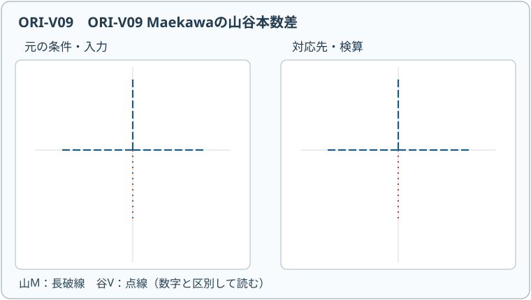

# ORI15 Maekawaの定理

**動く図 ORI-V09**：[山折り・谷折りの本数を切り替え](assets/ori-v09-player.html)（[静止SVG](assets/ori-v09-poster.svg)）。数学的な条件と適用範囲を図の説明文でも確かめ、以下の本文の式と照合してください。図だけから実物の連続折り運動や一般定理の成立を結論しません。動画を操作しなくても本文の証明・演習は完結します。

<!-- definition-example-audit: strict -->

[前講のKawasaki–Justinの定理](../ORI14/index.md#thm-ori14-kawasaki-justin)では、内部の一頂点に集まる折り目が**山谷未指定**で平坦に折れる条件を、扇形角の交互和で表しました。しかし、実際に折り線図を使うには、各折り目を山折りにするか谷折りにするかも指定したいところです。交互角和が0でも、どんな指定でも実現するわけではありません。

まず最も簡単な一本の直線折りを考えましょう。頂点の両側に伸びる半直線は二本の折り目として数えられますが、一本の直線の片側だけを山、もう片側だけを谷にすることは、頂点で紙を切ったり新しい折り目を作ったりしなければできません。**本数の組合せにも制約**があります。

この講で求めるのは、厚さ0・伸縮なしの紙の内部の一頂点を、小円板で切り出して平らに折るときの次の判断です。

1. 山谷を指定した折り線図が実現するとは、平面上の面の像だけでなく何を満たすことか。
2. なぜ山折り本数と谷折り本数の差は必ず $2$ または $-2$ なのか。
3. 角の条件と本数の条件を同時に満たしても、どのような層の衝突が残るのか。

以下でいう「平坦に折る」は**全折り目を作動させた局所的な完成配置**を意味します。多頂点の大域的な重なりや、折る途中の連続運動まで保証する言葉ではありません。

---

## 1. 指定された山谷は、平面への写像だけでは決まらない

[ORI13の山谷割当て](../ORI13/index.md#def-ori13-mv-assignment)では、表側を固定して各折り目に $M$（山）または $V$（谷）を与えました。また[面ごとの等長な配置候補](../ORI13/index.md#def-ori13-flat-placement)は、紙の各扇形を距離を保って平面へ写し、隣接辺の像を一致させます。[ORI14の山谷未指定の局所平坦折り可能性](../ORI14/index.md#def-ori14-local-unassigned-flat-foldability)では、さらに貫通しない層順の存在まで要求しました。しかし、同じ平面上の像に複数の紙片が重なったとき、その上下関係を記録しなければ、指定した山谷と整合するか判定できません。

ここで内部頂点 $v$ から出る相異なる $m$ 本の折り目を反時計回りに $c_1,\ldots,c_m$ とします。$c_i$ から次の $c_{i+1}$ へ反時計回りに測る正の扇形角を $\alpha_i$ とします。

添字は巡回して $c_{m+1}=c_1$、$\alpha_0=\alpha_m$、$\alpha_{m+1}=\alpha_1$ と読みます。一周する角の和は $360^\circ$ です。どの折り目も作動し、同じ紙片が互いを貫通せず、指定山谷に従って重ねられるかを問います。

<!-- formal-statement-start -->
> **定義（山谷指定の単頂点局所平坦折り可能性）**  
> 厚さ0の紙の内部点 $v$ から出る相異なる方向の正の長さの $m\ge2$ 本の直線折り目 $c_1,\ldots,c_m$ と、正の扇形角 $\alpha_i$（合計 $360^\circ$）、山谷割当て $\mu(c_i)\in\{M,V\}$ が与えられたとする。[ORI13の面ごとの等長な平坦配置候補](../ORI13/index.md#def-ori13-flat-placement)が全折り目を作動させ、かつ[層順](../ORI13/index.md#def-ori13-layer-order)を選んで自己貫通なく、折り目の表裏関係を $\mu$ と一致させられるとき、この割当てを**局所平坦折り可能**という。
<!-- formal-statement-end -->

<!-- definition-example-start: def-ori15-assigned-local-fold -->
### 例1：二本の半直線は同じ山谷になる

小円板の中心を貫く水平な直線 $y=0$ を考え、その上の頂点 $v=(0,0)$ から左右に出る二本の半直線を $c_1,c_2$ とします。正の扇形角はどちらも $180^\circ$ です。

上側の半円板では恒等写像 $T_+(x,y)=(x,y)$、下側では鏡映 $T_-(x,y)=(x,-y)$ を用います。これは[面の平坦配置候補の定義](../ORI13/index.md#def-ori13-flat-placement)を座標で確かめるための表示です。どちらの写像も二点 $P=(x,y),Q=(x',y')$ の距離について

$$
|T_\pm(P)-T_\pm(Q)|^2=(x-x')^2+(y-y')^2=|P-Q|^2
$$

を満たすので等長です。また共有直線上では $T_+(x,0)=T_-(x,0)=(x,0)$ ですが、$y\ne0$ なら両写像は異なるため、左右二本の半直線をともに作動させます。二層を上・下に定めれば自己貫通なく平坦に置けます。一本のまっすぐな折り目を全長にわたって山にした配置は $(M,M)$、紙を裏返せば $(V,V)$ です。

一方、$(M,V)$ とすると、同じ一本の直線を頂点の左で山、右で谷へ切り替えることになります。二つの半円板の上下関係は一本の共有直線の両側で連続していなければならず、頂点を境に上下を交換できません。

**定義の確認**：$(M,M)$ と $(V,V)$ は、内部頂点、正の二角、等長性、共有辺一致、全折り目作動、非貫通の二層、指定山谷をすべて満たします。$(M,V)$ は平面への同じ写像を書けても、最後の指定山谷に合う層順を持ちません。
<!-- definition-example-end -->

以後、山折りの本数を $M$、谷折りの本数を $V$ と書きます。これは山谷記号そのものと同じ文字を使いますが、数式 $M+V$ では**非負整数の本数**を意味します。全折り目を作動させるので $M+V=m$ です。

## 2. 頂点を切り落とした断面が本数差を決める

折り終えた頂点のごく近くを切り落としたと想像してください。紙の各扇形が切り口に一本ずつ辺を与え、折り目のところで切り口が折り返します。層が重なるため、切り口を上から見ると潰れた多角形のように見えます。**同じ一本の紙の境界をたどる**という点が重要です。交差を許して好きに線をつないだ図ではありません。

正面から見た切り口の折り返しは、山谷の向きに応じて内部角 $0^\circ$ または $360^\circ$ に対応します。裏から見れば両者は交換されます。通常の多角形で「内角和は $(m-2)180^\circ$」とする式は、ここでは重なって潰れた形を**紙の層をわずかに離した単純閉曲線の極限**として考え、符号付きの曲がり角の和として使います。接して見える辺を勝手に交差させてはいけません。

<!-- formal-statement-start -->
> **定理（Maekawaの定理）**  
> 厚さ0・伸縮なしの紙の内部の単頂点 $v$ に、相異なる方向の $m\ge2$ 本の直線折り目が集まり、正の扇形角の和が $360^\circ$ であるとする。全折り目が作動し、指定された山谷割当ての下で、重なりが自己貫通しない局所平坦折り配置が存在すると仮定する。山折りの本数を $M$、谷折りの本数を $V$ とすると、必ず

$$
M-V=\pm2
$$

> である。山谷を交換すると差の符号が反転する。**この本数条件だけから指定山谷の局所平坦折り可能性は結論できない。**
<!-- formal-statement-end -->

### 証明の見取り図

頂点の近くの切り口を一周すると、すべての折り目で一回ずつ向きを変えます。山での曲がりを $+180^\circ$、谷での曲がりを $-180^\circ$ と取る向きでは、曲がりの合計は $(M-V)180^\circ$ です。自己貫通しない一つの閉じた切り口なら、一周の**符号付き回転**は $+360^\circ$ または $-360^\circ$。この二つを比較します。

<!-- proof-start -->
### 証明

まず $m=2$ の場合を分けます。[Kawasaki–Justinの定理](../ORI14/index.md#thm-ori14-kawasaki-justin)を $n=1$ に適用すると二角はともに $180^\circ$ で、二本は一本の直線の両半直線です。例1で確かめたように、この二本は同じ山谷でなければならないため、$(M,V)=(2,0)$ または $(0,2)$ となり、本数差は $\pm2$ です。

以下 $m\ge3$ とします。折り畳み後の内部頂点 $v$ を、十分小さく切り落とします。切断面は各作動折り目をちょうど一回横切り、各扇形から一本ずつ辺を受け取る閉じた断面として取れます。頂点以外には折り目が交わらず、紙の層が互いを貫通しないので、重なって見える切り口の層を微小に離せば、同じ紙の境界を一周する**一つの単純閉曲線**として追えます。

この断面を曲げ戻して平面上の単純な多角形状の境界としてたどると、接線の向きは一回転します。実際、反時計回りにたどる非退化な単純多角形の内角を $\gamma_i$、外角を $180^\circ-\gamma_i$ とすれば、内角和は $(m-2)180^\circ$ だから

$$
\sum_{i=1}^{m}(180^\circ-\gamma_i)
=m\cdot180^\circ-(m-2)180^\circ=360^\circ.
$$

時計回りなら符号が逆で $-360^\circ$ です。曲線を潰れた平坦配置へ近づけても、自己交差を起こさない限り一周の回転数は変わりません。ここで使うのは完成配置の断面を微小に離す操作であって、開いた紙から折る連続運動の存在ではありません。

折り目を横切る断面では、平坦折りの二面は完全に折り重なるので、折り目に対応する内角は $0^\circ$ または $360^\circ$ に近づきます。したがって外角（$180^\circ-$ 内角）はそれぞれ $+180^\circ$ または $-180^\circ$ に近づきます。紙の表側を固定して一方向から断面をたどれば、山と谷はそれぞれ一方の符号へ対応し、裏側からの観察では対応が逆になります。

山を正、谷を負とした向きの外角和は

$$
\begin{aligned}
\sum_{i=1}^{m}\text{符号付き外角}_i
&=M\cdot180^\circ+V\cdot(-180^\circ)\\
&=(M-V)180^\circ.
\end{aligned}
$$

一方、この和は $\pm360^\circ$ です。ゆえに

$$
(M-V)180^\circ=\pm360^\circ,
\qquad M-V=\pm2.
$$

最後に紙の表裏を交換すると各山が谷へ、各谷が山へ変わり、$M-V$ の符号が反転します。証明は角度の数値ではなく、折り終えた**非貫通の断面**を用いています。従って山谷の文字を書いただけの、自己貫通する配置候補には適用できません。
<!-- proof-end -->

切り口の議論に不慣れなら、二本の半直線の例に戻るとよいでしょう。一本の折り目で $(M,V)=(2,0)$ または $(0,2)$ なので差は $2$ または $-2$。本数が二本だから山と谷が一本ずつ、とはなりません。

<!-- formal-statement-start -->
> **系（偶数次数と山谷本数）**  
> 全折り目が作動する、厚さ0で自己貫通のない内部単頂点の局所平坦折りを考える。折り目が $m$ 本、山谷本数が $M,V$ とすると、ある整数 $n\ge1$ に対して $m=2n$ であり、可能な本数の組は

$$
(M,V)=(n+1,n-1)\quad\text{または}\quad(n-1,n+1)
$$

> に限られる。
<!-- formal-statement-end -->

**証明の見取り図。** 合計と差の二式を足し引きして、山・谷の本数を決めます。これは本数に関する必要条件であり、各位置への割当ての判定とは別です。

<!-- proof-start -->
### 証明

全折り目が作動するので $M+V=m$ です。[Maekawaの定理](#thm-ori15-maekawa)から $M-V=2\varepsilon$（$\varepsilon=1$ または $-1$）です。足し引きすると

$$
2M=m+2\varepsilon,\qquad2V=m-2\varepsilon.
$$

$M,V$ は整数なので $m$ は偶数です。$m=2n$ と置けば $M=n+\varepsilon$、$V=n-\varepsilon$ となります。少なくとも二本の折り目があるので $n\ge1$ です。なお偶数次数自体は[ORI13でも別の方法で証明済み](../ORI13/index.md#prop-ori13-even-valence)です。
<!-- proof-end -->

### 例2：本数だけなら候補は何個か

四本なら可能な組は $(3,1)$ と $(1,3)$、六本なら $(4,2)$ と $(2,4)$ です。$2n$ 本の**位置を区別した**山谷文字列を本数だけで数えると

$$
2\binom{2n}{n-1}
$$

通りです。なぜなら $M=n+1$ となる文字列は山の位置を $2n$ 個から $n+1$ 個選ぶので $\binom{2n}{n+1}=\binom{2n}{n-1}$ 通りで、山谷を入れ替えた文字列も同数だからです。これは**本数条件を通過する候補数**であって、幾何的に折れる割当ての個数ではありません。

## 3. 本数が合っていても、狭い扇形で紙が衝突する

角の条件と本数の条件は、検査している情報が違います。[Kawasaki–Justinの定理](../ORI14/index.md#thm-ori14-kawasaki-justin)は角度だけを見て山谷未指定の存在を決めます。一方、[Maekawaの定理](#thm-ori15-maekawa)は実現した山谷の本数を制限します。どちらも**指定した折り目それぞれの表裏関係**を十分には検査していません。

狭い扇形の両隣を折り込む場面を考えます。中心の角が左右両隣の角より真に小さいと、両側の紙片は折り込まれた中心扇形の像を端から端まで覆います。ここで二つの境界折り目を同じ種類の山谷にすると、両紙片が中心扇形の同じ側に来るため、どちらかの折り目に別の紙片が割り込んでしまいます。

<!-- formal-statement-start -->
> **命題（厳密な局所最小扇形の山谷制約）**  
> 厚さ0の紙の内部の単頂点で、すべての折り目が作動する自己貫通のない山谷指定局所平坦折りがあるとする。巡回順に連続する三つの正の扇形角を $\alpha_{i-1},\alpha_i,\alpha_{i+1}$、中央の $\alpha_i$ を挟む二本の折り目を $c_i,c_{i+1}$ とする（添字は巡回する）。もし

$$
\alpha_i<\alpha_{i-1},\qquad\alpha_i<\alpha_{i+1}
$$

> なら、二本は必ず異なる山谷指定を持つ。

$$
\mu(c_i)\ne\mu(c_{i+1}).
$$
<!-- formal-statement-end -->

### 証明の見取り図

中心扇形を平面上の角度区間 $[0,\alpha_i]$ へ写します。両隣の面はそれぞれ両側の折り目で鏡映され、角の大小関係から中心扇形の像**全体**へ重なります。同じ山谷なら両隣が中心面の同じ側へ来ますが、両隣が重なる部分では層の上下が一方に確定し、その間にもう一方の折り目を閉じる余地がありません。

<!-- proof-start -->
### 証明

中央の扇形を $S$、その左の隣を $L$、右の隣を $R$ とします。頂点の像を原点とし、$c_i$ の像の方向を $0$、$c_{i+1}$ の像の方向を $\alpha_i$ として、$S$ の像をこの二方向の間に置きます。

[共有折り線に沿う相対鏡映](../ORI13/index.md#prop-ori13-seam-reflection)を両端に適用します。$L$ は元の角度区間 $[-\alpha_{i-1},0]$ を $0$ の軸で反射し、$R$ は元の区間 $[\alpha_i,\alpha_i+\alpha_{i+1}]$ を $\alpha_i$ の軸で反射します。従って三つの面の平坦像の角度区間は

$$
\begin{aligned}
L&:[0,\alpha_{i-1}],\\
S&:[0,\alpha_i],\\
R&:[\alpha_i-\alpha_{i+1},\alpha_i]
\end{aligned}
$$

となります。元の面での角幅は鏡映しても変わらず、隣接する境界線の像は一致するためです。

仮定 $\alpha_{i-1}>\alpha_i$ と $\alpha_{i+1}>\alpha_i$ により、$S$ 内部の任意の方向 $0<\theta<\alpha_i$ について

$$
0<\theta<\alpha_i<\alpha_{i-1},\qquad
\alpha_i-\alpha_{i+1}<0<\theta<\alpha_i
$$

が成立します。極座標で同じ十分小さい半径 $r>0$ の点 $(r,\theta)$ を考えると、各平坦像は半径を保つので、その点には $L,S,R$ の三層すべてが重なります。特に、$c_i$ に沿う $S$ のすぐ内側にも $R$ があり、$c_{i+1}$ に沿う $S$ のすぐ内側にも $L$ があります。

仮に $\mu(c_i)=\mu(c_{i+1})$ とします。紙の表側と各面の向きを固定すると、同じ山谷の二折り目は左右の面を中央面 $S$ の**同じ側**へ折り込むことを意味します。したがって $S$ の内部で重なる $L,R$ には、$S$ に近い層と遠い層という順序が生じます。

もし $L$ が $S$ に近ければ、$c_{i+1}$ の直近でも $L$ が $S$ と $R$ の間に存在します。そのため、折り目 $c_{i+1}$ に沿って接続すべき $S,R$ を直接つなげられません。

逆に $R$ が $S$ に近ければ、$c_i$ で $S,L$ の接続が妨げられます。どちらも紙の貫通を要するので不可能です。ゆえに二本は異なる山谷指定でなければなりません。
<!-- proof-end -->

この条件は**厳密な**局所最小角に対するものです。中央角が隣の角と等しいと、隣の像が境界まで届く配置で層の接続構造が変わるため、不等号を $\le$ に置き換えてはいけません。またこの命題だけで指定山谷の十分条件が得られたわけでもありません。

### 例3：二つの必要条件を通るのに折れない四折り線

四本の折り目 $c_1,c_2,c_3,c_4$ の間の扇形角を反時計回りに

$$
(\alpha_1,\alpha_2,\alpha_3,\alpha_4)
=(30^\circ,120^\circ,150^\circ,60^\circ)
$$

とし、折り目の山谷を巡回順に

$$
(\mu(c_1),\mu(c_2),\mu(c_3),\mu(c_4))=(M,M,M,V)
$$

と指定します。角度と山谷を混同しないよう、条件を別々に調べます。

| 判定 | 計算 | 結果 |
| --- | --- | --- |
| 内部頂点の角和 | $30+120+150+60=360$ | 成立 |
| Kawasaki–Justin | $30+150=120+60=180$ | 成立 |
| Maekawa | $M=3,V=1$ より $M-V=2$ | 成立 |
| 局所最小角 | $30<60$ かつ $30<120$ | $c_1,c_2$ は異符号が必要 |
| 実際の山谷 | $\mu(c_1)=\mu(c_2)=M$ | **矛盾** |

$\alpha_1$ は両隣の $\alpha_4$ と $\alpha_2$ より真に小さいため、[局所最小角の命題](#prop-ori15-strict-small-sector)が $\mu(c_1)\ne\mu(c_2)$ を要求します。しかし指定では両方山です。角度条件が保証したのは「**ある**山谷と層順なら折れる」ということだけで、この指定では紙片が衝突します。

なお角度は変えず、山谷の指定を選び直せば、[ORI14の十分性の構成](../ORI14/index.md#lem-ori14-minimum-start)から実現する配置を作れます。ここで示したのは角の配置全体の不可能性ではなく、**特定の山谷割当ての不可能性**です。

## 4. 必要条件を使うときの順番

入力が一つの**内部単頂点**、正の扇形角、全折り目作動であることを最初に確認します。その後に検査する順番を整理しておきます。

1. 角が一周 $360^\circ$ で、相異なる方向の折り目からできているか。[Kawasaki–Justinの定理](../ORI14/index.md#thm-ori14-kawasaki-justin)の交互角和が0か。
2. 山谷が各折り目に一つずつ指定され、[Maekawaの定理](#thm-ori15-maekawa)の $M-V=\pm2$ を満たすか。
3. 厳密な局所最小扇形があれば[本章の命題](#prop-ori15-strict-small-sector)で、その両端の山谷が反対か。
4. 上の検査を通っても、層順が矛盾なく作れるかを**別に**調べる。

最初の三つは、否定すれば不可能性を証明できる必要条件です。通過しただけでは可能性の証明になりません。次講では、角の等しい連なりや層順を含め、単頂点に与えられた山谷指定をどのように構成的に判定できるかを扱います。

---

## 5. 演習と詳細解答

### Level A：本数、角度、局所最小を確かめる

**ORI15-A1（二本の半直線）**  
内部頂点で一本の直線を左右二本の半直線として数える。全二本を作動させるとき、$(M,V)=(1,1)$ は可能か。$\alpha_1=\alpha_2=180^\circ$ として答えてください。

- Level: A

<!-- solution-start -->
**詳細解答**

一本の直線折りの両半直線は同じ山谷です。数式でも二本とも作動し、[Maekawaの定理](#thm-ori15-maekawa)を使えるので

$$
M+V=2,\qquad M-V=\pm2
$$

です。二式を足し引きすると $(M,V)=(2,0)$ または $(0,2)$ だけです。$(1,1)$ は差0となり不可能です。一方、角の条件は $180^\circ-180^\circ=0^\circ$ で成立しますが、それだけで山谷指定を許可してはいけません。
<!-- solution-end -->

**ORI15-A2（八本の本数候補）**  
内部単頂点から互いに異なる方向へ八本の折り目が出ている。全折り目を作動させる局所平坦折りに必要な $(M,V)$ の組を求め、$(5,3)$ と $(4,4)$ を判定してください。

- Level: A

<!-- solution-start -->
**詳細解答**

$M+V=8=2\cdot4$ なので[本数の系](#cor-ori15-count-parity)の $n=4$ を使います。$(M,V)=(5,3)$ または $(3,5)$ が必要です。$(5,3)$ は差2なので本数条件を通過しますが、それだけでは実現可能とは判定できません。$(4,4)$ は差0なので不可能です。
<!-- solution-end -->

**ORI15-A3（角度と山谷を別に判定）**  
内部単頂点の四扇形角が $40^\circ,70^\circ,130^\circ,120^\circ$ で、山谷が $(M,M,M,V)$ と指定された。角と本数の条件を独立に確認し、何を結論できるか述べてください。

- Level: A

<!-- solution-start -->
**詳細解答**

四角はいずれも正で、合計は $40+70+130+120=360$ 度です。しかし奇数番目と偶数番目の和を分けると

$$
\begin{aligned}
\alpha_1+\alpha_3&=40^\circ+130^\circ=170^\circ,\\
\alpha_2+\alpha_4&=70^\circ+120^\circ=190^\circ,\\
(\alpha_1+\alpha_3)-(\alpha_2+\alpha_4)&=-20^\circ
\end{aligned}
$$

です。よって[Kawasaki–Justinの必要条件](../ORI14/index.md#thm-ori14-kawasaki-justin)に反し、どの山谷でも平坦には折れません。一方、指定山谷では $M=3,V=1$ なので差2で[Maekawaの必要条件](#thm-ori15-maekawa)を満たします。後者が成立しても前者の不成立を取り消せません。
<!-- solution-end -->

**ORI15-A4（局所最小の両端）**  
内部単頂点の四扇形角が $30^\circ,120^\circ,150^\circ,60^\circ$ で、折り目 $c_i$ は角 $\alpha_{i-1}$ と $\alpha_i$ の境界（巡回添字）にある。どの扇形が厳密な局所最小かを求め、そこを挟む二本の折り目の必要な山谷関係を答えてください。

- Level: A

<!-- solution-start -->
**詳細解答**

$\alpha_1=30^\circ$ の両隣は $\alpha_4=60^\circ$ と $\alpha_2=120^\circ$ なので

$$
\alpha_1<\alpha_4,\qquad \alpha_1<\alpha_2
$$

が同時に成立し、厳密な局所最小です。他の角は両隣より真に小さくはありません。[局所最小角の命題](#prop-ori15-strict-small-sector)を $i=1$ に適用すると、境界折り目 $c_1,c_2$ は $\mu(c_1)\ne\mu(c_2)$ であることが必要です。
<!-- solution-end -->

**ORI15-A5（表裏交換と差の符号）**  
内部単頂点の六本の折り目に $(M,M,V,M,V,M)$ が指定されている。山谷の本数差を計算し、紙を裏返したときの差を答えてください。これだけで平坦折り可能といえるかも述べてください。

- Level: A

<!-- solution-start -->
**詳細解答**

山は1,2,4,6番の四本、谷は3,5番の二本なので $M-V=4-2=2$ です。表裏を交換すると元の山四本が谷、元の谷二本が山となり、

$$
M'=V=2,\qquad V'=M=4,\qquad M'-V'=-2
$$

です。いずれも[Maekawa条件](#thm-ori15-maekawa)を満たすだけで、扇形角や層順が与えられていない以上、平坦折り可能性は結論できません。
<!-- solution-end -->

### Level B：証明機構と必要条件を結び付ける

**ORI15-B1（断面の回転数から再導出）**  
厚さ0の内部単頂点を自己貫通なく平坦に折ったとき、切り口は単純閉曲線の退化極限として考えられるとする。山の外角を $+180^\circ$、谷を $-180^\circ$ と取って、外角和から本数差を導出してください。交差する任意の閉じた折れ線にこの証明を使えない理由も答えてください。

- Level: B

<!-- solution-start -->
**詳細解答**

切り口を一周した符号付き外角の和は、自己貫通しない単純閉曲線の回転数が $+1$ または $-1$ であるため、$\pm360^\circ$ です。山が $M$、谷が $V$ なら各折り目での折り返しの外角がそれぞれ $+180^\circ,-180^\circ$ なので

$$
M(180^\circ)+V(-180^\circ)=(M-V)180^\circ=\pm360^\circ.
$$

両辺を $180^\circ$ で割ると $M-V=\pm2$ です。任意の自己交差する閉折れ線では回転数が0や絶対値2以上になる場合があり、$\pm360^\circ$ と置く根拠がありません。紙の層が貫通しないことが本証明の仮定です。
<!-- solution-end -->

**ORI15-B2（局所最小角での衝突を説明する）**  
内部単頂点で連続する正の角が $\alpha_{i-1}=80^\circ,\alpha_i=25^\circ,\alpha_{i+1}=70^\circ$ であるとする。中央扇形を平坦像の角度区間 $[0^\circ,25^\circ]$ に置く。隣の二扇形の像の角度区間を示し、$c_i,c_{i+1}$ を両方山にできない理由を層順から説明してください。

- Level: B

<!-- solution-start -->
**詳細解答**

[共有辺の相対鏡映](../ORI13/index.md#prop-ori13-seam-reflection)で隣接する面を反射すると、左隣、中央、右隣の角度区間はそれぞれ

$$
\begin{aligned}
L&:[0^\circ,80^\circ],\\
S&:[0^\circ,25^\circ],\\
R&:[25^\circ-70^\circ,25^\circ]=[-45^\circ,25^\circ]
\end{aligned}
$$

です。両隣とも中央の開区間 $(0^\circ,25^\circ)$ 全体に重なります。

両方山なら二枚の隣接面が中央面の同じ側に入ります。左が中央面に近い場合は右の折り目 $c_{i+1}$ を左面が隔て、右が近い場合は左の折り目 $c_i$ を右面が隔てます。いずれも局所的な紙の貫通を必要とするので[厳密な局所最小扇形の山谷制約](#prop-ori15-strict-small-sector)に反します。異なる山谷であることが必要です。
<!-- solution-end -->

**ORI15-B3（本数条件を満たす文字列の数）**  
全折り目が作動する内部単頂点に六本の折り目があり、折り目の位置を区別する。Maekawaの本数条件を満たす山谷文字列を数え、式の意味を説明してください。実際に折れる割当ての数だといえるかも論じてください。

- Level: B

<!-- solution-start -->
**詳細解答**

$m=6=2n$ から $n=3$ です。[本数の系](#cor-ori15-count-parity)で山は4本・谷2本、または山2本・谷4本です。前者は山の位置を六つから四つ選ぶ $\binom64=15$ 通り、後者は $\binom62=15$ 通り。重複はないので合計

$$
\binom64+\binom62=15+15=30
$$

通りです。この30は**必要条件を満たす文字列数**です。扇形角が未指定なのでKawasaki条件すら検査できず、角が指定されても局所最小角や層順によって候補が除かれることがあります。
<!-- solution-end -->

**ORI15-B4（厳密不等号を外す誤り）**  
内部単頂点の四扇形角が $90^\circ,90^\circ,90^\circ,90^\circ$ である。$c_1,c_2$ を同じ山にする割当て $(M,M,M,V)$ は「局所最小角の必要条件」に反するか。角度と山谷本数の条件をそれぞれ検算してください。

- Level: B

<!-- solution-start -->
**詳細解答**

どの角も両隣と等しいので、厳密な局所最小を定める二つの不等式は一度も成立しません。[厳密な局所最小扇形の山谷制約](#prop-ori15-strict-small-sector)はこの配置では適用できず、$c_1,c_2$ が同じ山だから不可能、とはいえません。

角の和と交互角和はそれぞれ

$$
4\cdot90^\circ=360^\circ,\qquad
(90^\circ+90^\circ)-(90^\circ+90^\circ)=0^\circ
$$

なので[Kawasaki条件](../ORI14/index.md#thm-ori14-kawasaki-justin)を満たします。山三本・谷一本だから差は $3-1=2$ で[Maekawa条件](#thm-ori15-maekawa)も満たします。本問で求められた必要条件の検算はすべて通ります。ただしこの二条件から**一般の角度列について**任意の山谷指定の十分性を推論することはできません。
<!-- solution-end -->

### Level C：必要条件と実現可能性を取り違えない

**ORI15-C1（四折り線の三段階診断）**  
厚さ0で内部単頂点の四本の直線折り目 $c_1,c_2,c_3,c_4$ が全て作動し、巡回順の扇形角が

$$
(30^\circ,120^\circ,150^\circ,60^\circ)
$$

であるとする。山谷指定はそれぞれ $\mu_A=(M,M,M,V)$、$\mu_B=(M,V,M,V)$、$\mu_C=(V,M,M,M)$ とする。

1. 角条件を検算し、山谷**未指定**で何が分かるかを述べる。
2. 三つの山谷指定それぞれで本数条件を検算し、直ちに排除できるものを特定する。
3. 厳密な局所最小角の命題を適用し、残った指定のうち排除できるものを特定する。
4. これらの必要条件を通過した指定について、まだ確認すべきことを述べる。

- Level: C

<!-- solution-start -->
**詳細解答**

まずすべての角が正で合計 $30+120+150+60=360$ 度です。奇数和は $30+150=180$ 度、偶数和は $120+60=180$ 度なので交互和0。[Kawasaki–Justinの定理](../ORI14/index.md#thm-ori14-kawasaki-justin)により、**何らかの山谷指定**なら局所平坦折りが存在します。

各指定の本数は次のとおりです。

| 指定 | 山の本数 $M$ | 谷の本数 $V$ | $M-V$ | 本数条件 |
| --- | ---: | ---: | ---: | --- |
| $\mu_A=(M,M,M,V)$ | 3 | 1 | 2 | 通過 |
| $\mu_B=(M,V,M,V)$ | 2 | 2 | 0 | **不成立** |
| $\mu_C=(V,M,M,M)$ | 3 | 1 | 2 | 通過 |

$\mu_B$ は[Maekawaの定理](#thm-ori15-maekawa)に反するため即座に排除します。

次に $\alpha_1=30^\circ$ は、両隣の $\alpha_4=60^\circ$ と $\alpha_2=120^\circ$ より厳密に小さいので、[厳密な局所最小扇形の山谷制約](#prop-ori15-strict-small-sector)から $\mu(c_1)\ne\mu(c_2)$ が必要です。$\mu_A$ は $c_1,c_2$ をともに山にしているため排除されます。一方 $\mu_C$ は $c_1=V,c_2=M$ でこの条件を通ります。

従って、$\mu_A,\mu_B$ の不可能性は証明されましたが、$\mu_C$ に関してはここまで**三つの必要条件を通過した**だけです。最終的な実現可能性を言うには、各扇形の等長な平坦像、共有辺の一致、紙が貫通しない層順、および指定山谷と層の上下との整合を構成または検証する必要があります。[ORI13の層順](../ORI13/index.md#def-ori13-layer-order)を省いて「$\mu_C$ は折れる」と結論するのは、この問題の狙いに反します。
<!-- solution-end -->

---

## 6. 次の問い

この講では、**Maekawaの本数差は平坦に折れた断面の一周の回転数から出る必要条件**であり、角条件とは独立に、山谷の個々の位置を全て判定するものではないと学びました。厳密な局所最小扇形があると、その両側の折り目の山谷が異ならなければならないことも、層の重なりから示しました。

次のORI16「局所平坦折り可能性の判定」では、これらの局所制約を出発点に、山谷を指定した単頂点折り線図の重ね順をどう構成的に調べるかを学びます。

### 参考文献

- Thomas C. Hull, [*The Combinatorics of Flat Folds: A Survey*](https://arxiv.org/abs/1307.1065)（Maekawaの定理と平坦折りの組合せ論）。
- Thomas C. Hull, *On the Mathematics of Flat Origamis*, *Congressus Numerantium* 100 (1994), 215–224（断面多角形による証明）。
- Thomas C. Hull, Camila Morales, Jacob Nash, Saad Ter-Saakov, [*Maximal origami flip graphs of flat-foldable vertices: properties and algorithms*](https://arxiv.org/abs/2203.14173), 2022（等角の場合と局所最小扇形の制約）。
