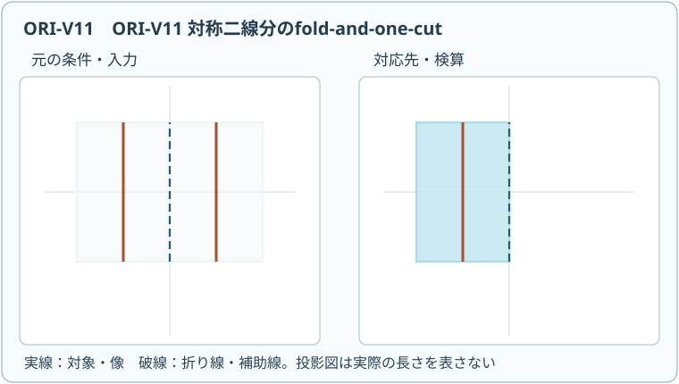
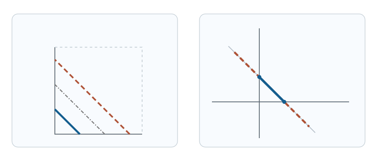

# ORI20 一回の直線切断で何が切り出せるか

**動く図 ORI-V11**：[折り重ねて一本の直線切断を表示](assets/ori-v11-player.html)（[静止SVG](assets/ori-v11-poster.svg)）。数学的な条件と適用範囲を図の説明文でも確かめ、以下の本文の式と照合してください。図だけから実物の連続折り運動や一般定理の成立を結論しません。動画を操作しなくても本文の証明・演習は完結します。

<!-- definition-example-audit: strict -->

前講までの平坦折りでは、折り線を与えて「畳めるか」を問いかけました。今度は発想を逆にします。**切りたい形を先に決め、その輪郭を一本の直線へ重ねる折り方を設計**します。折り畳み後にハサミを直線に沿って一度だけ動かせば、展開した紙に複数の線分が現れるという仕組みです。

例えば正方形を一枚の紙の中央から切り抜くには、未折りの紙に一本の切れ目を入れるだけでは足りません。しかし、折り紙の[面ごとの等長な平坦配置候補](../ORI13/index.md#def-ori13-flat-placement)では、離れた位置の紙を同じ平面位置へ重ねられます。切った位置が元の紙のどの点に対応するかを逆に調べれば、輪郭を厳密に検算できます。

この講の目標は次の五点です。

1. 入力の線分模様、折った後の直線、切断した元の紙上の点集合を区別する。
2. 軸に沿う二つの折りから菱形を一刀切りし、絶対値を使って証明する。
3. 対角折りを加え、辺が軸に平行な正方形も一刀切りする。
4. 二つの閉じた輪郭を一本へ重ね、角張った文字「O」を一刀切りする。
5. 以上の完全な特殊構成と、任意の直線分模様についての一般定理の証明範囲を区別する。

**模型**：初めは厚さ0の正方形の紙 $P=[-L,L]^2$（$L>0$）を置きます。本講の三つの具体構成では、指定線を境に片側の紙束全層を $180^\circ$ 返す**全層単純折り**だけを使い、示す順序で実際に平坦な紙束を作ります。切断は折り終えた紙束の**全層**を、一本の直線に沿ってその紙束を横切る全区間で切ります。部分的に切って途中でハサミを止める操作は数えません。折りの途中の厚さ・摩擦、紙束へのハサミの届きやすさは理想化します。第5節の一般定理は、全層単純折りの列に制限しない**一般の平坦折り配置**を許すため、こちらとは折り操作の範囲が異なります。

---

## 1. 一刀切りは「直線の逆像」を設計する問題

元の紙の点 $X=(x,y)$ が、折り終えた平面の点 $F(X)$ に移るとします。紙の異なる点が同じ場所に重なるため、$F$ は一対一とは限りません。切断する直線を $\ell$ とすると、切られるのは「折った後に $\ell$ 上へ来た」全ての元の点です。これは数学では**逆像**と呼ばれる集合の操作です。

記号 $F^{-1}(\ell)$ は「$F$ で $\ell$ 上に移る元の点全体」を意味し、$F$ の逆関数が存在するという意味ではありません。また $\operatorname{int}(P)$ は紙 $P$ の内部（外周を含まない部分）を表します。

<!-- formal-statement-start -->
> **定義（一回の直線切断と切断集合）**  
> 閉多角形の紙 $P\subset\mathbb R^2$、有限本の折り線を持つ平坦な折り畳み配置の位置写像 $F:P\to\mathbb R^2$、平面上の直線 $\ell$ を与える。紙束の全層を $\ell$ に沿って完全に切るとき、元の紙上で切られる集合を

$$
C(F,\ell)=\{X\in P:F(X)\in\ell\}=F^{-1}(\ell)\cap P
$$

> とする。入力の目標線分集合 $E\subset\operatorname{int}(P)$ について $C(F,\ell)=E$ なら、折り方 $F$ と直線 $\ell$ は $E$ の**一回の直線切断**を実現する。紙を展開した際の切断模様は $E$ であり、閉曲線ができるときはその内側の紙片を取り外せる。
<!-- formal-statement-end -->

この定義で、$F(X)\in\ell$ と $X\in\ell$ は別の条件です。また「線分を直線上に重ねた」だけでは、**余分な紙も同じ直線上に来ていないか**をまだ確かめていません。必要なのは包含 $E\subset C(F,\ell)$ だけでなく、逆の包含も含む集合の等号です。

切断直線の座標表示は、[ORI1の鏡映の座標公式](../ORI1/index.md#prop-ori1-coordinate-isometry)で扱った直線の方程式と同じ形です。実数 $\alpha,\beta,\gamma$ に対し、

$$
\alpha^2+\beta^2>0,\qquad
q(u,v)=\alpha u+\beta v-\gamma,\qquad
\ell=\{(u,v):q(u,v)=0\}
$$

と書きます。係数の非零条件により $q=0$ は一本の直線です。次の判定では、$q$ に折った後の二座標を代入します。

<!-- formal-statement-start -->
> **定義（切断集合の逆像判定）**  
> 指定した折り方 $F$ と切断直線 $\ell=\{(u,v):q(u,v)=0\}$ について、各 $X\in P$ に対し $q(F(X))=0$ を解く操作を**逆像判定**と呼ぶ。目標 $E$ に対して、
>
> - $X\in E$ なら $q(F(X))=0$（切り残しがない）、
> - $q(F(X))=0$ なら $X\in E$（余分な切れ目がない）
>
> の両方を示したとき、上の意味で一刀切りの正しさが証明される。
<!-- formal-statement-end -->

<!-- definition-example-start: def-ori20-one-cut, def-ori20-preimage-test -->
### 例1：二本の縦線は一本の切断から生じる

$P=[-4,4]^2$ を $x=0$ に沿って左半分を右へ折ると、位置写像は $F(x,y)=(|x|,y)$ です。$0<a<4$ とし、折り後の直線を $\ell=\{(u,v):u=a\}$ と選びます。すると

$$
\begin{aligned}
(x,y)\in C(F,\ell)
&\Longleftrightarrow |x|=a\\
&\Longleftrightarrow x=a\ \text{または}\ x=-a.
\end{aligned}
$$

切断集合は紙内部を通り、端点が紙の外周にある二本の縦線分です。$x=\pm a$ の各点が切られ（第一の包含）、それ以外は切られない（第二の包含）ことを同時に確認しました。ただしこの集合は $\operatorname{int}(P)$ に全体が入らず、二本は閉じた輪郭でもありません。この例は切断集合と逆像判定の直接確認であり、第1の定義における内部目標 $E$ の切り出し成功例ではありません。**切断模様の計算**と**閉じた形の切り出し**を区別しましょう。

**定義の確認**：元の点を折り写像 $F$ に入力し、直線の条件 $u=a$ を満たす点を過不足なく列挙しました。どの層の点も同じ判定を受けるため、余分な線を削るために切断を途中で止める操作は使っていません。
<!-- definition-example-end -->

## 2. 二つの軸折りだけで菱形が切り出せる

最初の具体的な目標を、頂点 $(a,0),(0,a),(-a,0),(0,-a)$ を持つ菱形とします。この四辺上では、第一象限で $x+y=a$、他の象限で符号を付け替えた式が成り立ちます。符号の違いを消すには**縦軸と横軸に沿って折る**のが自然です。

順序は次の通りです。

1. 元の正方形の左半分を直線 $x=0$ に沿って右へ返す。投影領域は $[0,L]\times[-L,L]$。
2. 現在の紙束の下半分を直線 $y=0$ に沿って上へ返す。四層の投影領域は $Q=[0,L]^2$。
3. $Q$ 上で一本の直線 $u+v=a$ を全層切る。ただし $0
<!-- formal-statement-start -->
> **定理（対称折りによる菱形の一刀切り）**  
> $P=[-L,L]^2$、$0<a<L$ とする。上記二回の軸折り $F_D$ と直線 $\ell_D=\{(u,v):u+v=a\}$ による全層切断は、正確に次の菱形の境界を切る。

$$
\partial D_a=\{(x,y)\in P:|x|+|y|=a\},\qquad
D_a=\{(x,y):|x|+|y|\le a\}.
$$
<!-- formal-statement-end -->

### 証明の見取り図

折りは各座標の符号だけを消します。折り後に $u+v=a$ となる条件を元の座標へ戻すと、四つの象限の四辺が一つの式になります。直線上へ来る点を余分に含まないことまで確認します。

<!-- proof-start -->
### 証明

折りの各段階は[鏡映の等距離性](../ORI1/index.md#prop-ori1-coordinate-isometry)に従い、紙の点 $(x,y)$ は順に $(|x|,y)$、$(|x|,|y|)$ へ移ります。したがって[切断集合の定義](#def-ori20-one-cut)から

$$
\begin{aligned}
C(F_D,\ell_D)
&=\{(x,y)\in P:|x|+|y|=a\}\\
&=\partial D_a.
\end{aligned}
$$

最後の等号は、第一象限で線分 $(a,0)$–$(0,a)$、第二象限で $(0,a)$–$(-a,0)$、第三・第四象限でも対応する線分になることから従います。四辺は端点でつながり、ほかの点を含みません。$a<L$ だから全頂点は紙の内部にあり、切断線は折り後の正方形 $Q$ を端点 $(a,0),(0,a)$ で横切ります。よって一本の**完全な**直線切断で四辺全てを切り、$\square$
<!-- proof-end -->

### 例2：半径 $a=2$ の菱形

$L=5$ とし、折り後の線 $u+v=2$ は $Q=[0,5]^2$ 内の線分 $(2,0)$–$(0,2)$ です。元の紙上では四象限それぞれに長さ $2\sqrt2$ の辺があり、周長は $8\sqrt2$、面積は対角線の長さがともに4なので $4\cdot4/2=8$ です。切断で得る中央の紙片は四つの合同な直角二等辺三角形からなり、面積も $4\cdot(2\cdot2/2)=8$ と一致します。

## 3. さらに対角線で畳めば軸平行な正方形になる

今度は $S_a=[-a,a]^2$ の輪郭を切りたいとします。[菱形の構成](#thm-ori20-diamond)で用いた二回の軸折りだけでは、第一象限に残る境界が $u=a$ と $v=a$ の**二辺**になってしまい、一本の直線へは重なりません。そこで第一象限の正方形 $Q$ の対角線 $u=v$ に沿って、$v>u$ の三角形を $u>v$ 側へ返します。

対角線 $u=v$ に関する鏡映を $R_{u=v}$ と書きます。この反射は $(u,v)\mapsto(v,u)$ です。折り後の投影領域は $W=\{(s,t):0\le t\le s\le L\}$。[鏡映の座標公式](../ORI1/index.md#prop-ori1-coordinate-isometry)で、直線 $u-v=0$ の法線が $(1,-1)$ であることを使えば、

$$
R_{u=v}(u,v)=(u,v)-\frac{2(u-v)}{1^2+(-1)^2}(1,-1)=(v,u)
$$

と確かめられます。元の点からの位置写像は

$$
F_S(x,y)=
\bigl(\max\{|x|,|y|\},\min\{|x|,|y|\}\bigr).
$$

ここでは最大値・最小値が意味するのは、新しい座標 $s,t$ の**大小を並べ替えること**です。新たな伸縮ではなく、対角線に関する鏡映によって二つの数が入れ替わるだけです。

<!-- formal-statement-start -->
> **定理（対角折りによる正方形の一刀切り）**  
> $P=[-L,L]^2$、$0<a<L$ とする。二回の軸折りに続き第一象限の上三角形を対角線へ折る $F_S$ と、直線 $\ell_S=\{(s,t):s=a\}$ による完全な全層切断は、次の正方形の境界をちょうど切る。

$$
\partial S_a=\{(x,y)\in P:\max(|x|,|y|)=a\}.
$$
<!-- formal-statement-end -->

### 証明の見取り図

折り後の第一座標は大きい方の絶対値です。$s=a$ となる点は、縦横どちらかの距離が $a$ で、もう片方は $a$ 以下の点に限られます。これが四辺全体であることを示します。

<!-- proof-start -->
### 証明

$u=|x|,v=|y|$ とすると、$v>u$ の点は対角線で反射され $(v,u)$ へ、$v\le u$ の点は $(u,v)$ に留まるので、確かに上記の $F_S$ です。[逆像判定](#def-ori20-preimage-test)を直線 $s=a$ へ適用すると

$$
\begin{aligned}
C(F_S,\ell_S)
&=\{(x,y)\in P:\max(|x|,|y|)=a\}\\
&=\{(x,y):|x|=a,\ |y|\le a\}\\
&\quad\cup\{(x,y):|y|=a,\ |x|\le a\}.
\end{aligned}
$$

右辺の第一集合は左右の二辺、第二集合は上下の二辺です。交点である四隅を重複して数えても集合は同じです。$0<a<L$ により紙の外周とは離れ、$W$ と $\ell_S$ の交わりは $(a,0)$–$(a,a)$ の線分だけです。切り残しも余分な切れ目もないので正方形を取り出せます。$\square$
<!-- proof-end -->

### 例3：折りの回数と切断線の向き

$L=5,a=2$ なら切断直線は $s=2$ で、投影領域 $W$ との交わりは $(2,0)$–$(2,2)$ です。例えば元の $(2,1),(1,2),(-2,-1),(-1,-2)$ は全て $(2,1)$ に重なり、正方形の別々の辺が一本へ集まります。逆に $(1,1)$ の像は $(1,1)$ で切断線にありません。四辺の長さは各4、面積は16です。菱形の切断線 $u+v=a$ と混同しないでください。

## 4. 一回の切断で穴も作れる：角張った文字「O」

一つの閉曲線だけでなく、**二つの閉曲線を同時に切れれば穴のある紙片**ができます。ここでは、内側と外側の菱形に挟まれた輪状領域を、角張ったブロック体の「O」として作ります。

目標の内半径を $a$、外半径を $b$ とし、$0<a<b<L$ とします。中心から見た「半径」はユークリッド距離ではなく、ここでは $|x|+|y|$ の値です。折り後の第一象限 $Q$ では、切るべき内外の輪郭は二本の平行線 $u+v=a$ と $u+v=b$ です。この二本をさらに**中間の平行線**で重ねます。

まず[二回の軸折り](#thm-ori20-diamond)で $Q$ を作り、$m=(a+b)/2$ と置きます。次に $Q$ の中の直線 $u+v=m$ に沿って、$u+v>m$ の側を $u+v<m$ の側へ返します。この直線での反射を実際に計算します。

この折り線の鏡映を $R_m$ と書きます。[鏡映の座標公式](../ORI1/index.md#prop-ori1-coordinate-isometry)を直線 $u+v=m$ に適用します。法線は $(1,1)$ で、長さの二乗は $1^2+1^2=2$ です。公式の係数を $\lambda$ と書くと

$$
\lambda=\frac{u+v-m}{2},\qquad
R_m(u,v)=(u,v)-2\lambda(1,1).
$$

これに代入して二座標をそれぞれ計算すれば、反射後は

$$
R_m(u,v)=(u-(u+v-m),\ v-(u+v-m))=(m-v,m-u).
$$

これは $m$ に対して符号を反転する写像ではありません。$u,v$ を入れ替え、各座標を $m$ から引く反射です。折り後の座標を $(s,t)$ とすると、紙束の最終写像は

$$
F_O(x,y)=
\begin{cases}
(u,v),&u+v\le m,\\
(m-v,m-u),&u+v\ge m,
\end{cases}
\qquad (u,v)=(|x|,|y|).
$$

境界 $u+v=m$ では両式は同じ点を返します。したがって接合する紙を裂かずに平坦に折れます。第二の領域は第一象限の**外**へ一部はみ出して写っても構いません。切断直線も第一象限内の短い区間に限らず、折った後の紙束を横切る**全区間**に沿って切ります。

<!-- formal-statement-start -->
> **定理（二重輪郭の文字Oの一刀切り）**  
> $P=[-L,L]^2$ と $0<a<b<L$ を固定し、$m=(a+b)/2$ とする。二回の軸折りと、$u+v=m$ の外側を内側へ返す一回の折りによる上記の $F_O$ を用いる。折り後の直線 $\ell_O=\{(s,t):s+t=a\}$ を全層切ると、切断集合は次の二本の菱形の境界の和集合に正確に一致する。

$$
C(F_O,\ell_O)=
\{(x,y):|x|+|y|=a\}
\cup
\{(x,y):|x|+|y|=b\}.
$$

> 切断後に得られる輪状の紙片は $O_{a,b}=\{(x,y):a\le |x|+|y|\le b\}$ である。
<!-- formal-statement-end -->

### 証明の見取り図

内側の線は折り返さずに残し、外側の線だけを中間線で反射します。二つの式の和を取れば $a$ と $b$ の両方が切断線へ移ることが分かり、他の値は移りません。

<!-- proof-start -->
### 証明

$r=u+v=|x|+|y|$ と書きます。$r\le m$ の側は動かないから

$$
s+t=u+v=r.
$$

$r\ge m$ の側では二座標の和は

$$
s+t=(m-v)+(m-u)=2m-r=a+b-r.
$$

切断直線の条件は「折り後の二座標の和が $a$」です。場合分けすると

$$
\begin{aligned}
r\le m &: \quad r=a,\\
r\ge m &: \quad a+b-r=a
\ \Longleftrightarrow\ r=b.
\end{aligned}
$$

$a<m<b$ なので第一の場合の $r=a$ と第二の場合の $r=b$ は、いずれもそれぞれの領域条件を満たし、逆も成り立ちます。したがって[逆像判定](#def-ori20-preimage-test)により、切断される点はちょうど二本の菱形の境界です。二曲線は交わらない単純閉曲線で、$b<L$ により紙の外周から離れています。その間の連結な紙の部分が輪状に分離し、文字O型の紙片を取り出せます。$\square$
<!-- proof-end -->

### 例4：具体的に二本の辺を重ねる

$L=5$、$a=1$、$b=3$ なら $m=2$ です。内側の頂点 $(1,0)$ は二回の軸折り後に $(1,0)$ のままなので、座標和1の切断線上です。外側の頂点 $(3,0)$ は最後の反射で $(2,-1)$ となり、こちらも座標和1の切断線上です。

単に頂点だけが一致するのではありません。外側の第一象限の辺全体 $(u,v)=(t,3-t)$（$0\le t\le3$）は

$$
(s,t')=(2-(3-t),\,2-t)=(t-1,\,2-t)
$$

へ写り、$s+t'=1$ を満たします。内側の辺 $(t,1-t)$（$0\le t\le1$）も同じ直線上に残ります。**二本の線分の像が必ずしも同じ長さ・同じ位置区間である必要はなく、一本の直線に乗り、余分な紙が乗らなければよい**点が重要です。

左は二回の軸折り後の第一象限で、青い実線が $u+v=1$、灰色の一点鎖線が折り線 $u+v=2$、茶色の破線が $u+v=3$ を表します。右は最後の折り後で、二本の輪郭が同一直線 $s+t=1$ に載っています。これは**切るべき線分だけの位置関係**を示す図で、紙束全体の外形や層順を描いたものではありません。

この輪状領域の面積は、半径 $r$ の菱形の面積が $2r^2$ であることから

$$
|O_{1,3}|=2\cdot3^2-2\cdot1^2=16
$$

です。輪の幅をユークリッド距離と取り違えて $(3-1)$ の一定幅の円環と考えないでください。

### なぜ内外の輪郭は「一回」に数えられるか

最後の切断は、切断線 $\ell_O$ に沿って紙束の全ての部分を端から端まで切る**一つの直線操作**です。元の紙上で二つの閉曲線になるのは、同じ切断線へ二つの異なる場所の紙が重なったためです。「内側を一回、外側を一回切った」のではありません。

## 5. 一般の多角形・文字にも通用するのか

ここまでで、菱形・正方形という**単純多角形**と、穴のある文字Oという**二重輪郭**を、折りの座標式と切断集合の等号で最後まで証明しました。しかし、これらは軸対称性を多く持つ特殊形状です。折りの対称性だけから、例えば非対称な星形、複数の独立した文字、任意の凹多角形について同じ三回折りが通用するとは言えません。

一方、数学的な一般定理はもっと強いものです。切るべき線分の集合を平面の**有限直線グラフ**として与えます。これは有限個の頂点を直線辺で結び、辺同士が交わる箇所は頂点として分割したものです。グラフは連結である必要はありません。

<!-- formal-statement-start -->
> **定理（fold-and-one-cutの一般定理）**  
> 厚さ0の十分大きな一枚の紙の内部に、有限本の直線分からなる平面グラフ $G$ が指定されているとする。有限個の折り線を用いた平坦な折り畳みと、折り後の一本の完全な直線切断により、展開した紙上の切断集合をちょうど $G$ の辺の和集合とすることができる。したがって凹多角形、互いに離れた多角形、穴を持つ文字形状なども実現できる。
<!-- formal-statement-end -->

この一般結果は Demaine・Demaine・Lubiw による *Folding and Cutting Paper* と、Bern・Demaine・Eppstein・Hayes による円板充填法の研究に基づきます。一般の折り線図を生成するには、目標線分の交点・角二等分線・**直線骨格**（多角形の各辺を内側へ平行移動したときの頂点の軌跡）などを扱い、局所的な位置合わせだけでなく紙束全体の平坦折り可能性を保証しなければなりません。

本講の三つの完全構成は、一般定理の**例**を証明するもので、一般定理の**証明**ではありません。一般定理の構成アルゴリズムと平坦折りの証明は原著を参照してください。次のORI21では直線骨格に基づく構成の幾何を学び、どの証明上の問題を解く必要があるかを整理します。

### 見かけの位置合わせが失敗する理由

折った後の図で「目標線分の像が一直線に見える」だけでは、次の問題が残ります。

1. 本来切らない紙の点までその直線上へ来ていないか。
2. 折り線が互いに交差する多頂点の紙束について、[静的平坦配置の面の整合条件](../ORI13/index.md#def-ori13-flat-placement)を満たすか。
3. 目標の折り上がりを**有限の折り工程で実現**できるか。一般の最終平坦配置を示すことと、全層単純折りだけで逐次作れることは別問題です。
4. ハサミの切断が複数回の折り直しや曲がった軌跡を使っていないか。

特に「どんな線分集合でも**単純折りだけ**で作れる」と一般定理を強めることはできません。折り操作を制限した別の問題では、実現可能な多角形が変わります。

---

## 6. 演習：切断集合を正確に再構成する

### Level A：定義と座標を確かめる

**ORI20-A1（一本の切断が二本になる）**  
$P=[-6,6]^2$ に対し $F(x,y)=(|x|,y)$ とする。折り後の直線 $\ell=\{(u,v):u=2\}$ で切ったときの元の紙上の切断集合を求め、正方形の輪郭でない理由を述べてください。

- Level: A

<!-- solution-start -->
**詳細解答**

[切断集合の定義](#def-ori20-one-cut)を使い、$F(x,y)\in\ell$ は $|x|=2$ と同値です。従って

$$
C(F,\ell)=\{(2,y):-6\le y\le6\}\cup\{(-2,y):-6\le y\le6\}.
$$

二本の縦線は端点が紙の外周にあり、上端・下端を結ぶ水平の切れ目がありません。したがって閉じた正方形の輪郭にはなりません。
<!-- solution-end -->

**ORI20-A2（菱形の周長と面積）**  
$a>0$ に対し $D_a=\{(x,y):|x|+|y|\le a\}$ の頂点、周長、面積を求めてください。

- Level: A

<!-- solution-start -->
**詳細解答**

四象限に分けると境界の頂点は $(\pm a,0),(0,\pm a)$ です。隣接頂点の距離は

$$
\sqrt{(a-0)^2+(0-a)^2}=a\sqrt2
$$

なので周長は $4a\sqrt2$。対角線は長さ $2a$ の縦線分と横線分で直交するから、面積は $(2a)(2a)/2=2a^2$ です。四つの直角三角形の面積の和 $4(a^2/2)$ とも一致します。
<!-- solution-end -->

**ORI20-A3（正方形の折り写像）**  
$F_S(x,y)=(\max(|x|,|y|),\min(|x|,|y|))$ に対し、$(3,-1),(-1,-3),(1,3),(1,1)$ の像を求め、$s=3$ で切られる点を挙げてください。

- Level: A

<!-- solution-start -->
**詳細解答**

絶対値の組を大小順に置き換えます。最初の三点は順に $(3,1),(3,1),(3,1)$ へ、最後の点は $(1,1)$ へ移ります。$s=3$ は像の第一座標が3である条件だから最初の三点は切られます。最後の点は第一座標が1で切られません。元の点が異なっても像が一致するのは紙の層が重なるためです。
<!-- solution-end -->

**ORI20-A4（文字Oの数値例）**  
$a=1,b=3,m=2,L=5$ とし、第4節の写像 $F_O$ を用いる。元の $(3,0)$ と $(1,0)$ の像がともに直線 $s+t=1$ 上にあることを直接確かめてください。

- Level: A

<!-- solution-start -->
**詳細解答**

$(3,0)$ は $r=3>m=2$ なので反射側です。像は $(m-0,m-3)=(2,-1)$ で、二座標の和は1です。$(1,0)$ は $r=1<m$ なので動かず $(1,0)$、和はやはり1です。一方、例えば $(2,0)$ は折り線上にあり像も $(2,0)$ で和は2だから切られません。この第三点の確認により、二輪郭の間に余分な線が現れない仕組みも分かります。
<!-- solution-end -->

**ORI20-A5（同じ折りで別の直線を使うと）**  
$0<a<L$ とし、軸折り $F_D(x,y)=(|x|,|y|)$ の後に $\ell=\{(u,v):u=a\}$ を切る。切断集合を求め、正方形の四辺にはならない理由を説明してください。

- Level: A

<!-- solution-start -->
**詳細解答**

$F_D(x,y)\in\ell$ の条件は $|x|=a$ です。したがって $y$ に条件は増えず、

$$
C(F_D,\ell)=\{(a,y):-L\le y\le L\}\cup\{(-a,y):-L\le y\le L\}.
$$

欲しい正方形の横辺 $y=\pm a$ が現れず、縦の切れ目は $|y|>a$ の位置へも延びます。[正方形の定理](#thm-ori20-square)では追加の対角折りによって第一座標を $\max(|x|,|y|)$ にする必要がありました。
<!-- solution-end -->

### Level B：構成の必要性と境界を調べる

**ORI20-B1（軸折りが一つ足りない）**  
$P=[-L,L]^2$、$0<a<L$ とする。縦軸でだけ折った $F(x,y)=(|x|,y)$ の後に $u+v=a$ を切る。切断集合の式を求め、$D_a$ の輪郭と一致しない点を一つ具体的に示してください。

- Level: B

<!-- solution-start -->
**詳細解答**

$|x|+y=a$ が切断条件なので

$$
C(F,\ell)=\{(x,y)\in P:y=a-|x|\}.
$$

例えば元の $(0,-a)$ は菱形 $D_a$ の下の頂点ですが、$F(0,-a)=(0,-a)$ の座標和は $-a$ であり、$a>0$ なので切られません。逆に元の

$$
(x,y)=\left(\frac{L+a}{2},\frac{a-L}{2}\right)
$$

は $0<a<L$ なら紙の内部にあり、$|x|+y=a$ を満たすため切られます。しかし目標輪郭を定める絶対値の和は

$$
|x|+|y|=\frac{L+a}{2}+\frac{L-a}{2}=L>a
$$

です。縦軸だけでは上下の符号が消えず、切り残しと余分な切れ目の双方が出ます。
<!-- solution-end -->

**ORI20-B2（菱形と正方形の比較）**  
$a>0$ に対し $D_a$ と $S_a=[-a,a]^2$ の面積と周長をそれぞれ求め、二回の軸折りから始めるとして、それぞれの切断直線と追加折りの要否を答えてください。

- Level: B

<!-- solution-start -->
**詳細解答**

[菱形の定理](#thm-ori20-diamond)では各辺の長さが $a\sqrt2$、対角線はともに $2a$ です。よって

$$
|D_a|=\frac{(2a)(2a)}{2}=2a^2,\qquad
\operatorname{perim}(D_a)=4(a\sqrt2)=4a\sqrt2.
$$

一方、$S_a$ の一辺は $2a$ なので

$$
|S_a|=(2a)^2=4a^2,\qquad
\operatorname{perim}(S_a)=4(2a)=8a.
$$

前者は軸折り後の直線 $u+v=a$ を切ればよく、追加折りは不要です。後者は[対角折りの定理](#thm-ori20-square)のように $u=v$ で上三角形を返してから $s=a$ を切ります。面積の比は

$$
|D_a|:|S_a|=2a^2:4a^2=1:2
$$

であり、同じ $a$ でも切り出す図形は違います。
<!-- solution-end -->

**ORI20-B3（切断線と折り線から内外半径を復元）**  
$P=[-10,10]^2$ を二回軸折りした後、$u+v=5$ の外側を反射し、最後に $s+t=2$ を全層切る。切り出す輪状の文字Oの内外半径と面積を、逆像の式から求めてください。

- Level: B

<!-- solution-start -->
**詳細解答**

$m=5$、切断線の和を $a=2$ と読みます。折り線より内側の点の像の和は $r=|x|+|y|$ だから、切断条件は $r=2$。外側では像の和が $2m-r=10-r$ だから、$10-r=2$ より $r=8$。$2<5<8<10=L$ なので[文字Oの定理](#thm-ori20-letter-o)の条件が揃います。面積は

$$
2\cdot8^2-2\cdot2^2=128-8=120
$$

です。折り線の和5を外半径と取り違えると、逆像を誤ります。
<!-- solution-end -->

**ORI20-B4（紙の端と接する場合）**  
文字Oの構成で $a<b<L$ を仮定する理由を、$b=L$ の場合と $a=b$ の場合について説明してください。逆像の等式が成り立つかと、独立した輪状の紙片が得られるかを区別してください。

- Level: B

<!-- solution-start -->
**詳細解答**

$b=L$ でも式 $m=(a+b)/2$ と場合分けにより、切断集合が $r=a$ と $r=L$ になる代数的な等式は成り立ちます。

しかし外側菱形の四頂点 $(\pm L,0),(0,\pm L)$ は元の紙の**外周**に接し、目標の全輪郭が $\operatorname{int}(P)$ に含まれるという[一回の直線切断の定義](#def-ori20-one-cut)の条件を満たしません。従って $b<L$ を仮定した[文字Oの定理](#thm-ori20-letter-o)をそのまま適用することはできません。

一方、この理想模型で $r=L$ の四辺をすべて切れば、外側にある四つの角部分から輪状の紙片を分離して取り出すこと自体は**可能**です。$b<L$ は輪郭が紙の外周に接しない内部切断を保証するための十分条件であり、取り出しの必要条件ではありません。

$a=b$ では $m=a=b$ となり、二つの輪郭は同じ一本です。形式的な逆像は $r=a$ のみで、$a\le r\le b$ は菱形の境界だけからなる面積0の集合です。面積を持つ輪状の紙片にはなりません。従って $a<b$ は形の存在に本質的です。
<!-- solution-end -->

### Level C：設計・検証・一般定理を接続する

**ORI20-C1（文字形状を設計して証明する）**  
$P=[-8,8]^2$ の中央から、内側の輪郭 $|x|+|y|=2$、外側の輪郭 $|x|+|y|=6$ に挟まれた角張った文字「O」を一回の直線切断で得たい。

1. 全ての折り工程と最後に切る直線を具体的に指定してください。
2. 紙の任意の点について切断条件を場合分けし、目標二輪郭に**等しい**ことを証明してください。
3. 得られる紙片の面積を求め、同じ折り方だけで非対称な文字「R」の輪郭も必ず切れると結論してよいか判断してください。

- Level: C

<!-- solution-start -->
**詳細解答**

**1. 折り工程。** 左半分を $x=0$ で右へ、次に下半分を $y=0$ で上へ全層折ります。これで $(u,v)=(|x|,|y|)$ です。内外半径は $a=2,b=6$ なので中間線は

$$
m=\frac{2+6}{2}=4.
$$

第一象限の紙束の $u+v>4$ 側を $u+v=4$ に沿って反射します。最後に折り後の**全層**を直線 $s+t=2$ で一度だけ切ります。

**2. 逆像の両方向。** $r=|x|+|y|$ と置くと、反射前の側 $r\le4$ では $s+t=r$ だから切られるのは $r=2$ だけです。反射側 $r\ge4$ では

$$
(s,t)=(4-v,4-u),\quad s+t=8-r.
$$

ここで $s+t=2$ は $8-r=2$、すなわち $r=6$ と同値です。$2<4<6<8$ なので二つの解はそれぞれ正しい場合分けの範囲に入ります。従って

$$
C(F_O,\ell_O)=\{r=2\}\cup\{r=6\}.
$$

この証明は二輪郭の全ての点が切られることだけでなく、それ以外の点が切られないことも示しています。外側の四頂点は紙の端から距離があるため輪状領域は独立します。

**3. 面積と一般性。** 半径6の菱形と半径2の菱形の面積差は

$$
2\cdot6^2-2\cdot2^2=72-8=64.
$$

**今回指定した切断直線 $s+t=2$ に対しては**、判定式が $r=|x|+|y|$ のみで決まるため、切断集合は上記二つの菱形輪郭です。非対称なRの輪郭とは一致しません。切断直線まで変更すれば判定式は変わるので、この計算だけであらゆる直線について不可能と証明したわけではありません。しかし、同じ折り方だけで任意のRを**必ず**切れるという結論は得られません。[一般定理](#thm-ori20-fold-cut-general)は目標ごとに別の折り方を用意できることを保証しており、矛盾しません。
<!-- solution-end -->

## 7. 次の講義へ

対称な図形なら、切断線の逆像を絶対値と場合分けだけで計算できました。非対称で凹んだ多角形では、どこへ折り線を加えると各辺が同じ直線へ向くのでしょうか。次の **ORI21「直線骨格を使うfold-and-one-cut」** では、辺を平行に縮めるときの頂点の軌跡から折り線候補を作ります。

### 参考文献

- Erik D. Demaine, Martin L. Demaine, Anna Lubiw, “[Folding and Cutting Paper](https://erikdemaine.org/papers/JCDCG98/)”, *Discrete and Computational Geometry*, LNCS 1763, 2000, pp. 104–117. 直線骨格を用いる折り・切りの一般構成と平坦折りの証明。
- Erik D. Demaine, “[The Fold-and-Cut Problem](https://erikdemaine.org/foldcut/)”. 一刀切りの定理、直線骨格法、円板充填法の比較と実例。
- Erik D. Demaine et al., “[Making Polygons by Simple Folds and One Straight Cut](https://dspace.mit.edu/entities/publication/e31deac0-33d9-42e2-825e-7738f353c55a)”, *Computational Geometry* 2011. 折りを全層単純折りへ制限した別問題の性質。
