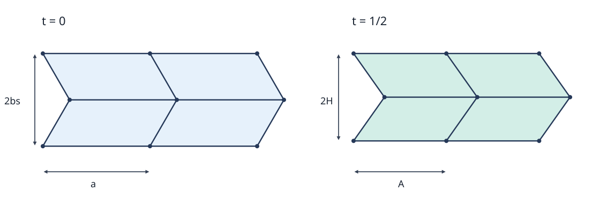

# ORI27 Miura折りと展開機構

<!-- definition-example-audit: strict -->

[ORI26で導入した剛体折りの許容経路](../ORI26/index.md#def-ori26-configuration)は、一つの4価頂点が動くことと、複数頂点をつないだ紙全体が動くことを区別します。ところが実際の展開機構では、多数の頂点を**同時に**動かす必要があります。そこで、平行四辺形を規則的につなぐ Miura（ミウラ）折りを、折り線図から立体配置まで同じ座標で追ってみましょう。

目標は、(1) 各面の長さと角度が変わらないこと、(2) 一つの変数で格子全体を連続的に動かせること、(3) 投影された縦横寸法と折り角を求められること、(4) 衝突・端点・紙厚という適用限界を言えることです。折り目だけを変形させる画面上のアニメーションでは、(1) と (2) は証明できません。

ここでは厚さ0、伸び縮みしない平面パネル、自由な理想ヒンジという[ORI25の剛体折り模型](../ORI25/index.md#def-ori25-rigid-path)を使います。$x,y$ は平面への直交投影、$z$ は高さです。角度を式で微分するときはラジアンを用います。

## 1. 平面の平行四辺形格子を定める

紙の横方向の辺の長さを $a>0$、斜め方向の辺の長さを $b>0$、両者の鋭角を $0<\alpha<\pi/2$ とします。$c=\cos\alpha>0$、$s=\sin\alpha>0$ と略記します。整数 $j$ が偶数なら $\varepsilon_j=0$、奇数なら $\varepsilon_j=1$ と置きます。列 $i$、行 $j$ の格子点を

$$
p_{ij}=(ia+\varepsilon_jbc,\;jbs)\qquad(i,j\in\mathbb Z)
$$

とします。隣接する点をつなぐと、行を一つ上がるたびに $bc$ だけ左右へずれるジグザグ格子になります。なぜ一行ごとにずらすのでしょうか。傾きの符号を交互に変えることで、すべての面を**辺長 $a,b$ の平行四辺形**にしたまま、折り畳みやすい4価頂点を並べられるからです。

<!-- formal-statement-start -->
> **定義（対称Miura格子）**  
> $a,b>0$、$0<\alpha<\pi/2$ を固定し、上記の点 $p_{ij}$ と隣接点を結ぶ折り目からなる平面折り線図を、本講の**対称Miura格子**とする。各面は四点 $p_{ij},p_{i+1,j},p_{i+1,j+1},p_{i,j+1}$ の平行四辺形である。有限パッチでは $0\le i\le N$、$0\le j\le M$（$N,M$ は正整数）だけを取る。
<!-- formal-statement-end -->

<!-- definition-example-start: def-ori27-miura-grid -->
**直接例：$a=2,b=1,\alpha=60^\circ$。** このとき $bc=1/2$、$bs=\sqrt3/2$ なので、$p_{00}=(0,0)$、$p_{10}=(2,0)$、$p_{01}=(1/2,\sqrt3/2)$、$p_{11}=(5/2,\sqrt3/2)$ です。二本の辺ベクトルは $(2,0)$ と $(1/2,\sqrt3/2)$。それぞれの長さは $2,1$、内積は $1=ab\cos60^\circ$ で、挟角は $60^\circ$ です。次の行では斜辺の水平成分が $-1/2$ となり、面は角度 $120^\circ$ の平行四辺形に切り替わります。**定義の確認**：辺長・挟角・偶奇による向きの交代を直接確かめました。
<!-- definition-example-end -->

一般に横辺と斜辺のベクトルを $u_i^{(0)},v_j^{(0)}$ とすると、

$$
u_i^{(0)}=(a,0),\qquad v_j^{(0)}=((-1)^jbc,bs),
$$

であり、各面の三つの内積は

$$
|u_i^{(0)}|^2=a^2,\qquad |v_j^{(0)}|^2=b^2,\qquad
u_i^{(0)}\cdot v_j^{(0)}=(-1)^jab c.
$$

この三つを折り畳み後にも保存すれば、面内のあらゆる距離が保存されます。[ORI25のGram行列による判定](../ORI25/index.md#thm-ori25-gram)を、各平行四辺形へ適用する準備が整いました。

## 2. 高さを一つ決めて立体格子を復元する

横辺を交互に上げ下げして立体のジグザグにします。平面上での横方向の投影長を $A$、斜辺の投影成分を $(\pm C,H)$、横辺の頂点の高さを $\pm T$ と書きます。折り上げ量を表す無次元の変数 $t$ を $2T=at$ で定めます。最初は $t=0$、つまり未折状態です。

横辺は投影長 $A$ と高さ差 $at$ の直角三角形ですから $A^2+a^2t^2=a^2$。斜辺と横辺の内積保存は $AC=abc$ を要求し、斜辺の長さ保存は $C^2+H^2=b^2$ を要求します。順番に解くと、次の式が候補になります。

$$
\begin{aligned}
T(t)&=\frac{at}{2},&A(t)&=a\sqrt{1-t^2},\\
C(t)&=\frac{bc}{\sqrt{1-t^2}},&
H(t)&=b\sqrt{\frac{s^2-t^2}{1-t^2}}.
\end{aligned}
$$

ここで $0\le t<s$ とするのは、$A>0$、$H>0$ を守って格子の帯を潰さないためです。折り方の図示より先に、平方根と非零条件の範囲が確定しました。

<!-- formal-statement-start -->
> **定義（対称Miura運動族）**  
> 対称Miura格子の各頂点を、$0\le t<s$ に対して

$$
q_{ij}(t)=\bigl(iA(t)+\varepsilon_jC(t),\;jH(t),\;(-1)^iT(t)\bigr)
$$

> に移し、各四角形をその四頂点が張る平面パネルとして結ぶ。$A,C,H,T$ は直前の式で定めた実数とする。このように、各行・列の周期対称性と高さの交代を保つ配置の族を**対称Miura運動族**という。$t$ の変化を折り畳みの経路とみなす。
<!-- formal-statement-end -->

<!-- definition-example-start: def-ori27-symmetric-motion -->
**直接例：$a=2,b=1,\alpha=60^\circ,t=1/2$。** 直前の式に代入すると $T=1/2$、$A=\sqrt3$、$C=1/\sqrt3$、$H=\sqrt{2/3}$ です。したがって

$$
q_{00}=(0,0,1/2),\quad q_{10}=(\sqrt3,0,-1/2),\quad
q_{01}=(1/\sqrt3,\sqrt{2/3},1/2).
$$

横辺の差は $(\sqrt3,0,-1)$ で長さ2、斜辺の差は $(1/\sqrt3,\sqrt{2/3},0)$ で長さ1、内積は1です。平面図の直接例と全く同じ三つの値になり、さらに $H>0$ なので行どうしが投影で分離しています。**定義の確認**：頂点座標、パネルのGram行列、行間隔の正値を数値で確認できました。
<!-- definition-example-end -->

次の図はこの数値例の**上面への直交投影**です。各面は実際には高さ $z=\pm T$ の交代する頂点を結びますが、図では $z$ を描いていません。左と右で横の周期 $a\to A$、二行分の縦周期 $2bs\to2H$ がどう変わるか、点の配置を比べてください。図だけから面の剛性を結論せず、次の定理で検算します。

小さな画面で記号が読みにくい場合は、[原図を開いて拡大表示](assets/miura-projected-grid.svg)できます。

<!-- formal-statement-start -->
> **定理（有限Miuraパッチの連続な剛体折り）**  
> $a,b>0$、$0<\alpha<\pi/2$、正整数 $N,M$ を固定する。上記の対称Miura格子の $N\times M$ 個の四角形を $q_{ij}(t)$ で移すと、各 $0\le t<s$ について全パネルは平面時の形と合同であり、共有折り目の位置は一致する。すべての $t$ にわたりパネル内部は相異なる他のパネル内部と交わらず、$t=0$ から任意の $t_1<s$ まで連続な剛体折り経路が存在する。
<!-- formal-statement-end -->

### 証明の見取り図

格子点を単に動かしただけでは面の剛性は分かりません。折り後の横辺 $u_i$ と斜辺 $v_j$ の**長さと内積を三つとも**検算すれば、平行四辺形の合同が従います。さらに $H>0$ を使うと、$xy$ 投影は行帯と列区間で座標を一意に復元できるため、異なる面どうしの衝突を排除できます。

<!-- proof-start -->
### 証明

式の引数 $t$ を省略します。横辺と斜辺は

$$
u_i=q_{i+1,j}-q_{ij}=(A,0,-2(-1)^iT),\qquad
v_j=q_{i,j+1}-q_{ij}=((-1)^jC,H,0).
$$

どちらも添字 $j$ または $i$ に依存しないので、$q_{i+1,j+1}=q_{ij}+u_i+v_j$ となり、各面は平行四辺形です。また

$$
\begin{aligned}
|u_i|^2&=A^2+4T^2=a^2(1-t^2)+a^2t^2=a^2,\\
|v_j|^2&=C^2+H^2=\frac{b^2(c^2+s^2-t^2)}{1-t^2}=b^2,\\
u_i\cdot v_j&=(-1)^jAC=(-1)^jab c.
\end{aligned}
$$

平面時と三つの内積が一致します。面内の任意の二点の差は $\lambda u_i+\mu v_j$ と表せ、その長さの二乗は

$$
|\lambda u_i+\mu v_j|^2
=\lambda^2a^2+2\lambda\mu(-1)^jab c+\mu^2b^2
$$

で平面時と同じです。従って各面は剛体パネルの合同な配置です。共有辺は共通の端点の像を用いて作られるため、隣接パネル間でずれません。面の独立した合同写像は向きを保存する三次元剛体運動として実現できます。

次に自己重複を調べます。$H>0$ のもとで、行帯 $jH<y<(j+1)H$ 内の点は第 $j$ 行の面にしか属しません。その面を

$$
r_{ij}(\lambda,\mu)=q_{ij}+\lambda u_i+\mu v_j,
\qquad 0<\lambda<1,\quad0<\mu<1
$$

と書くと、$y=jH+\mu H$ から $\mu=(y-jH)/H$ がただ一つ定まります。その $\mu$ に対して

$$
x=(i+\lambda)A+\varepsilon_jC+\mu(-1)^jC
$$

なので、$A>0$ を使って $i+\lambda$ もただ一つ定まります。$i$ は整数、$0<\lambda<1$ だから面の内部では $i$ と $\lambda$ が一意です。行・列境界上では隣接面が同一の折り目を共有するだけで、離れた面の内部は交わりません。すなわち投影された各点に紙の内部点は高々一つで、立体的にも面内部の交差がありません。

$A,C,H,T$ は $0\le t<s$ で連続、$q_{ij}(0)=(ia+\varepsilon_jbc,jbs,0)=p_{ij}$ です。有限パッチの各面の写像は $t$ に連続に依存するため、$0$ から任意の $t_1<s$ までの区間は[ORI26の許容経路](../ORI26/index.md#def-ori26-configuration)の条件を満たします。証明終わり。
<!-- proof-end -->

この定理では、投影が単射であることを使って**有限パッチの全時刻の非貫通**を示せました。一般の折り線図で局所条件だけから全体の非貫通が従わないこととは矛盾しません。Miura格子には強い周期対称性があるからです。

## 3. 二種類の折り目はどれだけ開くか

パネルの形を保っていても、隣り合うパネルの間の角度をどう読むのでしょうか。面内の二つの辺に同時に直交するベクトルを座標で作れば、それが面の向き付き法線を与えます。面同士が同じ向きで平らなら法線間角は0です。折り進むと、横方向に走る折り目と斜めに走る折り目では、法線間角が異なります。

ここで**無符号の折り角**を、共通辺の両側にある向きの揃った単位法線どうしの角 $\phi\in[0,\pi]$ とします。山谷の符号はまだ付けません。法線の取り方と、折り角が0の未折状態を対応させることが肝心です。

<!-- formal-statement-start -->
> **定義（Miura格子の無符号折り角）**  
> $0\le t<s$ の各面に、$d_i=-2(-1)^iT$ と置き、次の単位法線を与える。

$$
n_{ij}=\frac{(-d_iH,\;d_i(-1)^jC,\;AH)}{ab\sin\alpha}.
$$

> 横辺 $u_i$ を共有する隣接面の法線間角を $\phi_h$、斜辺 $v_j$ を共有する隣接面の法線間角を $\phi_o$ とする。両角は $[0,\pi)$ から選ぶ。
<!-- formal-statement-end -->

<!-- definition-example-start: def-ori27-dihedral -->
**直接例：未折状態。** $t=0$ なら $u_i=(a,0,0)$、$v_j=((-1)^jbc,bs,0)$、$d_i=0$、$AH=abs$ となります。したがって $n_{ij}=(0,0,1)$。二種類の折り目とも法線内積が1で $\phi_h=\phi_o=0$ です。**定義の確認**：法線が単位であること、二つの角が定義域にあること、平らなときの基準値を直接確かめました。
<!-- definition-example-end -->

<!-- formal-statement-start -->
> **定理（Miura折り角の半角関係）**  
> 対称Miura運動族の内部 $0<t<s$ では、横辺・斜辺の無符号折り角は次を満たす。

$$
\tan\frac{\phi_o}{2}=\frac{t}{\sqrt{s^2-t^2}},\qquad
\tan\frac{\phi_h}{2}=\frac{ct}{\sqrt{s^2-t^2}},\qquad
\tan\frac{\phi_h}{2}=c\tan\frac{\phi_o}{2}.
$$

> $t=0$ でも両角を0とすることで連続に成立する。等式は絶対値の関係であり、山谷の割当てまで決定するものではない。
<!-- formal-statement-end -->

### 証明の見取り図

法線を成分表示して、隣り合う面の符号が反転する成分だけを見れば、二つの法線内積が求まります。$\cos\phi=1-2\sin^2(\phi/2)$ を使って半角を取り出し、最後に正の分母で割ります。

<!-- proof-start -->
### 証明

$d_i=-2(-1)^iT=(-1)^{i+1}at$、$e_j=(-1)^j$ とすると $u_i=(A,0,d_i)$、$v_j=(e_jC,H,0)$ です。法線の分子を $w_{ij}=(-d_iH,d_ie_jC,AH)$ とすると、

$$
w_{ij}\cdot u_i=-Ad_iH+Ad_iH=0,\qquad
w_{ij}\cdot v_j=-d_ie_jCH+d_ie_jCH=0.
$$

したがって $w_{ij}$ は両辺に直交します。また $H^2+C^2=b^2$ と $A^2H^2=a^2b^2(s^2-t^2)$ を使うと、

$$
|w_{ij}|^2=d_i^2(H^2+C^2)+A^2H^2
=a^2b^2t^2+a^2b^2(s^2-t^2)=a^2b^2s^2
$$

と確かめられ、$n_{ij}=w_{ij}/(abs)$ は単位です。斜辺 $v_j$ を挟む二つの面は $i$ と $i-1$ の面で、$d_{i-1}=-d_i$ です。法線の第1・第2成分だけが反転し、第3成分は共通です。したがって

$$
\cos\phi_o
=\frac{A^2H^2-d_i^2(H^2+C^2)}{a^2b^2s^2}
=1-\frac{2t^2}{s^2}.
$$

横辺 $u_i$ を挟む二つの面は $j-1$ と $j$ の面で、$e_{j-1}=-e_j$。法線の第2成分だけが反転します。よって

$$
\cos\phi_h=1-\frac{2d_i^2C^2}{a^2b^2s^2}
=1-\frac{2t^2c^2}{s^2(1-t^2)}.
$$

$0<t<s$ の条件から二つの半角はともに $0<\phi/2<\pi/2$ に入ります。半角公式を適用すると

$$
\sin\frac{\phi_o}{2}=\frac{t}{s},\qquad
\sin\frac{\phi_h}{2}=\frac{tc}{s\sqrt{1-t^2}}.
$$

余弦は正なので、

$$
\cos\frac{\phi_o}{2}=\frac{\sqrt{s^2-t^2}}s,\qquad
\cos\frac{\phi_h}{2}=\frac{\sqrt{s^2-t^2}}{s\sqrt{1-t^2}}
$$

です。両辺の正弦を余弦で割ると、定理の二つの正接の式を得ます。$t\downarrow0$ でともに0へ収束します。証明終わり。
<!-- proof-end -->

例えば $\alpha=60^\circ,t=1/2$ では、$\tan(\phi_o/2)=1/\sqrt2$、$\tan(\phi_h/2)=1/(2\sqrt2)$ です。横折り目の角度は斜め折り目の角度より小さいことも、数値と定理の双方で確認できます。山谷の方向を決める際には、法線を作った向きと境界の両側の接続を別途見なければなりません。

## 4. 投影した格子はどのように伸縮するか

折る前の辺長 $a,b$ は定理により変わりません。しかし、上から見える「長さ」は変わります。横折り目の投影長は $A$ です。行が一つ進むたび $y$ 座標は $H$ 増え、二行進むと偶奇が戻るので $y$ の周期は $2H$ です。これを展開機構の**投影周期**として採用します。紙の実際の端から端までの最大幅とは、行のずれ $C$ の分だけ異なり得ます。

<!-- formal-statement-start -->
> **定義（Miura格子の投影周期と運動学的Poisson比）**  
> 対称Miura運動族で、列の投影周期を $L_x(t)=A(t)$、偶奇が戻る二行分の投影周期を $L_y(t)=2H(t)$ とする。$0<t<s$ で

$$
\nu_{xy}(t)=-\frac{d\log L_y/dt}{d\log L_x/dt}
$$

> を**運動学的Poisson比**とする。これは投影長の相対変化率の比であり、紙材料の弾性Poisson比ではない。
<!-- formal-statement-end -->

<!-- definition-example-start: def-ori27-projected-periods -->
**直接例：同じ $60^\circ$ 格子。** $a=2,b=1$ なら、$t=0$ では $(L_x,L_y)=(2,\sqrt3)$、$t=1/2$ では $(L_x,L_y)=(\sqrt3,2\sqrt{2/3})$ です。どちらの周期も折ると短くなっています。$t=1/2$ では $d\log L_x/dt=-2/3\ne0$ で定義の比が存在し、後述の式により $\nu_{xy}=-1/2$ です。**定義の確認**：長さ・対数微分・定義域の三点を確認しました。
<!-- definition-example-end -->

<!-- formal-statement-start -->
> **定理（投影角と負の運動学的Poisson比）**  
> $a,b>0$、$0<\alpha<\pi/2$ とする。対称Miura運動族の $0\le t<s$ で斜辺の $xy$ 投影が正の $x$ 軸となす鋭角 $\beta(t)$ は

$$
\cos\beta(t)=\frac{c}{\sqrt{1-t^2}},\qquad
\sin\beta(t)=\sqrt{\frac{s^2-t^2}{1-t^2}}.
$$

> また $0<t<s$ で次が成り立ち、$t\downarrow0$ で右辺は $-\cot^2\alpha$ に収束する。

$$
\nu_{xy}(t)=-\frac{c^2}{s^2-t^2}<0.
$$
<!-- formal-statement-end -->

### 証明の見取り図

斜辺 $v_j$ は高さ差0で $xy$ 平面内にあるので、射影の斜角は成分 $C,H$ を辺長 $b$ で割ればよいです。二つの投影周期の対数微分をそれぞれ計算し、共通因子を消します。$t=0$ では両微分が0なので、比の極限と定義値を混同しません。

<!-- proof-start -->
### 証明

$C,H>0$、$C^2+H^2=b^2$ なので、鋭角 $\beta$ を $\cos\beta=C/b$、$\sin\beta=H/b$ として定められます。第2節の式を代入すると角度の二式を得ます。特に $\beta(0)=\alpha$、$t\uparrow s$ で $\beta(t)\downarrow0$ です。

次に $L_x=a\sqrt{1-t^2}$ と $L_y=2b\sqrt{(s^2-t^2)/(1-t^2)}$ から

$$
\begin{aligned}
\frac{d}{dt}\log L_x&=-\frac{t}{1-t^2},\\
\frac{d}{dt}\log L_y&=-\frac{t}{s^2-t^2}+\frac{t}{1-t^2}\\
&=-\frac{tc^2}{(s^2-t^2)(1-t^2)}.
\end{aligned}
$$

$t>0$ では最初の導関数は0でないので比が定義され、

$$
-\frac{d\log L_y/dt}{d\log L_x/dt}
=-\frac{c^2}{s^2-t^2}.
$$

$c>0$ と $s^2-t^2>0$ から負であり、$t\downarrow0$ の極限は $-c^2/s^2=-\cot^2\alpha$ です。証明終わり。
<!-- proof-end -->

**ここでの「負」は、片方を開けばもう片方も開くことを意味します。** 具体的に $t$ が小さくなると $A,H$ はともに大きくなります。材料試験で横方向の伸びに伴う厚みや横ひずみを測った数値と混同しないでください。

## 5. 1自由度と言ってよい範囲と畳み切る端点

この構成で一つの変数が十分なのは、**行の左右ずれが交代し、列の高さも交代するという対称性を固定した運動族**に限るからです。実際、横辺長 $a$、斜辺長 $b$、内積 $(-1)^jab c$、$A,C,H>0$ を要求すると、$T$ を指定した後は第2節の三式から $A,C,H$ が一意に復元されます。従ってこの対称な族は $t$ 一つで動き、$0<t<s$ では $T=at/2$ が厳密単調なので非自明な1自由度の経路です。

一方、自由端を持つ任意の有限Miuraパッチの**配置空間全体**が1次元だとは、ここからは言えません。別の非対称変形枝や境界による追加拘束は別途調べる必要があります。[局所自由度と特異な配置](../ORI26/index.md#def-ori26-regularity)の定義を用いると、ある1本の経路を作れたことだけでは配置空間の次元の上界にならない、と区別できます。

<!-- formal-statement-start -->
> **命題（折り切り極限は正則な展開経路の内部にない）**  
> $a,b>0$、$0<\alpha<\pi/2$ の対称Miura運動族について、$t\uparrow s$ では $H\to0$、$A\to ac>0$、$C\to b$、$T\to as/2$ である。$t=s$ を第2節の非重複・単射の証明に含めることはできない。
<!-- formal-statement-end -->

### 証明の見取り図

平方根の分子 $s^2-t^2$ だけが0になり、分母は $1-s^2=c^2>0$ に近づきます。このとき異なる行の $y$ 座標が一致するので、帯ごとの一意性が失われます。

<!-- proof-start -->
### 証明

$s^2-t^2\to0$、$1-t^2\to c^2>0$ から $H\to0$ です。他の量は $A\to a\sqrt{c^2}=ac$、$C\to bc/c=b$、$T\to as/2$。$y=jH$ はすべての行で0に近づくので、先の証明で $\mu=(y-jH)/H$ とした除算が使えません。折り切り配置で面が同じ平面に重なる場合、層として接触を許すかという別の判定も必要です。証明終わり。
<!-- proof-end -->

例えば $t=s$ の極限では各 $xy$ 投影が同じ直線に潰れ、行の違いは $y$ 座標から復元できません。これは途中で自己貫通したという意味ではありません。**途中 $t<s$ では非貫通、終端では平坦な層の重複を許すか別判定**という区別が必要です。厚さ、摩擦、ヒンジの半径、駆動方法はこの座標模型に含まれず、ORI29で扱います。

## 6. 演習と詳細解答

### Level A：格子と辺長・内積を一つずつ確認する

#### A1. 偶奇で変わる扇角
- Level: A

$a=3,b=2,\alpha=60^\circ$ の対称Miura格子について $p_{00},p_{10},p_{01},p_{02}$ を求めよ。$j=0,1$ の斜辺ベクトルと横辺との内積を計算し、面の鋭角・鈍角を判定せよ。

<!-- solution-start -->
**詳細解答。** $bc=1$、$bs=\sqrt3$ です。$\varepsilon_0=0,\varepsilon_1=1,\varepsilon_2=0$ より

$$
p_{00}=(0,0),\quad p_{10}=(3,0),\quad p_{01}=(1,\sqrt3),\quad p_{02}=(0,2\sqrt3).
$$

横辺は $(3,0)$。$j=0$ の斜辺は $(1,\sqrt3)$ で内積 $3$、$j=1$ の斜辺は $(-1,\sqrt3)$ で内積 $-3$ です。両斜辺の長さは2、横辺の長さは3なので余弦は $3/(3\cdot2)=1/2$ と $-1/2$。それぞれ鋭角 $60^\circ$、鈍角 $120^\circ$ となります。
<!-- solution-end -->

#### A2. パラメータの実数範囲
- Level: A

$\alpha=60^\circ$ のとき $A,C,H$ がすべて正となる $t\ge0$ の範囲を求めよ。$t=1/2$ と $t=\sqrt3/2$ で $H$ を比較せよ（$b>0$）。

<!-- solution-start -->
**詳細解答。** $s=\sqrt3/2$、$c=1/2$ です。$A>0$ は $t<1$、$C>0$ も同じ範囲で成立します。$H^2=b^2(3/4-t^2)/(1-t^2)$ で $H>0$ を求めるには $3/4-t^2>0$ が必要十分です。ゆえに $0\le t<\sqrt3/2$。$t=1/2$ なら $H=b\sqrt{(1/2)/(3/4)}=b\sqrt{2/3}>0$、$t=\sqrt3/2$ なら式の極限は0です。後者は正の行間隔を保つ定義域に入りません。
<!-- solution-end -->

#### A3. 一枚のパネルの剛性検算
- Level: A

$a=2,b=1,\alpha=60^\circ,t=1/2$ で $u_0=(\sqrt3,0,-1)$、$v_0=(1/\sqrt3,\sqrt{2/3},0)$ を使い、$|u_0|^2,|v_0|^2,u_0\cdot v_0$ を計算せよ。

<!-- solution-start -->
**詳細解答。** $|u_0|^2=3+1=4=a^2$、$|v_0|^2=1/3+2/3=1=b^2$、$u_0\cdot v_0=\sqrt3/\sqrt3=1=ab\cos60^\circ$ です。従って任意の $\lambda,\mu$ に対して

$$
|\lambda u_0+\mu v_0|^2=4\lambda^2+2\lambda\mu+\mu^2
$$

となり、平面時の同じ二点間距離を保ちます。一本の辺長だけでなく、挟角も検算したことがポイントです。
<!-- solution-end -->

#### A4. 折り角の比較
- Level: A

$\alpha=60^\circ,t=1/2$ について、$\tan(\phi_o/2)$、$\tan(\phi_h/2)$ を求めよ。折り角の大小を述べよ。

<!-- solution-start -->
**詳細解答。** $s^2-t^2=3/4-1/4=1/2$ なので[半角関係](#thm-ori27-fold-angles)から

$$
\tan(\phi_o/2)=\frac{1/2}{\sqrt{1/2}}=\frac1{\sqrt2},\qquad
\tan(\phi_h/2)=\frac{(1/2)(1/2)}{\sqrt{1/2}}=\frac1{2\sqrt2}.
$$

両半角は $[0,\pi/2)$ 内にあり、正接はこの区間で単調増加です。従って $0<\phi_h<\phi_o<\pi$ です。符号付き山谷角の大小はこの計算だけでは判定していません。
<!-- solution-end -->

#### A5. 斜辺の投影角
- Level: A

$\alpha=60^\circ,t=1/2$ で $\cos\beta,\sin\beta$ を求めよ。未折時の $\beta$ と比較せよ。

<!-- solution-start -->
**詳細解答。** [投影角の定理](#thm-ori27-expansion)の式で $c=1/2$、$s^2=3/4$、$1-t^2=3/4$ とすると

$$
\cos\beta=\frac{1/2}{\sqrt3/2}=\frac1{\sqrt3},\qquad
\sin\beta=\sqrt{\frac{1/2}{3/4}}=\sqrt{\frac23}.
$$

二乗和は $1/3+2/3=1$、両値は正なので鋭角が一意に決まります。$\cos\beta=1/\sqrt3>1/2=\cos60^\circ$ だから $\beta<60^\circ=\beta(0)$ です。
<!-- solution-end -->

### Level B：方程式から機構の性質を導く

#### B1. 長さと内積からの一意復元
- Level: B

$T=at/2$、$A,C,H>0$ の対称な配置で $|u|=a$、$|v|=b$、$u\cdot v=ab c$ が成立するとする。$A,C,H$ を順に求め、なぜ $0\le t<s$ が必要か説明せよ。

<!-- solution-start -->
**詳細解答。** 横辺 $u=(A,0,-at)$ から $A^2+a^2t^2=a^2$。$A>0$ なので $A=a\sqrt{1-t^2}$ を選びます。斜辺 $v=(C,H,0)$ との内積は $AC=abc$、従って $C=abc/A=bc/\sqrt{1-t^2}$。次に $C^2+H^2=b^2$ より

$$
H^2=b^2-\frac{b^2c^2}{1-t^2}=\frac{b^2(s^2-t^2)}{1-t^2}.
$$

$H>0$ により正の平方根を取ります。$t\ge0$ と $H^2>0$ から $t<s$ が必要で、$s<1$ なのでこの条件は $A>0$ も保証します。反対に $0\le t<s$ なら三量はすべて正です。これで対称な族の中では $t$ に対する復元が一意と示せました。
<!-- solution-end -->

#### B2. 法線の内積から半角公式へ
- Level: B

$u_i=(A,0,d_i)$、$v_j=(e_jC,H,0)$、$d_i=(-1)^{i+1}at$、$e_j=(-1)^j$ とする。二種の隣接面の法線内積を求め、$\tan(\phi_h/2)=c\tan(\phi_o/2)$ を示せ。

<!-- solution-start -->
**詳細解答。** 法線の分子は $(-d_iH,d_ie_jC,AH)$、長さは $abs$ です。斜辺を挟む法線では $d_i$ が反転するので

$$
\cos\phi_o=\frac{A^2H^2-d_i^2(H^2+C^2)}{a^2b^2s^2}=1-\frac{2t^2}{s^2}.
$$

横辺を挟む法線では $e_j$ が反転するので

$$
\cos\phi_h=\frac{d_i^2H^2-d_i^2C^2+A^2H^2}{a^2b^2s^2}
=1-\frac{2t^2c^2}{s^2(1-t^2)}.
$$

半角公式から $\sin(\phi_o/2)=t/s$、$\sin(\phi_h/2)=tc/(s\sqrt{1-t^2})$。それぞれの余弦は $\sqrt{s^2-t^2}/s$、$\sqrt{s^2-t^2}/(s\sqrt{1-t^2})$ なので、正接を取ると

$$
\tan(\phi_o/2)=\frac{t}{\sqrt{s^2-t^2}},\qquad
\tan(\phi_h/2)=\frac{ct}{\sqrt{s^2-t^2}}
$$

となり、主張が従います。各根号は $0<t<s$ で正です。
<!-- solution-end -->

#### B3. 離れたパネルが重ならない理由
- Level: B

$t<s$ の有限パッチで、二つのパネル内部点 $r_{ij}(\lambda,\mu)$、$r_{k\ell}(\lambda',\mu')$ が同じ $xy$ 投影を持つと仮定する。$i=k$、$j=\ell$ と二つの内部座標の一致を導け。

<!-- solution-start -->
**詳細解答。** 投影の $y$ 座標はそれぞれ $(j+\mu)H$、$(\ell+\mu')H$。$H>0$、$0<\mu,\mu'<1$ のため、同じ数を含む開帯 $(jH,(j+1)H)$ と $(\ell H,(\ell+1)H)$ は、$j=\ell$ でなければ交わりません。従って $j=\ell$、さらに $j+\mu=\ell+\mu'$ から $\mu=\mu'$。投影の $x$ 成分の等式から

$$
(i+\lambda)A+\varepsilon_jC+\mu e_jC
=(k+\lambda')A+\varepsilon_jC+\mu e_jC
$$

です。$A>0$ で割ると $i+\lambda=k+\lambda'$。整数 $i,k$ と $0<\lambda,\lambda'<1$ により $i=k$、$\lambda=\lambda'$。よって二点は同一面の同一点です。行境界・列境界は異なる内部点の比較から外れ、隣接面の共有折り目としてのみ一致します。
<!-- solution-end -->

#### B4. 変化率の符号と端点
- Level: B

$L_x=a\sqrt{1-t^2}$、$L_y=2b\sqrt{(s^2-t^2)/(1-t^2)}$ とする。$0<t<s$ で両導関数の符号と $\nu_{xy}$ を求めよ。$t=s$ を定義域に加えない理由を述べよ。

<!-- solution-start -->
**詳細解答。** 対数微分を使うと

$$
\frac{L_x'}{L_x}=-\frac{t}{1-t^2}<0,
\qquad
\frac{L_y'}{L_y}=-\frac{tc^2}{(s^2-t^2)(1-t^2)}<0.
$$

$L_x,L_y>0$ なので $L_x',L_y'$ も負です。定義から

$$
\nu_{xy}=-\frac{-tc^2/((s^2-t^2)(1-t^2))}{-t/(1-t^2)}
=-\frac{c^2}{s^2-t^2}<0.
$$

$t=s$ では $L_y=2H=0$ で対数が定義できず、$H$ を分母とする非貫通証明も破綻します。また式の $\nu_{xy}$ は $t\uparrow s$ で負の無限大へ発散します。折り切り配置を正則な機構の内部点に含めることはできません。
<!-- solution-end -->

### Level C：有限格子の全工程を検算する

#### C1. $2\times2$ Miuraパッチの展開設計
- Level: C

$a=2,b=1,\alpha=60^\circ$ の対称Miura格子で $0\le i,j\le2$ の9頂点からなる $2\times2$ パッチを作る。$t=1/2$ を目標とし、次をすべて調べよ。

1. $A,C,H,T$ と $q_{00},q_{10},q_{01},q_{11}$ を求める。
2. $j=0$ と $j=1$ の両方で各面の長さ・内積が平面時の値を保つことを計算する。
3. 二種類の折り角の半角正接、投影周期 $L_x,L_y$ と $\nu_{xy}$ を求める。
4. 未折状態から目標までの全区間で自己重複がない理由を述べる。
5. $t=s$ と紙厚のある実物、及び非対称な他の運動枝に対して、ここまでの証明が何を保証しないか述べる。

<!-- solution-start -->
**詳細解答。**

1. $c=1/2$、$s=\sqrt3/2$、$t=1/2$ を各式へ代入すると

$$
A=2\sqrt{3/4}=\sqrt3,\quad C=\frac{1/2}{\sqrt3/2}=\frac1{\sqrt3},\quad
H=\sqrt{\frac{1/2}{3/4}}=\sqrt{\frac23},\quad T=\frac{2(1/2)}2=\frac12.
$$

従って

$$
\begin{aligned}
q_{00}&=(0,0,1/2),&q_{10}&=(\sqrt3,0,-1/2),\\
q_{01}&=(1/\sqrt3,\sqrt{2/3},1/2),&
q_{11}&=(\sqrt3+1/\sqrt3,\sqrt{2/3},-1/2).
\end{aligned}
$$

2. 横辺は $u_i=(\sqrt3,0,-(-1)^i)$、斜辺は $v_j=((-1)^j/\sqrt3,\sqrt{2/3},0)$ です。どの $i,j$ でも

$$
|u_i|^2=3+1=4,\quad |v_j|^2=1/3+2/3=1,\quad
u_i\cdot v_j=(-1)^j.
$$

平面時の値は $a^2=4$、$b^2=1$、$(-1)^jab c=(-1)^j$ です。特に第1行は内積1、第2行は内積 $-1$ と両方確かめられ、各四角形の全距離が保存されます。

3. $s^2-t^2=1/2$ から[折り角の定理](#thm-ori27-fold-angles)により

$$
\tan(\phi_o/2)=\frac1{\sqrt2},\qquad
\tan(\phi_h/2)=\frac1{2\sqrt2}.
$$

投影周期は [Miura格子の投影周期と運動学的Poisson比](#def-ori27-projected-periods)の定義により $L_x=A=\sqrt3$、$L_y=2H=2\sqrt{2/3}$ です。また[投影角と負の運動学的Poisson比](#thm-ori27-expansion)をこの値に適用して

$$
\nu_{xy}=-\frac{(1/2)^2}{(\sqrt3/2)^2-(1/2)^2}=-\frac{1/4}{1/2}=-\frac12.
$$

4. 経路上のすべての $0\le t\le1/2$ で $A\ge\sqrt3>0$、$H\ge\sqrt{2/3}>0$ です。第2節の面の内積保存と[有限パッチ非重複定理](#thm-ori27-rigid-motion)の帯ごとの一意性が全区間で成立します。すなわち一時刻の端点検査ではなく、連続区間全体で自己重複を排除しています。

5. $t=s=\sqrt3/2$ では $H=0$ で行の投影が重なり、証明に必要な $y$ からの行復元ができません。厚みを持つ紙ではヒンジやパネルの接触が新たに起こり、厚さ0の合同・単射証明から実機の可動性は従いません。またこの解答は交代高さ・周期対称性を課した**一本の経路**を構成したもので、境界条件を変えた配置空間全体の自由度や、非対称枝がないことの証明ではありません。
<!-- solution-end -->

## 7. まとめと先へ進むための問い

- 平行四辺形面の剛性は、辺長二つと内積一つの保存で証明できました。
- $0\le t<\sin\alpha$ に一本の連続で非貫通なMiura運動を具体的に構成しました。
- 横・斜め二種類の折り角は半角の正接で結ばれ、投影周期の同時伸縮に負の運動学的Poisson比が現れました。
- 「対称運動族の1パラメータ」と「自由な全配置の1自由度」は別です。終端の層重なり・現実の紙厚も別問題です。

次の ORI28 では直線ヒンジ・平面パネルの枠を離れ、**曲線折りと可展曲面**に進みます。折り目が曲線になったとき、左右の面でどのような局所等長条件が残るでしょうか。

### 参考文献

- Mark Schenk and Simon D. Guest, [*Geometry of Miura-folded metamaterials*](https://doi.org/10.1073/pnas.1217998110), *PNAS* 110 (2013), 3276–3281。平行四辺形単位格子の運動学と負の面内Poisson比を扱う原論文。ここでの $L_x,L_y$ の採り方は本講で明示した周期に従う。
- Thomas C. Hull, *Origametry: Mathematical Methods in Paper Folding*, Cambridge University Press, 2020, [Rigid Foldings](https://www.cambridge.org/core/books/abs/origametry/rigid-foldings/25393A6DFB7B5C78CB00D8B5568111A2)。剛体折り・Miura格子の背景。
- Erik D. Demaine and Joseph O'Rourke, *Geometric Folding Algorithms*, Cambridge University Press, 2007, [出版社紹介](https://www.cambridge.org/core/books/geometric-folding-algorithms/)。計算折り紙の配置と折り線図の一般的な見方。
- Tomohiro Tachi, [研究業績一覧](https://origami.c.u-tokyo.ac.jp/~tachi/profile_en.html)。剛体折り機構の解析・設計への発展。

本講の具体的な座標族、合同・非貫通証明、折り角・投影量の式は上記の一般的背景を踏まえ本講内で導出したもので、外部の図や式をそのまま転載していません。
