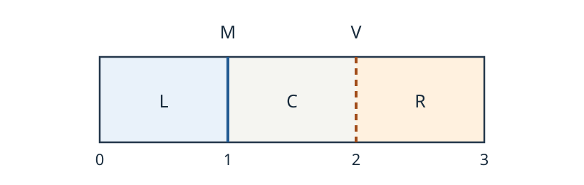

# ORI30 総合設計・数学的検証

<!-- definition-example-audit: strict -->

これまで、折り線を[有限回で作図する方法](../ORI3/index.md#thm-ori3-unit-fractions)、[面の平坦配置と層順](../ORI13/index.md#def-ori13-layer-order)、[剛体折りの許容経路](../ORI26/index.md#def-ori26-configuration)、[厚みを持つパネルの干渉](../ORI29/index.md#thm-ori29-clearance)を別々に学びました。同じ折り紙作品でも、この四つの問いの答えは一致しません。

この最終講では、一つの**三枚帯**を最初から最後まで検算します。線を引けても折れるとは限らず、厚さゼロで折れても板厚を与えると最後まで閉じられないことを、ひと続きの式で確かめます。

1. 原図から二本の折り線を有限回で構成し、山谷を指定する。
2. 平坦配置の面ごとの写像・貼り合わせ・層順を確認する。
3. 正真正銘の連続剛体折り経路を座標式で構成する。
4. 端点へ近づくときのパネル間距離を最小化し、厚さの制約を求める。
5. 原図・式・各時刻の断面図・動く図を一つの検証記録にまとめる。

ここでは紙を厚さゼロの三枚の剛体面と二本の理想ヒンジでモデル化します。現実の紙では、折り目の丸み、厚さ、弾性、摩擦、駆動が別途必要です。

## 1. 原図から、検証する対象を固定する

最初に幅3、高さ1の長方形に二本の縦の折り目を入れます。左・中央・右の三枚は幅1で、折り目は紙の上端と下端で終わります。紙の表を $z>0$ 側とし、左を山折り M、右を谷折り V と指定します。

[原図のSVGを拡大する](assets/three-strip-design.svg)。この図は**折り線図**であって三次元的に折れた結果ではありません。

使用する領域、折り線、面、山谷を一度に固定しておきます。ここから計算するものが何であるかを曖昧にしないためです。

<!-- formal-statement-start -->
> **定義（三枚帯の総合検証模型）**  
> 紙 $P=[0,3]\times[0,1]$ の折り目を $e_1=\{(1,y):0\le y\le1\}$ および $e_2=\{(2,y):0\le y\le1\}$ とする。三面の閉包を

$$
P_L=[0,1]\times[0,1],\qquad
P_C=[1,2]\times[0,1],\qquad
P_R=[2,3]\times[0,1]
$$

> と置き、紙の表を初期配置の上向き法線 $+e_z$ 側とする。折り線に対する山谷割当てを $\mu(e_1)=M$、$\mu(e_2)=V$ とする。長さの単位は三面の幅を1とする。
<!-- formal-statement-end -->

<!-- definition-example-start: def-ori30-design -->
**定義の確認**：以下では折り線図と山谷割当ての全条件を順に調べます。

**直接例と定義の確認。** $P$ は閉長方形で、二つの折り線分は互いに交わらず、どちらも外周に端点を持ちます。内部頂点は **0個** です。折り線を除いた内部の連結成分は $(0,1)\times(0,1)$、$(1,2)\times(0,1)$、$(2,3)\times(0,1)$ のちょうど三つで、[折り線図の定義](../ORI13/index.md#def-ori13-crease-pattern)を満たします。$e_1,e_2$ の各々に M または V を一つずつ与えたので、[山谷割当ての定義](../ORI13/index.md#def-ori13-mv-assignment)も満たします。内部頂点がないため、内部単頂点に適用する Kawasaki–Justin 条件や Maekawa 条件を境界端点へ誤用しません。
<!-- definition-example-end -->

**作図可能性の検算。** 底辺 $[0,3]\times\{0\}$ に $1/3$ と $2/3$ の目盛りを作ります。[ORI3の有限折りによる単位分数の定理](../ORI3/index.md#thm-ori3-unit-fractions)を長さ3の底辺へ適用すれば、有限回の折りでこれらの点を得られます。[O4の垂線操作](../ORI6/index.md#axiom-ori6-o4)で底辺の二点から上辺まで縦線分を引きます。結果は $x=1,2$ です。二等分の極限で無限回近づけただけではありません。

## 2. 平らに畳む写像を先に作る

折り線を描けたことだけでは、三面をどこへ移すかが未定です。[ORI13の平坦配置の定義](../ORI13/index.md#def-ori13-flat-placement)に従い、各面の内部を長さを保って一つの平面へ写し、共有辺で貼り合うかを調べます。

中央面は動かさず、左は $x=1$ で、右は $x=2$ で反射する候補を選びます。反射軸が各折り目そのものなので、共有辺上では両側の式が一致するはずです。

<!-- formal-statement-start -->
> **定理（三枚帯の平坦配置と層順）**  
> [三枚帯の総合検証模型](#def-ori30-design)に対し、面ごとの平面写像を

$$
T_L(x,y)=(2-x,y),\qquad
T_C(x,y)=(x,y),\qquad
T_R(x,y)=(4-x,y)
$$

> と定めると、三面の写像はそれぞれ距離を保存し、共有折り目で一致する連続な平坦配置候補を作る。三面の像はすべて $[1,2]\times[0,1]$ である。後述の連続運動の極限により、重なり部分で下から $R\prec C\prec L$ という矛盾のない層順を選べる。
<!-- formal-statement-end -->

### 証明の見取り図

二つの反射の線形部分は $\operatorname{diag}(-1,1)$ です。これが直交行列であること、二本の共有辺上で左右の座標が一致すること、三面の像が同一の長方形であることを順に示します。層順は平面写像だけでは決められないので、後の三次元経路の上下符号で確定します。

<!-- proof-start -->
### 証明

任意の同じ面内の二点 $p=(x,y)$、$q=(u,v)$ について、左の写像では

$$
|T_L(p)-T_L(q)|^2=((2-x)-(2-u))^2+(y-v)^2=(x-u)^2+(y-v)^2
$$

です。右も $2-x$ を $4-x$ に置き換えるだけで同じ式、中央は恒等写像なので距離を保存します。$x=1$ の共有辺では

$$
T_L(1,y)=(1,y)=T_C(1,y)
$$

であり、$x=2$ の共有辺でも $T_C(2,y)=(2,y)=T_R(2,y)$ です。従って[有限面の貼り合わせ命題](../ORI13/index.md#prop-ori13-gluing)を、この三つの閉長方形へ適用すると連続な候補が得られます。

$x\in[0,1]$ では $2-x\in[1,2]$、$x\in[2,3]$ では $4-x\in[1,2]$ ですから三像は同じ長方形です。内部の同一点に三面が重なるので、[層順の定義](../ORI13/index.md#def-ori13-layer-order)に照らして $R\prec C\prec L$ は全三面の比較ができ、推移的で循環しません。ただし**この順が実際の折り向きと両立すること**は次節の三次元経路で別途示します。
<!-- proof-end -->

ここで得たのは単なる重なった絵ではなく、長さと継ぎ目を確かめた配置候補です。しかし連続してそこへ到達できることは、まだ結論していません。

## 3. 平面図から連続的な剛体運動へ

各面が勝手に伸びたり、途中で互いをすり抜けたりするアニメーションは証明になりません。そこで一つの角度 $\theta$ を動かし、**初期状態と平坦端点を結ぶ明示的な三次元配置**を作ります。$\theta=0$ は開いた紙、$\theta=\pi$ は平坦に重なる極限です。

左面の点はヒンジ $x=1$ を中心に上へ回し、右面の点はヒンジ $x=2$ を中心に下へ回します。この「上・下」は初期紙面の $z$ の符号で検査できます。

<!-- formal-statement-start -->
> **定理（三枚帯の連続剛体折り経路）**  
> $0\le\theta\le\pi$ に対し、[三枚帯](#def-ori30-design)の面ごとの三次元配置を

$$
\begin{aligned}
F_{L,\theta}(x,y)&=(1+(x-1)\cos\theta,\ y,\ (1-x)\sin\theta),\\
F_{C,\theta}(x,y)&=(x,y,0),\\
F_{R,\theta}(x,y)&=(2+(x-2)\cos\theta,\ y,\ -(x-2)\sin\theta)
\end{aligned}
$$

> とする。各面の運動は面内距離を保存し、共有ヒンジ上で一致し、$0<\theta<\pi$ では異なる面の内部どうしが交差しない。$F_0(x,y)=(x,y,0)$ から連続に動き、$\theta\uparrow\pi$ の平面極限は[前節の $T_L,T_C,T_R$](#thm-ori30-flat)であり、左面が上・右面が下から近づく。従って厚さゼロで、端点の重なりを層順で表す平坦折りの模型において、この山谷割当ては連続的に畳める。
<!-- formal-statement-end -->

### 証明の見取り図

各面の $x$ 方向の単位接ベクトルを計算すれば剛性を確かめられます。三次元の $z$ 座標は左で正、中央で零、右で負です。これが途中での非交差と端点の層順の決め手です。$\theta=\pi$ では三面の座標が同じ平面へ潰れるので、端点だけは層順付きの理想平坦配置として読みます。

<!-- proof-start -->
### 証明

左・右の面では、どちらも

$$
\partial_x F=(\cos\theta,0,-\sin\theta),\qquad
\partial_y F=(0,1,0)
$$

であり、二つの接ベクトルの内積は零、各長さは1です。従って同じ面内の二点の差 $(\Delta x,\Delta y)$ は

$$
|\Delta F|^2=(\Delta x)^2(\cos^2\theta+\sin^2\theta)+(\Delta y)^2
=(\Delta x)^2+(\Delta y)^2
$$

となり、面内距離が保存されます。中央面も恒等写像で剛体です。$x=1$ で $F_{L,\theta}(1,y)=(1,y,0)=F_{C,\theta}(1,y)$、$x=2$ で $F_{C,\theta}(2,y)=(2,y,0)=F_{R,\theta}(2,y)$ なのでヒンジは離れません。三角関数が $\theta$ に連続なので、全体は連続経路です。

$0<\theta<\pi$ では $\sin\theta>0$ です。左面の内部 $x<1$ の像は $z=(1-x)\sin\theta>0$、中央は $z=0$、右面の内部 $x>2$ の像は $z=-(x-2)\sin\theta<0$ となります。従って異なる面の内部は交わりません。隣り合う二面は指定した共有ヒンジだけで会います。左端と右端が移動する側は逆なので、紙を左から右へ辿ると二つの折り目で曲がり方の符号が逆になります。

最後に $\cos0=1$、$\sin0=0$ を代入すると初期配置になり、$\cos\pi=-1$、$\sin\pi=0$ を代入すると

$$
F_{L,\pi}(x,y)=(2-x,y,0),\qquad
F_{R,\pi}(x,y)=(4-x,y,0)
$$

です。$\theta<\pi$ の間は左の内部は上、右の内部は下、中央は中間にあるので、極限の重なり順は下から $R\prec C\prec L$ と整合します。端点の三次元座標だけを見ると面が同一平面に重なりますが、これは厚さゼロの平坦折り模型の層順で区別します。
<!-- proof-end -->

**なぜ端点で数式が成立しても実物の保証ではないか。** 厚さゼロの重なりは、別々の薄い紙片が同じ高さを占める理想化です。厚さが正なら、すぐには同じ座標を共有できません。この差を次に数値化します。

## 4. 一番遠い二枚が、折り終わりにぶつかる

左右の面はヒンジを直接共有しないため、[ORI29の厚み近傍と最短距離](../ORI29/index.md#def-ori29-thickened-clearance)を適用できます。厚さを与える前に、左右の**中央面間の最短距離**を全角度で計算します。

左面の点を $x=1-a$、右面の点を $x=2+b$ と書けば $a,b\in[0,1]$ です。$a$ と $b$ は、それぞれのヒンジから外側へ測る非負距離です。

<!-- formal-statement-start -->
> **定理（非隣接パネル間の最短距離）**  
> [連続剛体折り経路](#thm-ori30-motion)の左面と右面の像を $L_\theta,R_\theta$ とする。$0\le\theta\le\pi$ における両面の最短距離は

$$
\delta(\theta)=\operatorname{dist}(L_\theta,R_\theta)
=\begin{cases}
1,&0\le\theta\le\pi/2,\\
\sin\theta,&\pi/2\le\theta\le\pi.
\end{cases}
$$

> とくに $\delta(\pi)=0$ であり、$\lim_{\theta\uparrow\pi}\delta(\theta)=0$ である。
<!-- formal-statement-end -->

### 証明の見取り図

左右の点の $y$ 座標は同じ値に選べるので、水平断面の二線分の最短距離を考えれば十分です。距離の二乗は $a,b$ 個別ではなく $v=a+b$ だけに依存し、区間 $0\le v\le2$ 上の二次関数を最小化します。

<!-- proof-start -->
### 証明

$a,b\in[0,1]$ と $y_L,y_R\in[0,1]$ に対し、二点の座標は

$$
p=(1-a\cos\theta,\ y_L,\ a\sin\theta),\qquad
q=(2+b\cos\theta,\ y_R,\ -b\sin\theta)
$$

です。差を取り、$v=a+b\in[0,2]$ と置けば

$$
\begin{aligned}
|p-q|^2
&=(1+v\cos\theta)^2+(y_R-y_L)^2+(v\sin\theta)^2\\
&=1+2v\cos\theta+v^2+(y_R-y_L)^2.
\end{aligned}
$$

$y_L=y_R$ を選べば最後の非負項を零にできるので、最小化は $g(v)=1+2v\cos\theta+v^2$、$0\le v\le2$ に帰着します。$c=\cos\theta$ と置くと

$$
g(v)=(v+c)^2+1-c^2.
$$

$c\ge0$ なら $v\ge0$ より最小点は $v=0$、最小値は $g(0)=1$。$c\le0$ なら $v_*=-c\in[0,1]\subset[0,2]$ が許され、最小値は $1-c^2=\sin^2\theta$。$0\le\theta\le\pi$ で $\sin\theta\ge0$ だから平方根を取ると主張の式になります。$\theta=\pi$ では最小値が0で、左右面は同じ平面上で重なることも直接確認できます。
<!-- proof-end -->

例えば $\theta=2\pi/3$ では $\delta=\sqrt3/2$、$\theta=5\pi/6$ では $\delta=1/2$ です。見た目の横方向の間隔だけを測ってはいけません。$z$ 方向にも離れており、最短点は一般にパネルの端点とは限らないからです。

<!-- formal-statement-start -->
> **命題（厚み付き経路の安全角度と終点障害）**  
> 左右の非隣接面を一様な半径 $h/2$ の閉近傍で厚くする。$0<h<1$ とする。$0\le\theta\le\theta_{\max}<\pi$ の全時刻にわたり左右の厚み近傍が非接触である必要十分条件は

$$
h<\min_{0\le\theta\le\theta_{\max}}\delta(\theta)
=\begin{cases}
1,&\theta_{\max}\le\pi/2,\\
\sin\theta_{\max},&\pi/2\le\theta_{\max}<\pi.
\end{cases}
$$

> 一方、$\theta\uparrow\pi$ まで同じ厚さ $h>0$ で左右の非接触を保つことはできない。この命題は**非隣接面だけ**の判定であり、共有ヒンジの逃げ、材料のひずみ、駆動可能性は保証しない。
<!-- formal-statement-end -->

### 証明の見取り図

[ORI29の厚み干渉定理](../ORI29/index.md#thm-ori29-clearance)では、厚い面の非接触と $h<\delta$ が同値でした。あとは前節の区分的距離関数が $\pi/2$ までは一定、その後は単調減少することを使います。

<!-- proof-start -->
### 証明

[左右の最短距離](#thm-ori30-clearance)は $[0,\pi/2]$ 上で1、$[\pi/2,\pi]$ 上で $\sin\theta$ です。後半では $\cos\theta\le0$ なので $\sin\theta$ は単調非増加です。従って閉区間 $[0,\theta_{\max}]$ の最小値は表示した式になります。[厚み干渉の必要十分条件](../ORI29/index.md#thm-ori29-clearance)を角度ごとに適用し、全角度での最小距離と $h$ を比較すれば証明できます。

最後に $\theta\uparrow\pi$ で $\sin\theta\downarrow0$ なので、任意の $h>0$ に対し十分大きい $\theta<\pi$ で $\delta(\theta)\le h$ となります。そこでは閉近傍が接触または干渉し、最後まで非接触のまま到達することはできません。
<!-- proof-end -->

**直接例。** $h=0.1$、$\theta_{\max}=5\pi/6$ なら、左右間の最小距離は $1/2>0.1$ ですから**左右に限れば**安全です。しかし共有ヒンジでは中央面と左右面の中央面距離が常に0であり、同じ膨張模型をヒンジのまま適用すると任意の $h>0$ で重なります。製作には[ヒンジ逃げの断面条件](../ORI29/index.md#prop-ori29-hinge-gap)などを別途検証し、切り欠いたなら新しい形状で経路を検算する必要があります。[曲げひずみ](../ORI29/index.md#prop-ori29-bending-strain)と[駆動エネルギー](../ORI29/index.md#def-ori29-actuation)も、本章の座標式だけでは判定できません。

## 5. 原図・運動フレーム・数式を照合する

アニメーションはただ滑らかに見えればよいのではありません。時刻に対応する角度を $\theta(t)=\pi t$（$0\le t\le1$）と指定すれば、どのフレームも [連続剛体折りの式](#thm-ori30-motion)から一意に生成できます。これは**等速の角度指定**であり、力学的な駆動方程式を解いた結果ではありません。

左端 $A=(0,0)$ と右端 $B=(3,0)$ の三次元像の $x$・$z$ 成分は

$$
A_\theta=(1-\cos\theta,\ \sin\theta),\qquad
B_\theta=(2+\cos\theta,\ -\sin\theta).
$$

これを原図のパネル幅、折り目の位置、途中の断面と同時に確認します。

| $\theta$ | 左端 $A_\theta=(x,z)$ | 右端 $B_\theta=(x,z)$ | $\delta(\theta)$ |
| --- | --- | --- | --- |
| $0$ | $(0,0)$ | $(3,0)$ | $1$ |
| $\pi/3$ | $(1/2,\sqrt3/2)$ | $(5/2,-\sqrt3/2)$ | $1$ |
| $\pi/2$ | $(1,1)$ | $(2,-1)$ | $1$ |
| $2\pi/3$ | $(3/2,\sqrt3/2)$ | $(3/2,-\sqrt3/2)$ | $\sqrt3/2$ |
| $5\pi/6$ | $(1+\sqrt3/2,1/2)$ | $(2-\sqrt3/2,-1/2)$ | $1/2$ |
| $\pi$ | $(2,0)$ | $(1,0)$ | $0$ |

**図の読み方。** 原図は $(x,y)$ 平面、動く図は $y=1/2$ で切った $(x,z)$ の**断面への直交投影**です。断面に現れる三本の線分はそれぞれ一枚のパネルの切り口であり、三次元面の衝突を単なる画面上の交差で代用しません。[運動フレームを操作する](assets/three-strip-motion.html)と、停止・一工程送り・速度変更・巻戻しができます。動く図を開けない環境では上表と[原図](assets/three-strip-design.svg)だけで同じ座標を再計算できます。

<!-- formal-statement-start -->
> **定義（総合判定の検証記録）**  
> 指定した折り線図 $P,C,\mu$ と目標角度区間 $I$ に対する**総合判定の検証記録**を、次の項目を区別した記録とする。
>
> 1. 有限作図の手順と、得た折り線の位置。
> 2. 平坦配置の各面の等長写像、共有辺の一致、層順。
> 3. 三次元の連続経路、面内の長さ保存、非貫通の適用範囲。
> 4. 厚み・ヒンジ・材料・駆動のそれぞれの仮定、成立判定、未判定箇所。
> 5. 原図・式・代表フレームの一致を、少なくとも端点と内部の二時点で突き合わせた結果。
>
> 個別項目が未判定なら「全体として製作可能」とは結論しない。
<!-- formal-statement-end -->

<!-- definition-example-start: def-ori30-certificate -->
**定義の確認**：各項目が成立・失敗・未判定のいずれに当たるかを個別に記録します。

**直接例と定義の確認：本講の模型の検証記録。** 二本の折り目 $x=1,2$ は有限作図可能、平坦配置と層順は[第2節の定理](#thm-ori30-flat)で成立、厚さゼロの連続経路は[第3節の定理](#thm-ori30-motion)で成立です。一方 $h=0.1$ を指定したとき、左右面の非接触は $[0,5\pi/6]$ に限れば[第4節の命題](#prop-ori30-thickness)で成立しますが、$[0,\pi]$ では失敗します。共有ヒンジの構造・材料・駆動は設計していないので未判定です。原図と六時点の座標は上表で照合でき、五項目を「成立／失敗／未判定」と分けて記録できています。
<!-- definition-example-end -->

## 6. 演習と詳細解答

以下は計算だけでなく、**何を証明したか、何をまだ証明していないか**を説明する練習です。とくに平坦な絵の存在を運動保証へ、厚さゼロの運動を実物の製作保証へ飛躍させないことに注意してください。

### Level A：各判定を一つずつ計算する

#### A1. 折り線と内部頂点
- Level: A

$P=[0,3]\times[0,1]$ の底辺を有限折りで三等分し、二点から上辺へ垂線を引いた。折り目の方程式、面の数、内部頂点の数を答えよ。内部頂点の Kawasaki–Justin 条件をこの図に直接適用できるか。

<!-- solution-start -->
**詳細解答。** [ORI3の単位分数の有限作図](../ORI3/index.md#thm-ori3-unit-fractions)で底辺の $1/3$・$2/3$ の点が有限回で得られ、底辺の長さが3なので $x=1$・$x=2$ です。垂線の式はそれぞれ $x=1,2$、$0\le y\le1$。開いた面は $x$ が $(0,1)$、$(1,2)$、$(2,3)$ の三区間に入る長方形なので3面です。二線分は紙の内部で交わらず、端点は境界上の $y=0,1$ にあるので内部頂点は0個。したがって内部単頂点に関する Kawasaki–Justin 条件の適用対象が存在しません。条件を満たすとも破るとも主張する必要はありません。
<!-- solution-end -->

#### A2. 二つの共有辺の一致
- Level: A

$T_L(x,y)=(2-x,y)$、$T_C(x,y)=(x,y)$、$T_R(x,y)=(4-x,y)$ がそれぞれの折り目で一致することを、$y\in[0,1]$ の任意値について確認せよ。

<!-- solution-start -->
**詳細解答。** 左側の共有辺 $x=1$ では $T_L(1,y)=(2-1,y)=(1,y)=T_C(1,y)$。右側の共有辺 $x=2$ では $T_C(2,y)=(2,y)$、$T_R(2,y)=(4-2,y)=(2,y)$。両式は端点を含む全 $y\in[0,1]$ で成立します。[有限面の貼り合わせ](../ORI13/index.md#prop-ori13-gluing)の共有辺一致条件をこの二本について満たしました。
<!-- solution-end -->

#### A3. 運動する端点と面内の長さ
- Level: A

$\theta=\pi/3$ における左端 $(0,0)$ と右端 $(3,0)$ の $(x,z)$ 座標を求めよ。左面の幅が1のままであることを、左ヒンジの像との距離で確認せよ。

<!-- solution-start -->
**詳細解答。** $\cos(\pi/3)=1/2$、$\sin(\pi/3)=\sqrt3/2$ だから、[運動式](#thm-ori30-motion)へ代入すると

$$
A=(1-1/2,\sqrt3/2)=(1/2,\sqrt3/2),\quad
B=(2+1/2,-\sqrt3/2)=(5/2,-\sqrt3/2).
$$

左ヒンジの断面点は $(1,0)$ で、左端との距離の二乗は

$$
(1-1/2)^2+(0-\sqrt3/2)^2=1/4+3/4=1.
$$

よって長さは1です。これは三次元で $y$ 成分が同一の断面の計算なので、幅の保存を直接確認しています。
<!-- solution-end -->

#### A4. 最短距離の中間式
- Level: A

$\theta=2\pi/3$ において、左右面の点のヒンジからの距離を $a,b\in[0,1]$ とする。$v=a+b$ を使って最短距離を計算し、実現する $a,b$ の一組を示せ。

<!-- solution-start -->
**詳細解答。** $\cos(2\pi/3)=-1/2$。同じ $y$ を持つ点どうしの距離の二乗は[第4節の式](#thm-ori30-clearance)から

$$
g(v)=1-v+v^2=(v-1/2)^2+3/4.
$$

$v_*=1/2$ は $[0,2]$ に入り、例えば $a=b=1/4$ で実現します。$y$ も等しく選べるので他の非負項は0です。したがって $\delta=\sqrt{3/4}=\sqrt3/2$ です。単に左右の端点距離を測った計算ではありません。
<!-- solution-end -->

#### A5. 厚さの安全判定
- Level: A

左右のパネルに半径 $0.2$ の厚み近傍を与える。つまり厚さパラメータを $h=0.4$ とする。$0\le\theta\le5\pi/6$ で左右は接触するか。$\theta=\pi$ ではどうか。

<!-- solution-start -->
**詳細解答。** [安全角度の命題](#prop-ori30-thickness)より区間全体の最小距離は $\sin(5\pi/6)=1/2$。$h=0.4<0.5$ なので[厚みの非接触条件](../ORI29/index.md#thm-ori29-clearance)を満たし、左右の近傍は全区間で交わりません。端点 $\pi$ では $\delta(\pi)=0<0.4$ だから重なります。なお、**中央面との共有ヒンジ部分の接触**はこの答えでは評価していません。
<!-- solution-end -->

### Level B：異なる判定をつなげる

#### B1. 平坦な絵が同じでも運動の符号が違う
- Level: B

右面だけ $F^+_{R,\theta}(x,y)=(2+(x-2)\cos\theta,y,+(x-2)\sin\theta)$ に変更した左右対称の同時回転を考える。$\theta=2\pi/3$ で非隣接面が衝突する具体的な二点を示せ。平坦端点の絵が同じでも、この指定経路が失敗する意味を述べよ。

<!-- solution-start -->
**詳細解答。** 左面の外端 $x=0$ では $a=1$ なので

$$
F_{L,2\pi/3}(0,y)=(1-(-1/2),y,\sqrt3/2)=(3/2,y,\sqrt3/2).
$$

変更した右面の外端 $x=3$ では $b=1$ なので

$$
F^+_{R,2\pi/3}(3,y)=(2+(-1/2),y,\sqrt3/2)=(3/2,y,\sqrt3/2).
$$

したがって、異なる非隣接面の外周辺が $0\le y\le1$ で一致し、少なくとも接触します。$\theta>2\pi/3$ ではさらに線分内部の交点も生じ得ます。$\sin\pi=0$ なので終点の平面写像は元の $T_R$ と同じでも、**この同時回転の経路**には衝突があります。別の時間配分や経路がすべて不可能だとまでは証明していません。
<!-- solution-end -->

#### B2. 厚みが小さければ最後まで行けるか
- Level: B

$h=1/4$ の左右非隣接面に対し、$\theta\in[\pi/2,\pi)$ の接触開始角を求めよ。また $\theta$ の変化をどれほど遅くしても、角度 $\pi$ を目標とする限り非接触を保持できない理由を述べよ。

<!-- solution-start -->
**詳細解答。** この区間では $\delta(\theta)=\sin\theta$ で単調減少します。最初の接触は $\sin\theta=1/4$ のうち $[\pi/2,\pi)$ にある解なので

$$
\theta_*=\pi-\arcsin(1/4).
$$

$\theta<\theta_*$ なら $\delta>h$、$\theta=\theta_*$ なら接触、$\theta>\theta_*$ なら近傍が重なります。[干渉判定](../ORI29/index.md#thm-ori29-clearance)は**時刻でなく配置角**の関数なので、$\theta(t)$ の進みを遅くしても、連続に $\pi$ へ行く経路は必ず $\theta_*$ を通ります。衝突は時間の速さだけでは消せません。
<!-- solution-end -->

#### B3. アニメーションのフレームを再現する
- Level: B

$\theta(t)=\pi t$ としたとき、$t=1/3,2/3,5/6$ で両外端の $(x,z)$ 座標と最短距離を計算せよ。その値を[動く図](assets/three-strip-motion.html)の工程表示と比較し、$t=5/6$ の画像で左右の外端が投影上ほぼ接近していても、接触と断定できない理由を述べよ。

<!-- solution-start -->
**詳細解答。** [端点座標の式](#thm-ori30-motion)へ $\cos\theta$・$\sin\theta$ を代入します。$t=1/3$ のとき $\theta=\pi/3$、$A=(1/2,\sqrt3/2)$、$B=(5/2,-\sqrt3/2)$、$\delta=1$。$t=2/3$ では $\theta=2\pi/3$、$A=(3/2,\sqrt3/2)$、$B=(3/2,-\sqrt3/2)$、$\delta=\sqrt3/2$。$t=5/6$ では $\theta=5\pi/6$、$A=(1+\sqrt3/2,1/2)$、$B=(2-\sqrt3/2,-1/2)$、$\delta=1/2$ です。最後の画面で外端の $x$ 座標だけ比べると左右が交差して見えますが、$z$ は $+1/2$ と $-1/2$ で異なります。さらに最短点は端点と限らず、[距離の最小化](#thm-ori30-clearance)で $a+b=-\cos\theta$ を検査して初めて $\delta$ を確定できます。
<!-- solution-end -->

#### B4. 何が未判定かを区分する
- Level: B

理想経路 $0\le\theta\le5\pi/6$ と厚さ $h=0.1$ を採用し、「左右非隣接面間」「共有ヒンジ」「材料ひずみ」「必要駆動力」の四つについて、判定可否と根拠を述べよ。すべて「安全」と判定する答案のどこが誤りか。

<!-- solution-start -->
**詳細解答。** 左右非隣接面間については[第4節の命題](#prop-ori30-thickness)から $\delta_*=\sin(5\pi/6)=0.5$、$h=0.1<0.5$ なので非接触です。共有ヒンジの中央面同士は距離0で接しており、同じ厚み近傍を加えた場合は重なります。したがってヒンジの切り欠き・逃げ寸法を別に設計するまでは**安全とは言えません**。材料の最大ひずみを求めるには曲げ半径・中立面・材料許容値が必要で、[ORI29のひずみ模型](../ORI29/index.md#prop-ori29-bending-strain)へ値を入れられません。駆動についてもエネルギー関数や摩擦が指定されず、[ORI29の駆動模型](../ORI29/index.md#def-ori29-actuation)だけでは到達性を判定できません。「非隣接面に衝突がない」から他の三条件が成立すると推論するのが誤りです。
<!-- solution-end -->

### Level C：原図・式・実装条件を統合する

#### C1. 三枚帯の総合検証書を作成する
- Level: C

幅3、高さ1の紙に $x=1,2$ の縦の折り目を入れ、左をM、右をVとする。$\theta(t)=\pi t$ を $0\le t\le1$ の指定運動とし、左右非隣接面の厚みパラメータを $h=0.2$ とする。次を一枚の検証書として提出せよ。

1. 有限作図の根拠と平坦配置 $T_L,T_C,T_R$、層順を示す。
2. 三次元運動式と面内距離保存、途中の非貫通を検証する。
3. 左右の最短距離 $\delta(\theta)$ を最初から導き、$t\le5/6$ と $t\le1$ それぞれの厚み判定を述べる。
4. $t=0,1/2,5/6,1$ の外端座標を[原図](assets/three-strip-design.svg)と[動く図](assets/three-strip-motion.html)に照らして確認する。
5. 本模型で「製造可能」と結論する前に不足している条件を三種類挙げる。

<!-- solution-start -->
**詳細解答。**

**1. 作図と平坦配置。** [ORI3の有限折りによる等分](../ORI3/index.md#thm-ori3-unit-fractions)を底辺に適用すると $x=1,2$ を有限回で印せます。垂線を上辺まで延ばせば二本の折り目となり、内部頂点はありません。面は左から $[0,1],[1,2],[2,3]$ の $x$ 区間を持つ三長方形です。左・右をそれぞれ折り線に関して反射させると

$$
T_L(x,y)=(2-x,y),\quad T_C(x,y)=(x,y),\quad T_R(x,y)=(4-x,y).
$$

各写像は $x$ の向きを反転するか保持する直交変換と並進であり、$x=1,2$ 上で両側の式が一致します。三像は $[1,2]\times[0,1]$ です。下から $R\prec C\prec L$ を選び、三面の全順序が循環しないことを確認します。ただしこの段階の根拠は平坦候補と層順までです。

**2. 剛体経路。** 左を $x=1$、右を $x=2$ の軸の周りに回す[第3節の構成](#thm-ori30-motion)を使います。左・右の $x$ 接ベクトルは $(\cos\theta,0,-\sin\theta)$、$y$ 接ベクトルは $(0,1,0)$ で、長さ1かつ内積0です。従って任意の同一面内の差の長さが保存されます。両ヒンジの上の像は中央面と一致し、$0<t<1$ では左の内部が $z>0$、右の内部が $z<0$、中央が $z=0$ で、内部衝突はありません。$t=1$ は三面が同じ座標に重なる理想端点であり、現実の厚みを持つ配置ではありません。

**3. 距離と厚み。** 左のヒンジからの距離を $a$、右のを $b$ として $v=a+b\in[0,2]$ と置きます。同じ $y$ に揃えた左右の点の距離の二乗は

$$
(1+v\cos\theta)^2+v^2\sin^2\theta
=1+2v\cos\theta+v^2=(v+\cos\theta)^2+\sin^2\theta.
$$

$\cos\theta\ge0$ では $v=0$、負では $v=-\cos\theta$ が区間内の最小点で、$\delta=1$（前半）、$\delta=\sin\theta$（後半）です。$t\le5/6$ なら $\theta\le5\pi/6$ で最小距離は $1/2$、$h=0.2<1/2$ より左右非接触です。$t\le1$ では終点に $\delta(\pi)=0$ があるため、$h>0$ で左右非接触は不可能です。

**4. 原図と四時点。** 外端の $(x,z)$ は $A=(1-\cos\theta,\sin\theta)$、$B=(2+\cos\theta,-\sin\theta)$ なので

| $t$ | $A$ | $B$ |
| --- | --- | --- |
| $0$ | $(0,0)$ | $(3,0)$ |
| $1/2$ | $(1,1)$ | $(2,-1)$ |
| $5/6$ | $(1+\sqrt3/2,1/2)$ | $(2-\sqrt3/2,-1/2)$ |
| $1$ | $(2,0)$ | $(1,0)$ |

原図の折り目は常に $(1,0)$ と $(2,0)$ の断面点に残り、左右の端点だけが動きます。各フレームの外端から対応ヒンジまでの距離は $\sqrt{\cos^2\theta+\sin^2\theta}=1$ で、描画と模型の幅は一致します。動く図が未表示でも、これらの表が代替検算となります。

**5. 製作判定の未完了項目。** 共有ヒンジに正の厚みを与えるには[切り欠きと逃げ](../ORI29/index.md#prop-ori29-hinge-gap)が必要で、元の形状のままならヒンジ近傍の厚み近傍が重なります。材料が曲げに耐えるには[曲げ半径と許容ひずみ](../ORI29/index.md#prop-ori29-bending-strain)が必要です。所望の角度変化を実現するには[駆動・エネルギー](../ORI29/index.md#def-ori29-actuation)を別に与えて確かめる必要があります。従って正しい最終判定は「厚さゼロでは端点まで連続可動、厚さ0.2の左右非隣接面は $t\le5/6$ の間だけ検証済み、実物全体の製作可能性は未判定」です。
<!-- solution-end -->

## 7. 最後に：四種類の「できる」を混同しない

| 問い | 本講での答え | 根拠の範囲 |
| --- | --- | --- |
| 折り目を作図できるか | できる | [有限の三等分作図](../ORI3/index.md#thm-ori3-unit-fractions) |
| 平坦配置を構成できるか | できる | [鏡映と層順](#thm-ori30-flat) |
| 厚さゼロでそこまで連続に動けるか | できる | [剛体運動と非交差](#thm-ori30-motion) |
| 正の厚さで同じ端点まで動けるか | この形状ではできない | [左右面の距離が0へ縮む](#prop-ori30-thickness) |
| 途中までの実物を製造・駆動できるか | 追加の設計が必要 | ヒンジ・材料・駆動が未指定 |

これで折り紙の幾何・折り線図・運動・実装を一つの原図からつなげられました。作図可能性と、平坦な完成図と、連続な運動と、実物の工作物は別々の数学的主張です。どこまで保証したかを明確に書くこと自体が、総合設計の最も大切な技能です。
