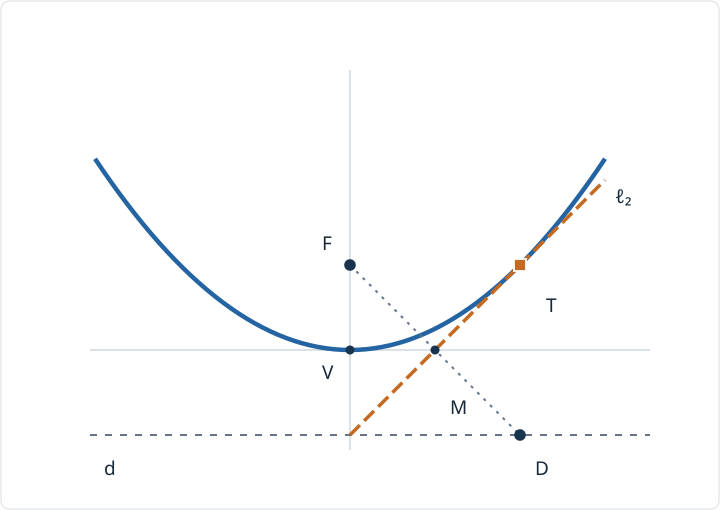

# ORI5 折りの包絡線と放物線

一枚の紙の上に点を一つ、直線を一本描きます。その点が直線上のある位置へ移るように折ると、一本の折り線ができます。直線上の行き先を少しずつ変えると、折り線が次々に現れます。その多数の直線が、ある曲線に「沿っている」ように見えるのはなぜでしょうか。

前講では[折り線の鏡映合成](../ORI4/index.md#thm-ori4-two-reflections)から正多角形を調べました。この講義では一回の鏡映に戻り、点を直線へ重ねる折りを**連続的なパラメータで指定する**ことで、放物線の接線群と包絡線を導きます。折り紙作図の許される操作全体の分類は次講以降で扱います。

ここで目指すことは次の四点です。

1. 焦点と準線への距離が等しい点を、座標式で決める。
2. 焦点を準線上の指定点へ移す折り線を、垂直二等分線として計算する。
3. その直線が放物線に**ただ一点で接する**ことと、直線族の**包絡線**が放物線になることを別々に証明する。
4. 有限本の折り線と連続的な直線族、一般配置と退化配置を区別する。

以下で折り線と曲線を考える平面は厚さ0の理想模型です。実際の有限サイズの紙で全てのパラメータを実現できるとは限りません。ここでいう「直線へ点を重ねる」は、直線上の**行き先を指定して**その点へ重ねる操作です。

<!-- definition-example-audit: strict -->

---

## 1. 放物線はどの点の集まりか

円は一点からの距離を一定にして定められます。一方、放物線では**一点と一本の直線からの距離を比べる**ことにします。点から直線への距離は、その直線に下ろした垂線の長さです。直線上の任意の点までの距離と取り違えないようにします。

点 $F$ を**焦点**、$F$ を通らない直線 $d$ を**準線**として与えます。まだ特定の方程式を暗記する必要はありません。

<!-- formal-statement-start -->
> **定義（焦点・準線による放物線）**
>
> 平面上の点 $F$ と、それを通らない直線 $d$ に対し、点 $X$ から $F$ までの距離と、点 $X$ から $d$ までの最短距離が等しい点全体を、焦点 $F$・準線 $d$ の**放物線**という。

$$
\mathcal P(F,d)=\{X:|XF|=\operatorname{dist}(X,d)\}.
$$
<!-- formal-statement-end -->

<!-- definition-example-start: def-ori5-focus-directrix -->
**定義の確認**： $F=(0,1)$、$d:y=-1$ とし、$X=(2,1)$ を取ります。焦点までの距離は $|XF|=2$。準線上の最も近い点は $(2,-1)$ なので、$\operatorname{dist}(X,d)=|1-(-1)|=2$。よって $X$ は放物線上にあります。一方 $Y=(2,0)$ は $|YF|=\sqrt5$、$\operatorname{dist}(Y,d)=1$ で、放物線上にはありません。「準線上の適当な点まで」ではなく**最短距離**を比較しました。
<!-- definition-example-end -->

### 焦点と準線から式を作る

座標軸を準線と平行・垂直に選び、$a>0$ として

$$
F=(0,a),\qquad d:\ y=-a
$$

とします。二者の間の距離は $2a$ です。一般の焦点と準線も、平行移動と回転でこの配置に移せます。点 $X=(x,y)$ の準線への垂足は $(x,-a)$ なので、距離の平方はそれぞれ

$$
|XF|^2=x^2+(y-a)^2,\qquad
\operatorname{dist}(X,d)^2=(y+a)^2.
$$

<!-- formal-statement-start -->
> **定理（焦点・準線の放物線の標準方程式）**
>
> 実数 $a>0$、焦点 $F=(0,a)$、準線 $d:y=-a$ を固定する。点 $X=(x,y)$ が[焦点・準線による放物線](#def-ori5-focus-directrix)に属するための必要十分条件は、次の方程式を満たすことである。

$$
y=\frac{x^2}{4a}.
$$

> 放物線の頂点（$y$ が最小となる点）は $(0,0)$、対称軸は $x=0$ である。
<!-- formal-statement-end -->

**証明の見取り図。** 距離は非負なので、等距離条件を平方しても情報は失われません。両辺を展開すると $y^2$ が消え、二次式だけが残ります。

<!-- proof-start -->
### 証明

[放物線の定義](#def-ori5-focus-directrix)に $X=(x,y)$ を代入すると

$$
\sqrt{x^2+(y-a)^2}=|y+a|.
$$

どちらも非負ですから、同値変形として平方でき、

$$
\begin{aligned}
x^2+(y-a)^2&=(y+a)^2,\\
x^2+y^2-2ay+a^2&=y^2+2ay+a^2,\\
x^2&=4ay.
\end{aligned}
$$

$a>0$ なので $4a$ で割って $y=x^2/(4a)$ です。逆にこの式から $x^2+(y-a)^2=(y+a)^2$ が復元されます。両辺の平方根を非負で取れば元の距離の等式に戻り、必要十分です。

$x^2/(4a)\ge0$ で、等号は $x=0$ に限るので頂点は $(0,0)$。$x$ を $-x$ に替えても式は変わらず、$x=0$ は対称軸です。
<!-- proof-end -->

**直接例。** $a=1$ なら放物線は $y=x^2/4$ です。点 $(0,0)$ では焦点までの距離と準線までの距離がともに1、点 $(2,1)$ ではともに2です。$y=x^2/4$ は上向きに開き、焦点と準線は頂点から等距離に位置します。

---

## 2. 点を準線上の点へ重ねる折り線

前節は曲線上の**点**の条件でした。今度は折り線という**直線**を求めます。焦点 $F=(0,a)$ を、準線 $d:y=-a$ 上の指定点 $D_u=(u,-a)$ に重ねます。ここで $u$ は実数のパラメータ、すなわち準線上の行き先の横座標です。

[二点を重ねる折り線の垂直二等分線定理](../ORI1/index.md#thm-ori1-point-alignment)により、求める折り線は線分 $FD_u$ の垂直二等分線です。$F$ と $D_u$ は $a>0$ のため常に異なる点なので、折り線は各 $u$ について一本に決まります。

<!-- formal-statement-start -->
> **定義（点と準線を結ぶ折り線族）**
>
> 実数 $a>0$、焦点 $F=(0,a)$、準線 $d:y=-a$ を固定する。
>
> 各 $u\in\mathbb R$ に対し、$F$ を準線上の指定点 $D_u=(u,-a)$ へ鏡映する唯一の直線を $\ell_u$ とする。これらの直線の集合

$$
\{\ell_u:u\in\mathbb R\}
$$

> を、この配置の**折り線族**という。
<!-- formal-statement-end -->

<!-- definition-example-start: def-ori5-fold-family -->
**定義の確認**： $a=1,u=0$ のとき、$F=(0,1)$、$D_0=(0,-1)$ の中点は $(0,0)$、線分は鉛直です。したがって折り線は水平な $y=0$ です。これを折れば点 $(0,1)$ は確かに $(0,-1)$ へ移り、$D_0$ は準線上にあります。行き先を指定したため、折り線は曖昧ではありません。
<!-- definition-example-end -->

折り線を計算するには、$FD_u$ の中点と、それに垂直な方向を使います。中点は $M_u=(u/2,0)$、$F$ から $D_u$ へ向かうベクトルは $(u,-2a)$ です。方向 $(b,c)$ を90度回した方向は $(-c,b)$ なので、非零の $(b,c)$ に垂直な方向 $(d,e)$ は $bd+ce=0$ を満たし、逆も成立します。折り線上の $X=(x,y)$ に対して、この条件を書きます。

<!-- formal-statement-start -->
> **命題（点を直線へ重ねる折り線の方程式）**
>
> $a>0$、$F=(0,a)$、$D_u=(u,-a)$ とする。[折り線族](#def-ori5-fold-family)の各直線は次の方程式を持つ。

$$
\ell_u:\quad
y=\frac{u}{2a}x-\frac{u^2}{4a}
\qquad(u\in\mathbb R).
$$
<!-- formal-statement-end -->

**証明の見取り図。** 中点 $M_u$ を通り、ベクトル $(u,-2a)$ に垂直な条件を展開します。$u=0$ でも除算による例外はありません。

<!-- proof-start -->
### 証明

[二点を重ねる折り線の定理](../ORI1/index.md#thm-ori1-point-alignment)より、折り線上の任意の点 $X$ は

$$
(X-M_u)\cdot(D_u-F)=0
$$

を満たします。成分を代入すると

$$
\begin{aligned}
(x-u/2,y)\cdot(u,-2a)&=0,\\
ux-\frac{u^2}{2}-2ay&=0,\\
y&=\frac{u}{2a}x-\frac{u^2}{4a}.
\end{aligned}
$$

逆にこの方程式を満たす点は中点を通る $FD_u$ に垂直な直線上にあり、垂直二等分線は一意です。$2a>0$ のため全ての $u$ で同じ議論が成立します。
<!-- proof-end -->

**$a=1,u=2$ の検算。** $F=(0,1)$、$D_2=(2,-1)$、$M_2=(1,0)$、折り線は $y=x-1$ です。方向ベクトル $(1,1)$ と $FD_2=(2,-2)$ は成分の積の和 $1\cdot2+1\cdot(-2)=0$、さらに $M_2$ では $0=1-1$。中点・垂直条件を両方検算できました。

図は $a=1,u=2$。長い破線の斜めの折り線 $\ell_2$ は点 $T=(2,1)$ で太い実線の放物線に接し、短い破線の準線上に $D_2=(2,-1)$、焦点 $F=(0,1)$ があります。$FD_2$ の中点は $M_2=(1,0)$ です。曲線全体を一回で折っているわけではありません。[図を拡大して見る](assets/parabola-fold-envelope.svg)こともできます。

---

## 3. なぜどの折り線も接線になるのか

ここでは曲線 $y=f(x)$ の点 $(t,f(t))$ に対して、二点 $(t,f(t))$ と $(t+h,f(t+h))$ を結ぶ直線の傾きが $h\to0$ で有限値 $m$ に近づくとき、その点を通り傾き $m$ を持つ直線を**接線**として使います。この傾きの極限を $f'(t)$ と書きます。多項式なら、次の式を展開するだけで求められます。

[放物線の方程式](#thm-ori5-parabola-equation)から $f(x)=x^2/(4a)$ です。二点を結ぶ直線の傾きの計算は

$$
\frac{f(t+h)-f(t)}h
=\frac{(t+h)^2-t^2}{4ah}
=\frac{2t+h}{4a}
\longrightarrow\frac{t}{2a}
\quad(h\to0).
$$

よって点 $(t,t^2/(4a))$ での接線は

$$
y-\frac{t^2}{4a}
=\frac{t}{2a}(x-t),
\quad\text{すなわち}\quad
y=\frac{t}{2a}x-\frac{t^2}{4a}.
$$

これは[折り線の式](#prop-ori5-fold-equation)と $t=u$ とすれば同じです。ただし、式が同じというだけでなく、**その直線が曲線と交わる点が一つだけ**であることも確認します。

<!-- formal-statement-start -->
> **定理（折り線の接線性と一意な接触点）**
>
> $a>0$ とし、放物線 $\mathcal P:y=x^2/(4a)$ と[折り線族](#def-ori5-fold-family) $\ell_u$ を取る。任意の $u\in\mathbb R$ について、$\ell_u$ は $\mathcal P$ の点

$$
T_u=\left(u,\frac{u^2}{4a}\right)
$$

> における接線である。$\ell_u$ と $\mathcal P$ の共通点は $T_u$ だけであり、同じ横座標 $x$ に対する放物線の高さは折り線の高さ以上で、等号成立は $x=u$ に限る。
<!-- formal-statement-end -->

**証明の見取り図。** 接線の傾きは既に微分で一致しました。放物線と折り線の高さの差が**完全平方**になるので、交点が一つに限られることも分かります。これは、図の線が「触れていそう」という観察を式にしたものです。

<!-- proof-start -->
### 証明

折り線の高さを $L_u(x)=ux/(2a)-u^2/(4a)$ と書きます。[放物線の標準方程式](#thm-ori5-parabola-equation)との差は

$$
\begin{aligned}
f(x)-L_u(x)
&=\frac{x^2}{4a}-\frac{ux}{2a}+\frac{u^2}{4a}\\
&=\frac{x^2-2ux+u^2}{4a}\\
&=\frac{(x-u)^2}{4a}\ge0.
\end{aligned}
$$

$a>0$ のため、等号は $x=u$ のときだけです。共通点の $y$ 座標は $f(u)=u^2/(4a)$ なので交点は $T_u$ 一つです。

さらに $f'(u)=u/(2a)$ は、[折り線の方程式](#prop-ori5-fold-equation)における $x$ の係数と一致します。$\ell_u$ は $T_u$ を通り、接線と同じ傾きを持つため、$\mathcal P$ の $T_u$ における接線そのものです。
<!-- proof-end -->

**幾何的に確かめる別の方法。** 折り線 $\ell_u$ 上の点 $X$ は $F$ と $D_u$ から等距離なので $|XF|=|XD_u|$ です。一方 $D_u$ は準線上の一点ですから、点から直線への最短距離の意味により

$$
|XD_u|\ge\operatorname{dist}(X,d).
$$

等号は $X$ の準線への垂足が $D_u$、つまり $x=u$ のときだけです。そこで $X=T_u$ と決まります。[焦点・準線の定義](#def-ori5-focus-directrix)を満たす折り線上の点はただ一つであり、上の完全平方計算と一致します。**折り線上の全ての点が放物線上にあるわけではない**ことに注意してください。

**三本の比較。** $a=1$ とすると、$u=-2,0,2$ の折り線は順に $y=-x-1,\ y=0,\ y=x-1$、接触点は $(-2,1),(0,0),(2,1)$ です。符号が逆の二本は $y$ 軸に関して鏡像で、中央の折り線は頂点における水平接線です。

---

## 4. 「包絡線」の意味を式で確定する

一つの折り線だけを見ても放物線の全体は出ません。$u$ を連続的に変化させると、隣り合う折り線が少しずつ回転し、各直線と一緒に**接触点も移動**します。これを数学的に述べるために、直線族を一つの式で表します。

直線を $G(x,y,u)=0$ と書き、$u$ によってその位置が変わるものとします。$G$ の $u$ に関する偏微分 $\partial G/\partial u$ は、$x,y$ を固定して $u$ だけを動かす微分です。曲線が直線族に沿って動く接点を拾うには $G=0$ と $\partial G/\partial u=0$ の両方を解く方法があります。ただしどんな関数族にも無条件に使えるわけではないため、本講では正則な場合だけを定義します。

<!-- formal-statement-start -->
> **定義（滑らかな直線族の包絡線）**
>
> 実区間 $I$ 上のパラメータ $u$ に依存する直線族 $G(x,y,u)=0$ を考え、$G$ は $x,y,u$ について連続微分可能とする。各 $u\in I$ について

$$
G(x,y,u)=0,\qquad
\frac{\partial G}{\partial u}(x,y,u)=0
$$

> がただ一つの点 $T(u)$ を定め、その点を通る曲線 $u\mapsto T(u)$ が正則（$T'(u)\ne(0,0)$）で、各点で直線 $G(x,y,u)=0$ と接するとき、この接触点の軌跡をその直線族の**包絡線**という。
<!-- formal-statement-end -->

<!-- definition-example-start: def-ori5-envelope -->
**定義の確認**： 水平な直線族 $G(x,y,u)=y-u$ を考えると、$G_u=-1$ です。$G=G_u=0$ を同時に満たす点はありません。この族は $u$ ごとに平行移動するだけで、上の意味の接触点軌跡はありません。**直線がたくさんあるだけで包絡線ができるとは限りません**。
<!-- definition-example-end -->

<!-- formal-statement-start -->
> **定理（折り線族の包絡線）**
>
> $a>0$ とし、各 $u\in\mathbb R$ の折り線 $\ell_u$ を

$$
G(x,y,u)=y-\frac{u}{2a}x+\frac{u^2}{4a}=0
$$

> と表す。この直線族の[包絡線](#def-ori5-envelope)は放物線 $y=x^2/(4a)$ であり、パラメータ $u$ に対応する接触点は $T(u)=(u,u^2/(4a))$ である。
<!-- formal-statement-end -->

**証明の見取り図。** $u$ で微分した式は一次方程式になるので、まず接触点の $x$ 座標が $u$ と分かります。それを直線の式へ戻せば $y$ 座標が得られ、接線性は前節で確かめた結果へ接続できます。

<!-- proof-start -->
### 証明

$G$ は多項式なので連続微分可能です。$x,y$ を固定して $u$ だけ微分すると

$$
\frac{\partial G}{\partial u}
=-\frac{x}{2a}+\frac{u}{2a}
=\frac{u-x}{2a}.
$$

$a>0$ だから $G_u=0$ は $x=u$ と同値です。これを元の $G=0$ に代入すると

$$
0=y-\frac{u}{2a}u+\frac{u^2}{4a}
=y-\frac{u^2}{4a}
$$

であり、各 $u$ で唯一の接触点候補は $T(u)=(u,u^2/(4a))$ です。微分すると

$$
T'(u)=\left(1,\frac{u}{2a}\right)\ne(0,0)
$$

なので正則であり、[折り線の接線性と一意な接触点](#thm-ori5-fold-tangency)により $\ell_u$ は $T(u)$ における接線です。ゆえに[包絡線の定義](#def-ori5-envelope)の全条件が満たされます。$u$ が全実数を動くと第一成分 $x=u$ も全実数を動くため、その軌跡は放物線全体です。
<!-- proof-end -->

### 近い二本の折り線を交わらせると

偏微分をまだ見慣れない場合、異なる $u,v$ の二本の[折り線の式](#prop-ori5-fold-equation)を引いても接触点を発見できます。$u\ne v$ とすると

$$
\begin{aligned}
0&=\frac{u-v}{2a}x-\frac{u^2-v^2}{4a}\\
&=\frac{u-v}{4a}\{2x-(u+v)\}.
\end{aligned}
$$

したがって交点は

$$
Q_{u,v}=\left(\frac{u+v}{2},\frac{uv}{4a}\right).
$$

$v=u+h$ として $h\to0$ を取ると、$Q_{u,u+h}\to(u,u^2/(4a))=T_u$ です。二本が交わる点は一般に放物線上ではなく、実際に

$$
\frac{((u+v)/2)^2}{4a}-\frac{uv}{4a}
=\frac{(u-v)^2}{16a}>0
\quad(u\ne v)
$$

です。**有限本の折り線の交点と、連続族の極限としての接触点は区別**しましょう。

---

## 5. 配置を変えた場合と成り立たない場合

座標をうまく選んだから放物線になったのか、それとも折りの幾何そのものなのかを確認します。準線 $d$ 上で焦点 $F$ に最も近い点を $H$ とし、$|FH|=2a>0$ とします。準線に沿う単位ベクトル $e$ と、$H$ から $F$ へ向かう単位ベクトル $n$ を取ると、両方向は垂直です。平面の点は $X=H+s e+v n$ と一意に表せます。

<!-- formal-statement-start -->
> **命題（平行移動と回転による一般配置）**
>
> 焦点 $F$ が準線 $d$ の外にあり、上記の $H,e,n,a$ を取る。焦点を $D_u=H+u e$ に重ねる折り線族の包絡線は、次の点を動かした放物線である。

$$
X(s)=H+s e+\left(a+\frac{s^2}{4a}\right)n
\qquad(s\in\mathbb R).
$$

> その頂点は $H+a n$、軸は $H+\mathbb R n$ である。
<!-- formal-statement-end -->

**証明の見取り図。** 互いに垂直な単位ベクトル $e,n$ の座標では、準線が $v=0$、焦点が $(s,v)=(0,2a)$ になります。頂点を原点へ移すと、前節までの配置に一致します。

<!-- proof-start -->
### 証明

準線上の点は $H+s e$ なので $\operatorname{dist}(X,d)=|v|$ です。また $F=H+2a n$ だから、互いに垂直な座標方向の長さの平方を足して

$$
|XF|^2=s^2+(v-2a)^2.
$$

[放物線の定義](#def-ori5-focus-directrix)へ代入し、両辺を平方すると

$$
s^2+(v-2a)^2=v^2
\quad\Longleftrightarrow\quad
s^2=4a(v-a).
$$

したがって $v=a+s^2/(4a)$。逆向きも距離の非負性により成立します。座標 $x=s,y=v-a$ では $F=(0,a)$、準線が $y=-a$ なので、[折り線族の包絡線](#thm-ori5-envelope)を適用できます。垂直な座標軸の平行移動・回転は角度、距離、接線性を保存するため、そこで得た包絡線を戻すと記載の $X(s)$ になります。

$s^2/(4a)\ge0$ で等号は $s=0$ なので頂点は $H+a n$、対称軸は $H+\mathbb R n$ です。
<!-- proof-end -->

**退化する場合。** 焦点が準線上にあると、$a>0$ という仮定が失われます。例えば $F=(0,0)$、$d:y=0$ なら等距離条件は

$$
\sqrt{x^2+y^2}=|y|
\quad\Longleftrightarrow\quad
x=0.
$$

点の軌跡は一本の直線になり、放物線とは呼びません。$D_u=(u,0)$ として $u\ne0$ の折り線を作っても、垂直二等分線 $x=u/2$ は互いに平行で、先ほどの滑らかな放物線包絡線を生みません。$u=0$ では移す前後の点が一致し、折り線は一意に決まりません。焦点が準線の**外**という仮定は本質的です。

**有限の紙と連続族。** $u=-2,0,2$ で三本折れば、三つの接線と三つの接触点を数学的に指定できます。しかし、その三本だけを「放物線全体を作図した」とは言えません。[有限折り作図の定義](../ORI3/index.md#def-ori3-finite-marking)では実行可能な有限の手順を指定します。この章の包絡線は**全実数の $u$ に対する理想的な直線族**についての定理です。さらに実物の紙では、焦点・行き先・折り線が紙面の中に収まる範囲だけを実現できます。

---

## 6. 演習

問題ごとに、焦点と準線の位置、折りの行き先、接線と包絡線のどちらを問うかを区別して取り組みましょう。

### Level A：定義と折り線の式

**ORI5-A1（焦点と準線から方程式）**

$F=(0,2)$、$d:y=-2$ の放物線の方程式を求め、点 $(4,2)$ が上にあるか距離で検算してください。

- Level: A

<!-- solution-start -->
**詳細解答**

$F=(0,a)$、$d:y=-a$ の標準配置で $a=2>0$ です。[標準方程式](#thm-ori5-parabola-equation)へ代入すると $y=x^2/8$。$x=4$ では $y=16/8=2$ です。

距離でも確認します。点 $(4,2)$ から焦点 $(0,2)$ までは4、準線 $y=-2$ までも $|2-(-2)|=4$ なので、[放物線の定義](#def-ori5-focus-directrix)を満たします。
<!-- solution-end -->

**ORI5-A2（折り線を中点から求める）**

$F=(0,1)$ を $D=(2,-1)$ へ重ねる折り線を求め、線分 $FD$ の中点を通り、$FD$ と垂直であることを確認してください。

- Level: A

<!-- solution-start -->
**詳細解答**

$a=1,u=2$ なので[折り線の式](#prop-ori5-fold-equation)から

$$
y=\frac{2}{2}x-\frac{4}{4}=x-1.
$$

中点は $M=((0+2)/2,(1-1)/2)=(1,0)$ であり、$0=1-1$ だから直線上です。$FD=(2,-2)$、直線の方向ベクトルは $(1,1)$。成分の積の和 $2\cdot1+(-2)\cdot1=0$ なので垂直で、[点を重ねる折り線の垂直二等分線定理](../ORI1/index.md#thm-ori1-point-alignment)の両条件を満たします。
<!-- solution-end -->

**ORI5-A3（負のパラメータ）**

$a=1$、$u=-2$ の折り線と放物線との接触点を求めてください。$u=2$ の場合との対称性も説明してください。

- Level: A

<!-- solution-start -->
**詳細解答**

[折り線の式](#prop-ori5-fold-equation)に $u=-2$ を代入すると $y=-x-1$ です。[接触点定理](#thm-ori5-fold-tangency)から $T_{-2}=(-2,(-2)^2/4)=(-2,1)$。$u=2$ では $y=x-1$、$T_2=(2,1)$。$x$ を $-x$ に替えると前者の直線式は後者になり、接触点も $y$ 軸について対称です。
<!-- solution-end -->

**ORI5-A4（定義に戻る検算）**

$F=(0,1)$、$d:y=-1$、$X=(4,4)$ について、焦点・準線への距離が等しいか判定し、等しいならその点の接線を求めてください。

- Level: A

<!-- solution-start -->
**詳細解答**

焦点までの距離は

$$
|XF|=\sqrt{(4-0)^2+(4-1)^2}=\sqrt{25}=5.
$$

準線までの距離は $|4-(-1)|=5$ ですから、[放物線の定義](#def-ori5-focus-directrix)を満たします。$a=1$ で接触点の横座標 $u=4$ を[接線の式](#thm-ori5-fold-tangency)へ代入すると

$$
y=\frac42x-\frac{16}4=2x-4.
$$

$x=4$ では $y=4$ となり、この点を通ります。
<!-- solution-end -->

**ORI5-A5（頂点の平行移動）**

$F=(3,5)$、準線 $d:y=1$ の放物線の頂点と方程式を求めてください。

- Level: A

<!-- solution-start -->
**詳細解答**

準線への垂足は $H=(3,1)$、距離 $|FH|=4=2a$ なので $a=2$ です。頂点は焦点と垂足の中点 $(3,3)$。$s=x-3$、$v=y-1$ と置いて[平行移動と回転による一般配置](#prop-ori5-general-position)を適用すると $v=2+s^2/8$。元へ戻して

$$
y=1+2+\frac{(x-3)^2}{8}
=3+\frac{(x-3)^2}{8}.
$$

確かに $x=3$ で最小値3を取ります。
<!-- solution-end -->

### Level B：証明と境界

**ORI5-B1（完全平方から接触点を証明）**

$a>0$ の放物線 $y=x^2/(4a)$ と $u\in\mathbb R$ の折り線 $\ell_u$ を考えます。二式を連立して交点がただ一つであることを示し、折り線が曲線より高い位置へ出ないことも証明してください。

- Level: B

<!-- solution-start -->
**詳細解答**

[放物線の式](#thm-ori5-parabola-equation)と[折り線の式](#prop-ori5-fold-equation)を等置すると

$$
\frac{x^2}{4a}=\frac{ux}{2a}-\frac{u^2}{4a}.
$$

$4a>0$ を掛けると $x^2=2ux-u^2$、よって $(x-u)^2=0$。唯一の解は $x=u$ で、そのとき $y=u^2/(4a)$ です。さらに同じ二式の差は

$$
\frac{x^2}{4a}-\left(\frac{ux}{2a}-\frac{u^2}{4a}\right)
=\frac{(x-u)^2}{4a}\ge0
$$

です。したがって全ての $x$ について曲線の方が高いか等しく、等号は接触点だけです。$a>0$ が不等号の向きを決めています。
<!-- solution-end -->

**ORI5-B2（近い二本から包絡線へ）**

$a>0$、$u\ne v$ として折り線 $\ell_u,\ell_v$ の交点を求めてください。さらに $v=u+h$、$h\to0$ とし、交点の極限と接触点を比較してください。交点自体が放物線に乗るかも調べてください。

- Level: B

<!-- solution-start -->
**詳細解答**

二本の[折り線の方程式](#prop-ori5-fold-equation)を引くと

$$
0=\frac{u-v}{2a}x-\frac{u^2-v^2}{4a}.
$$

$u-v\ne0$ なので割り算でき、$2x=u+v$、すなわち $x=(u+v)/2$ です。$\ell_u$ に戻すと

$$
y=\frac{u(u+v)}{4a}-\frac{u^2}{4a}=\frac{uv}{4a}.
$$

$v=u+h$ では $(x,y)=(u+h/2,u(u+h)/(4a))$。$h\to0$ で $(u,u^2/(4a))$ となり、[接触点](#thm-ori5-fold-tangency)と一致します。しかし $u\ne v$ のままでは

$$
\frac{x^2}{4a}-y
=\frac{(u+v)^2-4uv}{16a}
=\frac{(u-v)^2}{16a}>0,
$$

なので交点は放物線上にありません。極限を取った後に初めて接触点に到達します。
<!-- solution-end -->

**ORI5-B3（退化と有限本）**

(i) $F=(0,0)$、$d:y=0$ の等距離集合を求め、焦点が準線外にある仮定が必要な理由を示してください。(ii) $a=1$ で $u=-1,0,1$ の三本だけ折った場合、放物線全体の包絡線を得たといえるか判定してください。

- Level: B

<!-- solution-start -->
**詳細解答**

(i) $X=(x,y)$ について焦点までの距離は $\sqrt{x^2+y^2}$、準線までの距離は $|y|$。両辺を平方すると $x^2+y^2=y^2$、従って $x=0$。この点集合は直線であり、[放物線の定義](#def-ori5-focus-directrix)の「焦点は準線外」という条件を外すと結論が変わります。特に折りの中点と $2a$ で割る公式は $a=0$ では使えません。

(ii) 折り線は[公式](#prop-ori5-fold-equation)により $y=-x/2-1/4$、$y=0$、$y=x/2-1/4$ の三本です。[包絡線の定義](#def-ori5-envelope)は連続的なパラメータの各値で接点を定めることを要求しますが、この三本には連続的な $u$ も微分 $G_u$ もありません。三本を描いても放物線 $y=x^2/4$ **全体**を得たとは言えません。
<!-- solution-end -->

**ORI5-B4（焦点と準線がずれた配置）**

$F=(1,4)$、$d:y=0$ について、放物線の式を求めてください。焦点を $D=(5,0)$ へ重ねる折り線を求め、接触点と頂点の違いを確認してください。

- Level: B

<!-- solution-start -->
**詳細解答**

準線への垂足は $H=(1,0)$、$|FH|=4=2a$ から $a=2$ です。[一般配置](#prop-ori5-general-position)で $s=x-1$、$v=y$ と取ると、放物線は

$$
y=2+\frac{(x-1)^2}{8}.
$$

$D=(5,0)$ は $H$ から水平方向に4動いた点なので $u=4$。$y-2=(4/(2a))(x-1)-4^2/(4a)$ として $a=2$ を代入すると

$$
y-2=(x-1)-2,\qquad y=x-1.
$$

$x=5$ では放物線の高さが $2+16/8=4$、折り線の高さも $5-1=4$ で、接触点は $(5,4)$。一方、頂点は $H+a(0,1)=(1,2)$ であり、接触点とは異なります。中点 $((1+5)/2,(4+0)/2)=(3,2)$ も折り線 $y=x-1$ 上です。
<!-- solution-end -->

### Level C：折りから包絡線までを一続きで証明する

**ORI5-C1（座標を移した折り線族）**

焦点 $F=(2,3)$ と準線 $d:y=-1$ を固定します。任意の $u\in\mathbb R$ に対し、焦点を準線上の点 $D_u=(2+u,-1)$ へ重ねる折り線を $\ell_u$ とします。

1. 放物線の方程式・頂点・軸を、等距離条件から導いてください。
2. $FD_u$ の中点と垂直条件から $\ell_u$ の方程式を導いてください。
3. $\ell_u$ と放物線の接触点を求め、交点の一意性と接線の傾きを証明してください。
4. 一つの関数 $G(x,y,u)$ を定め、$G=G_u=0$ の解から包絡線がこの放物線であることを、定義の正則性まで検査して証明してください。
5. $u=2$ の具体例と、有限本の折り線だけからの結論の限界を説明してください。

- Level: C

<!-- solution-start -->
**詳細解答**

**1. 等距離条件。** 点 $X=(x,y)$ に対して $|XF|^2=(x-2)^2+(y-3)^2$、準線への距離の平方は $(y+1)^2$ です。両距離は非負なので平方等式と同値であり、

$$
\begin{aligned}
(x-2)^2+(y-3)^2&=(y+1)^2,\\
(x-2)^2+y^2-6y+9&=y^2+2y+1,\\
(x-2)^2&=8(y-1),\\
y&=1+\frac{(x-2)^2}{8}.
\end{aligned}
$$

頂点は $(2,1)$、軸は $x=2$ です。焦点と準線の距離は4なので、標準配置の $a=2$ にも一致します。

**2. 折り線。** 中点は

$$
M_u=\left(2+\frac u2,1\right),
\quad D_u-F=(u,-4).
$$

[点を重ねる折り線の垂直二等分線定理](../ORI1/index.md#thm-ori1-point-alignment)により、$X=(x,y)$ が折り線上にあることと

$$
u\left(x-2-\frac u2\right)-4(y-1)=0
$$

は同値です。従って

$$
\ell_u:\quad y=1+\frac u4(x-2)-\frac{u^2}{8}.
$$

$u=0$ も中点を通る水平線 $y=1$ を与えます。

**3. 接線性。** 放物線の高さから折り線の高さを引くと

$$
\begin{aligned}
1+\frac{(x-2)^2}{8}
-\left(1+\frac u4(x-2)-\frac{u^2}{8}\right)
&=\frac{(x-2-u)^2}{8}.
\end{aligned}
$$

これは $x=2+u$ でのみ0です。従って接触点は

$$
T_u=\left(2+u,1+\frac{u^2}{8}\right).
$$

放物線上で二点を結ぶ直線の傾きの極限は $(x-2)/4$ なので $x=2+u$ での傾きは $u/4$、折り線の傾きと一致します。よって一意な交点で接します。

**4. 包絡線。** $G(x,y,u)=y-1-\frac u4(x-2)+\frac{u^2}{8}$ と置きます。多項式なので連続微分可能で、

$$
G_u(x,y,u)=-\frac{x-2}{4}+\frac u4.
$$

$G_u=0$ から $x=2+u$。これを $G=0$ に代入すると $y=1+u^2/8$ で、各 $u$ について唯一解 $T_u$ です。さらに

$$
T'_u=\left(1,\frac u4\right)\ne(0,0)
$$

だから軌跡は正則で、3で接線性も確認済みです。[包絡線の定義](#def-ori5-envelope)の全条件から、軌跡 $y=1+(x-2)^2/8$ が包絡線です。

**5. 実例と限界。** $u=2$ は $D_2=(4,-1)$、$M_2=(3,1)$ を与え、折り線は

$$
y=1+\frac12(x-2)-\frac12=\frac x2-\frac12.
$$

接触点は $T_2=(4,3/2)$。放物線へ $x=4$ を代入しても $1+4/8=3/2$ です。焦点 $F=(2,3)$ と $D_2$ の中点 $(3,1)$ が折り線上にあり、$FD_2=(2,-4)$ と方向ベクトル $(2,1)$ の成分の積の和が $2\cdot2+(-4)\cdot1=0$ なのも検算できます。有限個の $u$ を実行しただけでは、全実数パラメータでの接線性・包絡線の存在を**操作として**実現したわけではありません。4の全称的な数式の証明と、有限紙上の折り操作の実現は別の主張です。
<!-- solution-end -->

---

## 7. この講義で得たこと

- [放物線の定義](#def-ori5-focus-directrix)は焦点までの距離と準線までの**最短距離**の等式です。$F=(0,a)$、$d:y=-a$ から $y=x^2/(4a)$ を導きました。
- 焦点を $D_u=(u,-a)$ へ重ねる折り線は、[垂直二等分線](#prop-ori5-fold-equation) $\ell_u:y=ux/(2a)-u^2/(4a)$ です。
- [接線性定理](#thm-ori5-fold-tangency)の核心は、放物線と折り線の高さの差 $(x-u)^2/(4a)$ が非負で、接触点 $T_u$ だけで0となることです。
- [包絡線定理](#thm-ori5-envelope)は直線族全体に対する主張で、$G=G_u=0$ の連立と正則性を検査しました。有限の折り線と曲線全体は同一ではありません。
- 焦点と準線が重なる退化配置では放物線になりません。一般位置は[平行移動と回転](#prop-ori5-general-position)で標準配置へ戻せます。

次講ORI6では、これまでのように折る行き先を個別に指定する代わりに、点と直線の一致条件を**単一折りの公理**として整理し、許された操作とその解の個数を調べます。
