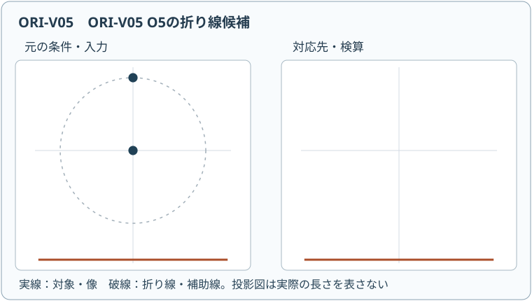
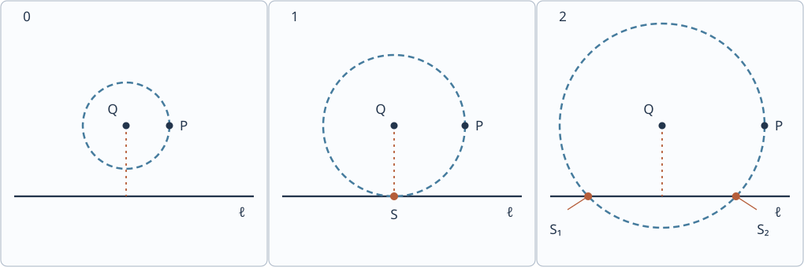

# ORI7 公理O5と二次方程式

**動く図 ORI-V05**：[円と直線の交点の本数を表示](assets/ori-v05-player.html)（[静止SVG](assets/ori-v05-poster.svg)）。数学的な条件と適用範囲を図の説明文でも確かめ、以下の本文の式と照合してください。図だけから実物の連続折り運動や一般定理の成立を結論しません。動画を操作しなくても本文の証明・演習は完結します。

前講の[O2：二点を重ねる折り線](../ORI6/index.md#axiom-ori6-o2)では、点 $P$ の行き先 $S$ を指定したため、$P\ne S$ なら折り線は一本に決まりました。ところが「$P$ を直線 $\ell$ **上のどこか**へ送る」とだけ指定すると、行き先は無数にあります。これにもう一つ、「折り線は点 $Q$ を通る」という条件を足したら、何本に絞られるのでしょうか。

この新しい操作を次節で定式化します。折り線を直接探す代わりに、まず $P$ の移り先 $S$ を探します。$Q$ を通る鏡映は距離 $QP$ を保存するので、$S$ は **$Q$ を中心とする円**と **$\ell$** の交点になります。この交点を求める式が二次方程式です。

この講では厚さ0の無限ユークリッド平面を用います。折り線の存在は、有限の紙の端や折り畳み中の衝突を考慮した実物の可動性を意味しません。

二点間の距離は、点の座標差をベクトルと見て $\|P-Q\|$ と書きます。例えば $P=(p_1,p_2)$、$Q=(q_1,q_2)$ なら

$$
\|P-Q\|=\sqrt{(p_1-q_1)^2+(p_2-q_2)^2}
$$

です。これはベクトルの長さであり、実数 $v$ の絶対値 $|v|$ と区別します。

学習後には、O5を正確に定式化し、円と直線の交点から折り線を復元し、0・1・2本と退化時の無数解を区別し、一般二次方程式との対応を説明できるようになります。

<!-- definition-example-audit: strict -->

---

## 1. O5は何を同時に指定するか

O1〜O4では、点を通す、二点を一致させる、二直線を一致させる、垂線を引くという条件を扱いました。今度は異なる二種類の条件を一本の折り線へ同時に課します。第一は「点の像が直線上にある」、第二は「折り線が別の指定点を通る」です。$\ell$ 上の像の**位置そのものは入力されません**。

折り線 $m$ に関する鏡映を $R_m$ と記します。この鏡映は[ORI1で定義した折り目の鏡映](../ORI1/index.md#def-ori1-crease-reflection)であり、$m$ 上の各点を固定し、点間距離を保存します。

<!-- formal-statement-start -->
> **公理（O5：点を直線へ重ね、指定点を通る折り線）**
>
> ユークリッド平面の点 $P,Q$ と直線 $\ell$ を入力する。求める折り線 $m$ は、$Q\in m$ かつ $R_m(P)\in\ell$ を満たす直線である。この二条件を満たす $m$ を、入力 $(P,Q,\ell)$ に対する O5 の許容折り線とする。
<!-- formal-statement-end -->

$P$ が $\ell$ のどの点へ移ってもよいことが重要です。反対に、$P$ をあらかじめ特定した $S$ へ重ねるだけなら[O2](../ORI6/index.md#axiom-ori6-o2)です。また、O5は $Q$ を**通る**のであって、$Q$ を別の点へ**重ねる**操作ではありません。

### 行き先から折り線を逆算する

$m$ が $Q$ を通るなら鏡映で $Q$ は動きません。しかも鏡映は距離を保つので、$S=R_m(P)$ には $\|Q-S\|=\|Q-P\|$ が必要です。つまり候補像は半径 $\|P-Q\|$ の円周上にあります。

<!-- formal-statement-start -->
> **定義（O5の候補像）**
>
> ユークリッド平面の点 $P,Q$ と直線 $\ell$ が与えられたとする。$\ell$ 上の点 $S$ が

$$
\|S-Q\|=\|P-Q\|
$$

> を満たすとき、$S$ をこの入力に対する **O5の候補像** と呼ぶ。候補像の集合は、$Q$ を中心とし半径 $\|P-Q\|$ の円周と $\ell$ の共通部分である。半径0の場合、ここでいう円周は一点集合 $\{Q\}$ とする。
<!-- formal-statement-end -->

<!-- definition-example-start: def-ori7-candidate-image -->
**定義の確認**：$P=(0,2), Q=(0,0),\ell:y=0$ とします。$\|P-Q\|=2$ ですから、$\ell$ 上の点 $S=(t,0)$ が候補像である条件は

$$
\|S-Q\|^2=t^2=\|P-Q\|^2=4.
$$

従って候補像は $S_-=(-2,0)$ と $S_+=(2,0)$ だけです。どちらも $y=0$ 上にあり、$Q$ からの距離は2です。一方、例えば $(1,0)\in\ell$ は $Q$ からの距離が1なので候補像ではありません。
<!-- definition-example-end -->

定義は行き先を絞っただけです。これら全ての候補像に、実際に折り線が対応することを次に示します。

---

## 2. 円と直線の交点から折り線を復元する

二点 $P,S$ が異なるとき、$P$ を $S$ に送る鏡映の軸は[ORI1の点を重ねる折り線の垂直二等分線定理](../ORI1/index.md#thm-ori1-point-alignment)により一意です。その軸の上に $Q$ があることと $\|Q-P\|=\|Q-S\|$ は同値です。したがって候補像と折り線を往復できそうです。

<!-- formal-statement-start -->
> **定理（O5の円と直線による解の対応）**
>
> ユークリッド平面で点 $P,Q$ と直線 $\ell$ を任意に取る。[O5](#axiom-ori7-o5) と[候補像](#def-ori7-candidate-image)について次が成り立つ。
>
> **（1）** $P\notin\ell$ なら、全ての候補像 $S$ は $S\ne P$ である。各 $S$ の線分 $PS$ の垂直二等分線がただ一本の O5 折り線になり、逆に全ての O5 折り線はこの形で得られる。従って候補像と折り線は一対一に対応する。
>
> **（2）** $P\in\ell$ かつ $P\ne Q$ なら、候補像 $S=P$ に対しては直線 $PQ$ がただ一本の O5 折り線である。他の候補像 $S\ne P$ に対しては（1）と同じ垂直二等分線が一本ずつ対応する。
>
> **（3）** $P=Q$ なら、$P\in\ell$ の場合は $P$ を通る全直線が O5 折り線であり、$P\notin\ell$ の場合は一本もない。
<!-- formal-statement-end -->

**証明の見取り図。** 折り線があれば鏡映の距離保存で候補像ができます。候補像 $S\ne P$ があれば、垂直二等分線を引いたとき $Q$ もそこに載ります。ただし $S=P$ では「垂直二等分線」を作れず、固定点の条件へ戻す必要があります。

<!-- proof-start -->
### 証明

$m$ を O5 折り線とし $S=R_m(P)$ とします。[鏡映の距離保存](../ORI1/index.md#prop-ori1-coordinate-isometry)を $P,Q$ に適用すると、$R_m(Q)=Q$ なので

$$
\|S-Q\|=\|R_m(P)-R_m(Q)\|=\|P-Q\|.
$$

また O5 の条件から $S\in\ell$ です。従って $S$ は候補像です。

逆に候補像 $S\ne P$ を取ります。[点を重ねる折り線の垂直二等分線定理](../ORI1/index.md#thm-ori1-point-alignment)を異なる二点 $P,S$ に適用すると、$R_m(P)=S$ を満たす直線は垂直二等分線 $m$ に限られます。$M=(P+S)/2$ は線分 $PS$ の中点です。[O2の垂直二等分線の座標判定](../ORI6/index.md#prop-ori6-o2)を使うと、この直線上に $X$ がある条件は

$$
(S-P)\cdot(X-M)=0.
$$

候補像の距離条件を二乗して展開すると

$$
\|Q-S\|^2-\|Q-P\|^2
=-2Q\cdot S+\|S\|^2+2Q\cdot P-\|P\|^2
=-2Q\cdot(S-P)+(S-P)\cdot(S+P)
=-2(S-P)\cdot(Q-M)=0.
$$

従って $Q\in m$ です。さらに $S\in\ell$ なので、$m$ は O5 の二条件をともに満たします。$P\ne S$ のとき一意な軸であり、異なる $S$ は同じ軸からは生じません。

$P\notin\ell$ なら $S\in\ell$ から必ず $S\ne P$ となり（1）が従います。

$P\in\ell$ かつ $P\ne Q$ で $S=P$ のときは $R_m(P)=P$ が必要です。[鏡映の固定点条件](../ORI1/index.md#prop-ori1-coordinate-isometry)から $P\in m$。さらに[O5](#axiom-ori7-o5)より $Q\in m$ ですから、異なる二点 $P,Q$ を通る直線 $PQ$ がただ一つの解であり、（2）が従います。

最後に $P=Q$ なら、$Q\in m$ の下では必ず $R_m(P)=P$ です。その像が $\ell$ 上にある条件は $P\in\ell$ と同値であり、成立すれば $P$ を通る全直線が許容されます。これで（3）も示されました。
<!-- proof-end -->

**具体的な復元。** 最初の候補像 $S_+=(2,0)$ では $P=(0,2)$ との中点は $(1,1)$、差は $(2,-2)$ なので、折り線は

$$
2(x-1)-2(y-1)=0 \quad\Longleftrightarrow\quad m_+:y=x.
$$

$S_-=(-2,0)$ では中点は $(-1,1)$、差は $(-2,-2)$ なので $m_-:y=-x$ です。どちらも $Q=(0,0)$ を通り、鏡映で $(0,2)$ はそれぞれ $(2,0)$、$(-2,0)$ へ移ります。

候補像が二個だから二本と数えられるのは、**この例で $P\notin\ell$ と確認したから**です。後で $P=Q\in\ell$ の例を見ると、一個の候補像に無数の折り線が対応します。

---

## 3. 二次方程式と0・1・2本の判定

円と直線の交点数を、図に頼らず数式で決めましょう。まず一般の直線 $\ell$ 上の点 $H$ を原点に選び、$\ell$ に沿う長さ1の方向ベクトル $e$ と、それを反時計回りに90度回した長さ1のベクトル $n$ を取ります。任意の点 $X$ は、この二方向の成分を使って一意に

$$
X=H+\xi e+\eta n,\qquad T(X)=(\xi,\eta)
$$

と表せます。両辺について $e,n$ との成分積の和をそれぞれ取れば $\xi=(X-H)\cdot e$、$\eta=(X-H)\cdot n$ となるので、二つの成分は一意です。$T(X)$ は点 $X$ の新しい座標です。

二点 $X,Y$ の新座標をそれぞれ $(\xi_X,\eta_X)$、$(\xi_Y,\eta_Y)$ とすると、$e\cdot n=0$ かつ $\|e\|=\|n\|=1$ なので

$$
\|X-Y\|^2=(\xi_X-\xi_Y)^2+(\eta_X-\eta_Y)^2
$$

です。従って $T$ は距離・中点・垂直を保存し、$\ell$ を横軸へ移します。直線 $m$ の点をそれぞれ $T$ で移した直線を $T(m)$ と書きます。[鏡映の定義](../ORI1/index.md#def-ori1-crease-reflection)で使う垂足と中点も保存されるので、任意の直線 $m$ と点 $X$ について

$$
T(R_m(X))=R_{T(m)}(T(X))
$$

が成り立ちます。これで座標を平行移動・回転しても O5 の二条件と折り線の本数は変わらないと確かめられました。

以下、新しい座標を $(x,y)$ と書き、$P=(p,s)$、$Q=(u,v)$、$\ell:y=0$ とします。$s\ne0$ は $P$ が直線上にないという条件です。

$Q$ から $\ell$ までの距離、すなわち $\ell$ 上の点と $Q$ との距離の最小値を $\operatorname{dist}(Q,\ell)$ と書きます。いま $\ell:y=0$ なので、この距離は $|v|$ です。円の半径は $r=\|P-Q\|$ です。候補像 $S=(t,0)$ の条件は

$$
(t-u)^2+v^2=(p-u)^2+(s-v)^2=r^2.
$$

この式から $t$ についての二次方程式が現れます。

<!-- formal-statement-start -->
> **定理（O5の判別量と0・1・2解）**
>
> 点 $P=(p,s)$、$Q=(u,v)$、直線 $\ell:y=0$ を取り、$s\ne0$ とする。次の実数を定める。

$$
\Delta=\|P-Q\|^2-v^2=(p-u)^2+(s-v)^2-v^2.
$$

> [O5](#axiom-ori7-o5) の折り線は、$\Delta<0$ なら0本、$\Delta=0$ なら1本、$\Delta>0$ なら2本である。対応する候補像 $S=(t,0)$ の座標は

$$
t=u\pm\sqrt{\Delta}\quad(\Delta\ge0).
$$

> $\Delta=0$ では二つの符号は同じ一つの値を表す。$S$ が定まれば折り線は

$$
(S-P)\cdot\left(X-\frac{P+S}{2}\right)=0
$$

> で一意に定まる。一般の直線についても、$|v|$ を $Q$ から $\ell$ への距離に替えた同じ判別量で分類できる。
<!-- formal-statement-end -->

**証明の見取り図。** 円と直線が離れているか、接するか、横切るかは、中心から直線までの距離 $|v|$ と半径 $r$ を比べれば分かります。二乗の差 $\Delta=r^2-v^2$ は、二次方程式の判別式の4分の1に当たります。

<!-- proof-start -->
### 証明

候補像は $S=(t,0)$ と書けます。[候補像の定義](#def-ori7-candidate-image)の距離条件は

$$
(t-u)^2+v^2=r^2
\quad\Longleftrightarrow\quad
(t-u)^2=\Delta.
$$

左辺は実数の二乗なので $\Delta<0$ なら解はありません。$\Delta=0$ なら $t=u$ の一個、$\Delta>0$ なら $t=u+\sqrt{\Delta},u-\sqrt{\Delta}$ の相異なる二個です。また展開した式は

$$
t^2-2ut+(u^2-\Delta)=0
$$

であり、通常の二次方程式の判別式は $(-2u)^2-4(u^2-\Delta)=4\Delta$ です。

仮定 $s\ne0$ により $P\notin\ell$ ですから、[円と折り線の一対一対応](#thm-ori7-circle-correspondence)の（1）が使えます。候補像の個数がそのまま折り線の本数です。$S\ne P$ なので、同じ定理で示した垂直二等分線の式が一意な折り線を与えます。任意の直線は等長変換で $y=0$ へ移せ、距離と折り線の個数は変わりません。
<!-- proof-end -->

### 図で見る三つの場合

破線の円は $Q$ 中心、半径 $\|P-Q\|$ です。実線 $\ell$ 上の交点を $S$ と記しています。左から $\|P-Q\|<\operatorname{dist}(Q,\ell)$、等号、$\|P-Q\|>\operatorname{dist}(Q,\ell)$ です。図は候補像の本数を表し、折り線自体は描いていません。各場合とも $P$ は $\ell$ の外にあり、候補像と折り線は一対一です。

**0本の例。** $P=(0,1),Q=(0,2),\ell:y=0$ なら、$r^2=1$、$v^2=4$、$\Delta=-3$ です。$Q$ を中心とする半径1の円は $y=0$ に届かず、折り線はありません。

**1本の例。** $P=(2,2),Q=(0,2),\ell:y=0$ なら、$r^2=4$、$v^2=4$、$\Delta=0$ です。唯一の候補像は $S=(0,0)$ です。中点 $(1,1)$、差 $S-P=(-2,-2)$ から唯一の折り線は $x+y=2$。$Q=(0,2)$ を通り、$P$ を $S$ に写します。

**2本の例。** 第2節の $P=(0,2),Q=(0,0),\ell:y=0$ では $\Delta=4$ でした。$t=\pm2$ から $y=x$ と $y=-x$ の二本を得ました。

### 軸の方程式を最後まで計算する例

$P=(1,3),Q=(2,1),\ell:y=0$ とします。半径の二乗は $r^2=(1-2)^2+(3-1)^2=5$、$\Delta=5-1=4$。候補像の $x$ 座標は $t=2\pm2$、すなわち $0,4$ です。

- $S_1=(0,0)$ の場合は $M_1=(1/2,3/2)$、$S_1-P=(-1,-3)$ です。$(-1,-3)\cdot(X-M_1)=0$ から $m_1:x+3y=5$。
- $S_2=(4,0)$ の場合は $M_2=(5/2,3/2)$、$S_2-P=(3,-3)$ です。$(3,-3)\cdot(X-M_2)=0$ から $m_2:x-y=1$。

両方とも $Q=(2,1)$ を通ります。前者は $2+3=5$、後者は $2-1=1$ です。各線は線分 $PS_i$ の中点を通り $PS_i$ に垂直なので、[垂直二等分線による鏡映](../ORI1/index.md#thm-ori1-point-alignment)により $P$ を指定された候補像へ写します。

---

## 4. 退化配置：一つの候補像でも無数の折り線

ここまで $P\notin\ell$ を仮定したのには理由があります。$P\in\ell$ なら $P$ 自身が候補像です。そこで「折っても $P$ が動かない」場合が加わり、$P=Q$ では何本もの軸が同じ像を作ります。

<!-- formal-statement-start -->
> **定理（O5の退化配置の完全分類）**
>
> ユークリッド平面の点 $P,Q$ と直線 $\ell$ について、$r=\|P-Q\|$、$h=\operatorname{dist}(Q,\ell)$、$\Delta=r^2-h^2$ とする。O5の解の本数は以下で尽くされる。
>
> - $P\notin\ell$：$\Delta<0,=0,>0$ の順に0、1、2本。
> - $P\in\ell,\ P\ne Q$：$\Delta=0$ なら1本、$\Delta>0$ なら2本。
> - $P=Q\in\ell$：無数の折り線。
>
> $P\in\ell$ の場合に $\Delta<0$ は起こらない。$P=Q\notin\ell$ は最初の場合に含まれ、0本である。
<!-- formal-statement-end -->

**証明の見取り図。** $P$ が直線上なら、円と直線の交点には少なくとも $P$ があります。点 $P$ と $Q$ が異なれば、それを固定する軸は直線 $PQ$ だけです。一致すれば軸の向きをいくら変えても $P$ は固定されます。

<!-- proof-start -->
### 証明

$P\notin\ell$ の場合は[判別量の定理](#thm-ori7-discriminant)です。$P\in\ell$ なら $\|Q-P\|=r$ である一方、$h$ は $Q$ から $\ell$ 上の点への距離の最小値なので $h\le r$、従って $\Delta\ge0$ です。

$P\in\ell$ かつ $P\ne Q$ なら、$P$ は一つの候補像です。[円と折り線の対応定理](#thm-ori7-circle-correspondence)の（2）より、この候補像には直線 $PQ$ が一本だけ対応し、他の候補像は各々一本の異なる軸を作ります。円と直線が接する $\Delta=0$ では交点は $P$ のみで1本、$\Delta>0$ では $P$ と別の交点が一つあり2本です。

$P=Q\in\ell$ では[対応定理](#thm-ori7-circle-correspondence)の（3）により、$P$ を通る全直線が条件を満たします。$P=Q\notin\ell$ なら $Q$ を通る鏡映は $P=Q$ を固定し、$\ell$ へ移せないので0本です。全ての入力はこの場合分けのいずれかに入ります。
<!-- proof-end -->

**反例：候補像の個数をそのまま数えてはいけない。** $P=Q=(0,0)$、$\ell:y=0$ とすると、候補像は一点 $P$ だけです。しかし $x=0$、$y=0$、$y=x$ など原点を通る全直線が $P$ を固定し、O5 折り線は無数です。二点 $P,S$ が異なるときだけ垂直二等分線が一意になるという[既習定理の非零条件](../ORI1/index.md#thm-ori1-point-alignment)が失われたのです。

$P\in\ell$ でも $Q\ne P$ ならこの非一意性は起きません。例えば $P=(0,0),Q=(0,1),\ell:y=0$ では円は $(0,0)$ で接し、折り線は $PQ$、すなわち $x=0$ の一本です。この折り線は $P$ を動かしません。

---

## 5. 一般の二次方程式をO5へ結び付ける

ここまで「与えられた O5 の配置から二次方程式が出る」ことを示しました。逆向きにも、実係数の二次方程式を平方完成して円・直線の交点問題に移せます。ここでは二次方程式の実根との対応を示し、係数から配置を作るための長さ・四則演算の作図法を別途省略して「O5一回だけで任意の係数を準備できる」とは主張しません。

<!-- formal-statement-start -->
> **命題（一般二次方程式のO5による実現）**
>
> 実数 $a,b,c$ で $a\ne0$ とし、$at^2+bt+c=0$ を考える。$B=b/a$、$C=c/a$、$d=B^2/4-C$ と置く。入力を

$$
P=(0,1),\qquad Q=\left(0,\frac{1-d}{2}\right),
\qquad \ell:y=0
$$

> とする。この O5 配置の候補像 $(w,0)$ と二次方程式の実根 $t$ は $t=w-B/2$ により一対一に対応する。従って $d<0,=0,>0$ は実根および O5 折り線の個数が0、1、2であることと同値である。
<!-- formal-statement-end -->

**証明の見取り図。** 平方完成によって未知数を $w=t+B/2$ に移すと $w^2=d$ です。O5 の座標設定を $\Delta=d$ となるように選び、候補像の横座標 $w$ で同じ式を実現します。

<!-- proof-start -->
### 証明

$a\ne0$ なので方程式全体を $a$ で割ると $t^2+Bt+C=0$。両辺に $B^2/4-C$ を対応させるため平方完成すると

$$
t^2+Bt+C=0
\ \Longleftrightarrow\
\left(t+\frac B2\right)^2=\frac{B^2}{4}-C=d.
$$

$w=t+B/2$ とおけば $w^2=d$ です。O5 の配置では $P$ の第2座標は1、$Q$ の第2座標は $v=(1-d)/2$ で、[判別量の定理](#thm-ori7-discriminant)の式へ代入すると

$$
\Delta=(0-0)^2+(1-v)^2-v^2
=1-2v
=1-(1-d)=d.
$$

候補像 $S=(w,0)$ の条件は $(w-0)^2=\Delta=d$ です。従って実数 $w$ の解と候補像は一対一で、$t=w-B/2$ により元の方程式の実根とも一対一です。$P=(0,1)\notin\ell$ なので[円と折り線の対応](#thm-ori7-circle-correspondence)から折り線の本数も一致します。
<!-- proof-end -->

**例：$2t^2-6t+1=0$。** $B=-3$、$C=1/2$ なので $d=9/4-1/2=7/4$、$w=t-3/2$。配置は $P=(0,1)$、$Q=(0,-3/8)$、$\ell:y=0$ です。候補像の横座標は $w=\pm\sqrt7/2$ となり、元の根は

$$
t=\frac32\pm\frac{\sqrt7}{2}.
$$

平方根の二つの符号が異なる二本の折り線に対応します。$d<0$ の場合は実根がなく O5 折り線もありません。実根の存在をあらかじめ仮定して図を描く必要はありません。

---

## 6. 演習

### Level A：候補像・判別量・折り線を求める

**ORI7-A1（二つの候補像）**

$P=(0,2)$、$Q=(0,0)$、$\ell:y=0$ に対する O5 折り線を全て求め、各折り線での $P$ の像を示してください。

- Level: A

<!-- solution-start -->
**詳細解答**

$r^2=\|P-Q\|^2=4$、$Q$ から $\ell$ までの距離は0なので $\Delta=4$ です。[判別量の定理](#thm-ori7-discriminant)を使うと候補像は $S_\pm=(\pm2,0)$ の二点です。

$S_+=(2,0)$ では中点 $(1,1)$、方向 $S_+-P=(2,-2)$ に垂直な線が折り線で、$2(x-1)-2(y-1)=0$、つまり $y=x$ です。$S_-=(-2,0)$ では中点 $(-1,1)$、差 $(-2,-2)$ から $-2(x+1)-2(y-1)=0$、つまり $y=-x$ です。

どちらも $Q$ を通ります。[点を重ねる折り線の垂直二等分線定理](../ORI1/index.md#thm-ori1-point-alignment)より前者の鏡映は $P\mapsto(2,0)$、後者は $P\mapsto(-2,0)$ で、両像は $\ell$ 上です。
<!-- solution-end -->

**ORI7-A2（接する場合）**

$P=(2,2)$、$Q=(0,2)$、$\ell:y=0$ に対して折り線が一本だけであることを計算し、その方程式を求めてください。

- Level: A

<!-- solution-start -->
**詳細解答**

$r^2=(2-0)^2+(2-2)^2=4$、$h=2$ なので $\Delta=4-2^2=0$ です。[O5の判別量](#thm-ori7-discriminant)から $S=(0,0)$ だけが候補像です。$P\notin\ell$ なので折り線も一本です。

$M=(P+S)/2=(1,1)$、$S-P=(-2,-2)$ より、折り線は $-2(x-1)-2(y-1)=0$、すなわち $x+y=2$ です。$Q=(0,2)$ はこの線上にあり、$M$ は中点、折り線方向 $(1,-1)$ は $S-P$ と垂直です。従って鏡映で $P$ は $S$ へ送られます。
<!-- solution-end -->

**ORI7-A3（届かない場合）**

$P=(0,1)$、$Q=(0,2)$、$\ell:y=0$ に O5 折り線が存在しないことを、距離と二次方程式の両方で示してください。

- Level: A

<!-- solution-start -->
**詳細解答**

$r=\|P-Q\|=1$、$h=\operatorname{dist}(Q,\ell)=2$ です。半径1の円は中心から距離2の直線に届きません。$\Delta=r^2-h^2=1-4=-3<0$ です。

$S=(t,0)$ として候補像の条件を直接書けば、$\|S-Q\|^2=t^2+4=\|P-Q\|^2=1$、つまり $t^2=-3$ となります。実数 $t$ でこれは成立しないため候補像がなく、[対応定理](#thm-ori7-circle-correspondence)より折り線も0本です。
<!-- solution-end -->

**ORI7-A4（折り線の復元）**

$P=(1,3)$、$Q=(2,1)$、$\ell:y=0$ に対して、候補像、各垂直二等分線、$Q$ の所属を計算してください。

- Level: A

<!-- solution-start -->
**詳細解答**

$r^2=1+4=5$、$h^2=1$ なので $\Delta=4$ です。候補像は $S_1=(0,0)$、$S_2=(4,0)$。$S_1$ では $M_1=(1/2,3/2)$、$S_1-P=(-1,-3)$ だから

$$
-(x-1/2)-3(y-3/2)=0
\quad\Longleftrightarrow\quad x+3y=5.
$$

$S_2$ では $M_2=(5/2,3/2)$、$S_2-P=(3,-3)$ なので

$$
3(x-5/2)-3(y-3/2)=0
\quad\Longleftrightarrow\quad x-y=1.
$$

$Q=(2,1)$ を代入すると、それぞれ $2+3=5$、$2-1=1$ です。$P\notin\ell$ なのでこの二本が[対応定理](#thm-ori7-circle-correspondence)による全解です。
<!-- solution-end -->

**ORI7-A5（点が動かない接点）**

$P=(0,0)$、$Q=(0,1)$、$\ell:y=0$ とする。候補像は何個か、O5 折り線は何本かを区別して求めてください。

- Level: A

<!-- solution-start -->
**詳細解答**

$r=1$、$h=1$ で $\Delta=0$。円と直線の唯一の交点は $S=P=(0,0)$ です。ここでは $P\in\ell$ なので $P\ne S$ を仮定する垂直二等分線公式は使えません。

鏡映で $P$ を固定するには折り線が $P$ を通る必要があります。さらに $Q$ を通る必要があり $P\ne Q$ なので、[退化配置の分類](#thm-ori7-degenerate)に従い二点を通る $x=0$ の一本だけです。実際この鏡映は $P$ を固定し、$P\in\ell$ です。
<!-- solution-end -->

### Level B：対応の証明と境界を使いこなす

**ORI7-B1（点が直線上にある二解）**

$P=(2,0)$、$Q=(0,1)$、$\ell:y=0$ の O5 折り線を全て求めてください。候補像 $S=P$ とそれ以外を別々に扱ってください。

- Level: B

<!-- solution-start -->
**詳細解答**

$r^2=(2-0)^2+(0-1)^2=5$、$h^2=1$ なので $\Delta=4$。候補像 $S=(t,0)$ は $t=\pm2$、すなわち $S_1=P=(2,0)$ と $S_2=(-2,0)$ です。

$S_1=P$ は固定点の像です。折り線は異なる二点 $P,Q$ をともに通る必要があるので、$Q-P=(-2,1)$ を方向とする直線です。$P$ を通る方程式は

$$
m_1:\quad x+2y=2.
$$

これは $P$ と $Q$ の双方を通るため、$P$ を固定して $\ell$ 上に保ちます。

$S_2\ne P$ では中点 $(0,0)$、差 $S_2-P=(-4,0)$ なので[点を重ねる折り線の垂直二等分線定理](../ORI1/index.md#thm-ori1-point-alignment)から $m_2:x=0$ です。$Q=(0,1)$ を通り、鏡映で $(2,0)$ を $(-2,0)$ へ移します。二本は異なり、[完全分類](#thm-ori7-degenerate)から他の解はありません。
<!-- solution-end -->

**ORI7-B2（回転した直線にも通用する判別量）**

任意の直線 $\ell$ について、$Q$ からの垂足を $H$、$\ell$ に沿う長さ1の方向ベクトルを $e$ とする。$\ell$ の点を $S=H+te$（$t\in\mathbb R$）と書くとき、候補像の条件が $t^2=\|P-Q\|^2-\|Q-H\|^2$ になることを証明してください。$P\notin\ell$ なら解の本数はどうなりますか。

- Level: B

<!-- solution-start -->
**詳細解答**

$H$ は垂足なので $Q-H$ は直線 $\ell$ の方向 $e$ に垂直です。従って $(Q-H)\cdot e=0$ です。$S=H+te$ に対し $S-Q=(H-Q)+te$ であり、成分の積を展開すると

$$
\|S-Q\|^2=\|H-Q\|^2+2t(H-Q)\cdot e+t^2\|e\|^2.
$$

中項は0、$\|e\|^2=1$ なので $\|S-Q\|^2=\|Q-H\|^2+t^2$ です。[候補像の定義](#def-ori7-candidate-image)の $\|S-Q\|^2=\|P-Q\|^2$ を代入し、

$$
t^2=\|P-Q\|^2-\|Q-H\|^2
$$

を得ます。右辺は $r^2-h^2$ という座標に依らない判別量です。$P\notin\ell$ なら[円と折り線の一対一対応](#thm-ori7-circle-correspondence)により、右辺が負、零、正の順に0、1、2本となります。
<!-- solution-end -->

**ORI7-B3（二次方程式を折りの配置にする）**

$2t^2-6t+1=0$ を平方完成し、[二次方程式とO5の対応](#prop-ori7-quadratic)に従って点 $P,Q$ と直線 $\ell$ を与えてください。実根を計算し、対応する候補像を示してください。

- Level: B

<!-- solution-start -->
**詳細解答**

2で割ると $t^2-3t+1/2=0$ です。$B=-3,C=1/2$ なので $d=B^2/4-C=9/4-1/2=7/4$。従って

$$
\left(t-\frac32\right)^2=\frac74.
$$

命題の配置は $P=(0,1)$、$Q=(0,(1-7/4)/2)=(0,-3/8)$、$\ell:y=0$ です。候補像 $S=(w,0)$ の条件は $w^2=d=7/4$ なので

$$
S_\pm=\left(\pm\frac{\sqrt7}{2},0\right).
$$

$w=t-3/2$、つまり $t=w+3/2$ であるため、実根は $t=(3\pm\sqrt7)/2$ です。$P\notin\ell$ なので候補像二個は二本の異なる折り線へ対応します。
<!-- solution-end -->

**ORI7-B4（接するときだけ一本になる）**

$h>0$ を実数として $P=(1,h)$、$Q=(0,h)$、$\ell:y=0$ を与える。$h=1/2,1,2$ の各場合の折り線本数を求め、$h$ を連続的に動かすと何が境界になるか示してください。

- Level: B

<!-- solution-start -->
**詳細解答**

$P-Q=(1,0)$ より半径は $r=1$ で一定です。$Q$ から直線までの距離は $h$ なので、[判別量の定理](#thm-ori7-discriminant)の不変な形から

$$
\Delta=r^2-h^2=1-h^2.
$$

$h=1/2$ なら $\Delta=3/4>0$ で二本、$h=1$ なら $\Delta=0$ で一本、$h=2$ なら $\Delta=-3<0$ で0本です。候補像は $\Delta\ge0$ で $(\pm\sqrt{1-h^2},0)$ です。

$h>0$ だから $P=(1,h)\notin\ell$ であり、候補像と折り線は一対一です。$h$ が1を下から上へ通るとき、二つの交点が接点に合流してから消えるのが本数変化の理由です。$h=0$ まで含めると $P\in\ell$ に変わるので、同じ分類を無条件に延長せず[退化配置の分類](#thm-ori7-degenerate)を使います。
<!-- solution-end -->

### Level C：折り線の完全分類を一つの族で扱う

**ORI7-C1（判別量・構成・退化の総合）**

点 $P=(1,3)$、直線 $\ell:y=0$ を固定し、点 $Q_h=(2,h)$ を実数 $h$ で動かす。次の問いに答えてください。

1. O5の候補像の座標を $h$ で表し、0・1・2本の範囲を必要十分条件として分類する。
2. $h=1$ で全折り線の方程式を求め、両条件を検算する。
3. $Q_h=P$ に変わる場合はあるか。また $P=Q=(1,3)$ と入力し直した場合、折り線の本数はどうなるか。
4. 最初の $P$ を $P'=(2,0)$、$Q$ を $(0,1)$ に変えたとき、候補像と折り線の数が一致する理由を確認する。

- Level: C

<!-- solution-start -->
**詳細解答**

**1. 判別量。** $Q_h$ の第2座標は $h$、$P-Q_h=(-1,3-h)$ です。従って

$$
r^2=1+(3-h)^2=10-6h+h^2,
\qquad
\Delta=r^2-h^2=10-6h.
$$

候補像 $S=(t,0)$ の方程式は $(t-2)^2=10-6h$ です。判別量の符号を $h$ で解くと

$$
\Delta>0\iff h<\frac53,\qquad
\Delta=0\iff h=\frac53,\qquad
\Delta<0\iff h>\frac53
$$

です。$P\notin\ell$ は全ての $h$ で成り立つため、[判別量の定理](#thm-ori7-discriminant)により、順に2、1、0本です。存在する場合の候補像は

$$
S_\pm=(2\pm\sqrt{10-6h},\,0)
$$

です。等号のとき二つの表示は同一点を表します。

**2. $h=1$。** $\Delta=4$ なので候補像は $S_1=(0,0)$、$S_2=(4,0)$ です。前者の中点 $(1/2,3/2)$ と差 $(-1,-3)$ から

$$
m_1:\quad x+3y=5,
$$

後者の中点 $(5/2,3/2)$ と差 $(3,-3)$ から

$$
m_2:\quad x-y=1
$$

を得ます。両式に $Q_1=(2,1)$ を代入すると $5=5$、$1=1$ です。さらに各軸は対応する $PS_i$ の垂直二等分線ですから[鏡映と垂直二等分線の定理](../ORI1/index.md#thm-ori1-point-alignment)により $R_{m_i}(P)=S_i\in\ell$。これで O5 の二条件を検算でき、[一対一対応](#thm-ori7-circle-correspondence)より他の折り線はありません。

**3. 一致点への変更。** $Q_h=(2,h)$ の第1座標は常に2、$P$ の第1座標は1なので、どの $h$ に対しても $Q_h=P$ ではありません。入力を別に $P=Q=(1,3)$ とすれば $P$ は $\ell:y=0$ に属しません。$Q$ を通る鏡映は $P=Q$ を固定するので像を $\ell$ へ送れず、[退化配置の定理](#thm-ori7-degenerate)から0本です。この場合を元の族の値と取り違えてはいけません。

**4. $P'$ が直線上の場合。** 新たな入力では半径と判別量が

$$
r^2=\|(2,0)-(0,1)\|^2=5,\qquad
h^2=1,\qquad \Delta=5-1=4
$$

となります。候補像は $S_1=P'=(2,0)$ と $S_2=(-2,0)$ です。

$S_1$ を固定する折り線は二点 $P',Q$ を通り、$S_2$ を作る折り線は $P'S_2$ の垂直二等分線です。それぞれ

$$
m_1:\ x+2y=2,\qquad m_2:\ x=0
$$

と求まります。$P'\ne Q$ なので固定点を通る軸も一意であり、この**特定の場合**には二候補像と二折り線が対応します。[退化配置の定理](#thm-ori7-degenerate)により、この結論を $P'=Q\in\ell$ にまで拡張すると無数解を見落とすことになります。
<!-- solution-end -->

---

## 7. この講義で得たこと

- [O5](#axiom-ori7-o5) は $Q$ を折り線上に置きながら、$P$ の鏡映像を直線 $\ell$ 上のどこかへ送る操作です。
- $P\notin\ell$ では[円と直線の交点](#thm-ori7-circle-correspondence)と折り線が一対一対応し、$\Delta=\|P-Q\|^2-\operatorname{dist}(Q,\ell)^2$ の符号が0・1・2本を決めます。
- [退化配置](#thm-ori7-degenerate)では $P=Q\in\ell$ に無数の解が現れます。二次方程式の根の個数だけでは折り線の個数を常に決められません。
- [平方完成](#prop-ori7-quadratic)により、任意の実係数二次方程式の実根を O5 の候補像に対応させられます。

次の ORI8 では、**二つの点**をそれぞれ指定直線へ同時に重ねる O6 に進みます。O5 の二次方程式から何が変わり、なぜ三次方程式が現れるかを調べます。
