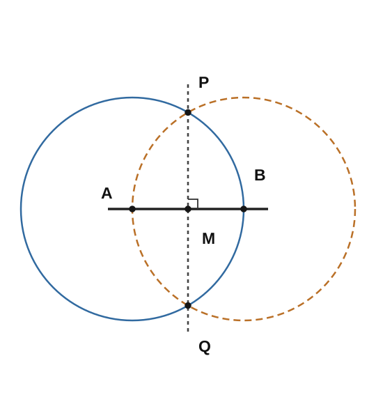

# SQC1 定規とコンパスの有限作図と古典三大問題

定規で線を引き、コンパスで円を描けば、どんな長さでも正確に作れるでしょうか。紙の上で円と同じ面積の正方形を非常に高い精度で描けても、「いつか誤差がゼロになる」ことと「有限回の操作で誤差ゼロの図形が得られる」ことは違います。

ここでは何を一回の操作と数えるかを明確にし、中点・垂線・平行線・正方形が実際に作れることを確認します。その後、円積・立方体倍積・角の三等分を**要求される出力の方程式**として定式化します。不可能性を示す代数的な判定は次章以降で扱います。

作図可能な実数の一般定義と、作図可能性を二次拡大列で特徴付ける定理は、既習の[作図可能点・作図可能数の定義](../../../代数系/FLD/FLD5/index.md#def-fld5-constructible-number)および[二次拡大列による特徴付け](../../../代数系/FLD/FLD5/index.md#thm-fld5-constructible-quadratic-tower)にあります。本章はその論理の前に現れる「具体的な作図はどの操作を使うか」を丁寧に確かめる講義です。

<!-- definition-example-audit: strict -->

---

## 1. 許された道具と有限回という条件

平面上で異なる二点 $A,B$ が分かっていれば、その二点を通る直線を定規で引けます。また、中心 $A$ と円周上の点 $B$ が分かっていれば、半径 $AB$ の円をコンパスで描けます。直線や円を描いても、まだ得られていない点を勝手に選べるわけではありません。新しい点は**描いた直線・円の交点**から得ます。

出発時には異なる二点 $O,I$ を持ち、その距離 $OI$ を単位長 $1$ とします。問題によっては、さらに与えられた線分・円・角を表す点を初期データとします。交点がない組を指定しても新しい点は得られません。二点が一致していると一意な直線は定まらず、中心と円周上の点が一致すれば正の半径を持つ円にはなりません。

<!-- formal-statement-start -->
> **定義（有限作図手順）**  
> 平面上の異なる基準点 $O,I$ と、問題に指定された有限個の初期点から出発する。すでに得た点だけを使い、次の操作を有限回繰り返して得られる点・直線・円の列を**有限作図手順**という。
>
> 1. 異なる既知の二点を通る直線を描く。
> 2. 異なる既知の二点の一方を中心、他方を円周上の点とする円を描く。
> 3. すでに描いた相異なる直線・円の交点のうち、実際に存在する点を取り出す。
>
> 各操作で選ぶ対象と、必要な交点が存在することを説明できるものとする。長さの目盛を読み取る操作、任意の座標を数値入力する操作、曲線を自由に描く操作は含めない。
<!-- formal-statement-end -->

<!-- definition-example-start: def-sqc1-finite-procedure -->
**定義の確認**　既知の二点 $A\ne B$ から直線 $AB$ を描き、中心 $A$ で $B$ を通る円を描くことは許されます。円と直線の交点として $B$ と反対側の点 $B'$ を得ることも許されます。一方、「距離 $AB$ を10進数で測り、その半分を目盛で取る」はここでの操作ではありません。**目盛を読まずに**半分を得る方法を次節で構成します。
<!-- definition-example-end -->

既習の[作図可能点の定義](../../../代数系/FLD/FLD5/index.md#def-fld5-constructible-number)は、基準点 $O=(0,0),I=(1,0)$ に対するこの操作の繰り返しを扱います。追加の初期データを与える問題でも、許される一手は同じです。

作図中に正確な数値を知らなくても構いません。例えば二つの円の交点 $P$ の座標を先に計算しなくても、円同士が交わると分かれば交点 $P$ を取れます。逆に数値だけを大量に計算しても、これらの操作の列がなければ作図手順にはなりません。

## 2. 線分の中点は実際に作れる

線分 $AB$ の中点 $M$ は $AM=MB$ を満たす $AB$ 上の点です。「半分の位置に印を付ける」だけでは目盛を暗黙に使っています。そこで二つの円を使います。

<!-- formal-statement-start -->
> **命題（線分の中点の有限作図）**  
> 平面上の任意の異なる二点 $A,B$ から、線分 $AB$ の中点 $M$ は[有限作図手順](#def-sqc1-finite-procedure)で得られる。
<!-- formal-statement-end -->

### 作図の見取り図

1. 中心 $A$ で $B$ を通る円と、中心 $B$ で $A$ を通る円を描く。
2. 両円の二つの交点を $P,Q$ とする。
3. 直線 $PQ$ と直線 $AB$ の交点を $M$ とする。

両円の半径が同じなので $PA=PB$ かつ $QA=QB$ です。二つの交点を結ぶ線は $AB$ の垂直二等分線になるはずです。次の証明では交点が**本当に二つある**ことも確認します。

<!-- proof-start -->
### 証明

$d=AB>0$ とします。証明のためだけに平面の座標を取り直し、$A=(0,0)$、$B=(d,0)$ と表します。これは紙の上で新しい座標値を入力する操作ではありません。二つの円の方程式は

$$
x^2+y^2=d^2,\qquad (x-d)^2+y^2=d^2
$$

です。後式から前式を引くと $-2dx+d^2=0$ なので、$d>0$ により $x=d/2$。これを前式へ代入すると

$$
y^2=d^2-\frac{d^2}{4}=\frac{3d^2}{4}>0.
$$

したがって交点は確かに相異なる二点

$$
P=\left(\frac d2,\frac{\sqrt3d}{2}\right),
\qquad
Q=\left(\frac d2,-\frac{\sqrt3d}{2}\right)
$$

です。直線 $PQ$ は $x=d/2$、直線 $AB$ は $y=0$ です。両者はただ一つの点 $M=(d/2,0)$ で交わり、

$$
AM=\frac d2=MB.
$$

各円・直線・交点は定義で許された操作で得られたので、有限作図として中点を得ました。
<!-- proof-end -->

例えば $A=(0,0)$、$B=(2,0)$ なら $P=(1,\sqrt3)$、$Q=(1,-\sqrt3)$ となり、$M=(1,0)$ です。最終結果の座標が簡単な数であることではなく、そこへ至る**円二つ・直線二つ・交点**の列が重要です。

## 3. 垂線・平行線も有限回で作れる

中点ができると、垂直二等分線を作る仕組みが利用できます。直線 $\ell$ と点 $T$ が与えられたとき、$T$ が直線上にある場合とない場合を分けます。

<!-- formal-statement-start -->
> **命題（点を通る垂線と平行線の有限作図）**  
> 既知の異なる二点で定まる直線 $\ell$ と既知の点 $T$ が与えられるとする。$T$ を通り $\ell$ に垂直な直線を有限作図できる。また $T\notin\ell$ なら、$T$ を通り $\ell$ に平行な直線も有限作図できる。
<!-- formal-statement-end -->

### 証明の見取り図

垂線は「同じ二点から等距離の点が並ぶ直線」を作ります。平行線は垂線を二回作れば得られます。直線外の点から垂線を下ろす際には、円が接するだけの半径を偶然選ばないように注意します。

<!-- proof-start -->
### 証明

**(i) $T\in\ell$ の場合。** $\ell$ 上に $T$ と異なる既知の点 $U$ を取ります。中心 $T$ で $U$ を通る円と $\ell$ のもう一つの交点を $V$ とします。$TU=TV>0$ で、$T$ は線分 $UV$ の中点です。中心 $U$ で $V$ を通る円と、中心 $V$ で $U$ を通る円を描き、交点を $R,S$ とします。前節と同じ計算を $U,V$ へ適用すると、$RS$ は $UV=\ell$ の垂直二等分線で、$T$ を通ります。

**(ii) $T\notin\ell$ の場合。** $\ell$ を定める相異なる二点 $A,B$ を使います。$T$ から $\ell$ へ下ろした垂線の足を、証明上 $F$ と呼びます。$A,B$ は異なるので、少なくとも一方は $F$ と異なります。その点を $X$ とします（実際の手順では両方の円を描けば、少なくとも片方が二つの交点を持つので選べます）。

中心 $T$ で $X$ を通る円と $\ell$ は、$X$ のほかに $F$ に関して $X$ と対称な点 $Y$ で交わります。$X\ne F$ なので $X\ne Y$ です。これは直角三角形 $TFX$ と $TFY$ において、$TX=TY$ と $TF$ が共通であることからも確認できます。従って

$$
TX=TY,\qquad FX=FY.
$$

[中点の作図](#prop-sqc1-midpoint)で $XY$ の中点 $M$ を得ます。実際には $M=F$ です。$T$ は $X,Y$ から等距離にあるため、直線 $TM$ は $XY=\ell$ の垂直二等分線です。$T\notin\ell$ より $T\ne M$ なので直線 $TM$ を描けます。

**(iii) 平行線。** $T\notin\ell$ のとき、(ii)で得た $T$ を通る垂線を $k$ とします。次に (i) を点 $T\in k$ に適用し、$T$ を通る $k$ の垂線 $m$ を作ります。同一平面で $\ell$ と $m$ はともに $k$ に垂直なので $\ell\parallel m$ です。いずれも上の有限個の操作の合成です。
<!-- proof-end -->

直線上の点を通る「平行線」はもとの直線そのものです。命題が別の平行直線を作ると言っているのは、$T$ が直線の**外**にある場合に限ります。

## 4. 辺から正方形を作り、面積を確認する

中点・垂線・平行線だけで何ができるか、具体的な面積問題に戻りましょう。長さ $a>0$ の線分 $AB$ を一辺とする正方形を作ります。

<!-- formal-statement-start -->
> **命題（与えられた辺からの正方形の有限作図）**  
> 異なる二点 $A,B$ が与えられ、$a=AB>0$ とする。$AB$ を一辺とする正方形 $ABDC$ を有限作図できる。その面積は $a^2$ である。
<!-- formal-statement-end -->

### 作図の見取り図

$A,B$ からそれぞれ $AB$ に垂線を立て、各垂線上に元の辺と同じ長さをコンパスで写します。写した点を**同じ側**に選ぶことで、残りの二頂点が決まります。

<!-- proof-start -->
### 証明

[垂線の作図](#prop-sqc1-perpendicular-parallel)で $A$ と $B$ を通る $AB$ への垂線を描きます。中心 $A$ で $B$ を通る円と $A$ の垂線の交点から、$AB$ の一方の側にある点を $C$ とします。同様に中心 $B$ で $A$ を通る円から、同じ側の点 $D$ を得ます。

円の半径より $AC=BD=a$、垂線より $AC\perp AB$、$BD\perp AB$ です。証明のため $A=(0,0)$、$B=(a,0)$ と置き、選んだ側を $y>0$ の領域とすると $C=(0,a)$、$D=(a,a)$ になります。従って

$$
\overrightarrow{AB}=(a,0),\qquad
\overrightarrow{CD}=(a,0),\qquad
\overrightarrow{BD}=(0,a).
$$

すなわち $AB\parallel CD$、$AC\parallel BD$、四辺の長さはすべて $a$、隣接辺は直角に交わります。直線 $CD$ と線分の境界を描けば正方形 $ABDC$ です。面積は底辺 $a$ と高さ $a$ の積 $a^2$ となります。
<!-- proof-end -->

ここで使ったのは **辺が与えられれば正方形を作れる**という事実です。「指定された面積を持つ正方形の辺そのものを作れるか」は別問題です。

## 5. 「作図可能」をどの問いについて言うのか

一つの角が三等分できたとしても、すべての角の三等分法があるとは限りません。一枚の円について近似的に等積な正方形を描けても、その円の厳密な円積に成功したとは言えません。そこで、入力と要求する出力を固定します。

<!-- formal-statement-start -->
> **定義（作図問題の厳密解）**  
> 与えられた点・直線・円などの入力について、指定された幾何学的条件を**等式として正確に満たす**出力を、有限作図手順によって得たとき、その入力に対する作図問題の**厳密解**という。すべての許された入力について解くことを要求する問題では、各入力に対して実行可能な有限手順を与える必要がある。
<!-- formal-statement-end -->

<!-- definition-example-start: def-sqc1-exact-solution -->
**定義の確認**　上の[正方形の作図](#prop-sqc1-square)は、任意の $a>0$ の辺を入力として面積が正確に $a^2$ の正方形を出力するので厳密解です。一方、面積が $4$ の正方形を求めるのに、辺の長さを $1.9999$ として描くのは、面積が $1.9999^2\ne4$ なので厳密解ではありません。
<!-- definition-example-end -->

「実数として目標の長さが存在する」ことは「その長さを作図できる」ことを含意しません。また、有限手順を明記できる場合でも、操作に使う交点が存在しない入力があれば、その入力まで解いたことにはなりません。

## 6. 古典三大作図問題を長さの式へ直す

古典的な三つの問題は、いずれも「必要な幾何量を有限作図で構成できるか」という問いです。円・立方体・角という見た目の違いを、正確な出力条件に直します。

<!-- formal-statement-start -->
> **定義（古典三大作図問題）**  
> 許す操作を[有限作図手順](#def-sqc1-finite-procedure)に限定して、次を問う。
>
> 1. **円積問題**：半径 $r>0$ の円が与えられたとき、円と面積が等しい正方形の一辺 $s>0$ を作図できるか。
> 2. **立方体倍積問題**：一辺 $a>0$ の立方体が与えられたとき、体積がその2倍の立方体の一辺 $b>0$ を作図できるか。
> 3. **一般角の三等分問題**：頂点と二本の半直線で与えられた $0<\theta<180^\circ$ の任意の角について、角の内部に $\theta/3$ の方向を作図できるか。
<!-- formal-statement-end -->

<!-- definition-example-start: def-sqc1-three-problems -->
**定義の確認**　半径 $1$ の円なら正方形に必要な辺は $\sqrt\pi$、辺 $1$ の立方体を倍積するなら必要な辺は $\sqrt[3]{2}$ です。$90^\circ$ の角の三等分では $30^\circ$ の方向が必要です。三つとも目標の量を**指定する等式**は書けますが、それだけでは有限作図が成立したことにはなりません。
<!-- definition-example-end -->

### 6.1 円積：面積を辺の長さに翻訳する

半径 $r>0$ の円の面積は $\pi r^2$、一辺 $s>0$ の正方形の面積は $s^2$ です。等積条件は

$$
s^2=\pi r^2.
$$

$s>0$、$r>0$ なので平方根を取って

$$
s=r\sqrt\pi
$$

となります。半径 $2$ なら必要な一辺は $2\sqrt\pi$、半径 $1/2$ なら $\sqrt\pi/2$ です。[与えられた辺からの正方形の有限作図](#prop-sqc1-square)から、**この辺を得られたなら**正方形に組み立てることは可能です。難しさは「その長さが有限作図で得られるか」にあります。

### 6.2 倍積：体積を辺の長さに翻訳する

辺 $a>0$ の立方体の体積は $a^3$ です。新しい立方体の辺を $b>0$ とすると

$$
b^3=2a^3
\quad\Longleftrightarrow\quad
b=a\sqrt[3]{2}.
$$

体積を二倍にすることは辺の長さを二倍にすることではありません。もし $b=2a$ とすれば体積は $(2a)^3=8a^3$ となってしまいます。ここでは**要求する長さ**を決めただけで、その構成法はまだ与えていません。

### 6.3 三等分：一つの成功例と一般問題

例えば $90^\circ$ の角は三等分できます。角の一辺を基準に正三角形を作れば $60^\circ$ の方向を得られます。正三角形は、同じ長さを半径とする二円の交点から作れます。次に[中点の作図](#prop-sqc1-midpoint)でその正三角形の向かい側の辺の中点を取り、頂点から結ぶと、二つの合同な直角三角形ができ、$60^\circ$ が $30^\circ$ ずつに分かれます。得た $30^\circ$ の方向は、与えられた直角の内部にあり、$90^\circ/3$ です。

しかしこれが示すのは $90^\circ$ という**個別の入力**の成功だけです。「任意の角を三等分できる」という全称命題の証明にはなりません。後の章では、三等分できない具体的な角を代数的に判定します。

## 7. 近似と厳密な作図を混同しない

現代の数値計算なら $\pi$ を多くの桁まで計算できます。例えば半径 $1$ の円について $\sqrt\pi$ を有限桁で近似し、その値を辺の長さとして使えば、面積が $\pi$ に非常に近い正方形が描けます。ただし、有限桁に丸めた辺を $s_N$ とすれば、示したい等式は $s_N^2=\pi$ であり、単なる「誤差が小さい」ではこれを満たしません。

逆に、長さの数値を表示できない交点でも、有限作図で正確に得られることはあります。例えば[中点の作図](#prop-sqc1-midpoint)では、二円の交点に平方根が現れますが、座標値を数値入力する必要はありません。[二次拡大列による作図可能性](../../../代数系/FLD/FLD5/index.md#thm-fld5-constructible-quadratic-tower)は、こうした違いを一般的な代数の言葉で記述するための定理です。

| 判断したいこと | 本章で確かめる方法 |
|---|---|
| 目標の図形が数学的に存在するか | 面積・体積・角の条件を方程式にする |
| その条件を厳密に作図したか | 一手ずつ許容操作を列挙し、交点の存在と出力条件を証明する |
| 近似精度を上げられるか | 数値的な誤差を評価する（厳密作図とは別の問い） |
| 特定の入力だけ解けるか | その入力の作図手順を示す（一般問題の解決とは限らない） |

## 8. 演習：手順と要求条件を自力で確かめる

### Level A：具体的な操作と方程式

**SQC1-A1（中点の交点計算）**  
$A=(0,0)$、$B=(4,0)$ に対して、両端を中心とし半径 $4$ の二円の交点 $P,Q$ を求め、直線 $PQ$ が $AB$ の中点を通ることを確認してください。

- Level: A

<!-- solution-start -->
**詳細解答**

二円は $x^2+y^2=16$、$(x-4)^2+y^2=16$ です。差を取ると $-8x+16=0$ なので $x=2$、代入すると $y^2=16-4=12$ です。よって

$$
P=(2,2\sqrt3),\qquad Q=(2,-2\sqrt3).
$$

二点を通る直線は $x=2$、$AB$ は $y=0$ だから交点 $M=(2,0)$ です。$AM=2=MB$ で、中点条件を満たします。これは[中点の有限作図](#prop-sqc1-midpoint)の具体的な計算です。
<!-- solution-end -->

**SQC1-A2（直線上の垂線）**  
直線 $\ell$ 上の点 $T$ と異なる点 $U\in\ell$ が与えられています。円と交点だけを用い、$T$ を通る $\ell$ の垂線を得る手順を書き、なぜ直角になるか説明してください。

- Level: A

<!-- solution-start -->
**詳細解答**

まず中心 $T$ で $U$ を通る円を描き、直線 $\ell$ とのもう一方の交点を $V$ とします。このとき $TU=TV$ で、三点 $U,T,V$ は一直線上にあります。従って $T$ は $UV$ の中点です。

次に、中心 $U$ で $V$ を通る円と、中心 $V$ で $U$ を通る円を描きます。二円の交点を $R,S$ として直線 $RS$ を描きます。[中点の作図命題の証明](#prop-sqc1-midpoint)と同じ座標計算により二円は相異なる二交点を持ち、$RS$ は $UV$ の垂直二等分線です。

よって $RS$ は中点 $T$ を通り、$\ell=UV$ と垂直に交わります。
<!-- solution-end -->

**SQC1-A3（円積の辺を求める）**  
半径 $3$ の円と等積な正方形の一辺 $s>0$ が満たす方程式を立て、$s$ を記号で表してください。数値近似を出す必要はありません。

- Level: A

<!-- solution-start -->
**詳細解答**

円の面積は $\pi\cdot3^2=9\pi$、正方形の面積は $s^2$ です。等積条件は $s^2=9\pi$ です。$s>0$ なので $s=\sqrt{9\pi}=3\sqrt\pi$ です。この計算は必要な辺の**値**を決定しますが、有限作図手順までは与えません。
<!-- solution-end -->

**SQC1-A4（立方体倍積の長さ）**  
一辺 $a=2$ の立方体の体積を二倍にする一辺 $b>0$ を求めてください。$b=2a$ とした場合の体積も計算してください。

- Level: A

<!-- solution-start -->
**詳細解答**

元の体積は $2^3=8$ で、目標体積は $16$ です。従って $b^3=16=2\cdot2^3$、正の根は $b=2\sqrt[3]2$ です。辺を二倍にすれば $b=4$、体積は $4^3=64$ となり、目標の16ではなく元の8倍です。
<!-- solution-end -->

**SQC1-A5（できる角の三等分）**  
正三角形を使って $90^\circ$ の角を三等分する作図を説明し、角度が正確に $30^\circ$ となる理由を述べてください。

- Level: A

<!-- solution-start -->
**詳細解答**

直角の一方の半直線上に点 $A$ を取り、頂点 $O$ と $A$ を中心として互いの点を通る円を描きます。直角の内部側にある交点を $B$ とします。円の半径から

$$
OA=AB=BO
$$

なので、三角形 $OAB$ は正三角形です。従って $\angle AOB=60^\circ$ です。

[中点の作図](#prop-sqc1-midpoint)で辺 $AB$ の中点 $M$ を取り、$OM$ を描きます。$OA=OB$、$AM=MB$、$OM$ が共通なので三角形 $OAM$ と $OBM$ は合同です。従って

$$
\angle AOM=\angle MOB=\frac{60^\circ}{2}=30^\circ.
$$

この $OM$ は直角の内部にあり、その一方の辺から正確に $30^\circ$ の方向を与えます。
<!-- solution-end -->

### Level B：証明と論理条件を組み立てる

**SQC1-B1（直線外の点を通る平行線）**  
直線 $\ell$ 上の二つの既知点 $A\ne B$ と、$\ell$ の外にある点 $T$ が与えられています。許容操作だけで $T$ を通る平行線を作る手順を記述し、円が接するだけになる危険への対処を含めて正しさを示してください。

- Level: B

<!-- solution-start -->
**詳細解答**

$T$ を中心に $A$ を通る円と $B$ を通る円を描きます。$T$ から $\ell$ への垂線の足を $F$ とすると、$A,B$ は異なるので少なくとも一方 $X$ は $F$ でありません。その $X$ を通る円と $\ell$ のもう一つの交点 $Y$ は $X$ と異なります。理由は、$X$ と $F$ の距離が正で、$F$ に関して対称な点 $Y$ に対し $TX=TY$ が成り立つからです。交点二つを持つ円を選べばよく、足 $F$ を事前に作る必要はありません。

$XY$ の中点 $M$ を[中点の作図](#prop-sqc1-midpoint)で得ます。$TX=TY$ より $TM$ は $\ell$ に垂直です。$T$ は線外なので $T\ne M$ であり、直線 $TM$ は一意に描けます。さらに $T$ を通る $TM$ の垂線を[A2の手順](#prop-sqc1-perpendicular-parallel)で構成すると、得た直線は $\ell$ と平行です。円・交点・中点・直線の有限回の列で構成できました。
<!-- solution-end -->

**SQC1-B2（高精度近似の限界）**  
半径 $1$ の円の円積を数値計算し、正方形の一辺として小数第100位までの値 $q$ を得たとします。この事実だけから「厳密に円積できた」とは結論できない理由を、必要な等式と許容操作の両面から説明してください。

- Level: B

<!-- solution-start -->
**詳細解答**

必要な条件は $q^2=\pi$、すなわち $q=\sqrt\pi$（$q>0$）です。有限桁の数値近似が $\sqrt\pi$ に近いことは、差 $|q-\sqrt\pi|$ が小さいことしか示さず、差が0であることを示しません。さらに小数を計測して「その長さで線を引く」という命令は、[有限作図手順](#def-sqc1-finite-procedure)の三操作に含まれません。条件の等式と操作の許容性は独立に検証する必要があります。したがって、数値近似の成功だけでは厳密円積の証明にはなりません。
<!-- solution-end -->

**SQC1-B3（道具を変えると問題も変わる）**  
「任意の正の実数 $x$ を入力すると、長さ $\sqrt x$ の線分を直接出力する装置」を追加したとします。(i) これは本章のどの操作にないか、(ii) この装置だけで円積が解けると言えるか、(iii) もし入力として数値 $\pi$ も正確に与えられるならどうなるか、順に答えてください。

- Level: B

<!-- solution-start -->
**詳細解答**

(i) [有限作図手順](#def-sqc1-finite-procedure)は既知の二点から直線・円を描き交点を取るだけで、実数 $x$ を任意の数値として入力する装置を含みません。(ii) $\sqrt x$ の装置があっても、円の面積係数 $\pi$ をその装置へ**正確な入力として渡す手段**が指定されなければ、直ちに円積の解法が得られるとは言えません。(iii) $\pi$ を正確に入力できるなら、装置から長さ $s=\sqrt\pi$ を得ます。

半径 $r$ と掛け合わせる操作も具体化します。点 $O$ から出る異なる二本の半直線を取り、第一の半直線に $OU=1$ と $OR=r$、第二の半直線に $OS=s$ を写します。$U,S$ を結び、点 $R$ を通る $US$ の平行線を[平行線の作図](#prop-sqc1-perpendicular-parallel)で作り、第二の半直線との交点を $T$ とします（$R=U$ なら $US$ 自体を使います）。相似な二三角形 $OUS,ORT$ により

$$
\frac{OT}{OS}=\frac{OR}{OU}=r,
\qquad OT=r\sqrt\pi.
$$

こうして得た長さを一辺として[正方形を作図](#prop-sqc1-square)すれば、面積は $\pi r^2$ です。これは追加装置を使った別問題の解法で、古典的な定規とコンパスのみの解法ではありません。
<!-- solution-end -->

**SQC1-B4（逆向きの等積条件）**  
一辺 $a>0$ の正方形と等積な円の半径 $r>0$ を求めてください。また、これを数式で求めたことが古典的な作図の成功を意味しない理由を述べてください。

- Level: B

<!-- solution-start -->
**詳細解答**

正方形の面積は $a^2$、円の面積は $\pi r^2$ です。等積条件 $a^2=\pi r^2$ を $r>0$ について解くと

$$
r^2=\frac{a^2}{\pi},\qquad
r=\frac a{\sqrt\pi}.
$$

この式は目標の長さを指定していますが、[厳密解の定義](#def-sqc1-exact-solution)では、指定長を得る有限作図手順と交点の存在も必要です。単に代数的に式を変形したことは作図ではありません。
<!-- solution-end -->

### Level C：三つの問題を同じ物差しで読む

**SQC1-C1（入力・必要条件・完成の意味）**  
次の三つの主張を調べてください。

1. 半径 $1$ の円について円積の厳密解があると仮定する。その作図を使い、半径 $2$ と $1/2$ の円についても等積正方形を作れることを示す。
2. 辺 $a>0$ の立方体を倍積するため必要な辺 $b$ を求める。「$b$ が実数として存在する」と「$b$ を有限作図できる」を分けて説明する。
3. $90^\circ$ の三等分が可能なことから、一般角の三等分が可能とは結論できない理由を量化（「ある角」「すべての角」）に注意して述べる。

- Level: C

<!-- solution-start -->
**詳細解答**

**(1) 半径の変更。** 半径1の円積作図から、一辺 $s=\sqrt\pi$ の正方形が得られたと仮定します。

線分 $AB$ の長さをもう一度延長して写すには、直線 $AB$ と中心 $B$ で $A$ を通る円を描き、$B$ の先にある交点を取ればよいです。これにより長さ $s$ を二つ連ねられます。[中点の作図](#prop-sqc1-midpoint)を使えば長さを半分にもできます。従って作れる二つの長さは

$$
2s=2\sqrt\pi,\qquad \frac{s}{2}=\frac{\sqrt\pi}{2}.
$$

それぞれを[正方形に作図](#prop-sqc1-square)すると面積は

$$
(2s)^2=4\pi,\qquad
\left(\frac{s}{2}\right)^2=\frac{\pi}{4}.
$$

半径2の円の面積は $\pi\cdot2^2=4\pi$、半径 $1/2$ の円は $\pi(1/2)^2=\pi/4$ なので等積条件を満たします。これは**仮定された作図から**別の作図を作る条件付きの議論であり、円積作図そのものの存在証明ではありません。

**(2) 倍積の実数解と作図。** 必要条件は $b^3=2a^3$ で、その正の実数解は

$$
b=a\sqrt[3]2
$$

です。正の立方根は実数として一意に存在します。しかし[厳密解](#def-sqc1-exact-solution)には、有限個の許容操作でその長さを取得することも必要です。実数解の存在だけでは作図は完了しません。

**(3) 角の量化。** $90^\circ$ の例は「三等分できる**ある**角がある」という存在命題を示します。一般角の三等分は「$0<\theta<180^\circ$ の**すべて**の角で可能」という全称命題です。一つの入力の成功だけでは、すべての入力について手順を与えたことにはなりません。一般問題の可否を決めるには、別途一般構成または三等分できない反例が必要です。
<!-- solution-end -->

## 9. 次の問い

ここまでの手順は、交点を取るだけで中点・垂線・平行線・正方形を実際に構成しました。しかし $\sqrt\pi$ や $\sqrt[3]2$ のような長さについては、式を立てた段階です。次章では交点の座標が満たす方程式に着目して、「許された操作で作れる数」を四則演算と平方根へ翻訳します。そこから[作図可能性と二次拡大列の対応](../../../代数系/FLD/FLD5/index.md#thm-fld5-constructible-quadratic-tower)へつながります。
