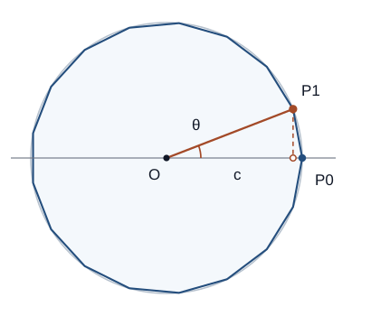

# SQC5 正多角形とGauss–Wantzelの定理

正三角形、正方形、正五角形は定規とコンパスで作れます。では正七角形はどうでしょう。正17角形はどうでしょう。辺の数を増やすほど難しくなる、という単純な話ではありません。**17角形は作図でき、7角形と9角形は作図できない**のです。

前章までの[作図可能数の特徴付け](../SQC3/index.md#prop-sqc3-tower-construction)は、平方根だけを有限回使えるという条件を与えました。しかし一般の多項式については、次数が2の冪であることは十分条件ではありません。正多角形には追加の対称性があるため、その場合だけ次数条件を必要十分条件へ強められます。その対称性を表すのが **1の根** と **円分体** です。

本章では正多角形から数への翻訳、原始根が満たす多項式の既約性、Galois群からの完全分類を証明します。最後に、正17角形の一つの頂点を平方根だけで指定する具体式を導きます。

<!-- definition-example-audit: strict -->

---

## 1. 正多角形を1の根で表す

原点を中心とする単位円上に正 $n$ 角形（整数 $n\ge3$）を置き、一つの頂点を $(1,0)$ に取ります。隣の頂点は角度 $\theta=2\pi/n$ の方向にあり、その座標は

$$
P_1=(\cos\theta,\sin\theta)
$$

です。複素数 $z=x+iy$ を平面の点 $(x,y)$ と同一視すると、$P_1$ は $z=\cos\theta+i\sin\theta$ で表されます。頂点を一つずつ回転した点は、その冪 $z^k$ です。

ここで重要なのは、$z^n=1$ となるだけでなく、$n$ 回より前には $1$ に戻らないことです。$n=6$ で $z=-1$ を選ぶと $z^6=1$ ですが、$z$ は2回ですでに戻るため、六角形の隣接頂点ではありません。この「最初に戻る回数」を明示します。

<!-- formal-statement-start -->
> **定義（1の原始n乗根）**
> 整数 $n\ge1$ に対し、複素数 $\zeta$ が次の条件を満たすとき、$\zeta$ を **1の原始 $n$ 乗根**という。

$$
\zeta^n=1,\qquad
\zeta^k\ne1\quad(1\le k<n).
$$

> 例えば $\zeta_n=\cos(2\pi/n)+i\sin(2\pi/n)$ は原始 $n$ 乗根である。
<!-- formal-statement-end -->

<!-- definition-example-start: def-sqc5-primitive-root -->
**定義の確認**

例えば $n=5$ では $\zeta_5^5=1$ であり、$1\le k<5$ に対して $k/5$ は整数でないため $\zeta_5^k\ne1$ です。対して $\zeta_5^2$ も原始5乗根ですが、$1$ は原始5乗根ではありません。

一般に $\zeta_n^a$ が初めて $1$ に戻る正の指数（**位数**）は $n/\gcd(a,n)$ です。これは $\zeta_n$ が原始根であることから

$$
(\zeta_n^a)^k=1
\iff n\mid ak
\iff \frac{n}{\gcd(a,n)}\mid k
$$

と分かるためです。したがって $\zeta_n^a$ が原始 $n$ 乗根となる条件は $\gcd(a,n)=1$ です。ここでは「$n$ 乗して $1$ になる」だけでなく、より小さい正の指数で $1$ に戻らないことも確認しました。
<!-- definition-example-end -->

原始根だけを集めると、$X^n-1$ から「より小さい約数の段階ですでに $1$ になる根」を取り除けます。この選別を多項式として記録します。$\varphi(n)$ は $1\le a\le n$ のうち $\gcd(a,n)=1$ となる整数の個数（Eulerのトーシェント関数）とします。

<!-- formal-statement-start -->
> **定義（円分多項式）**
> 整数 $n\ge1$ と1の原始 $n$ 乗根 $\zeta_n$ に対し、第 $n$ **円分多項式**を

$$
\Phi_n(X)=\prod_{\substack{1\le a\le n\\ \gcd(a,n)=1}}(X-\zeta_n^a)
$$

> と定める。その次数は $\varphi(n)$ であり、原始根 $\zeta_n$ の選び方には依存しない。
<!-- formal-statement-end -->

実際、別の原始根は $\eta=\zeta_n^b$（$\gcd(b,n)=1$）と書けます。$a$ が $n$ と互いに素な剰余類を動くとき、$ab$ も同じ剰余類を重複なく動くため、$\eta$ を使っても積の因子集合は変わりません。

<!-- definition-example-start: def-sqc5-cyclotomic -->
**定義の確認**

$n=5$ で確かめます。原始根は $\zeta_5,\zeta_5^2,\zeta_5^3,\zeta_5^4$ の四つなので、

$$
\Phi_5(X)=\frac{X^5-1}{X-1}=X^4+X^3+X^2+X+1.
$$

根の集合が複素数でも係数は整数です。一般にも、$X^n-1$ の根を**正確な位数**で分けると
<!-- definition-example-end -->

$$
X^n-1=\prod_{d\mid n}\Phi_d(X)
$$

となります。$\Phi_1(X)=X-1$ から始め、$n$ の真の約数の多項式が整数係数・最高次係数1であると仮定すると、その積で $X^n-1$ を割った商も、[多項式除法](../../../代数系/RNG/RNG4/index.md#thm-rng4-division-algorithm)で最高次係数が1の因子を順に引くため、整数係数です。これを約数について帰納すれば

$$
\Phi_n(X)\in\mathbb Z[X]
$$

が分かります。例えば $\Phi_9(X)=(X^9-1)/(X^3-1)=X^6+X^3+1$ で、次数は $\varphi(9)=6$ です。

### 1.1 正多角形の作図に必要なのは実部だけ

複素数の点そのものを「作図可能数」という実数の定義へ直接押し込む必要はありません。横座標と縦座標を扱い、両者が作れるかを確認すればよいのです。

<!-- formal-statement-start -->
> **命題（正n角形と実部の作図可能性）**
> 整数 $n\ge3$ を固定する。基準点 $O=(0,0)$、$I=(1,0)$ から出発し、[有限回の定規・コンパス作図](../SQC1/index.md#def-sqc1-finite-procedure)だけを許す。次の実数を置く。

$$
t_n=2\cos\left(\frac{2\pi}{n}\right).
$$

> このとき、正 $n$ 角形を作図できることと $t_n$ が作図可能であることは同値である。
<!-- formal-statement-end -->

### 証明の見取り図

頂点が作れれば垂線で横座標を取り出せます。逆に横座標が作れれば、正の平方根から縦座標を作れます。残りの頂点は複素数の積（実座標では四則演算）で有限回求められます。

<!-- proof-start -->
### 証明

**必要性。** 作図した正 $n$ 角形の二辺の垂直二等分線から外接円の中心を求め、その半径を $R>0$ とします。中心から一つの頂点へ向かう半直線を正の横軸に取り、隣の頂点を上半平面側に選べば、その横座標（中心を原点とする）は $x=R\cos(2\pi/n)$ です。[垂線と長さの移動](../SQC2/index.md#prop-sqc2-translate-segment)で符号付き射影長 $x$ を横軸に写せます。[四則演算の作図](../SQC2/index.md#prop-sqc2-field-operations)で非零の $R$ で割って $x/R=\cos(2\pi/n)$ を得、2倍して $t_n$ を得ます。ここでは辺の長さと外接円半径を混同していません。

**十分性。** $t_n$ が作図可能と仮定し、[四則演算の作図](../SQC2/index.md#prop-sqc2-field-operations)で $c=t_n/2$ を得ます。$n\ge3$ より $0<\theta=2\pi/n<\pi$ なので $s=\sin\theta>0$ です。$1-c^2=s^2\ge0$ だから、[非負平方根の作図](../SQC2/index.md#prop-sqc2-positive-square-root)により

$$
s=\sqrt{1-c^2}
$$

を作れます。よって $P_1=(c,s)$ は作図可能です。

さらに $P_k=(x_k,y_k)$ が得られれば、複素数 $(x_k+iy_k)(c+is)$ の実部・虚部を展開して

$$
x_{k+1}=cx_k-sy_k,\qquad
y_{k+1}=sx_k+cy_k
$$

となります。すべて四則演算なので、$P_0=(1,0)$ から $P_1,\ldots,P_{n-1}$ を有限回で得られます。$c+is=\zeta_n$ は原始 $n$ 乗根だから、これらは相異なる単位円上の等間隔の頂点です。順に直線で結べば正 $n$ 角形です。
<!-- proof-end -->

例えば $n=5$ では $t=\zeta_5+\zeta_5^{-1}$ と置き、$\Phi_5(\zeta_5)=0$ を $\zeta_5^2$ で割ると

$$
\left(\zeta_5^2+\zeta_5^{-2}\right)
+\left(\zeta_5+\zeta_5^{-1}\right)+1=0.
$$

$\zeta_5^2+\zeta_5^{-2}=t^2-2$ なので $t^2+t-1=0$ です。$t=2\cos72^\circ>0$ を選ぶと $t=(-1+\sqrt5)/2$ となり、正五角形が作図できます。この計算が一般の分類の小さな見本です。

## 2. 円分多項式の次数を本当に確定する

$\Phi_n$ は次数 $\varphi(n)$ の整数係数多項式ですが、これだけでは $\zeta_n$ を根とする[モニック既約多項式](../../../代数系/FLD/FLD1/index.md#def-fld1-minimal-polynomial)の次数が $\varphi(n)$ と分かりません。前章の三次式と同じく、既約性の確認が必要です。

<!-- formal-statement-start -->
> **定理（円分多項式の既約性）**
> 任意の整数 $n\ge1$ に対し $\Phi_n(X)$ は $\mathbb Q[X]$ 上既約である。従って任意の原始 $n$ 乗根 $\zeta_n$ について

$$
[\mathbb Q(\zeta_n):\mathbb Q]=\varphi(n).
$$
<!-- formal-statement-end -->

### 証明の見取り図

ある原始根を根とするモニック既約式 $f$ を取り、$n$ と互いに素な素数 $p$ を使って「$\zeta_n$ と $\zeta_n^p$ は必ず共役根」と示します。もし別の既約因子へ移るなら、係数を $p$ で割ったとき $X^n-1$ に重根ができてしまいます。しかし $p\nmid n$ なので重根はありません。

<!-- proof-start -->
### 証明

$\zeta=\zeta_n$ とし、その $\mathbb Q$ 上で $\zeta$ を根とするモニック既約式を $f(X)$ とします。$\zeta$ はモニック整係数多項式 $X^n-1$ の根であり、[RNG4の整係数と有理係数の既約性の対応](../../../代数系/RNG/RNG4/index.md#thm-rng4-gauss-irreducibility)により $f\in\mathbb Z[X]$ で、$f$ は $X^n-1$ のモニック因子です。

$p\nmid n$ を満たす素数 $p$ を一つ取ります。$\zeta^p$ も原始 $n$ 乗根です。仮に $f(\zeta^p)\ne0$ とすると、$\zeta^p$ を根とするモニック既約式 $g(X)\in\mathbb Z[X]$ は $f$ とは異なる $X^n-1$ のモニック既約因子です。

$g(\zeta^p)=0$ なので $g(X^p)$ は $\zeta$ を根に持ち、最小性により

$$
f(X)\mid g(X^p)\quad\text{in }\mathbb Q[X].
$$

モニック整係数多項式同士の割り算だから商も整数係数です。係数を素数 $p$ で還元し、上線を $\mathbb F_p[X]$ の像と書きます。$(a+b)^p$ の $a^{p-k}b^k$ の係数は、$p$ 個の因子から $k$ 個を選ぶ整数

$$
c_k=\frac{p(p-1)\cdots(p-k+1)}{1\cdot2\cdots k}
\qquad(1\le k<p)
$$

です。分母には素数 $p$ が現れず、分子には $p$ が現れるため、整数 $c_k$ は $p$ で割り切れます。よって標数 $p$ では $(a+b)^p=a^p+b^p$ となります。これを多項式の各項に繰り返し適用すると

$$
\overline f(X)\mid\overline{g(X^p)}
=\bigl(\overline g(X)\bigr)^p.
$$

$\overline f$ はモニック非定数式なので、これと $\overline g$ は共通の非定数既約因子 $h$ を持ちます。一方、$f\ne g$ は $X^n-1$ の**異なる**既約因子であるから $fg\mid X^n-1$ が $\mathbb Z[X]$ で成立します。還元後は $h^2\mid X^n-1$ となり重根が生じます。

ところが $\mathbb F_p[X]$ における、変数 $X$ に関する[形式微分](../../../代数系/FLD/FLD2/index.md#def-fld2-formal-diff-multiplicity)（ここで $'$ は $d/dX$ に相当する記法）は

$$
(X^n-1)'=nX^{n-1}
$$

であり、$p\nmid n$ より係数 $n$ は零でありません。$X^n-1$ の定数項は $-1$ なので $X$ と互いに素、従って

$$
\gcd(X^n-1,nX^{n-1})=1.
$$

これは[重根の形式微分判定](../../../代数系/FLD/FLD2/index.md#thm-fld2-repeated-root-gcd)により重根がないことを意味し、矛盾です。よって $f(\zeta^p)=0$ がすべての $p\nmid n$ で成立します。

次に $\gcd(a,n)=1$ とします。$a$ の素因数はすべて $n$ と互いに素です。上の議論は $f$ の**任意の原始根**にも適用でき、$\zeta^p$ が根になれば次の素因数を掛けた冪も根になります。これを繰り返すと $f(\zeta^a)=0$。したがって $f$ は $\Phi_n$ の $\varphi(n)$ 個の相異なる根をすべて持ちます。

$f$ はモニックで $\Phi_n$ を割るので、両者の次数は一致し $f=\Phi_n$ です。求める既約式の次数が $\varphi(n)$ になりました。
<!-- proof-end -->

ここで「$p\nmid n$」は外せません。$p\mid n$ なら $\zeta^p$ が原始根でなくなることがあり、さらに導関数 $nX^{n-1}$ が $\mathbb F_p$ で零になり、重根なしという矛盾が使えなくなります。

## 3. 正多角形を完全分類する

第 $n$ **円分体**とは $K=\mathbb Q(\zeta_n)$ のことです。$\zeta_n^a$ は $X^n-1$ の根なので、$K$ はこの多項式のすべての根を含み、標数0で根は相異なります。従って $K/\mathbb Q$ は有限Galois拡大です。Galois群は「原始根をどの共役根へ送れるか」で具体的に記述できます。

<!-- formal-statement-start -->
> **命題（円分体のGalois群）**
> 整数 $n\ge3$、原始 $n$ 乗根 $\zeta_n$、$K=\mathbb Q(\zeta_n)$ に対し、$K/\mathbb Q$ は有限Galois拡大であり、

$$
\operatorname{Gal}(K/\mathbb Q)
\simeq(\mathbb Z/n\mathbb Z)^\times,\qquad
\sigma_a(\zeta_n)=\zeta_n^a
$$

> が成り立つ。右辺は $n$ と互いに素な剰余類の**乗法群**であり、位数は $\varphi(n)$ で可換である。
<!-- formal-statement-end -->

### 証明の見取り図

自己同型は生成元 $\zeta_n$ の像で決まります。[円分多項式の既約性](#thm-sqc5-cyclotomic-irreducibility)により、原始根のすべてが実際に共役根となり、ちょうど $\varphi(n)$ 個の自己同型を生みます。

<!-- proof-start -->
### 証明

$K$ が $X^n-1$ の分解体であることと標数0の分離性から、[有限Galois拡大の定義](../../../代数系/FLD/FLD4/index.md#def-fld4-finite-galois)に適合します。

各 $\mathbb Q$-自己同型 $\sigma$ は $\zeta_n$ のモニック既約式 $\Phi_n$ の根へ $\zeta_n$ を送るので、像は $\zeta_n^a$（$\gcd(a,n)=1$）です。逆に、[円分多項式の既約性](#thm-sqc5-cyclotomic-irreducibility)により各 $\zeta_n^a$ は同じ既約式の根です。$\zeta_n\mapsto\zeta_n^a$ は $\mathbb Q$-埋め込み $K\to\mathbb C$ を定め、像も $K$ なので自己同型です。合成は

$$
(\sigma_a\circ\sigma_b)(\zeta_n)
=\sigma_a(\zeta_n^b)=\zeta_n^{ab}.
$$

よって群の積は剰余類の乗法と一致し、全単射です。右辺の乗法は可換だからGalois群も可換で、位数は $\varphi(n)$ です。
<!-- proof-end -->

### 3.1 なぜ2の冪だけで十分になるのか

前章の[「次数が2の冪」は必要条件に過ぎないという反例](../SQC3/index.md#prop-sqc3-quartic-counterexample)と違い、円分体ではGalois群が可換です。有限**可換**2群（元の総数が $2^r$ の可換群）には、指数2の部分群を一段ずつ取る列が必ず存在します。

その理由も確かめます。非自明な有限可換2群 $G$ を加法で書き、$2G=\{2g:g\in G\}$ を考えます。もし $2G=G$ なら $2^rG=G$ ですが、位数が $2^r$ の群ではすべての元に $2^rg=0$ が成立するため矛盾します。ゆえに $G/2G$ は非零の $\mathbb F_2$-ベクトル空間です。非零線形写像 $G/2G\to\mathbb F_2$ の核の逆像は指数2の部分群です。これを繰り返すと

$$
G=G_0\supset G_1\supset\cdots\supset G_r=\{1\},
\qquad [G_{j-1}:G_j]=2
$$

という列が得られます。指数2から、[有限Galois対応](../../../代数系/FLD/FLD4/index.md#thm-fld4-fundamental-galois)で固定体を逆順に並べると、それぞれ**二次拡大**になります。

ただし実数の作図には、複素数全体の塔ではなく**実二次拡大列**が必要です。複素共役 $c:\zeta_n\mapsto\zeta_n^{-1}$ が作る位数2の部分群 $H=\{1,c\}$ を使います。固定体 $K^H=K\cap\mathbb R$ に含まれる数はすべて実数で、$G/H$ も有限可換2群です。$G/H$ の部分群列を $G$ の部分群列へ引き戻せば

$$
G=G_0\supset\cdots\supset G_s=H
$$

となり、対応する固定体列は

$$
\mathbb Q=K^{G_0}\subset\cdots\subset K^{G_s}=K^H\subset\mathbb R,
\qquad [K^{G_j}:K^{G_{j-1}}]=2.
$$

これなら[作図可能性と実二次拡大列の定理](../../../代数系/FLD/FLD5/index.md#thm-fld5-constructible-quadratic-tower)を正しく適用できます。

### 3.2 どの整数が条件を満たすか

素数 $p$ について $p-1$ が2の冪なら、$p=2^m+1$ です。もし $m=2^s q$ と書いたとき $q>1$ が奇数なら、$A=2^{2^s}$ として

$$
2^m+1=A^q+1=(A+1)(A^{q-1}-A^{q-2}+\cdots-A+1)
$$

となり合成数です。従って素数となる可能性があるのは $m=2^s$ に限られます。この形の素数を一つの名前で呼びます。

<!-- formal-statement-start -->
> **定義（Fermat素数）**
> 非負整数 $s$ に対して $F_s=2^{2^s}+1$ が素数であるとき、その数を **Fermat素数**という。例えば $3,5,17,257,65537$ はFermat素数である。$2^{2^s}+1$ がすべて素数になる、という意味ではない。
<!-- formal-statement-end -->

<!-- definition-example-start: def-sqc5-fermat-prime -->
**定義の確認**

$s=0,1,2$ は順に $3,5,17$ であり、いずれも1と自分自身以外に正の約数を持たない素数です。一方 $s=5$ では

$$
2^{32}+1=4294967297=641\cdot6700417
$$

なので、Fermat数ではあってもFermat素数ではありません。
<!-- definition-example-end -->

<!-- formal-statement-start -->
> **定理（Gauss–Wantzelの定理）**
> 整数 $n\ge3$ に対して、単位長から出発する有限回の定規・コンパス作図で正 $n$ 角形を作図できるための必要十分条件は、次の同値な条件のいずれかが成り立つことである。
>
> 1. $\varphi(n)$ は2の冪である。
> 2. $n=2^a p_1p_2\cdots p_r$ と書ける。ただし $a,r\ge0$ は整数であり、$p_1,\ldots,p_r$ は**相異なる**Fermat素数である。
<!-- formal-statement-end -->

### 証明の見取り図

作図できれば $\zeta_n+\zeta_n^{-1}$ が作図でき、それが生成する体の次数 $\varphi(n)/2$ が2の冪になります。逆向きは、円分体の可換2群から**実二次拡大列**を作れることが核心です。最後にEulerのトーシェント関数を素因数分解します。

<!-- proof-start -->
### 証明

まず $t=\zeta_n+\zeta_n^{-1}=2\cos(2\pi/n)$、$K=\mathbb Q(\zeta_n)$ と置きます。$n\ge3$ なので $\zeta_n$ は非実数で、

$$
\zeta_n^2-t\zeta_n+1=0,\qquad
[K:\mathbb Q(t)]=2.
$$

後者の次数は、二次式から高々2であり、$\mathbb Q(t)\subset\mathbb R$ に $\zeta_n$ は属さないことから正確に2です。[円分多項式の既約性](#thm-sqc5-cyclotomic-irreducibility)から $[K:\mathbb Q]=\varphi(n)$ が分かります。ここで[拡大次数の塔の公式](../../../代数系/FLD/FLD1/index.md#thm-fld1-tower-law)を $K/\mathbb Q(t)/\mathbb Q$ に適用すると

$$
[\mathbb Q(t):\mathbb Q]
=\frac{[K:\mathbb Q]}{[K:\mathbb Q(t)]}
=\frac{\varphi(n)}{2}.
$$

**必要性。** 正 $n$ 角形が作図可能なら、[実部への帰着](#prop-sqc5-regular-polygon-real-part)により $t$ が作図可能です。[作図可能数の次数条件](../../../代数系/FLD/FLD5/index.md#cor-fld5-constructible-degree)から $\varphi(n)/2$ が2の冪です。$\varphi(n)$ は $n\ge3$ で偶数だから、$\varphi(n)$ も2の冪になります。

**十分性。** $\varphi(n)=2^r$ とします。[円分体のGalois群](#prop-sqc5-cyclotomic-galois)は位数 $2^r$ の可換群です。

複素共役の部分群を $H=\{1,c\}$ とします。前節で構成した $G/H$ の指数2の部分群列に[有限Galois対応](../../../代数系/FLD/FLD4/index.md#thm-fld4-fundamental-galois)を適用すると、$K^H$ までの実二次拡大列が存在します。

$t$ は実数なので $t\in K^H$ です。[実二次拡大列による作図の必要十分条件](../../../代数系/FLD/FLD5/index.md#thm-fld5-constructible-quadratic-tower)から $t$ が作図可能となります。最後に[実部への帰着](#prop-sqc5-regular-polygon-real-part)の逆向きを使い、正 $n$ 角形も作図できます。

**整数の分類。** $n=2^a\prod_{j=1}^m q_j^{e_j}$（$q_j$ は相異なる奇素数、$e_j\ge1$）と素因数分解します。$\varphi(n)$ は1から $n$ のうち、$n$ のどの素因数でも割り切れない数の個数です。$n$ を割る相異なる素数の集合を $S$ とすると、指定した素数 $p\in T\subset S$ のすべてで割り切れる数は $n/\prod_{p\in T}p$ 個です。これらの倍数を重複を補正しながら数えると

$$
\varphi(n)=
\sum_{T\subset S}(-1)^{|T|}
\frac{n}{\prod_{p\in T}p}
=n\prod_{p\mid n}\left(1-\frac1p\right).
$$

この式を上の素因数分解に適用して

$$
\varphi(n)=\varphi(2^a)
\prod_{j=1}^m q_j^{e_j-1}(q_j-1),
\qquad
\varphi(2^a)=
\begin{cases}
1 &(a=0,1),\\
2^{a-1} &(a\ge2).
\end{cases}
$$

この積が2の冪であるためには、各奇素数 $q_j$ の奇数因子 $q_j^{e_j-1}$ が1、つまり $e_j=1$ でなければなりません。また各 $q_j-1$ は2の冪でなければなりません。前節の因数分解より、後者を満たす奇素数はFermat素数に限ります。逆に奇素数因子が相異なるFermat素数なら上の積の各因子が2の冪なので、$\varphi(n)$ も2の冪です。
<!-- proof-end -->

この定理は任意の代数的数の作図可能性を「次数だけ」で判定しているわけではありません。**円分体のGalois群が可換**という特別な構造が十分性を支えます。例えば一般の既約四次式の実根には、[次数4でも作図不能な例](../SQC3/index.md#prop-sqc3-quartic-counterexample)があります。

## 4. 17角形を平方根だけで作る

分類定理から正17角形は作図可能ですが、「作図できる」という存在証明と、実際に必要な長さを取り出すことは別です。ここではGauss周期という、原始根の冪を**対称な組に分けた和**から、頂点の横座標を順番に二次方程式で取り出します。

$\zeta=\zeta_{17}$、$\theta=2\pi/17$ とし、次の四つの実数を考えます。指数は法17で読みます。

$$
\begin{aligned}
C&=\zeta+\zeta^4+\zeta^{13}+\zeta^{16}
 =2\cos\theta+2\cos4\theta,\\
D&=\zeta^2+\zeta^8+\zeta^9+\zeta^{15}
 =2\cos2\theta+2\cos8\theta,\\
E&=\zeta^3+\zeta^5+\zeta^{12}+\zeta^{14}
 =2\cos3\theta+2\cos5\theta,\\
F&=\zeta^6+\zeta^7+\zeta^{10}+\zeta^{11}
 =2\cos6\theta+2\cos7\theta.
\end{aligned}
$$

各組は $\zeta^k+\zeta^{-k}=2\cos(k\theta)$ の対でできているため実数です。四組の指数は1から16を重複なく覆います。まず $P=C+D$、$Q=E+F$ と置きます。

<!-- formal-statement-start -->
> **命題（正17角形のGauss周期による作図）**
> 原始17乗根 $\zeta=\cos(2\pi/17)+i\sin(2\pi/17)$ を取り、指数を法17で解釈して

$$
\begin{aligned}
C&=\zeta+\zeta^4+\zeta^{13}+\zeta^{16}, &
D&=\zeta^2+\zeta^8+\zeta^9+\zeta^{15},\\
E&=\zeta^3+\zeta^5+\zeta^{12}+\zeta^{14}, &
F&=\zeta^6+\zeta^7+\zeta^{10}+\zeta^{11},\\
P&=C+D,& Q&=E+F
\end{aligned}
$$

> と定める。これらは共役な根の対の和なので実数である。このとき $u=2\cos(2\pi/17)$ は次の有限回の非負平方根と四則演算で得られる。

$$
\begin{aligned}
P&=\frac{-1+\sqrt{17}}2,& Q&=\frac{-1-\sqrt{17}}2,\\
C&=\frac{P+\sqrt{P^2+4}}2,&
E&=\frac{Q+\sqrt{Q^2+4}}2,\\
u&=\frac{C+\sqrt{C^2-4E}}2.
\end{aligned}
$$

> したがって $\bigl(u/2,\sqrt{1-u^2/4}\bigr)$ は有限作図できる正17角形の隣接頂点である。
<!-- formal-statement-end -->

### 証明の見取り図

まず16個の冪を8個ずつに分けると $P,Q$ が二次式の根になります。次にそれぞれ4個ずつの $C,D,E,F$ へ分け、最後に2個ずつの $u$ と別の対へ分けます。各段階で「和と積」を具体的に計算することが、抽象的な二次拡大列を実際の長さへ翻訳する鍵です。

<!-- proof-start -->
### 証明

指数の集合を

$$
\begin{aligned}
R&=\{1,2,4,8,9,13,15,16\},\\
N&=\{3,5,6,7,10,11,12,14\}
\end{aligned}
$$

とします。$R$ は法17の乗法で閉じる位数8の部分群で、$N=3R$ です。全17乗根の和は $0$ だから $P+Q=\sum_{k=1}^{16}\zeta^k=-1$ です。

$PQ$ の積を展開すると、各項は $a\in R,b\in N$ について $\zeta^{a+b}$ の形です。$a+b\equiv0\pmod{17}$ は生じません。なぜなら $-1\in R$ なので $-a\in R$ ですが、$R$ と $N$ は交わらないからです。非零剰余 $c$ に対する組の数は $R$ の乗法作用により $c\in R$ 内、$c\in N$ 内でそれぞれ一定です。代表 $c=1,3$ では

| $c$ | $a\in R$ と $b=c-a\in N$ の組 |
|---|---|
| $1$ | $(4,14),(8,10),(13,5),(15,3)$ |
| $3$ | $(8,12),(9,11),(13,7),(15,5)$ |

となり、どちらも4組です。ゆえに各非零剰余がちょうど4回現れ、

$$
PQ=4\sum_{c=1}^{16}\zeta^c=-4.
$$

従って $P,Q$ は $X^2+X-4=0$ の根です。$P$ の方が正であることを確認します。$\theta=2\pi/17$ とすると

$$
\frac P2=\cos\theta+\cos2\theta+\cos4\theta+\cos8\theta
=\cos\theta-\cos(\pi/17)+\cos(4\pi/17)+\cos(8\pi/17).
$$

$|\cos x-\cos y|\le |x-y|$、$\cos(4\pi/17)>\cos(\pi/4)=\sqrt2/2$、$\cos(8\pi/17)>0$ なので $P/2>-\pi/17+\sqrt2/2>0$ です。従って $P=(-1+\sqrt{17})/2$、$Q=(-1-\sqrt{17})/2$ です。

次に $CD$ を展開します。各行は $a=1,4,13,16$、各列は $b=2,8,9,15$ とした $a+b$ の剰余です。

| $a\backslash b$ | $2$ | $8$ | $9$ | $15$ |
|---|---:|---:|---:|---:|
| $1$ | 3 | 9 | 10 | 16 |
| $4$ | 6 | 12 | 13 | 2 |
| $13$ | 15 | 4 | 5 | 11 |
| $16$ | 1 | 7 | 8 | 14 |

1から16がちょうど一度ずつ現れるので

$$
CD=\sum_{k=1}^{16}\zeta^k=-1.
$$

全指数を3倍すると集合 $C$ の指数は $E$ の指数へ、$D$ は $F$ の指数へ移ります。$\zeta\mapsto\zeta^3$ は[円分体の自己同型](#prop-sqc5-cyclotomic-galois)だから $EF=-1$ です。ゆえに

$$
C+D=P,\quad CD=-1,\qquad E+F=Q,\quad EF=-1.
$$

$C=2\cos\theta+2\cos4\theta>0$ なので、$C$ は $X^2-PX-1=0$ の正の根です。また

$$
E=2\cos3\theta+2\cos5\theta
=4\cos4\theta\cos\theta>0
$$

なので $E$ は $X^2-QX-1=0$ の正の根です。こうして命題の $C,E$ の平方根表示が得られます。

最後に $u=\zeta+\zeta^{-1}=2\cos\theta$、$v=\zeta^4+\zeta^{-4}=2\cos4\theta$ と置くと

$$
u+v=C,
\qquad uv=(\zeta+\zeta^{16})(\zeta^4+\zeta^{13})
=\zeta^5+\zeta^{14}+\zeta^3+\zeta^{12}=E.
$$

従って $u,v$ は $X^2-CX+E=0$ の根です。$0<\theta<4\theta<\pi/2$ だから $u>v>0$ で、$u$ は二次方程式の大きい方の根です。判別式は $(u-v)^2>0$ であり、

$$
u=\frac{C+\sqrt{C^2-4E}}2.
$$

この式は非負平方根を3段と、最初の $\sqrt{17}$ を使う有限式です。$0<u/2<1$ より $\sqrt{1-u^2/4}$ も非負平方根で得られます。[実部と正多角形の同値性](#prop-sqc5-regular-polygon-real-part)によって17個の頂点を有限回の四則演算から順に作れます。
<!-- proof-end -->

### 4.1 円上の頂点と平方根の対応

上の構成では $u/2$ が**最初の隣接頂点の横座標**であり、$\sqrt{1-u^2/4}$ がその縦座標です。以後の頂点は証明した回転の漸化式に $c=u/2$、$s=\sqrt{1-c^2}$ を代入して得ます。例えば

図の $P_0$ から $P_1$ への中心角が $\theta=2\pi/17$ です。破線は $P_1$ の横軸への射影で、横方向の距離が $c$、縦方向の距離が $s$ に対応します。ほかの15頂点も同じ角度で並び、次の漸化式から得られます。

$$
P_0=(1,0),\quad
P_1=(c,s),\quad
P_2=(c^2-s^2,2cs)=(2c^2-1,2cs).
$$

近似値での照合は

| 量 | 近似値 | 幾何上の役割 |
|---|---:|---|
| $P$ | $1.56155$ | 8個の根の和 |
| $C$ | $2.04948$ | 4個の根の和 |
| $E$ | $0.34415$ | $u$ と $v$ の積 |
| $u$ | $1.86494$ | 最初の頂点の横座標の2倍 |
| $c=u/2$ | $0.93247$ | 最初の頂点の横座標 |

です。数値はどの平方根の符号を選ぶかを確認する補助であり、**近似から作図可能性を証明しているのではありません**。証明は上の等式と非負平方根の有限作図で完結しています。

## 5. 具体的な辺の数を判定する

[Gauss–Wantzelの定理](#thm-sqc5-gauss-wantzel)を用いれば、試行錯誤の作図なしで判定できます。

| $n$ | $\varphi(n)$ | 素因数分解 | 結論 |
|---:|---:|---|---|
| $7$ | $6$ | 奇素数7はFermat素数でない | 作図不能 |
| $9$ | $6$ | $3^2$ に同じ奇素数が重複 | 作図不能 |
| $15$ | $8$ | $3\cdot5$（相異なるFermat素数） | 作図可能 |
| $17$ | $16$ | Fermat素数17 | 作図可能 |
| $20$ | $8$ | $2^2\cdot5$ | 作図可能 |

$n=9$ では「正三角形が作図できるなら3等分すれば9角形ができる」と言ってはいけません。その三等分がまさに許容作図で不可能になる場合があるためです。また $n=21=3\cdot7$ は $7$ がFermat素数でないので不能です。初期データに正7角形を先に与える、分度器を使う、といった問題変更とは区別します。

---

## 6. 演習：群・次数・平方根をつなぐ

### Level A：定義と判定の一段階

**SQC5-A1（原始根の判定）**
$n=12$ とし、$\zeta=\cos(2\pi/12)+i\sin(2\pi/12)$ とする。$\zeta^a$ が原始12乗根となる $a\in\{1,\ldots,12\}$ をすべて求めよ。

- Level: A

<!-- solution-start -->
**詳細解答**

$\zeta^a$ の位数は $12/\gcd(a,12)$ です。12になるのは $\gcd(a,12)=1$ のときだけです。1から12のうち2または3で割り切れないのは $1,5,7,11$ なので、答えは $\zeta,\zeta^5,\zeta^7,\zeta^{11}$ です。例えば $\zeta^4$ は位数 $12/4=3$ で原始12乗根ではありません。
<!-- solution-end -->

**SQC5-A2（円分多項式の具体例）**
$X^6-1$ の約数分解から $\Phi_3(X)$、$\Phi_6(X)$ を求め、いずれも次数が $\varphi(n)$ に一致することを確かめよ。

- Level: A

<!-- solution-start -->
**詳細解答**

$X^3-1=(X-1)(X^2+X+1)$ なので $\Phi_3=X^2+X+1$ です。また

$$
X^6-1=(X^3-1)(X^3+1)
=(X-1)(X^2+X+1)(X+1)(X^2-X+1).
$$

6の約数は1,2,3,6で、$\Phi_1=X-1$、$\Phi_2=X+1$ だから残る因子は $\Phi_6=X^2-X+1$ です。$\varphi(3)=2$、$\varphi(6)=2$ で、両方とも次数2に一致します。
<!-- solution-end -->

**SQC5-A3（トーシェント値）**
$n=7,9,15,17,20$ について $\varphi(n)$ を、各素因数の倍数を除く数え上げから求めよ。

- Level: A

<!-- solution-start -->
**詳細解答**

素数冪 $p^e$ に対して、$1,\ldots,p^e$ のうち $p$ の倍数は $p^{e-1}$ 個なので、$\varphi(p^e)=p^e-p^{e-1}=p^{e-1}(p-1)$ です。異なる素因数についても、本文の倍数の数え上げを適用します。

$$
\begin{aligned}
\varphi(7)&=7-1=6,\\
\varphi(9)&=3(3-1)=6,\\
\varphi(15)&=(3-1)(5-1)=2\cdot4=8,\\
\varphi(17)&=17-1=16,\\
\varphi(20)&=\varphi(4)\varphi(5)=2\cdot4=8.
\end{aligned}
$$

これらを2の冪と比べると7,9は不適合で15,17,20は適合します。
<!-- solution-end -->

**SQC5-A4（Fermat素数の指数）**
$m=6$、$p=2^m+1$ とする。$p$ が素数でないことを、一般の $m$ について使った因数分解と同じ形で示せ。

- Level: A

<!-- solution-start -->
**詳細解答**

$m=6=2\cdot3$ で、奇数因子3が残ります。$A=2^2=4$ とすれば

$$
2^6+1=A^3+1=(A+1)(A^2-A+1)
=5(16-4+1)=5\cdot13=65.
$$

両因子が1より大きいので65は合成数です。従って $p-1$ が2の冪という条件だけではなく、$p$ 自身の素数性を確かめる必要があります。
<!-- solution-end -->

**SQC5-A5（実部分体の次数）**
$n=5$ とし $t=\zeta_5+\zeta_5^{-1}$ とする。$t$ を根とする $\mathbb Q$ 上のモニック既約多項式と、$\mathbb Q(\zeta_5)$ および $\mathbb Q(t)$ の $\mathbb Q$ 上の次数を求めよ。

- Level: A

<!-- solution-start -->
**詳細解答**

第1節の[正五角形の計算](#prop-sqc5-regular-polygon-real-part)と同じ置き方で $\Phi_5(\zeta_5)=0$ を $\zeta_5^2$ で割ると

$$
(t^2-2)+t+1=0,\qquad t^2+t-1=0.
$$

判別式は $1+4=5$ で有理数の平方ではないので、この二次式は $\mathbb Q$ 上既約です。従って $[\mathbb Q(t):\mathbb Q]=2$。[円分多項式の既約性](#thm-sqc5-cyclotomic-irreducibility)から $[\mathbb Q(\zeta_5):\mathbb Q]=\varphi(5)=4$。また $\zeta_5$ は $\mathbb Q(t)$ 上 $X^2-tX+1$ の非実根だから拡大次数は2で、塔の公式も $4=2\cdot2$ と一致します。
<!-- solution-end -->

### Level B：二つ以上の論理を接続する

**SQC5-B1（正15角形と正9角形の対比）**
単位長からの有限作図で正15角形が可能で正9角形が不可能なことを、$\varphi(n)$ と奇素数因子の重複の両方から説明せよ。

- Level: B

<!-- solution-start -->
**詳細解答**

$15=3\cdot5$ で3と5は相異なるFermat素数です。$\varphi(15)=\varphi(3)\varphi(5)=2\cdot4=8=2^3$ なので、[Gauss–Wantzelの定理](#thm-sqc5-gauss-wantzel)から作図可能です。一方 $9=3^2$ では奇素数3が2回現れ、$\varphi(9)=3(3-1)=6$ に奇因子3が残ります。$\varphi(9)/2=3$ は[実部分体の次数](#thm-sqc5-gauss-wantzel)ですが、作図可能実数の次数は2の冪でなければならず、矛盾します。従って9角形は作図不能です。
<!-- solution-end -->

**SQC5-B2（17個の根を4組に分ける）**
第4節のGauss周期 $C,D$ を構成する指数集合を、それぞれ

$$
I_C=\{1,4,13,16\},\qquad I_D=\{2,8,9,15\}
$$

と書く。$a\in I_C$ と $b\in I_D$ を足した16個の剰余を計算し、**周期の積** $CD=-1$ を示せ。また $E=\zeta^3+\zeta^5+\zeta^{12}+\zeta^{14}$ が正である理由も示せ。

- Level: B

<!-- solution-start -->
**詳細解答**

まず $a\in I_C$、$b\in I_D$ に対して $a+b$ を法17で計算します。$a=1$ の行は $(3,9,10,16)$、$a=4$ の行は $(6,12,13,2)$、$a=13$ の行は $(15,4,5,11)$、$a=16$ の行は $(1,7,8,14)$ となります。1から16が一度ずつ現れるので

$$
CD=\sum_{a\in I_C,b\in I_D}\zeta^{a+b}
=\sum_{k=1}^{16}\zeta^k=-1.
$$

$E$ では指数が $\pm3,\pm5$ の対になり、$\theta=2\pi/17$ とおくと

$$
E=2\cos3\theta+2\cos5\theta
=4\cos4\theta\cos\theta.
$$

$4\theta=8\pi/17<\pi/2$、$\theta<\pi/2$ なので両余弦は正、従って $E>0$ です。$X^2-QX-1=0$ の二根は符号が異なるため、$E$ が正の根であるという平方根の符号選択まで正当化できます。
<!-- solution-end -->

**SQC5-B3（可換2群から実二次塔へ）**
$n=17$ に対し、$G=\operatorname{Gal}(\mathbb Q(\zeta_{17})/\mathbb Q)$ が位数16の可換群であることを確認し、複素共役の部分群 $H$ を使って、$2\cos(2\pi/17)$ が実二次拡大列に属することを説明せよ。特定の根号公式を先に使ってはならない。

- Level: B

<!-- solution-start -->
**詳細解答**

[円分体のGalois群](#prop-sqc5-cyclotomic-galois)より $G\simeq(\mathbb Z/17\mathbb Z)^\times$ で、位数は $\varphi(17)=16$、積は可換です。複素共役は $\zeta_{17}\mapsto\zeta_{17}^{-1}$ に対応する位数2の元なので $H=\{1,c\}$ は正規部分群です。従って $G/H$ は位数 $16/2=8$ の可換2群です。

第3節で示した可換2群の指数2の部分群の存在を3回適用し、

$$
G/H=J_0\supset J_1\supset J_2\supset J_3=\{H\}
$$

で各指数2の列を得ます。$G$ への逆像を $G_j$ とすれば、[Galois対応](../../../代数系/FLD/FLD4/index.md#thm-fld4-fundamental-galois)から

$$
\mathbb Q=K^{G_0}\subset K^{G_1}\subset K^{G_2}
\subset K^{G_3}=K^H\subset\mathbb R
$$

の各段が次数2です。$t=\zeta_{17}+\zeta_{17}^{-1}$ は複素共役で固定されるため $K^H$ に入ります。従って[実二次拡大列による判定](../../../代数系/FLD/FLD5/index.md#thm-fld5-constructible-quadratic-tower)から $t$ が作図可能です。この論法は根号の具体式を一切前提にしていません。
<!-- solution-end -->

**SQC5-B4（偶数倍の辺数と作図）**
整数 $n\ge3$ について正 $n$ 角形が作図可能なら正 $2n$ 角形も作図可能であることを示せ。逆向きも成り立つか説明し、$n=7$ の場合と照合せよ。

- Level: B

<!-- solution-start -->
**詳細解答**

正 $n$ 角形を作図できれば、中心 $O$ から隣接頂点 $A,B$ へ引いた半直線のなす角 $\theta=2\pi/n$ が作図できます。$OA=OB=R>0$ なので、$A$、$B$ を中心にともに半径 $R$ の円を描き、$O$ 以外の交点 $T$ を取ります。

$OT$ は $\triangle OAT$ と $\triangle OBT$ の三辺相等から角を二等分し、$\theta/2=\pi/n$ を構成します。$n\ge3$ なら $0<\theta<\pi$ なので、$T\ne O$ となる交点が存在します。

正 $2n$ 角形の隣接頂点を作るには、この半直線と中心 $O$、半径 $R$ の円との交点を取ります。代数的にも $\varphi(2n)$ は $\varphi(n)$ または $2\varphi(n)$ なので、2の冪性を保ちます。

逆に正 $2n$ 角形が作図できれば、頂点を一つおきに選ぶだけで正 $n$ 角形を得ます。従って両方向とも成り立ちます。$n=7$ は $\varphi(7)=6$ で作図不能だから、その2倍である正14角形も作図不能です。なお角の二等分線の構成は[有限作図操作](../SQC1/index.md#def-sqc1-finite-procedure)の範囲であり、角度目盛は使いません。
<!-- solution-end -->

### Level C：分類定理を出発点から使い直す

**SQC5-C1（素数冪と積から判定を構成する）**
整数 $n\ge3$ について、次を順に示せ。

1. 正 $n$ 角形が作図可能なら、$[\mathbb Q(2\cos(2\pi/n)):\mathbb Q]=\varphi(n)/2$ は2の冪である。
2. $\varphi(n)$ が2の冪なら、複素共役の固定体に至る実二次拡大列があり、正 $n$ 角形が作図可能である。
3. $n=3^a5^b2^c$（$a,b,c$ は非負整数、$n\ge3$）の作図可能条件を $a,b$ に関して完全に求め、$n=45$ と $n=40$ を判定せよ。

- Level: C

<!-- solution-start -->
**詳細解答**

**（1）** $\zeta=\zeta_n$、$t=\zeta+\zeta^{-1}$、$K=\mathbb Q(\zeta)$ とします。[円分多項式の既約性](#thm-sqc5-cyclotomic-irreducibility)より $[K:\mathbb Q]=\varphi(n)$。$n\ge3$ なので $\zeta$ は非実数ですが、$t$ は実数です。$\zeta$ は $X^2-tX+1$ の根だから $[K:\mathbb Q(t)]=2$。[拡大次数の塔の公式](../../../代数系/FLD/FLD1/index.md#thm-fld1-tower-law)を $K/\mathbb Q(t)/\mathbb Q$ に適用すると

$$
[\mathbb Q(t):\mathbb Q]=\varphi(n)/2.
$$

正 $n$ 角形が作図可能なら[実部の帰着](#prop-sqc5-regular-polygon-real-part)から $t$ が作図可能です。[作図可能数の次数条件](../../../代数系/FLD/FLD5/index.md#cor-fld5-constructible-degree)を適用して $\varphi(n)/2$ は2の冪となります。

**（2）** $\varphi(n)=2^r$ とします。[円分体のGalois群](#prop-sqc5-cyclotomic-galois)は位数 $2^r$ の可換群 $G$ です。複素共役の位数2の部分群 $H=\{1,c\}$ を取ります。

商群 $G/H$ は位数 $2^{r-1}$ の可換2群なので、指数2の部分群を反復して自明群へ至る列を作れます。それを $G$ に引き戻し、[Galois対応](../../../代数系/FLD/FLD4/index.md#thm-fld4-fundamental-galois)で固定体へ翻訳すると、$\mathbb Q$ から $K^H\subset\mathbb R$ までの各段2次の実拡大列になります。

$t$ は複素共役で固定されるので $t\in K^H$ です。[実二次塔の判定](../../../代数系/FLD/FLD5/index.md#thm-fld5-constructible-quadratic-tower)から $t$、続いて正 $n$ 角形が作図可能です。

**（3）** 3.2節の素因数の倍数を除く数え上げを用います。$a,b$ が正の場合、奇数因子から

$$
\varphi(3^a)=2\cdot3^{a-1},\qquad
\varphi(5^b)=4\cdot5^{b-1}.
$$

従って $a\ge2$ なら3、$b\ge2$ なら5という奇因子が $\varphi(n)$ に残り、作図不能です。逆に $a,b\in\{0,1\}$ なら奇素数の因子は高々3と5を一度ずつ含むだけで、それぞれの $p-1$ は2または4です。$2^c$ の寄与も2の冪なので、$\varphi(n)$ は2の冪です。条件は

$$
\boxed{a\le1,\qquad b\le1}
$$

です。$45=3^2\cdot5$ は $a=2$ で作図不能、$\varphi(45)=24$ に奇因子3が残ります。$40=2^3\cdot5$ は $a=0,b=1$ で作図可能、$\varphi(40)=16$ です。必要性と十分性を分けて確認しました。
<!-- solution-end -->

---

## 7. まとめ

1. 正 $n$ 角形は、実数 $2\cos(2\pi/n)$ が作図可能かという問題へ翻訳できる。
2. 円分多項式は既約で、原始 $n$ 乗根の次数は $\varphi(n)$。そのGalois群は可換群 $(\mathbb Z/n\mathbb Z)^\times$。
3. **正 $n$ 角形が作図可能 $\Longleftrightarrow \varphi(n)$ が2の冪 $\Longleftrightarrow n$ は2の冪と相異なるFermat素数の積。**
4. 17角形はGauss周期を二次式へ分割していくことで、横座標を平方根だけから具体的に作れる。

次に扱う円の面積の問題では、長さとして $\sqrt\pi$ を作図できるかが中心になります。正多角形の場合のような有限の円分体では扱えない数が現れるため、まず $\pi$ の無理性を確かめるところから始めます。
