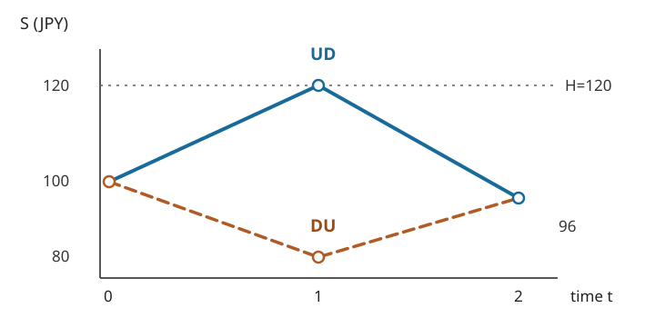

# U3-09 Barrier：knock-in / knock-out と監視頻度

<!-- definition-example-audit: strict -->

[European call](../U3-05/index.md#def-u3-05-european) は、満期の株価だけで受取額が決まりました。[Asian オプション](../U3-08/index.md#def-u3-08-asian-payoff) では途中の株価の和が必要でした。今度は「期間中、一度でも指定水準に触れたか」で契約が有効になったり、消滅したりする場合を考えます。必要なのは過去の株価を全部保存することではなく、**障壁に触れたかを表す一つの記録**です。

本講は有限二項市場で、満期現金決済の上側障壁を扱います。障壁への「到達」は観測する時刻によって変わり、観測していない時刻の株価は二項モデルだけからは分かりません。途中の連続的な価格経路を仮定する議論は、後の連続時間モデルで扱います。

## 1. いつ障壁を監視するかを先に決める

[多期間二項市場](../U3-03/index.md#def-u3-03-tree)で時点を $t=0,1,\ldots,N$、$N\ge1$ とします。初期株価 $S_0>0$ 円、各期の上昇・下落倍率を $u>d>0$、預金の**1期間あたり**の元利倍率を $R>0$ とします。無配当・取引費用なし・借入と空売り可能で、

$$
0<d<R<u,\qquad
q=\frac{R-d}{u-d}\in(0,1),\qquad B_t=R^t
$$

を仮定します。ここで $B_t$ は預金口座の価値であり、以下の**障壁水準 $H$** と区別します。1期間の長さは等しく、以下の数値例では通貨は円、年率換算・暦日換算は行いません。独立な上昇／下落枝に [評価用確率 $Q$](../U3-03/index.md#def-u3-03-path-measure) でそれぞれ $q$ と $1-q$ を割り当てます。$Q$ は将来の実現頻度を予測する確率 $P$ ではありません。

上側障壁 $H>S_0$ 円、行使価格 $K\ge0$ 円を選び、監視日を空でない集合 $M\subseteq\{0,\ldots,N\}$ に固定します。契約開始時に「日0も監視するか」、満期だけか途中も監視するかを指定することが不可欠です。本講では障壁への**接触 $S_j=H$ も到達に含め**、障壁を触れたときの追加支払（rebate）はありません。

<a id="def-u3-09-barrier-contract"></a>

<!-- formal-statement-start -->
> **定義（離散監視 Barrier call：knock-in と knock-out）**  
> 上記の $N$ 期間二項市場で $H>S_0>0$、$K\ge0$、空でない $M\subseteq\{0,\ldots,N\}$ を固定する。経路が監視日に上側障壁へ到達する事象とその指示値を

$$
A_M=\{\exists j\in M:S_j\ge H\},\qquad
I_M=\mathbf1_{A_M}
$$

> とする。満期 $N$ に一度だけ決済する上側障壁 **knock-in call** と **knock-out call** の受取額をそれぞれ

$$
X_N^{\mathrm{in}}=(S_N-K)_+I_M,\qquad
X_N^{\mathrm{out}}=(S_N-K)_+(1-I_M)
$$

> と定める。ただし $(x)_+=\max\{x,0\}$ とする。途中で追加の現金支払いはなく、ノックアウト後の復活もない。
<!-- formal-statement-end -->

<!-- definition-example-start: def-u3-09-barrier-contract -->
**定義の直接確認**：$S_0=100$ 円、$u=6/5$、$d=4/5$、$N=2$、$K=90$ 円、$H=120$ 円、$M=\{0,1,2\}$ とします。$UD$ と $DU$ は共に終値96円ですが、観測した株価列は異なります。

| 経路 | 観測株価列（円） | $I_M$ | 通常の call | knock-in | knock-out |
| --- | --- | ---: | ---: | ---: | ---: |
| $UU$ | $100,120,144$ | 1 | 54 | 54 | 0 |
| $UD$ | $100,120,96$ | 1 | 6 | 6 | 0 |
| $DU$ | $100,80,96$ | 0 | 6 | 0 | 6 |
| $DD$ | $100,80,64$ | 0 | 0 | 0 | 0 |

> $UD$ は時点1で**ちょうど120円**に触れます。満期96円でもノックアウトは復活せず、ノックインは有効のままです。$DU$ は一度も触れないため逆の結果です。満期株価だけで判定すると $UD$ と $DU$ を誤って同じ商品価値にしてしまいます。
<!-- definition-example-end -->

この2本の経路では、時点1に障壁へ触れるかどうかを確かめてください。



## 2. 到達済みの記録を状態に追加する

株価 $S_t$ だけでは過去の到達有無が分かりません。ただし今後の受取額を判定するには、一度触れたか否かの1ビットがあれば十分です。時点 $t$ までに監視した日のみを見ることに注意します。

<a id="def-u3-09-hit-state"></a>

<!-- formal-statement-start -->
> **定義（到達フラグと拡張状態）**  
> $S_0>0$、$H>S_0$、監視日集合 $M\subseteq\{0,\ldots,N\}$ の二項市場において、時点 $t$ までに観測された障壁到達フラグ $J_t\in\{0,1\}$ を

$$
J_t=\mathbf1_{\{\exists j\in M,\ j\le t:S_j\ge H\}}
$$

> とする。初期値は $J_0=\mathbf1_{\{0\in M,\ S_0\ge H\}}$。状態 $(S_t,J_t)=(s,a)$ の子状態は、$t<N$ に対して

$$
\begin{aligned}
(s,a)&\xrightarrow{U}(us,\ a\vee \mathbf1_{\{t+1\in M,\ us\ge H\}}),\\
(s,a)&\xrightarrow{D}(ds,\ a\vee \mathbf1_{\{t+1\in M,\ ds\ge H\}})
\end{aligned}
$$

> と定める。$\vee$ は0と1の論理和、すなわち大きい方の値を取る演算である。$J_N=I_M$ である。
<!-- formal-statement-end -->

これは監視しない時点に障壁判定を追加しない更新則です。いったん $a=1$ なら次の株価が低くてもフラグは1のままです。

<!-- definition-example-start: def-u3-09-hit-state -->
**定義の直接確認**：上の2期間例では $J_0=0$。最初の上枝は $S_1=120$ かつ $1\in M$ なので $(S_1,J_1)=(120,1)$、下枝は $(80,0)$ です。次に $UD$ では $96<120$ ですが $1\vee0=1$ なので $(S_2,J_2)=(96,1)$、$DU$ では $96<120$ かつ $0\vee0=0$ なので $(96,0)$ です。株価96円でも後退計算の二つの状態を統合できないことが確認できます。
<!-- definition-example-end -->

## 3. フラグ付き後退帰納と無裁定価格

[二項市場の条件付き平均と後退帰納](../U3-03/index.md#thm-u3-03-backward-conditional)は、次の二つの子の価値を $q$ と $1-q$ で重み付けし、$R$ で割る手順です。今回は子へ進むたびに到達フラグも更新します。

<a id="thm-u3-09-barrier-backward"></a>

<!-- formal-statement-start -->
> **定理（離散監視 Barrier の後退帰納価格）**  
> $N\ge1$、$S_0>0$、$0<d<R<u$ の無配当・無摩擦二項市場で、$H>S_0$、$K\ge0$、空でない $M\subseteq\{0,\ldots,N\}$、時点 $N$ 決済・rebate なしの Barrier call を考える。[到達フラグ](#def-u3-09-hit-state)の子を $(s_+,a_+)$ と $(s_-,a_-)$ と書く。満期価値を

$$
V_N^{\mathrm{in}}(s,a)=(s-K)_+a,\qquad
V_N^{\mathrm{out}}(s,a)=(s-K)_+(1-a)
$$

> と置き、$t=N-1,\ldots,0$ で両種類に共通の後退式

$$
V_t^{\ast}(s,a)
=\frac{qV_{t+1}^{\ast}(s_+,a_+)
 +(1-q)V_{t+1}^{\ast}(s_-,a_-)}{R},
\qquad \ast\in\{\mathrm{in},\mathrm{out}\}
$$

> を用いると、すべての到達可能状態で

$$
V_t^\ast(S_t,J_t)
=E_Q[R^{-(N-t)}X_N^\ast\mid\mathcal F_t]
$$

> が成り立つ。特に時点0の $V_0^\ast(S_0,J_0)$ はこの契約の一意な無裁定価格である。
<!-- formal-statement-end -->

**証明の見取り図**：満期ではフラグから受取額がそのまま得られます。時点 $t$ に履歴を固定すると、翌期の株価とフラグは二通りに決まり、条件付き平均を1期間割り引けばよいのです。経路依存であっても取引可能な資産は株式と預金の二つのままです。

<!-- proof-start -->
### 証明

固定した $t$ までの履歴から分かる情報を [$\mathcal F_t$](../U3-03/index.md#def-u3-03-information) とします。$J_t$ は時点 $t$ までの観測で決まるため $\mathcal F_t$ で既知です。満期 $t=N$ では $J_N=I_M$ なので、いずれの $\ast$ に対しても $V_N^\ast(S_N,J_N)=X_N^\ast$ です。また $X_N^\ast$ は $\mathcal F_N$ で既知であり、定理の等式は $R^0=1$ から成り立ちます。

時点 $t+1$ について等式を仮定し、時点 $t$ の状態 $(s,a)$ を固定します。上枝では $S_{t+1}=us$、$J_{t+1}=a_+$、下枝では $S_{t+1}=ds$、$J_{t+1}=a_-$ です。帰納仮定と、[反復条件付き期待値および二項条件付き平均](../U3-03/index.md#thm-u3-03-backward-conditional) を $R^{-(N-t)}X_N^\ast$ に適用すると

$$
\begin{aligned}
E_Q[R^{-(N-t)}X_N^\ast\mid\mathcal F_t]
&=\frac1R E_Q[
 E_Q[R^{-(N-t-1)}X_N^\ast\mid\mathcal F_{t+1}]
 \mid\mathcal F_t]\\
&=\frac1R E_Q[V_{t+1}^\ast(S_{t+1},J_{t+1})\mid\mathcal F_t]\\
&=\frac{qV_{t+1}^\ast(us,a_+)
 +(1-q)V_{t+1}^\ast(ds,a_-)}R\\
&=V_t^\ast(s,a).
\end{aligned}
$$

$Q$ の下で上・下枝の条件付き確率が $q,1-q$ であることと、子状態が既知の関数であることを第三行で使いました。有限木なので期待値はすべて有限で、この帰納法は $t=N-1$ から0まで適用できます。

[自己金融複製の構成](../U3-04/index.md#thm-u3-04-replication)は各履歴の二つの子の価値を株式・預金で同時に複製します。履歴によって保有量を変えることは許されるので経路依存は妨げになりません。[無裁定価格の一意性](../U3-04/index.md#thm-u3-04-unique-price)から、この後退計算の初期額が一意の無裁定価格です。
<!-- proof-end -->

### 2期間の価格を全経路から検算する

前節と同じ $S_0=100,u=6/5,d=4/5,R=21/20,K=90,H=120,N=2,M=\{0,1,2\}$ とします。[リスク中立確率](../U3-02/index.md#def-u3-02-risk-neutral) は

$$
q=\frac{21/20-4/5}{6/5-4/5}=\frac58,
\qquad 1-q=\frac38.
$$

各経路の $Q$-確率は $UU:25/64$、$UD:15/64$、$DU:15/64$、$DD:9/64$。第1節の満期受取額を割り引くと

$$
\begin{aligned}
\pi_0^{\mathrm{in}}
&=\frac{(25/64)54+(15/64)6}{(21/20)^2}
=\frac{(1350+90)/64}{441/400}
=\frac{1000}{49}\ \text{円},\\
\pi_0^{\mathrm{out}}
&=\frac{(15/64)6}{(21/20)^2}
=\frac{90}{64}\frac{400}{441}
=\frac{125}{98}\ \text{円}.
\end{aligned}
$$

後退法でも、時点1の上枝は既に到達しているため out 価値0、下枝は上子 $DU$ の満期6円・下子 $DD$ の満期0円から

$$
V_1^{\mathrm{out}}(80,0)
=\frac{(5/8)6+(3/8)0}{21/20}
=\frac{25}{7}\ \text{円}
$$

です。時点0では $[(5/8)0+(3/8)(25/7)]/(21/20)=125/98$ 円となり全経路法と一致します。

## 4. in/out parity は「同じ条件」の組に限る

一つの経路で障壁に触れれば in が受け取り、触れなければ out が受け取ります。二つの契約を組み合わせると障壁判定が不要になります。

<a id="prop-u3-09-in-out-parity"></a>

<!-- formal-statement-start -->
> **命題（Barrier の in/out parity）**  
> $N\ge1$、$S_0>0$、$0<d<R<u$ の二項市場で、同一の $K\ge0$、$H>S_0$、監視日集合 $M\subseteq\{0,\ldots,N\}$（空でない）、決済日 $N$、無配当・無摩擦・rebate なしの上側 knock-in call と knock-out call を考える。同じ条件の満期現金決済 European call の無裁定価格を $\pi_0^{\mathrm{vanilla}}$ とすると、

$$
\pi_0^{\mathrm{in}}+\pi_0^{\mathrm{out}}
=\pi_0^{\mathrm{vanilla}}
=R^{-N}E_Q[(S_N-K)_+]
$$

> が成り立つ。
<!-- formal-statement-end -->

**証明の見取り図**：経路を二つに重複なく分け、指示値 $I_M+(1-I_M)=1$ を受取額へ掛けます。単なる価格の偶然の一致ではなく、各経路での受取額の恒等式です。

<!-- proof-start -->
### 証明

[離散監視 Barrier call：knock-in と knock-out](#def-u3-09-barrier-contract)より、任意の満期経路 $\omega$ に対して

$$
\begin{aligned}
X_N^{\mathrm{in}}(\omega)+X_N^{\mathrm{out}}(\omega)
&=(S_N(\omega)-K)_+I_M(\omega)\\
&\quad +(S_N(\omega)-K)_+(1-I_M(\omega))\\
&=(S_N(\omega)-K)_+.
\end{aligned}
$$

右辺は [European call の受取額](../U3-05/index.md#def-u3-05-european) です。有限経路全体で同じ $Q$ を用い、期待値の線形性から

$$
R^{-N}E_Q[X_N^{\mathrm{in}}]+R^{-N}E_Q[X_N^{\mathrm{out}}]
=R^{-N}E_Q[(S_N-K)_+]
$$

を得ます。[後退帰納価格定理](#thm-u3-09-barrier-backward)と [European オプションの二項評価](../U3-05/index.md#prop-u3-05-valuation) がそれぞれの項を無裁定価格と同定します。
<!-- proof-end -->

2期間例の European call は

$$
\pi_0^{\mathrm{vanilla}}
=\frac{(25/64)54+(15/64)6+(15/64)6}{(21/20)^2}
=\frac{2125}{98}\ \text{円}.
$$

確かに $1000/49+125/98=2125/98$ 円です。一方、**in と out の監視日程が異なる**場合には $I_M+(1-I_{M'})$ は1とは限りません。rebate を out に追加した場合も追加受取額の分だけ恒等式が変わります。put についても受取額を共通の $(K-S_N)_+$ に置けば同じ証明が使えます。

## 5. 監視を増やすとどちらの価格が動くか

同じ基礎二項木で、監視日集合だけを $M_1\subseteq M_2$ とします。$M_2$ の方が観測時点が多いので、障壁に一度でも触れる経路の集合は広がります。ただし**観測日の間にどんな連続株価があったか**はこの二項市場では定義していません。

<a id="prop-u3-09-monitoring-order"></a>

<!-- formal-statement-start -->
> **命題（離散監視日追加による価格の単調性）**  
> $N\ge1$、$S_0>0$、$0<d<R<u$、$K\ge0$、$H>S_0$ の同一無配当二項市場で、$M_1\subseteq M_2\subseteq\{0,\ldots,N\}$ はともに空でない監視日集合とする。決済日 $N$、rebate なし、同じ European call 受取額を用いた上側障壁契約では

$$
\pi_0^{\mathrm{in}}(M_1)\le \pi_0^{\mathrm{in}}(M_2),
\qquad
\pi_0^{\mathrm{out}}(M_1)\ge \pi_0^{\mathrm{out}}(M_2)
$$

> が成り立つ。
<!-- formal-statement-end -->

**証明の見取り図**：同じ経路の同じ満期受取額に対し、到達事象の包含だけを比べます。確率の再較正や株価モデルの変更を同時に行うと、この単調性の比較にはなりません。

<!-- proof-start -->
### 証明

$M_1\subseteq M_2$ なので、ある $j\in M_1$ で $S_j\ge H$ なら同じ $j$ は $M_2$ にも含まれます。よって $A_{M_1}\subseteq A_{M_2}$、したがって全経路で

$$
I_{M_1}\le I_{M_2},\qquad
1-I_{M_1}\ge1-I_{M_2}.
$$

$G=(S_N-K)_+\ge0$ を同じ経路上で両辺に掛けると、$GI_{M_1}\le GI_{M_2}$ と $G(1-I_{M_1})\ge G(1-I_{M_2})$ を得ます。すべての $Q$-経路重みは非負、$R^{-N}>0$ なので、期待値を取ると価格の不等式が成立します。[離散監視 Barrier の後退帰納価格](#thm-u3-09-barrier-backward)により両辺は各契約の無裁定価格です。
<!-- proof-end -->

先ほどの $N=2$ の木で、**満期と開始だけ監視**する $M_1=\{0,2\}$ と、**全時点を監視**する $M_2=\{0,1,2\}$ を比較します。$UD$ は $S_0=100,S_2=96$ 円なので $M_1$ では未到達、しかし $S_1=120$ 円なので $M_2$ では到達です。

| 監視日 | 到達する経路 | in 価格（円） | out 価格（円） |
| --- | --- | ---: | ---: |
| $\{0,2\}$ | $UU$ | $1875/98$ | $125/49$ |
| $\{0,1,2\}$ | $UU,UD$ | $1000/49$ | $125/98$ |

$UD$ の受取額6円の現在価値は

$$
R^{-2}Q(UD)\,6
=\frac{400}{441}\frac{15}{64}6
=\frac{125}{98}\ \text{円}
$$

です。監視日を増やすと、まさにこの額が out から in へ移ります。各行で in + out = $2125/98$ 円です。

**離散監視と連続監視を混同しないこと**：$S_0=100,S_2=96$ という両端値だけから、時刻1の株価が120円に到達したかは判断できません。さらに二項時点の間については、100円から96円へ途中125円を経由する連続曲線も、障壁に触れない連続曲線も数学的には作れます。連続監視の価格は、時点間の価格経路にどんな重みを割り当てるかを別途定めなければ決まりません。単に監視日の集合を増やす場合の単調性と、連続時間へのモデル拡張は別の話です。

## 6. 同じ株価でも到達フラグによって価値が異なる

$N=3$、$S_0=100,u=6/5,d=4/5,R=21/20,K=90,H=120$、$M=\{0,1,2,3\}$ を考えます。時点2の $UD$ と $DU$ はどちらも $S_2=96$ 円です。しかし $UD$ は時点1で120円に触れて $J_2=1$、$DU$ は一度も触れず $J_2=0$ です。次の上枝では $S_3=96(6/5)=576/5=115.2<120$ 円、下枝は $384/5=76.8$ 円です。

<a id="prop-u3-09-stock-alone-fails"></a>

<!-- formal-statement-start -->
> **命題（満期前の同一株価でも Barrier 価値は異なる）**  
> 上記の3期間無配当・無摩擦市場で上側障壁の全時点監視、満期決済、rebate なしの knock-out call を考える。時点2の $UD$ と $DU$ は株価がともに96円だが、前者は到達済み $J_2=1$、後者は未到達 $J_2=0$ で、条件付き価値は

$$
V_2^{\mathrm{out}}(96,1)=0,\qquad
V_2^{\mathrm{out}}(96,0)=15\ \text{円}
$$

> である。したがって時点と株価だけを引数とする後退価値では一般に不十分である。
<!-- formal-statement-end -->

<!-- proof-start -->
### 証明

$UD$ では既に到達しており、[フラグ更新](#def-u3-09-hit-state)で翌期も $J_3=1$ となるため、どちらの子の out 受取額も0円です。したがって $V_2^{\mathrm{out}}(96,1)=0$ です。

$DU$ では $J_2=0$ で、次の上枝の115.2円も下枝の76.8円も障壁120円に届きません。上枝の受取額は $576/5-90=126/5$ 円、下枝の受取額は $(384/5-90)_+=0$ 円です。[後退価格定理](#thm-u3-09-barrier-backward)から

$$
V_2^{\mathrm{out}}(96,0)
=\frac{(5/8)(126/5)+(3/8)0}{21/20}
=\frac{126}{8}\frac{20}{21}
=15\ \text{円}.
$$

株価は等しくても条件付き価値は0円と15円の二つです。$J_2$ を捨てて節点を併合すると、この二つを同時に表すことはできません。
<!-- proof-end -->

同じ二経路の knock-in 価値は逆に $V_2^{\mathrm{in}}(96,1)=15$ 円、$V_2^{\mathrm{in}}(96,0)=0$ 円です。[in/out parity](#prop-u3-09-in-out-parity) は時点2の条件付き価値にも経路ごとに成立し、合計はどちらも通常の call 価値15円です。

## 7. 経路依存でも株式・預金で複製できる

障壁契約の価値が履歴に依存することは、取引資産を増やすことを意味しません。[自己金融複製](../U3-04/index.md#thm-u3-04-replication)と同じ二状態の連立方程式を、**到達フラグを更新した二つの子の価値**に対して解きます。

<a id="prop-u3-09-node-hedge"></a>

<!-- formal-statement-start -->
> **命題（Barrier の各節点における複製保有量）**  
> $0<d<R<u$、$S_0>0$ の無配当二項市場で、時点 $t<N$ の到達可能な状態 $(S_t,J_t)=(s,a)$、$s>0$ と、[Barrier の後退価値](#thm-u3-09-barrier-backward)の子の価値 $V^+=V_{t+1}(s_+,a_+)$、$V^-=V_{t+1}(s_-,a_-)$ を取る。時点 $t$ に株式を $\Delta_t$ 株、預金へ $\beta_t$ 円投じる複製保有量は唯一に定まり、

$$
\Delta_t=\frac{V^+-V^-}{s(u-d)},\qquad
\beta_t=\frac{uV^- -dV^+}{R(u-d)}
$$

> である。費用は $\Delta_ts+\beta_t=V_t(s,a)$ となる。
<!-- formal-statement-end -->

**証明の見取り図**：上・下の株価は $us,ds$、預金はどちらでも $R\beta_t$ 円です。二つの受取額への連立方程式を解き、条件付き平均価格と照合します。

<!-- proof-start -->
### 証明

複製条件は

$$
us\Delta_t+R\beta_t=V^+,\qquad
ds\Delta_t+R\beta_t=V^-.
$$

上式から下式を引き、$s(u-d)>0$ で割ると $\Delta_t=(V^+-V^-)/(s(u-d))$ です。下式に戻すと

$$
R\beta_t
=V^--ds\frac{V^+-V^-}{s(u-d)}
=\frac{uV^- -dV^+}{u-d}
$$

なので $\beta_t$ も一意です。初期費用は

$$
\begin{aligned}
s\Delta_t+\beta_t
&=\frac{R(V^+-V^-)+uV^- -dV^+}{R(u-d)}\\
&=\frac{(R-d)V^++(u-R)V^-}{R(u-d)}\\
&=\frac{qV^++(1-q)V^-}{R}=V_t(s,a).
\end{aligned}
$$

最後の等式は [離散監視 Barrier の後退帰納価格](#thm-u3-09-barrier-backward)です。時点ごとに状態を観測して組み直せば、[自己金融戦略](../U3-04/index.md#thm-u3-04-replication)により満期まで複製できます。
<!-- proof-end -->

2期間 knock-out の時点0では $V^+=0,V^-=25/7$ 円です。したがって

$$
\Delta_0=\frac{-25/7}{100(2/5)}=-\frac5{56},\qquad
\beta_0=\frac{(6/5)(25/7)}{(21/20)(2/5)}=\frac{500}{49}\ \text{円}.
$$

時点0費用は $100(-5/56)+500/49=125/98$ 円。上枝では $120(-5/56)+(21/20)(500/49)=0$ 円、下枝では $80(-5/56)+(21/20)(500/49)=25/7$ 円となり、両子の価値に一致します。負の株式保有量は、仮定で許された空売りです。

## 8. 計算量とブラウザでの再現

時点 $t$ に上昇が $k$ 回なら株価は次の形です。

$$
S_t=S_0u^kd^{t-k},\qquad k=0,1,\ldots,t.
$$

したがって異なる株価は高々 $t+1$ 種。到達フラグは0/1の2種しかなく、**拡張状態 $(S_t,J_t)$ は高々 $2(t+1)$ 種**です。同じ状態なら子の状態と将来受取額も同じなので、後退価値を再利用できます。

層をすべて保存する素朴な動的計画の時間・記憶量の上界は

$$
\sum_{t=0}^{N}2(t+1)=(N+1)(N+2)=O(N^2)
$$

です。次層だけ保持すれば記憶量を $O(N)$ にできます。一方、全経路列挙は $2^N$ 経路をそれぞれ $N$ 回更新するので $O(N2^N)$ 時間です.

[barrier_tree_check.py](assets/barrier_tree_check.py) は Python 標準ライブラリの有理数を使い、全経路列挙と $(t,S_t,J_t)$ の後退帰納を**別々の実装**で比較します。上記2期間の2種類の監視日程と、3期間の同一株価・異なるフラグを分数まで照合します。乱数を使わず初期乱数値の指定は不要で、浮動小数点の丸め誤差もありません。

次の実行欄の「このページで実行」から、公開しているこの Python ソースを **Pyodide Worker によりブラウザ内で直接実行**できます。ローカルへの Python インストールは不要です。初回は実行環境の読み込みに通信が必要で、ブラウザの制限により実行できない場合は出力済みの表と式で検算できます。$N=2,3$ の軽い整数・分数演算のみ行い、外部 Python パッケージ、ネットワーク API、市場データは使用しません。

```python-file-lab
# lab-id: U3-09-BROWSER-CHECK
# lab-title: Barrier の監視日・in/out parity・後退帰納を有理数で検証
# lab-file: textbook/volumes/dream_thater/応用系/U/U3-09/assets/barrier_tree_check.py
# timeout-ms: 15000
# lab-preset: 本文の監視日程と価格を一括検算 |
```

ローカルでの追加検証は Python 3.10 以上を用い、章ディレクトリで `python3 assets/barrier_tree_check.py`、自動テストは `python3 -m unittest discover -s assets/tests -v` と実行します。入力・出力・境界値の一覧は [実行手順](assets/README.md) に記します。

## 9. 演習と詳細解答

特記しない限り、円建て・無配当・無摩擦・1期間倍率 $R=21/20$ の二項市場、上側障壁への**等号を含む到達**、満期一括決済・rebate なしとします。必要な数値と監視日を問題ごとに示します。

<a id="ex-u3-09-a1"></a>

### 演習 U3-09-A1：終値は同じでも到達有無は違う
- Level: A

次の call を考える。

$$
S_0=100,\quad u=6/5,\quad d=4/5,\quad N=2,\quad
H=120,\quad K=90,\quad M=\{0,1,2\}.
$$

$UD$ と $DU$ の $(S_2,J_2)$ を求め、knock-in / knock-out の満期受取額をそれぞれ計算せよ.

<!-- solution-start -->
**詳細解答**：[到達フラグの更新](#def-u3-09-hit-state)から、$UD$ は $100\to120\to96$ 円なので時点1に障壁へ到達します。よって $(S_2,J_2)=(96,1)$ です。

$DU$ は $100\to80\to96$ 円なので到達せず、$(S_2,J_2)=(96,0)$ です。通常の call 受取額は両方で $(96-90)_+=6$ 円です。

[離散監視 Barrier call の受取額](#def-u3-09-barrier-contract)に代入すると、$UD$ は in 6円・out 0円、$DU$ は in 0円・out 6円となります。
<!-- solution-end -->

<a id="ex-u3-09-a2"></a>

### 演習 U3-09-A2：全経路で in/out の価格を求める
- Level: A

$S_0=100,u=6/5,d=4/5,R=21/20,N=2,H=120,K=90,M=\{0,1,2\}$ の場合、$q$、in/out および通常の call の時点0価格を計算して parity を確かめよ。

<!-- solution-start -->
**詳細解答**：[評価用確率](../U3-02/index.md#def-u3-02-risk-neutral)は $q=(21/20-4/5)/(6/5-4/5)=5/8$ です。$UU,UD,DU,DD$ の確率はそれぞれ $25/64,15/64,15/64,9/64$。in 受取額は $54,6,0,0$ 円なので、$R^{-2}=400/441$ を掛けると

$$
\pi_0^{\mathrm{in}}=\frac{400}{441}\left(\frac{25\cdot54+15\cdot6}{64}\right)
=\frac{400}{441}\frac{1440}{64}
=\frac{1000}{49}.
$$

out 受取額は $0,0,6,0$ 円なので $\pi_0^{\mathrm{out}}=(400/441)(90/64)=125/98$ 円です。通常の call は $54,6,6,0$ 円なので $\pi_0^{\mathrm{vanilla}}=(400/441)(1530/64)=2125/98$ 円。[in/out parity](#prop-u3-09-in-out-parity)は $1000/49+125/98=2125/98$ 円と成立します。
<!-- solution-end -->

<a id="ex-u3-09-a3"></a>

### 演習 U3-09-A3：途中を監視しない
- Level: A

A2 と同じ市場で $M=\{0,2\}$ に変更する。$UD$ の到達判定を行い、knock-out 価格を求めよ。

<!-- solution-start -->
**詳細解答**：$UD$ の観測する時点は $S_0=100,S_2=96$ 円であり、時点1の120円は監視日ではないので $J_2=0$ です。未到達の $DU$ も out 受取額6円、$UU$ は時点2の144円で到達し out 0円、$DD$ は通常 call 自体が0円です。$Q(UD)=Q(DU)=(5/8)(3/8)=15/64$ より

$$
\pi_0^{\mathrm{out}}(\{0,2\})
=\frac{400}{441}\left(\frac{15\cdot6+15\cdot6}{64}\right)
=\frac{125}{49}\ \text{円}.
$$

全時点監視の $125/98$ 円より高いのは、途中の $UD$ を取りこぼすためです。[監視日の価格単調性](#prop-u3-09-monitoring-order)に合致します。
<!-- solution-end -->

<a id="ex-u3-09-a4"></a>

### 演習 U3-09-A4：1期間の複製戦略
- Level: A

A2 の2期間 knock-out について、時点1の上枝価値 $V^+=0$ 円、下枝価値 $V^-=25/7$ 円を所与として、時点0に必要な株式 $\Delta_0$ 株と預金 $\beta_0$ 円、初期費用を求めよ。両枝の受取額も確認せよ。

<!-- solution-start -->
**詳細解答**：[節点複製の命題](#prop-u3-09-node-hedge)では $s=100,u-d=2/5,R=21/20$ を代入します。

$$
\Delta_0=\frac{0-25/7}{100(2/5)}=-\frac5{56},\qquad
\beta_0=\frac{(6/5)(25/7)-(4/5)0}{(21/20)(2/5)}
=\frac{500}{49}.
$$

初期費用は $100(-5/56)+500/49=-125/14+500/49=(-875+1000)/98=125/98$ 円です。翌期の預金額は $(21/20)(500/49)=75/7$ 円。上枝では $120(-5/56)+75/7=-75/7+75/7=0$ 円、下枝では $80(-5/56)+75/7=-50/7+75/7=25/7$ 円で、両枝で一致します。
<!-- solution-end -->

<a id="ex-u3-09-a5"></a>

### 演習 U3-09-A5：「超える」と「触れる」は違う
- Level: A

A2 の市場で障壁判定を誤って $S_j>120$ とした場合（全時点監視）、$UD$ の out 受取額と時点0 out 価格はいくらに変わるか。元の $S_j\ge120$ の定義と比較せよ。

<!-- solution-start -->
**詳細解答**：$UD$ の最大値は時点1のちょうど120円なので、厳密な不等号 $>$ の下では未到達となり out 受取額は $(96-90)_+=6$ 円です。$DU$ も未到達で6円、$UU$ は満期144円で超えるので out 0円、$DD$ の通常 call は0円です。したがって out 価格は

$$
\frac{400}{441}\left(\frac{15}{64}6+\frac{15}{64}6\right)
=\frac{125}{49}\ \text{円}
$$

となり、$S_j\ge120$ での $125/98$ 円より $125/98$ 円高くなります。**等号を含む契約条件**は単なる書式ではなく、価格を変える条件です。
<!-- solution-end -->

<a id="ex-u3-09-b1"></a>

### 演習 U3-09-B1：parity が崩れる契約を作る
- Level: B

任意の $N\ge1$ の二項市場で in/out parity を経路ごとに証明せよ。次に knock-out に「一度も到達しなかった場合だけ満期に2円を追加支払する」rebate を付けたときの合計受取額を求めよ。$N=2,M=\{0,1,2\},H=120$ の基準例で追加価値を計算せよ。

<!-- solution-start -->
**詳細解答**：[Barrier 契約の定義](#def-u3-09-barrier-contract)で $G=(S_N-K)_+$、$I=I_M\in\{0,1\}$ と置くと、in と out は $GI$ と $G(1-I)$ です。和は $G[I+(1-I)]=G$ で、各経路において通常の call と一致します。同一測度で期待値を取れば [parity 命題](#prop-u3-09-in-out-parity)になります。

rebate 付き out は $G(1-I)+2(1-I)$ 円なので、in と合わせた受取額は $G+2(1-I)$ 円です。基準例では未到達経路は $DU,DD$ で、確率は $15/64+9/64=24/64=3/8$。追加の現在価値は

$$
\frac{1}{R^2}E_Q[2(1-I)]
=\frac{400}{441}\cdot2\cdot\frac38
=\frac{100}{147}\ \text{円}.
$$

この追加額が0でないため、合計は通常 call の $2125/98$ 円より $100/147$ 円大きくなります。
<!-- solution-end -->

<a id="ex-u3-09-b2"></a>

### 演習 U3-09-B2：監視集合の包含と価格差
- Level: B

同一の $N$ 期間二項市場、同じ非負満期受取額 $G=(S_N-K)_+$ と $M_1\subseteq M_2$ を仮定して、in と out の価格単調性を導け。A2 の例の $M_1=\{0,2\}$、$M_2=\{0,1,2\}$ で、各価格差を分数で計算し、parity と両立することを示せ。

<!-- solution-start -->
**詳細解答**：任意の経路について $M_1$ のいずれかの日に触れれば、その日は $M_2$ にも含まれます。従って $I_{M_1}\le I_{M_2}$ であり、$G\ge0$ から $GI_{M_1}\le GI_{M_2}$、$G(1-I_{M_1})\ge G(1-I_{M_2})$。同じ正の $Q$-重みと $R^{-N}>0$ を掛けて足すと [監視日単調性](#prop-u3-09-monitoring-order)を得ます。

数値では $M_1$ の in/out は $1875/98,250/98$ 円、$M_2$ は $2000/98,125/98$ 円です。in の増分は $(2000-1875)/98=125/98$ 円、out の減分は $(250-125)/98=125/98$ 円で逆符号です。それぞれの合計は $2125/98$ 円で、同じ監視条件どうしの [parity](#prop-u3-09-in-out-parity) を満たします。
<!-- solution-end -->

<a id="ex-u3-09-b3"></a>

### 演習 U3-09-B3：同株価・異なる条件付き価格
- Level: B

$N=3,S_0=100,u=6/5,d=4/5,R=21/20,K=90,H=120,M=\{0,1,2,3\}$。時点2の $UD,DU$ のフラグを求め、各経路から出る上・下の満期株価、out 受取額、および時点2 out 価値を計算せよ。in 価値も求めよ。

<!-- solution-start -->
**詳細解答**：$UD$ は120円に触れたので $(S_2,J_2)=(96,1)$、$DU$ は触れていないので $(96,0)$ です。両状態の次期株価は $96(6/5)=576/5$ 円と $96(4/5)=384/5$ 円です。前者は120円未満で通常 call 受取額 $576/5-90=126/5$ 円、後者は90円未満で0円です。

$UD$ はフラグ1を維持し out 受取額は両枝0円、in 受取額は $126/5,0$ 円。$DU$ は両枝とも障壁に触れず out 受取額が $126/5,0$ 円、in 受取額が両枝0円です。[後退帰納](#thm-u3-09-barrier-backward)で共通の正の価値は

$$
\frac{(5/8)(126/5)+(3/8)0}{21/20}
=\frac{63/4}{21/20}=15\ \text{円}.
$$

したがって $UD$ は out 0円・in 15円、$DU$ は out 15円・in 0円です。株価だけではこの差を記録できません。
<!-- solution-end -->

<a id="ex-u3-09-b4"></a>

### 演習 U3-09-B4：状態圧縮で何が減るか
- Level: B

$N$ 期間の無配当二項木において、上昇が $k$ 回である時点 $t$ の株価を表し、フラグ付き Barrier 後退計算の状態種類数の上界を導け。全経路列挙と動的計画の時間計算量を比較し、Asian の累積和状態と違う点を述べよ。

<!-- solution-start -->
**詳細解答**：乗算は順序を入れ替えられるので、時点 $t$ までに上昇 $k$ 回、下落 $t-k$ 回なら $S_t=S_0u^kd^{t-k}$ 円です。$k=0,\ldots,t$ の $t+1$ 通りしかないため、株価種類数は高々 $t+1$ です。到達フラグは0または1で、各株価に最大2種類の状態があるから $(S_t,J_t)$ は高々 $2(t+1)$ 種です。各状態の子価値は二つで、結果を保存すれば、全層を評価する仕事量は

$$
\sum_{t=0}^{N}2(t+1)
=2\frac{(N+1)(N+2)}2
=(N+1)(N+2)=O(N^2)
$$

です。全経路列挙は $2^N$ 本あり、各経路の観測判定を $N$ 回行うので $O(N2^N)$ 時間です。[Asian の累積和状態](../U3-08/index.md#def-u3-08-augmented-state)は同株価でも多種類の和を取り得ますが、障壁の過去情報は二値のフラグに圧縮できます。すべての履歴で同じ株価とフラグなら、以後の受取額と後退価値も同じため統合できます。
<!-- solution-end -->

<a id="ex-u3-09-c1"></a>

### 演習 U3-09-C1：監視契約の一式価格と複製
- Level: C

$S_0=100,u=6/5,d=4/5,R=21/20,N=2,K=90,H=120$ 円、$Q(U)=q$ の無配当・無摩擦二項市場を考える。障壁への接触は到達に含み、rebate はなく、満期 $N$ に現金決済する。

1. 4経路の満期株価・$Q$-確率・$M=\{0,1,2\}$ での到達判定・通常 call と in/out の受取額を表にまとめよ。
2. 全時点監視での in/out/vanilla の価格を分数で求め、in/out parity を経路単位と価格単位で確認せよ。
3. $M'=\{0,2\}$ だけに変更し、どの経路で判定が変わるか、in/out 価格とその差を示せ。
4. 全時点監視の out を、時点0の株式・預金で次期まで複製し、その両枝受取額を検算せよ。二項市場が時点間の連続監視価格まで決定するかも答えよ。

<!-- solution-start -->
**詳細解答**：まず $q=(R-d)/(u-d)=(21/20-4/5)/(6/5-4/5)=5/8$、$1-q=3/8$、$R^{-2}=400/441$ です。[到達フラグ](#def-u3-09-hit-state)は各経路の監視日を順に調べます。

| 経路 | $(S_0,S_1,S_2)$（円） | 確率 | $I_M$ | vanilla | in | out |
| --- | --- | ---: | ---: | ---: | ---: | ---: |
| $UU$ | $(100,120,144)$ | $25/64$ | 1 | 54 | 54 | 0 |
| $UD$ | $(100,120,96)$ | $15/64$ | 1 | 6 | 6 | 0 |
| $DU$ | $(100,80,96)$ | $15/64$ | 0 | 6 | 0 | 6 |
| $DD$ | $(100,80,64)$ | $9/64$ | 0 | 0 | 0 | 0 |

全確率は $(25+15+15+9)/64=1$ です。各行で in + out = vanilla と確認できます。これを経路確率で重み付けすると

$$
\begin{aligned}
E_Q[X_N^{\mathrm{in}}]&=(25\cdot54+15\cdot6)/64=45/2,\\
E_Q[X_N^{\mathrm{out}}]&=15\cdot6/64=45/32,\\
E_Q[G]&=(25\cdot54+15\cdot6+15\cdot6)/64=765/32.
\end{aligned}
$$

割引すると $\pi_0^{\mathrm{in}}=(45/2)(400/441)=1000/49$ 円、$\pi_0^{\mathrm{out}}=(45/32)(400/441)=125/98$ 円、$\pi_0^{\mathrm{vanilla}}=(765/32)(400/441)=2125/98$ 円です。[parity](#prop-u3-09-in-out-parity)は $(2000+125)/98=2125/98$ 円となります。

$M'$ では時点1を監視しないため $UD$ だけが到達から未到達に変わります。$UU$ は満期144円で触れ、$DU,DD$ は元から未到達です。従って in 価格は $UU$ だけの寄与で

$$
\pi_0^{\mathrm{in}}(M')=\frac{400}{441}\frac{25\cdot54}{64}
=\frac{1875}{98}\ \text{円},
$$

out 価格は $UD,DU$ の2本から

$$
\pi_0^{\mathrm{out}}(M')=\frac{400}{441}\frac{15\cdot6+15\cdot6}{64}
=\frac{125}{49}\ \text{円}.
$$

in は $2000/98-1875/98=125/98$ 円減り、out は $250/98-125/98=125/98$ 円増えます。$M'$ でも価格合計は $2125/98$ 円です。

最後に全時点監視の out の時点1の上枝は0円です。下枝は $DU$ で6円・$DD$ で0円を受け取るので $V_1(D)=[(5/8)6+(3/8)0]/(21/20)=25/7$ 円です。[複製保有量](#prop-u3-09-node-hedge)に $s=100$、$V^+=0$、$V^-=25/7$ を代入して

$$
\Delta_0=-\frac5{56}\ \text{株},\qquad
\beta_0=\frac{500}{49}\ \text{円}.
$$

時点0費用は $100(-5/56)+500/49=125/98$ 円、上枝価値は $120(-5/56)+(21/20)(500/49)=0$ 円、下枝価値は $80(-5/56)+(21/20)(500/49)=25/7$ 円です。複製条件を両子で検証しました。

この有限二項市場は時点0,1,2の株価しか定めず、時点間で120円以上を通過したかという連続監視の事象は定義されません。連続監視価格を出すには、その区間の価格過程と条件付き到達確率などを新たに規定する必要があります。
<!-- solution-end -->

## 10. まとめと次講

Barrier 契約の中心は、**どの時点を監視し、一度でも障壁へ触れたか**を分けることです。到達フラグを株価へ添えれば有限木の後退計算を行えます。満期・障壁・監視日・rebate 条件を揃えた in/out parity と、監視日追加による価格の単調性は、実装を検算する強い手掛かりになります。

次の U3-10 では、この二値の到達フラグに代えて、途中の最大値・最小値を記録する Lookback オプションへ進みます。
