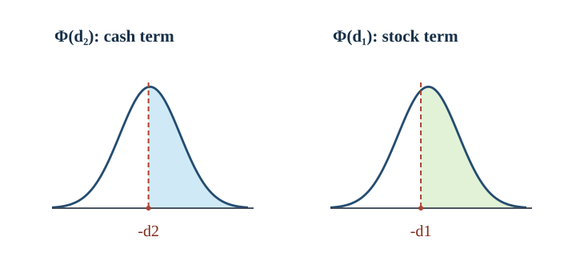

# U3-18 Black–Scholes 閉形式と正規積分

[前講のリスク中立評価関数](../U3-17/index.md#def-u3-17-valuation)では、満期支払額 $g(S_T)$ を正規密度で積分すれば BSM 方程式の解が得られました。しかし、満期に折れ目を持つ欧州型 call/put では、積分を数値的に計算するだけでなく、**二つの標準正規累積分布関数**にまとめられます。どの領域を積分し、なぜ正規化指標が二つ現れるのでしょうか。

本講では行使事象を標準正規変数の不等式へ変換し、指数重み付き正規密度の平方完成を一段ずつ行います。得た式を [無裁定の put–call parity](../U3-05/index.md#thm-u3-05-parity)、[自己金融デルタ複製](../U3-16/index.md#thm-u3-16-bsm-replication)、正規積分、[CRR 木](../U3-11/index.md#def-u3-11-crr)で照合し、満期・低変動率など公式の分母が消える極限を別に扱います。

## 1. 対象と、二つの正規化指標を作る理由

期間は年、金額は円です。無配当の株式 $S$ と銀行預金を持つ、摩擦のない市場を考えます。利率 $r\in\mathbb R$ は年$^{-1}$、変動率 $\sigma>0$ は年$^{-1/2}$ の**定数**で、期間 $T>0$、評価時刻 $0\le t<T$、株価 $s>0$、行使価格 $K>0$ とします。満期のみ権利を行使する [欧州型 call/put](../U3-05/index.md#def-u3-05-european) の支払額は、それぞれ $(S_T-K)_+$、$(K-S_T)_+$ です。ここで $x_+=\max(x,0)$ です。

[リスク中立測度の構成](../U3-15/index.md#thm-u3-15-risk-neutral-measure)により $Q$ 下で $dS_u=rS_u\,du+\sigma S_u\,dW_u^Q$、$S_t=s$ です。[GBM の陽解](../U3-14/index.md#thm-u3-14-explicit-gbm)を使い、$\tau=T-t>0$ と標準正規変数 $Z=(W_T^Q-W_t^Q)/\sqrt{\tau}$ を置けば

$$
S_T=s\exp\left((r-\tfrac12\sigma^2)\tau+\sigma\sqrt{\tau}\,Z\right),
\qquad Z\sim N(0,1).
$$

以降、$S_T$ は初期状態 $(t,s)$ から出発する $Q$ 下の満期株価 $S_T^{t,s}$（[前講の評価関数](../U3-17/index.md#def-u3-17-valuation)での記法）の略記です。$E_Q[\cdot]$ もこの初期状態での期待値を表し、$Q(S_T>K\mid S_t=s)$ は同じ初期状態から見た行使確率です。

call が正の支払額を持つのは $S_T>K$ のときだけです。両辺の対数を取り、$\sigma\sqrt{\tau}>0$ で割ると

$$
S_T>K
\ \Longleftrightarrow\
Z>\frac{\log(K/s)-(r-\sigma^2/2)\tau}{\sigma\sqrt{\tau}}.
$$

この境界を短く書くため、まず「行使する確率」の指標 $d_2$ を作り、指数重み $S_T$ を掛けると正規密度が横にずれるので $d_1$ も用意します。

<a id="def-u3-18-normal-indices"></a>

<!-- formal-statement-start -->
> **定義（Black–Scholes の正規化指標）**  
> $s,K,\sigma,\tau>0$、$r\in\mathbb R$ に対し、次の無次元量を定める。

$$
d_2=\frac{\log(s/K)+(r-\sigma^2/2)\tau}{\sigma\sqrt{\tau}},
\qquad
d_1=d_2+\sigma\sqrt{\tau}
=\frac{\log(s/K)+(r+\sigma^2/2)\tau}{\sigma\sqrt{\tau}}.
$$

> 標準正規密度とその累積分布関数を

$$
\phi(z)=\frac{e^{-z^2/2}}{\sqrt{2\pi}},
\qquad
\Phi(x)=\int_{-\infty}^{x}\phi(z)\,dz
$$

> と書く。
<!-- formal-statement-end -->

<!-- definition-example-start: def-u3-18-normal-indices -->
**定義の確認**：$s=K=100$ 円、$r=0.03$ 年$^{-1}$、$\sigma=0.20$ 年$^{-1/2}$、$\tau=1$ 年なら、$\log(s/K)=0$、$\sigma\sqrt{\tau}=0.20$ です。従って $d_2=(0.03-0.02)/0.20=0.05$、$d_1=0.05+0.20=0.25$。対数は同じ金額単位の比 $s/K$ にしか取らず、分子・分母とも無次元です。行使領域は $Z>-0.05$ です。
<!-- definition-example-end -->

標準正規分布の対称性 $\phi(-z)=\phi(z)$ により $\Phi(-x)=1-\Phi(x)$ です。よって上の変換と合わせると

$Z$ は $Q$ 下の標準正規変数であり、$W_T^Q-W_t^Q$ は時刻 $t$ までの情報と独立です。従って、実確率測度 $P$ に切り替えることなく

$$
\begin{aligned}
Q(S_T>K\mid S_t=s)
&=Q(Z>-d_2\mid S_t=s)\\
&=\int_{-d_2}^{\infty}\phi(z)\,dz
=\Phi(d_2).
\end{aligned}
$$

ここで $\Phi(d_2)$ は「満期に権利を行使する $Q$ 確率」であり、$\Phi(d_1)$ とは一般に異なります。

## 2. 株価が掛かった正規積分を平方完成する

正規密度に $e^{az}$ を掛けたときは、平方完成で密度の中心を $a$ だけ移せます。これは「単に確率を掛ける」操作ではなく、**株価で重み付けした期待値**を計算するための要点です。

<a id="lem-u3-18-tilted-tail"></a>

<!-- formal-statement-start -->
> **補題（指数重み付き正規尾積分）**  
> 任意の $a,b\in\mathbb R$ について、次が成り立つ。

$$
\int_b^\infty e^{az}\phi(z)\,dz
=e^{a^2/2}\Phi(a-b),
\qquad
\int_{-\infty}^b e^{az}\phi(z)\,dz
=e^{a^2/2}\Phi(b-a).
$$
<!-- formal-statement-end -->

**証明の見取り図**：指数の $az-z^2/2$ を平方完成し、$y=z-a$ と変数を置き直します。

<!-- proof-start -->
### 証明

まず

$$
az-\frac{z^2}{2}
=-\frac{(z-a)^2}{2}+\frac{a^2}{2}
$$

なので $e^{az}\phi(z)=e^{a^2/2}\phi(z-a)$ です。従って $y=z-a$ とおくと

$$
\begin{aligned}
\int_b^\infty e^{az}\phi(z)\,dz
&=e^{a^2/2}\int_b^\infty\phi(z-a)\,dz\\
&=e^{a^2/2}\int_{b-a}^\infty\phi(y)\,dy\\
&=e^{a^2/2}[1-\Phi(b-a)]
=e^{a^2/2}\Phi(a-b).
\end{aligned}
$$

下側積分では $y=z-a$ とすると下端 $-\infty$ は変わらず、上端 $b$ は $b-a$ へ移ります。従って

$$
\begin{aligned}
\int_{-\infty}^b e^{az}\phi(z)\,dz
&=e^{a^2/2}\int_{-\infty}^{b-a}\phi(y)\,dy\\
&=e^{a^2/2}\Phi(b-a).
\end{aligned}
$$

$a=0$ の場合は普通の正規尾確率へ戻ります。
<!-- proof-end -->

この補題を $a=\sigma\sqrt{\tau}$、$b=-d_2$ として用いると、$a-b=d_1$ です。$S_T$ が掛かる項には $\Phi(d_1)$ が現れ、現金の $K$ が掛かる項には $\Phi(d_2)$ が現れます。



図は前節の数値例 $d_2=0.05,d_1=0.25$ を表示しています。左の尾面積は $\Phi(d_2)$、右の尾面積は **平方完成して密度を平行移動した後**の $\Phi(d_1)$ です。二つの面積を同一の確率と読み替えてはいけません。

## 3. call と put の閉形式

<a id="thm-u3-18-black-scholes"></a>

<!-- formal-statement-start -->
> **定理（無配当 Black–Scholes call/put 価格公式）**  
> $T>0$、$0\le t<T$、$s,K>0$、$r\in\mathbb R$、$\sigma>0$ とする。無配当・定数金利・定数変動率の上記の完備な BSM 市場で、満期にそれぞれ $(S_T-K)_+$、$(K-S_T)_+$ を支払う欧州型 call と put の無裁定価格は、$\tau=T-t$ と[正規化指標](#def-u3-18-normal-indices)を使って

$$
\boxed{C(t,s)=s\Phi(d_1)-Ke^{-r\tau}\Phi(d_2)}
$$

$$
\boxed{P(t,s)=Ke^{-r\tau}\Phi(-d_2)-s\Phi(-d_1)}
$$

> である。いずれも $t<T$ では $C^{1,2}$ 級の BSM PDE の解で、満期では各支払額へ連続に接続する。期待値に使うのはリスク中立測度 $Q$ であり、実確率測度 $P$ とは異なる。なお価格関数 $P(t,s)$ の $P$ は put の略であり、確率測度を表す記号ではない。
<!-- formal-statement-end -->

**見取り図**：支払額を「株価項 − 行使価格項」に分け、それぞれの積分を確率と指数重み付き確率に変換します。put は下側積分でも直接求め、最後に parity で両者を照合します。

<!-- proof-start -->
### 証明

[前講の期待値からの古典解定理](../U3-17/index.md#thm-u3-17-fk-existence)を適用できるのは、$g_C(x)=(x-K)_+$ と $g_P(x)=(K-x)_+$ が $x>0$ で連続、かつ $0\le g_C(x)\le x$、$0\le g_P(x)\le K$ なので多項式成長を満たすためです。従って両価格は以下の割引期待値に等しく、$t<T$ で滑らかです。

$$
C=e^{-r\tau}E_Q[(S_T-K)_+],
\qquad
P=e^{-r\tau}E_Q[(K-S_T)_+].
$$

**call の計算。** $m=(r-\sigma^2/2)\tau$、$a=\sigma\sqrt{\tau}>0$、$b=-d_2=(\log(K/s)-m)/a$ と置きます。正の支払は $Z>b$ でだけ生じますから、

$$
\begin{aligned}
C
&=e^{-r\tau}\int_b^\infty(se^{m+az}-K)\phi(z)\,dz\\
&=s e^{-r\tau+m}\int_b^\infty e^{az}\phi(z)\,dz
  -Ke^{-r\tau}\int_b^\infty\phi(z)\,dz.
\end{aligned}
$$

第1項に[指数重み付き正規尾積分補題](#lem-u3-18-tilted-tail)を $a=\sigma\sqrt{\tau},b=-d_2$ で適用します。$m+a^2/2=(r-\sigma^2/2)\tau+\sigma^2\tau/2=r\tau$ なので、

$$
s e^{-r\tau+m}e^{a^2/2}\Phi(a-b)
=s\Phi(d_1).
$$

第2項は $\int_b^\infty\phi=1-\Phi(b)=\Phi(d_2)$ です。差を取ると $C=s\Phi(d_1)-Ke^{-r\tau}\Phi(d_2)$ です。

**put の計算。** put の支払は $Z<b$ で正です。したがって

$$
\begin{aligned}
P
&=e^{-r\tau}\int_{-\infty}^{b}(K-se^{m+az})\phi(z)\,dz\\
&=Ke^{-r\tau}\Phi(b)
-s e^{-r\tau+m}\int_{-\infty}^b e^{az}\phi(z)\,dz.
\end{aligned}
$$

補題の**下側**積分を使えば、第2項は $s\Phi(b-a)$ です。$b=-d_2,b-a=-d_1$ として

$$
P=Ke^{-r\tau}\Phi(-d_2)-s\Phi(-d_1).
$$

最後に $\Phi(x)+\Phi(-x)=1$ より

$$
C-P=s[\Phi(d_1)+\Phi(-d_1)]
-Ke^{-r\tau}[\Phi(d_2)+\Phi(-d_2)]
=s-Ke^{-r\tau}.
$$

これは[無配当の put–call parity](../U3-05/index.md#thm-u3-05-parity)の連続時間版と一致します。前講の定理による PDE・満期連続性と、[多項式成長クラスでの一意性](../U3-17/index.md#prop-u3-17-uniqueness)を合わせて主張を得ます。自己金融複製の具体的な保有量は次節で確認します。
<!-- proof-end -->

**数値例**：$s=K=100$ 円、$r=0.03$ 年$^{-1}$、$\sigma=0.20$ 年$^{-1/2}$、$\tau=1$ 年では $d_1=0.25,d_2=0.05$、$\Phi(0.25)\approx0.598706326$、$\Phi(0.05)\approx0.519938806$ です。従って

$$
\begin{aligned}
C&=100(0.598706326)-100e^{-0.03}(0.519938806)
 \approx 9.413403384\ \text{円},\\
P&=C-100+100e^{-0.03}
 \approx 6.457956739\ \text{円}.
\end{aligned}
$$

利率 $r$ の単位は年$^{-1}$、$r\tau$ は無次元です。価格の二項はともに円です。有限の $\tau$ では、権利行使の $Q$ 確率が約 $0.519939$ であっても call 価格は「その確率 × 現在株価」ではありません。行使時の株価の大きさも重みに入るからです。

## 4. デルタ、複製、価格の上下界

閉形式を株価 $s$ で微分する際は $d_1,d_2$ の $s$ 依存を無視できません。ただし、正規密度同士に重要な恒等式があります。

<a id="prop-u3-18-delta"></a>

<!-- formal-statement-start -->
> **命題（call/put のデルタと密度恒等式）**  
> 上の定理の条件で、$t<T$ の株価偏微分は

$$
\frac{\partial C}{\partial s}=\Phi(d_1),
\qquad
\frac{\partial P}{\partial s}=\Phi(d_1)-1=-\Phi(-d_1).
$$

> また、導出に必要な密度恒等式は

$$
s\phi(d_1)=Ke^{-r\tau}\phi(d_2)
$$

> である。$B_t=e^{rt}$ とすれば自己金融複製の株式保有はデルタ $\Delta=v_s$ 株、預金単位は $\psi=(v-s\Delta)/B_t$ である。
<!-- formal-statement-end -->

**見取り図**：二つの $\phi$ 項は偶然消えるのではありません。$d_1^2-d_2^2$ を計算すると、ちょうど割引係数と株価比に変換できます。

<!-- proof-start -->
### 証明

$d_1=d_2+\sigma\sqrt{\tau}$ を使い、

$$
\begin{aligned}
d_1^2-d_2^2
&=(d_1-d_2)(d_1+d_2)\\
&=\sigma\sqrt{\tau}\left(
\frac{2\log(s/K)+2r\tau}{\sigma\sqrt{\tau}}\right)\\
&=2\log(s/K)+2r\tau.
\end{aligned}
$$

従って正規密度の比は

$$
\frac{\phi(d_1)}{\phi(d_2)}
=\exp\left(-\frac{d_1^2-d_2^2}{2}\right)
=\frac{K}{s}e^{-r\tau}.
$$

$s>0$ を掛ければ密度恒等式を得ます。$d_1,d_2$ はともに $\partial_sd_i=1/(s\sigma\sqrt{\tau})$ だから、連鎖律により

$$
\begin{aligned}
C_s
&=\Phi(d_1)+s\phi(d_1)\frac1{s\sigma\sqrt{\tau}}
-Ke^{-r\tau}\phi(d_2)\frac1{s\sigma\sqrt{\tau}}\\
&=\Phi(d_1).
\end{aligned}
$$

$P=C-s+Ke^{-r\tau}$ を $s$ で微分すれば $P_s=C_s-1$ です。

複製への接続も確かめます。第1項の微分から $0<C_s<1$ かつ $-1<P_s<0$ であり、両デルタは有界です。両価格は[期待値からの BSM 古典解](../U3-17/index.md#thm-u3-17-fk-existence)であり、満期 payoff は線形成長、デルタは有界です。よって [自己金融複製の十分条件](../U3-16/index.md#thm-u3-16-bsm-replication)に適合します。$v=\Delta s+\psi B_t$ の価値恒等式から $\psi=(v-s\Delta)/B_t$ が得られ、初期費用は上記の $C$ または $P$ です。
<!-- proof-end -->

**保有量の解釈**：call は株価が上がるほど価値が増え、put はその逆です。例えば上の数値例では call のデルタは約 $0.598706$ 株、put のデルタは約 $-0.401294$ 株です。このデルタは $\Phi(d_2)$（行使確率）ではありません。

<a id="prop-u3-18-bounds"></a>

<!-- formal-statement-start -->
> **命題（無配当欧州型オプションの価格範囲）**  
> 上の仮定の下で、$t<T$ の call/put 価格はそれぞれ

$$
(s-Ke^{-r\tau})_+\le C(t,s)\le s,
\qquad
(Ke^{-r\tau}-s)_+\le P(t,s)\le Ke^{-r\tau}.
$$
<!-- formal-statement-end -->

<!-- proof-start -->
### 証明

任意の実数 $x$ について $(x-K)_+\ge x-K$、かつ $0\le(x-K)_+\le x$（$x>0$）です。$Q$ 期待値を取り、[GBM の一次モーメント](../U3-14/index.md#prop-u3-14-moments)から $e^{-r\tau}E_Q[S_T]=s$ を代入すると

$$
C\ge s-Ke^{-r\tau},\qquad 0\le C\le s.
$$

この二つから call の下界が従います。put では各標本 $x=S_T>0$ について $(K-x)_+\ge K-x$ と $0\le(K-x)_+\le K$ をそれぞれ割引期待値に移して

$$
P\ge Ke^{-r\tau}-e^{-r\tau}E_Q[S_T]=Ke^{-r\tau}-s,
\qquad 0\le P\le Ke^{-r\tau}
$$

を得ます。従って $(Ke^{-r\tau}-s)_+\le P\le Ke^{-r\tau}$ です。負金利 $r<0$ でも $e^{-r\tau}>0$ なので同じ論証が成立します。
<!-- proof-end -->

価格上界は権利行使価格に対する単なる直感ではなく、**各標本での支払額の大小関係**を割引期待値へ移したものです。

## 5. 満期・変動率・株価の境界で何が起きるか

公式には $\sigma\sqrt{\tau}$ が分母にあります。従って $\tau=0$ や $\sigma=0$ を **$d_1,d_2$ に直接代入してはいけません**。支払額と確率変数の極限から計算します。

<a id="prop-u3-18-limits"></a>

<!-- formal-statement-start -->
> **命題（call/put の代表的な境界極限）**  
> $s,K>0,r\in\mathbb R$ は固定、$\sigma>0$ とする。$C,P$ は上の定理の価格とする。
>
> **（1）満期極限**：$\tau\downarrow0$ では

$$
C\to(s-K)_+,\qquad P\to(K-s)_+.
$$

> **（2）ゼロ変動率極限**：$\tau>0$ を固定して $\sigma\downarrow0$ では

$$
C\to(s-Ke^{-r\tau})_+,\qquad
P\to(Ke^{-r\tau}-s)_+.
$$

> **（3）株価端点**：$\tau>0,\sigma>0$ を固定すると

$$
\lim_{s\downarrow0}C=0,\quad
\lim_{s\downarrow0}P=Ke^{-r\tau},\quad
\lim_{s\to\infty}(C-s)=-Ke^{-r\tau},\quad
\lim_{s\to\infty}P=0.
$$
<!-- formal-statement-end -->

**見取り図**：満期では対数正規変数が現在株価 $s$ に集まり、$\sigma\downarrow0$ では将来株価が確定値 $se^{r\tau}$ に集まります。どちらも積分の極限と期待値交換を裏付けてから支払額を計算します。

<!-- proof-start -->
### 証明

同じ $Z\sim N(0,1)$ を固定した確率空間上に

$$
X_{\tau,\sigma}
=s\exp((r-\sigma^2/2)\tau+\sigma\sqrt{\tau}Z)
$$

を構成します。$\tau\downarrow0$（$\sigma$ 固定）では $X_{\tau,\sigma}\to s$、$\sigma\downarrow0$（$\tau$ 固定）では $X_{\tau,\sigma}\to se^{r\tau}$ がほとんど確実に成り立ちます。どちらの場合もパラメータを上限のある区間に制限すると $X_{\tau,\sigma}$ は定数倍の $e^{M|Z|}$（有限 $M$）以下で抑えられ、その期待値は有限です。実際、[正規尾積分補題](#lem-u3-18-tilted-tail)を上下で足すと $E_Q[e^{aZ}]=e^{a^2/2}$ であり、$Z$ の対称性と合わせて

$$
E_Q[e^{M|Z|}]\le E_Q[e^{MZ}]+E_Q[e^{-MZ}]=2e^{M^2/2}<\infty.
$$

call・put の支払関数は連続で、絶対値が $X_{\tau,\sigma}+K$ 以下なので [Lebesgue の優収束定理](../../../解析系/F0/F0-00D2B/index.md#thm-f0-00d2b-01)で期待値を交換できます。割引因子も連続ですから（1）と（2）が従います。

（3）の $s\downarrow0$ では、$X_{\tau,\sigma}=sY$、$Y>0$ は $s$ と独立で $E_Q[Y]=e^{r\tau}$ です。$0\le C\le s$ より $C\to0$、[parity](../U3-05/index.md#thm-u3-05-parity)で $P=C-s+Ke^{-r\tau}\to Ke^{-r\tau}$ です。

$s\to\infty$ では put payoff $(K-sY)_+$ が各 $Y>0$ で0に収束し、$K$ 以下なので同じ[優収束定理](../../../解析系/F0/F0-00D2B/index.md#thm-f0-00d2b-01)から $P\to0$。同じ parity から $C-s=P-Ke^{-r\tau}\to -Ke^{-r\tau}$ を得ます。
<!-- proof-end -->

**折れ目の注意**：$s=K$、$\tau\downarrow0$ のとき、$d_1,d_2$ はどちらも0へ向かい、$\Phi(d_i)\to1/2$ です。しかし call の価格は $K/2-K/2=0$ へ向かいます。「満期直前の行使確率が約半分」から「満期価値が半額」とはなりません。

## 6. 正規積分と CRR 木による独立な数値照合

閉形式とは別の経路で計算すると、指数係数、行使領域の向き、割引の位置を検証できます。[CRR 木の定義](../U3-11/index.md#def-u3-11-crr)で、$h=\tau/N$、$u=e^{\sigma\sqrt h}$、$d=e^{-\sigma\sqrt h}$、$R=e^{rh}$、$q=(R-d)/(u-d)$ とします。$d<R<u$ を満たす $N$ のときだけ $q\in(0,1)$ になり、後退計算が評価用確率として有効です。

標準正規積分では $Z>-d_2$ でのみ call が正です。固定した $s=K=100,r=0.03,\sigma=0.2,\tau=1$ の比較は次の通りです（小数は表示桁で丸め）。

| 方法 | call 価格（円） | 閉形式との差（円） |
| --- | ---: | ---: |
| Black–Scholes 閉形式 | 9.413403 | 基準 |
| CRR 木 $N=25$ | 9.489075 | +0.075672 |
| CRR 木 $N=100$ | 9.393596 | −0.019808 |
| CRR 木 $N=400$ | 9.408447 | −0.004957 |

CRR の誤差は刻み数に対して必ず単調減少するわけではありません。特に行使価格と格子節点の位置が変わるため、前講の二乗支払の一次収束証明を call にそのまま転用しません。

**ページ内で再計算**：Python 3.10 以降の標準ライブラリだけで、閉形式、分割点を固定した Simpson 正規積分、CRR 後退評価、parity を照合できます。外部市場データや乱数は使いません。初回のブラウザ実行には Pyodide の取得が必要です。通信できない場合のローカル手順と検証誤差は [assets/README.md](assets/README.md) にあります。

```python-file-lab
# lab-id: U3-18-BLACK-SCHOLES
# lab-title: 正規積分・二項木・閉形式の照合
# lab-file: textbook/volumes/dream_thater/応用系/U/U3-18/assets/black_scholes_check.py
# timeout-ms: 20000
# lab-preset: 閉形式と独立な積分・CRR価格を比較 |
```

## 7. 演習と詳細解答

明示しない限り無配当定数係数モデルで、$s,K,\tau,\sigma>0$、$r\in\mathbb R$ とします。記号 $\phi,\Phi,d_1,d_2$ は[第1節の定義](#def-u3-18-normal-indices)に従い、価格は円です。

<a id="ex-u3-18-a1"></a>
### U3-18-A1：行使領域の符号
- Level: A

$S_T=s\exp((r-\sigma^2/2)\tau+\sigma\sqrt{\tau}Z)$ で $Z\sim N(0,1)$ とする。$S_T>K$ を $Z$ の不等式へ変換し、初期状態 $S_t=s$ からの確率 $Q(S_T>K\mid S_t=s)$ を $\Phi$ で示せ。

<!-- solution-start -->
**詳細解答**：$s,K>0$ なので対数は取れます。$S_T>K$ を $\log(S_T/s)>\log(K/s)$ と書いて、

$$
(r-\sigma^2/2)\tau+\sigma\sqrt{\tau}Z>\log(K/s).
$$

$\sigma\sqrt{\tau}>0$ で割ると $Z>[\log(K/s)-(r-\sigma^2/2)\tau]/(\sigma\sqrt{\tau})=-d_2$ です。従って

$$
Q(S_T>K\mid S_t=s)=1-\Phi(-d_2)=\Phi(d_2).
$$

負の閾値を $d_2$ と取り違えないようにします。
<!-- solution-end -->

<a id="ex-u3-18-a2"></a>
### U3-18-A2：正規密度の平方完成
- Level: A

$a=0.4,b=-0.1$ とする。$\int_b^\infty e^{az}\phi(z)\,dz$ を $\Phi$ と指数関数で表せ。積分の置換後の下端も示せ。

<!-- solution-start -->
**詳細解答**：指数は $az-z^2/2=-(z-a)^2/2+a^2/2$ です。$y=z-a$ とすれば下端は $b-a=-0.5$。従って [正規尾積分補題](#lem-u3-18-tilted-tail)の具体化は

$$
\int_{-0.1}^{\infty}e^{0.4z}\phi(z)\,dz
=e^{0.4^2/2}\int_{-0.5}^{\infty}\phi(y)\,dy
=e^{0.08}\Phi(0.5).
$$

単なる $\Phi(0.1)$ ではありません。
<!-- solution-end -->

<a id="ex-u3-18-a3"></a>
### U3-18-A3：正規化指標の数値と単位
- Level: A

$s=K=100$、$r=0.03$ 年$^{-1}$、$\sigma=0.2$ 年$^{-1/2}$、$\tau=1$ 年の $d_1,d_2$ と call のデルタを求めよ。

<!-- solution-start -->
**詳細解答**：$\log(s/K)=0$、$\sigma^2/2=0.02$ 年$^{-1}$、$\sigma\sqrt{\tau}=0.2$ なので

$$
d_2=\frac{0.03-0.02}{0.2}=0.05,\qquad
d_1=\frac{0.03+0.02}{0.2}=0.25.
$$

[デルタ命題](#prop-u3-18-delta)で $\Delta_C=\Phi(0.25)\approx0.598706326$ 株です。デルタは無次元の「株の保有数」（円／円の感度）であり、call の価格9.41円とは単位が違います。
<!-- solution-end -->

<a id="ex-u3-18-a4"></a>
### U3-18-A4：put–call parity の方向
- Level: A

$C=9.413403384$ 円、$s=K=100$ 円、$r=0.03$ 年$^{-1}$、$\tau=1$ 年とする。parity から put を計算せよ。

<!-- solution-start -->
**詳細解答**：[無配当の parity](../U3-05/index.md#thm-u3-05-parity)は $C-P=s-Ke^{-r\tau}$ です。put について解くと

$$
P=C-s+Ke^{-r\tau}
=9.413403384-100+100e^{-0.03}
\approx6.457956739\ \text{円}.
$$

ここで $100e^{-0.03}\approx97.044553355$ 円です。割引額の符号を逆にすると価格が負になり得ます。
<!-- solution-end -->

<a id="ex-u3-18-a5"></a>
### U3-18-A5：割れない分母とゼロ変動率
- Level: A

$\sigma=0$ のとき $d_1,d_2$ を定義式へ代入できるか。$s=95,K=100,r=0.05,\tau=1$ で call の価格を直接求めよ。

<!-- solution-start -->
**詳細解答**：$\sigma\sqrt{\tau}=0$ だから $d_i$ の分母が0になり、代入は無効です。変動率0なら $Q$ 下の株価は確定的に $S_T=95e^{0.05}$ です。割引支払額は

$$
e^{-0.05}(95e^{0.05}-100)_+
=(95-100e^{-0.05})_+=0,
$$

なぜなら $100e^{-0.05}\approx95.122942>95$ だからです。結論が0であることは[境界極限定理](#prop-u3-18-limits)とも整合します。
<!-- solution-end -->

<a id="ex-u3-18-b1"></a>
### U3-18-B1：call 公式を積分から再導出
- Level: B

$C=e^{-r\tau}E_Q[(S_T-K)_+]$ から始めて、$\Phi(d_1),\Phi(d_2)$ がそれぞれどの積分から現れるか記し、call の閉形式を導け。

<!-- solution-start -->
**詳細解答**：$m=(r-\sigma^2/2)\tau$、$a=\sigma\sqrt{\tau}$、$b=[\log(K/s)-m]/a=-d_2$ と定めます。正の支払領域が $Z>b$ だから

$$
C=s e^{-r\tau+m}\int_b^\infty e^{az}\phi(z)\,dz
-Ke^{-r\tau}\int_b^\infty\phi(z)\,dz.
$$

[尾積分補題](#lem-u3-18-tilted-tail)で最初の積分は $e^{a^2/2}\Phi(a-b)$ です。$a-b=a+d_2=d_1$ で、$-r\tau+m+a^2/2=0$。従って株価項は $s\Phi(d_1)$ となります。現金項の積分は $1-\Phi(-d_2)=\Phi(d_2)$。差を取ると

$$
C=s\Phi(d_1)-Ke^{-r\tau}\Phi(d_2).
$$

割引を第1項に掛け忘れても最終式の第1項には割引が残らないことは、指数の正確な相殺による結果です。
<!-- solution-end -->

<a id="ex-u3-18-b2"></a>
### U3-18-B2：put の下側積分と parity
- Level: B

put の期待値から独立に閉形式を求め、$C-P=s-Ke^{-r\tau}$ を確認せよ。

<!-- solution-start -->
**詳細解答**：put では $S_T<K$ が必要なので、同じ $a,b,m$ に対して

$$
P=Ke^{-r\tau}\int_{-\infty}^{b}\phi(z)\,dz
-s e^{-r\tau+m}\int_{-\infty}^{b}e^{az}\phi(z)\,dz.
$$

[尾積分補題](#lem-u3-18-tilted-tail)の下側版は $e^{a^2/2}\Phi(b-a)$ です。$b=-d_2$、$b-a=-d_1$、$e^{-r\tau+m+a^2/2}=1$ だから

$$
P=Ke^{-r\tau}\Phi(-d_2)-s\Phi(-d_1).
$$

call の式と引き算すると、$C-P=s[\Phi(d_1)+\Phi(-d_1)]-Ke^{-r\tau}[\Phi(d_2)+\Phi(-d_2)]$。括弧はいずれも1なので $C-P=s-Ke^{-r\tau}$ です。
<!-- solution-end -->

<a id="ex-u3-18-b3"></a>
### U3-18-B3：デルタ微分の打消しを証明する
- Level: B

$d_1,d_2$ が $s$ に依存することを考慮して $C_s$ を求めよ。なぜ正規密度の二項が相殺されるかも導け。

<!-- solution-start -->
**詳細解答**：$d_1-d_2=\sigma\sqrt{\tau}$、$d_1+d_2=[2\log(s/K)+2r\tau]/(\sigma\sqrt{\tau})$ から $d_1^2-d_2^2=2\log(s/K)+2r\tau$ を得ます。よって

$$
\frac{\phi(d_1)}{\phi(d_2)}
=e^{-(d_1^2-d_2^2)/2}
=\frac{Ke^{-r\tau}}s.
$$

各 $d_i$ の株価微分は $1/(s\sigma\sqrt{\tau})$ です。そこで積の微分と連鎖律を使うと

$$
C_s=\Phi(d_1)+\frac{\phi(d_1)}{\sigma\sqrt{\tau}}
-\frac{Ke^{-r\tau}\phi(d_2)}{s\sigma\sqrt{\tau}}
=\Phi(d_1).
$$

[自己金融複製定理](../U3-16/index.md#thm-u3-16-bsm-replication)の株式保有はこのデルタ株、預金単位は $(C-s\Phi(d_1))/B_t=-Ke^{-r\tau}\Phi(d_2)/B_t$ です。
<!-- solution-end -->

<a id="ex-u3-18-b4"></a>
### U3-18-B4：上下界と二つの異なる極限
- Level: B

負金利 $r<0$ を含む無配当市場で call の上下界を支払額から示せ。さらに $\tau\downarrow0$ と $\sigma\downarrow0$ の call 極限を比較し、何を固定するか明示せよ。

<!-- solution-start -->
**詳細解答**：各標本の $x=S_T>0$ について $0\le(x-K)_+\le x$、かつ $(x-K)_+\ge x-K$ です。割引期待値を取り、$e^{-r\tau}E_Q S_T=s$ より

$$
0\le C\le s,\qquad C\ge s-Ke^{-r\tau}
$$

となります。$r$ の符号にかかわらず $e^{-r\tau}>0$ なので、まとめると $(s-Ke^{-r\tau})_+\le C\le s$ です。

$\sigma>0,s,K,r$ を固定して $\tau\downarrow0$ とすると $S_T\to s$、割引も1へ向かうので $C\to(s-K)_+$。他方 $\tau>0,s,K,r$ を固定して $\sigma\downarrow0$ なら $S_T\to se^{r\tau}$ なので $C\to e^{-r\tau}(se^{r\tau}-K)_+=(s-Ke^{-r\tau})_+$ です。二つの極限は異なる操作であり、$\sigma=0$ をもとの分母へ代入して証明してはいけません。
<!-- solution-end -->

<a id="ex-u3-18-c1"></a>
### U3-18-C1：閉形式・積分・二項木・複製を統合する
- Level: C

無配当市場で $s=K=100$ 円、$r=0.03$ 年$^{-1}$、$\sigma=0.2$ 年$^{-1/2}$、$\tau=1$ 年、$B_0=1$ とする。

1. 正規化指標と call/put の閉形式価格を求め、parity を検算せよ。
2. call の正規積分を、積分境界と平方完成を明示して書き、解析値と独立に比較できる形を与えよ。
3. $N=100$ の CRR 木で $h,u,d,R,q$ と満期節点支払額、後退式を記せ。木の価格が閉形式と異なる理由を説明せよ。
4. call と put のデルタ、および call の時刻0の預金保有単位を求め、複製保有の価値を照合せよ。

<!-- solution-start -->
**詳細解答**：

**（1）正規指標・価格・parity。** $\sigma^2/2=0.02$、$\sigma\sqrt{\tau}=0.2$ なので $d_2=0.05$、$d_1=0.25$ です。$\Phi(0.25)\approx0.598706325683$、$\Phi(0.05)\approx0.519938805838$、$e^{-0.03}\approx0.970445533549$ を閉形式に代入すると

$$
\begin{aligned}
C_0&=100\Phi(0.25)-100e^{-0.03}\Phi(0.05)
\approx9.413403384,\\
P_0&=100e^{-0.03}\Phi(-0.05)-100\Phi(-0.25)
\approx6.457956739.
\end{aligned}
$$

従って $C_0-P_0\approx2.955446645=100-100e^{-0.03}$ 円で、[parity](../U3-05/index.md#thm-u3-05-parity)と一致します。

**（2）正規積分を独立に評価。** $m=(0.03-0.02)\cdot1=0.01$、$a=0.2$、$b=[\log(100/100)-0.01]/0.2=-0.05$ なので

$$
C_0=e^{-0.03}\int_{-0.05}^{\infty}
(100e^{0.01+0.2z}-100)\phi(z)\,dz.
$$

上側の株価積分に対して $0.2z-z^2/2=-(z-0.2)^2/2+0.02$ を使い、$y=z-0.2$ と置けば下端は $-0.25$ です。これにより株価項は $100\Phi(0.25)$ になります。現金項は $100e^{-0.03}\Phi(0.05)$ なので、上の解析価格に戻ります。積分の数値近似はこの下端 $-0.05$ で分割すると支払の折れ目を避けられます。

**（3）CRR の定義と後退。** $h=0.01$ 年、$u=e^{0.2\sqrt{0.01}}=e^{0.02}$、$d=e^{-0.02}$、$R=e^{0.0003}$ です。$d<R<u$ なので $q=(R-d)/(u-d)\in(0,1)$ が保証されます。上昇回数 $j=0,\ldots,100$ の満期株価は $s_j=100u^j d^{100-j}$、支払額は $V_{100,j}=(s_j-100)_+$ です。各時刻の後退式は

$$
V_{n,j}=R^{-1}\{qV_{n+1,j+1}+(1-q)V_{n+1,j}\},
\quad n=99,\ldots,0.
$$

これを繰り返すと $V_{0,0}\approx9.393595624$ 円です。閉形式との差は約 $-0.019807760$ 円。有限 $N$ の CRR 木は $N\to\infty$ の対数正規分布と完全には一致せず、折れ目 $S_T=K$ の位置にも誤差が左右されます。

**（4）複製。** [デルタ命題](#prop-u3-18-delta)から call の株式保有は $\Delta_C=\Phi(0.25)\approx0.598706326$ 株、put は $\Delta_P=\Phi(0.25)-1\approx-0.401293674$ 株です。[自己金融複製](../U3-16/index.md#thm-u3-16-bsm-replication)で call の預金単位は

$$
\psi_C=(C_0-s\Delta_C)/B_0
=9.413403384-100(0.598706326)
\approx-50.457229184.
$$

従って保有価値は $100\Delta_C+\psi_CB_0\approx59.870632568-50.457229184=9.413403384$ 円となり、call 価格へ戻ります。負の預金保有は借入を表し、デルタを価格そのものと混同しません。
<!-- solution-end -->

---

**本講の到達点**：欧州型 call/put の閉形式は、行使領域を $-d_2$ で切り、株価で重み付けした正規密度を平方完成して $-d_1$ へ移すことで導出できます。公式を使うときは、無配当、連続時間、定数係数、$s,K,\sigma,\tau>0$ の条件を確認してください。次講 U3-19 では連続配当利回りと金利・先渡価格・割引規約に拡張します。
