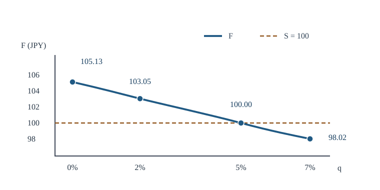

# U3-19 配当・金利・先渡価格・割引規約

[前講の無配当 Black–Scholes 公式](../U3-18/index.md#thm-u3-18-black-scholes)は、株価を現在の $s$ のまま、行使価格だけを $e^{-r\tau}$ で割り引きました。ところが株式を保有している間に配当を受け取るなら、**満期に株式だけを受け取る契約**と、**今から株式を保有すること**は同じではありません。価格のどの項に配当を反映させるのでしょうか。

本講の目標は、配当込みの株式保有を実際に複製し、先渡の受渡価格とオプション価格を同じ割引規約で結び直すことです。最後に「年率5%・30日」という数値だけでは計算できない理由を確認します。

## 1. 市場の時計と配当を区別する

時刻 $t<T$、残存期間 $\tau=T-t>0$ を**年**で測り、現在株価 $s=S_t>0$、行使価格または先渡受渡価格 $K>0$ を円で測ります。金利 $r\in\mathbb R$ は連続複利の年率（年$^{-1}$）、配当利回り $q\ge0$ も年率（年$^{-1}$）、変動率 $\sigma>0$ は年$^{-1/2}$ とします。これらはまず定数です。負金利は許しますが、金利と配当利回りは異なる数量です。

**株式の価格 $S$ は配当を含まない権利落ち価格**です。1株を持っていると、微小期間 $du$ に $qS_u\,du$ 円の配当を受け取ります。リスク中立測度 $Q$ の下での価格過程は、[配当付き BSM 方程式の市場設定](../U3-16/index.md#prop-u3-16-dividend-pde)に合わせて

$$
dS_u=(r-q)S_u\,du+\sigma S_u\,dW_u^Q,\qquad S_t=s.
$$

ここで $W^Q$ は $Q$ の Brown 運動です。摩擦・税・空売り制約のない市場で連続取引と配当の即時再投資を許し、預金は $dB_u=rB_u\,du$、$B_0=1$ とします。これは評価用の測度 $Q$ 下のモデルであり、実世界の値上がり率を $r-q$ と主張しているわけではありません。

[リスク中立測度の構成](../U3-15/index.md#thm-u3-15-risk-neutral-measure)ではドリフト変更を使いました。配当付きでも実世界の株価を

$$
dS_u=(\mu-q)S_u\,du+\sigma S_u\,dW_u^P
$$

とし、定数 $\theta=(\mu-r)/\sigma$ による測度変更を使うと、株価ドリフトは $r-q$ になります。有限期間では $\theta$ は定数なので、指数可積分条件 $E_P[\exp(\tfrac12\theta^2T)]<\infty$ も満たされます。

[ニュメレールと割引価格](../U3-15/index.md#def-u3-15-numeraire)を時点間に適用すると、$t$ の1円と $T$ の1円を比較する係数が必要です。また配当を再投資すると、株数そのものが増えます。両者を別々の記号にします。

まず配当再投資が株数をどう変えるか計算します。時刻 $t$ に $n_t$ 株を保有し、以後の配当をすべて同じ株式へ回すとします。[GBM の陽解と正値性](../U3-14/index.md#thm-u3-14-explicit-gbm)により $s>0$ なら $S_u>0$ なので、$du$ の間の受取配当 $qn_uS_u\,du$ 円を株価 $S_u$ で割って、増加株数を求められます。時刻 $u$ における保有株数を $n_u$ と書けば

$$
\frac{dn_u}{du}=\frac{qn_uS_u}{S_u}=qn_u,
\qquad
\frac{d}{du}\left(e^{-q(u-t)}n_u\right)
=e^{-q(u-t)}\left(\frac{dn_u}{du}-qn_u\right)=0.
$$

したがって $e^{-q(u-t)}n_u=n_t$ であり、$n_u=n_t e^{q(u-t)}$ となります。これは時刻 $u$ を動かす通常の微分方程式です。株数 $n_u$ 自体で割るような変数分離は使っていません。満期に1株を得るには $n_T=1$、つまり $n_t=e^{-q(T-t)}$ とすればよく、$q=0$ なら株数は増えません。この初期株数の比率と、現金の割引率を次に定義します。

<!-- formal-statement-start -->
> **定義（割引係数と配当保持係数）**  
> 定数 $r\in\mathbb R$、$q\ge0$、$\tau=T-t\ge0$ に対し、満期 $T$ の1円の時点 $t$ における価値を表す割引係数 $D(t,T)$ と、満期に株式1株を得るための時点 $t$ の株数を表す配当保持係数 $A(t,T)$ を

$$
D(t,T)=e^{-r\tau},\qquad A(t,T)=e^{-q\tau}
$$

> と定める。いずれも無次元で正であり、$D(t,t)=A(t,t)=1$ である。
<!-- formal-statement-end -->

<!-- definition-example-start: def-u3-19-factors -->
**定義の確認**：$\tau=1$ 年、$r=0.05$、$q=0.02$ なら $D=e^{-0.05}\approx0.951229425$、$A=e^{-0.02}\approx0.980198673$ です。将来の100円の現在価値は $100D\approx95.122942$ 円です。$A$ はお金の割引率ではなく、100株を満期に保有したければ今は約98.019867株を持ち、配当を再投資して増やすという比率です。$r<0$ なら $D>1$ となっても正値性は失われません。
<!-- definition-example-end -->

## 2. 配当込みで先渡を複製する

[先渡契約と受渡価格の定義](../U3-05/index.md#def-u3-05-forward)では、買い手は満期に株式1株と引き換えに指定額 $K$ を払い、純受取額 $S_T-K$ を得ます。契約締結時の価値を0にする $K$ が**公正先渡受渡価格**であり、契約後に時価評価した**契約価値**と混同しません。

今 $S_t=s$ 円を出して1株を買うと途中の配当も受け取ります。一方、先渡の買い手は満期より前の配当を受け取りません。そこで最初の株数を $A(t,T)$ に減らし、配当を再投資します。この戦略は満期に1株を引き渡せるため、その初期費用 $sA(t,T)$ が「満期の1株だけ」の価格です。

<!-- formal-statement-start -->
> **定義（前払先渡価格）**  
> 時刻 $T$ に株式1株を受け取り、$T$ に追加の支払いをしない前払先渡契約の時刻 $t$ の価格を $P_{\mathrm{pre}}(t,T)$ と書く。上の配当再投資可能な市場では

$$
P_{\mathrm{pre}}(t,T)=sA(t,T)=se^{-q(T-t)}.
$$

> 単位は円であり、時刻 $T$ の受渡価格 $K$ や時刻 $t$ での通常の先渡の価値とは異なる。
<!-- formal-statement-end -->

<!-- definition-example-start: def-u3-19-prepaid -->
**定義の確認**：$s=100$ 円、$q=0.02$、$\tau=1$ 年なら $P_{\mathrm{pre}}\approx98.019867$ 円です。この金額で $0.98019867$ 株を購入し、配当をすべて買い増しに充てると、時刻 $T$ に $0.98019867e^{0.02}=1$ 株になります。満期受取は1株、追加支払は0円で、定義の両条件を検証できます。
<!-- definition-example-end -->

<!-- formal-statement-start -->
> **定理（連続配当付き株式の無裁定先渡価格）**  
> $t<T$、$s>0$、$r\in\mathbb R$、$q\ge0$ とし、上の市場で配当を直ちに再投資できるとする。満期 $T$ に1株を受け取り $K$ 円を支払う先渡買い契約の時刻 $t$ における価値 $f_t(K)$ と、その価値を0とする公正受渡価格 $F_{t,T}$ はそれぞれ

$$
\boxed{f_t(K)=se^{-q\tau}-Ke^{-r\tau}},
\qquad
\boxed{F_{t,T}=se^{(r-q)\tau}}.
$$

> ここで $F_{t,T}$ は時刻 $T$ に支払う**円建ての受渡価格**であり、時刻 $t$ に支払う価格 $P_{\mathrm{pre}}$ ではない。
<!-- formal-statement-end -->

**証明の見取り図**：満期の1株を作る配当再投資ポートフォリオから、満期に $K$ 円を払う預金ポジションを差し引きます。取引後の先渡価値が0となる $K$ を最後に解きます。

<!-- proof-start -->
### 証明

時刻 $t$ に $e^{-q\tau}$ 株を買い、以後受け取る $qn_uS_u\,du$ 円を同じ株式に再投資する。再投資で買う株数は $(qn_uS_u\,du)/S_u=qn_u\,du$ だから、$dn_u=qn_u\,du$、$n_T=e^{-q\tau}e^{q\tau}=1$ となる。このポートフォリオの初期費用は $se^{-q\tau}$ 円、満期価値は $S_T$ 円である。

これと同時に、満期に $K$ 円の支払義務を作るよう、時刻 $t$ に $Ke^{-r\tau}$ 円を借りる。預金元利倍率は $B_T/B_t=e^{r\tau}$ なので、満期の返済額は $Ke^{-r\tau}e^{r\tau}=K$ 円である。全体の満期純価値は **どの経路でも** $S_T-K$、時刻 $t$ の初期費用は

$$
se^{-q\tau}-Ke^{-r\tau}.
$$

先渡も複製ポートフォリオも同じ満期価値を持つため、無裁定かつ同じ取引条件では価格は一致する。公正受渡価格は $f_t(F_{t,T})=0$ を満たすので

$$
0=se^{-q\tau}-F_{t,T}e^{-r\tau},
\quad
F_{t,T}e^{-r\tau}=se^{-q\tau},
\quad
F_{t,T}=se^{(r-q)\tau}.
$$

負金利でも $e^{r\tau}>0$ なので解は存在し一意である。
<!-- proof-end -->

**最小数値例**：$s=100$ 円、$r=0.05$、$q=0.02$、$\tau=1$ 年なら

$$
P_{\mathrm{pre}}=100e^{-0.02}=98.01986733,\qquad
F_{t,T}=100e^{0.03}=103.04545340\ \text{円}.
$$

$K=100$ 円の既存先渡を時価評価すると $f_t(100)=98.01986733-95.12294245=2.89692488$ 円です。**受渡価格103.04545円と契約価値2.89692円は、どちらも円ですが別の時刻の別の役割の量**です。

図は $s=100$ 円、$r=5\%$、$\tau=1$ 年を固定し、$q$ を動かしたものです。横破線は現在株価100円です。先渡価格と現在株価の上下は $r-q$ の符号で決まり、「先渡は必ずスポットより高い」という規則はありません。

## 3. オプションの配当付き Black–Scholes 公式

[指数重み付き正規尾積分](../U3-18/index.md#lem-u3-18-tilted-tail)を使えば、無配当の場合の計算を一からやり直す必要はありません。ただし、株価の期待値のドリフトが $r$ から $r-q$ に変わる点が核心です。満期に $(S_T-K)_+$ または $(K-S_T)_+$ を支払う [欧州型 call/put](../U3-05/index.md#def-u3-05-european) を考えます。

<!-- formal-statement-start -->
> **定理（連続配当付き Black–Scholes call/put 価格）**  
> $t<T$、$s,K,\sigma>0$、$r\in\mathbb R$、$q\ge0$ が定数であり、上のリスク中立 GBM、市場の完備性、連続取引を仮定する。$\tau=T-t$ とし

$$
d_1=\frac{\log(s/K)+(r-q+\sigma^2/2)\tau}{\sigma\sqrt{\tau}},
\qquad
d_2=d_1-\sigma\sqrt{\tau}
$$

> を定める。このとき満期 $T$ の欧州型 call/put の時刻 $t$ の無裁定価格は

$$
\boxed{C(t,s)=se^{-q\tau}\Phi(d_1)-Ke^{-r\tau}\Phi(d_2)},
$$

$$
\boxed{P(t,s)=Ke^{-r\tau}\Phi(-d_2)-se^{-q\tau}\Phi(-d_1)}.
$$

> $\Phi$ は[標準正規累積分布関数](../U3-18/index.md#def-u3-18-normal-indices)である。$t=T$、$\sigma=0$ の場合は上の分母に代入せず、支払額または確定株価から扱う。
<!-- formal-statement-end -->

ここで $C(t,s)$ と $P(t,s)$ はそれぞれ **call と put の円建て価格関数**であり、確率測度 $P$ と価格関数 $P(t,s)$ は別物です。偏導関数 $C_s=\partial C/\partial s$ は時刻 $t$ を固定して株価 $s$ で微分し、$C_t=\partial C/\partial t$ は株価 $s$ と満期 $T$ を固定して時刻 $t$ で微分します。

**証明の見取り図**：行使境界 $Z>-d_2$ と、株価で重み付けした正規積分 $d_1$ を区別します。現金項の割引率は $r$、株価項の配当調整率は $q$ です。

<!-- proof-start -->
### 証明

[GBM の陽解](../U3-14/index.md#thm-u3-14-explicit-gbm)を $Q$ 下のドリフト $r-q$ に適用する。$Z=(W_T^Q-W_t^Q)/\sqrt{\tau}\sim N(0,1)$ として

$$
S_T=s\exp\{m+aZ\},\qquad
m=(r-q-\sigma^2/2)\tau,\quad a=\sigma\sqrt{\tau}>0.
$$

$S_T>K$ の条件は $\log s+m+aZ>\log K$、従って $Z>b$、ただし

$$
b=\frac{\log(K/s)-m}{a}=-d_2.
$$

割引 $Q$ 期待値を用いて（配当込みの自己金融複製と一致する評価測度の下で）

$$
\begin{aligned}
C&=e^{-r\tau}E_Q[(S_T-K)_+]\\
&=se^{-r\tau+m}\int_b^\infty e^{az}\phi(z)\,dz
-Ke^{-r\tau}\int_b^\infty\phi(z)\,dz.
\end{aligned}
$$

株価項に[指数重み付き正規尾積分補題](../U3-18/index.md#lem-u3-18-tilted-tail)を $a,b$ で適用すると、積分は $e^{a^2/2}\Phi(a-b)$ である。ここで

$$
-r\tau+m+\frac{a^2}{2}
=-r\tau+(r-q-\sigma^2/2)\tau+\frac{\sigma^2\tau}{2}
=-q\tau,\qquad a-b=d_1.
$$

従って株価項は $se^{-q\tau}\Phi(d_1)$。現金項は $\int_b^\infty\phi(z)\,dz=\Phi(-b)=\Phi(d_2)$ なので call 公式が従う。

put は $Z<b$ のときだけ正であるから

$$
\begin{aligned}
P&=e^{-r\tau}E_Q[(K-S_T)_+]\\
&=Ke^{-r\tau}\int_{-\infty}^b\phi(z)\,dz
-se^{-r\tau+m}\int_{-\infty}^b e^{az}\phi(z)\,dz\\
&=Ke^{-r\tau}\Phi(b)
-se^{-r\tau+m+a^2/2}\Phi(b-a)\\
&=Ke^{-r\tau}\Phi(-d_2)-se^{-q\tau}\Phi(-d_1).
\end{aligned}
$$

最後に、割引期待値と自己金融複製が整合することを直接確認する。$A=e^{-q\tau}$、$D=e^{-r\tau}$ と書く。$d_1-d_2=\sigma\sqrt{\tau}$、$d_1+d_2=2[\log(s/K)+(r-q)\tau]/(\sigma\sqrt{\tau})$ なので

$$
\frac{\phi(d_1)}{\phi(d_2)}
=\exp\left(-\frac{d_1^2-d_2^2}{2}\right)
=\frac{K}{s}e^{-(r-q)\tau},
\quad sA\phi(d_1)=KD\phi(d_2).
$$

$s$ を動かし $t$ を固定する連鎖律で $\partial_s d_1=\partial_s d_2=1/(s\sigma\sqrt{\tau})$ を使うと、$sA\phi(d_1)=KD\phi(d_2)$ により二つの密度項が相殺して

$$
C_s=A\Phi(d_1),\qquad
C_{ss}=\frac{A\phi(d_1)}{s\sigma\sqrt{\tau}}.
$$

また $\tau=T-t$ なので、$s,T$ を固定した時間微分は $\partial_t=-\partial_\tau$ と読み替えます。従って

$$
\partial_t d_1=-\frac{(r-q+\sigma^2/2)\tau-\log(s/K)}{2\sigma\tau^{3/2}},
\qquad
\partial_t d_2=\partial_t d_1+\frac{\sigma}{2\sqrt{\tau}}.
$$

係数について $\partial_t A=qA$、$\partial_t D=rD$ です。積と合成関数の微分をいったん展開し、密度恒等式を適用すると

$$
\begin{aligned}
C_t
&=qsA\Phi(d_1)-rKD\Phi(d_2)
+sA\phi(d_1)\partial_t d_1-KD\phi(d_2)\partial_t d_2\\
&=qsA\Phi(d_1)-rKD\Phi(d_2)
+sA\phi(d_1)(\partial_t d_1-\partial_t d_2)\\
&=qsA\Phi(d_1)-rKD\Phi(d_2)
-\frac{sA\sigma\phi(d_1)}{2\sqrt{\tau}}.
\end{aligned}
$$

従って[連続配当付き BSM 方程式](../U3-16/index.md#prop-u3-16-dividend-pde)の左辺は

$$
\begin{aligned}
&C_t+(r-q)sC_s+\tfrac12\sigma^2s^2C_{ss}-rC\\
&=(q+r-q-r)sA\Phi(d_1)+(-r+r)KD\Phi(d_2)\\
&\quad-\frac{sA\sigma\phi(d_1)}{2\sqrt{\tau}}
+\frac{sA\sigma\phi(d_1)}{2\sqrt{\tau}}=0.
\end{aligned}
$$

put については、先ほど直接求めた call/put 二式の差を $w=C-P=sA-KD$ と書きます。この関数の偏導関数は

$$
w_t=qsA-rKD,\qquad w_s=A,\qquad w_{ss}=0
$$

です。これを配当付き PDE に代入すると、$w_t+(r-q)sw_s-rw=0$ が得られます。したがって $P=C-w$ も同じ PDE の解です。

満期極限 $t\uparrow T$ では、$s$ を固定して $\tau=T-t\downarrow0$ とします。[GBM の実数モーメント](../U3-14/index.md#prop-u3-14-moments)をドリフト $r-q$ に適用すると

$$
\begin{aligned}
E_Q[(S_T-s)^2]
&=E_Q[S_T^2]-2sE_Q[S_T]+s^2\\
&=s^2\left(e^{[2(r-q)+\sigma^2]\tau}
-2e^{(r-q)\tau}+1\right)\longrightarrow0.
\end{aligned}
$$

従って [Cauchy–Schwarz の不等式](../../../基礎科目/F0/F0-00E2/index.md#thm-f0-00e2-cauchy-schwarz)より $E_Q[|S_T-s|]\to0$ です。call・put の支払関数はいずれも、株価が $\delta$ 円変わっても支払額の変化が $|\delta|$ 円以下となるため、例えば

$$
|(S_T-K)_+-(s-K)_+|\le|S_T-s|.
$$

同様の不等式が put にも成り立ち、$e^{-r\tau}\to1$ と併せて、割引期待値がそれぞれ $(s-K)_+$、$(K-s)_+$ へ収束することが分かります。デルタについても

$$
|C_s|\le A\le1,\qquad
|P_s|=|C_s-A|\le A\le1
$$

です。[自己金融複製の構成](../U3-16/index.md#thm-u3-16-bsm-replication)の係数比較を、配当込み利得に合わせて実施します。価格関数を $v$、株数を $\Delta=v_s$、預金単位を $\psi=(v-s\Delta)/B_u$ とすると、[時間依存 Itô 公式](../../../解析系/STO/STO7/index.md#thm-sto7-ito-process-formula)と[配当付き PDE](../U3-16/index.md#prop-u3-16-dividend-pde)より

$$
\begin{aligned}
dv&=v_s\,dS+\left(v_t+\tfrac12\sigma^2S^2v_{ss}\right)du\\
&=\Delta\,dS+\left[rv-(r-q)S\Delta\right]du\\
&=\Delta(dS+qS\,du)+\psi\,dB.
\end{aligned}
$$

満期の価格は支払額に一致し、デルタは有界です。株価の対数正規二次モーメントが有限であることは[GBM モーメント命題](../U3-14/index.md#prop-u3-14-moments)から従い、割引した確率積分の二乗可積分性を保証します。ゆえに戦略は自己金融で満期支払を複製し、価格は無裁定価格となります。
<!-- proof-end -->

定理で用いた「株価項は $e^{-q\tau}$、行使価格項は $e^{-r\tau}$」という二つの係数は、**先渡の複製で既に現れたものと同じ**です。

$0<q$ を含む数値例として $s=K=100$ 円、$\tau=1$ 年、$r=0.05$、$q=0.02$、$\sigma=0.20$ を代入すると

$$
d_1=\frac{0+(0.05-0.02+0.02)}{0.20}=0.25,\qquad
d_2=0.25-0.20=0.05.
$$

$\Phi(0.25)\approx0.598706326$、$\Phi(0.05)\approx0.519938806$ なので

$$
C\approx9.227005508\ \text{円},\qquad
P\approx6.330080628\ \text{円}.
$$

変動率の単位は年$^{-1/2}$、$\sigma\sqrt{\tau}$ は無次元です。配当利回りは $r-q$ として正規化指標にも入り、$e^{-q\tau}$ として株価係数にも入ります。**どちらか片方だけ変えると誤答**になります。

## 4. put–call parity、先渡、無配当極限

<!-- formal-statement-start -->
> **命題（連続配当付き put–call parity）**  
> 同じ株式・満期 $T$・行使価格 $K$ の欧州型 call/put が、前節の連続配当市場で無裁定価格 $C,P$ を持つとする。このとき

$$
\boxed{C-P=se^{-q\tau}-Ke^{-r\tau}
=e^{-r\tau}(F_{t,T}-K)}.
$$

> $q=0$ とすれば $C-P=s-Ke^{-r\tau}$ に戻る。
<!-- formal-statement-end -->

**証明の見取り図**：満期の call と put を引くと、オプションらしい折れ目が消え、先渡の支払額になります。

<!-- proof-start -->
### 証明

各 $x>0$ について

$$
(x-K)_+-(K-x)_+=x-K
$$

である。$x\ge K$ なら左辺は $(x-K)-0$、$x<K$ なら $0-(K-x)$ で、どちらも右辺と一致する。従って $C-P$ の満期支払額は**経路ごとに** $S_T-K$ である。[先渡複製の定理](#thm-u3-19-forward)より同じ支払額を持つ契約の価格は $se^{-q\tau}-Ke^{-r\tau}$。さらに $se^{-q\tau}=F_{t,T}e^{-r\tau}$ を代入すると右端の式になる。

別検算として[配当付き閉形式](#thm-u3-19-bsm-dividend)の差を取る。$\Phi(d)+\Phi(-d)=1$ なので

$$
\begin{aligned}
C-P
&=se^{-q\tau}[\Phi(d_1)+\Phi(-d_1)]\\
&\quad-Ke^{-r\tau}[\Phi(d_2)+\Phi(-d_2)]\\
&=se^{-q\tau}-Ke^{-r\tau}.
\end{aligned}
$$

最後に $q=0$ とすると $e^{-q\tau}=1$ となり、[無配当 parity](../U3-05/index.md#thm-u3-05-parity)と一致する。
<!-- proof-end -->

数値例では $C-P\approx9.227005508-6.330080628=2.896924880$ 円。これは第2節の $K=100$ 円の先渡契約価値そのものです。負金利や $q>r$ でも指数係数は正であり、同じ複製と恒等式が成立します。

**破綻条件を確認**：現金配当3円を半年後に**一度だけ**支払う株式を、$q=0.03$ の連続配当と読み替えてはなりません。配当の時刻と金額が確定し、配当権利落ちによる株価の減少を適切に扱える場合は、無配当資産の複製と同様に、満期までに支払われる確定現金配当の現在価値を株価から引いて

$$
F_{t,T}=\frac{s-\mathrm{PV}_t(\text{満期前の確定現金配当})}{D(t,T)}
$$

という**先渡の関係**を得ます。しかし、そのような離散配当を仮定しただけで前節の対数正規分布や連続配当 BSM 閉形式まで正当化されるわけではありません。[確定現金配当の parity](../U3-05/index.md#thm-u3-05-dividend-parity)とも区別してください。

## 5. 金利曲線・日数規約・満期を揃える

金利が時刻で変わるとき、$r\tau$ を「年率×年数」とみなすだけでは不正確になります。連続複利の決定的な短期金利 $r(u)$ と配当利回り $q(u)$ が区間 $[t,T]$ で可積分なら、総利息と総配当を積分で定めます。

<!-- formal-statement-start -->
> **命題（決定的な金利・配当曲線での先渡）**  
> $t<T$、$s>0$、$r(u)$ と $q(u)\ge0$ は $[t,T]$ 上の決定的な可積分関数、配当再投資可能で借入・貸付の金利が同じとする。$R=\int_t^T r(u)\,du$、$Q_d=\int_t^T q(u)\,du$ と置くと

$$
D(t,T)=e^{-R},\quad A(t,T)=e^{-Q_d},
\quad
\boxed{F_{t,T}=s e^{R-Q_d}}.
$$

> ここで $Q_d$ は**総配当利回り**であり、確率測度の記号 $Q$ とは異なる。
<!-- formal-statement-end -->

**証明の見取り図**：時刻に依存する金利と配当は、その都度小さく増える量を積み上げる必要があります。

<!-- proof-start -->
### 証明

預金の初期時刻 $t$ からの倍率を $b(u)$ とします。$r$ は可積分なので

$$
b(u)=\exp\left(\int_t^u r(v)\,dv\right)
$$

は絶対連続で、$b'(u)=r(u)b(u)$ を**ほとんど至る所**で満たし、$b(t)=1$ です。従って満期1円の現在価値は $D(t,T)=1/b(T)=e^{-R}$ となります。

配当の全額再投資による株数についても、$q$ が可積分なら $n(u)=n(t)\exp(\int_t^u q(v)\,dv)$ は絶対連続で、$n'(u)=q(u)n(u)$ をほとんど至る所で満たします。$n(t)=e^{-Q_d}$ とすれば

$$
n(T)=e^{-Q_d}\exp\left(\int_t^Tq(u)\,du\right)=1.
$$

前払先渡を $s e^{-Q_d}$ 円で複製でき、受渡価格 $K$ の先渡価値は $s e^{-Q_d}-K e^{-R}$。これを0にすると $F=s e^{R-Q_d}$ である。
<!-- proof-end -->

決定的な時間変動係数でも、この先渡の複製は変動率の確率モデルに依存しません。一方、オプション価格を正規分布から求めるには別途ボラティリティの仮定が必要です。

実務上の日数規約は、単なる表示上の便宜ではなく割引指数に入る $\tau$ を決めます。「30日間」の年換算を ACT/365（実際の日数を365で割る）にするなら $\tau=30/365$、ACT/360 なら $\tau=30/360$ です。この二つは一致しません。さらに、単利・年 $m$ 回複利・連続複利を混ぜないため、以下を区別します。

<!-- formal-statement-start -->
> **定義（年換算時間と複利変換）**  
> 暦上の区間の実日数を $n>0$ とする。  
> ACT/365・ACT/360 のように day-count 分母 $b>0$ が一定なら、年換算時間は $\tau=n/b$ である。年ごとに分母が変わる規約では、別途積算する。  
> 単利年率を $y$ とし、$1+y\tau>0$ なら満期1円の割引係数は $(1+y\tau)^{-1}$ である。  
> 名目年率を $j$、年の複利回数を $m\in\mathbb N$ とする。$1+j/m>0$ なら年 $m$ 回複利の割引係数は $(1+j/m)^{-m\tau}$ である。端数の複利期間は累乗によって補間する約束とする。  
> 連続複利年率 $r$ の割引係数は $e^{-r\tau}$ である。  
> 同じ区間について、同じ割引係数を表す連続複利年率への変換は

$$
r_{\mathrm{simple}}=\frac{\log(1+y\tau)}{\tau},
\qquad
r_{\mathrm{periodic}}=m\log(1+j/m).
$$
<!-- formal-statement-end -->

<!-- definition-example-start: def-u3-19-daycount -->
**定義の確認**：実日数30日、$b=365$、単利年率 $y=0.05$ の場合は $\tau=30/365>0$、$1+y\tau\approx1.00410959>0$ です。これを $D=(1+y\tau)^{-1}$ とし、$r_{\mathrm{simple}}=\log(1+y\tau)/\tau$ に変換すると、$e^{-r_{\mathrm{simple}}\tau}=e^{-\log(1+y\tau)}=D$ となります。$y=0.05$ をそのまま連続複利の指数に入れたものとは厳密には異なります。

別の規約として $\tau=1$ 年、$m=2$、名目年率 $j=0.04$ とすれば、$m\in\mathbb N$、$1+j/m=1.02>0$ を満たし、$D=(1.02)^{-2}$ です。等価な連続複利年率は $r_{\mathrm{periodic}}=2\log(1.02)$ なので、$e^{-r_{\mathrm{periodic}}}=e^{-2\log(1.02)}=(1.02)^{-2}=D$ となり、複利の種類を切り替えても同じ満期1円の価値を再現できます。
<!-- definition-example-end -->

**使う前の確認表**：

| 契約で確認する項目 | 計算へ現れる場所 | 混同すると起きること |
| --- | --- | --- |
| 評価時刻 $t$、満期 $T$、決済時刻 | $\tau=T-t$ と支払日の定義 | 異なる時点の金額をそのまま足す |
| ACT/365、ACT/360、ACT/ACT など指定の年換算規約 | 金利・配当・変動率へ渡す年数 | 金利と満期の単位が揃わない |
| 単利、定期複利、連続複利 | 割引係数 $D(t,T)$ | 同じ「年率」を別の複利として扱う |
| 配当の型（連続利回り／確定現金配当） | $A(t,T)$ または配当現在価値 | 先渡とオプションの仮定を混同する |
| 価格・配当・行使価格の通貨 | すべての価格関係 | 異通貨の額を同じ式で直接比較する |

ACT/ACT は方式まで契約に従います。例えば ACT/ACT（ISDA 方式：暦年ごとに分割する方式）なら、区間がまたがる各暦年の実日数を $n_j$、その暦年の日数を $b_j\in\{365,366\}$ として

$$
\tau=\sum_j\frac{n_j}{b_j}
$$

と計算します。一般に単一の $n/b$ では表せません。また、年 $m$ 回複利の端数期間や休日による決済日の調整は契約独自の約束があり、年換算時間とは別に確認します。本講では具体的な市場商品の制度を勝手に一つへ固定せず、**指定された規約で年換算時間を確定してから**価格式を使います。

## 6. 演習

以下は同じ円建て株式市場を扱い、断りがなければ $t=0$、$r,q,\sigma$ は定数・連続複利、配当再投資可能で $T>0$ とします。計算結果の小数は途中では丸めすぎないこと。

### U3-19-A1：利率と配当の二つの係数
- Level: A

$r=0.04$、$q=0.01$、$T=2$ 年の割引係数 $D$ と保持係数 $A$ を求め、それぞれの意味と $q=0$ のときの変化を説明せよ。

<!-- solution-start -->
**詳細解答**：[割引係数と配当保持係数の定義](#def-u3-19-factors)に $rT=0.08$、$qT=0.02$ を代入するから $D=e^{-0.08}\approx0.923116$、$A=e^{-0.02}\approx0.980199$ です。$D$ は2年後の1円を今日の約0.923116円で複製する係数です。$A$ 株を今日買い配当を再投資すると、満期には $Ae^{0.01\cdot2}=1$ 株です。$q=0$ なら $A=1$ ですが $D=e^{-0.08}$ は変わりません。
<!-- solution-end -->

### U3-19-A2：先渡価格の上下
- Level: A

$s=100$ 円、$r=0.05$、$T=1$ 年のとき、$q=0,\ 0.05,\ 0.07$ での公正受渡価格を求め、各場合でスポット価格より高いか低いか判定せよ。

<!-- solution-start -->
**詳細解答**：[先渡定理](#thm-u3-19-forward)により $F=100e^{(0.05-q)}$ 円です。$q=0$ なら $100e^{0.05}\approx105.127110$ 円で高く、$q=0.05$ なら $100e^0=100$ 円で一致し、$q=0.07$ なら $100e^{-0.02}\approx98.019867$ 円で低くなります。指数関数は増加関数なので比較は $r-q$ の符号で判定できます。
<!-- solution-end -->

### U3-19-A3：受渡価格と契約価値
- Level: A

$s=100$ 円、$r=0.05$、$q=0.02$、$T=1$ 年。$K=100$ 円の先渡買い契約の時価と、新規契約が価値0になる受渡価格を区別して求めよ。

<!-- solution-start -->
**詳細解答**：[配当保持係数と割引係数](#def-u3-19-factors)は $A=e^{-0.02}$、$D=e^{-0.05}$ だから

$$
f_0(100)=100A-100D
=98.01986733-95.12294245
=2.89692488\ \text{円}.
$$

[先渡定理](#thm-u3-19-forward)から新規の公正受渡価格は $F=100A/D=100e^{0.03}\approx103.04545340$ 円です。新規契約では $f_0(F)=100A-FD=0$ であり、$F$ 自体を「契約の現在価値」と呼びません。
<!-- solution-end -->

### U3-19-A4：配当付き parity の直接確認
- Level: A

$s=90$ 円、$K=100$ 円、$T=1$ 年、$r=0$、$q=0.02$ のとき $C-P$ を計算せよ。符号は何を意味するか。

<!-- solution-start -->
**詳細解答**：[parity](#prop-u3-19-parity)を使い $C-P=90e^{-0.02}-100e^0=88.21788060-100=-11.78211940$ 円です。call と put が非負であることには矛盾しません。差が負ということはこの条件では put の価値が call より11.78211940円高いという意味です。
<!-- solution-end -->

### U3-19-A5：年換算時間の差
- Level: A

実日数30日、連続複利年率5%の満期100円の現在価値を ACT/365 と ACT/360 の両方で**式として**示し、どちらの現在価値が低いか判定せよ。

<!-- solution-start -->
**詳細解答**：[年換算時間の定義](#def-u3-19-daycount)に従い、前者は $V_{365}=100\exp(-0.05\cdot30/365)$ 円、後者は $V_{360}=100\exp(-0.05\cdot30/360)$ 円です。$30/360>30/365$ で利率は正なので $-0.05\cdot30/360<-0.05\cdot30/365$。指数関数の単調性から $V_{360}<V_{365}$ です。指定された実日数は同じですが、年換算時間の相違が割引係数に残ります。
<!-- solution-end -->

### U3-19-B1：配当再投資から先渡を再導出
- Level: B

満期まで1年、連続配当利回り $q>0$ とする。時刻0に $n_0$ 株を買い、配当をすべて同じ株に再投資する。満期に1株となる $n_0$ を導き、預金との組合せで先渡買い契約の $f_0(K)$ を示せ。

<!-- solution-start -->
**詳細解答**：保有株数を $n_u$ とすると、微小期間 $du$ に受け取る配当は $qn_uS_u\,du$ 円です。これを株式購入に回したときの株数増加は

$$
dn_u=\frac{qn_uS_u\,du}{S_u}=qn_u\,du.
$$

従って $dn_u/du=qn_u$ を解き、$n_u=n_0e^{qu}$ を得ます。満期 $u=1$ に1株とするには $n_0=e^{-q}$。初期の株式購入費用は $se^{-q}$ 円です。

時刻0に $Ke^{-r}$ 円借りると、1年後には $Ke^{-r}e^r=K$ 円の返済義務が生じます。従って初期費用と満期受取額は順に

$$
se^{-q}-Ke^{-r},\qquad S_1-K.
$$

後者は[先渡契約の定義](../U3-05/index.md#def-u3-05-forward)の満期純受取額と一致します。無裁定の複製価格は $f_0(K)=se^{-q}-Ke^{-r}$ です。
<!-- solution-end -->

### U3-19-B2：配当付き正規積分を検算
- Level: B

$s=K=100$ 円、$T=1$ 年、$r=0.05$、$q=0.02$、$\sigma=0.20$ の call と put を求め、$d_1,d_2$ と parity を独立に検算せよ。$q$ を0にした場合と公式のどこが違うかも説明せよ。

<!-- solution-start -->
**詳細解答**：[配当付き閉形式](#thm-u3-19-bsm-dividend)により

$$
d_1=\frac{\log(1)+(0.05-0.02+0.20^2/2)\cdot1}{0.20}
=\frac{0.05}{0.20}=0.25,\quad d_2=0.05.
$$

$\Phi(0.25)\approx0.5987063257$、$\Phi(0.05)\approx0.5199388058$、$A=e^{-0.02}\approx0.9801986733$、$D=e^{-0.05}\approx0.9512294245$ から

$$
\begin{aligned}
C&=100A\Phi(0.25)-100D\Phi(0.05)
\approx9.227005508,\\
P&=100D\Phi(-0.05)-100A\Phi(-0.25)
\approx6.330080628.
\end{aligned}
$$

差は $2.896924880$ 円。一方、先渡を別に複製すると $100A-100D=2.896924881$ 円で丸め誤差内で一致します。$q=0$ では株価側の $A$ が1になる**だけでなく** $d_i$ の分子の $r-q$ が $r$ へ変わるため、$d_1=(0.05+0.02)/0.2=0.35$、$d_2=0.15$ となります。
<!-- solution-end -->

### U3-19-B3：時間依存する金利と配当
- Level: B

$T=1$、$s=100$ 円、$r(u)=0.04+0.02u$、$q(u)=0.02+0.02u$（$0\le u\le1$）とする。満期1株の前払価格、満期100円の割引現在価値、公正先渡受渡価格を導け。

<!-- solution-start -->
**詳細解答**：利息・配当の累積値をそれぞれ積分します。

$$
R=\int_0^1(0.04+0.02u)\,du=0.04+0.01=0.05,
\quad
Q_d=\int_0^1(0.02+0.02u)\,du=0.02+0.01=0.03.
$$

従って[決定的な金利・配当曲線での先渡](#prop-u3-19-deterministic-term)により前払価格は $100e^{-0.03}\approx97.044553$ 円、満期100円の現在価値は $100e^{-0.05}\approx95.122942$ 円。両者の差が $K=100$ の既存先渡の現在価値です。新規契約の公正受渡価格は $F=100e^{0.05-0.03}=100e^{0.02}\approx102.020134$ 円。時間の平均を用いたのは、ここで $T=1$ 年だったからで、一般には $\int r$ と $\int q$ の指数を使います。
<!-- solution-end -->

### U3-19-B4：一回の現金配当との違い
- Level: B

$s=100$ 円、$r=0.05$、$T=1$ 年で、半年後に**1株につき確定3円**の現金配当が支払われる。金利は連続複利で一定とする。配当を受け取る権利と満期株式の引渡しを分離したとき、先渡の受渡価格を求めよ。また $q=0.03$ を連続配当率として代入してよいか判定せよ。

<!-- solution-start -->
**詳細解答**：配当を受け取る権利の時点0現在価値は $3e^{-0.05\cdot0.5}=3e^{-0.025}\approx2.92592974$ 円です。株式1株を100円で買い、同時に $3e^{-0.025}$ 円を借りると、半年後に株式から受け取る確定配当3円でちょうど借金を返済できます。満期に残るのは株式1株だけなので、前払価格は $100-3e^{-0.025}\approx97.07407026$ 円です。この配当権利の分離は[確定現金配当を含む parity](../U3-05/index.md#thm-u3-05-dividend-parity)の複製と同じ考え方です。これを1年後の受渡価格へ進めれば

$$
F=(100-3e^{-0.025})e^{0.05}
=100e^{0.05}-3e^{0.025}\ \text{円}.
$$

現金配当3円は株価の一定割合を毎瞬間受け取る契約ではないため、$100e^{(0.05-0.03)}$ と一般には一致しません。前者は権利落ち日の3円を個別に割り引くのに対し、後者は配当を連続して買い増すという異なる支払経路を仮定しているためです。
<!-- solution-end -->

### U3-19-C1：先渡・オプション・割引規約を統合する
- Level: C

$s=K=100$ 円、$t=0$、$T=1$ 年、$r=0.05$、$q=0.02$、$\sigma=0.20$ とする。連続配当・連続複利・年換算時間1年を仮定する。

1. 配当再投資による前払先渡の複製株数と預金の必要額を求め、$K=100$ の先渡契約価値および公正受渡価格を求めよ。
2. $Q$ 下の対数正規分布と行使境界を記述し、call/put の価格を正規積分から導け。
3. payoff恒等式と閉形式の**二通り**で parity を確認せよ。
4. 金利を「単利年率5%」へ変更し、同じ1年の期間の割引係数を整合させるとき、連続複利年率をどう変える必要があるか述べよ。$r=0.05$ のままでよいか。
5. $q\to0$ と $\sigma\to0$ の二つの極限を別々に扱い、どの項が変化するか示せ。

<!-- solution-start -->
**詳細解答**：

**（1）再投資と先渡。** $n_0=e^{-qT}=e^{-0.02}\approx0.9801986733$ 株を買うと、満期の株数は $n_0e^{0.02}=1$ 株です。初期費用は $100e^{-0.02}=98.01986733$ 円。満期に100円を支払うため時刻0に $100e^{-0.05}=95.12294245$ 円を借り、1年後に100円を返済します。差額が先渡の時価

$$
f_0(100)=98.01986733-95.12294245
=2.89692488\ \text{円}
$$

です。価値0となる受渡価格は $F=100e^{0.05-0.02}\approx103.04545340$ 円です。

**（2）行使領域と正規積分。** [陽解](../U3-14/index.md#thm-u3-14-explicit-gbm)のドリフトを $r-q=0.03$ と置くので

$$
S_1=100\exp\{(0.03-0.02)+0.20Z\}
=100e^{0.01+0.20Z},\qquad Z\sim N(0,1).
$$

$S_1>100\iff0.01+0.20Z>0\iff Z>-0.05$ であり、$d_2=0.05$、$d_1=d_2+0.20=0.25$。従って

$$
C=e^{-0.05}\int_{-0.05}^\infty
(100e^{0.01+0.20z}-100)\phi(z)\,dz.
$$

[正規尾積分補題](../U3-18/index.md#lem-u3-18-tilted-tail)に $a=0.20$、$b=-0.05$ を代入すると、株価積分は $e^{0.02}\Phi(0.25)$、現金項は $\Phi(0.05)$ になります。株価項の前係数は $100e^{-0.05+0.01+0.02}=100e^{-0.02}$、現金項は $100e^{-0.05}$。よって $C=100e^{-0.02}\Phi(0.25)-100e^{-0.05}\Phi(0.05)\approx9.227005508$ 円。put の下側積分は $Z<-0.05$ にわたり

$$
P=e^{-0.05}\int_{-\infty}^{-0.05}
(100-100e^{0.01+0.20z})\phi(z)\,dz
=100e^{-0.05}\Phi(-0.05)-100e^{-0.02}\Phi(-0.25)
\approx6.330080628\ \text{円}.
$$

**（3）二通りの parity。** 標本ごとに $(S_1-100)_+-(100-S_1)_+=S_1-100$。これを第1問の先渡戦略で複製した価格は $f_0(100)=2.89692488$ 円です。閉形式からも $C-P=100e^{-0.02}[\Phi(0.25)+\Phi(-0.25)]-100e^{-0.05}[\Phi(0.05)+\Phi(-0.05)]$。角括弧がそれぞれ1なので、同じ差を得ます。

**（4）複利の統一。** [年換算時間と複利変換](#def-u3-19-daycount)より、単利5%で1年なら満期1円の割引係数は $(1+0.05)^{-1}=1/1.05$ です。連続複利を同じ割引係数へ一致させるには $r_c=\log(1.05)\approx0.048790164$ 年$^{-1}$ として $e^{-r_c}=1/1.05$ にします。従って元の連続複利 $r=0.05$ をそのまま使うことはできません。配当利回り $q$ はこの問いでは変更しないため、先渡を再計算する際も新しい $r_c$ を使います。

**（5）異なる極限。** $q\to0$ では $A=e^{-qT}\to1$、$F=100e^{(r-q)T}\to100e^{rT}$、正規化指標は $(r-q)$ から $r$ へ移り、[無配当 Black–Scholes 定理](../U3-18/index.md#thm-u3-18-black-scholes)に戻ります。一方 $\sigma\to0$ では正規化指標の分母に直接代入せず、$S_1\to100e^{(r-q)T}=100e^{0.03}$ が確定するので

$$
C\to e^{-rT}(100e^{(r-q)T}-K)_+
=(100e^{-qT}-Ke^{-rT})_+,
$$

$$
P\to e^{-rT}(K-100e^{(r-q)T})_+
=(Ke^{-rT}-100e^{-qT})_+.
$$

この極限は配当係数 $A$ を残したまま、偶然の株価変動だけを消す操作です。
<!-- solution-end -->

---

**本講の到達点**：配当付き市場では満期1株の現在価格が $se^{-q\tau}$、満期の1円の現在価格が $e^{-r\tau}$ です。両者から先渡 $F=se^{(r-q)\tau}$、put–call parity、配当付き Black–Scholes 公式を一貫して導けました。次講 **U3-20** では、これらの価格式をどの変数で微分するかを明示して Greeks とヘッジ誤差を調べます。
