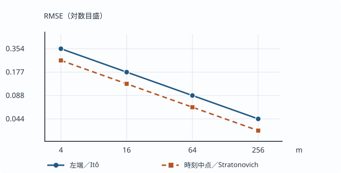

# U3-27 Itô 積分の数値近似と誤差の実測

株価のリスク中立期待値を Monte Carlo 平均へ置き換えた [U3-26 の価格推定](../U3-26/index.md#def-u3-26-mc-estimator)では、「標本数を増やす」と「時間刻みを細かくする」は別の操作でした。今回は時間刻み側へ進みます。Brown 運動の値を有限個の時刻でしか読めない場合、**どの時刻の値を増分へ掛けるか**によって、そもそも近似する確率積分が変わります。

既習の [STO6 の確率積分構成](../../../解析系/STO/STO6/index.md#thm-sto6-l2-construction)は、過去の情報だけに依存する単純被積分過程の和から Itô 積分を作りました。[STO7 の Itô–Stratonovich 換算定理](../../../解析系/STO/STO7/index.md#thm-sto7-ito-stratonovich-conversion)は、対称な和の極限との違いを共変分で表しました。この講では両定理を再証明せず、**実際に生成できる和、厳密な同一路誤差、再現実験**へつなぎます。SDE の数値的な解経路そのものは次の U3-28 で扱います。

## 1. 時間積分と確率積分では「左端」に意味がある

確率空間 $(\Omega,\mathcal F,P)$ 上で $W_0=0$ の標準 Brown 運動 $(W_t)_{0\le t\le T}$、その自然な情報の流れ $(\mathcal F_t)$、終端時刻 $T>0$ を固定します。格子は $m\ge1$ 等分、$h=T/m$、$t_j=jh$（$j=0,\ldots,m$）とし、$\Delta_jW=W_{t_{j+1}}-W_{t_j}$ と置きます。各 $\Delta_jW$ は互いに独立で $N(0,h)$ に従います。**第2引数は分散**です。

積分の係数を時刻 $t_j$ で決めるには、その時刻までに観測できる値だけを使う必要があります。例えば $W_{t_j}$ は $\mathcal F_{t_j}$ から決まりますが、未来の $W_{t_{j+1}}$ は通常そうではありません。[単純予測可能被積分過程](../../../解析系/STO/STO6/index.md#def-sto6-simple-predictable)に対応させて、左端値を区間 $(t_j,t_{j+1}]$ 全体の係数にします。

<!-- formal-statement-start -->
> **定義（適合左端和と同一路の積分誤差）**  
> 上の Brown 運動、時刻格子と、予測可能な被積分過程 $H$ で $E\int_0^T H_t^2dt<\infty$ を満たすものを考える。各 $H_{t_j}$ は $\mathcal F_{t_j}$ 可測で二乗可積分とする。左端単純近似、適合左端和、同じ Brown 運動を使った真の Itô 積分およびその差を
>
$$
H_t^{(m)}=\sum_{j=0}^{m-1}H_{t_j}\boldsymbol{1}_{(t_j,t_{j+1}]}(t),
\qquad
L_m(H)=\sum_{j=0}^{m-1}H_{t_j}\Delta_jW,
$$
>
$$
I(H)=\int_0^T H_t\,dW_t,
\qquad D_m(H)=L_m(H)-I(H)
$$
>
> と書く。両方は**同一の Brown 運動**上で計算する。
<!-- formal-statement-end -->

<!-- definition-example-start: def-u3-27-left-coupled -->
**定義の確認**：$H_t=W_t$ とします。$W_{t_j}$ は時刻 $t_j$ までの情報で決まり、$E[W_{t_j}^2]=t_j<\infty$、$E\int_0^TW_t^2dt=T^2/2<\infty$ です。従って左端係数の可測性と二乗可積分性は満たされています。積分の存在は [STO6 の $L^2$ 構成定理](../../../解析系/STO/STO6/index.md#thm-sto6-l2-construction)から従います。

$T=1,m=2$、一つの標本路で $\Delta_0W=0.3,\Delta_1W=-0.1$ なら、観測値は $W_0=0,W_{1/2}=0.3,W_1=0.2$ です。左端和は $L_2(W)=0(0.3)+0.3(-0.1)=-0.03$ です。後で導く厳密値は $I(W)=(0.2^2-1)/2=-0.48$ なので、**この経路の誤差は $+0.45$** です。この三つの値は手順の確認用であり、Brown 運動の分布から独立に抽出した標本ではありません。
<!-- definition-example-end -->

一般の $H$ に対して、時刻を細かくしただけで左端近似が収束すると断言してはいけません。[STO6 の確率積分構成](../../../解析系/STO/STO6/index.md#thm-sto6-l2-construction)と等長性によって、十分な条件は

$$
E\int_0^T|H_t^{(m)}-H_t|^2dt\longrightarrow0
$$

です。そのとき $E[|D_m(H)|^2]\to0$ となります。次の $H=W$ では条件を計算で直接検証でき、しかも誤差を**有限 $m$ で厳密に**求められます。

## 2. Brown 運動自身を積分すると、誤差を計算し尽くせる

[STO7 の多次元 Itô 公式](../../../解析系/STO/STO7/index.md#thm-sto7-multidimensional-ito)を一次元の $f(x)=x^2$、$X_t=W_t$、区間 $[0,T]$ に適用します。$f'(x)=2x,f''(x)=2$、Brown 運動の二次変分 $[W]_T=T$ なので

$$
W_T^2-W_0^2
=\int_0^T2W_t\,dW_t+\frac12\int_0^T2\,dt.
$$

$W_0=0$ から、真の Itô 積分は

$$
I:=I(W)=\int_0^TW_t\,dW_t=\frac{W_T^2-T}{2}.
$$

一方、各区間で $W_{t_{j+1}}=W_{t_j}+\Delta_jW$ と置き、二乗を展開すれば

$$
W_{t_{j+1}}^2-W_{t_j}^2
=2W_{t_j}\Delta_jW+(\Delta_jW)^2.
$$

これを $j=0,\ldots,m-1$ で足し、左辺を望遠鏡和にすると

$$
L_m:=L_m(W)
=\frac12\left(W_T^2-\sum_{j=0}^{m-1}(\Delta_jW)^2\right).
$$

したがって左端近似と真値の差は、有限格子で計算した**二次変動和**が $T$ からどれだけずれたかそのものです。

<!-- formal-statement-start -->
> **命題（Brown 運動の適合左端和の厳密二乗平均誤差）**  
> $W$ を $W_0=0$ の標準 Brown 運動、$T>0$、$m\ge1$、$h=T/m$、$t_j=jh$ とする。$L_m=\sum_{j=0}^{m-1}W_{t_j}\Delta_jW$ と $I=\int_0^T W_t\,dW_t$ に対して
>
$$
L_m-I=-\frac12\sum_{j=0}^{m-1}\bigl((\Delta_jW)^2-h\bigr)
$$
>
> が各標本路で成り立つ。さらに
>
$$
E[L_m-I]=0,\qquad
E[(L_m-I)^2]=\frac{T^2}{2m},\qquad
\sqrt{E[(L_m-I)^2]}=\frac{T}{\sqrt{2m}}.
$$
>
> 従って $L_m\to I$ は二乗平均で収束する。
<!-- formal-statement-end -->

### 証明の見取り図

誤差を独立な Brown 増分の二乗の**中心化和**へ変換します。平均が0の項どうしの異なる時刻の積は消え、二次モーメントだけを足せます。最後に [Itô 等長性](../../../解析系/STO/STO6/index.md#thm-sto6-ito-isometry-simple)でも別の方向から照合します。

<!-- proof-start -->
### 証明

上で得た $L_m=(W_T^2-\sum_j(\Delta_jW)^2)/2$ と $I=(W_T^2-T)/2$ を引くと

$$
L_m-I=\frac{T-\sum_j(\Delta_jW)^2}{2}
=-\frac12\sum_j\bigl((\Delta_jW)^2-h\bigr)
$$

を得ます。$Z_j=\Delta_jW/\sqrt h$ は互いに独立な標準正規確率変数です。正規分布の $E[Z_j^2]=1,E[Z_j^4]=3$ を使えば

$$
E[(\Delta_jW)^2-h]=h(E[Z_j^2]-1)=0,
$$

$$
E[\{(\Delta_jW)^2-h\}^2]
=h^2E[(Z_j^2-1)^2]
=h^2(3-2+1)=2h^2.
$$

異なる $i\ne j$ では独立性と平均0により

$$
E[\{(\Delta_iW)^2-h\}\{(\Delta_jW)^2-h\}]=0.
$$

従って和の平方の期待値は対角項だけになり、

$$
E[(L_m-I)^2]
=\frac14\sum_{j=0}^{m-1}2h^2
=\frac{mh^2}{2}=\frac{T^2}{2m}.
$$

また誤差の平均は上の中心化より0です。平方根を取れば二乗平均平方根誤差の式になり、$m\to\infty$ で二乗平均誤差が0へ収束します。

**等長性による独立の照合**：$H_t^{(m)}=W_{t_j}$（$t_j<t\le t_{j+1}$）について $L_m-I=\int_0^T(H_t^{(m)}-W_t)dW_t$ です。$W_{t_j}$ は非有界なので、有界係数版の [単純 Itô 等長性](../../../解析系/STO/STO6/index.md#thm-sto6-ito-isometry-simple)から使う際は係数を切断し、[STO6 の $L^2$ 完備化](../../../解析系/STO/STO6/index.md#thm-sto6-l2-construction)によって極限へ渡します。実際

$$
\begin{aligned}
E\int_0^T|H_t^{(m)}-W_t|^2dt
&=\sum_{j=0}^{m-1}\int_{t_j}^{t_{j+1}}
E[(W_{t_j}-W_t)^2]\,dt\\
&=\sum_{j=0}^{m-1}\int_{t_j}^{t_{j+1}}(t-t_j)\,dt\\
&=m\frac{h^2}{2}=\frac{T^2}{2m}.
\end{aligned}
$$

ここで第2行は Brown 増分 $W_t-W_{t_j}\sim N(0,t-t_j)$ の分散を代入した結果です。従って $H^{(m)}\to W$ は $L^2(P\otimes dt)$ で成立し、同じ二乗平均誤差を得ます。
<!-- proof-end -->

**実験の読み方**：$m$ を4倍にすると、二乗平均誤差（Mean Squared Error; MSE）は4分の1、二乗平均平方根誤差（Root Mean Squared Error; RMSE）は半分になります。

ただし単一の標本路の実現誤差が必ず半分になるわけではありません。$E[L_m-I]=0$ であっても、各標本路で $L_m=I$ とは限りません。

## 3. 「中点」は2種類あり、Itô の近似にはならない

通常の積分なら、左右の端の平均で評価する台形則と、区間の真ん中で評価する中点則を区別します。確率積分でもこの二つの有限和は**一致しません**。しかも、どちらも左端和とは別の極限へ向かいます。

まず $H=W$ の場合だけを扱います。$W$ の**両端値の算術平均**を係数にする和を $S_m$、**実時刻の真ん中**で観測した値を係数にする和を $M_m$ とします。どちらも未来側の値を含むため、左端の「適合な係数」とは異なります。

<!-- formal-statement-start -->
> **定義（両端対称和と時刻中点和）**  
> 上記の Brown 運動と等分格子に対し
>
$$
S_m=\sum_{j=0}^{m-1}
\frac{W_{t_j}+W_{t_{j+1}}}{2}\Delta_jW,
\qquad
M_m=\sum_{j=0}^{m-1}W_{t_j+h/2}\Delta_jW
$$
>
> と置く。$S_m$ は両端対称和、$M_m$ は時刻中点和である。比較する Stratonovich 積分は
>
$$
J=\int_0^T W_t\circ dW_t
$$
>
> と書く。
<!-- formal-statement-end -->

<!-- definition-example-start: def-u3-27-midpoint -->
**定義の確認**：$T=1,m=1$、半区間の増分が $A=W_{1/2}-W_0=0.2$、$B=W_1-W_{1/2}=0.1$ であったとします。$W_0=0,W_{1/2}=0.2,W_1=0.3$ です。$S_1=(0+0.3)(0.3)/2=0.045$、$M_1=0.2(0.3)=0.060$ なので二つの中点型和は有限格子で異なります。$W_{1/2}$ も $W_1$ も区間開始時の情報 $\mathcal F_0$ からは決まらないため、どちらも適合左端和ではありません。二つの半区間に分けた増分の確率モデルは、$A,B$ が独立で $N(0,1/2)$ に従うというものです。示した数値は手計算用の値です。
<!-- definition-example-end -->

[STO7 の Itô–Stratonovich 換算](../../../解析系/STO/STO7/index.md#thm-sto7-ito-stratonovich-conversion)に $H=X=W$ と $[W]_T=T$ を代入すると、$J=I+T/2=W_T^2/2$ です。以下はこの**既習の換算結果を有限和の誤差まで具体化**します。

<!-- formal-statement-start -->
> **命題（中点の選び方と Stratonovich 目標への誤差）**  
> $W_0=0$ の標準 Brown 運動、$T>0$、$m\ge1$、$h=T/m$ とし、$S_m,M_m,I,J$ は上記の定義による。各区間の前半増分と後半増分を
>
$$
A_j=W_{t_j+h/2}-W_{t_j},\qquad
B_j=W_{t_{j+1}}-W_{t_j+h/2}
$$
>
> とする。このとき任意の $m$ で
>
$$
S_m=J=\frac{W_T^2}{2},\qquad
M_m-J=\frac12\sum_{j=0}^{m-1}(A_j^2-B_j^2).
$$
>
> さらに
>
$$
E[M_m-J]=0,\qquad E[(M_m-J)^2]=\frac{T^2}{4m},
$$
>
$$
E[M_m-I]=\frac T2,\qquad
E[(M_m-I)^2]=\frac{T^2}{4}+\frac{T^2}{4m}.
$$
>
> 従って $M_m\to J$ は二乗平均で成立するが、$M_m$ は $I$ へ二乗平均では収束しない。
<!-- formal-statement-end -->

### 証明の見取り図

両端の算術平均では二乗差がそのまま望遠鏡和になります。実時刻中点では、半刻み増分 $A_j,B_j$ の二乗の差が残ります。半刻みの分散は $h/2$ であり、ここを $h$ と取り違えないことが核心です。

<!-- proof-start -->
### 証明

各区間で $(W_{t_j}+W_{t_{j+1}})(W_{t_{j+1}}-W_{t_j})=W_{t_{j+1}}^2-W_{t_j}^2$ です。従って

$$
S_m=\frac12\sum_j(W_{t_{j+1}}^2-W_{t_j}^2)
=\frac12(W_T^2-W_0^2)=\frac{W_T^2}{2}=J.
$$

さらに $W_{t_{j+1}}=W_{t_j}+A_j+B_j$ と $W_{t_j+h/2}=W_{t_j}+A_j$ を使えば、$j$ 番目の時刻中点和と対称和の差は

$$
\begin{aligned}
&(W_{t_j}+A_j)(A_j+B_j)
-\frac{2W_{t_j}+A_j+B_j}{2}(A_j+B_j)\\
&=\left(A_j-\frac{A_j+B_j}{2}\right)(A_j+B_j)
=\frac{(A_j-B_j)(A_j+B_j)}2
=\frac{A_j^2-B_j^2}{2}.
\end{aligned}
$$

全区間で足すと誤差恒等式が得られます。Brown 運動の独立増分性から、すべての $A_j,B_j$ は相互に独立で $N(0,h/2)$ に従います。$E[A_j^2-B_j^2]=h/2-h/2=0$ で、正規四次モーメントより

$$
\begin{aligned}
\operatorname{Var}(A_j^2-B_j^2)
&=\operatorname{Var}(A_j^2)+\operatorname{Var}(B_j^2)\\
&=2(h/2)^2+2(h/2)^2=h^2.
\end{aligned}
$$

したがって $E[(M_m-J)^2]=\frac14mh^2=T^2/(4m)$。また [換算定理](../../../解析系/STO/STO7/index.md#thm-sto7-ito-stratonovich-conversion)で $J-I=T/2$ なので

$$
M_m-I=(M_m-J)+\frac T2.
$$

これを二乗して期待値を取り、交差項は $E[M_m-J]=0$ より0となるから

$$
E[(M_m-I)^2]
=E[(M_m-J)^2]+T^2/4
=T^2/(4m)+T^2/4
$$

です。$m\to\infty$ でも残る $T^2/4$ が、Itô 積分を中点和で直接近似できない理由です。
<!-- proof-end -->

**重要な反例**：$S_m=J$ が全 $m$ で成立するのは $H=X=W$ の特別な代数的恒等式です。一般の被積分過程へ「対称和は刻みに関係なく厳密」という結論を広げてはいけません。そもそも $S_m$ や $M_m$ の係数には区間の未来が混ざり、[STO6 の適合左端単純積分](../../../解析系/STO/STO6/index.md#def-sto6-simple-integral)に直接代入する条件を失っています。結果として左端とは**異なる極限**へ向かいます。

## 4. 刻みの誤差と、誤差を測る標本数を別々に変える

厳密積分 $I$ の代わりに同一標本路の $L_m$ を使うとき、誤差はランダムです。一本の経路での絶対値 $|D_m|$ と、すべての経路にわたる二乗誤差平均 $q_m=E[D_m^2]$ は違います。$q_m$ は既に $T^2/(2m)$ と分かりましたが、一般の確率積分では厳密な式がないこともあります。そこで独立な標本路を多数作り、**各経路で同じ Brown 運動を使って**誤差を計算し、その二乗を平均します。

<!-- formal-statement-start -->
> **定義（同一路二乗誤差の Monte Carlo 実測）**  
> 上記の $T>0,m\ge1$ を固定し、Brown 運動の独立な複製 $W^{(1)},\ldots,W^{(n)}$（$n\ge2$）を用意する。各複製で適合左端和 $L_m^{(i)}$ と同じ経路に対応する真値
>
$$
I^{(i)}=\frac{(W_T^{(i)})^2-T}{2},
\qquad
Y_i=(L_m^{(i)}-I^{(i)})^2
$$
>
> を作る。同一路二乗誤差の標本平均と、その推定標準誤差は
>
$$
\widehat q_{m,n}=\frac1n\sum_{i=1}^nY_i,\qquad
\widehat{\mathrm{SE}}(\widehat q_{m,n})
=\sqrt{\frac{1}{n(n-1)}\sum_{i=1}^n(Y_i-\widehat q_{m,n})^2}
$$
>
> である。$\widehat q_{m,n}$ の平方根は実測 RMSE だが、$\widehat{\mathrm{SE}}$ は**二乗平均誤差の標本平均**の標準誤差である。
<!-- formal-statement-end -->

<!-- definition-example-start: def-u3-27-empirical-mse -->
**定義の確認**：独立な Brown 増分列を各経路ごとに生成すると、$W^{(i)}$ は互いに独立で同じ分布に従います。[左端誤差の命題](#prop-u3-27-left-mse)から、各 $Y_i$ の母平均は $q_m$ です。

正規増分はすべての有限次数のモーメントを持ちます。$Y_i$ は有限個の増分の四次多項式なので $E[Y_i^2]<\infty$ です。従って [Monte Carlo 不偏性と平均の分散公式](../../../計算系/MC/MC1/index.md#prop-mc1-unbiased-variance-rmse)を $Y_i$ に適用できます。

たとえば $Y_i$ を $0.01,0.04,0.09$ と観測した場合、標本平均は

$$
\widehat q=\frac{0.01+0.04+0.09}{3}=0.046666\ldots
$$

です。これは3値の算術例であり、Brown 運動を生成して得た標本結果ではありません。
<!-- definition-example-end -->

[MC1 の平均の分散公式](../../../計算系/MC/MC1/index.md#prop-mc1-unbiased-variance-rmse)で $Y_i=D_m(W^{(i)})^2$ と置くと

$$
E[\widehat q_{m,n}]=q_m=\frac{T^2}{2m},
\qquad
\operatorname{Var}(\widehat q_{m,n})
=\frac{\operatorname{Var}(Y_1)}n.
$$

したがって **$m$ を固定して $n$ を増やしても真の離散化 MSE $q_m$ は変わらず**、実測 MSE の統計的な揺れだけが減ります。$n$ を4倍にしたときの標準誤差の理論倍率は $1/2$ です。一方、$m$ を4倍にすると左端の**真の**MSEは4分の1、RMSEは半分になります。何を平均しているかを先に固定しないと、この二つの平方根則を取り違えます。

### 理論値を先に書いてから数値実験へ

$T=1$ の場合、以下は乱数を一切使わずに [命題](#prop-u3-27-left-mse) と [中点和の命題](#prop-u3-27-midpoint-mse)から算出した**厳密な二乗平均平方根誤差の近似小数値**です。時刻中点の比較対象は Stratonovich 積分 $J$ であって Itô 積分 $I$ ではありません。

| 分割数 $m$ | 左端 RMSE（対 $I$） | 時刻中点 RMSE（対 $J$） | 時刻中点の $E[M_m-I]$ |
| ---: | ---: | ---: | ---: |
| 4 | 0.353553 | 0.250000 | +0.500000 |
| 16 | 0.176777 | 0.125000 | +0.500000 |
| 64 | 0.088388 | 0.062500 | +0.500000 |
| 256 | 0.044194 | 0.031250 | +0.500000 |

時刻中点と Itô の間の平均差 $+T/2$ は、刻みを細かくしても残ります。両端対称和は $J$ に標本路ごとに完全一致するため、その RMSE を同じグラフの別系列として描いても、ゼロの水平線が加わるだけです。

<!-- U3-27 figure: theory vs discretization -->

この図の縦軸は RMSE の対数目盛、横軸は等間隔に並べた $m=4,16,64,256$ です。**実測の点ではなく上表の理論値**を描いており、左端和の実線・丸印と時刻中点和の破線・四角印を区別しています。同じ $m$ における違いは、二つの近似が**別々の目標**を持つことも踏まえて読みます。

## 5. Python で同一 Brown 運動を共有する

正しい数値比較では、左端和だけの経路と中点和だけの経路を別々に発生させません。各区間をさらに半分に分けて、独立な

$$
A_j,B_j\sim N(0,h/2),\qquad
\Delta_jW=A_j+B_j
$$

を作り、$W_{t_j+h/2}=W_{t_j}+A_j$ とします。このようにすると一経路から左端・両端対称・実時刻中点の三つの和が構成できます。[同一路二乗誤差の定義](#def-u3-27-empirical-mse)の $Y_i$ も同じ $W_T$ から求められます。

アルゴリズムは「①一経路について $m$ 組の半増分を生成 → ②経路の左端値を保存してから $A_j+B_j$ を加算 → ③三つの和と $W_T$ を更新 → ④厳密値との誤差二乗を保存 → ⑤これを独立に $n$ 回繰り返して誤差の平均と標準誤差を出す」という順序です。計算費用は概ね $O(mn)$、必要なメモリ量は各経路の半増分と二乗誤差列に対して $O(m+n)$ です。

[Python ソースと検証手順](assets/README.md)は標準ライブラリのみで動きます。初期シード 20261114、各 $m=8,32,128,512$ に2048経路を使い、平均二乗誤差と**その推定標準誤差**を出します。次に $m=32$ を固定して $n=256,1024,4096$ を独立に試します。有限標本の実測 MSE が理論値へ常に単調に近づく保証はありません。

~~~python-file-lab
# lab-id: U3-27-ITO-ERROR
# lab-title: Itô 左端和・時刻中点和の二乗平均誤差
# lab-file: textbook/volumes/dream_thater/応用系/U/U3-27/assets/ito_integral_diagnostics.py
# timeout-ms: 30000
# lab-preset: 半刻み増分を共有して左端・対称・時刻中点和を比較し、MSEの標本誤差を表示 |
~~~

### どこで数値計算が失敗するか

- **同一路性の欠落**：$L_m$ と真値 $I$ に独立な Brown 運動を使えば、$L_m-I$ は離散化誤差ではなく、そもそも別の確率変数どうしの差になります。正しい収束判定を破壊します。
- **未来の情報を混入**：右端和 $R_m=\sum_jW_{t_{j+1}}\Delta_jW$ は $R_m=L_m+\sum_j(\Delta_jW)^2$ です。二次変動和が $T$ に近づくため、$R_m$ は $I+T$ へ向かい、Itô の近似ではありません。平均0の左端誤差を期待して右端和を使うと、誤差が消えない原因になります。
- **有限精度**：$H_t=c+W_t$ として $c$ が極めて大きいと、数学的には $\int_0^T(c+W_t)dW_t-cW_T=I$ ですが、数値的には大きい浮動小数点数を引き算した際に桁落ちし得ます。付属コードは $c=10^{12}$ の計算を行い、中心化した左端和と比較します。丸め誤差は格子の数学的 MSE とは別に診断してください。
- **正規増分の分散の誤指定**：半刻みの $A_j,B_j$ は分散が $h/2$、標準偏差が $\sqrt{h/2}$ です。標準偏差を $h/2$ として生成すると $\operatorname{Var}(\Delta_jW)=h$ が崩れ、理論誤差の比較そのものが無効になります。

## 6. 演習と詳細解答

全問で $W$ は初期値0の標準 Brown 運動、$T>0$、$m\ge1$ は等分割数、$h=T/m$、$\Delta_jW=W_{t_{j+1}}-W_{t_j}$ とします。$I=\int_0^T W_t\,dW_t=(W_T^2-T)/2$、$J=\int_0^T W_t\circ dW_t=W_T^2/2$ はそれぞれ Itô、Stratonovich 積分です。問題文で与える個別の数値は、特記がなければ**計算法を確認するための一つの経路**であり、確率的な期待値を求めた標本ではありません。

### U3-27-A1：二刻みで同一路誤差を求める
- Level: A

$T=1,m=2$ とし、二つの Brown 増分が $0.3,-0.1$ であった。$W_{1/2},W_1$、左端和 $L_2$、厳密積分 $I$、差 $L_2-I$、二次変動和 $Q_2=\sum_{j=0}^1(\Delta_jW)^2$ を求め、[誤差恒等式](#prop-u3-27-left-mse)と照合せよ。

<!-- solution-start -->
**詳細解答**：$W_0=0$ から $W_{1/2}=0+0.3=0.3$、$W_1=0.3-0.1=0.2$。左端の係数は $0$ と $0.3$ なので

$$
L_2=0(0.3)+0.3(-0.1)=-0.03.
$$

厳密積分は $I=(0.2^2-1)/2=(0.04-1)/2=-0.48$。従って $L_2-I=-0.03-(-0.48)=+0.45$。二次変動和は $Q_2=0.3^2+(-0.1)^2=0.09+0.01=0.10$。[左端誤差の命題](#prop-u3-27-left-mse)から $(T-Q_2)/2=(1-0.10)/2=0.45$ となり一致する。二次変動和は有限 $m$ では $T$ と一致する必要はない。
<!-- solution-end -->

### U3-27-A2：分割数と理論 RMSE
- Level: A

$T=2$、$m=8$ の場合の左端和の理論 MSE と RMSE を求めよ。$m=32$ にするとそれぞれ何倍になるか。

<!-- solution-start -->
**詳細解答**：[厳密 MSE 命題](#prop-u3-27-left-mse)へ $T=2,m=8$ を代入し、$E[(L_8-I)^2]=2^2/(2\cdot8)=4/16=0.25$、RMSE $=\sqrt{0.25}=0.5$。$m=32$ では MSE $=4/(2\cdot32)=1/16=0.0625$、RMSE $=1/4=0.25$。$m$ を4倍にすると MSE は $1/4$、RMSE は $1/2$ になる。これは二乗平均に関する倍率であって、各経路の誤差が常に同じ倍率になるという意味ではない。
<!-- solution-end -->

### U3-27-A3：二つの中点型和を計算する
- Level: A

$T=1,m=1$、$W_0=0$ とし、前半増分 $A_0=0.2$、後半増分 $B_0=0.1$ を観測した。両端対称和 $S_1$ と実時刻中点和 $M_1$ を求め、$J=W_1^2/2$ と比較せよ。

<!-- solution-start -->
**詳細解答**：$W_{1/2}=0.2$、$W_1=0.2+0.1=0.3$、$\Delta_0W=0.3$。両端対称和は $S_1=(W_0+W_1)\Delta_0W/2=(0+0.3)0.3/2=0.045$。時刻中点和は $M_1=W_{1/2}\Delta_0W=0.2(0.3)=0.060$。厳密な Stratonovich 積分は $J=W_1^2/2=0.09/2=0.045$ なので $S_1-J=0$、$M_1-J=0.015$。後者は $(A_0^2-B_0^2)/2=(0.04-0.01)/2=0.015$ と一致する。実時刻中点和は一般に有限格子で厳密値とは一致しない。
<!-- solution-end -->

### U3-27-A4：標本数を増やす意味
- Level: A

$m=32,T=1$ を固定する。$n$ 本の独立な同一路二乗誤差 $Y_i$ について標本平均を求めるとき、$n=500$ を $n=2000$ に変えたら、(i) 真の離散化 MSE、(ii) 実測 MSE の標準誤差、は理論上それぞれどう変わるか。

<!-- solution-start -->
**詳細解答**：真の MSE は [左端誤差の命題](#prop-u3-27-left-mse)から $q_{32}=1/(2\cdot32)=1/64=0.015625$ で、$n$ に依存しない。(ii) 独立な $Y_i$ は有限分散を持つため、[Monte Carlo 平均の分散命題](../../../計算系/MC/MC1/index.md#prop-mc1-unbiased-variance-rmse)を $Y_i$ へ適用すると $\mathrm{SE}(\widehat q_{32,n})=\sqrt{\operatorname{Var}(Y_1)/n}$。$n$ が4倍なら標準誤差は $1/2$ 倍になる。観測した標準誤差はランダムなので厳密な半分になるわけではない。
<!-- solution-end -->

### U3-27-A5：定数係数では何が変わらないか
- Level: A

任意の $T>0$ と格子について $H_t\equiv c$（$c\in\mathbb R$）を積分する。左端和、両端対称和、実時刻中点和、真の Itô 積分と Stratonovich 積分を比較せよ。

<!-- solution-start -->
**詳細解答**：係数が常に $c$ なので、左端和・両端対称和・時刻中点和はすべて

$$
\sum_j c\Delta_jW=c(W_T-W_0)=cW_T
$$

に一致する。[STO6 の単純確率積分](../../../解析系/STO/STO6/index.md#def-sto6-simple-integral)も $cW_T$ である。

さらに [Itô–Stratonovich 換算](../../../解析系/STO/STO7/index.md#thm-sto7-ito-stratonovich-conversion)の補正項は、定数過程と $W$ の共変分 $[c,W]_T=0$ なので消える。従って Stratonovich 積分も $cW_T$ となり、すべての和は $m$ に依存せず厳密に一致する。$H=W$ で生じる $T/2$ は、被積分過程自身も積分器と一緒に揺れる場合の補正である。
<!-- solution-end -->

### U3-27-B1：正規四次モーメントから左端 MSE を再導出
- Level: B

$W_0=0$ の標準 Brown 運動、$h=T/m$ とし、$\Delta_jW$ は独立な $N(0,h)$ とする。$E[Z^2]=1,E[Z^4]=3$（$Z\sim N(0,1)$）を用いて、$L_m-I=(T-\sum_j(\Delta_jW)^2)/2$ から $E[(L_m-I)^2]=T^2/(2m)$ を出発点から証明せよ。

<!-- solution-start -->
**詳細解答**：$Z_j=\Delta_jW/\sqrt h$ と置けば、増分の標準化により独立な $N(0,1)$ である。$X_j=(\Delta_jW)^2-h=h(Z_j^2-1)$ とおくと $E[X_j]=h(1-1)=0$、

$$
E[X_j^2]=h^2(E[Z_j^4]-2E[Z_j^2]+1)
=h^2(3-2+1)=2h^2.
$$

$i\ne j$ では独立性から $E[X_iX_j]=E[X_i]E[X_j]=0$。誤差は $L_m-I=-\frac12\sum_jX_j$ なので

$$
\begin{aligned}
E[(L_m-I)^2]
&=\frac14E\left[\left(\sum_jX_j\right)^2\right]\\
&=\frac14\left(\sum_jE[X_j^2]+2\sum_{i<j}E[X_iX_j]\right)\\
&=\frac14(2mh^2)=\frac{T^2}{2m}.
\end{aligned}
$$

最後は $h=T/m$ を代入した。平均0は二乗平均誤差0を意味しない点にも注意する。
<!-- solution-end -->

### U3-27-B2：時刻中点和の独立な誤差導出
- Level: B

各区間を前後半に分け、$A_j,B_j$ を相互に独立な $N(0,h/2)$ の半増分とする。$M_m=\sum_j(W_{t_j}+A_j)(A_j+B_j)$、$J=W_T^2/2$ について、$M_m-J$ を二乗和の差に直し、$E[(M_m-J)^2]=T^2/(4m)$ を求めよ。

<!-- solution-start -->
**詳細解答**：[両端対称和の命題](#prop-u3-27-midpoint-mse)の望遠鏡計算から $J=\sum_j(2W_{t_j}+A_j+B_j)(A_j+B_j)/2$。$j$ 番目の差を作ると、$W_{t_j}$ の項が消えて

$$
(W_{t_j}+A_j)(A_j+B_j)
-\frac{2W_{t_j}+A_j+B_j}{2}(A_j+B_j)
=\frac12(A_j^2-B_j^2).
$$

従って $M_m-J=\frac12\sum_j(A_j^2-B_j^2)$。半増分の二乗の平均はともに $h/2$ なので誤差の平均は0。正規四次モーメント $3(h/2)^2$ から、それぞれの二乗の分散は $3(h/2)^2-(h/2)^2=2(h/2)^2$ である。独立な二つの二乗の差の分散はその和 $h^2$。異なる格子区間も独立なので

$$
E[(M_m-J)^2]
=\operatorname{Var}(M_m-J)
=\frac14\sum_{j=0}^{m-1}h^2
=\frac{mh^2}{4}=\frac{T^2}{4m}.
$$

ここでの目標は $J$ であり $I$ ではない。
<!-- solution-end -->

### U3-27-B3：右端和が Itô へ行かない理由
- Level: B

右端和を $R_m=\sum_jW_{t_{j+1}}\Delta_jW$ とする。$L_m$ と $R_m$ の差を計算し、$R_m-I$ の平均、二乗平均誤差の極限、極限積分を求めよ。左端係数が持っていたどの条件を失ったか説明せよ。

<!-- solution-start -->
**詳細解答**：$W_{t_{j+1}}=W_{t_j}+\Delta_jW$ より

$$
R_m=L_m+\sum_j(\Delta_jW)^2.
$$

[左端和の誤差恒等式](#prop-u3-27-left-mse)を代入すると

$$
R_m-I=(L_m-I)+\sum_j(\Delta_jW)^2
=\frac12\left(T+\sum_j(\Delta_jW)^2\right).
$$

$\sum_j(\Delta_jW)^2=T-2(L_m-I)$ と置き直せば $R_m-I=T-(L_m-I)$。従って [左端和の命題](#prop-u3-27-left-mse)から $E[R_m-I]=T$、平均0の $L_m-I$ と定数 $T$ の交差項が消えるので

$$
E[(R_m-I)^2]=T^2+E[(L_m-I)^2]
=T^2+\frac{T^2}{2m}\to T^2.
$$

また $R_m=I+T-(L_m-I)$ より二乗平均で $I+T$ へ収束する。右端値 $W_{t_{j+1}}$ は $\mathcal F_{t_j}$ 可測でないため、[STO6 の単純予測可能被積分過程](../../../解析系/STO/STO6/index.md#def-sto6-simple-predictable)の条件に違反し、Itô 和の構成を使えない。
<!-- solution-end -->

### U3-27-B4：等長性から近似の成立条件を確認
- Level: B

$W$ を標準 Brown 運動、$H_t=W_t$、$H_t^{(m)}=W_{t_j}$（$t_j<t\le t_{j+1}$）、$h=T/m$ とする。$E\int_0^T(H_t^{(m)}-H_t)^2dt$ を求め、[STO6 の積分構成](../../../解析系/STO/STO6/index.md#thm-sto6-l2-construction)を適用して $L_m(H)\to I(H)$ を示せ。単純係数の非有界性にも注意せよ。

<!-- solution-start -->
**詳細解答**：区間 $(t_j,t_{j+1}]$ では $H_t^{(m)}-H_t=W_{t_j}-W_t$。独立増分の正規分布 $W_t-W_{t_j}\sim N(0,t-t_j)$ の平均は0、二乗期待値は $t-t_j$ なので

$$
\begin{aligned}
E\int_0^T(H_t^{(m)}-H_t)^2dt
&=\sum_j\int_{t_j}^{t_{j+1}}(t-t_j)dt\\
&=\sum_j\left[\frac{(t-t_j)^2}{2}\right]_{t_j}^{t_{j+1}}\\
&=m\frac{h^2}{2}=\frac{T^2}{2m}\to0.
\end{aligned}
$$

$H$ 自身も $E\int_0^TH_t^2dt=\int_0^Tt\,dt=T^2/2<\infty$ なので $L^2$ 被積分過程である。$W_{t_j}$ は非有界だが $E[W_{t_j}^2]<\infty$。各係数を $[-K,K]$ へ切断した有界単純過程に対し [Itô 等長性](../../../解析系/STO/STO6/index.md#thm-sto6-ito-isometry-simple)を適用し、$K\to\infty$ で $L^2$ 完備化へ渡せば、元の単純和にも等長性が及ぶ。従って

$$
E\left[\left|\int_0^T(H_t^{(m)}-H_t)dW_t\right|^2\right]
=\frac{T^2}{2m}\to0.
$$

左辺は $E[|L_m(H)-I(H)|^2]$ に等しく、差の二乗の期待値が0へ収束すると確認できる。単に $h\to0$ と述べるのではなく、収束条件を積分で検算した。
<!-- solution-end -->

### U3-27-C1：理論・中点の規約・数値実験を一つにまとめる
- Level: C

$T=1$ の Brown 運動を扱う。次の五点を検討せよ。

(i) $m=16$ と $m=64$ の左端近似の理論 MSE と RMSE を出し、必要な分割数の倍率を述べよ。

(ii) $m=64$ の時刻中点和の対 Stratonovich 積分 RMSE と、対 Itô 積分の平均誤差および MSE を求めよ。

(iii) $m=64$ を固定し、独立標本路を $n=1024$ 本から4096本へ増やした場合、真の左端 MSE とその標本平均の推定標準誤差がどう変わるか述べよ。

(iv) Python 実験を設計せよ。左端和、真時刻中点和、両端対称和が**同一 Brown 運動**を使う構成と、厳密値との比較対象を説明せよ。

(v) $H_t=c+W_t$ として $c=10^{12}$ の場合、左端和から $cW_T$ を引いて $\int_0^T W_t\,dW_t$ を復元する操作が数値的に危険な理由と、原因を区別する検査を述べよ。

<!-- solution-start -->
**詳細解答**：

(i) [Brown 運動の適合左端和の厳密二乗平均誤差](#prop-u3-27-left-mse)より $q_{16}=1/(2\cdot16)=1/32=0.03125$、$\operatorname{RMSE}_{16}=1/\sqrt{32}\approx0.176777$。$q_{64}=1/(2\cdot64)=1/128=0.0078125$、$\operatorname{RMSE}_{64}=1/\sqrt{128}\approx0.088388$。分割を4倍にすると MSE は4分の1、RMSE は半分になる。

(ii) [時刻中点誤差命題](#prop-u3-27-midpoint-mse)に $T=1,m=64$ を代入し、対 $J$ の MSE は $1/(4\cdot64)=1/256$、RMSE は $1/16=0.0625$。対 $I$ の平均誤差は $1/2=0.5$、MSE は $1/4+1/256=65/256=0.25390625$。時刻中点で $m$ を増やしても対 $I$ の MSE は0へ下がらず $1/4$ が残る。

(iii) $m=64$ 固定なら真の MSE は $1/128$ のまま。[MC1 の標本平均分散公式](../../../計算系/MC/MC1/index.md#prop-mc1-unbiased-variance-rmse)へ、各独立経路の二乗誤差 $Y_i$ を代入すると $\operatorname{Var}(\widehat q_{64,n})=\operatorname{Var}(Y_1)/n$。$n=1024$ から4096なら標準誤差の理論倍率は $\sqrt{1024/4096}=1/2$。二乗誤差の標本平均自体が半分になるわけではない。

(iv) 各区間について、前半・後半の独立な増分 $A_j,B_j\sim N(0,1/(2m))$ を一度だけ生成する。区間全体の増分は $\Delta_jW=A_j+B_j$ である。

時刻 $t_j$ の $W$ を蓄積し、同じ経路の各区間で次の三つの加算値を計算する。

$$
\begin{aligned}
\text{左端： }&W_{t_j}\Delta_jW,\\
\text{時刻中点： }&(W_{t_j}+A_j)\Delta_jW,\\
\text{両端対称： }&(W_{t_j}+\Delta_jW/2)\Delta_jW.
\end{aligned}
$$

最後の $W_T$ は三つの和で共通に使う。左端和は $I=(W_T^2-1)/2$、二つの中点型和は $J=W_T^2/2$ と比較する。二次変動和 $Q_m=\sum_j(\Delta_jW)^2$ も保存し、[左端誤差恒等式](#prop-u3-27-left-mse)によって

$$
L_m-I=-\frac12(Q_m-1)
$$

を経路ごとに検査する。独立経路を繰り返し、二乗誤差の標本平均とその推定標準誤差を出して理論 MSE と比較する。個別経路の誤差が単調とは限らない。

(v) 数学的な左端和は $L_m(c+W)=c\sum_j\Delta_jW+\sum_jW_{t_j}\Delta_jW=cW_T+L_m(W)$ なので、差を取れば正確には $L_m(W)$ が残る。しかし浮動小数点では大きい二数 $L_m(c+W)$ と $cW_T$ の差を取ると有効桁が失われる。直接 $W$ を中心化して $L_m(W)$ を計算し、両者の差を比較する。さらに[左端誤差の代数恒等式](#prop-u3-27-left-mse)の残差と、独立な標本での MSE を分けて計算すれば、丸めによる差を時間離散化バイアスと誤認しにくい。
<!-- solution-end -->

## 7. 次の問い

左端和の近似対象、同一 Brown 運動に対する厳密な誤差、分割数と標本数の異なる役割を分離できました。次の **U3-28「厳密 GBM・Euler–Maruyama・Milstein」**では、積分だけでなく未知の解過程を離散的に更新するとき、どの誤差が加わるかを調べます。
