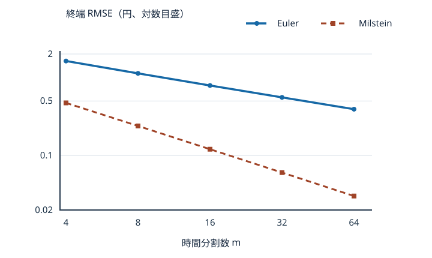

# U3-28 厳密 GBM・Euler–Maruyama・Milstein

[U3-27 の適合左端和](../U3-27/index.md#def-u3-27-left-coupled)では、既知の被積分過程を離散的に積分しました。今回は積分の中に**まだ分からない解自身**が現れます。たとえば株価の変化を現在株価に比例させると、次の時刻の株価を得るには現在株価を次々と更新しなければなりません。

幸い [U3-14 の幾何 Brown 運動（GBM）の陽解](../U3-14/index.md#thm-u3-14-explicit-gbm)は正確に分かっています。この陽解を同じ Brown 運動上の**答え合わせ用の物差し**とし、Euler–Maruyama 法（左端の係数だけで進める方法）と Milstein 法（二次変動の補正を足す方法）が何を捉え、どこで失敗するかを紙と Python で確認します。

## 1. 方程式と同じ乱数を使う三本の経路

時間 $t\in[0,T]$ は年単位、$T>0$、初期株価 $s_0>0$ 円、定数 $\mu\in\mathbb R$（年$^{-1}$）、$\sigma\ge0$（年$^{-1/2}$）を固定します。確率空間 $(\Omega,\mathcal F,P)$ 上の情報の流れ $(\mathcal F_t)_{0\le t\le T}$ と、それに関する [標準 Brown 運動](../../../解析系/STO/STO4/index.md#def-sto4-brownian-motion) $W$ を与えます。$\mathcal F_t$ は時刻 $t$ までの情報を表し、$W$ の未来増分は $\mathcal F_t$ と独立です。この節の $P$ は増分を生成する確率測度であり、無裁定価格を計算するなら別途リスク中立測度 $Q$ の下で $\mu=r-q$ を指定する必要があります。**数値近似の検証とリスク中立価格付けは別の問い**です。

[STO9 の SDE 積分表示](../../../解析系/STO/STO9/index.md#def-sto9-sde)に基づくモデルは

$$
S_t=s_0+\int_0^t\mu S_u\,du+\int_0^t\sigma S_u\,dW_u.
$$

この等式は通常の標本路ごとの微分方程式ではなく、右端の確率積分を [STO6 の Itô 積分](../../../解析系/STO/STO6/index.md#thm-sto6-l2-construction)として解釈するものです。[U3-14 の GBM](../U3-14/index.md#def-u3-14-gbm)はこの積分形を満たす連続な適合強解です。

等分割 $m\ge1$、$h=T/m$、$t_j=jh$ とし、

$$
\Delta_jW=W_{t_{j+1}}-W_{t_j}\sim N(0,h),
\qquad j=0,\ldots,m-1
$$

と置きます。異なる $j$ の増分は独立です。正規乱数の**分散は $h$、標準偏差は $\sqrt h$**であり、$h$ を標準偏差として入力するのは誤りです。

「同じ経路上で比べる」とは、三手法の $j$ 番目の更新で**まったく同じ** $\Delta_jW$ を使い、厳密値と近似値を対応させることです。最初に厳密格子経路を固定します。

<!-- formal-statement-start -->
> **定義（同一路での GBM 厳密格子経路）**  
> $T>0,m\ge1,h=T/m,t_j=jh$、$s_0>0,\mu\in\mathbb R,\sigma\ge0$ と標準 Brown 運動 $W$ に対し、[GBM 陽解](../U3-14/index.md#thm-u3-14-explicit-gbm)の格子点値を $X_j=S_{t_j}$ とする。$X_0=s_0$ とし、同じ $\Delta_jW$ により
>
$$
X_{j+1}=X_j\exp\left[
\left(\mu-\frac{\sigma^2}{2}\right)h+\sigma\Delta_jW
\right]
$$
>
> と更新する列を**同一路の厳密格子経路**と呼ぶ。
<!-- formal-statement-end -->

<!-- definition-example-start: def-u3-28-exact-grid -->
**定義の確認**：$m=2,T=1,s_0=100,\mu=0.08,\sigma=0.20$ とします。$h=0.5$、二つの増分を計算確認用に $\Delta_0W=0.3,\Delta_1W=-0.1$ と固定すると、$W_{1/2}=0.3,W_1=0.2$ です。$X_0=100>0$、各更新の乗数は正の指数関数なので $X_1,X_2>0$。積を取れば

$$
X_1=100e^{0.03+0.06}=100e^{0.09}\approx109.417428,\quad
X_2=X_1e^{0.03-0.02}=100e^{0.10}\approx110.517092.
$$

したがって各 $X_j$ は**指定した同じ Brown 運動で構成した GBM 陽解の格子点値**と一致します。株価 $X_j$ と Brown 運動の値 $W_{t_j}$ を同一視しているわけではありません。数値の増分は経路更新の手計算例であり、正規乱数標本の平均値ではありません。
<!-- definition-example-end -->

<!-- formal-statement-start -->
> **命題（GBM の厳密一刻み乗数）**  
> 上の $T,m,s_0,\mu,\sigma,W$ のもとで、各 $j=0,\ldots,m-1$ に対して
>
$$
\frac{S_{t_{j+1}}}{S_{t_j}}
=\exp\left[\left(\mu-\frac{\sigma^2}{2}\right)h
+\sigma\Delta_jW\right]>0
$$
>
> がほとんど確実に成り立ち、$S_{t_j}>0$ である。
<!-- formal-statement-end -->

**見取り図**：連続時間の陽解を各格子点で評価して割れば、途中の Brown 運動が打ち消されます。近似法では**この乗数そのものを**少数の項で近似します。

<!-- proof-start -->
### 証明

[GBM 陽解と正値性](../U3-14/index.md#thm-u3-14-explicit-gbm)より

$$
S_{t_{j+1}}
=s_0e^{(\mu-\sigma^2/2)(t_j+h)+\sigma(W_{t_j}+\Delta_jW)},\quad
S_{t_j}=s_0e^{(\mu-\sigma^2/2)t_j+\sigma W_{t_j}}>0.
$$

後式で前式を割ると、指数の差が $(\mu-\sigma^2/2)h+\sigma\Delta_jW$ となります。したがって乗数は正で、各格子点の価格も正です。これは指数候補の存在・強解一意性を再証明したのではなく、既習の陽解を**同じ Brown 運動の二時刻に適用**した結果です。
<!-- proof-end -->

## 2. 左端の係数で解を更新する Euler–Maruyama 法

SDE の積分形を一つの区間で引き算すると

$$
S_{t_{j+1}}-S_{t_j}
=\int_{t_j}^{t_{j+1}}\mu S_u\,du+
\int_{t_j}^{t_{j+1}}\sigma S_u\,dW_u
$$

です。右辺の $S_u$ は、時刻 $t_j$ ではまだ分かりません。そこで両積分の係数を既知の左端値 $E_j$ へ置き換えます。ここで左端値は時刻 $t_j$ の情報 $\mathcal F_{t_j}$ だけで決まる必要があります。[STO6 の単純予測可能被積分過程](../../../解析系/STO/STO6/index.md#def-sto6-simple-predictable)はこれに加えて係数の**有界性**も要求します。今回の $E_j$ は一般に有界でないので、その定義をそのまま適用せず、二乗可積分性を確かめてから [Itô 積分の $L^2$ 完備化](../../../解析系/STO/STO6/index.md#thm-sto6-l2-construction)を使用します。

<!-- formal-statement-start -->
> **定義（GBM の Euler–Maruyama 更新）**  
> $T>0,m\ge1,h=T/m,s_0>0,\mu\in\mathbb R,\sigma\ge0$、標準 Brown 運動 $W$ の増分 $\Delta_jW$ に対し、$E_0=s_0$ とおき、
>
$$
E_{j+1}=E_j+\mu E_jh+\sigma E_j\Delta_jW
=E_j(1+\mu h+\sigma\Delta_jW)
$$
>
> で定める離散列を Euler–Maruyama（EM）近似とする。$E_j$ は時刻 $t_j$ までの増分の関数である。
<!-- formal-statement-end -->

**左端積分をこの更新に使える理由**：$E_0=s_0$ は確定値です。$E_j$ が $\mathcal F_{t_j}$ 可測かつ二乗可積分なら、$\Delta_jW$ は $\mathcal F_{t_j}$ と独立な $N(0,h)$ なので、更新式を二乗して条件付き平均を取ると

$
\begin{aligned}
E[E_{j+1}^2\mid\mathcal F_{t_j}]
&=E_j^2 E[(1+\mu h+\sigma\Delta_jW)^2]\\
&=E_j^2\{(1+\mu h)^2+\sigma^2h\}.
\end{aligned}
$

したがって帰納法により $E_j$ は各 $j$ で $\mathcal F_{t_j}$ 可測で、

$
E[E_j^2]=s_0^2\{(1+\mu h)^2+\sigma^2h\}^j<\infty.
$

実際、区間 $(t_j,t_{j+1}]$ 上で一定の係数 $\sigma E_j$ は

$
E\int_{t_j}^{t_{j+1}}|\sigma E_j|^2\,du
=\sigma^2hE[E_j^2]<\infty
$

を満たします。$E_j$ を有界に切り詰めれば STO6 の単純予測可能係数になり、二乗平均で元の係数へ戻せます。[Itô 積分の $L^2$ 構成](../../../解析系/STO/STO6/index.md#thm-sto6-l2-construction)によって区間積分は $\sigma E_j\Delta_jW$ となります。よって、左端の係数で作った更新は単なる形式的な「$dW$ の掛け算」ではありません。

<!-- definition-example-start: def-u3-28-euler -->
**定義の確認**：第1節と同じ $h=0.5,\Delta W=(0.3,-0.1)$ を使います。最初の係数 $E_0=100$ は時刻0で既知であり、$E_1$ は $\Delta_0W$ だけで決まります。

$$
E_1=100(1+0.08\cdot0.5+0.2\cdot0.3)
=100(1.10)=110.
$$

次の更新には過去の $E_1$ と新たな $\Delta_1W$ だけを使い、

$$
E_2=110(1+0.04-0.02)=110(1.02)=112.2
$$

です。$E_j$ の適合性と、指定増分の再利用が確認できました。この一経路では $E_2-X_2\approx1.682908$ 円です。
<!-- definition-example-end -->

式を導いた理由は、決定論的な積分へ $\mu E_jh$、確率積分へ $\sigma E_j\Delta_jW$ を入れたからです。ただし $S_u$ を $E_j$ へ置き換えた**差**は残り、厳密乗数と一致するとは限りません。特に大きな負の Brown 増分が来ると、乗数 $1+\mu h+\sigma\Delta_jW$ は負になる可能性があります。

## 3. 二次変動を残す Milstein 法

EM は $\Delta W$ の一次項までしか保持しません。しかし $S_u$ も区間内の Brown 運動によって動き、その動きが次の確率積分の係数を変えます。一般のスカラー SDE の拡散係数を $g(x)$ とすると、滑らかな $g$ に対する局所的な一次展開は

$$
g(S_u)\approx g(S_{t_j})
+g'(S_{t_j})g(S_{t_j})(W_u-W_{t_j})
$$

です。ここで $g'$ は**状態変数 $x$ に関する導関数**です。時間変数ではありません。この式は、$S_u-S_{t_j}$ の雑音側の一次近似 $g(S_{t_j})(W_u-W_{t_j})$ を $g$ の Taylor 展開へ代入したものです。ドリフトや二次以上の残りは消えたのではなく、ここでは更新公式の導出のため切り離しています。

局所雑音が生む追加項を正確に計算するには、[Itô 過程版の時間依存 Itô 公式](../../../解析系/STO/STO7/index.md#thm-sto7-ito-process-formula)を使います。

<!-- formal-statement-start -->
> **命題（反復 Itô 積分の二次変動補正）**  
> 標準 Brown 運動 $W$、$0\le t<t+h\le T$、$h>0$ に対して、
>
$$
\int_t^{t+h}(W_u-W_t)\,dW_u
=\frac12\left[(W_{t+h}-W_t)^2-h\right]
$$
>
> がほとんど確実に成り立つ。右辺の条件付き平均は、時刻 $t$ の情報の下で0である。
<!-- formal-statement-end -->

**見取り図**：二乗の微分に $dt$ の項が現れるのが通常の Taylor 展開と異なる点です。「$-\!h$」を忘れると補正が平均0でなくなり、そもそも左端で構成した Itô 積分の性質と一致しません。

<!-- proof-start -->
### 証明

区間内で $B_v=W_{t+v}-W_t$（$0\le v\le h$）と置くと、$B_0=0$ で、Brown 運動の増分性により $B$ は時刻 $t$ 以降の標準 Brown 運動です。[一次元 Itô 公式](../../../解析系/STO/STO7/index.md#thm-sto7-ito-process-formula)を $f(x)=x^2$、$f'(x)=2x$、$f''(x)=2$ に適用すると

$$
B_h^2-B_0^2
=2\int_0^hB_v\,dB_v+\frac12\int_0^h2\,dv
=2\int_t^{t+h}(W_u-W_t)\,dW_u+h.
$$

$B_0=0$ を代入し移項して主張を得ます。また $W_{t+h}-W_t\sim N(0,h)$ は $\mathcal F_t$ と独立で、$E[(W_{t+h}-W_t)^2\mid\mathcal F_t]=h$ です。したがって右辺の条件付き平均は $\frac12(h-h)=0$ です。
<!-- proof-end -->

実際、拡散係数を区間の左端で展開して確率積分へ代入すると、更新式を得るための局所近似は

$
\begin{aligned}
\int_{t_j}^{t_{j+1}}g(S_u)\,dW_u
&\approx g(S_{t_j})\Delta_jW\\
&\quad+g'(S_{t_j})g(S_{t_j})
\int_{t_j}^{t_{j+1}}(W_u-W_{t_j})\,dW_u\\
&=g(S_{t_j})\Delta_jW
+\frac12g'(S_{t_j})g(S_{t_j})\{(\Delta_jW)^2-h\}
\end{aligned}
$

となります。最後の等号は直前の [反復 Itô 積分の命題](#prop-u3-28-ito-correction)による**正確な**変形です。一方、最初の近似では高次の残りを省いており、その誤差評価は後続の講義で扱います。

GBM では $g(x)=\sigma x$、$g'(x)=\sigma$ なので $g'(x)g(x)=\sigma^2x$ です。時間積分の左端近似 $\mu S_{t_j}h$ と合わせ、未知の真値 $S_{t_j}$ を数値値 $M_j$ に置き換えれば、次の更新式の Milstein 補正 $\frac12\sigma^2M_j\{(\Delta_jW)^2-h\}$ が現れます。

<!-- formal-statement-start -->
> **定義（GBM のスカラー Milstein 更新）**  
> $T>0,m\ge1,h=T/m,s_0>0,\mu\in\mathbb R,\sigma\ge0$ と標準 Brown 運動 $W$ の増分を固定する。$M_0=s_0$ とし、
>
$$
M_{j+1}=M_j\left[
1+\mu h+\sigma\Delta_jW
+\frac{\sigma^2}{2}\{(\Delta_jW)^2-h\}
\right]
$$
>
> をスカラー GBM の Milstein 近似とする。最後の項を **Milstein 補正**と呼ぶ。
<!-- formal-statement-end -->

<!-- definition-example-start: def-u3-28-milstein -->
**定義の確認**：$h=0.5,\sigma=0.2$ なら、$\sigma^2/2=0.02$ です。$\Delta_0W=0.3$ の二乗から $h$ を引くと $0.09-0.5=-0.41$ なので第1乗数は

$$
1+0.04+0.06+0.02(-0.41)=1.0918,
\qquad M_1=109.18.
$$

$\Delta_1W=-0.1$ なら $(\Delta_1W)^2-h=0.01-0.5=-0.49$ で、

$$
M_2=109.18\{1+0.04-0.02+0.02(-0.49)\}
=109.18(1.0102)=110.293636.
$$

この例では $M_2-X_2\approx-0.223456$ 円。各段の係数は過去の $M_j$ とその区間の増分だけで決まり、未来の情報を使用していません。正規増分の二乗から**その分散 $h$**を差し引いている点も確認しました。
<!-- definition-example-end -->

この補正を、多次元の非可換ノイズや滑らかさを欠く係数へ無条件に移してはいけません。ここで使ったのは一つの Brown 運動に駆動されるスカラーの $g(x)=\sigma x$ であり、補正の高次誤差の一般論は U3-30 で学びます。

## 4. 三手法の経路と、正値性の落とし穴

一つの経路を3方法で更新すると次のようになります。**列ごとに独立の乱数を引いていません。**

| 時刻 | 厳密 $X_j$（円） | EM $E_j$（円） | Milstein $M_j$（円） |
| --- | ---: | ---: | ---: |
| $0$ | 100.000000 | 100.000000 | 100.000000 |
| $0.5$ | 109.417428 | 110.000000 | 109.180000 |
| $1$ | 110.517092 | 112.200000 | 110.293636 |

この例だけを見ると Milstein がいつも正値を保ち、必ず EM より精確に見えます。しかしどちらも一般には保証されません。**厳密な指数乗数**と**多項式で切り取った乗数**は、負の増分に対して異なります。

<!-- formal-statement-start -->
> **命題（離散更新における正値性の限界）**  
> $h>0,\mu\in\mathbb R,\sigma>0$ とし、$\Delta W\sim N(0,h)$ とする。厳密 GBM の乗数は常に正である。EM の乗数 $F_E=1+\mu h+\sigma\Delta W$ は負となる確率が正である。Milstein の乗数
>
$$
F_M=1+\mu h+\sigma\Delta W+
\frac{\sigma^2}{2}\{(\Delta W)^2-h\}
$$
>
> は $\Delta W\in\mathbb R$ 上で最小値
>
$$
\min F_M=\frac12+\left(\mu-\frac{\sigma^2}{2}\right)h
$$
>
> を取る。よってこの最小値が正なら全増分で正、0ならほとんど確実に正、負なら負となる確率が正である。
<!-- formal-statement-end -->

**見取り図**：EM は傾き $\sigma$ の直線で、正規分布の左裾が負の乗数を作ります。Milstein は二次関数なので、平方完成により**最も危険な増分**を調べられます。

<!-- proof-start -->
### 証明

厳密乗数は [厳密一刻み乗数](#prop-u3-28-exact-flow)で示した正の指数関数です。EM は $\sigma>0$ なら

$$
F_E<0\quad\Longleftrightarrow\quad
\Delta W<-\frac{1+\mu h}{\sigma}
$$

であり、正規分布は任意の実数より左に正の確率を持ちます。

Milstein では $u=\sigma\Delta W$ と置いて平方完成すると

$$
\begin{aligned}
F_M
&=1+\mu h+u+\frac12(u^2-\sigma^2h)\\
&=\frac12(u+1)^2+\frac12+
\left(\mu-\frac{\sigma^2}{2}\right)h.
\end{aligned}
$$

$\sigma>0$ なので $u$ の正規分布の確率密度関数は実数上のどの点でも0を超えます。第1項は $u=-1$ で0となります。最小値が負ならその付近の**開区間**で $F_M<0$ となり、正の確率で負になります。最小値が0なら $F_M=0$ は $u=-1$ の一点だけであり、連続分布ゆえ確率0です。最小値が正なら全実数で正です。
<!-- proof-end -->

**失敗を手計算で再現**：$s_0=100,\mu=0,\sigma=2,T=h=1$、一つの増分 $\Delta W=-0.5$ を指定します。厳密乗数は $e^{(0-2)+2(-0.5)}=e^{-3}>0$、EM は $1+2(-0.5)=0$、Milstein は

$$
1+2(-0.5)+\frac{2^2}{2}\{(-0.5)^2-1\}
=0+2(-0.75)=-1.5.
$$

よって厳密値 $100e^{-3}\approx4.9787$ 円に対し、EM は0円、Milstein は $-150$ 円です。**正値性という仮定を失ったのではなく、近似乗数の形が正値性を維持できない**のが破綻機構です。$\sigma=0$ の場合は両数値法とも $1+\mu h$ となり、$\mu h<-1$ なら負になるので、上の確率的な判定とは分けて扱います。

## 5. 強誤差と弱誤差を同じ実験で混同しない

強誤差は**同一 Brown 運動で作った二つの終端値の差**を測ります。弱誤差は、例えば最終価格の平均という**期待値の差**を測ります。両者を同じ「誤差」とだけ書くと、刻み幅の効果と標本数の効果も混乱します。一般の試験関数と収束次数の条件は U3-29 で扱い、ここでは $\varphi(s)=s$ を計算します。

<!-- formal-statement-start -->
> **定義（同一路 GBM の終端強・弱誤差）**  
> $T>0,m\ge1,s_0>0,\mu\in\mathbb R,\sigma\ge0$、同一 Brown 運動 $W$ から作る厳密値 $X_m=S_T$、近似値 $Y_m\in\{E_m,M_m\}$ について、終端の強二乗平均平方根誤差と、試験関数 $\varphi(s)=s$ に対する弱誤差を
>
$$
\operatorname{RMSE}_{\rm strong}(Y_m)
=\sqrt{E[(Y_m-X_m)^2]},\qquad
B_{\rm weak}(Y_m)=E[Y_m]-E[X_m]
$$
>
> とする。$X_m,Y_m$ は同じ $W$ に対応させる。$\operatorname{RMSE}_{\rm strong}$ は非負、$B_{\rm weak}$ は符号を持つ。
<!-- formal-statement-end -->

<!-- definition-example-start: def-u3-28-terminal-errors -->
**定義の確認**：一つの手計算経路では $E_2-X_2\approx1.682908$ ですが、これは**強誤差の一標本**であり RMSE ではありません。独立な経路を $n\ge2$ 本作り、各経路 $i$ で同一増分から $Y_m^{(i)},X_m^{(i)}$ を計算すれば

$$
\widehat q=\frac1n\sum_{i=1}^n(Y_m^{(i)}-X_m^{(i)})^2,\quad
\widehat B=\frac1n\sum_{i=1}^n(Y_m^{(i)}-X_m^{(i)})
$$

でそれぞれ強平均二乗誤差（Mean Squared Error; MSE）と弱誤差の標本推定ができます。[Monte Carlo 推定量の不偏性・分散・二乗平均平方根誤差](../../../計算系/MC/MC1/index.md#prop-mc1-unbiased-variance-rmse)により、二乗値の標本標準偏差を $\sqrt n$ で割ると $\widehat q$ の推定標準誤差になります。$n$ を増やしても本来の離散化誤差は減りません。
<!-- definition-example-end -->

### 5.1 乱数実験とは独立の理論 MSE を作る

GBM なら、驚くべきことに有限 $m$ における強 MSE を**正規積分だけで正確に**計算できます。これをランダムなシミュレーションの合否判定に使います。以下の式はすべて有限の $m$ で等号です。

<!-- formal-statement-start -->
> **命題（GBM の有限刻み強 MSE と平均偏り）**  
> $T>0,m\ge1,h=T/m,s_0>0,\mu\in\mathbb R,\sigma\ge0$、標準 Brown 運動 $W$ に対する [厳密格子経路](#def-u3-28-exact-grid)、[EM 更新](#def-u3-28-euler)、[Milstein 更新](#def-u3-28-milstein)を同一路で作る。次の量を置く。
>
$$
\begin{aligned}
A&=e^{(2\mu+\sigma^2)T},\\
D_E&=(1+\mu h)^2+\sigma^2h,\\
D_M&=D_E+\tfrac12\sigma^4h^2,\\
C_E&=1+(\mu+\sigma^2)h,\\
C_M&=C_E+\tfrac12\sigma^4h^2.
\end{aligned}
$$
>
> このとき
>
$$
E[(E_m-X_m)^2]
=s_0^2\left[A+D_E^m-2e^{\mu T}C_E^m\right],
$$
>
$$
E[(M_m-X_m)^2]
=s_0^2\left[A+D_M^m-2e^{\mu T}C_M^m\right].
$$
>
> さらに $\varphi(s)=s$ に対する**両数値法共通**の弱誤差は
>
$$
B_{\rm weak}=s_0\left[(1+\mu h)^m-e^{\mu T}\right].
$$
<!-- formal-statement-end -->

**見取り図**：1区間の乗数を $R$（厳密）、$F_E,F_M$（近似）とすると、独立増分のため「終端の二乗期待値」は**1区間の二乗期待値の $m$ 乗**になります。差の二乗を計算するには、厳密値と近似値の相互積 $E[RF]$ が重要です。別々の Brown 運動を生成するとこの相互積が変わり、示した式を使えません。

<!-- proof-start -->
### 証明

$Z=\Delta W\sim N(0,h)$ とし、$R=e^{(\mu-\sigma^2/2)h+\sigma Z}$、$F_E=1+\mu h+\sigma Z$、$F_M=F_E+\frac12\sigma^2(Z^2-h)$ と置きます。[U3-14 の正規指数モーメント](../U3-14/index.md#prop-u3-14-moments)の導出に用いた $E[e^{aZ}]=e^{a^2h/2}$ を微分するか、正規密度の平方完成を使うと

$$
\begin{aligned}
E[e^{\sigma Z}]&=e^{\sigma^2h/2},\\
E[Ze^{\sigma Z}]&=\sigma h e^{\sigma^2h/2},\\
E[(Z^2-h)e^{\sigma Z}]&=\sigma^2h^2e^{\sigma^2h/2}.
\end{aligned}
$$

ここで第2式は指数モーメントを $\sigma$ で一回、第3式は二回微分して $hE[e^{\sigma Z}]$ を引くことで得ます。正規分布の指数可積分性によりこれらの微分交換は許されます。これを厳密乗数へ代入すると

$$
\begin{aligned}
E[R]&=e^{\mu h},\\
E[R^2]&=e^{(2\mu+\sigma^2)h},\\
E[RF_E]&=e^{\mu h}\{1+\mu h+\sigma^2h\}
=e^{\mu h}C_E,\\
E[RF_M]&=E[RF_E]+\tfrac12\sigma^2
  E[R(Z^2-h)]
=e^{\mu h}(C_E+\tfrac12\sigma^4h^2)
=e^{\mu h}C_M.
\end{aligned}
$$

次に $E[Z]=0,E[Z^2]=h,E[Z^3]=0,E[Z^4]=3h^2$ を使い、交差項を一つずつ確かめます。

$$
E[F_E]=1+\mu h,\qquad
E[F_E^2]=(1+\mu h)^2+\sigma^2h=D_E.
$$

$H=\frac12\sigma^2(Z^2-h)$ とおくと $E[H]=0$、$E[ZH]=\frac12\sigma^2(E[Z^3]-hE[Z])=0$ です。また

$$
E[H^2]=\tfrac14\sigma^4\{E[Z^4]-2hE[Z^2]+h^2\}
=\tfrac14\sigma^4(3h^2-2h^2+h^2)
=\tfrac12\sigma^4h^2.
$$

したがって $E[F_M]=1+\mu h$、$E[F_M^2]=D_E+\frac12\sigma^4h^2=D_M$ です。

最後に各区間の独立性と同じ増分の共有を用いると

$$
\begin{aligned}
E[X_m^2]&=s_0^2E[R^2]^m=s_0^2A,\\
E[E_m^2]&=s_0^2D_E^m,\quad E[M_m^2]=s_0^2D_M^m,\\
E[X_mE_m]&=s_0^2(E[RF_E])^m=s_0^2e^{\mu T}C_E^m,\\
E[X_mM_m]&=s_0^2e^{\mu T}C_M^m.
\end{aligned}
$$

各組について $E[(Y_m-X_m)^2]=E[Y_m^2]+E[X_m^2]-2E[Y_mX_m]$ を適用すると MSE の二式が出ます。また $E[E_m]=E[M_m]=s_0(1+\mu h)^m$、$E[X_m]=s_0e^{\mu T}$ なので、最後の弱誤差も得ます。$\sigma=0$ でも上の各式は有効です。
<!-- proof-end -->

### 5.2 数値の予測と誤差の読み方

$s_0=100,\mu=0.08,\sigma=0.20,T=1$ を用い、命題の有限刻み式だけで平方根を計算します。以下は**シミュレーション結果ではありません**。

| $m$ | EM 理論 RMSE（円） | Milstein 理論 RMSE（円） | 共通の平均偏り（円） |
| ---: | ---: | ---: | ---: |
| 4 | 1.624777 | 0.471879 | -0.085491 |
| 16 | 0.789700 | 0.120337 | -0.021592 |
| 64 | 0.391782 | 0.030236 | -0.005412 |

この図の実線・破線は**理論 MSE から直接計算**したものです。縦軸は円単位の対数目盛で、$m=4,8,16,32,64$ を比較しています。[図を原寸で開く](assets/gbm-rmse.svg)。強誤差が小さくても、非線形ペイオフの弱誤差が同じ比率で小さくなるとは、この図からは言えません。

## 6. Python で同じ増分を使い、理論と照合する

一つの経路の処理順は、① $m$ 個の独立な $N(0,h)$ 増分を一度だけ生成、②厳密 $X_j$、EM $E_j$、Milstein $M_j$ の**三つをその増分で順番に更新**、③ $Y_m-X_m$ とその二乗を保存、④独立な経路を $n$ 本生成して標本平均を取る、です。

$n$ 本の誤差二乗を $V_i=(Y_m^{(i)}-X_m^{(i)})^2$、平均を $\bar V$ とすると、[Monte Carlo 推定量の不偏性・分散・二乗平均平方根誤差](../../../計算系/MC/MC1/index.md#prop-mc1-unbiased-variance-rmse)により

$$
\widehat{\operatorname{SE}}(\bar V)
=\sqrt{\frac{\sum_{i=1}^n(V_i-\bar V)^2}{n(n-1)}}
$$

と推定できます。標本 RMSE $\sqrt{\bar V}$ と**MSE の推定標準誤差**は異なる量であり、そのまま大小比較してはいけません。$m$ は離散化誤差、$n$ は推定値の統計的な揺れを支配する別々のパラメータです。

[実行ソース・テスト・再現手順](assets/README.md)は Python 3.10 以降の標準ライブラリで実行可能です。固定シード 20261114、分割数 $m=4,16,64$、それぞれ $n=1800$ 本を使います。読み込んだコードと同じソースがブラウザ上で実行されるため、環境ごとの丸め差を除いて更新規約が一致します。初回の Pyodide 読み込みには通信が必要な場合があります。

~~~python-file-lab
# lab-id: U3-28-GBM-SCHEMES
# lab-title: 厳密 GBM・Euler–Maruyama・Milstein 同一路比較
# lab-file: textbook/volumes/dream_thater/応用系/U/U3-28/assets/gbm_schemes.py
# timeout-ms: 30000
# lab-preset: 同一 Brown 増分で強MSEと弱平均差を測り、独立の厳密MSE公式へ照合 |
~~~

**実験の受け入れ方**：理論 MSE と標本 MSE の差を、各実験で出す MSE 推定標準誤差と比較します。例えばその6倍以内というテスト閾値は固定シードの数値誤差検査用であり、数学的な絶対誤差保証ではありません。符号付き平均差の推定値も、その標本標準誤差の規模で読んでください。

**破綻条件を切り分ける**：EM が負値になるのは近似乗数の問題、Milstein の二乗項から $h$ を引き忘れれば平均0の補正ではなくなる問題、別々の増分列を使うと強誤差の比較自体が無効になる問題です。また有限刻みの MSE 公式は互いに近い大数の差なので、極端に細かい刻みで浮動小数点の桁落ちが起き得ます。正値化のために負の近似値を0へ切り詰めると**別の数値法**になるため、検証段階で勝手に修正してはいけません。

## 7. 演習と詳細解答

特に指定しなければ $W_0=0$ の標準 Brown 運動、$s_0>0,T>0,m\ge1,h=T/m,\mu\in\mathbb R,\sigma\ge0$ を用い、厳密列 $X$、EM 列 $E$、Milstein 列 $M$ は**共通の $\Delta_jW$**で作るものとします。

### U3-28-A1：手計算で三手法の一刻み更新
- Level: A

$s_0=100,\mu=0.08,\sigma=0.2,T=1,m=2$ で、最初の増分が $0.3$ とする。時刻 $1/2$ の三手法の値をそれぞれ求めよ。

<!-- solution-start -->
**詳細解答**：$h=1/2$、$\mu h=0.04$、$\sigma^2h/2=0.01$。[厳密乗数](#prop-u3-28-exact-flow)で指数は $(0.08-0.02)/2+0.2(0.3)=0.09$、$X_1=100e^{0.09}\approx109.417428$。[EM 定義](#def-u3-28-euler)は $E_1=100(1+0.04+0.06)=110$。[Milstein 定義](#def-u3-28-milstein)の補正は $\frac12(0.2)^2(0.3^2-0.5)=0.02(-0.41)=-0.0082$ なので、$M_1=100(1.10-0.0082)=109.18$。
<!-- solution-end -->

### U3-28-A2：なぜ $-\!h$ を引くか
- Level: A

$h=0.25,\sigma=0.4$、左端の値 $x=100$、一増分 $\Delta W=-0.1$ とする。Milstein 補正の金額を求めよ。また補正の条件付き平均を述べよ。

<!-- solution-start -->
**詳細解答**：[反復 Itô 積分の二次変動補正](#prop-u3-28-ito-correction)より補正は $\frac12\sigma^2x((\Delta W)^2-h)$。$\sigma^2=0.16$、$(\Delta W)^2-h=0.01-0.25=-0.24$ なので $\frac12(0.16)(100)(-0.24)=8(-0.24)=-1.92$ 円。増分が $N(0,h)$ だから左端の情報の下で $E[(\Delta W)^2]=h$、従って $E[\frac12\sigma^2x((\Delta W)^2-h)\mid\mathcal F_t]=0$ である。$-\!h$ を省くと $0.5\sigma^2xh=2$ 円の正の条件付き平均が余分に生まれる。
<!-- solution-end -->

### U3-28-A3：一刻み乗数の二乗モーメント
- Level: A

$\mu=0.08,\sigma=0.2,h=0.25$ とし、EM と Milstein の一刻み乗数の平均と二乗期待値を求めよ。

<!-- solution-start -->
**詳細解答**：[有限刻み MSE 命題の証明](#prop-u3-28-finite-mse)の乗数 $F_E,F_M$ について、どちらも平均は $1+\mu h=1+0.02=1.02$。EM の二乗期待値は $D_E=(1.02)^2+(0.2)^2(0.25)=1.0404+0.01=1.0504$。Milstein はさらに $\sigma^4h^2/2=(0.2)^4(0.25)^2/2=0.0016\cdot0.0625/2=0.00005$ を足すので $E[F_M^2]=1.05045$。平均が同じでも二乗モーメントは異なる。
<!-- solution-end -->

### U3-28-A4：負値は出るか
- Level: A

$s_0=100,\mu=0,\sigma=2,h=T=1,\Delta W=-0.5$ で三手法の終端値を計算し、Milstein が正値性を保証しない理由を述べよ。

<!-- solution-start -->
**詳細解答**：[厳密乗数](#prop-u3-28-exact-flow)は $e^{(0-4/2)+2(-0.5)}=e^{-3}$ なので $X_1=100e^{-3}>0$。EM 乗数は $1-1=0$ で $E_1=0$。Milstein は $F_M=1-1+(4/2)(0.25-1)=-1.5$、よって $M_1=-150$。[正値性の命題](#prop-u3-28-positivity)の最小値も $1/2+(0-2)1=-1.5<0$ であり、単発の数値例だけでなく正規増分の開区間で負値を取り得る。
<!-- solution-end -->

### U3-28-A5：正規乱数の入力は標準偏差
- Level: A

$T=2,m=8$ の Brown 増分について、分散・標準偏差・独立性を指定せよ。誤って標準偏差 $h$ で乱数生成した場合、各増分の分散はいくらになるか。

<!-- solution-start -->
**詳細解答**：$h=T/m=2/8=1/4$。[Brown 運動の独立増分](../../../解析系/STO/STO4/index.md#def-sto4-brownian-motion)により各増分は独立に $N(0,1/4)$、標準偏差は $\sqrt{1/4}=1/2$ である。誤って $h=1/4$ を標準偏差にすると分散は $(1/4)^2=1/16$ となり、本来の $1/4$ の4分の1になる。従って SDE も同じ Brown 運動も再現していない。
<!-- solution-end -->

### U3-28-B1：正値性の判定を一般の増分で行う
- Level: B

$\mu=0,\sigma=1,h=1/2$ で、EM と Milstein の乗数の正値性を比較せよ。続いて $\mu=0,\sigma=2,h=1$ では Milstein の負値区間が存在することを示せ。

<!-- solution-start -->
**詳細解答**：前者の EM は $1+\Delta W$ で、$\Delta W<-1$ の正規分布左裾で負となる。一方、[正値性の命題](#prop-u3-28-positivity)で Milstein の最小値は $1/2+(0-1/2)(1/2)=1/4>0$、したがって全実数の増分で正である。後者では最小値が $1/2+(0-4/2)1=-3/2<0$。平方完成した $F_M=\frac12(2\Delta W+1)^2-3/2$ より $|2\Delta W+1|<\sqrt3$ で $F_M<0$。この開区間は正規分布で正の確率を持つ。
<!-- solution-end -->

### U3-28-B2：一刻みの厳密 MSE を再導出
- Level: B

$s_0=1,\mu=0,\sigma=1,T=m=h=1$ とする。終端強 MSE を厳密な指数モーメントから両数値法について求め、大小を比較せよ。

<!-- solution-start -->
**詳細解答**：$Z\sim N(0,1)$ で $R=e^{-1/2+Z}$。$E[R^2]=e$、$E[R]=1$。[有限刻み命題の証明](#prop-u3-28-finite-mse)の計算を $h=1,\mu=0,\sigma=1$ に当てはめる。EM は $F_E=1+Z$ なので $E[F_E^2]=1+E[Z^2]=2$、$E[RF_E]=E[R]+E[RZ]=1+1=2$。従って MSE は $e+2-2\cdot2=e-2\approx0.718282$。Milstein は $F_M=1+Z+(Z^2-1)/2$。$E[(Z^2-1)^2]=2$、$E[Z(Z^2-1)]=0$ より $E[F_M^2]=2+(1/4)2=2.5$、さらに $E[R(Z^2-1)]=1$ だから $E[RF_M]=2+(1/2)1=2.5$。MSE は $e+2.5-5=e-2.5\approx0.218282$。この指定したモデル・刻みでは Milstein が小さいが、すべての SDE に無条件で外挿しない。
<!-- solution-end -->

### U3-28-B3：弱誤差とペイオフの取り違え
- Level: B

$s_0=100,\mu=0.10,T=1,m=2$ で $\varphi(s)=s$ の弱誤差を計算せよ。$\sigma$ が式に現れない理由と、この値を call ペイオフの弱誤差に流用できない理由を述べよ。

<!-- solution-start -->
**詳細解答**：[有限刻み命題](#prop-u3-28-finite-mse)の平均偏り公式で $h=1/2$、$1+\mu h=1.05$、従って

$$
B_{\rm weak}=100\{(1.05)^2-e^{0.10}\}
=100(1.1025-1.105170918\ldots)
\approx-0.267092.
$$

$\Delta W$ と $(\Delta W)^2-h$ はともに平均0なので、一刻みの両乗数の平均は $1+\mu h$ となり、$\sigma$ はこの試験関数の平均差に現れない。しかし call の $(s-K)_+$ は非線形で、$E[(S_T-K)_+]$ は $E[S_T]$ だけでは決まらない。試験関数を変更した場合は両数値法のペイオフを改めて計算する必要がある。
<!-- solution-end -->

### U3-28-B4：刻み数と標本数の分業
- Level: B

$Y_m$ を EM または Milstein とする。$m=32$ を固定し $n=1024$ 本から4096本へ増やす実験と、$n$ を固定して $m$ を増やす実験を設計し、各実験で何を期待でき何を保証できないか述べよ。

<!-- solution-start -->
**詳細解答**：各経路 $i$ に $m$ 個の独立な $N(0,T/m)$ 増分を与え、同一路で $Y_m^{(i)}$ と $X_m^{(i)}$ を作る。二乗差を $V_i$、符号付き差を $D_i$ とする。

[Monte Carlo 推定量の不偏性・分散・二乗平均平方根誤差](../../../計算系/MC/MC1/index.md#prop-mc1-unbiased-variance-rmse)を独立同分布な $V_i,D_i$ に適用すると、

$$
\operatorname{Var}(\bar V)=\frac{\operatorname{Var}(V_1)}n,
\qquad
\operatorname{Var}(\bar D)=\frac{\operatorname{Var}(D_1)}n
$$

である。$m=32$ を固定し $n$ を4倍にすると、どちらの標本平均の推定標準誤差も理論上約半分になる。ただし**真の離散化 MSE も弱誤差も不変**である。

逆に $n$ を固定し $m$ を増やすと、対象となる真の誤差は [GBM の有限刻み強 MSE と平均偏り](#prop-u3-28-finite-mse)で変わり得る。ただし、有限標本の実測値や単一経路誤差が毎回単調減少する保証はない。

異なる $m$ も経路単位で比較する場合は、細格子増分を足し合わせて粗格子増分を作り、共通の Brown 運動を維持する。
<!-- solution-end -->

### U3-28-C1：厳密値・補正・誤差・破綻を一度に検査
- Level: C

$s_0=100,\mu=0.08,\sigma=0.2,T=1,m=2,\Delta W=(0.3,-0.1)$ とする。(i) 三手法の中間・終端値を算出し、Milstein 補正を各段に分解せよ。(ii) この一経路の誤差と強 RMSE の違いを説明せよ。(iii) 同じパラメータで $m=4,16$ の**真の**終端強 RMSE と弱平均偏りを理論式で求めよ。(iv) 乱数を別々に生成した比較と、負値を0に切り詰めた比較がなぜ検証として不適切か説明せよ。

<!-- solution-start -->
**詳細解答**：

(i) $h=1/2$、[厳密格子経路](#def-u3-28-exact-grid)は $X_1=100e^{0.09}\approx109.417428$、$X_2=100e^{0.10}\approx110.517092$。[EM 更新](#def-u3-28-euler)は第1乗数 $1.10$、第2乗数 $1.02$ なので $E_1=110,E_2=112.2$。Milstein は二乗変動補正を第1段で $0.02(0.09-0.5)=-0.0082$、第2段で $0.02(0.01-0.5)=-0.0098$ とする。従って $M_1=100(1.10-0.0082)=109.18$、$M_2=109.18(1.02-0.0098)=110.293636$。この手計算経路では Milstein の誤差の絶対値が小さい。

(ii) 終端符号付き誤差は $E_2-X_2\approx+1.682908$、$M_2-X_2\approx-0.223456$ 円。[終端強誤差の定義](#def-u3-28-terminal-errors)では、**全 Brown 経路に関する二乗期待値を取ってから平方根**を計算する。一経路の絶対誤差をそのまま理論 RMSE と呼べない。

(iii) [有限刻み命題](#prop-u3-28-finite-mse)へ $s_0=100,\mu=0.08,\sigma=0.2,T=1,h=1/m$ を代入すると、$A=e^{0.20}$、$D_E=(1+0.08/m)^2+0.04/m$、$D_M=D_E+0.0008/m^2$、$C_E=1+0.12/m$、$C_M=C_E+0.0008/m^2$。従って

$$
\operatorname{RMSE}_E(m)
=100\sqrt{e^{0.2}+D_E^m-2e^{0.08}C_E^m},
$$

$$
\operatorname{RMSE}_M(m)
=100\sqrt{e^{0.2}+D_M^m-2e^{0.08}C_M^m}.
$$

$m=4$ では順に約 $1.624777$ 円、$0.471879$ 円、$m=16$ では約 $0.789700$ 円、$0.120337$ 円。共通の弱平均偏りは $m=4$ で $100\{(1.02)^4-e^{0.08}\}\approx-0.085491$ 円、$m=16$ で $100\{(1.005)^{16}-e^{0.08}\}\approx-0.021592$ 円。強誤差と弱平均偏りは異なる量である。

(iv) 異なる増分を使うと $E[(Y_m-X_m)^2]$ の**同一路相互積** $E[Y_mX_m]$ が [証明](#prop-u3-28-finite-mse)と異なり、離散化誤差だけを測れない。負値を0へ切り詰めると更新規則そのものが変わり、[正値性の命題](#prop-u3-28-positivity)が明らかにした破綻を隠してしまう。先に元の更新の誤差・負値頻度を報告し、正値化法を別モデルとして比較すべきである。
<!-- solution-end -->

## 8. 次の問い

GBM では厳密値が分かるため、同一路の強 MSE を有限刻みで証明し、標本実験の検算もできました。一方、**何倍細かくすると強・弱誤差が何倍減るか**は、係数の滑らかさ、試験関数、比較対象によって変わります。次の **U3-29「強収束・弱収束と誤差予算」**では収束次数と必要な条件を整理します。
