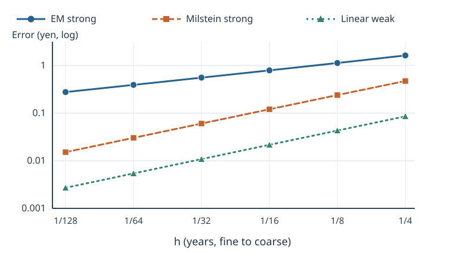

# U3-29 強収束・弱収束と誤差予算

[U3-28 の同一路 GBM・Euler–Maruyama・Milstein](../U3-28/index.md#def-u3-28-terminal-errors)では、同じ Brown 運動で厳密解と数値解を作り、終端の誤差を測りました。しかし、表の一行だけで「何次で収束する」と言えるのでしょうか。さらに、オプション価格を Monte Carlo 法で求めるなら、時間刻みを細かくするだけでは標本平均の揺れは消えません。

ここでは**同一路の近さ（強収束）**、**期待値の近さ（弱収束）**、**価格推定の誤差予算**を別々に定義します。二乗した差の期待値を平均二乗誤差（Mean Squared Error; MSE）と呼び、[GBM の有限刻み強 MSE と平均偏り](../U3-28/index.md#prop-u3-28-finite-mse)から収束次数を計算します。抽象的な確率微分方程式の一般収束定理を、必要条件を省いてすべての係数・商品へ適用することはしません。

## 1. 何を近似するかで「収束」の意味が違う

固定した満期 $T>0$（年）、確率空間 $(\Omega,\mathcal F,P)$、標準 Brown 運動 $W$ を考えます。[STO9 の確率微分方程式](../../../解析系/STO/STO9/index.md#def-sto9-sde)の強解を $S_t$、分割数 $m\ge1$・刻み $h=T/m$ の数値終端値を $Y_m$ とします。**強誤差を論じるときは $Y_m$ と $S_T$ を同じ $W$ で構成**します。$E$ は確率測度 $P$ に関する期待値です。

「標本路の終端値が近い」と「価格を与える期待値が近い」は別です。前者は同じ乱数を共有して差を取り、後者は商品支払を表す関数 $\varphi$ を通して平均を比較します。価格付けの場合だけ、$P$ を適切なリスク中立測度 $Q$ に置き換えて割引支払額を使います。

<!-- formal-statement-start -->
> **定義（終端の強誤差・弱誤差と収束次数）**  
> $T>0$ とし、同じ Brown 運動上で定義された厳密終端値 $S_T$ と分割数 $m$ の近似終端値 $Y_m$ について、$q\ge1$ で $E|S_T|^q+E|Y_m|^q<\infty$ を仮定する。**強 $L^q$ 誤差**を
>
$$
e_q(h)=\{E|Y_m-S_T|^q\}^{1/q},\qquad h=T/m
$$
>
> とする。十分小さい $h=T/m$ に対して、$m$ に依存しない定数 $C,h_0>0$ があり、$0<h\le h_0$ で $e_q(h)\le Ch^\alpha$ なら、**強次数が少なくとも $\alpha>0$**であるという。
>
> 一方、可測な試験関数 $\varphi:\mathbb R\to\mathbb R$ に対し $E|\varphi(S_T)|+E|\varphi(Y_m)|<\infty$ とするとき、**弱誤差**は
>
$$
b_\varphi(h)=E[\varphi(Y_m)]-E[\varphi(S_T)]
$$
>
> であり、十分小さい $h=T/m$ で $|b_\varphi(h)|\le C_\varphi h^\beta$ が成立すれば、**その $\varphi$ に対して弱次数が少なくとも $\beta>0$**であるという。
<!-- formal-statement-end -->

「少なくとも」を付けるのは、$O(h^\alpha)$ がより速い収束を排除しないからです。正確に $\alpha$ 次と示すには、典型的には $e_q(h)/h^\alpha$ が正の定数へ収束することまで調べます。強 $L^2$ 誤差の単位は株価と同じ円、$\varphi(s)=s^2$ の弱誤差の単位は円$^2$ です。

<!-- definition-example-start: def-u3-29-strong-weak -->
**定義の確認**：$S_0=100$ 円、$\mu=0.08$ 年$^{-1}$、$\sigma=0.20$ 年$^{-1/2}$、$T=1$ 年の GBM を同じ $W$ で EM と Milstein に結合します。$m=4$ のとき、[GBM の有限刻み強 MSE と平均偏り](../U3-28/index.md#prop-u3-28-finite-mse)から

$$
e_2^{\rm EM}(1/4)=1.624777,\qquad
e_2^{\rm Mil}(1/4)=0.471879
$$

です（数値の単位は円）。一方 $\varphi(s)=s$ に対する**符号付き**弱誤差は両方式とも $-0.085491$ 円です。$e_2$ は同一経路差の二乗を期待値化した**非負の量**で、$b_\varphi$ は各方式の期待値を引き算した**符号を持つ量**です。これらは有限の二次モーメントを持つため、定義の可積分条件も満たします。単一の経路上で誤差が小さくても、期待値としての強誤差を証明したことにはなりません。
<!-- definition-example-end -->

強 $L^2$ の評価から弱誤差をいくらかは抑えられます。しかし弱次数が強次数より良いこともあり得ます。

<!-- formal-statement-start -->
> **命題（強 L2 誤差から Lipschitz 試験関数の弱誤差を抑える）**  
> 実数値確率変数 $X,Y$ が同一確率空間にあり、$E|X|^2+E|Y|^2<\infty$ とする。$\varphi:\mathbb R\to\mathbb R$ がある $L\ge0$ に対し任意の $x,y\in\mathbb R$ で $|\varphi(x)-\varphi(y)|\le L|x-y|$ を満たすなら、
>
$$
|E[\varphi(Y)]-E[\varphi(X)]|
\le L\{E|Y-X|^2\}^{1/2}.
$$
<!-- formal-statement-end -->

**見取り図**：試験関数を通した差を、経路ごとの距離で抑えます。最後に二乗平均の方が絶対値平均以上であることを使います。

<!-- proof-start -->
### 証明

まず $\varphi$ の Lipschitz 条件から $|\varphi(Z)|\le|\varphi(0)|+L|Z|$ が $Z=X,Y$ について成立します。二乗可積分性から $E|Z|\le(E|Z|^2)^{1/2}<\infty$ なので、両期待値は存在します。期待値の三角不等式と Lipschitz 条件により

$$
\begin{aligned}
|E[\varphi(Y)]-E[\varphi(X)]|
&=|E[\varphi(Y)-\varphi(X)]|\\
&\le E|\varphi(Y)-\varphi(X)|\\
&\le L E|Y-X|.
\end{aligned}
$$

最後に Cauchy–Schwarz の不等式を $|Y-X|$ と定数確率変数 $1$ に用いると $E|Y-X|\le\{E|Y-X|^2\}^{1/2}$ となり主張を得ます。
<!-- proof-end -->

たとえば $\varphi(s)=s$ は $L=1$ です。この命題は EM の強次数 $1/2$ から**弱次数は少なくとも $1/2$**としか保証しません。実際に $1$ 次と主張するには、期待値の打消しを**別途**計算する必要があります。また、デジタル支払 $\boldsymbol{1}_{\{s>K\}}$ は $K$ で跳ぶため Lipschitz 条件を満たしません。上の命題を機械的に当てはめるのは誤りです。

## 2. GBM の強次数を有限刻み式から証明する

[U3-28 の更新式](../U3-28/index.md#def-u3-28-euler)と [Milstein の更新式](../U3-28/index.md#def-u3-28-milstein)を使います。$S_0=s_0>0$、$\mu\in\mathbb R$、$\sigma\ge0$ は定数です。連続時間の [GBM 陽解](../U3-14/index.md#thm-u3-14-explicit-gbm)があるため、非線形一般 SDE の近似誤差評価を仮定しなくても、GBM に限って次数を直接導出できます。

<!-- formal-statement-start -->
> **命題（GBM の EM 強1/2次・Milstein 強1次）**  
> $s_0>0,T>0,\mu\in\mathbb R,\sigma>0$、標準 Brown 運動 $W$ のもとで、厳密 GBM の $S_T$ と $h=T/m$ の EM 終端値 $E_m$、スカラー Milstein 終端値 $M_m$ を**同一の Brown 増分**で構成する。$a=2\mu+\sigma^2$ とすると、$h\downarrow0$（$m\to\infty$）で
>
$$
E[(E_m-S_T)^2]
=s_0^2e^{aT}\left[\frac{\sigma^4T}{2}h+O(h^2)\right]
$$
>
> および
>
$$
E[(M_m-S_T)^2]
=s_0^2e^{aT}\left[
\left\{\left(\sigma^2\mu^2+\frac{\sigma^6}{6}\right)T
+\frac{\mu^2(\mu+2\sigma^2)^2T^2}{4}\right\}h^2
+O(h^3)\right]
$$
>
> が成立する。したがって、$\sigma>0$ では強 $L^2$ 誤差の次数は EM で**正確に $1/2$**、Milstein で**正確に $1$**である。
<!-- formal-statement-end -->

**見取り図**：前講の強 MSE 公式に出てくる「一刻みの二乗期待値」と「厳密値との相互積」を展開します。$m=T/h$ 乗するので、乗数の対数を**三次まで**展開しないと Milstein の $h^2$ 係数が見えません。二つの方式を別々の乱数で作ると相互積が変わり、この計算は成立しません。

<!-- proof-start -->
### 証明

[GBM の有限刻み強 MSE と平均偏り](../U3-28/index.md#prop-u3-28-finite-mse)から出発します。$a=2\mu+\sigma^2$、$b=\mu+\sigma^2$、$k=\sigma^4/2$ と置きます。各刻みは独立なので

$$
\begin{aligned}
D_E&=1+ah+\mu^2h^2,& C_E&=1+bh,\\
D_M&=1+ah+(\mu^2+k)h^2,& C_M&=1+bh+kh^2
\end{aligned}
$$

を用いて

$$
\frac{E[(Y_m-S_T)^2]}{s_0^2}
=e^{aT}+D_Y^{T/h}-2e^{\mu T}C_Y^{T/h},
\qquad Y\in\{E,M\}
$$

です。固定した $T,\mu,\sigma$ に対し $h\to0$ なら $D_Y,C_Y>0$ なので対数展開が適用できます。

**EM** では $\log(1+z)=z-z^2/2+O(z^3)$ を $z=ah+\mu^2h^2$ と $z=bh$ に適用し、

$$
\begin{aligned}
\log D_E&=ah+(\mu^2-a^2/2)h^2+O(h^3),\\
\log C_E&=bh-\frac{b^2}{2}h^2+O(h^3).
\end{aligned}
$$

$m=T/h$ 倍して指数へ戻すと

$$
\begin{aligned}
D_E^{T/h}
&=e^{aT}\{1+(\mu^2-a^2/2)Th+O(h^2)\},\\
e^{\mu T}C_E^{T/h}
&=e^{aT}\{1-b^2Th/2+O(h^2)\},
\end{aligned}
$$

です。ここで $\mu+b=a$ を用いました。差の二乗の期待値の定数項 $1+1-2$ が消え、一次係数は

$$
\begin{aligned}
\mu^2-\frac{a^2}{2}+b^2
&=\mu^2-\frac{(2\mu+\sigma^2)^2}{2}
  +(\mu+\sigma^2)^2\\
&=\frac{\sigma^4}{2}
\end{aligned}
$$

となります。

**Milstein** では $d=\mu^2+k$、$c=k$ とし、$\log(1+z)=z-z^2/2+z^3/3+O(z^4)$ を使います。以下の係数を明示すると

$$
\begin{aligned}
u_D&=d-a^2/2,&v_D&=-ad+a^3/3,\\
u_C&=c-b^2/2,&v_C&=-bc+b^3/3,\\
\log D_M&=ah+u_Dh^2+v_Dh^3+O(h^4),\\
\log C_M&=bh+u_Ch^2+v_Ch^3+O(h^4).
\end{aligned}
$$

ここでは $u_D=-\mu^2-2\mu\sigma^2=2u_C$ です。$T/h$ 倍した指数をさらに二次まで展開すると

$$
\begin{aligned}
D_M^{T/h}
&=e^{aT}\left[
1+u_DTh+(v_DT+u_D^2T^2/2)h^2+O(h^3)\right],\\
e^{\mu T}C_M^{T/h}
&=e^{aT}\left[
1+u_CTh+(v_CT+u_C^2T^2/2)h^2+O(h^3)\right].
\end{aligned}
$$

定数項と一次項（$u_D-2u_C=0$）は消え、二次係数は

$$
(v_D-2v_C)T+(u_D^2/2-u_C^2)T^2.
$$

定義式へ $a,b,c,d$ を代入して整理する途中は

$$
v_D-2v_C
=-(2\mu+\sigma^2)(\mu^2+\sigma^4/2)
+\frac{(2\mu+\sigma^2)^3}{3}
+\sigma^4(\mu+\sigma^2)-\frac{2(\mu+\sigma^2)^3}{3}
=\sigma^2\mu^2+\frac{\sigma^6}{6},
$$

$$
u_D^2/2-u_C^2=u_D^2/4
=\frac{\mu^2(\mu+2\sigma^2)^2}{4}
$$

です。ゆえに命題の二次係数が得られます。$\sigma>0,T>0$ なら EM の一次係数 $\sigma^4T/2$ も、Milstein の二次係数（特に $\sigma^6T/6$ を含む）も厳密に正です。平方根を取ると $e_2^{\rm EM}/h^{1/2}$、$e_2^{\rm Mil}/h$ は正の定数に収束するので、次数はそれぞれ正確に $1/2$、$1$ です。
<!-- proof-end -->

$\sigma=0$ の場合、両方式は通常の Euler 更新 $Y_m=s_0(1+\mu h)^m$ と一致し、誤差は $O(h)$（$\mu=0$ なら恒等的に0）です。したがって **$\sigma>0$ は「正確に $1/2$ 次」を言うために必要**です。上の結論は定数係数の GBM に対するもので、多次元非可換雑音や非 Lipschitz 係数への無条件な保証ではありません。

## 3. 弱次数は期待値を直接計算する

滑らかな関数 $\varphi(s)=s$ なら、同一経路差を二乗せずに、**各近似の終端期待値**を計算できます。さらに $\varphi(s)=s^2$ なら平均だけでなく二乗モーメントを比較できます。両関数は滑らかで、GBM と二つの数値近似には必要なモーメントが存在します。

<!-- formal-statement-start -->
> **命題（GBM の滑らかな多項式支払の弱1次評価）**  
> $s_0>0,T>0,\mu\in\mathbb R,\sigma\ge0$ とし、[GBM の厳密値・EM・Milstein](../U3-28/index.md#prop-u3-28-finite-mse)を同じ分割幅 $h=T/m$ で作る。$\varphi(s)=s$ なら両方式の符号付き弱誤差は
>
$$
s_0\{(1+\mu h)^m-e^{\mu T}\}
=-\frac{s_0e^{\mu T}\mu^2T}{2}h+O(h^2).
$$
>
> $\varphi(s)=s^2$ について $a=2\mu+\sigma^2$ と置くと、EM の弱誤差は
>
$$
-s_0^2e^{aT}(\mu^2+2\mu\sigma^2+\sigma^4/2)Th+O(h^2),
$$
>
> Milstein の弱誤差は
>
$$
-s_0^2e^{aT}(\mu^2+2\mu\sigma^2)Th+O(h^2).
$$
>
> よって両方式は $\varphi(s)=s,s^2$ に対して**少なくとも弱 $1$ 次**である。特定の係数・試験関数で一次項が消える場合は、より高次または誤差0になり得る。
<!-- formal-statement-end -->

**見取り図**：強誤差は $E[(Y_m-S_T)^2]$ という相互積を含みますが、弱誤差は $E[Y_m]-E[S_T]$ や $E[Y_m^2]-E[S_T^2]$ です。式の引き算での打消しを明示すれば、弱次数 $1$ と強次数 $1/2$ を混同しなくなります。

<!-- proof-start -->
### 証明

[U3-28 の有限刻みモーメント計算](../U3-28/index.md#prop-u3-28-finite-mse)で、両近似の一刻み乗数の平均は $1+\mu h$、二乗平均はそれぞれ $D_E=1+ah+\mu^2h^2$、$D_M=1+ah+(\mu^2+\sigma^4/2)h^2$ と得ています。独立増分から

$$
\begin{aligned}
E[E_m]=E[M_m]&=s_0(1+\mu h)^{T/h},&
E[S_T]&=s_0e^{\mu T},\\
E[E_m^2]&=s_0^2D_E^{T/h},&
E[M_m^2]&=s_0^2D_M^{T/h},&
E[S_T^2]&=s_0^2e^{aT}.
\end{aligned}
$$

まず $m$ が十分大きければ $1+\mu h>0$ なので

$$
\frac{T}{h}\log(1+\mu h)
=\mu T-\frac{\mu^2T}{2}h+O(h^2).
$$

指数関数を展開すると $(1+\mu h)^{T/h}=e^{\mu T}\{1-\mu^2Th/2+O(h^2)\}$ です。これから一次モーメントの差が出ます。二次モーメントは、第2節と同じ対数展開を**相互積を取らずに**使い、

$$
\begin{aligned}
D_E^{T/h}-e^{aT}
&=e^{aT}(\mu^2-a^2/2)Th+O(h^2),\\
D_M^{T/h}-e^{aT}
&=e^{aT}(\mu^2+\sigma^4/2-a^2/2)Th+O(h^2)
\end{aligned}
$$

です。$a^2/2=2\mu^2+2\mu\sigma^2+\sigma^4/2$ を代入すると結論を得ます。
<!-- proof-end -->

**試験関数に関する注意**：$\mu=0$ なら $\varphi(s)=s$ の弱誤差は全刻みで0ですが、$\sigma>0$ のとき強誤差は残ります。

有限次数の多項式試験関数を $\varphi(s)=\sum_{k=0}^d c_ks^k$ とします。各固定 $k$ に対し、増分の正規モーメントと二項展開から、EM または Milstein の一刻み乗数 $F$ について

$$
E[F^k]=1+\left\{k\mu+\frac{k(k-1)}2\sigma^2\right\}h+O(h^2)
$$

を得ます。$m=T/h$ 乗により、この多項式試験関数の弱誤差は $O(h)$ となります。ただし**任意の滑らかな関数**へこの多項式計算をそのまま外挿した証明にはなりません。一般の弱次数定理には係数・試験関数の微分可能性、導関数の成長、解のモーメント等が必要で、非滑らかな行使境界・障壁に次数を保証するものではありません。

## 4. 対数–対数の傾きで次数を測る

収束次数は一つの刻みでは測れません。$m$ を倍にして $h$ を半分にしたとき、誤差がおよそ何倍になるかを比べます。厳密な評価値 $e(h)>0$ の二刻みから算出する**観測次数**を使います。

<!-- formal-statement-start -->
> **定義（観測収束次数）**  
> 二つの刻み $h_1>h_2>0$ と、同一の誤差指標について正の値 $e(h_1),e(h_2)$ があるとき、観測次数を
>
$$
p_{\rm obs}=\frac{\log(e(h_1)/e(h_2))}
{\log(h_1/h_2)}
$$
>
> とする。弱誤差を使う場合は $e(h)=|b_\varphi(h)|$ とし、0の値ではこの比を定義しない。
<!-- formal-statement-end -->

<!-- definition-example-start: def-u3-29-observed-order -->
**定義の確認**：$T=1$ の GBM、$m=16$ と $m=64$ で $h_1/h_2=4$ です。前掲の厳密式による EM 強 RMSE $0.789700,0.391782$ 円なら

$$
p_{\rm obs}^{\rm EM}
=\frac{\log(0.789700/0.391782)}{\log4}\approx0.505.
$$

Milstein の $0.120337,0.030236$ 円なら $p_{\rm obs}^{\rm Mil}\approx0.996$。両方の刻み幅と正の誤差を指定し、対数の分母が $\log4>0$ であることを確かめました。有限刻みの傾きは極限次数そのものではありません。
<!-- definition-example-end -->

$s_0=100$ 円、$\mu=0.08$、$\sigma=0.20$、$T=1$ 年での**厳密有限刻み公式による理論値**を示します。標本乱数で作った推定値ではありません。

| 分割数 $m$ | EM 強 RMSE（円） | Milstein 強 RMSE（円） | $\varphi(s)=s$ の共通弱偏り（円） |
| ---: | ---: | ---: | ---: |
| 4 | 1.624777 | 0.471879 | -0.085491 |
| 8 | 1.127951 | 0.239074 | -0.043036 |
| 16 | 0.789700 | 0.120337 | -0.021592 |
| 32 | 0.555525 | 0.060371 | -0.010814 |
| 64 | 0.391782 | 0.030236 | -0.005412 |
| 128 | 0.276663 | 0.015131 | -0.002707 |

横軸を時間刻み $h$（年）、縦軸を誤差の絶対値（円）の対数尺度にした図です。**右へ進むほど刻みは粗く**なります。丸印（EM 強）、四角印（Milstein 強）、三角印（線形支払の弱偏り）で傾きを比較してください。[図を原寸で表示](assets/convergence-orders.svg)。図は固定した $\mu,\sigma,T,s_0$ の理論曲線であり、全 SDE への一般定理ではありません。

数値で傾きを推定するときは、各 $m$ で同じ「厳密解との結合」規約を使い、経路を独立に何度も生成して強 MSE の標本平均を作ります。**真の RMSE の大小が単一標本で単調である必要はありません。** 高分解能と低分解能を同じ Brown 運動で比べるには、低分解能の一増分を、その区間内の高分解能増分の和で構成します。

## 5. 離散化バイアスと標本誤差に予算を割り振る

期待値評価では、強誤差と異なり、数値解 $Y_m$ から作る支払額 $Z_h=\varphi(Y_m)$ の独立標本 $Z_h^{(1)},\ldots,Z_h^{(n)}$ を平均し、真の期待値 $V=E[\varphi(S_T)]$ を推定します。リスク中立価格なら $P$ を $Q$ にし、$Z_h$ に割引因子を含めます。ここで**同一路結合は強誤差を測るため**、**経路間の独立は Monte Carlo 平均の分散を下げるため**に必要であり、別の条件です。[U3-26 の価格付け Monte Carlo](../U3-26/index.md#def-u3-26-mc-estimator)を参照してください。

誤差の二つの来源をはっきり分けるため、$b_h=E[Z_h]-V$ を離散化バイアス、$v_h=\operatorname{Var}(Z_h)<\infty$ を一経路の分散とします。

<!-- formal-statement-start -->
> **定義（離散化と標本誤差の予算）**  
> $Z_h^{(1)},\ldots,Z_h^{(n)}$ が二乗可積分な $Z_h$ の独立同分布な複製、$n\ge1$ であり、$V=E[\varphi(S_T)]$ が有限とする。推定量とその**平均二乗誤差の二項分解**を
>
$$
\widehat V_{m,n}=\frac1n\sum_{i=1}^n Z_h^{(i)},
\qquad
E[(\widehat V_{m,n}-V)^2]
=b_h^2+\frac{v_h}{n}
$$
>
> と書く。前者 $b_h^2$ は時間離散化の二乗バイアス、後者 $v_h/n$ は標本分散の寄与である。
<!-- formal-statement-end -->

<!-- definition-example-start: def-u3-29-error-budget -->
**定義の確認**：真の値 $V=10$、近似一経路の平均 $E[Z_h]=10.2$、分散 $v_h=4$、独立経路数 $n=100$ とすると $b_h=0.2$、$v_h/n=0.04$ です。二乗バイアス $0.04$ と足して平均二乗誤差は $0.08$、平方根は $\sqrt{0.08}\approx0.283$ です。$n$ を4倍にすると分散項は $0.01$ へ減りますが、バイアスの $0.04$ は変わりません。
<!-- definition-example-end -->

<!-- formal-statement-start -->
> **命題（時間離散化と独立経路平均の厳密分解）**  
> 上の $Z_h^{(i)}$ が独立同分布、$E Z_h^2<\infty$、$E|\varphi(S_T)|<\infty$ なら、任意の有限 $m,n\ge1$ について
>
$$
E[(\widehat V_{m,n}-V)^2]
=\{E Z_h-V\}^2+\frac{\operatorname{Var}(Z_h)}n
$$
>
> が厳密に成立する。離散化バイアスを $n$ の増加だけで減らすことはできない。
<!-- formal-statement-end -->

**見取り図**：推定誤差を「平均を中心に揺れる項」と「中心自体のずれ」に分けます。揺れる項の期待値が0のため交差項が消えます。

<!-- proof-start -->
### 証明

$\bar Z_h=\widehat V_{m,n}$、$\eta=\bar Z_h-E Z_h$ と書きます。独立同分布性から $E\eta=0$、$\operatorname{Var}(\eta)=n^{-2}\sum_{i=1}^n\operatorname{Var}(Z_h^{(i)})=v_h/n$ です。

$$
\begin{aligned}
E[(\bar Z_h-V)^2]
&=E[(\eta+(E Z_h-V))^2]\\
&=E[\eta^2]+2(E Z_h-V)E[\eta]+(E Z_h-V)^2\\
&=\frac{v_h}{n}+0+b_h^2.
\end{aligned}
$$

二乗可積分性で全項が有限です。$n\to\infty$ でも $b_h^2$ は残るため、時間刻み $h$ を固定したままでは一般に $V$ へ平均二乗収束しません。
<!-- proof-end -->

### 5.1 許容誤差と計算量

目標平均二乗平方根誤差を $\varepsilon>0$ とします。$|b_h|\le C_b h^p$ が**その支払について**示され、$v_h\le V_{\max}<\infty$ が使えるとします。各寄与を二乗で半分ずつ割り当てるなら

$$
C_b h^p\le\frac{\varepsilon}{\sqrt2},\qquad
\sqrt{V_{\max}/n}\le\frac{\varepsilon}{\sqrt2}
$$

とすれば前命題から RMSE $\le\varepsilon$ が**数学的に保証**されます。すなわち

$$
m\ge T\left(\frac{\sqrt2 C_b}{\varepsilon}\right)^{1/p},
\qquad
n\ge\frac{2V_{\max}}{\varepsilon^2}
$$

を満たす整数へ切り上げます。$h$ が十分小さい領域でのバイアス評価なら、さらに $h\le h_0$ が必要です。$C_b,V_{\max}$ が未知なら**パイロット推定に基づく設計目安**であり、無条件の保証とは呼べません。

一経路 $m$ 刻みの計算費用が $O(m)$、初期化の固定費を無視できる場合、$m=O(\varepsilon^{-1/p})$、$n=O(\varepsilon^{-2})$ を選ぶ標準 Monte Carlo の費用は

$$
O(nm)=O(\varepsilon^{-2-1/p})
$$

です。滑らかな支払で弱 $p=1$ を確認できるなら $O(\varepsilon^{-3})$、強評価だけで EM の Lipschitz 支払を抑える保守的な $p=1/2$ なら $O(\varepsilon^{-4})$ です。Milstein の強 $1$ 次は同一路を比較するときに有益ですが、滑らかな支払の弱次数が両方式で既に1なら、この費用指数だけでは Milstein の優位を主張できません。

**95% 信頼区間と RMSE 保証を混同しない**ことも大切です。正規近似を用いる半幅はおよそ $1.96\sqrt{v_h/n}$ であり、標本誤差の不確実性を表すだけで**離散化バイアスを含みません**。独立経路の有限分散、十分な標本数、標本分散の適切な推定が必要です。[Monte Carlo の標準誤差](../../../計算系/MC/MC1/index.md#prop-mc1-unbiased-variance-rmse)と区別して読みます。

## 6. 同一路実験と再現方法

次の実験では $s_0=100,\mu=0.08,\sigma=0.20,T=1$、$m=4,8,16,32,64,128$ の刻みを使います。各独立経路で $m=128$ の Brown 増分を一度生成し、粗い刻みの増分は対応する細かい増分を**加算**します。これにより各方式の強誤差の比較が同じ $W$ に対して定義されます。異なる経路同士は独立です。

[Python 実行ソース・テスト・実行手順](assets/README.md)では、有限刻みの理論強 MSE・弱偏りと、乱数生成器の初期値を固定した Monte Carlo 推定値を別々に表示します。強 MSE は各経路の $(Y_m-S_T)^2$ の標本平均、弱偏りは $\varphi(s)=s$ について $(Y_m-S_T)$ の標本平均で推定します。各推定値は標本標準誤差を持つので、実測した傾きだけで理論次数を断定せず、第2・3節の独立の式で確認します。特に小さな差を近接する大きな数の差として求める理論 MSE 公式には、極細刻みで丸め誤差が生じ得ます。

~~~python-file-lab
# lab-id: U3-29-GBM-CONVERGENCE
# lab-title: 同一路 GBM の強・弱収束と有限刻み理論の照合
# lab-file: textbook/volumes/dream_thater/応用系/U/U3-29/assets/gbm_convergence.py
# timeout-ms: 30000
# lab-preset: 乱数生成器の初期値を固定してEMとMilsteinの同一路誤差を測定 |
~~~

## 7. 演習と詳細解答

各設問の $W$ は標準 Brown 運動、$T>0$、$h=T/m$、$m$ は正整数です。強誤差では厳密値と近似値が**同一 $W$**上にあり、Monte Carlo では異なる経路が独立であることを明示的に用います。

### U3-29-A1：強と弱の取り違え
- Level: A

$\varphi(s)=s$ とし、同じ Brown 運動の厳密値 $X=S_T$ と数値値 $Y$ が $E[(Y-X)^2]=9$ 円$^2$、$E[Y-X]=-1$ 円を満たす。強 $L^2$ 誤差と符号付き弱誤差を求めよ。二量が等しい必要はあるか。

<!-- solution-start -->
**詳細解答**：[終端の強誤差・弱誤差と収束次数](#def-u3-29-strong-weak)から $e_2=\sqrt9=3$ 円、$b_\varphi=-1$ 円です。強誤差は必ず非負ですが弱誤差は負にもなります。[Lipschitz 評価](#prop-u3-29-strong-to-lipschitz)で $|b_\varphi|\le e_2$、すなわち $1\le3$ は確認できますが、等号は要求されません。
<!-- solution-end -->

### U3-29-A2：次数を比から読む
- Level: A

$T=1$、$m=8$ と $m=32$ の強誤差がそれぞれ $1.2$ 円と $0.6$ 円である。観測次数を求め、弱次数を同じ結果から確定できるか答えよ。

<!-- solution-start -->
**詳細解答**：$h_1=1/8,h_2=1/32$ なので $h_1/h_2=4$、誤差比は $1.2/0.6=2$。[観測次数](#def-u3-29-observed-order)は $p_{\rm obs}=\log2/\log4=1/2$ です。これは有限2点の**強**誤差での傾きであり、試験関数の期待値差を測っていません。したがって弱次数は確定できません。
<!-- solution-end -->

### U3-29-A3：平均が正確でも経路は違う
- Level: A

$s_0=1,\mu=0,\sigma=1,T=1,m=1$ の GBM に EM を適用する。$\varphi(s)=s$ での弱誤差を求め、強誤差が0とは言えない理由を示せ。

<!-- solution-start -->
**詳細解答**：[GBM 陽解](../U3-14/index.md#thm-u3-14-explicit-gbm)と [EM 更新](../U3-28/index.md#def-u3-28-euler)を $\mu=0,\sigma=1,h=T=1$ へ適用すると

$$
S_1=e^{-1/2+W_1},\qquad E_1=1+W_1.
$$

正規指数モーメントにより

$$
E[S_1]=e^{-1/2}E[e^{W_1}]=e^{-1/2}e^{1/2}=1,\qquad
E[E_1]=1+E[W_1]=1.
$$

したがって弱誤差は0です。一方、$W_1=0$ では関数値が $e^{-1/2}$ と $1$ で異なります。両関数は連続なので、その近くの開区間でも差は0になりません。正規分布はこの区間に正の確率を持つため

$$
E[(E_1-S_1)^2]>0
$$

となり、強誤差は正です。
<!-- solution-end -->

### U3-29-A4：誤差予算の数値
- Level: A

ある数値支払が $V=10$ に対し $E[Z_h]=10.2,\operatorname{Var}(Z_h)=4$ で、$n=400$ の独立経路を用いた。平均二乗誤差のバイアス項、分散項と合計を求めよ。

<!-- solution-start -->
**詳細解答**：[誤差予算](#def-u3-29-error-budget)によれば $b_h=10.2-10=0.2$、二乗バイアスは $0.2^2=0.04$。標本分散項は $4/400=0.01$。したがって平均二乗誤差は $0.04+0.01=0.05$、平均二乗平方根誤差は $\sqrt{0.05}\approx0.2236$ です。$n$ を増やしても $0.04$ は残ります。
<!-- solution-end -->

### U3-29-A5：刻み幅の正規化
- Level: A

$T=2$ 年を $m=8$ 分割する。Brown 増分を $N(0,h)$ とするとき、その分散と標準偏差を求めよ。また $m=32$ との刻み比を示せ。

<!-- solution-start -->
**詳細解答**：$h=2/8=1/4$ 年で、増分の分散は $h=0.25$ 年、標準偏差は $\sqrt h=0.5$ 年$^{1/2}$ です。$m=32$ では $h_2=2/32=1/16$ 年で、$h_1/h_2=(1/4)/(1/16)=4$ です。正規乱数の標準偏差を $h=0.25$ として生成すると、別の確率過程を近似してしまいます。
<!-- solution-end -->

### U3-29-B1：線形支払の弱 $1$ 次を再導出
- Level: B

$\mu\ne0$、$T>0$、$s_0>0$ の GBM に EM を用いる。$E[E_m]=s_0(1+\mu h)^m$ と $E[S_T]=s_0e^{\mu T}$ から、$\varphi(s)=s$ の弱誤差の一次項を導き、$\sigma$ が式に現れない理由を答えよ。

<!-- solution-start -->
**詳細解答**：$h=T/m\to0$ とし、$1+\mu h>0$ となる十分小さい刻みに限ります。$\log(1+\mu h)=\mu h-\mu^2h^2/2+O(h^3)$ を $T/h$ 倍すると $\mu T-\mu^2Th/2+O(h^2)$。指数に戻して $E[E_m]=s_0e^{\mu T}(1-\mu^2Th/2+O(h^2))$。ここから

$$
E[E_m]-E[S_T]
=-s_0e^{\mu T}\mu^2Th/2+O(h^2)
$$

を得ます。各段の EM 乗数の期待値は $E[1+\mu h+\sigma\Delta W]=1+\mu h$ であり、$E[\Delta W]=0$ のため $\sigma$ が直接現れません。$\mu\ne0$ で一次係数は非零なので、この試験関数では正確に弱1次です。
<!-- solution-end -->

### U3-29-B2：二乗支払で弱偏りを検算
- Level: B

$s_0=1,\mu=0,\sigma=1,T=1$ とする。$\varphi(s)=s^2$ について、EM の有限刻み弱誤差を求め、$h\to0$ の一次項を示せ。$\varphi(s)=s$ の弱誤差との違いも述べよ。

<!-- solution-start -->
**詳細解答**：$a=2\mu+\sigma^2=1$、[既出の二乗乗数](../U3-28/index.md#prop-u3-28-finite-mse)は $D_E=1+h$、厳密二乗期待値は $e^1=e$ です。独立刻み $m=1/h$ から

$$
b_{s^2}(h)=E[E_m^2]-E[S_T^2]=(1+h)^{1/h}-e.
$$

$\log(1+h)=h-h^2/2+O(h^3)$ なので $(1+h)^{1/h}=e\{1-h/2+O(h^2)\}$、したがって $b_{s^2}(h)=-eh/2+O(h^2)$ です。一方、$\mu=0$ なら $E[E_m]=E[S_T]=1$ のため $\varphi(s)=s$ の弱偏りは全刻みで0です。弱次数は試験関数に依存します。
<!-- solution-end -->

### U3-29-B3：誤差予算から費用指数を出す
- Level: B

各独立経路の費用が $O(m)$、$|b_h|\le C h^p$、$\operatorname{Var}(Z_h)\le V_{\max}$ であるとする。RMSE 目標 $\varepsilon$ に対して、二乗バイアスと分散を半分ずつにする $m,n$ の下限と費用指数を導け。$p=1$ と $p=1/2$ を比較せよ。

<!-- solution-start -->
**詳細解答**：[二項分解](#prop-u3-29-mc-decomposition)で $E[(\widehat V-V)^2]\le C^2(T/m)^{2p}+V_{\max}/n$ です。各項を $\varepsilon^2/2$ 以下にするなら $C(T/m)^p\le\varepsilon/\sqrt2$ より $m\ge T(\sqrt2 C/\varepsilon)^{1/p}$、$V_{\max}/n\le\varepsilon^2/2$ より $n\ge2V_{\max}/\varepsilon^2$ です。整数へ切り上げて $m=O(\varepsilon^{-1/p}),n=O(\varepsilon^{-2})$ とすると費用 $O(nm)=O(\varepsilon^{-2-1/p})$。$p=1$ は $O(\varepsilon^{-3})$、$p=1/2$ は $O(\varepsilon^{-4})$ です。ただし既知の誤差**上限**を利用した設計であり、未知定数を実測推定しただけなら厳密保証ではありません。
<!-- solution-end -->

### U3-29-B4：細格子と粗格子を同一路にする
- Level: B

$T=1$、細格子 $h_f=1/4$ の独立増分 $z_0,z_1,z_2,z_3\sim N(0,1/4)$ から、粗格子 $h_c=1/2$ の増分 $Z_0=z_0+z_1,Z_1=z_2+z_3$ を作る。粗格子の増分が Brown 増分として正しいこと、強誤差評価でこれが重要な理由を示せ。

<!-- solution-start -->
**詳細解答**：正規確率変数の和より $E[Z_0]=0$、$\operatorname{Var}(Z_0)=1/4+1/4=1/2$ です。同じく $Z_1\sim N(0,1/2)$ です。$Z_0$ と $Z_1$ は互いに重ならない独立増分の関数なので独立です。$W_{1/2}-W_0=z_0+z_1$、$W_1-W_{1/2}=z_2+z_3$ と一致し、**同じ Brown 運動の粗視化**になります。独立に粗増分を再生成すると、その粗近似と細近似の差は共通の標本路誤差でなく、乱数実現の違いも混入します。強誤差や粗細差の分散比較にはこの対応が必要です。
<!-- solution-end -->

### U3-29-C1：強・弱・費用を一つのモデルで切り分ける
- Level: C

$s_0=100,\mu=0.08,\sigma=0.2,T=1$ の GBM を、厳密格子解 $S_T$、EM $E_m$、Milstein $M_m$ と同一 Brown 運動で比較する。

1. 一刻みの増分 $Z\sim N(0,h)$ に対する EM と Milstein の一刻み乗数の平均・二乗平均を計算せよ。
2. $\varphi(s)=s$ の両方式の有限刻み弱誤差を導き、一次係数を求めよ。
3. 強 $L^2$ の理論次数を述べ、$m=16,64$ の理論 RMSE から傾きを計算せよ。
4. 独立な $n$ 経路の $\widehat V=n^{-1}\sum\varphi(Y_m^{(i)})$ を考え、真の $V=E[\varphi(S_T)]$ に対する平均二乗誤差を分解せよ。精密化するのが $m$ だけでは不十分な理由と、滑らかな支払での費用指数を述べよ。

<!-- solution-start -->
**詳細解答**：

**(1)** $Z\sim N(0,h)$ なので $E Z=0,E Z^2=h,E Z^3=0,E Z^4=3h^2$ です。[EM](../U3-28/index.md#def-u3-28-euler)の一刻み乗数 $F_E=1+\mu h+\sigma Z$ は

$$
E F_E=1+\mu h,\quad E F_E^2
=(1+\mu h)^2+2(1+\mu h)\sigma E Z+\sigma^2E Z^2
=(1+\mu h)^2+\sigma^2h.
$$

[Milstein](../U3-28/index.md#def-u3-28-milstein)の補正を $H=\sigma^2(Z^2-h)/2$ とすると $E H=0$、$E[ZH]=\sigma^2(E Z^3-hE Z)/2=0$、$E H^2=\sigma^4(3h^2-2h^2+h^2)/4=\sigma^4h^2/2$ です。したがって $F_M=F_E+H$ は

$$
E F_M=1+\mu h,\quad
E F_M^2=E F_E^2+2E[F_EH]+E H^2
=(1+\mu h)^2+\sigma^2h+\sigma^4h^2/2.
$$

**(2)** 独立刻みの平均の積から $E E_m=E M_m=s_0(1+\mu h)^m$、[GBM の厳密モーメント](../U3-14/index.md#prop-u3-14-moments)から $E S_T=s_0e^{\mu T}$。弱誤差は両方式とも

$$
100\{(1+0.08h)^{1/h}-e^{0.08}\}.
$$

対数の二次 Taylor 展開により一次係数は $-100e^{0.08}(0.08)^2/2\approx-0.346656$ 円/年なので、偏りは $-0.346656h+O(h^2)$ 円です。

**(3)** [強次数の命題](#prop-u3-29-gbm-strong-orders)の仮定は $s_0>0,T>0,\sigma>0$ で満たされます。EM は強 $1/2$ 次、Milstein は強 $1$ 次です。理論式の $m=16,64$ の値を代入すると

$$
\begin{aligned}
p_E&=\log(0.789700/0.391782)/\log4\approx0.505,\\
p_M&=\log(0.120337/0.030236)/\log4\approx0.996.
\end{aligned}
$$

図と表は有限刻みでの近似傾きであり、正確な極限次数の証明は (1) の一刻みモーメントと第2節の展開にあります。

**(4)** $\widehat V$ の対象は $Z_h^{(i)}=\varphi(Y_m^{(i)})$、目標は $V=E\varphi(S_T)$ です。独立同分布標本について $E\widehat V=E Z_h$、$\operatorname{Var}(\widehat V)=\operatorname{Var}(Z_h)/n$。$b_h=E Z_h-V$ と書き、$E[\widehat V-V]^2$ の括弧内で $\widehat V-E Z_h+b_h$ を展開すると交差項が0なので

$$
E[(\widehat V-V)^2]=b_h^2+\operatorname{Var}(Z_h)/n.
$$

$m$ だけ増やしても $n$ が固定なら標本分散は一般に消えません。この線形支払では弱次数 $p=1$、有限分散、経路費用 $O(m)$ だから、両誤差を $\varepsilon$ 程度に揃えたとき $m=O(\varepsilon^{-1}),n=O(\varepsilon^{-2})$、計算費用は $O(\varepsilon^{-3})$ です。
<!-- solution-end -->

## 8. まとめと次への接続

同じ Brown 運動上での**強誤差**は経路近似の精度を、滑らかな試験関数の**弱誤差**は期待値近似の精度を表します。GBM では EM の強次数 $1/2$、スカラー Milstein の強次数 $1$ を厳密な有限刻み式から示し、線形・二乗支払の弱誤差が $O(h)$ であることを別途証明しました。価格の Monte Carlo 計算では離散化バイアスと独立経路の標本誤差に**別々の予算**が必要です。

続く U3-30 では、どの反復 Itô 積分を追加すれば高次化できるか、また収束する方法でも大きすぎる刻みで数値安定性を失う理由を検討します。
