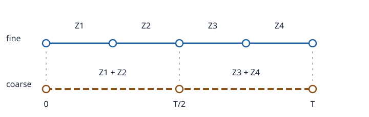

# U3-31 Multilevel Monte Carlo（MLMC）

一つの細かい格子で何万本も経路を作ると、精度は上がっても計算費用が重くなります。前講までに、[終端の強・弱誤差](../U3-29/index.md#def-u3-29-strong-weak)と、[時間離散化・標本誤差の分解](../U3-29/index.md#prop-u3-29-mc-decomposition)を学びました。強い近似は高価ですが、隣り合う二つの格子で計算した支払額は**同じ Brown 運動で作れば**近くなる、という性質を使えないでしょうか。

Multilevel Monte Carlo（MLMC、多層 Monte Carlo 法）は、粗い格子の平均を大量の安い標本で求め、細かい格子は**粗い計算との小さな差**だけを、少ない標本で補います。目指すのは「粗い近似と細かい近似の混合」ではなく、最終的に**細格子の期待値そのもの**を推定することです。

この講義では有限のレベル数で成り立つ等式・分散・最適化を完全に証明し、[GBM の Euler–Maruyama（EM）更新](../U3-28/index.md#def-u3-28-euler)で厳密な数値検算を行います。資産価格の単位は円、時間は年、金利・ボラティリティはそれぞれ年$^{-1}$・年$^{-1/2}$ とします。

## 1. 粗い格子と細かい格子を同じ乱数で作る

時刻区間 $[0,T]$ に対し、初期刻み数 $m_0\ge1$ を決め、レベル $\ell=0,1,\ldots,L$ の刻み数と幅を次で定めます。

$$
m_\ell=m_0 2^\ell,\qquad h_\ell=T/m_\ell.
$$

細格子で $Z_1,Z_2\sim N(0,h_\ell)$ が独立なら、二つを束ねた $Z_1+Z_2$ は平均0、分散 $2h_\ell=h_{\ell-1}$ の正規変数です。[Brown 運動の増分](../U3-28/index.md#def-u3-28-exact-grid)は独立な正規増分なので、これを粗格子の一増分に採用すれば**同一の Brown 運動**の両格子表示になります。

青い実線の細格子と茶色い破線の粗格子は線種でも区別できます。共有時刻 $0,T/2,T$ の位置が上下で一致し、**粗い増分を別に引き直していない**点に注目してください。図の $Z_1,\ldots,Z_4$ は各区間の増分で、$T/2$ は例示した4分割の場合の共有時刻です。

時刻 $T$ の支払額を近似した正方可積分確率変数を $P_\ell$ と書きます。例えば利率 $r$ のもと、数値的な終端資産価格 $Y_{m_\ell}$ から

$$
P_\ell=e^{-rT}g(Y_{m_\ell})
$$

を作ります。$g$ は円建ての支払関数です。**同じレベルの単独の周辺分布は変えず**、隣接レベル間の同時分布だけを Brown 増分の共有によって指定します。

<!-- formal-statement-start -->
> **定義（粗細結合差分と MLMC 推定量）**  
> 確率変数 $P_0,\ldots,P_L\in L^2$ を考える。$\ell\ge1$ では、周辺分布がそれぞれ $P_\ell,P_{\ell-1}$ に等しい対 $(P_\ell^{\mathrm f},P_{\ell-1}^{\mathrm c})$ を**結合**する。各レベルの差分確率変数を

$$
\Delta_0=P_0,\qquad
\Delta_\ell=P_\ell^{\mathrm f}-P_{\ell-1}^{\mathrm c}
\quad(1\le\ell\le L)
$$

> とする。各 $\ell$ で $\Delta_\ell^{(1)},\ldots,\Delta_\ell^{(N_\ell)}$ は独立同分布の複製とし、**異なるレベル間の標本も独立**に生成する。すべての $N_\ell$ は正の整数とする。このとき MLMC 推定量は

$$
\widehat Q_{\rm ML}=\sum_{\ell=0}^{L}
\frac1{N_\ell}\sum_{i=1}^{N_\ell}\Delta_\ell^{(i)}
$$

> である。$V_\ell=\operatorname{Var}(\Delta_\ell)$ をレベル分散と呼ぶ。各対の**内側**は強く相関してよいが、**異なる標本とレベル**は独立に作る。
<!-- formal-statement-end -->

<!-- definition-example-start: def-u3-31-coupling -->
**定義の確認**：$T=1$ 年、細刻み $h=1/4$ 年、粗刻み $H=1/2$ 年とします。最初の2増分を $Z_1=0.2,Z_2=-0.1$ 年$^{1/2}$ と観測したなら、粗増分は $Z_1+Z_2=0.1$ 年$^{1/2}$ です。$s_0=100$ 円、$r=0.1$ 年$^{-1}$、$\sigma=0.2$ 年$^{-1/2}$ の EM 乗数を使うと、前半の粗細値はそれぞれ

$$
Y_{\rm f}=100(1+0.025+0.04)(1+0.025-0.02)
=107.0325,
$$

$$
Y_{\rm c}=100(1+0.05+0.02)=107.0000.
$$

この時刻での差は $0.0325$ 円です。粗格子の増分は分散 $1/2$ を持つ正しい正規変数であり、細格子の2増分から**決定的に**作られています。これが周辺分布と対内結合の二条件です。別標本では新しい正規増分を引き直します。
<!-- definition-example-end -->

### なぜ差分の平均で細格子の平均になるか

<!-- formal-statement-start -->
> **命題（望遠和推定量の不偏性・分散・二乗平均誤差）**  
> 上の [MLMC 推定量](#def-u3-31-coupling)で、各レベル内の標本と異なるレベルの標本がすべて独立、$E[P_\ell^2]<\infty$ とする。このとき

$$
E[\widehat Q_{\rm ML}]=E[P_L],\qquad
\operatorname{Var}(\widehat Q_{\rm ML})
=\sum_{\ell=0}^L \frac{V_\ell}{N_\ell}.
$$

> また求めたい厳密な期待値 $Q=E[P]$ が有限なら、$Q$ に対する二乗平均誤差は

$$
E[(\widehat Q_{\rm ML}-Q)^2]
=(E[P_L]-Q)^2+\sum_{\ell=0}^L\frac{V_\ell}{N_\ell}.
$$
<!-- formal-statement-end -->

証明の要点は、**一対の差分を作るときの依存**は $V_\ell$ に閉じ込め、平均を足すときには**レベル間を独立**にすることです。望遠和は標本値同士の打ち消しではなく、期待値の打ち消しです。

<!-- proof-start -->
### 証明

結合の周辺分布の条件から、$\ell\ge1$ について

$$
E[\Delta_\ell]
=E[P_\ell^{\mathrm f}]-E[P_{\ell-1}^{\mathrm c}]
=E[P_\ell]-E[P_{\ell-1}].
$$

従って有限和を実際に書き下すと

$$
\sum_{\ell=0}^L E[\Delta_\ell]
=E[P_0]+\{E[P_1]-E[P_0]\}
+\cdots+\{E[P_L]-E[P_{L-1}]\}
=E[P_L].
$$

各レベル平均の期待値は $E[\Delta_\ell]$ なので線形性から不偏性が従います。各標本が独立なので、共分散項を0として平均の分散を求めると

$$
\operatorname{Var}\left(\frac1{N_\ell}
\sum_{i=1}^{N_\ell}\Delta_\ell^{(i)}\right)
=\frac{N_\ell V_\ell}{N_\ell^2}
=\frac{V_\ell}{N_\ell}.
$$

異なる $\ell$ の標本は独立なので共分散項が0となり、和の分散は各項の分散の和です。最後に

$$
\widehat Q_{\rm ML}-Q
=(\widehat Q_{\rm ML}-E[P_L])+(E[P_L]-Q)
$$

を二乗します。第一項の平均は0で第二項は定数なので、交差項の期待値は0です。よって主張の式が得られます。
<!-- proof-end -->

この結果は [通常の MC の標本平均と分散](../U3-26/index.md#prop-u3-26-unbiased-sample-variance)の多層版です。$L$ を固定したとき $\widehat Q_{\rm ML}$ は **$E[P_L]$ には不偏**ですが、一般に $E[P]$ には不偏ではありません。

## 2. 誤差予算からレベル別標本数を決める

MLMC では、標本を同数ずつ作る理由はありません。粗い計算は安く、差分の分散は細かいほど小さくなることが多いため、各レベルに適した標本数を選びます。

<!-- formal-statement-start -->
> **定義（MLMC の誤差予算と更新費用）**  
> $Q=E[P]$ と許容 RMSE $\varepsilon>0$ に対し、レベル $L$ の離散化バイアスを $b_L=E[P_L]-Q$ とする。$C_\ell>0$ は差分 $\Delta_\ell$ の1標本を生成する計算費用（同じ単位で測る）で、総費用を

$$
W=\sum_{\ell=0}^L N_\ell C_\ell
$$

> とする。ここでは次の十分条件を誤差予算として採用する。

$$
b_L^2\le\frac{\varepsilon^2}{2},
\qquad
\sum_{\ell=0}^L\frac{V_\ell}{N_\ell}
\le\frac{\varepsilon^2}{2}.
$$

> これは両誤差に二乗の予算を半分ずつ与える設計であって、唯一の割り振りではない。
<!-- formal-statement-end -->

<!-- definition-example-start: def-u3-31-budget -->
**定義の確認**：$\varepsilon=0.5$ 円、$b_L=-0.3$ 円、二乗した標本誤差が $0.16$ 円$^2$ なら、$0.09+0.16=0.25$ 円$^2$、RMSE は $0.5$ 円です。ただし半分ずつの条件はバイアス側 $0.09\le0.125$、分散側 $0.16>0.125$ で**満たしていません**。従って目標 RMSE の達成と、この十分条件を満たすことは同値ではありません。実装では後者を保守的な規則として使います。
<!-- definition-example-end -->

<!-- formal-statement-start -->
> **命題（費用最小化のレベル別配分）**  
> レベル数 $L$ が固定され、$V_\ell>0,C_\ell>0$ が既知、異なるレベルの標本が独立とする。標本数を一時的に正の実数とみなして

$$
\sum_{\ell=0}^L V_\ell/N_\ell\le\varepsilon^2/2
$$

> のもとで $W=\sum_\ell N_\ell C_\ell$ を最小にする解は、$S=\sum_{k=0}^L\sqrt{V_k C_k}$ と置いて

$$
N_\ell^*=\frac{2S}{\varepsilon^2}
\sqrt{\frac{V_\ell}{C_\ell}},
\qquad
W^*=\frac{2S^2}{\varepsilon^2}.
$$

> 実際の正の整数配分 $N_\ell=\lceil N_\ell^*\rceil$ は同じ分散予算を満たし、費用は $W^*+\sum_\ell C_\ell$ 未満である（$N_\ell^*$ が整数のときはそのまま）。
<!-- formal-statement-end -->

たとえば $V_0=9,V_1=1,C_0=1,C_1=8$ なら

$$
\frac{N_0^*}{N_1^*}
=\sqrt{\frac{9/1}{1/8}}=6\sqrt2.
$$

粗いレベル0に約8.49倍の標本を配分します。**分散が大きいから多く、費用が高いから少なく**という二つの効果が同時に入っています。

<!-- proof-start -->
### 証明

正数列 $N_\ell$ に対して Cauchy–Schwarz の不等式を

$$
x_\ell=\sqrt{\frac{V_\ell}{N_\ell}},\qquad
y_\ell=\sqrt{N_\ell C_\ell}
$$

へ適用します。すると

$$
S^2=\left(\sum_{\ell=0}^L x_\ell y_\ell\right)^2
\le\left(\sum_{\ell=0}^L \frac{V_\ell}{N_\ell}\right)
\left(\sum_{\ell=0}^L N_\ell C_\ell\right)
\le \frac{\varepsilon^2}{2}W.
$$

ゆえに $W\ge2S^2/\varepsilon^2$。等号には $x_\ell=\lambda y_\ell$ がすべてのレベルで成立することが必要十分です。これを二乗して解くと

$$
\frac{V_\ell}{N_\ell}
=\lambda^2 N_\ell C_\ell,\qquad
N_\ell=\lambda^{-1}\sqrt{V_\ell/C_\ell}.
$$

さらに予算の等号条件より

$$
\sum_\ell\frac{V_\ell}
{\lambda^{-1}\sqrt{V_\ell/C_\ell}}
=\lambda\sum_\ell\sqrt{V_\ell C_\ell}
=\lambda S=\varepsilon^2/2.
$$

従って $\lambda=\varepsilon^2/(2S)$、主張の $N_\ell^*$ と $W^*$ を得ます。整数化すると $N_\ell\ge N_\ell^*$ なので分散は増えません。また $N_\ell<N_\ell^*+1$ を各レベルで足して費用上界が得られます。
<!-- proof-end -->

$V_\ell=0$ のレベルはその差分が定数であり、理論上はその定数を直接加えられます。定数を知らず標本で計算する場合は少なくとも1標本を取ります。実装では正の $V_\ell$ を想定し、整数化後に $\max(1,\cdot)$ を使います。現実には $V_\ell,C_\ell$ を小規模な予備標本で見積もり、標本数がランダムに決まる場合の偏りや推定不確実性を別途確認する必要があります。ここでの最適性は**既知の分散と費用**についてのものです。

## 3. MLMC が安くなるための次数条件

レベルを一段上げると費用は増えますが、差分の分散も減るなら有利です。格子幅 $h_\ell\to0$ で、バイアス、差分分散、単位費用の変化をそれぞれ $\alpha,\beta,\gamma>0$ とします。

<!-- formal-statement-start -->
> **命題（バイアス・レベル分散・費用からの MLMC 計算量）**  
> $h_\ell=T/(m_0 2^\ell)$ とし、レベル内・レベル間の標本は独立である。$\ell\ge1$ について定数 $K_1,K_2,K_3>0$ と $\alpha,\beta,\gamma>0$ があり、十分小さい $h_\ell$ で

$$
|E[P_\ell]-Q|\le K_1 h_\ell^\alpha,\quad
V_\ell\le K_2 h_\ell^\beta,\quad
C_\ell\le K_3 h_\ell^{-\gamma}
$$

> とする。$V_0,C_0$ は有限で、$\alpha\ge\min(\beta,\gamma)/2$ とする。バイアスが $\varepsilon/\sqrt2$ 以下になるよう $L$ を選び、[最適配分](#prop-u3-31-optimal-allocation)を上へ整数化すれば、$\varepsilon\downarrow0$ で RMSE $\le\varepsilon$ を達成する計算費用には次の上界がある。

$$
W=
\begin{cases}
O(\varepsilon^{-2})&\beta>\gamma,\\
O(\varepsilon^{-2}|\log\varepsilon|^2)&\beta=\gamma,\\
O(\varepsilon^{-2-(\gamma-\beta)/\alpha})&\beta<\gamma.
\end{cases}
$$

> 各上界はこの仮定から得られる**保証**であり、任意の支払についての正確な下界・次数を主張するものではない。
<!-- formal-statement-end -->

**見取り図**：分散と費用の積の平方根をレベルごとに足した $S$ が支配的です。粗いレベルだけが支配すれば $\varepsilon^{-2}$、各レベルが同程度なら対数因子が2乗、細かいレベルが支配すれば追加のべき因子が現れます。

<!-- proof-start -->
### 証明

バイアス上界を使い、$K_1 h_L^\alpha\le\varepsilon/\sqrt2$ となる最小のレベルを選びます。倍々格子ゆえ $h_L=\Theta(\varepsilon^{1/\alpha})$ となり、$L=O(|\log\varepsilon|)$ です（定数ゼロ等の退化した場合は不要な細分を省けます）。

[配分命題](#prop-u3-31-optimal-allocation)の整数丸め込みの上界は

$$
W\le \frac{2}{\varepsilon^2}
\left(\sum_{\ell=0}^L\sqrt{V_\ell C_\ell}\right)^2
+\sum_{\ell=0}^L C_\ell.
$$

仮定から $\sqrt{V_\ell C_\ell}\le\sqrt{K_2K_3}\,h_\ell^{(\beta-\gamma)/2}$ です。$\beta>\gamma$ のとき、この幾何級数は一様有界です。$\beta=\gamma$ では各項が $O(1)$ なので総和が $O(L)$。$\beta<\gamma$ では最後の項が支配し、総和は $O(h_L^{(\beta-\gamma)/2})$ となります。よって第一項は順に

$$
O(\varepsilon^{-2}),\quad
O(\varepsilon^{-2}|\log\varepsilon|^2),\quad
O(\varepsilon^{-2-(\gamma-\beta)/\alpha}).
$$

整数丸めによる第二項は幾何級数から $O(h_L^{-\gamma})=O(\varepsilon^{-\gamma/\alpha})$。$\beta\ge\gamma$ なら $\alpha\ge\gamma/2$ だから $\gamma/\alpha\le2$。$\beta<\gamma$ なら $\alpha\ge\beta/2$ だから $\gamma/\alpha\le2+(\gamma-\beta)/\alpha$。いずれも第一項の上界へ吸収されます。最後に [二乗平均誤差の分解](#prop-u3-31-telescope)と両予算を加えれば RMSE $\le\varepsilon$ です。
<!-- proof-end -->

スカラー GBM の EM と、資産価格そのもののような Lipschitz 支払の場合、[GBM の強 $1/2$ 次](../U3-29/index.md#prop-u3-29-gbm-strong-orders)を三角不等式に使うと、粗細差分の二乗平均は $O(h_\ell)$ です。したがって $V_\ell=O(h_\ell)$、費用は $O(h_\ell^{-1})$、つまり $\beta=\gamma=1$ の上界が得られます。**バイアスが一次**であることは別途調べる必要があります。以下の線形支払では有限刻みで直接証明します。

粗細を独立に生成した場合は $\operatorname{Var}(P_\ell-P_{\ell-1})=\operatorname{Var}(P_\ell)+\operatorname{Var}(P_{\ell-1})$ で、通常この分散は0に近づきません。相関による共分散項が消えるため、分散減衰の機構が壊れるのです。連続監視障壁や不連続支払では強誤差からの保証を安易に移さず、結合方法とバイアス・分散の次数を別々に検証します。

## 4. GBM の有限刻みモデルですべて検算する

モデルをリスク中立測度のもとで

$$
dS_t=rS_t\,dt+\sigma S_t\,dW_t,\quad
S_0=s_0>0,\quad r>0,\ \sigma>0,\quad T>0
$$

とします。配当はなく、連続複利の割引 $e^{-rT}$ を採用します。診断用の支払を $g(s)=s$ とすれば、[GBM の陽解](../U3-14/index.md#thm-u3-14-explicit-gbm)と正規指数積率により

$$
Q=E[e^{-rT}S_T]=s_0.
$$

これは解析値が分かる**アルゴリズムの検算用モデル**です。実際の株式価格付けにこの Monte Carlo 法が必要という意味ではありません。非線形オプションへの拡張時には、バイアス次数を別途調べます。

EM 更新の細区間乗数は $F_j=1+rh+\sigma Z_j$。粗区間1本に対応する細区間2本の乗数積を $F=F_1F_2$、粗乗数を $G=1+2rh+\sigma(Z_1+Z_2)$ とします。細刻み $h=T/m$、$m$ は偶数とします。

<!-- formal-statement-start -->
> **命題（GBM Euler 結合の有限刻み二次モーメント）**  
> $s_0,r,\sigma,T>0$、偶数 $m\ge2$、$h=T/m$、独立な $Z_j\sim N(0,h)$ とする。同じ $Z_1,\ldots,Z_m$ から、EM の $m$ 刻みの細終端値 $Y_f$ と、増分を2本ずつ和にした $m/2$ 刻みの粗終端値 $Y_c$ を作る。$a=1+rh,\ b=1+2rh$ とおき、

$$
A=a^2+\sigma^2h,\quad
B=b^2+2\sigma^2h,\quad
D=a^2b+2a\sigma^2h
$$

> とすると、$K=s_0e^{-rT}$ に対して

$$
E[P_f]=Ka^m,\quad E[P_c]=Kb^{m/2},
$$

$$
E[P_f^2]=K^2A^m,\quad
E[P_c^2]=K^2B^{m/2},\quad
E[P_fP_c]=K^2D^{m/2}
$$

> が成立する。ただし $P_f=e^{-rT}Y_f,\ P_c=e^{-rT}Y_c$ である。従ってレベル差分 $\Delta=P_f-P_c$ の分散は

$$
V=K^2\{A^m+B^{m/2}-2D^{m/2}
-(a^m-b^{m/2})^2\}.
$$

> また細格子の厳密期待値に対するバイアスは

$$
b(m)=Ka^m-s_0
=-\frac{s_0r^2T}{2}h+O(h^2)
\qquad(h\downarrow0).
$$
<!-- formal-statement-end -->

**見取り図**：期待値を求めるだけなら、一刻みの乗数の平均を独立性で積にします。分散を求めるには細二乗、粗二乗だけでなく、**同じ増分による相互積 $E[P_fP_c]$** が欠かせません。

<!-- proof-start -->
### 証明

$Z_1,Z_2$ は平均0、分散 $h$ で独立です。$F_i=a+\sigma Z_i$ だから $E[F_1F_2]=a^2$、$E[(F_1F_2)^2]=(a^2+\sigma^2h)^2=A^2$。また $E[G]=b$、$E[G^2]=b^2+2\sigma^2h=B$ です。

相互積は省略せず展開します。

$$
F_1F_2=a^2+a\sigma(Z_1+Z_2)+\sigma^2Z_1Z_2.
$$

従って $G=b+\sigma(Z_1+Z_2)$ を掛け、$E[Z_i]=0$、$E[Z_1Z_2]=0$、$E[(Z_1+Z_2)^2]=2h$ と、奇数次の交差モーメントが0であることを使うと

$$
E[F_1F_2G]=a^2b+a\sigma^2(2h)=D.
$$

異なる粗区間の Brown 増分の組は独立です。[Brown 運動の独立増分](../U3-28/index.md#def-u3-28-exact-grid)の条件をここに使うと、各粗区間の期待値を $m/2$ 乗できます。細乗数の平均・二乗は $a,a^2+\sigma^2h$ の $m$ 乗、粗乗数と相互積は $b,B,D$ の $m/2$ 乗になり、主張の5つの式を得ます。

差の二乗を展開すると

$$
E[(P_f-P_c)^2]
=K^2(A^m+B^{m/2}-2D^{m/2}).
$$

$E[P_f-P_c]=K(a^m-b^{m/2})$ を二乗して引けば分散の式になります。

バイアスについて $m=T/h$ に注意し、自然対数の Taylor 展開を $rh=0$ の近傍で用いると

$$
m\log(1+rh)
=\frac{T}{h}\left(rh-\frac{r^2h^2}{2}+O(h^3)\right)
=rT-\frac{r^2T}{2}h+O(h^2).
$$

これを指数関数へ戻すと

$$
e^{-rT}(1+rh)^m
=\exp\left(-\frac{r^2T}{2}h+O(h^2)\right)
=1-\frac{r^2T}{2}h+O(h^2).
$$

$s_0$ を掛けて $Q=s_0$ を引けば結論です。
<!-- proof-end -->

特別なチェックとして $r=0,\sigma=1,s_0=1,T=1,m=2$ にすると、$Z_1,Z_2\sim N(0,1/2)$ で

$$
Y_f=(1+Z_1)(1+Z_2),\qquad
Y_c=1+Z_1+Z_2,\qquad
Y_f-Y_c=Z_1Z_2.
$$

二つは独立なので $E[Z_1Z_2]=0$、$V=E[Z_1^2]E[Z_2^2]=1/4$ と直接確認できます。粗増分を独立な乱数にすればこの積の打ち消しは失われます。

レベル0の標本は粗細差分でなく $P_0$ です。$h_0=T/m_0,\ a_0=1+rh_0$ とすると

$$
V_0=K^2\left\{(a_0^2+\sigma^2h_0)^{m_0}
-a_0^{2m_0}\right\}.
$$

$\ell\ge1$ の $V_\ell$ には命題の式を $m=m_\ell$ として代入します。ここでは $g(s)=s$ であり、[GBM の強誤差次数](../U3-29/index.md#prop-u3-29-gbm-strong-orders)から $V_\ell=O(h_\ell)$。上で求めた $b(m)=O(h)$ と組み合わせれば、$\alpha=\beta=\gamma=1$ の保証、すなわち **MLMC の費用上界 $O(\varepsilon^{-2}|\log\varepsilon|^2)$** を適用できます。単一細格子の標準 MC は $h_L=O(\varepsilon)$、標本数 $O(\varepsilon^{-2})$、1標本の費用 $O(h_L^{-1})$ で $O(\varepsilon^{-3})$ です。

## 5. 再現可能な費用比較：標準 MC と MLMC

ここでは $s_0=100$ 円、$r=0.30$ 年$^{-1}$、$\sigma=0.60$ 年$^{-1/2}$、$T=1$ 年、$m_0=2$、許容 $\varepsilon=0.5$ 円とします。高めの利率・ボラティリティは学習用に刻みバイアスとレベル分散を見やすくするための設定で、市場推奨値ではありません。費用は**EM 更新を1回行う操作を1単位**とし、初期化・乱数生成・メモリ・実時間は含めません。各レベル差分では細格子更新 $m_\ell$ 回と粗格子更新 $m_\ell/2$ 回を数えます。

厳密な目標値は $Q=100$ 円です。バイアス予算に必要な最小レベルは $L=3$（細格子16刻み）で、$b_3\simeq-0.277398$ 円。命題の有限刻み分散と[最適配分](#prop-u3-31-optimal-allocation)の整数化を使うと次の理論値になります。

| レベル $\ell$ | $E[\Delta_\ell]$（円） | $V_\ell$（円$^2$） | 1標本の更新数 $C_\ell$ | $N_\ell$ |
|---:|---:|---:|---:|---:|
| 0 | 97.97321 | 2790.70717 | 2 | 52329 |
| 1 | 0.96078 | 158.72428 | 6 | 7206 |
| 2 | 0.51869 | 95.96771 | 12 | 3962 |
| 3 | 0.26992 | 52.81770 | 24 | 2079 |

望遠和の平均 $97.97321+0.96078+0.51869+0.26992\simeq99.72260$ 円が、細格子の期待値です。標本数は細かいほど減少します。**異なるレベルの標本は独立**で、各レベルの対の内側だけ増分を共有しています。

| 手法 | 時間刻み | 標本数の決め方 | 理論 RMSE（円） | EM 更新回数 |
|---|---|---|---:|---:|
| 標準 MC | 16刻み | $N=\lceil2\operatorname{Var}(P_L)/\varepsilon^2\rceil=32571$ | 約0.44939 | 521136 |
| MLMC | 2・4・8・16刻み | 上表のレベル別 $N_\ell$ | 約0.44937 | 245334 |

両者は**同じ $P_L$ を対象**とするためバイアスも同じです。この設定では MLMC の更新数は標準 MC の約47.1%ですが、改善率はモデル・支払・$\varepsilon$ に依存します。また一回の乱数試行の誤差は理論 RMSE とは違います。

[標準ライブラリのみで動く再現用 Python](assets/mlmc_gbm.py)を、章ディレクトリで次のように実行します。

python3 assets/mlmc_gbm.py

プログラムは乱数生成器の初期値を固定し、有限刻みの**解析的分散**から標本数を配分します。費用・理論 RMSE と、独立な乱数を使う標準 MC・MLMC の単回推定値を表示します。

乱数生成器の初期値を固定するのは再現のためで、単回の観測値は RMSE の保証の証拠になりません。実用的には初期値を変えた独立な実験反復と、分散・バイアスの予備推定が必要です。極端に細かい格子では大きな二次モーメント同士の減算が浮動小数点で桁落ちし得るため、計算精度や公式の実装にも注意します。

## 6. 演習：定義から標本配分まで

### Level A：一つずつ基本操作を確かめる

### U3-31-A1：望遠和を数で確かめる
- Level: A

$E[P_0]=10,E[P_1]=12,E[P_2]=11$（円）とする。$E[\Delta_0],E[\Delta_1],E[\Delta_2]$ とその和を求めよ。さらに「標本値の差が必ず消える」という解釈が誤りである理由を述べよ。

<!-- solution-start -->
**詳細解答**：[差分の定義](#def-u3-31-coupling)より

$$
E[\Delta_0]=10,\quad
E[\Delta_1]=12-10=2,\quad
E[\Delta_2]=11-12=-1.
$$

その和は $10+2-1=11=E[P_2]$。レベル別に独立な標本を取るため、ある標本の $P_0$ と次レベルの $P_0$ は同一の確率変数値である必要がありません。消えるのは**周辺分布に関する期待値**です。
<!-- solution-end -->

### U3-31-A2：Brown 増分の結合
- Level: A

$h=1/4$、独立な $Z_1,Z_2\sim N(0,h)$ とするとき、$Z_1+Z_2$ の平均・分散を求め、粗刻み $2h$ の増分として正しい理由を説明せよ。

<!-- solution-start -->
**詳細解答**：線形性により $E(Z_1+Z_2)=0$。独立なので $\operatorname{Cov}(Z_1,Z_2)=0$ で、

$$
\operatorname{Var}(Z_1+Z_2)
=\operatorname{Var}(Z_1)+\operatorname{Var}(Z_2)
=1/4+1/4=1/2.
$$

正規変数の独立な和は正規分布だから $Z_1+Z_2\sim N(0,1/2)=N(0,2h)$。[Brown 運動の増分](../U3-28/index.md#def-u3-28-exact-grid)の分布条件に一致します。粗格子を独立に生成するのでなく、**同じ二つの細増分の和**とすることが結合です。
<!-- solution-end -->

### U3-31-A3：独立なレベルの分散
- Level: A

$V_0=16,V_1=1$（円$^2$）、$N_0=100,N_1=25$ とする。レベル間独立のとき $\widehat Q_{\rm ML}$ の分散と標準偏差を求めよ。

<!-- solution-start -->
**詳細解答**：[望遠和推定量の分散](#prop-u3-31-telescope)より

$$
\operatorname{Var}(\widehat Q_{\rm ML})
=\frac{16}{100}+\frac1{25}
=0.16+0.04=0.20\ \text{円}^2.
$$

標準偏差は $\sqrt{0.20}=0.447213\ldots$ 円です。対の内側の相関は $V_1$ にすでに含まれ、レベル間の共分散を別に足してはいけません。
<!-- solution-end -->

### U3-31-A4：RMSE と十分条件
- Level: A

$\varepsilon=0.5$ 円、$b_L=-0.3$ 円、$\operatorname{Var}(\widehat Q_{\rm ML})=0.16$ 円$^2$ とする。RMSE と、半分ずつの誤差予算が成立するかを判定せよ。

<!-- solution-start -->
**詳細解答**：[誤差分解](#prop-u3-31-telescope)へ代入すると

$$
\operatorname{RMSE}
=\sqrt{(-0.3)^2+0.16}
=\sqrt{0.25}=0.5\ \text{円}.
$$

一方、各半分の上限は $\varepsilon^2/2=0.125$ 円$^2$。$b_L^2=0.09\le0.125$ は満たしますが $0.16>0.125$ は満たしません。したがって目標 RMSE には達していても、採用した[誤差予算](#def-u3-31-budget)のバイアスと分散の上限は、両方とも満たされてはいません。
<!-- solution-end -->

### U3-31-A5：最適標本数の比
- Level: A

$V_0=9,V_1=1,C_0=1,C_1=8$ の二レベル MLMC について、連続最適配分の $N_0^*/N_1^*$ を求めよ。$V$ の単位は円$^2$、$C$ の単位は更新回数とする。

<!-- solution-start -->
**詳細解答**：[最適配分](#prop-u3-31-optimal-allocation)の比例式 $N_\ell^*\propto\sqrt{V_\ell/C_\ell}$ に各レベルの値を代入します。

$$
\frac{N_0^*}{N_1^*}
=\frac{\sqrt{9/1}}{\sqrt{1/8}}
=\frac{3}{1/(2\sqrt2)}
=6\sqrt2\approx8.485.
$$

レベル0は分散が大きく費用は小さいため、約8.49倍の標本数になります。この比は $\varepsilon$ には依存しません。
<!-- solution-end -->

### Level B：証明とモデルを接続する

### U3-31-B1：Cauchy–Schwarz の等号条件
- Level: B

独立なレベルを $0,\ldots,L$ とし $V_\ell,C_\ell>0$ とする。$\sum V_\ell/N_\ell\le\varepsilon^2/2$ の下で、Cauchy–Schwarz から $W\ge2(\sum\sqrt{V_\ell C_\ell})^2/\varepsilon^2$ を導け。さらに等号条件で $N_\ell^*$ を導け。

<!-- solution-start -->
**詳細解答**：各 $\ell$ の二数列を

$$
x_\ell=\sqrt{V_\ell/N_\ell},\quad
y_\ell=\sqrt{N_\ell C_\ell}
$$

と置くと $x_\ell y_\ell=\sqrt{V_\ell C_\ell}$ です。Cauchy–Schwarz によって

$$
\left(\sum\sqrt{V_\ell C_\ell}\right)^2
\le\left(\sum V_\ell/N_\ell\right)
\left(\sum N_\ell C_\ell\right)
\le(\varepsilon^2/2)W.
$$

$S=\sum\sqrt{V_\ell C_\ell}$ として $W\ge2S^2/\varepsilon^2$。等号には $x_\ell=\lambda y_\ell$ が必要なので、$V_\ell/N_\ell=\lambda^2N_\ell C_\ell$ から $N_\ell=\lambda^{-1}\sqrt{V_\ell/C_\ell}$。分散予算の等号を代入すると $\lambda S=\varepsilon^2/2$、すなわち

$$
N_\ell^*=\frac{2S}{\varepsilon^2}\sqrt{V_\ell/C_\ell}.
$$

全て正なのでこの条件で等号が実際に達成され、下界が最小費用です。整数では上へ丸めると分散が増えないことも分母の単調性から従います。
<!-- solution-end -->

### U3-31-B2：独立な粗細経路ではなぜ失敗するか
- Level: B

$P_\ell,P_{\ell-1}$ を独立に生成し、$\operatorname{Var}(P_\ell)\to v>0$ とする。差分の分散極限と、MLMC の効率を失う機構を求めよ。$P_\ell$ の分布は有効な格子近似と仮定する。

<!-- solution-start -->
**詳細解答**：独立性から共分散が0なので

$$
\operatorname{Var}(P_\ell-P_{\ell-1})
=\operatorname{Var}(P_\ell)
+\operatorname{Var}(P_{\ell-1})
\longrightarrow2v>0.
$$

粗細経路の**平均差**は依然として $E[P_\ell]-E[P_{\ell-1}]$ なので望遠和の不偏性は保たれます。しかし [MLMC の計算量条件](#prop-u3-31-complexity)で必要な $V_\ell=O(h_\ell^\beta)$（$\beta>0$）が成立せず、費用の高い細格子で差分の分散が小さくなるという構造を失います。[結合差分の定義](#def-u3-31-coupling)で共有した Brown 増分による正の共分散が欠けることが原因です。
<!-- solution-end -->

### U3-31-B3：2刻みの結合差分を手で証明
- Level: B

$r=0,\sigma=1,s_0=1,T=1,m=2$ とする。EM の細終端値と粗終端値を同じ $Z_1,Z_2\sim N(0,1/2)$ から作り、差分の平均・分散を求めよ。

<!-- solution-start -->
**詳細解答**：[EM 更新](../U3-28/index.md#def-u3-28-euler)に $r=0$ を代入して細値を $Y_f=(1+Z_1)(1+Z_2)$、粗値を $Y_c=1+(Z_1+Z_2)$ とします。積を展開すると

$$
Y_f=1+Z_1+Z_2+Z_1Z_2,\quad
\Delta=Y_f-Y_c=Z_1Z_2.
$$

二つの正規変数は独立で平均0なので $E[\Delta]=E Z_1 E Z_2=0$、二乗期待値は

$$
E[\Delta^2]=E[Z_1^2]E[Z_2^2]
=\frac12\cdot\frac12=\frac14.
$$

従って $\operatorname{Var}(\Delta)=1/4$。これは [有限刻み二次モーメントの命題](#prop-u3-31-gbm-moments)へ $a=b=1,A=3/2,B=D=2,m=2,K=1$ を代入した $(3/2)^2+2-2(2)=1/4$ とも一致します。
<!-- solution-end -->

### U3-31-B4：整数標本配分を自分で設計
- Level: B

レベル0,1,2の $V=(8,2,0.5)$ 円$^2$、$C=(1,2,4)$ 更新、$\varepsilon=1$ 円とする。バイアスの二乗が $1/2$ 円$^2$ 以下と分かっているとして、[配分公式](#prop-u3-31-optimal-allocation)で整数 $N_\ell$ を選び、標本分散と費用を計算せよ。

<!-- solution-start -->
**詳細解答**：平方根和は

$$
S=\sqrt{8\cdot1}+\sqrt{2\cdot2}+\sqrt{0.5\cdot4}
=2\sqrt2+2+\sqrt2=2+3\sqrt2.
$$

$\varepsilon=1$ より $N_\ell^*=2S\sqrt{V_\ell/C_\ell}$ です。従って

$$
\begin{aligned}
N_0^*&=2(2+3\sqrt2)\cdot2\sqrt2
=24+8\sqrt2\approx35.314,\\
N_1^*&=2(2+3\sqrt2)\cdot1
=4+6\sqrt2\approx12.485,\\
N_2^*&=2(2+3\sqrt2)\cdot(1/(2\sqrt2))
=3+\sqrt2\approx4.414.
\end{aligned}
$$

上へ丸めて $(N_0,N_1,N_2)=(36,13,5)$。推定量分散と費用は

$$
\sum_\ell V_\ell/N_\ell
=\frac8{36}+\frac2{13}+\frac{0.5}5
\approx0.47607\le0.5,
$$

$$
W=36\cdot1+13\cdot2+5\cdot4=82\quad\text{更新}.
$$

よってバイアスの二乗が仮定どおり $0.5$ 以下なら、二乗平均誤差は $0.5+0.47607<1$ です。バイアスはこの標本配分からは決まらないことに注意します。
<!-- solution-end -->

### Level C：全体を通して誤差と費用を検証する

### U3-31-C1：GBM で両方法を同じ目標に揃える
- Level: C

EM で割引線形支払 $P_m=e^{-rT}Y_m$ を評価する。次の仮想 GBM を考え、初期価格の単位は円、利率は年$^{-1}$、ボラティリティは年$^{-1/2}$、満期は年とする。

$$
S_0=100,\qquad r=0.30,\qquad \sigma=0.60,\qquad T=1.
$$

初期刻み数は $m_0=2$、許容 RMSE は $\varepsilon=0.5$ 円とし、レベル $L=3$（細格子は16刻み）を採用する。

(i) 厳密値と細格子の期待値の差を求めよ。(ii) [GBM Euler 結合の有限刻み二次モーメント](#prop-u3-31-gbm-moments)から4レベルの分散を求めよ。(iii) 標本数を最適化し整数化せよ。(iv) 同じ細格子の標準 MC と、MLMC の理論 RMSE・更新費用を比較せよ。単回推定値と RMSE の違いも説明せよ。

<!-- solution-start -->
**詳細解答**：まずリスク中立の [GBM 陽解](../U3-14/index.md#thm-u3-14-explicit-gbm)から $Q=100$ 円です。レベル $L=3$ は $m_L=2\cdot2^3=16$、$h=1/16$ 年なので、$K=100e^{-0.30}$ を用いて

$$
E[P_{16}]=100e^{-0.30}(1+0.30/16)^{16}
\approx99.7226024\ \text{円}.
$$

従って $b_3\simeq-0.277398$ 円で、$b_3^2\simeq0.07695\le\varepsilon^2/2=0.125$ 円$^2$。$L=2$ のバイアスは約 $-0.547318$ 円で予算を超えるため、$L=3$ はこの予算での最小レベルです。

レベル0は $m_0=2$ の単独 EM 終端値の分散を使います。

$$
V_0=K^2\left[
\{(1+0.30/2)^2+0.60^2/2\}^{2}
-(1+0.30/2)^4\right]
\approx2790.70717.
$$

レベル1から3は、それぞれ $m=4,8,16$ として $a=1+0.30/m$、$b=1+0.60/m$、$\sigma^2h=0.36/m$ を代入します。例えば $m=4$ では

$$
a=1.075,\quad b=1.15,\quad
A=a^2+0.09=1.245625,
$$

$$
B=b^2+0.18=1.5025,\qquad
D=a^2 b+2a(0.09)=1.52246875.
$$

これらを有限刻みの分散式

$$
V_1=K^2\{A^4+B^2-2D^2-(a^4-b^2)^2\}
$$

へ代入して $V_1\simeq158.72428$ 円$^2$ を得ます。同じ代入を $m=8,16$ に対して行うと、$V_2\simeq95.96771,V_3\simeq52.81770$ 円$^2$ です。

費用は $C_0=2,C_1=6,C_2=12,C_3=24$。$S=\sum_{\ell=0}^3\sqrt{V_\ell C_\ell}$ を作り、

$$
N_\ell=\left\lceil
\frac{2S}{0.5^2}\sqrt{\frac{V_\ell}{C_\ell}}
\right\rceil
$$

へ各 $V_\ell,C_\ell$ を入れれば $(52329,7206,3962,2079)$。整数化後の推定量の分散と費用は

$$
\sum_{\ell=0}^3 \frac{V_\ell}{N_\ell}
\approx0.12498409\ \text{円}^2,
$$

$$
W_{\rm ML}=52329(2)+7206(6)+3962(12)+2079(24)
=245334.
$$

同じ16刻みの標準 MC の単独標本分散は

$$
\operatorname{Var}(P_{16})
=K^2\left[\left\{(1+0.30/16)^2+0.36/16\right\}^{16}
-(1+0.30/16)^{32}\right]
\approx4071.31585.
$$

標本数は $N_{\rm MC}=\lceil2(4071.31585)/0.25\rceil=32571$、費用は $16(32571)=521136$。二つの RMSE は [誤差分解](#prop-u3-31-telescope)を使って

$$
\operatorname{RMSE}_{\rm ML}
=\sqrt{b_3^2+0.12498409}\approx0.44937\ \text{円},
$$

$$
\operatorname{RMSE}_{\rm MC}
=\sqrt{b_3^2+4071.31585/32571}
\approx0.44939\ \text{円}.
$$

更新費用の比は $245334/521136\approx0.471$ です。この差は理論二次モーメント・所定の費用尺度による比較です。固定した乱数生成器の初期値 の単回の推定値は確率的に上下します。標本を多数の独立実験へ分けたときの二乗誤差の期待値が RMSE の定義であり、単回の絶対誤差で理論予算の成否を判定できません。
<!-- solution-end -->

---

## この講義で得たこと

- **期待値の望遠和**はどんな有効な結合でも成立しますが、**計算量の改善**には同一雑音による差分分散の減少が必要です。
- 粗細の同時サンプリングと、レベル同士の独立な平均を分離すれば、バイアス・標本分散・費用を正確に設計できます。
- 最適な標本数は $\sqrt{V_\ell/C_\ell}$ に比例し、$\beta=\gamma$ なら対数二乗の費用因子が現れます。
- GBM の線形支払では解析値が使えるため、理論と固定した乱数生成器の初期値による実験を照合できます。ただしこの特別例のバイアス次数を、[経路依存や非滑らかな支払](../U3-25/index.md)へ根拠なく移すことはできません。
