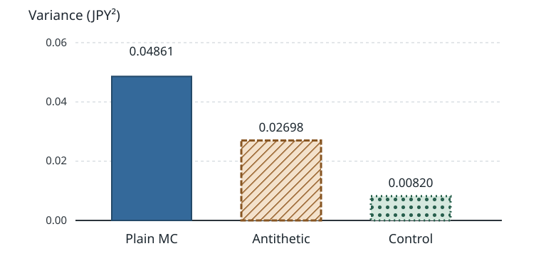

# U3-32 分散減少：対称変量・対照変量

[前講の MLMC](../U3-31/index.md#def-u3-31-coupling) は、粗格子と細格子の差を同じ Brown 運動で作ることで、時間離散化を含む推定の費用を節約しました。しかし**厳密に満期株価を発生できる**商品では格子誤差はなく、残るのは支払額の標本平均の揺れです。[金融商品の Monte Carlo 推定量](../U3-26/index.md#def-u3-26-mc-estimator)の標準誤差は、独立な標本を $N$ 倍にしても $N^{-1/2}$ 倍にしかなりません。

同じ期待値を保ちながら、(i) 一つの正規乱数を二つの逆向きの株価経路に使う、(ii) 平均の分かる別の支払額を使って揺れを差し引く、という方法を比較します。これらは [MC3 の対称変量法](../../../計算系/MC/MC3/index.md#def-mc3-antithetic-variates) と [制御変量法](../../../計算系/MC/MC3/index.md#def-mc3-control-variate) の**金融向けの具体化**です。一般理論を重複せず、割引・価格の単位・係数推定・評価費用を明示します。

時刻は年、株価・支払額は円、金利 $r$ と配当利回り $q$ は年$^{-1}$、ボラティリティ $\sigma$ は年$^{-1/2}$ とします。モデルは定数係数のリスク中立 GBM とし、特記しない限り $s,K,T,\sigma>0$、$r,q\in\mathbb R$、$Q$ は価格付け用のリスク中立測度です。実確率 $P$ での損失推定を扱う講義ではありません。以下、特記しない $E,\operatorname{Var},\operatorname{Cov}$ はすべて $Q$ 下の期待値・分散・共分散を表します。

## 1. 満期株価の一つの乱数を二通りに使う

[GBM の陽解](../U3-14/index.md#thm-u3-14-explicit-gbm)へリスク中立ドリフト $r-q$ を代入します。$\Phi$ を標準正規分布関数、$\Phi^{-1}:(0,1)\to\mathbb R$ をその逆関数とします。$Z\sim N(0,1)$ として

$$
b=\sigma\sqrt T>0,\qquad
A=s\exp\{(r-q-\sigma^2/2)T\},\qquad D=e^{-rT},
$$

$$
S_T(Z)=Ae^{bZ},\qquad X(Z)=D(S_T(Z)-K)_+,\qquad V=E^Q[X(Z)].
$$

$A$ は円、$b$ と $D$ は無次元で、$X$ は割引後の欧州型 call の円建て支払額です。

$Z$ と $-Z$ の分布は一致するので、$S_T(Z)$ と $S_T(-Z)$ は**いずれも上の GBM 陽解から得る満期株価と同じ分布**を持ちます。ただし二つは独立ではありません。高い株価が出たら低い株価を同時に作る仕組みです。

<!-- formal-statement-start -->
> **定義（GBM の対称経路と対称変量価格推定量）**  
> $s,K,T,\sigma>0$、$r,q\in\mathbb R$、$A,b,D$ を上記の通りとする。独立同分布な $Z_1,\ldots,Z_n\sim N(0,1)$ に対して、各対の割引支払額
>
$$
X_i^+=D(Ae^{bZ_i}-K)_+,\qquad
X_i^-=D(Ae^{-bZ_i}-K)_+,\qquad
H_i=\frac{X_i^++X_i^-}{2}
$$
>
> を作る。**対称変量推定量**は $\widehat V_{\mathrm{anti},n}=n^{-1}\sum_{i=1}^n H_i$ である。異なる対 $i$ は独立に作るが、同じ対の $X_i^+,X_i^-$ は従属してよい。
<!-- formal-statement-end -->

<!-- definition-example-start: def-u3-32-antithetic -->
**定義の確認**：$s=K=100$ 円、$r=0.03,q=0,\sigma=0.20,T=1$ 年とします。このとき

$$
A=100e^{0.01}\ \text{円},\qquad b=0.2,\qquad D=e^{-0.03}.
$$

$Z_1=1$ の対では二つの満期株価は

$$
S_T(1)=100e^{0.21}\ \text{円},\qquad
S_T(-1)=100e^{-0.19}\ \text{円}.
$$

前者の call は正の支払額を持ち、後者は行使されません。$-Z_1$ 自体も $N(0,1)$ に従うため、両側とも[満期株価の対数正規法則](../U3-14/index.md#prop-u3-14-lognormal-law)と一致します。

他方、$Z_1$ の値を固定すれば $-Z_1$ は確定するので対内独立性はありません。次の対では新しい $Z_2$ を独立に発生させ、必要な対間独立性を確保します。
<!-- definition-example-end -->

### 価格の不偏性と「同じ評価回数」の比較

<!-- formal-statement-start -->
> **命題（call の対称変量推定量と計算予算）**  
> 上の定義で $n\ge1$ とし、$v=\operatorname{Var}_Q(X(Z))$、$\gamma=\operatorname{Cov}_Q(X(Z),X(-Z))$ とする。このとき
>
$$
E^Q[\widehat V_{\mathrm{anti},n}]=V,\qquad
\operatorname{Var}_Q(\widehat V_{\mathrm{anti},n})=\frac{v+\gamma}{2n}.
$$
>
> $X(Z)$ は $Z$ の単調非減少関数なので $\gamma\le0$。同じ $2n$ 回の支払評価を使う独立 MC の分散 $v/(2n)$ を上回らず、$v>0$ の場合の分散比は $1+\gamma/v\in[0,1]$ となる。ただし対生成の追加費用がある実装では実時間の優位は別途確認する。
<!-- formal-statement-end -->

証明の見取り図：$Z$ と $-Z$ が同分布であることは**平均**を保証し、互いに逆向きに変わることは**共分散**に働きます。「独立な二本」と誤って扱うと、改善効果を消してしまいます。

<!-- proof-start -->
### 証明

$Z\overset d=-Z$ だから $E^Q[X(Z)]=E^Q[X(-Z)]=V$ です。また $0\le X(Z)\le DAe^{bZ}$ と $E[e^{2bZ}]=e^{2b^2}<\infty$ から二次モーメントは有限です。よって

$$
E^Q[H_i]=\frac{V+V}{2}=V,
$$

$$
\operatorname{Var}_Q(H_i)
=\frac14\{\operatorname{Var}(X_i^+)+\operatorname{Var}(X_i^-)+2\operatorname{Cov}(X_i^+,X_i^-)\}
=\frac{v+\gamma}{2}.
$$

対間は独立なので平均の分散は $(v+\gamma)/(2n)$ です。

[MC3 の単調関数の負の共分散命題](../../../計算系/MC/MC3/index.md#prop-mc3-antithetic-monotone)へ、次の関数を代入します。

$$
h(u)=D(Ae^{b\Phi^{-1}(u)}-K)_+,\qquad 0<u<1.
$$

$\Phi^{-1}$ も $x\mapsto(x-K)_+$ も単調非減少です。さらに、$U\sim\operatorname{Unif}(0,1)$ なら $Z=\Phi^{-1}(U)$ は標準正規であり、$h(1-U)=X(-Z)$ です。端点 $u=0,1$ は確率0なので任意に値を定めてよく、同命題の仮定を満たして $\gamma\le0$ を得ます。

[MC1 の独立平均の分散](../../../計算系/MC/MC1/index.md#prop-mc1-unbiased-variance-rmse)は $2n$ 標本で $v/(2n)$ です。最後に $\operatorname{Var}(H_i)\ge0$ から $\gamma\ge-v$、従って $0\le1+\gamma/v\le1$ が出ます。
<!-- proof-end -->

この符号保証は支払額が $Z$ に単調な場合です。例えば $X(Z)=Z^2$ は $X(Z)=X(-Z)$ なので $\gamma=v>0$。同じ2回の関数評価費用なら対称化は**独立 MC の2倍の分散**になってしまいます。株価経路が複数時点・複数 Brown 次元に依存し、各座標で支払関数が単調とは限らない商品では、機械的に「必ず減る」とは言えません。

### 1.1 どれだけ減るかを積分で確かめる

行使価格0の線形支払 $X(Z)=DS_T(Z)$（株式の割引満期価値）なら、対称化の改善幅を[GBM の実数モーメント](../U3-14/index.md#prop-u3-14-moments)から厳密に求められます。

<!-- formal-statement-start -->
> **命題（零行使価格の対称変量分散比）**  
> $s,T,\sigma>0$、$r,q\in\mathbb R$ とし、$X=DAe^{bZ}$ を価格付け対象とする。$v=\operatorname{Var}(X)$、$\gamma=\operatorname{Cov}(X(Z),X(-Z))$ は
>
$$
v=(se^{-qT})^2(e^{b^2}-1),\qquad
\gamma=(se^{-qT})^2(e^{-b^2}-1).
$$
>
> したがって同じ正の偶数 $2n$ 回の支払評価で比較した対称変量法と独立 MC の分散比は
>
$$
\frac{v+\gamma}{v}=1-e^{-b^2}.
$$
<!-- formal-statement-end -->

見取り図：積 $X(Z)X(-Z)$ では正規乱数が消えます。共分散の負号は、その積の期待値が各側の期待値の積より小さいことから出ます。

<!-- proof-start -->
### 証明

標準正規の指数モーメント $E[e^{tZ}]=e^{t^2/2}$ を適用します。$c=DAe^{b^2/2}=se^{-qT}$ と書くと

$$
E[X]=c,\qquad E[X^2]=D^2A^2e^{2b^2}=c^2e^{b^2},
$$

$$
\operatorname{Var}(X)=E[X^2]-E[X]^2=c^2(e^{b^2}-1).
$$

同じ $Z$ を正負に使うので、$X(Z)X(-Z)=D^2A^2 e^{bZ}e^{-bZ}=D^2A^2$ が標本ごとに成立します。従って

$$
\gamma=D^2A^2-c^2=c^2(e^{-b^2}-1).
$$

差を足して因数分解すれば

$$
\frac{v+\gamma}{v}
=\frac{(e^{b^2}-1)+(e^{-b^2}-1)}{e^{b^2}-1}
=\frac{(e^{b^2}-1)(1-e^{-b^2})}{e^{b^2}-1}
=1-e^{-b^2}.
$$

$b>0$ なので分母は正で約分できます。
<!-- proof-end -->

$b=0.2$ なら $1-e^{-0.04}\simeq0.03921$。**線形支払の例の改善率を一般の call へ流用してはいけません**。call の折れ目では $X(Z)+X(-Z)$ は一定になりません。

## 2. 平均が既知の「株式」を対照変量にする

対称化と別の道は、call と同時に動く、期待値を計算できる商品を引くことです。GBM なら割引満期株価とその平均を

$$
C=DS_T,\qquad c_0=E^Q[C]=se^{-qT}\ \text{円}
$$

と書けます。$Q$ 下での[GBM のモーメント](../U3-14/index.md#prop-u3-14-moments)に $k=1$ を入れた結果です。

配当があれば既知平均は $s$ ではなく $se^{-qT}$ です。$C$ を**同じ $Z$**から生成すると、call と強い正の共変動が生じます。

<!-- formal-statement-start -->
> **定義（割引満期株価を使う対照変量価格推定量）**  
> $X=D(S_T-K)_+$、$C=DS_T$、$c_0=E^Q[C]=se^{-qT}$ とする。独立な $Z_1,\ldots,Z_N\sim N(0,1)$（$N\ge1$）で $X_i=X(Z_i)$、$C_i=DAe^{bZ_i}$ を**対として**生成する。標本と独立に事前に固定された実数 $\beta$ に対して
>
$$
\widehat V_{\mathrm{cv},N}(\beta)
=\frac1N\sum_{i=1}^N\{X_i-\beta(C_i-c_0)\}
$$
>
> を**株式対照変量推定量**と呼ぶ。
<!-- formal-statement-end -->

<!-- definition-example-start: def-u3-32-stock-control -->
**定義の確認**：$q=0$、$s=100$ 円なら $E^Q[C]=100$ 円です。一組の標準正規値 $Z=0$ から

$$
X=D(A-K)_+,\qquad C=DA
$$

を計算します。例えば固定 $\beta=1/2$ なら調整値は

$$
X-\tfrac12(C-100).
$$

$C$ は別の乱数から作ってはいません。[陽解の一次モーメント](../U3-14/index.md#prop-u3-14-moments)より $E^Q[C-c_0]=0$。従って調整項の平均は0で、元の $V$ は変えません。

「株式が100円で確定」なのではなく、**割引株価の期待値だけが100円で確定**している点が重要です。
<!-- definition-example-end -->

<!-- formal-statement-start -->
> **命題（株式対照変量の最適係数と分散）**  
> 上の $X,C$ が二乗可積分、$\operatorname{Var}(C)>0$ とする。評価標本とは独立に固定した $\beta\in\mathbb R$ について
>
$$
E[\widehat V_{\mathrm{cv},N}(\beta)]=V,\qquad
\operatorname{Var}(\widehat V_{\mathrm{cv},N}(\beta))
=\frac{v-2\beta k+\beta^2w}{N},
$$
>
> ただし $v=\operatorname{Var}(X)$、$w=\operatorname{Var}(C)$、$k=\operatorname{Cov}(X,C)$。最小分散係数と分散は
>
$$
\beta_*=\frac{k}{w},\qquad
\operatorname{Var}(\widehat V_{\mathrm{cv},N}(\beta_*))
=\frac{v-k^2/w}{N}.
$$
>
> 特に $v>0$ なら分散比は $1-\rho_{XC}^2$（$\rho_{XC}=k/\sqrt{vw}$）。
<!-- formal-statement-end -->

証明の見取り図：$C-c_0$ の平均は0なので不偏性は係数に依存しません。一方、分散は $\beta$ の二次式なので、平方完成で最良係数を得ます。これは[MC3 の最適制御変量係数定理](../../../計算系/MC/MC3/index.md#thm-mc3-optimal-control-variate)へ金融の $X,C,c_0$ を代入した形です。

<!-- proof-start -->
### 証明

$E[C-c_0]=0$ なので

$$
E[X-\beta(C-c_0)]=E[X]-\beta(E[C]-c_0)=V.
$$

また、定数を引いても分散は変わらず、同一対の共分散を残すと

$$
\begin{aligned}
\operatorname{Var}(X-\beta(C-c_0))
&=\operatorname{Var}(X-\beta C)\\
&=\operatorname{Var}(X)+\beta^2\operatorname{Var}(C)-2\beta\operatorname{Cov}(X,C)\\
&=v-2\beta k+\beta^2w.
\end{aligned}
$$

$N$ 個の調整済み標本は独立だから $1/N$ 倍になります。$w>0$ を使い

$$
v-2\beta k+\beta^2w
=v-\frac{k^2}{w}+w\left(\beta-\frac{k}{w}\right)^2
$$

と平方完成すると唯一の最小値は $\beta_*=k/w$、その値は $v-k^2/w$ です。$v,w>0$ なら $k^2/w=v\rho_{XC}^2$ を代入します。相関係数が定義できる条件を外した場合に $1-\rho^2$ は使いません。
<!-- proof-end -->

**対照変量は無償ではありません。** $C$ を同じ経路から得る費用は小さいことが多いものの、複雑な対照商品の値や係数を求める追加費用も含めて比較します。また $\beta_*$ は一般に未知で、**全標本から推定した係数をその同じ標本へ当てる**と不偏性が自動では保証されません。第4節で分離します。

## 3. call の係数を正規積分から独立検算する

ここまでは一般公式への代入です。call では、[Black–Scholes の正規化指標](../U3-18/index.md#def-u3-18-normal-indices)を使って $k$、$v$、$\beta_*$ まで閉形式で検算できます。シミュレーションの実行結果に合わせて係数を後付けしないための、解析的基準です。

$d_2=\log(A/K)/b$、$d_1=d_2+b$、$\phi(z)=(2\pi)^{-1/2}e^{-z^2/2}$ を標準正規密度とし、$j=0,1,2$ について

$$
M_j=E[S_T^j\mathbf1_{\{S_T>K\}}]
=A^j e^{j^2b^2/2}\Phi(d_2+jb).
$$

導出では $S_T>K\iff Z>-d_2$ とし、$\phi(z)e^{jbz}=e^{j^2b^2/2}\phi(z-jb)$ の平方完成を使います。これは[指数重み付き正規尾積分](../U3-18/index.md#lem-u3-18-tilted-tail)へ $j b$ を代入したものです。$j=0$ では $M_0=\Phi(d_2)$ です。

<!-- formal-statement-start -->
> **命題（GBM call と割引株式の二次モーメント）**  
> $s,K,T,\sigma>0$、$r,q\in\mathbb R$、$X=D(S_T-K)_+$、$C=DS_T$ とする。上の $M_j$ に対して
>
$$
V=E[X]=D(M_1-KM_0),\qquad
E[X^2]=D^2(M_2-2KM_1+K^2M_0),
$$
>
$$
E[XC]=D^2(M_2-KM_1),\quad
E[C]=c_0=se^{-qT},\quad
\operatorname{Var}(C)=c_0^2(e^{b^2}-1).
$$
>
> 従って $v=E[X^2]-V^2$、$k=E[XC]-Vc_0$ を求め、[最適係数](#prop-u3-32-optimal-control)へ代入できる。
<!-- formal-statement-end -->

証明の見取り図：call がゼロでない事象の指示関数を残して二乗し、指数モーメントを $j=0,1,2$ へ入れます。これは実験値から分散を逆算する操作ではありません。

<!-- proof-start -->
### 証明

$J=\mathbf1_{\{S_T>K\}}$ とすると $J^2=J$、$X=D(S_T-K)J$ だから

$$
X^2=D^2(S_T^2-2KS_T+K^2)J,\qquad
XC=D^2(S_T^2-KS_T)J.
$$

期待値の線形性と $M_j=E[S_T^jJ]$ で最初の三式を得ます。さらに指数モーメントで

$$
E[C]=DAE[e^{bZ}]=DAe^{b^2/2}=se^{-qT},
$$

$$
E[C^2]=D^2A^2e^{2b^2}
=(se^{-qT})^2e^{b^2}.
$$

よって $E[C^2]-E[C]^2=c_0^2(e^{b^2}-1)$ です。$b>0$、$s>0$ なのでこの分散は正、従って最適係数が定義できます。
<!-- proof-end -->

### 3.1 対称化の共分散も call の場合に積分できる

$X(Z)$ と $X(-Z)$ が**両方正**なのは $-d_2<Z<d_2$ のときです。$d_2\le0$ ではこの開区間が空なので積 $X(Z)X(-Z)=0$ がほぼ確実に成立します。$d_2>0$ では

$$
p=2\Phi(d_2)-1,\qquad
J_b=e^{b^2/2}\{\Phi(d_2-b)-\Phi(-d_2-b)\}
$$

と置くと、区間の対称性から $E[e^{bZ}\mathbf1_{(-d_2,d_2)}]=E[e^{-bZ}\mathbf1_{(-d_2,d_2)}]=J_b$ です。よって

$$
E[X(Z)X(-Z)]
=\begin{cases}
D^2\{(A^2+K^2)p-2AKJ_b\},&d_2>0,\\
0,&d_2\le0.
\end{cases}
$$

この式は $D^2(Ae^{bZ}-K)(Ae^{-bZ}-K)$ を上の区間で展開し、各項を正規積分したものです。$\gamma=E[X(Z)X(-Z)]-V^2$ から対称化分散を求められます。**積の期待値がゼロでも共分散がゼロとは限りません**。

### 3.2 同じ支払評価回数の数値比較

$s=K=100$ 円、$r=0.03,q=0,\sigma=0.20,T=1$ 年、評価回数の予算を $B=4096$ と固定します。$V$ は[Black–Scholes call 公式](../U3-18/index.md#thm-u3-18-black-scholes)と上の $M_1-KM_0$ の両方で $9.41340338$ 円です。

| 量 | 解析値 |
|---|---:|
| 通常の割引 call 支払額の分散 $v$ | $199.11696016$ 円$^2$ |
| 対称化する二支払の共分散 $\gamma$ | $-88.58687029$ 円$^2$ |
| 割引株式の分散 $w$ | $408.10774192$ 円$^2$ |
| call と割引株式の共分散 $k$ | $259.90831198$ 円$^2$ |
| 最適対照係数 $\beta_*$ | $0.63686200$ |
| 最適対照後の一支払の分散 | $33.59123326$ 円$^2$ |

図の縦軸は**推定価格の分散**で、単位は円$^2$。通常 MC は $199.11696/4096\simeq0.0486125$、対称変量は $(199.11696-88.58687)/4096\simeq0.0269849$、既知の最適係数を使う対照変量は $33.59123/4096\simeq0.0082010$ です。図は *oracle 係数* の理論比較であり、係数学習費用ゼロを実務的に主張していません。予算の中で学習する場合は次節の追加費用と推定誤差を含めます。

## 4. 係数は評価標本と切り離す

金融商品の価格が解析できる例では $\beta_*$ を事前に決められますが、複雑な支払額ではそうとは限りません。最初に別の独立な標本で係数を学習し、後から**学習に使っていない標本**を評価する方式なら、不偏性を明確に証明できます。以下の $X,C\in L^2(Q)$ は $E^Q[X^2],E^Q[C^2]<\infty$、すなわち二乗可積分であることを表します。

<!-- formal-statement-start -->
> **定義（独立パイロット対照変量推定量）**  
> $X,C\in L^2(Q)$、$E[C]=c_0$ とする。パイロット組 $(X'_j,C'_j)$（$1\le j\le m$）で計算した有限実数値係数 $\widehat\beta$ を用意し、これとは独立な評価用標本の対 $(X_i,C_i)$（$1\le i\le N$）を独立同分布に作る。$E[\widehat\beta^2]<\infty$ とし、
>
$$
\widehat V_{\mathrm{pilot}}
=\frac1N\sum_{i=1}^N\{X_i-\widehat\beta(C_i-c_0)\}
$$
>
> と定める。例えばパイロット標本における共分散を株式の標本分散で割って $\widehat\beta$ とする。ただし分母がゼロの場合の扱い、および有限二次モーメントが成り立つかを別に確認する。
<!-- formal-statement-end -->

<!-- definition-example-start: def-u3-32-pilot-control -->
**定義の確認**：先に独立な乱数列から $m=256$ 組を作り、標本共分散を標本分散で割って $\widehat\beta$ を求めます。続いて新しい独立な乱数列から $N=3840$ 組を発生させ、その標本だけで価格平均を計算します。合計4096組を使い、学習した係数は評価標本と独立です。既知平均は $c_0=100$ 円です。

この call では係数の二次モーメント条件も直接確認できます。パイロットの割引株価と支払額の関係は

$$
C'_j=DS'_{T,j},\qquad
X'_j=D(S'_{T,j}-K)_+=(C'_j-DK)_+.
$$

ここで $f(u)=(u-DK)_+$ は単調非減少であり、任意の実数 $u,v$ に対して $|f(u)-f(v)|\le|u-v|$ を満たします（$1$-Lipschitz 性）。従って任意の $i,j$ について

$$
0\le (C'_i-C'_j)(X'_i-X'_j)\le(C'_i-C'_j)^2.
$$

標本平均を $\overline C',\overline X'$ と書きます。中心化積には次の恒等式があります。

$$
\sum_{j=1}^m(C'_j-\overline C')(X'_j-\overline X')
=\frac1m\sum_{i<j}(C'_i-C'_j)(X'_i-X'_j).
$$

$X'$ を $C'$ に置き換えた恒等式も同様に成り立ちます。この両式を標本回帰傾きへ代入すると

$$
\widehat\beta
=\frac{\sum_{j=1}^m(C'_j-\overline C')(X'_j-\overline X')}
{\sum_{j=1}^m(C'_j-\overline C')^2}
=\frac{\sum_{i<j}(C'_i-C'_j)(X'_i-X'_j)}
{\sum_{i<j}(C'_i-C'_j)^2}.
$$

$C'_j$ は連続な対数正規分布の独立標本で、$m=256\ge2$ なら分母はほぼ確実に正です。従って $0\le\widehat\beta\le1$ がほぼ確実に成り立ち、$E[\widehat\beta^2]\le1<\infty$ を確認できました。評価用の $Z_i$ はパイロットの $Z'_j$ と独立なので、これで定義の独立性と有限二次モーメントの両方を満たします。実装では数値的な退化を検出するため、分母の下限も検査します。一般の支払関数には $1$-Lipschitz 性がないので、同じ係数の有界性を無条件に仮定してはいけません。
<!-- definition-example-end -->

<!-- formal-statement-start -->
> **命題（独立パイロット係数の不偏性と過剰分散）**  
> 上の[パイロット推定量](#def-u3-32-pilot-control)で、$v=\operatorname{Var}(X)$、$w=\operatorname{Var}(C)>0$、$k=\operatorname{Cov}(X,C)$、$\beta_*=k/w$ とする。このとき
>
$$
E[\widehat V_{\mathrm{pilot}}]=V=E[X],
$$
>
$$
\operatorname{Var}(\widehat V_{\mathrm{pilot}})
=\frac1N\left\{v-\frac{k^2}{w}+wE[(\widehat\beta-\beta_*)^2]\right\}.
$$
>
> 従って、係数を学習しても不偏性は維持できるが、最適係数を既知とした理論下限より過剰分散が増える。評価予算が $N$ ではなくパイロットも含む $m+N$ であることにも注意する。
<!-- formal-statement-end -->

証明の見取り図：係数がランダムでも、評価標本に対して固定された定数として扱えることが重要です。条件付き期待値を先に取り、次に全分散を計算します。

<!-- proof-start -->
### 証明

パイロットから生成した $\widehat\beta$ を固定した条件の下では、評価標本は独立同分布なので

$$
E[\widehat V_{\mathrm{pilot}}\mid\widehat\beta]
=E[X]-\widehat\beta(E[C]-c_0)=V.
$$

両辺の期待値を取れば不偏性が成立します。条件付き分散は、[株式対照変量の分散式](#prop-u3-32-optimal-control)へ係数 $\widehat\beta$ を代入して

$$
\operatorname{Var}(\widehat V_{\mathrm{pilot}}\mid\widehat\beta)
=\frac{v-2\widehat\beta k+\widehat\beta^2 w}{N}.
$$

全分散の公式から

$$
\operatorname{Var}(\widehat V_{\mathrm{pilot}})
=E[\operatorname{Var}(\widehat V_{\mathrm{pilot}}\mid\widehat\beta)]
+\operatorname{Var}(E[\widehat V_{\mathrm{pilot}}\mid\widehat\beta]).
$$

第2項は条件付き平均が定数 $V$ なので0です。第1項の二次式を平方完成し、

$$
v-2\widehat\beta k+\widehat\beta^2w
=v-\frac{k^2}{w}+w(\widehat\beta-\beta_*)^2
$$

を期待値に入れると主張の式になります。二次モーメントの仮定があるのでこれらの期待値は有限です。
<!-- proof-end -->

### 同じ標本で係数を合わせるとどうなるか

独立性を抜くと、上の条件付き期待値の計算は使えません。これは単なる用心ではなく反例があります。$C\sim N(0,1)$、$X=C^2$、既知平均 $c_0=0$ とし、**二組**の独立標本で切片付き最小二乗の傾き

$$
\widehat\beta=\frac{X_1-X_2}{C_1-C_2}=C_1+C_2
$$

を推定します（$C_1\ne C_2$ はほぼ確実）。それを**同じ二組**へ当てると

$$
\overline X-\widehat\beta\overline C
=\frac{C_1^2+C_2^2}{2}
-\frac{(C_1+C_2)^2}{2}
=-C_1C_2.
$$

独立性より $E[-C_1C_2]=0$ ですが、狙った $E[X]=E[C^2]=1$ です。つまり**この実例では推定値が1だけ下方へ偏ります**。すべての同一標本推定が必ず偏るとまでは言いません。欠けたのは「係数が評価標本と独立」という、前命題の条件です。係数が学習データに合わせて変動するため、調整項の平均がゼロとは限らなくなります。

## 5. 再現可能な検証と費用の数え方

同じ正規乱数を使う *common random numbers* は、**方法間の差のばらつき**を小さくして比較しやすくしますが、それだけで各方法の推定分散を小さくするとは限りません。[MC3 の分散減少の定義](../../../計算系/MC/MC3/index.md#def-mc3-variance-reduction)に照らし、評価すべき量は各推定量の不偏性と反復分散です。

本講の [検証用 Python コード](assets/variance_reduction.py) は NumPy を用い、固定 seed 20261114、独立反復600回、各反復の予算4096組で次を比較します。

1. 通常 MC：独立な4096個の $Z$ に対し $X(Z)$ を平均する。
2. 対称変量：同じ乱数配列の先頭2048個から $X(Z)$ と $X(-Z)$ の4096回の支払を評価する。
3. 既知最適係数：通常MCと**同じ4096個の $Z$**で $X-\beta_*(C-c_0)$ を平均する。最適係数を既知と仮定した理想的な対照実験である。
4. 独立パイロット：反復ごとに別の256組で係数を学習し、通常MCと同じ乱数配列の先頭3840個で評価する。**学習＋評価**で4096組に合わせる。

この実験の一例では、反復ごとの価格推定値の標本分散（円$^2$）がそれぞれ約 $0.04960$、$0.02771$、$0.00802$、$0.00873$ となります。理論値は先の図の $0.04861$、$0.02698$、$0.00820$ に近いものの、有限600反復の実測分散には標本誤差があります。異なる手法で共通乱数を使うことと、**600反復の間で乱数列を独立に進めること**を区別してください。

価格付け1組の費用を $c_X$、補助変量評価の追加費用を $c_C$、パイロット学習の総費用を $c_{\mathrm{fit}}$ とします。予算 $B$ での概算評価数は、通常MCと係数固定の対照法でそれぞれ

$$
N_{\rm plain}\simeq \frac{B}{c_X},\qquad
N_{\rm cv}\simeq \frac{B}{c_X+c_C}
$$

です。効率比較には次の費用付き分散を用います。

$$
\operatorname{Var}(X)c_X,\qquad
\operatorname{Var}(X-\beta(C-c_0))(c_X+c_C).
$$

パイロットを実施するときは、さらに $c_{\mathrm{fit}}$ と残余評価回数を明示します。今回の数値例の「1組の予算」は同一経路から取得する**評価回数の代理指標**であり、CPU時間や実務費用の一致までは保証しません。

比較の落とし穴は三つです。第一に同じ seed の単発価格推定値の絶対誤差は分散でも RMSE でもありません。第二に標本数を増やしても、経路離散化の**バイアス**は消えません（[U3-29 の誤差分解](../U3-29/index.md#prop-u3-29-mc-decomposition)）。第三に同じ乱数を手法間で共有した場合、推定値同士の差を検証するときには手法間の共分散も含めます。

---

## 6. 演習：設計条件を自力で判定する

### Level A：定義と共分散の読み方

### U3-32-A1：対内と対間の独立
- Level: A

$Z_1,Z_2$ を独立な標準正規変数とし、$X_i^\pm=D(Ae^{\pm bZ_i}-K)_+$ とする。$X_1^+$ と $X_1^-$、$X_1^+$ と $X_2^-$ はそれぞれ独立か。さらに $E[X_i^+]=E[X_i^-]$ の根拠を述べよ。

<!-- solution-start -->
**詳細解答**：$X_1^\pm$ は同一 $Z_1$ の関数なので、一般には独立ではありません。$X_1^+$ と $X_2^-$ はそれぞれ独立な $Z_1,Z_2$ の可測関数なので独立です。$Z_i\overset d=-Z_i$ かつ両辺で同じ関数 $z\mapsto D(Ae^{bz}-K)_+$ を評価するため、両側の分布が等しく、期待値も等しくなります（有限性は $X_i^\pm\le DAe^{\pm bZ_i}$ の指数二次モーメントから従います）。
<!-- solution-end -->

### U3-32-A2：費用を合わせた分散
- Level: A

$X^+,X^-$ はそれぞれ分散 $100$ 円$^2$、共分散 $-30$ 円$^2$ とする。独立な対を50組取る場合の平均の分散を計算し、支払評価100回の独立MCと比較せよ。

<!-- solution-start -->
**詳細解答**：[対称化の分散命題](#prop-u3-32-antithetic-variance)で $n=50,v=100,\gamma=-30$ とすると

$$
\operatorname{Var}(\widehat V_{\mathrm{anti},50})
=\frac{100-30}{2(50)}=0.7\ \text{円}^2.
$$

独立な100評価なら $100/100=1$ 円$^2$。分散比 $0.7$、改善率は $1-0.7=30\%$ です。50組対100個の単独支払を比較しており、50個の単独支払と比較するのは費用を揃えていません。
<!-- solution-end -->

### U3-32-A3：配当付きの既知平均
- Level: A

$s=120$ 円、連続配当利回り $q=0.02$ 年$^{-1}$、$T=2$ 年とする。$C=e^{-rT}S_T$ のリスク中立期待値を求め、金利 $r$ が式に残らない理由を説明せよ。

<!-- solution-start -->
**詳細解答**：[GBM の実数モーメント](../U3-14/index.md#prop-u3-14-moments)に $Q$ のドリフト $r-q$ を代入すると $E^Q[S_T]=s e^{(r-q)T}$。割引して

$$
E^Q[C]=e^{-rT}se^{(r-q)T}
=se^{-qT}=120e^{-0.04}\simeq115.2947\ \text{円}.
$$

$rT$ が指数で相殺されるためです。$q\ne0$ なのに $c_0=120$ と置くと調整項の平均がゼロでなくなり、係数が非ゼロなら推定値は偏ります。
<!-- solution-end -->

### U3-32-A4：制御係数の平方完成
- Level: A

$X,C\in L^2$、$E[C]=c_0$、$\operatorname{Var}(X)=25$、$\operatorname{Var}(C)=16$、$\operatorname{Cov}(X,C)=12$ とする。最適 $\beta_*$、調整後分散、分散比を求めよ。

<!-- solution-start -->
**詳細解答**：[最適係数命題](#prop-u3-32-optimal-control)より $\beta_*=12/16=0.75$。一標本の調整後分散は

$$
25-2(0.75)(12)+(0.75)^2(16)
=25-18+9=16.
$$

平方完成の式でも $25-12^2/16=25-9=16$。通常の一標本分散25との比は $16/25=0.64$ です。分散16が確率変数の二乗単位であることも確認できます。
<!-- solution-end -->

### U3-32-A5：対称化が失敗する関数
- Level: A

$Z\sim N(0,1)$、$h(z)=z^2$ とする。$h(Z)$ と $h(-Z)$ を対にするとき、独立な二評価を使う標準MCに対して、同費用の分散比はいくらか。改善しない理由を説明せよ。

<!-- solution-start -->
**詳細解答**：$h(-Z)=(-Z)^2=Z^2=h(Z)$ なので $\gamma=\operatorname{Cov}(Z^2,Z^2)=v=\operatorname{Var}(Z^2)=2>0$。同じ二評価を比べる[対称化の分散比](#prop-u3-32-antithetic-variance)は $1+\gamma/v=2$。二度評価しても同じ値を複製するだけで独立な情報が増えないためです。[単調性による共分散の符号保証](../../../計算系/MC/MC3/index.md#prop-mc3-antithetic-monotone)は $h(z)=z^2$ に適用できません。
<!-- solution-end -->

### Level B：二次モーメントと推定の注意

### U3-32-B1：指数モーメントから分散比
- Level: B

$X(Z)=se^{-rT}e^{(r-\sigma^2/2)T+\sigma\sqrt T Z}$、$Z\sim N(0,1)$、$s,T,\sigma>0$ とする。$E[X]$、$\operatorname{Var}(X)$、$\operatorname{Cov}(X(Z),X(-Z))$ を計算し、同費用の分散比を導け。$\sigma^2T=0.09$ の値も求めよ。

<!-- solution-start -->
**詳細解答**：無配当 $q=0$ なので $X=s e^{-\sigma^2T/2+\sigma\sqrt T Z}$。$a=\sigma^2T>0$ と置き、正規指数モーメントを $t=\sqrt a,2\sqrt a$ に適用します。

$$
E[X]=se^{-a/2}e^{a/2}=s,\qquad
E[X^2]=s^2e^{-a}e^{2a}=s^2e^a.
$$

よって $\operatorname{Var}(X)=s^2(e^a-1)$。対内積は $X(Z)X(-Z)=s^2e^{-a}$ だから

$$
\operatorname{Cov}(X(Z),X(-Z))
=s^2e^{-a}-s^2=s^2(e^{-a}-1).
$$

[線形支払の命題](#prop-u3-32-linear-antithetic)と同じ計算で、分散比は

$$
\frac{s^2(e^a+e^{-a}-2)}{s^2(e^a-1)}
=1-e^{-a}=1-e^{-0.09}\simeq0.08607.
$$

$r$ が消えるのは割引したリスク中立ドリフトと相殺されたためです。
<!-- solution-end -->

### U3-32-B2：call の二次モーメントの構築
- Level: B

$S_T=Ae^{bZ}$、$b,A,K,D>0$、$Z\sim N(0,1)$ とし、$X=D(S_T-K)_+$、$C=DS_T$。$d_2=\log(A/K)/b$、$M_j=A^je^{j^2b^2/2}\Phi(d_2+jb)$ とする。$E[X^2]$、$E[XC]$、$\beta_*$ を $M_j$ で表せ。なぜ $E[XC]$ に $K^2M_0$ が現れないかも説明せよ。

<!-- solution-start -->
**詳細解答**：行使事象の指示関数を $J=\mathbf1_{\{S_T>K\}}$ とします。$J^2=J$ を使い、

$$
X^2=D^2(S_T-K)^2J=D^2(S_T^2-2KS_T+K^2)J,
$$

$$
XC=D^2(S_T-K)S_TJ=D^2(S_T^2-KS_T)J.
$$

よって $E[X^2]=D^2(M_2-2KM_1+K^2M_0)$、$E[XC]=D^2(M_2-KM_1)$。後者は $S_T$ と掛けており $(S_T-K)^2$ ではないので定数 $K^2$ の項はありません。さらに $V=D(M_1-KM_0)$、$c_0=DAe^{b^2/2}$、$w=c_0^2(e^{b^2}-1)$ より

$$
\beta_*=
\frac{D^2(M_2-KM_1)-D(M_1-KM_0)c_0}
{c_0^2(e^{b^2}-1)}.
$$

$b>0$ なので分母は正です。[call モーメント命題](#prop-u3-32-call-moments)を起点から再導出しました。
<!-- solution-end -->

### U3-32-B3：独立パイロットの過剰分散
- Level: B

$\operatorname{Var}(X)=25,\operatorname{Var}(C)=16,\operatorname{Cov}(X,C)=12$、既知平均 $c_0$ とする。パイロットから評価標本と独立な係数 $\widehat\beta$ を得て、$E[\widehat\beta]=0.70$、$\operatorname{Var}(\widehat\beta)=0.01$、評価数 $N=100$ とする。価格推定量の期待値と分散を求め、係数を最適値に固定した場合と比べよ。

<!-- solution-start -->
**詳細解答**：最適係数は $\beta_*=12/16=0.75$ です。係数の平均二乗誤差は

$$
E[(\widehat\beta-\beta_*)^2]
=\operatorname{Var}(\widehat\beta)
+(E[\widehat\beta]-\beta_*)^2
=0.01+(0.70-0.75)^2=0.0125.
$$

[独立パイロットの命題](#prop-u3-32-pilot-unbiased)の条件付き平均は $V=E[X]$ で、分散は

$$
\frac{25-12^2/16+16(0.0125)}{100}
=\frac{16+0.2}{100}=0.162.
$$

最適係数既知なら $16/100=0.16$。差は $0.002$ です。係数学習に使った標本は評価数100には含まれません。総予算ではパイロット費用も加算します。
<!-- solution-end -->

### U3-32-B4：同一標本回帰の反例
- Level: B

$C_1,C_2$ を独立な $N(0,1)$、$X_i=C_i^2$ とする。$c_0=0$ は既知とする。二組で回帰傾き $\widehat\beta=(X_1-X_2)/(C_1-C_2)$ を作り、同じ二組の平均 $\overline X-\widehat\beta\overline C$ を求めよ。その期待値と $E[X]$ を比較し、独立パイロットなら何が違うか述べよ。

<!-- solution-start -->
**詳細解答**：$C_1=C_2$ は確率0なので、差の平方を因数分解して

$$
\widehat\beta
=\frac{C_1^2-C_2^2}{C_1-C_2}
=C_1+C_2.
$$

従って

$$
\overline X-\widehat\beta\overline C
=\frac{C_1^2+C_2^2}{2}
-\frac{(C_1+C_2)^2}{2}
=-C_1C_2.
$$

独立・平均0より $E[-C_1C_2]=-E[C_1]E[C_2]=0$。対して $E[X]=E[C^2]=1$ なので偏りは $-1$ です。パイロットを別の独立標本にすれば、評価標本について $E[\overline C\mid\widehat\beta]=0$ が保証され、調整項の条件付き平均が消えます。ここが[独立パイロット命題](#prop-u3-32-pilot-unbiased)で使った条件です。
<!-- solution-end -->

### Level C：手法選択を一つの実験として設計する

### U3-32-C1：不偏性・分散・費用を同時に比較
- Level: C

$Q$ 下で $s=K=100$ 円、$r=0.03$ 年$^{-1}$、$q=0$、$\sigma=0.20$ 年$^{-1/2}$、$T=1$ 年の無配当欧州型 call を考える。満期は厳密 GBM で発生させる。支払評価の総予算は4096回とする。

(1) 通常MC、2048組の対称変量、解析的最適係数を知っている対照変量の3方式の不偏性を述べ、各方式の推定分散を $v,\gamma,w,k$ で表せ。

(2) 本文の解析値 $v=199.11696016,\gamma=-88.58687029,w=408.10774192,k=259.90831198$ を使い、各方式の標準誤差を算出せよ。

(3) 別256組で係数を推定して3840組で評価する方式は、(1) の既知係数方式と何が違うか。不偏性の条件と費用を説明せよ。

(4) 時間刻み $h$ の Euler 経路に変更したとき、以上の分散比較だけで真の契約価格への RMSE が決まるか。理由を述べよ。

<!-- solution-start -->
**詳細解答**：

(1) 通常MCは独立4096個の $X$ の平均なので、不偏・分散 $v/4096$ です。

対称変量では $Z$ と $-Z$ は同分布で、異なる2048組は独立です。[対称変量命題](#prop-u3-32-antithetic-variance)より不偏で、分散は $(v+\gamma)/4096$ となります。

対照変量は $E[C]=c_0=100$ 円で、既知の固定係数 $\beta_*=k/w$ を使います。[最適係数命題](#prop-u3-32-optimal-control)より不偏・分散 $(v-k^2/w)/4096$。3方式とも分散の単位は円$^2$ です。

(2) 通常MC：

$$
\operatorname{SE}_{\mathrm{plain}}
=\sqrt{199.11696016/4096}\simeq0.22048\ \text{円}.
$$

対称変量：

$$
\operatorname{SE}_{\mathrm{anti}}
=\sqrt{(199.11696016-88.58687029)/4096}
\simeq0.16427\ \text{円}.
$$

対照変量：

$$
v-\frac{k^2}{w}
=199.11696016-\frac{259.90831198^2}{408.10774192}
\simeq33.59123326,
$$

$$
\operatorname{SE}_{\mathrm{cv}}
=\sqrt{33.59123326/4096}\simeq0.09056\ \text{円}.
$$

価格の真値は[Black–Scholes 公式](../U3-18/index.md#thm-u3-18-black-scholes)で約 $9.41340338$ 円であり、これらは**標準誤差**であって単回の推定値の絶対誤差ではありません。

(3) パイロットの係数はランダムです。独立な学習標本と評価標本、$E[\widehat\beta^2]<\infty$、既知の正しい $c_0$ という条件下なら[パイロット命題](#prop-u3-32-pilot-unbiased)より不偏です。しかし評価に使えるのは3840組なので、推定分散は

$$
\frac{33.59123326+408.10774192
E[(\widehat\beta-0.63686200)^2]}{3840}
$$

で、(2) の既知係数・4096評価の分散より大きくなります。パイロット256組の費用を総予算から差し引いています。$E[(\widehat\beta-\beta_*)^2]$ を数値的に評価しない限り、具体的な標準誤差を確定できません。

(4) 決まりません。[時間離散化・標本誤差の分解](../U3-29/index.md#prop-u3-29-mc-decomposition)によると、離散化後の支払額 $X_h$ を使う推定量なら

$$
E[(\widehat V_h-V)^2]
=\operatorname{Var}(\widehat V_h)
+\{E[X_h]-V\}^2.
$$

推定量が $E[\widehat V_h]=E[X_h]$ を満たす場合の式です。分散減少で小さくできるのは第1項です。Euler 法に起因する弱バイアス $E[X_h]-V$ は独立に検算が必要です。したがって「分散が小さいから真値への RMSE も小さい」と、格子を異なる方式間で比較せずに結論してはいけません。
<!-- solution-end -->

---

## この講義で得たこと

- **対称変量**は $Z$ と $-Z$ を同じ対にし、平均の同一性と負の共分散を区別する。同じ評価回数で比べる。
- **対照変量**は $C=DS_T$ の既知の平均 $se^{-qT}$ を引く。最適係数の利益は相関の二乗で決まる。
- call の二次モーメント・共分散は指数重み付き正規尾積分で検算できる。解析的係数は実験の正解ラベルに使える。
- **係数学習は評価と分離**する。パイロットは不偏性を守る一方、分散と費用の両方を増やす。
- 分散減少は時間離散化のバイアスを消さない。次の U3-33 では標本空間の**割り当てや確率分布そのもの**を変える方法へ進む。
