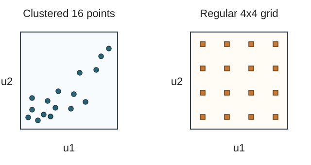

# U3-34 準 Monte Carlo と次元削減

[前講の層化抽出・重要度サンプリング](../U3-33/index.md#def-u3-33-gbm-strata)では、どの領域から何個標本を取るか、どの密度から標本を発生させるかを変えました。今回は別の問題があります。多数の時点を参照する価格付けで、一様乱数点が偶然一か所へ集まることを避け、限られた経路評価回数をより均等に使えないでしょうか。

**準 Monte Carlo（QMC）** は、独立な乱数の代わりに、積分領域を均一に埋めるよう設計した点を使います。ただし点は独立でなく、通常の標本分散・中心極限定理をそのまま使えません。**乱択 QMC（RQMC）** では、点のよい配置をある程度保ちながら配置全体を独立に乱択し、複数回の結果から誤差を測ります。

さらに Brown 運動の経路を作るとき、どの一様座標からどの時点を決めるかも重要です。本講では終端から先に作る *Brownian bridge construction* を使い、低次元の座標が支払額の主要な変動を捉える例を計算します。これは**障壁の未観測越境を補う手法ではありません**。その確率補正は次の U3-35 で扱います。

既習の[リスク中立割引支払の Monte Carlo 推定量](../U3-26/index.md#def-u3-26-mc-estimator)、[時間離散化と標本誤差の分解](../U3-29/index.md#prop-u3-29-mc-decomposition)、[幾何 Brown 運動の陽解](../U3-14/index.md#thm-u3-14-explicit-gbm)を使います。時間は年、価格は円、$r,q$ は連続複利の年率、$\sigma>0$ は年$^{-1/2}$、評価測度は $Q$ です。以下、$s>0$、$T>0$、$r,q\in\mathbb R$ を固定します。

## 1. 経路価格を単位立方体上の積分へ直す

まず $m\ge1$、$t_j=jT/m$、$\Delta t=T/m$ とします。独立標準正規変数 $Z_1,\ldots,Z_m$ を用いると、[GBM の陽解](../U3-14/index.md#thm-u3-14-explicit-gbm)を各区間へ適用して、時刻 $t_j$ の株価は

$$
S_{t_j}=s\exp\left\{(r-q-\sigma^2/2)t_j
+\sigma\sqrt{\Delta t}\sum_{k=1}^j Z_k\right\}.
$$

ここでは **$m$ 個の観測時点の同時分布**だけを評価します。たとえば $G:(0,\infty)^m\to\mathbb R$ が可測で、$E_Q[|G(S_{t_1},\ldots,S_{t_m})|]<\infty$ なら、価格は $V_m=e^{-rT}E_Q[G]$ です。標準正規の累積分布関数を $\Phi(z)=Q(Z\le z)$ とすると、$U_k=\Phi(Z_k)$ は互いに独立な区間 $(0,1)$ の一様変数です。逆変換 $z_k=\Phi^{-1}(u_k)$ を代入し、割引した支払額を各点 $u$ に対応させる関数を

$$
f_m(u_1,\ldots,u_m)
=e^{-rT}G(S_{t_1}(z),\ldots,S_{t_m}(z))
$$

と書けば、確率積分は通常の多重積分になります。

<!-- formal-statement-start -->
> **定義（金融価格の準 Monte Carlo 積分）**  
> 上の $m$ 時点GBM、可測支払関数 $G$、$E_Q|G|<\infty$ を固定する。$N\ge1$ と $(0,1)^m$ 内の決定論的な点 $u^{(1)},\ldots,u^{(N)}$ に対して、$f_m$ が各点で有限なら、価格の **QMC 積分近似**を

$$
\widehat V_{m,N}^{\rm QMC}
=\frac1N\sum_{i=1}^N f_m(u^{(i)}),
\qquad
V_m=\int_{(0,1)^m}f_m(u)\,du
$$

> とする。QMC 点は互いに独立な確率標本とは仮定しない。
<!-- formal-statement-end -->

<!-- definition-example-start: def-u3-34-qmc-pricing -->
**定義の確認**（終端だけの契約）：$m=1$、$G(x)=(x-K)_+$、$s=K=100$ 円、$r=0.03,q=0,\sigma=0.2,T=1$ 年とします。ここで $A=100e^{0.01}$、$D=e^{-0.03}$ とすると

$$
f_1(u)=D\max\{A e^{0.2\Phi^{-1}(u)}-100,0\}.
$$

任意の $u\in(0,1)$ で逆正規関数は有限で、$f_1(u)$ も有限です。さらに $0\le f_1(u)\le D A e^{0.2\Phi^{-1}(u)}$ で、[GBM の一次モーメント](../U3-14/index.md#prop-u3-14-moments)が有限なので積分可能です。したがって $u^{(i)}=(i-\tfrac12)/N$ を選べば定義を満たし、時刻の離散化もありません。ただし固定点の平均は**確率変数ではない**ため、通常MCの不偏性・標準誤差をそのまま宣言できません。
<!-- definition-example-end -->

同じ16点でも、左のように一部へ偏る配置と、右のように各領域を覆う配置とでは積分の取りこぼし方が異なります。次図は**二次元単位正方形の幾何学的な例**であり、右図を Sobol 列そのものと主張するものではありません。横軸は第1一様座標、縦軸は第2一様座標です。点の個数だけでなく配置を見る、という QMC の発想を確認します。

### 均等な配置を一変数から理解する

点が積分領域の左端からどれだけ均等に分布するかを測ります。点が $x_i\in(0,1)$ にあるとき、$[0,t)$ に入る点の割合は $N^{-1}\sum_i\boldsymbol1_{\{x_i<t\}}$ です。一様分布なら区間の長さ $t$ に一致するはずです。

<!-- formal-statement-start -->
> **定義（一変数の星食い違い度）**  
> $x_1,\ldots,x_N\in(0,1)$ の **星食い違い度**を、区間 $[0,t)$ における経験割合と長さの差の最大値

$$
D_N^*=\sup_{0\le t\le1}
\left|\frac1N\sum_{i=1}^N
\boldsymbol1_{\{x_i<t\}}-t\right|
$$

> と定める。
<!-- formal-statement-end -->

<!-- definition-example-start: def-u3-34-star-discrepancy -->
**定義の確認**（4点）：$x=(1/8,3/8,5/8,7/8)$ なら、各点の直前・直後で経験割合が $0,1/4,1/2,3/4,1$ と変わります。各点の座標と隣接する経験割合との差の絶対値はすべて $1/8$ なので $D_4^*=1/8$ です。一方、4点を $x_i=1/8$ に重ねると、$t$ を $1/8$ より少し大きくした時点で経験割合が1となり、$D_4^*=7/8$ です。**同じ4回の評価でも、点の配置の悪さは違う**ことが数値で確認できます。
<!-- definition-example-end -->

多次元では区間 $[0,t_1)\times\cdots\times[0,t_m)$ とその体積 $\prod_jt_j$ のずれで同様に定義します。ただし「すべての低食い違い点列で、すべての金融ペイオフが速く収束する」という主張ではありません。正規逆変換は区間端で発散し、デジタル・障壁のペイオフには不連続点もあります。

一変数なら、低食い違い度が何に効くかを、追加の大規模定理に頼らず証明できます。

<!-- formal-statement-start -->
> **命題（一変数の QMC 積分誤差）**  
> $g:[0,1]\to\mathbb R$ は絶対連続で、導関数が Lebesgue 可積分、すなわち $\int_0^1|g'(t)|dt<\infty$ とする。任意の $x_i\in(0,1)$ について

$$
\left|\frac1N\sum_{i=1}^Ng(x_i)-\int_0^1g(u)\,du\right|
\le D_N^*\int_0^1|g'(t)|\,dt
$$

> が成り立つ。
<!-- formal-statement-end -->

**証明の見取り図**：$g(x)$ を $g(0)$ と導関数の積分に分けます。各 $t$ より右にある点の割合と、一様区間の長さ $1-t$ の差が食い違い度で抑えられます。

<!-- proof-start -->
### 証明

絶対連続性から $g(x)=g(0)+\int_0^x g'(t)\,dt$ です。$g'\in L^1(0,1)$ なので、有限和と積分は交換でき、

$$
\frac1N\sum_{i=1}^Ng(x_i)
=g(0)+\int_0^1 g'(t)
\left(\frac1N\sum_i\boldsymbol1_{\{x_i>t\}}\right)dt.
$$

一方、$g$ の積分で積分順序を交換すると、領域 $0\le t\le u\le1$ より

$$
\int_0^1 g(u)\,du
=g(0)+\int_0^1 g'(t)(1-t)\,dt.
$$

有限個の点 $x_i$ と $t$ が一致する箇所は積分に影響しません。ほとんどすべての $t$ で

$$
\frac1N\sum_i\boldsymbol1_{\{x_i>t\}}
=1-\frac1N\sum_i\boldsymbol1_{\{x_i<t\}}.
$$

したがって両式の差の絶対値は

$$
\left|\int_0^1 g'(t)
\left(t-\frac1N\sum_i\boldsymbol1_{\{x_i<t\}}\right)dt\right|
\le\int_0^1|g'(t)|D_N^*dt.
$$

これが結論です。$\square$
<!-- proof-end -->

例として $g(u)=u^2$、4中点 $x_i=(i-\tfrac12)/4$ では、平均が $21/64$、真の積分は $1/3$ なので誤差は $-1/192$ です。上界は $D_4^*\int_0^1 2u\,du=1/8$。上界は安全ですが鋭いとは限りません。**先ほどのGBMの $f_1$ は端点で無界になり得る**ので、この命題をそのまま当てはめないでください。高次元の一般的な Koksma–Hlawka 型評価にも別の変動条件が必要です。

## 2. 独立な「点配置」を何度も作って誤差を測る

固定したQMC点の誤差を、点間の標本分散で測ることはできません。そこで一つの点配置を**まとめて乱択**します。単位立方体の各点の周辺分布が一様になるようにすれば、点どうしが依存していても、積分の平均値は正しく保てます。

以下の $E[\cdot]$ と $\operatorname{Var}(\cdot)$ は、この**点配置の乱択**に関する期待値と分散です。もとの金融価格を定める $E_Q[\cdot]$ は、リスク中立 GBM の分布による期待値を表します。両者を対応づけるのが各乱択点の一様周辺分布です。

初歩的な例は一次元の周期格子を一様に平行移動する方法です。$V\sim\operatorname{Unif}(0,1)$ を一つ発生し、

$$
X_i=(V+(i-1)/N)\bmod 1,\qquad i=1,\ldots,N
$$

とします。各 $X_i$ は一様分布です。なぜなら、任意の区間 $A\subset[0,1)$ で $Q((V+c)\bmod1\in A)=|A|$ だからです。しかし $X_1,\ldots,X_N$ は独立ではありません。$N=2$ なら必ず二点の距離は周期的に $1/2$ です。

多次元では、たとえば base 2 の Sobol 点列に独立した *scramble*（桁の乱択）を施す構成を使用できます。ここで必要なのは、乱択後の**各点の周辺分布が $(0,1)^m$ 上の一様分布**になり、異なる scramble ごとに独立な点配置を得る性質です。点配置の内部は独立と仮定しません。Sobol 点列の $N=2^k$ 個という区切りを保つのは、配置の均一性に有利な実装上の選択です。

<!-- formal-statement-start -->
> **定義（独立乱択配置による価格推定）**  
> $f_m\in L^2((0,1)^m)$ とし、$R\ge2$、$N\ge1$ とする。各 $a=1,\ldots,R$ に対し**同じ乱択規則**で配置 $(U_{a1},\ldots,U_{aN})$ を独立に生成し、各 $U_{ai}$ の周辺分布は $(0,1)^m$ の一様分布とする。従って配置どうしは互いに独立で、同じ分布に従う。配置内の $U_{ai}$ は依存してもよい。各配置の推定値とその平均を

$$
Y_a=\frac1N\sum_{i=1}^Nf_m(U_{ai}),
\qquad
\widehat V_{R,N}^{\rm RQMC}=\frac1R\sum_{a=1}^RY_a
$$

> と定める。1配置には $N$ 回、全体には $RN$ 回の支払関数評価が必要である。
<!-- formal-statement-end -->

<!-- definition-example-start: def-u3-34-rqmc -->
**定義の確認**（周期格子の2点）：$N=2$、各配置で一様シフト $V_a$ を独立に引き、$U_{a1}=V_a$、$U_{a2}=(V_a+1/2)\bmod1$ とします。二点とも一様で、配置間のシフトは独立、$f(u)=u$ は二乗可積分なので全条件を満たします。たとえば $V_1=0.1,V_2=0.7$ という実現値なら、二配置は $(0.1,0.6)$、$(0.7,0.2)$、積分近似は $Y_1=0.35,Y_2=0.45$、全体平均は $0.40$ です。**この実現値が真値 $1/2$ に等しい必要はありません**。不偏性はシフトを繰り返す確率実験の期待値で主張します。
<!-- definition-example-end -->

<!-- formal-statement-start -->
> **命題（独立乱択QMCの不偏性と反復標準誤差）**  
> [乱択配置の定義](#def-u3-34-rqmc)の条件が成り立つなら、$I_m=\int f_m(u)\,du$ に対して

$$
E[\widehat V_{R,N}^{\rm RQMC}]=I_m,\qquad
\operatorname{Var}(\widehat V_{R,N}^{\rm RQMC})
=\frac{\operatorname{Var}(Y_1)}R.
$$

> $Y_a$ が同じ分布に従うとき、反復間の標本分散と標準誤差推定値は

$$
s_Y^2=\frac1{R-1}\sum_{a=1}^R(Y_a-\overline Y)^2,
\qquad
\widehat{\mathrm{SE}}_{\rm RQMC}=\sqrt{\frac{s_Y^2}{R}}.
$$

> $s_Y^2$ は $\operatorname{Var}(Y_1)$ の不偏推定量である。ただし少数反復で正規近似区間の被覆を保証するものではない。
<!-- formal-statement-end -->

**証明の見取り図**：各点は周辺一様なので、一つの配置の**平均の期待値**は積分値です。配置内に相関があってもこの段階では困りません。分散を $1/R$ にする際だけ、配置間の独立性を使います。

<!-- proof-start -->
### 証明

$f_m\in L^2$ は単位立方体の体積が1だから $L^1$ にも属します。各 $U_{ai}$ が一様なので

$$
E[f_m(U_{ai})]=\int_{(0,1)^m}f_m(u)\,du=I_m,
\quad
E[Y_a]=\frac1N\sum_{i=1}^NI_m=I_m.
$$

従って $E[\overline Y]=I_m$ です。各配置の $Y_a$ は互いに独立で同じ分布に従い、二乗可積分なので

$$
\operatorname{Var}(\overline Y)
=\frac1{R^2}\sum_{a=1}^R\operatorname{Var}(Y_a)
=\frac{\operatorname{Var}(Y_1)}R.
$$

分散の不偏推定について、$\mu=I_m$ と置き、

$$
\sum_a(Y_a-\overline Y)^2
=\sum_a(Y_a-\mu)^2-R(\overline Y-\mu)^2
$$

を展開で確認します。両辺の期待値を取ると、右辺は
$$
R\operatorname{Var}(Y_1)-R\operatorname{Var}(\overline Y)
=(R-1)\operatorname{Var}(Y_1).
$$

これを $R-1$ で割って $E[s_Y^2]=\operatorname{Var}(Y_1)$。$\square$
<!-- proof-end -->

**誤りやすい点**：同一 scramble に含まれる $N$ 個の点で通常の $N-1$ 標本分散を作り、$N$ で割っても、この推定量の分散を測ったことにはなりません。また $R=1$ では反復間分散を推定できません。

配置ごとの $Y_a$ が互いに独立で同じ分布に従い、分散が正かつ有限なら、独立な配置数 $R$ を増やすときに[中心極限定理](../../../解析系/F0/F0-00P6A/index.md#thm-iid-clt)を適用できますが、**$R$ を固定して $N$ だけ増やしたときの正規近似**を自動的には保証しません。

### 乱択は効率向上を保証するか

固定した $N$ に対して、点の一様な周辺分布は不偏性を保証します。しかし $\operatorname{Var}(Y_a)$ が通常MCの $\operatorname{Var}(f_m(U))/N$ より小さいとは、この仮定だけからは証明できません。乱択法・関数の滑らかさ・次元・座標の順序が効率を左右します。不連続な障壁型支払や、高次元の多数の座標に等しく依存する支払では改善が弱まることがあります。

## 3. Brown 運動の生成順序で重要な座標を前へ置く

$m$ 個の独立な標準正規変数を使った前進生成では、$W_{t_j}=\sqrt{\Delta t}\sum_{k\le j}Z_k$ です。終端 $W_T$ は $Z_1,\ldots,Z_m$ の**全座標**で決まります。QMC点は初期の座標ほど均一な構造を持つことが多く、終端を最初の座標だけで決められれば有利な可能性があります。

Brown 運動には、既知の両端値の間の値を正規分布から作れる性質があります。まず $W_0=0$、$W_T=\sqrt T\,Z_1$ と置きます。次に $W_{T/2}$ を両端に条件付けた正規分布で作り、さらに左右の区間の中点を作ります。この**経路の生成順序の変更**を Brownian bridge construction と呼びます。連続経路の途中越境確率を加える計算とは違います。

<!-- formal-statement-start -->
> **定義（Brownian bridge による観測時点の正規座標生成）**  
> $0\le a<t<b\le T$ において、すでに値 $W_a,W_b$ が確定しているとする。新たな独立標準正規変数 $Z$ を使い、条件付き平均と分散を

$$
\mu_{t\mid a,b}
=\frac{b-t}{b-a}W_a+\frac{t-a}{b-a}W_b,
\qquad
v_{t\mid a,b}=\frac{(t-a)(b-t)}{b-a}
$$

> として、$W_t=\mu_{t\mid a,b}+\sqrt{v_{t\mid a,b}}\,Z$ と作る。$W_0=0$、$W_T=\sqrt T Z_1$ から開始し、必要な中間観測時刻をこの規則で挿入する方法を **Brownian bridge 座標生成**という。左右の区間の補間には独立な新しい $Z$ を使用する。
<!-- formal-statement-end -->

<!-- definition-example-start: def-u3-34-bridge-coordinates -->
**定義の確認**（$T=1$、四分割）：独立な $Z_1,\ldots,Z_4\sim N(0,1)$ から

$$
W_1=Z_1,\qquad W_{1/2}=\tfrac12Z_1+\tfrac12Z_2,
$$

$$
W_{1/4}=\tfrac12W_{1/2}+\sqrt{\tfrac18}\,Z_3,
\qquad
W_{3/4}=\tfrac12(W_{1/2}+W_1)+\sqrt{\tfrac18}\,Z_4
$$

と生成します。$W_{1/2}$ の条件付き平均は $W_1/2$、条件付き分散は $(1/2)(1/2)=1/4$ なので係数 $1/2$ です。左右の四分点では、長さ $1/2$ の区間を二分するので分散は $(1/4)^2/(1/2)=1/8$。4つの新しい標準正規変数が独立で、各条件付き分散も正しく設定されています。
<!-- definition-example-end -->

<!-- formal-statement-start -->
> **命題（橋生成が Brown 運動の有限次元分布を保つ）**  
> $W_0=0$、$W_T\sim N(0,T)$ を取り、各段階で正しい両端条件付き正規分布から新しい点を発生し、異なる区間の新しい正規雑音を条件付き独立とする。このとき、任意の有限個の挿入時刻 $t_1,\ldots,t_m$ について、得られたベクトルは平均0で

$$
\operatorname{Cov}(W_{t_i},W_{t_j})
=\min(t_i,t_j)
$$

> を持つ多変量正規分布になる。従って Brown 運動の観測点と同じ分布であり、同じ観測時点の金融支払額の期待値を変えない。
<!-- formal-statement-end -->

**証明の見取り図**：Brown 運動の Gaussian 増分を使って、端点を与えたときの中間点の条件付き平均・分散を計算します。条件付き分布の連鎖を順に再構成しているので、前進順と同じ同時分布になります。

<!-- proof-start -->
### 証明

Brown 運動の独立増分を $A=W_t-W_a$、$B=W_b-W_t$ とします。平均0、分散は $t-a$、$b-t$、両者は独立です。既知の端点差 $C=W_b-W_a=A+B$ の分散は $b-a$、$\operatorname{Cov}(A,C)=t-a$ です。独立な正規変数の線形結合だから $(A,C)$ は同時正規です。係数

$$
\lambda=\frac{\operatorname{Cov}(A,C)}{\operatorname{Var}(C)}
=\frac{t-a}{b-a}
$$

$D=A-\lambda C$ と置きます。$\operatorname{Cov}(D,C)=0$ であり、$(D,C)$ は同時正規だから $D$ と $C$ は独立です。

さらに、元の独立増分から $A,B$ は $W_a$ と独立です。よって $(D,C)$ も $W_a$ と独立で、$D$ は組 $(W_a,C)$ と独立になります。$W_b=W_a+C$ なので、両端 $(W_a,W_b)$ を指定しても $D$ はそのままの分布を持ちます。

$A=\lambda C+D$ を使うと、条件付き分散は次の値になります。

$$
\operatorname{Var}(D)
=(t-a)-\frac{(t-a)^2}{b-a}
=\frac{(t-a)(b-t)}{b-a}.
$$

従って $W_t=W_a+A$ の端点条件付き平均は $W_a+\lambda(W_b-W_a)$、分散は上の $\operatorname{Var}(D)$ です。$W_a+\lambda(W_b-W_a)=(1-\lambda)W_a+\lambda W_b$ に $\lambda=(t-a)/(b-a)$ を代入すると、定義の平均の式と一致します。両端で条件付けると、重ならない左右区間の内部増分の残差も独立です（もとの独立増分の各区間の正規密度を、区間ごとの端点差を固定して条件付ければ積の形が保たれます）。

最初の $W_T$ は本来の終端分布で、各挿入では本来の条件付き分布を使っています。条件付き密度の積、すなわち連鎖律により、有限回の挿入後の全ベクトルの同時分布は本来の Brown 運動と一致します。元の Brown 運動では $t_i\le t_j$ のとき $W_{t_j}=W_{t_i}+(W_{t_j}-W_{t_i})$、後者の増分は前者と独立だから共分散は $\operatorname{Var}(W_{t_i})=t_i$。よって結論の $\min(t_i,t_j)$ を得ます。$\square$
<!-- proof-end -->

前の四分割を手で検算すると

$$
W_{1/4}=\tfrac14Z_1+\tfrac14Z_2+\sqrt{\tfrac18}Z_3,
\quad
W_{3/4}=\tfrac34Z_1+\tfrac14Z_2+\sqrt{\tfrac18}Z_4.
$$

独立性を使うと

$$
\operatorname{Var}(W_{1/4})=\tfrac1{16}+\tfrac1{16}+\tfrac18=\tfrac14,
\quad
\operatorname{Cov}(W_{1/4},W_{3/4})
=\tfrac3{16}+\tfrac1{16}=\tfrac14.
$$

これは正しい Brown 運動の共分散です。**生成順序が変わっても、経路の分布は変わりません**。

## 4. 実効次元を「第一座標への依存度」で測る

次元 $m$ は観測時点の個数です。しかし、同じ $m$ でも関数が主に最初の少数座標で変動するなら、QMCの良い座標配置を生かしやすくなります。この違いを数値化するため、まず第一座標に着目します。$U=(U_1,\ldots,U_m)$ は独立一様、$Y=f_m(U)$ は有限で正の分散を持つとします。$E[Y\mid U_1]$ は最初の座標を固定し、残りを平均した関数です。$X=E[Y\mid U_1]$ と書くと、$E[Y-X\mid U_1]=0$ であり、$X$ は $U_1$ だけの関数なので

$$
E[(Y-X)(X-E[Y])]
=E[(X-E[Y])E[Y-X\mid U_1]]=0.
$$

$Y-E[Y]=(Y-X)+(X-E[Y])$ を二乗して期待値を取れば、全分散の公式のこの場合の形

$$
\operatorname{Var}(Y)
=E[(Y-X)^2]+\operatorname{Var}(X)
$$

が出ます。右辺第1項は非負で、0なら $Y=X$ がほとんど確実に成り立ちます。これが次の寄与率の範囲と等号条件を判定する根拠です。

<!-- formal-statement-start -->
> **定義（第一座標の分散寄与率）**  
> $Y=f_m(U)\in L^2$、$\operatorname{Var}(Y)>0$ とする。第一座標の分散寄与率を

$$
\rho_1=\frac{\operatorname{Var}(E[Y\mid U_1])}
{\operatorname{Var}(Y)}
$$

> と定める。全分散の公式から $0\le\rho_1\le1$ である。$\rho_1=1$ は、ほとんど確実に $Y$ が第一座標だけで決まる場合と同値である。
<!-- formal-statement-end -->

<!-- definition-example-start: def-u3-34-coordinate-ratio -->
**定義の確認**：$Y=U_1+2U_2$ とすると、$E[Y\mid U_1]=U_1+1$、独立な一様変数の分散は $1/12$ です。従って

$$
\operatorname{Var}(Y)=\tfrac1{12}+\tfrac4{12}=\tfrac5{12},
\qquad
\operatorname{Var}(E[Y\mid U_1])=\tfrac1{12},
\qquad \rho_1=\tfrac15.
$$

一方 $Y=U_1$ なら $\rho_1=1$。$\rho_1$ は「QMCの誤差がこの割合で減る」という保証ではなく、関数が最初の座標へどれほど依存するかの診断値です。
<!-- definition-example-end -->

厳密には実効次元は、複数の座標集合への分散分解と許容割合（たとえば99%）を選んで定義されることがあります。本講ではその一般論を新たな前提にせず、**計算できる第一座標の寄与率**で、前進生成と橋生成の違いを調べます。

### 割引満期株式なら寄与率を厳密に計算できる

満期株式を割引した $Y=e^{-rT}S_T$ を考えます。標準正規変数の線形結合に使う係数 $a_1,\ldots,a_m$ が $\sum_ka_k^2=1$ を満たすなら、$Z_k$ は独立標準正規なので $\sum_ka_kZ_k$ も標準正規です。[GBM の実数モーメント](../U3-14/index.md#prop-u3-14-moments)の $p=1,2$ を使い、$b=\sigma\sqrt T$、$c=s e^{-qT}$ と置くと

$$
Y=c\exp\left\{b\sum_{k=1}^m a_kZ_k-\frac{b^2}{2}\right\}.
$$

<!-- formal-statement-start -->
> **命題（割引満期株式の第一座標寄与率）**  
> $c>0$、$b>0$、$Z_k$ が独立標準正規、$\sum a_k^2=1$ とする。上の $Y$ に対し、第一座標の分散寄与率は

$$
\rho_1=\frac{e^{b^2a_1^2}-1}{e^{b^2}-1}.
$$

> $m$ 等分の前進生成では $a_1=1/\sqrt m$ であり、終端を最初に作る橋生成では $a_1=1$ なので、後者の $\rho_1$ は1である。
<!-- formal-statement-end -->

**証明の見取り図**：条件付き平均では $Z_2,\ldots,Z_m$ の指数モーメントだけを先に積分します。残った $Z_1$ の対数正規分散を、全体の対数正規分散で割ります。

<!-- proof-start -->
### 証明

独立標準正規の指数モーメント $E[e^{tZ}]=e^{t^2/2}$ を各 $Z_k$ に適用します。$\sum a_k^2=1$ なので

$$
E[Y]=c e^{-b^2/2}\prod_ke^{b^2a_k^2/2}=c,
\qquad
E[Y^2]=c^2e^{-b^2}\prod_ke^{2b^2a_k^2}=c^2e^{b^2}.
$$

従って $\operatorname{Var}(Y)=c^2(e^{b^2}-1)>0$ です。$Z_1$ を固定して、残りの $m-1$ 個を積分すると

$$
E[Y\mid Z_1]
=c e^{b a_1Z_1-b^2/2}
\prod_{k=2}^me^{b^2a_k^2/2}
=c\exp\{ba_1Z_1-b^2a_1^2/2\}.
$$

これは平均 $c$、二乗平均 $c^2e^{b^2a_1^2}$ の対数正規変数なので

$$
\operatorname{Var}(E[Y\mid Z_1])
=c^2(e^{b^2a_1^2}-1).
$$

$\Phi$ は単調で逆写像があり、$U_1=\Phi(Z_1)$ と $Z_1$ は同じ情報を持つため $E[Y\mid U_1]=E[Y\mid Z_1]$。分散の比を取れば結論です。前進生成では $W_T=\sqrt{T/m}\sum_kZ_k$ を $\sqrt T$ で割ると各係数 $1/\sqrt m$、橋生成では $W_T=\sqrt T\,Z_1$ で係数 $1,0,\ldots,0$ です。$\square$
<!-- proof-end -->

**数値例**：$m=4$、$\sigma=0.2$ 年$^{-1/2}$、$T=1$ 年では $b^2=0.04$。前進生成の寄与率は

$$
\rho_1^{\rm forward}
=\frac{e^{0.01}-1}{e^{0.04}-1}\simeq0.24626,
\qquad
\rho_1^{\rm bridge}=1.
$$

前進座標から作る積分関数 $f_m^{\rm forward}$ と橋座標から作る $f_m^{\rm bridge}$ は点ごとの値こそ異なりますが、変換後の経路ベクトルが同じ分布なので、どちらも同じ $V_m$ を積分します。

二つは**まったく同じ $S_T$ の分布**を作ります。異なるのは最初のQMC座標にどれだけ終端の変動を集めたか、です。これは終端だけの契約では極端に効く例ですが、算術平均 Asian では途中の $W_{t_j}$ も使うため、橋生成でも一般に $\rho_1=1$ にはなりません。ゆえにすべての金融契約で改善すると断定しません。

## 5. 数値比較：固定した契約・独立スクランブル・誤差予算

検証用の契約は **8時点の離散算術平均 Asian call** とします（[算術平均ペイオフ](../U3-08/index.md#def-u3-08-asian-payoff)）。$m=8$、$s=K=100$ 円、$r=0.03,q=0,\sigma=0.2,T=1$ 年、観測時刻 $t_j=j/8$、支払額は

$$
G(S_{t_1},\ldots,S_{t_8})
=\left(\frac18\sum_{j=1}^8S_{t_j}-100\right)_+
$$

円です。[既習の算術平均契約](../U3-08/index.md#def-u3-08-asian-payoff)は初期時点 $S_0$ を含む観測平均でしたが、**本講では $j=1,\ldots,8$ の右端8時点だけ**を平均します。監視仕様が異なれば別の契約です。無限回の連続観測平均ではなく、固定された8回の算術平均を評価します。各 $S_{t_j}$ はGBMの厳密な有限次元同時分布から発生させるので、ここに Euler 法の経路近似誤差はありません。

この支払額に [乱択配置の定義](#def-u3-34-rqmc) を適用できるよう、二乗可積分性も確認します。算術平均 $A$ と割引支払額 $H$ を

$$
A=\frac18\sum_{j=1}^8 S_{t_j},
\qquad
H=e^{-rT}(A-K)_+
$$

と置きます。$K=100\ge0$ と株価の正値性から $0\le (A-K)_+\le A$ です。二乗の凸性（または Cauchy–Schwarz の不等式）により

$$
0\le H^2\le e^{-2rT}A^2
\le\frac{e^{-2rT}}8\sum_{j=1}^8S_{t_j}^2.
$$

[GBM の実数モーメント](../U3-14/index.md#prop-u3-14-moments)の $p=2$ により右辺の期待値は有限です。したがって $E_Q[H^2]<\infty$、つまり対応する $f_8$ は $L^2((0,1)^8)$ に属します。

次の3方式を同じ $(R,N)$ とし、同じ契約の割引支払額を比較します。

| 方式 | 標準正規変数の割当て | 同一配置内の依存性 | 誤差の推定 |
| --- | --- | --- | --- |
| 独立擬似乱数MC | 前進増分 | 独立 | 反復平均 $Y_a$ の間 |
| スクランブル Sobol（前進） | 前進増分 | 一般に依存 | 独立スクランブル間 |
| スクランブル Sobol（橋） | 終端→中点→四分点… | 一般に依存 | 独立スクランブル間 |

各方式で **独立反復 $R=24$**、各反復の評価経路数 $N=256,1024,4096$ とし、総経路費用は $RN$ です。乱択 Sobol は独立スクランブルを新しく生成し、ソースの固定シードから再現します。全方式とも同じ割引率・監視時点・ペイオフで、前進と橋の違いは分布でなく独立標準正規変数の利用順だけです。

添付の [Python 実験](assets/qmc_asian_experiment.py) は、標本平均・反復間標準誤差・同じ費用の通常MCに対する反復間分散比を表として出力します。固定シードは再現性のためのものであり、計算機やライブラリ版によって最後の桁は異なり得ます。推定値の表は確率実験の一実現で、**QMCの理論的な優位性の証明ではありません**。また、上の不偏性命題は連続一様な周辺分布を仮定しますが、実際の Sobol 実装は有限桁・浮動小数点であり、コードは逆正規変換が無限大になる端点を `np.clip` で避けます。したがって実装の丸め・端点処理まで含めた厳密な不偏性を主張するものではありません。

比較の前に二つの誤差を分けます。$V_{\rm cont}$ を連続時間の算術平均の価格、$V_m$ を上で固定した $m$ 時点契約の価格、$\widehat V$ を $V_m$ に不偏な乱択推定量とすると、

<!-- formal-statement-start -->
> **命題（乱択QMCの分散と監視仕様の偏り）**  
> $E[\widehat V]=V_m$、$E[\widehat V^2]<\infty$、$V_m,V_{\rm cont}$ は有限とする。このとき

$$
E[(\widehat V-V_{\rm cont})^2]
=\operatorname{Var}(\widehat V)+(V_m-V_{\rm cont})^2.
$$

> $V_m$ が同じ契約の真の価格なら第二項は0であり、橋生成と前進生成は $V_m$ を変えない。
<!-- formal-statement-end -->

**証明の見取り図**：基準を $V_m$ に一度戻すと、ランダムな誤差は平均0なので交差項が消えます。監視頻度を変えた違いを、サンプリングの分散減少と取り違えないための式です。

<!-- proof-start -->
### 証明

$\widehat V-V_{\rm cont}=(\widehat V-V_m)+(V_m-V_{\rm cont})$ なので

$$
\begin{aligned}
E[(\widehat V-V_{\rm cont})^2]
&=E[(\widehat V-V_m)^2]
+2(V_m-V_{\rm cont})E[\widehat V-V_m]\\
&\quad+(V_m-V_{\rm cont})^2.
\end{aligned}
$$

$E[\widehat V-V_m]=0$、$E[(\widehat V-V_m)^2]=\operatorname{Var}(\widehat V)$ より結論です。$\square$
<!-- proof-end -->

**境界と失敗例**：極端に不連続な支払額では、座標ごとの滑らかさに依存するQMCの高速収束を適用できないことがあります。また橋生成は指定した観測時点について Brown 運動と同じ同時分布を再現する方法ですが、離散監視障壁の二点間の越境事象を新たに検出するものではありません。その事象を無視したままスクランブル数を増やしても、連続監視契約との差は消えません。

---

## 演習：価格積分から経路座標・誤差診断まで

### Level A：定義と生成規則を一つずつ確認する

### U3-34-A1：中点格子の積分と食い違い度
- Level: A

$N=4$、$x_i=(i-\tfrac12)/4$、$g(u)=u^2$ とする。QMC 積分値、真の積分、符号付き誤差、星食い違い度を求め、[一変数誤差命題](#prop-u3-34-one-dimensional-bound)の上界を検算せよ。

<!-- solution-start -->
**詳細解答**：点は $1/8,3/8,5/8,7/8$ なので、二乗値の和は $(1+9+25+49)/64=84/64$。平均は

$$
\widehat I=\frac14\frac{84}{64}=\frac{21}{64}.
$$

真の値は $\int_0^1u^2du=[u^3/3]_0^1=1/3$ で、誤差は

$$
\widehat I-I=\frac{63-64}{192}=-\frac1{192}.
$$

経験割合は点を通過するたびに $1/4$ ずつ増えるため、各段差の左右端で長さとの差が $1/8$。従って $D_4^*=1/8$。$g'(u)=2u$ で $\int_0^1|g'|du=1$ なので上界は $1/8$、実際 $1/192\le1/8$ を満たします。
<!-- solution-end -->

### U3-34-A2：金融ペイオフを一様積分へ
- Level: A

$s=K=100$ 円、$r=0.03,q=0,\sigma=0.2,T=1$ 年の満期 European call を考える。$u=1/2$ の正規変換 $z=\Phi^{-1}(u)$、株価、割引支払 $f_1(u)$ を求め、どの量が標本数を増やしても変わらない契約条件か説明せよ。

<!-- solution-start -->
**詳細解答**：標準正規は0で左右対称なので $\Phi(0)=1/2$、よって $z=0$。リスク中立 drift の指数は $(0.03-0-0.2^2/2)T=0.01$ で、

$$
S_T=100e^{0.01+0.2(0)}=100e^{0.01}.
$$

行使価格との差は正なので、割引後は

$$
f_1(1/2)=e^{-0.03}(100e^{0.01}-100)
=100e^{-0.03}(e^{0.01}-1)\simeq0.9753\,\text{円}.
$$

$s,K,r,q,\sigma,T$ と満期だけを参照する支払条件は契約・モデルの固定事項です。QMC 点の数を増やしても、これらの値や価格の評価測度 $Q$ は変えません。
<!-- solution-end -->

### U3-34-A3：周期格子の乱択と依存性
- Level: A

$N=2$ の周期格子 $X_1=V$、$X_2=(V+1/2)\bmod1$、$V$ は一様とする。$f(u)=u$ の積分を狙い、独立なシフト $V_1=0.1,V_2=0.7$ を使った二反復の値、反復平均、推定標準誤差を求めよ。なぜ一配置内の二点を独立とみなせないか。

<!-- solution-start -->
**詳細解答**：第1配置は $(0.1,0.6)$ なので $Y_1=(0.1+0.6)/2=0.35$。第2は $(0.7,0.2)$ なので $Y_2=(0.7+0.2)/2=0.45$。平均 $\overline Y=0.40$。反復間の標本分散は

$$
s_Y^2=\frac{(0.35-0.40)^2+(0.45-0.40)^2}{2-1}=0.005.
$$

[独立乱択QMCの不偏性と反復標準誤差](#prop-u3-34-rqmc-se)より $\widehat{\rm SE}=\sqrt{0.005/2}=0.05$ です。$X_2$ は $X_1$ から決定されるので、一点を知れば他方も確定し、独立ではありません。これは二つの**独立な配置**から得た標準誤差（Standard Error; SE）であり、真の積分 $1/2$ からの偏差 $0.10$ を推定標準誤差と取り違えません。
<!-- solution-end -->

### U3-34-A4：橋の条件付き分散
- Level: A

$T=1$、$W_0=0$、$W_1=Z_1$ とする。橋生成で $W_{1/2}$、次に $W_{1/4}$ を作る平均・分散・独立な新しい標準正規変数の係数を計算せよ。

<!-- solution-start -->
**詳細解答**：$a=0,t=1/2,b=1$ を[橋座標の定義](#def-u3-34-bridge-coordinates)へ代入します。条件付き平均は $(1/2)W_0+(1/2)W_1=Z_1/2$、分散は $(1/2)(1/2)/(1)=1/4$ なので

$$
W_{1/2}=\tfrac12Z_1+\tfrac12Z_2.
$$

次は $a=0,t=1/4,b=1/2$ です。平均は $(1/2)W_0+(1/2)W_{1/2}=W_{1/2}/2$、分散は $(1/4)(1/4)/(1/2)=1/8$。従って新しい独立 $Z_3$ を使い

$$
W_{1/4}=\tfrac12W_{1/2}+\sqrt{\tfrac18}Z_3
=\tfrac14Z_1+\tfrac14Z_2+\sqrt{\tfrac18}Z_3.
$$
<!-- solution-end -->

### U3-34-A5：終端株式の第一座標への集中
- Level: A

$m=4,T=1,\sigma=0.2$ の割引満期株式に対し、前進生成と橋生成で標準化終端値 $W_1$ の $Z_1$ の係数を求め、[寄与率命題](#prop-u3-34-stock-ratio)を使って $\rho_1$ を比較せよ。

<!-- solution-start -->
**詳細解答**：前進法の $\sqrt{\Delta t}=1/2$ なので $W_1=(Z_1+Z_2+Z_3+Z_4)/2$。従って $a_1=1/2$。橋生成では最初に $W_1=Z_1$ と置くので $a_1=1$。$b^2=\sigma^2T=0.04$ を[寄与率の式](#prop-u3-34-stock-ratio)へ入れて

$$
\rho_1^{\rm forward}=\frac{e^{0.04/4}-1}{e^{0.04}-1}
\simeq0.24626,\qquad
\rho_1^{\rm bridge}=1.
$$

全体の $W_1$ はどちらも $N(0,1)$ であり、平均価格を変えたのではありません。
<!-- solution-end -->

### Level B：別の設定から式を再導出する

### U3-34-B1：一般の中点格子の積分誤差
- Level: B

$N\ge1$、$x_i=(i-\tfrac12)/N$、$g(u)=u^2$ とする。有限和 $\sum_i(i-\tfrac12)^2$ を展開して積分誤差が $-1/(12N^2)$ となることを示せ。星食い違い度 $D_N^*$ を求め、一般の誤差命題の上界と比較せよ。

<!-- solution-start -->
**詳細解答**：二乗和を分けると

$$
\begin{aligned}
\sum_{i=1}^N(i-\tfrac12)^2
&=\sum_i i^2-\sum_i i+\frac N4\\
&=\frac{N(N+1)(2N+1)}6-\frac{N(N+1)}2+\frac N4\\
&=\frac{N(4N^2-1)}{12}.
\end{aligned}
$$

よって $N$ 個の点における平均は

$$
\frac1N\sum_i x_i^2
=\frac1{N^3}\frac{N(4N^2-1)}{12}
=\frac13-\frac1{12N^2}.
$$

真値は $1/3$ なので誤差は $-1/(12N^2)$。各点は長さ $1/N$ のセルの中点です。点の直前・直後では経験割合と $t$ の差が最大 $1/(2N)$ となり、セル内ではその間を直線的に変化するため $D_N^*=1/(2N)$ です。[一変数の上界](#prop-u3-34-one-dimensional-bound)は $|{\rm error}|\le D_N^*\int_0^12u\,du=1/(2N)$。この特定の滑らかな関数では実際に $O(N^{-2})$ とさらに速いですが、一般の不連続な金融支払額へこの次数を移してはいけません。
<!-- solution-end -->

### U3-34-B2：独立スクランブルの誤差と総費用
- Level: B

$R=4,N=256$、独立スクランブルごとの割引支払平均が $(9,10,11,10)$ 円となった。反復平均、標本分散、推定SE、総評価回数を計算せよ。さらに、この4個の配置の中の1024点をすべて独立な標本として扱ってよいか判断せよ。

<!-- solution-start -->
**詳細解答**：反復平均は $(9+10+11+10)/4=10$ 円です。偏差の二乗和は $(-1)^2+0^2+1^2+0^2=2$ 円$^2$。従って

$$
s_Y^2=\frac2{4-1}=\frac23\,\text{円}^2,\quad
\widehat{\mathrm{SE}}=\sqrt{\frac{2/3}4}
=\sqrt{\frac16}\simeq0.4082\,\text{円}.
$$

総評価回数は $RN=4\cdot256=1024$ 経路。各点の周辺分布が一様でも、同じ scramble 内の点は互いに独立ではありません。[不偏性・反復分散命題](#prop-u3-34-rqmc-se)の分散計算は配置間の独立性で行っており、1024点に通常の独立標本用SEを適用してはなりません。
<!-- solution-end -->

### U3-34-B3：四分割の橋の共分散を再構成する
- Level: B

独立標準正規 $Z_1,\ldots,Z_4$ で $W_1=Z_1$、$W_{1/2}=(Z_1+Z_2)/2$、$W_{1/4}=W_{1/2}/2+\sqrt{1/8}Z_3$、$W_{3/4}=(W_{1/2}+W_1)/2+\sqrt{1/8}Z_4$ とする。$W_{1/4},W_{1/2},W_{3/4}$ の各分散と、$W_{1/4}$ と $W_{3/4}$ の共分散を全て計算し、Brown 運動の条件と照合せよ。

<!-- solution-start -->
**詳細解答**：まず係数を展開して

$$
W_{1/4}=\tfrac14Z_1+\tfrac14Z_2+\sqrt{\tfrac18}Z_3,
\quad W_{1/2}=\tfrac12Z_1+\tfrac12Z_2,
$$

$$
W_{3/4}=\tfrac34Z_1+\tfrac14Z_2+\sqrt{\tfrac18}Z_4.
$$

独立・分散1の正規変数なので、線形結合の分散は係数の二乗和です。

$$
\operatorname{Var}(W_{1/4})=\tfrac1{16}+\tfrac1{16}+\tfrac18=\tfrac14,
$$

$$
\operatorname{Var}(W_{1/2})=\tfrac14+\tfrac14=\tfrac12,\qquad
\operatorname{Var}(W_{3/4})=\tfrac9{16}+\tfrac1{16}+\tfrac18=\tfrac34.
$$

また共通する $Z_1,Z_2$ の係数積だけが残り、

$$
\operatorname{Cov}(W_{1/4},W_{3/4})
=\tfrac14\cdot\tfrac34+\tfrac14\cdot\tfrac14
=\tfrac4{16}=\tfrac14.
$$

いずれも [橋生成の分布保存命題](#prop-u3-34-bridge-law) の $\operatorname{Var}(W_t)=t$、$\operatorname{Cov}(W_s,W_t)=\min(s,t)$ と一致します。
<!-- solution-end -->

### U3-34-B4：離散監視仕様の偏りを手計算する
- Level: B

無配当GBMで $s=100$ 円、$r=0.03$、$T=1$、$q=0$ とし、行使価格0の算術平均（$m$ 個の右端時点の単純平均）を満期に支払う。$m=4$ での割引価格と、連続時間平均 $T^{-1}\int_0^TS_tdt$ を支払う場合の割引価格を求め、差の符号と原因を説明せよ。乱択QMCの反復数を増やせばこの差は消えるか。

<!-- solution-start -->
**詳細解答**：[GBM の一次モーメント](../U3-14/index.md#prop-u3-14-moments)にドリフト $r-q=0.03$ を入れると $E_Q[S_t]=100e^{0.03t}$ です。有限和と期待値を交換し、割引すると

$$
V_4=e^{-0.03}\frac{100}4\sum_{j=1}^4e^{0.03j/4}
\simeq98.88478\,\text{円}.
$$

連続平均のほうは正の連続過程なので、積分と期待値を交換でき（非負性による Tonelli の定理）、

$$
V_{\rm cont}
=100e^{-0.03}\int_0^1e^{0.03t}dt
=100e^{-0.03}\frac{e^{0.03}-1}{0.03}
\simeq98.51489\,\text{円}.
$$

$e^{0.03t}$ は $t$ で単調増加するため、右端Riemann和は積分より大きく、$V_4-V_{\rm cont}\simeq0.36989$ 円は正です。乱択QMCを無限に反復しても $V_4$ に近づくだけで、**監視契約の差** $V_4-V_{\rm cont}$ は残ります。これは[誤差予算命題](#prop-u3-34-error-budget)の第二項に対応します。
<!-- solution-end -->

### Level C：積分変換・実効次元・標準誤差をつなぐ

### U3-34-C1：終端株式と8時点 Asian を同じ予算で比較
- Level: C

$s=K=100$ 円、$r=0.03,q=0,\sigma=0.2,T=1$ 年、$m=8$、$R=8,N=1024$ とする。

(1) 満期株式 $e^{-rT}S_T$ を評価するときの第一座標寄与率を、前進生成と橋生成で計算せよ。金融価格としての期待値と分散も求めよ。

(2) 満期株式に行使価格 $K$ の call を付ける場合と、8時点の算術平均 call を付ける場合で、橋生成後の支払額が第一座標だけの関数になるか判断せよ。

(3) 8時点契約を独立擬似乱数、乱択Sobol前進、乱択Sobol橋の3方式で比較する場合、各方式の総経路数と、各方式の推定標準誤差を何の標本から計算すべきか書け。ある方式の反復価格が8個得られたときのSE式を示せ。

(4) 同じ $m=8$ 契約の真値 $V_8$ を比較対象にする場合と、連続時間平均の真値を比較対象にする場合の二乗平均誤差の違いを記し、「橋生成を使えば連続監視の見落としがなくなる」という主張の真偽を述べよ。

<!-- solution-start -->
**詳細解答**：

(1) 前進生成では $\Delta t=1/8$ なので $W_1=8^{-1/2}\sum_{k=1}^8Z_k$、従って $a_1^2=1/8$。橋生成では $W_1=Z_1$ で $a_1^2=1$。[株式の寄与率命題](#prop-u3-34-stock-ratio)に $b^2=0.04$ を代入すると

$$
\rho_1^{\rm forward}
=\frac{e^{0.04/8}-1}{e^{0.04}-1}\simeq0.12282,
\quad
\rho_1^{\rm bridge}=1.
$$

[GBM の実数モーメント](../U3-14/index.md#prop-u3-14-moments)から $E_Q[S_T]=100e^{0.03}$、$E_Q[S_T^2]=100^2e^{2(0.03)+0.04}$ です。割引した $Y=e^{-0.03}S_T$ に対して

$$
E[Y]=e^{-0.03}100e^{0.03}=100\,\text{円},
$$

$$
\operatorname{Var}(Y)
=e^{-0.06}(10000e^{0.10}-10000e^{0.06})
=10000(e^{0.04}-1)\,\text{円}^2.
$$

(2) 終端callの支払 $e^{-rT}(S_T-K)_+$ は終端 $S_T$ だけの関数です。橋生成では $S_T$ が $Z_1$ だけから決まるため、callの支払も第一座標だけの関数です。一方8時点算術平均の支払は $\sum_{j=1}^8S_{j/8}$ を使うので、橋で作った中間時刻 $W_{1/2},W_{1/4},\ldots$ に含まれる $Z_2,Z_3,\ldots$ も残ります。従って一般に第一座標だけにはなりません。

(3) 各方式の費用は $RN=8\cdot1024=8192$ **経路評価**です（別方式どうしを足せば $3\cdot8192$）。方式ごとに独立な反復価格 $Y_1,\ldots,Y_8$ を保存します。擬似乱数の経路が反復内で独立でも、統一した費用比較では反復平均を単位にします。乱択Sobolでは反復**内**の1024点を独立と扱いません。各方式の推定SEは

$$
\widehat{\rm SE}
=\sqrt{\frac1{8(8-1)}
\sum_{a=1}^8(Y_a-\overline Y)^2},
\quad \overline Y=\frac18\sum_{a=1}^8Y_a.
$$

これは各方式ごとに別々に計算し、反復数が小さいため区間の正規近似には慎重である必要があります。

(4) 同じ8時点契約の真値を $V_8$ とすれば、周辺一様性と同時分布の保存からいずれの方式も $E[\widehat V]=V_8$。よって $E[(\widehat V-V_8)^2]=\operatorname{Var}(\widehat V)$ です。連続時間平均契約の価格 $V_{\rm cont}$ を基準にすると、[誤差予算命題](#prop-u3-34-error-budget)から

$$
E[(\widehat V-V_{\rm cont})^2]
=\operatorname{Var}(\widehat V)+(V_8-V_{\rm cont})^2.
$$

橋生成は既知の8時点の同時分布を変えないので、価格の監視頻度を高める操作ではなく、観測時点**間**の障壁越境を検出する機能もありません。従って最後の主張は偽です。
<!-- solution-end -->

---

## この講義で得たこと

- 価格を一様立方体上の積分へ変換すればQMC点で評価できる。ただし正規逆変換の端点・不連続な支払には一般の滑らかさ評価を無条件に使えない。
- 乱択QMCでは配置内の点は依存してよいが、各点が一様、配置間が独立であることを確認する。**SEは独立スクランブル間の変動**から計算する。
- Brownian bridge は正しい有限次元分布を保ちながら終端などの大きな変動を先頭座標へ置く。第一座標の分散寄与率は改善の可能性の診断値であり、価格誤差改善の保証ではない。
- 分散・経路評価回数・監視契約の離散化差を分離する。連続障壁の越境補正は次講 **U3-35** の主題である。
