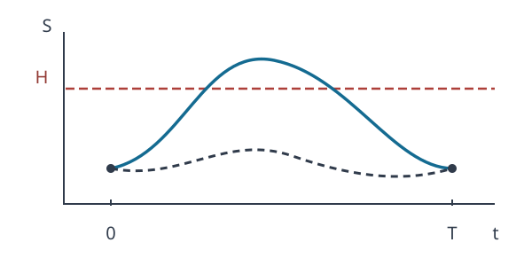

# U3-35 Brownian bridge・連続障壁の越境補正

[前講の Brownian bridge による経路生成](../U3-34/index.md#def-u3-34-bridge-coordinates)では、**指定した時点の Brown 運動を正しい同時分布で作る**ことを学びました。しかし、格子点間に価格が上側障壁を越え、次の格子点までに戻ってしまったら、その生成手順だけでは越境を検出できません。点を増やすことと、**点の間で何が起きたかを条件付きで評価すること**は別問題です。

今回の問いは、**観測した両端点から、間の越境確率を正確に計算できるか**です。定数係数の幾何 Brown 運動（GBM）なら、対数株価を条件付き Brownian bridge として扱い、反射原理から確率を導けます。これを用いて、連続監視の商品を離散格子の Monte Carlo で**偏りなく**価格付けします。

使用するのは、[離散監視 Barrier 契約](../U3-09/index.md#def-u3-09-barrier-contract)、[GBM の陽解](../U3-14/index.md#thm-u3-14-explicit-gbm)、[リスク中立 Monte Carlo 推定量](../U3-26/index.md#def-u3-26-mc-estimator)、[時間離散化と標本誤差の分解](../U3-29/index.md#prop-u3-29-mc-decomposition)、および[橋生成が有限次元分布を保つ結果](../U3-34/index.md#prop-u3-34-bridge-law)です。

以下、時間単位は年、株価・障壁は円、$r,q$ は連続複利年率、$\sigma>0$ は年$^{-1/2}$ とします。確率・期待値は特記しない限りリスク中立測度 $Q$ の下で計算します。$S_0=s>0$、満期 $T>0$、定数 $r,q\in\mathbb R$ とし、配当利回り $q$ の GBM

$$
S_t=s\exp\left\{\left(r-q-\frac{\sigma^2}{2}\right)t+\sigma W_t\right\},
\qquad 0\le t\le T
$$

を使います。$W$ は $Q$ の下の標準 Brown 運動です。

## 1. 端点を見ただけでは連続監視にならない

上側障壁 $H>s$ を固定します。上方ノックアウトは、価格が一度でも $H$ に達した時点で権利が失われる契約です。格子 $0=t_0<t_1<\cdots<t_m=T$ でしか調べない商品とは、そもそも監視条件が異なります。今回は簡潔にするため、障壁に達したときの rebate（返戻金）は **0** とし、満期受取額は終値だけの関数 $g(S_T)$ とします。

<!-- formal-statement-start -->
> **定義（連続監視上方ノックアウトと格子監視）**  
> $H>s>0$、$T>0$、連続な正値過程 $S$、可測な $g:(0,\infty)\to[0,\infty)$ を与える。$E_Q[g(S_T)]<\infty$ とする。障壁への初到達時刻を

$$
\tau_H=\inf\{t\in[0,T]:S_t\ge H\},
\qquad \inf\varnothing=\infty
$$

> とし、**連続監視**の満期受取額と価格を

$$
G_{\rm cont}=g(S_T)\boldsymbol1_{\{\tau_H>T\}},
\qquad V_{\rm cont}=e^{-rT}E_Q[G_{\rm cont}]
$$

> と定める。一方、決定論的格子 $0=t_0<\cdots<t_m=T$ での**格子監視**受取額と価格は

$$
G_m=g(S_T)\prod_{j=0}^m\boldsymbol1_{\{S_{t_j}<H\}},
\qquad V_m=e^{-rT}E_Q[G_m]
$$

> とする。
<!-- formal-statement-end -->

<!-- definition-example-start: def-u3-35-continuous-barrier -->
**定義の確認**：$s=100$ 円、$H=120$ 円、$T=1$ 年とし、観測は始点と満期の2点だけとします。満期に生存していれば $g(x)=1$ 円を支払います。

始点・終点がともに $S_0=S_1=100$ 円でも、途中で $S_{1/2}=130$ 円となる連続経路では、初到達時刻が満期以前なので

$$
\tau_H\le\frac12,\qquad G_{\rm cont}=0\ \text{円}.
$$

一方、格子点では両方とも120円未満ですから、$G_1=1$ 円です。途中も常に120円未満の経路なら両受取額は1円になります。定義の判定は**「ある監視時刻で上回ったか」ではなく「期間内で一度でも到達したか」**です。これらは可能な経路形状の説明であり、確率を代入した例ではありません。
<!-- definition-example-end -->

下の二経路は両端点が同じでも、一方だけが障壁 $H$ に達することを示します。実線は越境する例、破線は越境しない例で、**色だけで識別する図ではありません**。縦軸は株価、横軸は時間です。

$g\ge0$ なので、経路ごとに $G_{\rm cont}\le G_m$、従って $V_{\rm cont}\le V_m$ です。**格子を細かくすると上方ノックアウトの見逃しは減りますが、有限個の格子点だけでは一般にゼロになりません。**

## 2. 株価の対数を条件付きの橋にする

株価 $S$ はそのままでは正規分布ではありません。[GBM 陽解](../U3-14/index.md#thm-u3-14-explicit-gbm)を対数へ移し、初期株価を基準にした無次元変数

$$
X_t=\log(S_t/s),\qquad b=\log(H/s)>0,\qquad
\mu=r-q-\frac{\sigma^2}{2}
$$

を用います。すると $X_t=\mu t+\sigma W_t$ であり、$S_t\ge H$ と $X_t\ge b$ は同値です。したがって、**株価の越境は、正規過程 $X$ の水平線 $b$ への到達**に置き換わります。

中間の値を知りたいとき、両端 $X_a=x_0,X_{a+h}=x_1$（$0\le a
<!-- formal-statement-start -->
> **定義（対数株価の条件付き Brownian bridge）**  
> $X_t=\mu t+\sigma W_t$、$\sigma>0$、$h>0$ とする。$X_a=x_0,X_{a+h}=x_1$ を固定したときの $0<u<h$ での条件付き正規過程を、**対数株価の Brownian bridge** とする。その平均と分散は

$$
E_Q[X_{a+u}\mid X_a=x_0,X_{a+h}=x_1]
=x_0+\frac{u}{h}(x_1-x_0),
$$

$$
\operatorname{Var}_Q(X_{a+u}\mid X_a,X_{a+h})
=\sigma^2\frac{u(h-u)}{h}.
$$

> ここで端点条件は正規過程の正則条件付き分布として解釈する。
<!-- formal-statement-end -->

<!-- definition-example-start: def-u3-35-log-bridge -->
**定義の確認**：$a=0,h=1,u=1/2,\sigma=0.2$、端点 $x_0=x_1=0$ とすると、平均は $0+(1/2)(0-0)=0$、分散は $0.2^2(1/2)(1/2)=0.01$、標準偏差は $0.1$ です。従って $X_{1/2}$ の条件付き分布は $N(0,0.01)$ であり、**端点が両方0でも途中が0に固定されるわけではありません**。$b=0.2$ なら中間値だけで $b$ を超える正の条件付き確率があります。
<!-- definition-example-end -->

なぜ drift $\mu$ が式から消えるかを確認します。区間内の増分を $A=X_{a+u}-X_a=\mu u+\sigma(W_{a+u}-W_a)$、全区間を $C=X_{a+h}-X_a=\mu h+\sigma(W_{a+h}-W_a)$ とします。[独立増分からの条件付き正規計算](../U3-34/index.md#prop-u3-34-bridge-law)と同じように

$$
\operatorname{Cov}(A,C)=\sigma^2u,\qquad
\operatorname{Var}(C)=\sigma^2h
$$

なので、$C=c=x_1-x_0$ の下では

$$
E[A\mid C=c]
=\mu u+\frac{\sigma^2u}{\sigma^2h}(c-\mu h)
=\frac{u}{h}c.
$$

条件付き分散も $\sigma^2u-(\sigma^2u)^2/(\sigma^2h)=\sigma^2u(h-u)/h$ です。**端点を固定すると、定数 drift による平均移動が打ち消される**ことが重要です。

## 3. 反射原理から端点間の越境確率を求める

橋の中間点をいくつか生成しても、さらにその間で越境する可能性が残ります。必要なのは「全区間の最大値が障壁に達する確率」です。Brown 運動の**反射原理**は、障壁に最初に到達した後の部分経路を鏡映して、越境した経路の終点密度を数える方法です。ここでは条件付き越境確率そのものを導出します。

<!-- formal-statement-start -->
> **命題（Brownian bridge の上側障壁越境確率）**  
> $X_t=\mu t+\sigma W_t$、$\sigma>0$、$h>0$、$b\in\mathbb R$ とする。両端 $X_a=x_0<b,X_{a+h}=x_1<b$ を固定したとき、区間内で $b$ に**一度でも到達する**条件付き確率は

$$
p_{\rm hit}(x_0,x_1;h)
=\exp\left\{-\frac{2(b-x_0)(b-x_1)}{\sigma^2 h}\right\}.
$$

> 対応する条件付き生存確率は $w=1-p_{\rm hit}$ である。いずれかの端点が $b$ 以上なら生存確率を $0$ とする。
<!-- formal-statement-end -->

**証明の見取り図**：drift を固定端点で消し、始点0の Brown 運動で上側距離 $d=b-x_0$ を考えます。終点 $z=x_1-x_0<d$ に向かう経路のうち、一度 $d$ に到達したものは、到達後を反射すると終点 $2d-z$ の経路と一対一になります。二つの正規密度の比を計算すると、上の指数式になります。

<!-- proof-start -->
### 証明

**(1) 定数 drift を除く。** $Y_u=X_{a+u}-x_0=\mu u+\sigma B_u$ とし、$B$ を区間の Brown 運動とします。終点 $Y_h=z=x_1-x_0$ を固定すると、$0\le u\le h$ の条件付き平均は $uz/h$、共分散は

$$
\operatorname{Cov}(Y_u,Y_v\mid Y_h)
=\sigma^2\left(\min(u,v)-\frac{uv}{h}\right).
$$

これは drift $0$ の $\sigma B$ を終点 $z$ に条件付けた平均・共分散と同じです。両者は Gaussian 過程で連続版を持つため、条件付き経路法則も一致します。従って以後は drift $0$ の場合だけ示せばよいです。

**(2) 反射による密度対応。** $d=b-x_0>0$、$z=x_1-x_0<d$ とします。drift $0$ の $\sigma B_h$ の密度は

$$
f_h(z)=\frac{1}{\sigma\sqrt{2\pi h}}
\exp\left(-\frac{z^2}{2\sigma^2h}\right).
$$

時刻 $h$ の終点が $z<d$ であり、それまでに $d$ へ到達した経路を考えます。初到達時刻を $\rho=\inf\{0\le u\le h:\sigma B_u=d\}$ とし、到達後の差分を符号反転する変換

$$
\widetilde Y_u=
\begin{cases}
\sigma B_u,&u\le\rho,\\
2d-\sigma B_u,&u>\rho
\end{cases}
$$

を施すと、反射原理（Brown 運動の強 Markov 性と対称な増分）によって、越境した経路の終点 $z$ の密度は、反射後の終点 $2d-z>d$ の密度 $f_h(2d-z)$ に一致します。終点の密度 $f_h(z)$ は正ですから、正則条件付き確率はその比

$$
Q\!\left(\max_{0\le u\le h}\sigma B_u\ge d\,\middle|\,\sigma B_h=z\right)
=\frac{f_h(2d-z)}{f_h(z)}
$$

です。

**(3) 指数を計算する。** 分母・分子の係数は打ち消し合い、

$$
\begin{aligned}
\log\frac{f_h(2d-z)}{f_h(z)}
&=-\frac{(2d-z)^2-z^2}{2\sigma^2h}\\
&=-\frac{4d^2-4dz}{2\sigma^2h}
=-\frac{2d(d-z)}{\sigma^2h}.
\end{aligned}
$$

$d=b-x_0$、$d-z=(b-x_0)-(x_1-x_0)=b-x_1$ と戻して命題の式を得ます。端点が障壁以上なら、その端点だけで到達が確定し、生存確率は0です。$\square$
<!-- proof-end -->

**数字で確認**：$s=100$ 円、$H=100e^{0.2}\simeq122.14$ 円、$X_0=X_T=0$、$T=1$ 年、$\sigma=0.2$ 年$^{-1/2}$ とすると、$b=0.2$ です。両端が障壁より低くても

$$
p_{\rm hit}
=\exp\left(-\frac{2(0.2)(0.2)}{0.2^2\cdot1}\right)
=e^{-2}\simeq0.135335
$$

です。終点が近いほど、障壁と両端の距離積が小さくなり、越境確率が上がります。$h\downarrow0$ でも固定した安全な両端点に対しては指数が大きく負となるため、越境確率は下がります。ただし**区間幅と端点位置の双方が変わる**数値経路では、単純に一方だけを固定して比較しません。

下側障壁 $\ell<b$ の場合も、過程に符号を反転して同じ反射を行えば、両端が $\ell$ より上にあるとき

$$
p_{\rm lower}=\exp\left\{-\frac{2(x_0-\ell)(x_1-\ell)}{\sigma^2h}\right\}
$$

となります。上下**二つの障壁を同時に監視**するときは、上下の生存確率を単純に掛けるだけでは正しくありません。両側到達事象は独立ではないためです。

## 4. 各区間の条件付き生存率を掛ける

同じ GBM の格子点を[厳密な同時分布](../U3-14/index.md#thm-u3-14-explicit-gbm)から作り、**間の越境を新たに Bernoulli 乱数で決定しない**方法を考えます。各区間で得られる条件付き生存確率を掛け、終値の受取額へ直接掛けます。ここで使うのは確率の**条件付き平均**であって、前講の「Brownian bridge で格子点を発生する順序」とは異なります。

<!-- formal-statement-start -->
> **定義（連続上方ノックアウトの橋補正推定量）**  
> 前節の定数係数 GBM と上側障壁 $H>s$、格子 $0=t_0<\cdots<t_m=T$、$g\ge0$、$E_Q[g(S_T)]<\infty$ を固定する。$X_j=\log(S_{t_j}/s)$、$h_j=t_{j+1}-t_j$、$b=\log(H/s)$ とする。各区間の**橋生存重み**を

$$
w_j=
\begin{cases}
1-\exp\left\{-\dfrac{2(b-X_j)(b-X_{j+1})}{\sigma^2h_j}\right\},
& X_j<b,\ X_{j+1}<b,\\
0,&\text{それ以外}
\end{cases}
$$

> とし、経路一本あたりの割引橋補正支払額を

$$
Y_{\rm BB}=e^{-rT}g(S_T)\prod_{j=0}^{m-1}w_j
$$

> と定める。独立な $N$ 本の格子経路から $\widehat V_{\rm BB}=N^{-1}\sum_{i=1}^NY_{{\rm BB},i}$ と平均する。
<!-- formal-statement-end -->

<!-- definition-example-start: def-u3-35-bridge-weight -->
**定義の確認**：$m=1,X_0=X_1=0,b=0.2,h_0=1,\sigma=0.2$ とします。両端は $b$ 未満で、前節の確率が $e^{-2}$ ですから $w_0=1-e^{-2}\simeq0.864665$ となります。満期に1円を支払う契約 $g(x)=1$ 円、$r=0.02$ 年$^{-1}$ なら、この端点経路に割り当てる値は

$$
Y_{\rm BB}=e^{-0.02}(1-e^{-2})\simeq0.84754\,\text{円}.
$$

この値は「格子経路一本に割り当てる**条件付き平均支払額**」であって、実際の満期支払額が端数の円になるという意味ではありません。端点が $H$ 以上なら $w_0=0$ になり、すでに到達した経路へ正の生存重みを付けません。
<!-- definition-example-end -->

## 5. 不偏性と分散減少を証明する

なぜ区間ごとの重みを掛けてよいのでしょうか。Brown 運動は区間ごとに独立な増分を持ちます。[橋生成の有限次元分布の証明](../U3-34/index.md#prop-u3-34-bridge-law)と同様、**格子点の全体を条件として固定すると、異なる区間の橋の内部は条件付き独立**です。ただし格子点を固定しないまま「各区間の越境が無条件に独立」としてはいけません。

<!-- formal-statement-start -->
> **命題（橋重みの条件付き期待値と不偏性）**  
> 定義の定数係数 GBM、$H>s$、$g:(0,\infty)\to[0,\infty)$ 可測、$E_Q[g(S_T)]<\infty$ の下で、格子点の情報 $\mathcal G_m=\sigma(X_{t_0},\ldots,X_{t_m})$ に対し

$$
E_Q\!\left[e^{-rT}g(S_T)\boldsymbol1_{\{\tau_H>T\}}
\mid\mathcal G_m\right]=Y_{\rm BB}.
$$

> よって $E_Q[Y_{\rm BB}]=V_{\rm cont}$ であり、独立な $N$ 格子経路の平均 $\widehat V_{\rm BB}$ は連続監視価格に不偏である。**有限の格子でも、このモデル内では越境見逃しによる監視バイアスがない。**
<!-- formal-statement-end -->

**証明の見取り図**：各区間の「越えなかった」という事象を掛け、その条件付き期待値を取ります。区間内部の橋は、格子点を固定すると互いに独立なので、各区間で[Brownian bridge の上側障壁越境確率](#prop-u3-35-hit-prob)を使って積に分解できます。

<!-- proof-start -->
### 証明

$A_j=\{\sup_{t_j\le t\le t_{j+1}}X_t<b\}$ と置きます。連続経路で $X_t$ が $b$ に到達したかを判定するため、到達しない事象は

$$
\{\tau_H>T\}=\bigcap_{j=0}^{m-1}A_j,\qquad
\boldsymbol1_{\{\tau_H>T\}}=\prod_{j=0}^{m-1}\boldsymbol1_{A_j}
$$

です。格子点の値を固定すると、各区間の Brown 運動増分の密度は元の独立増分の密度の積を端点差ごとに条件付けたものなので、区間内部の橋の条件付き法則も積になります。従って

$$
\begin{aligned}
Q(\tau_H>T\mid\mathcal G_m)
&=E_Q\!\left[\prod_j\boldsymbol1_{A_j}\mid\mathcal G_m\right]\\
&=\prod_j Q(A_j\mid\mathcal G_m)
=\prod_j Q(A_j\mid X_{t_j},X_{t_{j+1}})\\
&=\prod_j w_j.
\end{aligned}
$$

最後の等号は[上側障壁越境確率](#prop-u3-35-hit-prob)によります。$e^{-rT}g(S_T)$ は満期の格子点から決まり、$\mathcal G_m$ に関して可測です。よって条件付き期待値からその因子を外せて、第一の結論を得ます。さらに条件付き期待値の塔の性質より

$$
E_Q[Y_{\rm BB}]
=E_Q[E_Q(e^{-rT}g(S_T)\boldsymbol1_{\{\tau_H>T\}}\mid\mathcal G_m)]
=V_{\rm cont}.
$$

独立に生成した経路の平均の期待値も同じです。$\square$
<!-- proof-end -->

この方法は「一回ごとに越境を当てる」より、**越境結果そのものを条件付き平均で置き換える**方法です。次の命題がその分散上の利点を述べます。

<!-- formal-statement-start -->
> **命題（橋補正の条件付き平均による分散減少）**  
> 前命題の仮定に加え $E_Q[g(S_T)^2]<\infty$ とする。真の連続監視支払標本を

$$
Y_{\rm exact}=e^{-rT}g(S_T)\boldsymbol1_{\{\tau_H>T\}}
$$

> とすれば、以下の分散不等式が成り立つ。

$$
\operatorname{Var}_Q(Y_{\rm BB})
\le\operatorname{Var}_Q(Y_{\rm exact})
$$

> さらに、

$$
\operatorname{Var}_Q(Y_{\rm exact})
=\operatorname{Var}_Q(Y_{\rm BB})
+E_Q[\operatorname{Var}_Q(Y_{\rm exact}\mid\mathcal G_m)]
$$

> となる。比較対象は**同じ連続監視契約**の、内部の越境成否まで標本抽出した推定量である。
<!-- formal-statement-end -->

**証明の見取り図**：前命題で $Y_{\rm BB}=E[Y_{\rm exact}\mid\mathcal G_m]$ を得ました。これを条件付き分散の公式へ代入します。両辺の差は非負の量です。

<!-- proof-start -->
### 証明

$g(S_T)$ の二乗可積分性と $0\le\boldsymbol1_{\{\tau_H>T\}}\le1$ より $Y_{\rm exact}\in L^2$ です。前命題の等式を使って

$$
Y_{\rm exact}-E[Y_{\rm exact}]
=(Y_{\rm exact}-Y_{\rm BB})+(Y_{\rm BB}-E[Y_{\rm exact}]).
$$

二乗を展開し期待値を取ると、交差項は

$$
\begin{aligned}
E[(Y_{\rm exact}-Y_{\rm BB})(Y_{\rm BB}-E[Y_{\rm exact}])]
&=E[(Y_{\rm BB}-E[Y_{\rm exact}])\\
&\quad\cdot E[Y_{\rm exact}-Y_{\rm BB}\mid\mathcal G_m]]=0
\end{aligned}
$$

です。残る第一の二乗項は $E[\operatorname{Var}(Y_{\rm exact}\mid\mathcal G_m)]$、第二項は $\operatorname{Var}(Y_{\rm BB})$ なので、等式と不等式が得られます。$\square$
<!-- proof-end -->

ただし、$\operatorname{Var}(Y_{\rm BB})$ と**離散監視契約**の $Y_m=e^{-rT}g(S_T)\prod_j\boldsymbol1_{\{X_{t_j}<b\}}$ の分散に、一般の大小関係を主張してはいけません。両者はそもそも期待値が異なります。また $g$ が端点以外の経路の積分・最大値にも依存する契約では、$g$ を条件付き期待値の外へ出す操作が不正となり、同じ重みの積だけでは不偏性を保証しません。

## 6. 真値が分かる連続監視デジタルで検証する

数値実験には、**障壁に一度も触れなければ満期に1円**という上方ノックアウト・デジタルを使います。$s=100$ 円、$H=100e^{0.2}\simeq122.14$ 円、$\sigma=0.2$ 年$^{-1/2}$、$r=0.02$ 年$^{-1}$、$q=0$、$T=1$ 年と固定します。すると $\mu=r-q-\sigma^2/2=0$ で、$X_t=0.2W_t$ です。

<!-- formal-statement-start -->
> **命題（対数 drift が0の上側生存デジタルの解析解）**  
> $X_t=\sigma W_t$、$X_0=0$、$\sigma>0$、$b>0$、$T>0$ とする。$\Phi$ を標準正規分布関数、$d=b/(\sigma\sqrt T)$ とすると

$$
Q\!\left(\sup_{0\le t\le T}X_t<b\right)=2\Phi(d)-1.
$$

> 返戻金0、満期生存時に1円を支払う契約の価格は $e^{-rT}[2\Phi(d)-1]$ 円である。
<!-- formal-statement-end -->

**証明の見取り図**：終点が $b$ 未満である確率から、**終点は低いのに途中で障壁に達した確率**を引きます。反射によって後者は終点が $b$ 以上になる確率と一致します。

<!-- proof-start -->
### 証明

$X_T\sim N(0,\sigma^2T)$ なので、終点が $b$ 未満の確率は $\Phi(d)$ です。反射原理の[密度対応](#prop-u3-35-hit-prob)を、終点 $x<b$ にわたって積分します。途中で到達して終点が低い確率は

$$
\begin{aligned}
Q(\sup_{0\le t\le T}X_t\ge b,\ X_T<b)
&=\int_{-\infty}^{b}f_T(2b-x)\,dx\\
&=\int_b^\infty f_T(y)\,dy\\
&=1-\Phi(d).
\end{aligned}
$$

二行目は $y=2b-x$ と置換し、積分区間を反転したものです。よって生存確率は $\Phi(d)-[1-\Phi(d)]=2\Phi(d)-1$。満期受取額が1円または0円なので、リスク中立割引を掛けて価格を得ます。$\square$
<!-- proof-end -->

本例は $b=0.2$、$\sigma\sqrt T=0.2$ だから $d=1$ です。1時点（終点だけ）監視では生存確率 $\Phi(1)\simeq0.84134475$ に対し、連続監視の真値は

$$
p_{\rm cont}=2\Phi(1)-1\simeq0.68268949,
\quad
p_{\rm discrete,1}-p_{\rm cont}
=1-\Phi(1)\simeq0.15865525.
$$

価格へ換算すると、格子監視の過大評価は $e^{-0.02}(1-\Phi(1))\simeq0.15551$ 円です。**乱数をいくら増やしても、この格子契約の監視バイアスはなくなりません**。

一方、橋補正の期待値は任意の $m\ge1$ で正しい連続監視価格 $e^{-0.02}[2\Phi(1)-1]$ 円です。有限標本で真値とぴったり一致するという意味ではありません。格子点は厳密 GBM で生成するため、このモデルでは SDE の数値積分による離散化誤差もありません。残るのは主に**標本平均の確率誤差**です。

### 再現可能な比較

[Python 実験](assets/bridge_barrier_experiment.py) は、固定シード、$N=200000$ 本の独立な格子経路、$m=1,4,16,64$ という**入れ子の等間隔監視幅**を用い、格子監視（指示関数）と橋補正（生存重みの積）の両方を、同じ格子経路上で計算します。

| 測定項目 | 格子監視 | 橋補正 |
| --- | --- | --- |
| 推定対象 | $V_m$（異なる契約） | $V_{\rm cont}$（同じ連続監視契約） |
| 経路一本の値 | 割引された0円または1円 | 割引された $[0,1]$ 円の重み |
| 有限格子での監視バイアス | 一般に正 | 定数係数 GBM なら0 |
| 標本誤差の推定 | 独立経路の標本分散から | 独立経路の標本分散から |

実験では両者の**真値からの標本偏差**と通常の推定標準誤差を表示します。橋補正の標本偏差がすべての乱数実現で格子監視より小さいとは限りません。$m$ を増やした際の計算費用も増えるため、「最も細かい格子が常に効率的」とは断言しません。

[時間離散化と Monte Carlo の二乗誤差分解](../U3-29/index.md#prop-u3-29-mc-decomposition)をこの比較へ当てはめると、独立経路平均に対し、基準を $V_{\rm cont}$ とした平均二乗誤差は

$$
E[(\widehat V_m-V_{\rm cont})^2]
=\frac{\operatorname{Var}(Y_m)}{N}
+(V_m-V_{\rm cont})^2
$$

です。橋補正では $E[Y_{\rm BB}]=V_{\rm cont}$ なので、対応する二乗誤差は $\operatorname{Var}(Y_{\rm BB})/N$ になります。これは**異なる契約の価格差（偏り）**と、**同じ契約を数値推定する分散**を切り分けた式です。

### 失敗条件と拡張の境界

この指数公式を無条件に使ってはなりません。区間ごとの対数過程が**定数 drift・定数拡散係数の Brown 運動**であり、障壁が対数座標で水平な定数であることが根拠です。局所ボラティリティ、確率ボラティリティ、ジャンプ、動く障壁、二重障壁では一般に同じ式は正確ではありません。また「経路生成の橋」と「越境補正の橋」は同時に使えますが、前者だけで後者は代用できません。

---

## 演習：端点の情報から連続監視価格へ

### Level A：橋の分布・確率・重みを手で確かめる

### U3-35-A1：端点条件付きの中点
- Level: A

$X_t=\mu t+0.2W_t$、$h=1$ 年、$x_0=0$、$x_1=0.1$ の区間の中点における条件付き平均、分散、標準偏差を求めよ。$\mu$ に依存するか。

<!-- solution-start -->
**詳細解答**：[対数株価の橋の定義](#def-u3-35-log-bridge)へ $u=h/2=0.5$ を代入すると、平均は

$$
0+\frac{0.5}{1}(0.1-0)=0.05.
$$

分散は $\sigma^2u(h-u)/h=0.2^2\cdot0.5\cdot0.5=0.01$、標準偏差は $\sqrt{0.01}=0.1$ です。$X$ の drift は条件付き平均の計算で $\mu u-(u/h)\mu h=0$ と相殺され、結果に $\mu$ は現れません。
<!-- solution-end -->

### U3-35-A2：両端が同じでも越境する
- Level: A

$b=0.2$、$x_0=x_1=0$、$\sigma=0.2$ 年$^{-1/2}$、$h=1$ 年の橋について越境確率と生存確率を求めよ。

<!-- solution-start -->
**詳細解答**：両端とも $0<b$ なので[越境確率命題](#prop-u3-35-hit-prob)を適用できます。指数の分母は $0.2^2\cdot1=0.04$、分子は $2(0.2-0)(0.2-0)=0.08$ ですから、

$$
p_{\rm hit}=e^{-0.08/0.04}=e^{-2}\simeq0.135335.
$$

従って $w=1-e^{-2}\simeq0.864665$ です。両端が障壁未満でも生存が確実とはいえません。
<!-- solution-end -->

### U3-35-A3：短い区間の越境確率
- Level: A

$b=0.2$、$x_0=0$、$x_1=0.1$、$h=0.5$ 年、$\sigma=0.2$ 年$^{-1/2}$ の越境確率を求め、計算に使った二つの障壁距離を示せ。

<!-- solution-start -->
**詳細解答**：始点と終点からの障壁距離は $b-x_0=0.2$、$b-x_1=0.1$ です。$\sigma^2h=0.04\cdot0.5=0.02$、$2(b-x_0)(b-x_1)=2\cdot0.2\cdot0.1=0.04$ なので

$$
p_{\rm hit}
=\exp(-0.04/0.02)=e^{-2}.
$$

[A2](#ex-u3-35-a2)と数値が同じでも、区間幅と終点距離が両方変わっています。「時間を半分にしたから確率も半分」とする線形近似は成立しません。
<!-- solution-end -->

### U3-35-A4：二つの橋重みを掛ける
- Level: A

$m=2$、$(t_0,t_1,t_2)=(0,0.5,1)$、$(X_0,X_{1/2},X_1)=(0,0.1,0)$、$b=0.2$、$\sigma=0.2$ とする。区間ごとの $w_0,w_1$ と連続生存の条件付き確率を求めよ。

<!-- solution-start -->
**詳細解答**：両区間は $h=0.5$、両端の障壁距離の積は $(0.2)(0.1)=0.02$ です。どちらも

$$
w_j=1-\exp\left(-\frac{2(0.02)}{0.04(0.5)}\right)
=1-e^{-2}.
$$

区間内部が全格子点を条件に独立である[不偏性命題の証明](#prop-u3-35-unbiased)を使って、条件付き全生存確率は

$$
w_0w_1=(1-e^{-2})^2\simeq0.747645.
$$

どちらか一方だけ生き残ればよいのではないので、和ではなく積を取ります。
<!-- solution-end -->

### U3-35-A5：端点が障壁に触れた場合
- Level: A

上側障壁 $b=0.2$、$X_0=0$、$X_{1/2}=0.2$、$X_1=0.1$ とする。橋補正の全生存重みと、$g(S_T)=1$ 円の連続上方ノックアウト支払額を求めよ。

<!-- solution-start -->
**詳細解答**：時刻 $1/2$ の端点が $X_{1/2}=b$ なので、すでに障壁に**到達**しています。[橋重みの定義](#def-u3-35-bridge-weight)の「それ以外」に該当し、$w_0=0,w_1=0$ です。全生存重みは $0$。$\tau_H\le1/2$ だから実際の連続契約の満期受取額も $1\cdot0=0$ 円です。端点が等しいときに指数公式の値 $1-e^0=0$ を偶然得ても、**条件判定を省いてよいわけではありません**。
<!-- solution-end -->

### Level B：反射・誤差・契約条件を別の角度から導く

### U3-35-B1：反射された正規密度の比
- Level: B

$Z=\sigma W_h$、$b>x_0$、$x_1<b$ とし、$d=b-x_0$、$z=x_1-x_0$ と置く。$f_h(z)$ と $f_h(2d-z)$ の比を計算し、$x_0,x_1$ に戻せ。

<!-- solution-start -->
**詳細解答**：$Z$ の密度は

$$
f_h(v)=\frac{1}{\sigma\sqrt{2\pi h}}
\exp\left(-\frac{v^2}{2\sigma^2h}\right).
$$

密度係数を約分し、指数差を計算すると

$$
\begin{aligned}
\frac{f_h(2d-z)}{f_h(z)}
&=\exp\left[-\frac{(2d-z)^2-z^2}{2\sigma^2h}\right]\\
&=\exp\left[-\frac{4d^2-4dz}{2\sigma^2h}\right]\\
&=\exp\left[-\frac{2d(d-z)}{\sigma^2h}\right].
\end{aligned}
$$

$d=b-x_0$、$d-z=b-x_0-(x_1-x_0)=b-x_1$ なので、結果は $\exp\{-2(b-x_0)(b-x_1)/(\sigma^2h)\}$。[反射原理による越境密度の対応](#prop-u3-35-hit-prob)があるから、この**密度の比**を越境条件付き確率と解釈できます。
<!-- solution-end -->

### U3-35-B2：1時点格子の監視バイアスを算出
- Level: B

$X_t=0.2W_t$、$T=1$、$b=0.2$ とし、満期に生存すれば1円を払う。格子が $0,T$ のみのとき、格子監視と連続監視の生存確率、および差を $\Phi(1)$ で表せ。格子標本 $N$ 本を増やすだけでその差が消えるか。

<!-- solution-start -->
**詳細解答**：$X_T/0.2=W_T\sim N(0,1)$ ですから、終点監視の生存確率は

$$
p_{\rm grid}=Q(X_T<0.2)=Q(W_T<1)=\Phi(1).
$$

一方、[連続生存の解析解](#prop-u3-35-reflection-benchmark)の $d=b/(\sigma\sqrt T)=1$ を代入すれば

$$
p_{\rm cont}=2\Phi(1)-1.
$$

よって差は $\Phi(1)-[2\Phi(1)-1]=1-\Phi(1)\simeq0.158655$。格子監視の独立標本平均は $N\to\infty$ で $p_{\rm grid}$ に収束し、連続監視確率には収束しません。必要なのは契約監視条件の修正（橋補正など）であって、単なる標本増加ではありません。
<!-- solution-end -->

### U3-35-B3：下側障壁への対称変換
- Level: B

$X_t=\mu t+\sigma W_t$ を下側定数障壁 $\ell$ で監視する。$x_0,x_1>\ell$ のとき、区間内に一度でも $X_t\le\ell$ となる条件付き確率を導け。$\ell=-0.2$、$x_0=x_1=0$、$h=1$、$\sigma=0.2$ の数値も示せ。

<!-- solution-start -->
**詳細解答**：$Z_t=-X_t$ を置くと $Z_t=-\mu t+\sigma(-W_t)$ です。Brown 運動の対称性から $-W$ も Brown 運動で、下側到達 $X_t\le\ell$ は上側到達 $Z_t\ge-\ell$ と同値です。[上側越境公式](#prop-u3-35-hit-prob)に $b'=-\ell$、端点 $z_0=-x_0,z_1=-x_1$ を代入します。

$$
p_{\rm lower}
=\exp\left[-\frac{2(-\ell+x_0)(-\ell+x_1)}{\sigma^2h}\right]
=\exp\left[-\frac{2(x_0-\ell)(x_1-\ell)}{\sigma^2h}\right].
$$

指定値では二つの距離が $0.2$、分母が $0.04$ なので $p_{\rm lower}=e^{-2}\simeq0.135335$ です。端点が $\ell$ 以下なら到達は確定し、生存重みは0になります。
<!-- solution-end -->

### U3-35-B4：ノックインとのペイオフ恒等式
- Level: B

同じ上側障壁 $H$ を連続監視する、返戻金0の上方ノックインとノックアウトについて、満期支払額をそれぞれ $g(S_T)\boldsymbol1_{\{\tau_H\le T\}}$、$g(S_T)\boldsymbol1_{\{\tau_H>T\}}$ とする。$g\ge0$ 可積分の下で in/out parity と、橋補正経路におけるノックインの重みを導け。異なる監視条件で parity を適用してはならない理由も述べよ。

<!-- solution-start -->
**詳細解答**：到達事象と非到達事象は排他的かつ全事象を尽くすので、経路ごとに

$$
\boldsymbol1_{\{\tau_H\le T\}}+\boldsymbol1_{\{\tau_H>T\}}=1.
$$

双方へ $g(S_T)$ を掛けて期待値・割引を取ると $V_{\rm in}+V_{\rm out}=V_{\rm vanilla}$。これは[離散 Barrier の in/out parity](../U3-09/index.md#prop-u3-09-in-out-parity)と同じ、監視事象の分割に基づきます。[条件付き生存の等式](#prop-u3-35-unbiased)により、格子に条件付けた in 支払額は

$$
e^{-rT}g(S_T)\left(1-\prod_{j=0}^{m-1}w_j\right).
$$

同じ経路上で out 重み $\prod_jw_j$ と加えれば $e^{-rT}g(S_T)$ となります。片方が連続監視、他方が格子監視なら、間で越境した事象が片方の in に含まれて他方の out にも含まれ、指示関数の和が1にならないので、この parity の仮定が崩れます。
<!-- solution-end -->

### Level C：条件付き平均・反射・偏りを統合する

### U3-35-C1：連続障壁デジタルの価格と二つの誤差機構
- Level: C

$S_t=100\exp(0.2W_t)$、$H=100e^{0.2}$、$T=1$ 年、$r=0.02$ 年$^{-1}$、$q=0$ とする（この係数はリスク中立 GBM と整合する）。障壁に触れずに満期を迎えた場合に限り1円を支払う契約について、以下を示せ。

1. 反射原理から連続監視の価格を導出する。
2. $m=1$ の格子監視の価格との差を求める。
3. 終点 $X_1=\log(S_1/100)=x$ を条件とした橋補正値を $x<0.2$ と $x\ge0.2$ に分けて書く。
4. その条件付き推定量の期待値が連続価格に等しいことを、正規密度の積分で確認する。

<!-- solution-start -->
**詳細解答**：対数過程は $X_t=0.2W_t$ で始点0、障壁 $b=\log(H/100)=0.2$、標準偏差 $\sigma\sqrt T=0.2$ です。

**(1)** 反射原理より、終点が $b$ 未満なのに途中で到達する確率は $Q(X_T\ge b)=1-\Phi(1)$ です。終点が $b$ 未満の確率 $\Phi(1)$ から引けば、連続生存確率は $2\Phi(1)-1$。したがって価格は

$$
V_{\rm cont}=e^{-0.02}[2\Phi(1)-1]\ \text{円}.
$$

**(2)** 終点のみの格子監視では $V_1=e^{-0.02}\Phi(1)$ 円。差は

$$
V_1-V_{\rm cont}
=e^{-0.02}[1-\Phi(1)]\simeq0.15551\ \text{円}.
$$

**(3)** $x<0.2$ なら[越境確率](#prop-u3-35-hit-prob)へ $x_0=0,x_1=x,h=1$ を代入し、条件付き生存率は

$$
w(x)=1-\exp\left[-\frac{2(0.2)(0.2-x)}{0.04}\right]
=1-e^{-2+10x}.
$$

従って終点 $x$ に対する橋補正値は $e^{-0.02}(1-e^{-2+10x})$ 円です。$x\ge0.2$ では終点で障壁に達しているため $w(x)=0$、橋補正値も0円です。

**(4)** $X_T$ の密度を $f(x)=(0.2\sqrt{2\pi})^{-1}e^{-x^2/(2\cdot0.2^2)}$ とすると、条件付き平均支払額の割引前期待値は

$$
\begin{aligned}
E[w(X_T)]
&=\int_{-\infty}^{0.2}f(x)[1-e^{-2+10x}]\,dx\\
&=\int_{-\infty}^{0.2}f(x)\,dx
-\int_{-\infty}^{0.2}f(x)e^{-2+10x}\,dx.
\end{aligned}
$$

正規密度の指数を直接展開すると

$$
-\frac{x^2}{0.08}-2+10x
=-\frac{(0.4-x)^2}{0.08},
\qquad f(x)e^{-2+10x}=f(0.4-x).
$$

後者の積分は $y=0.4-x$ と置くと $\int_{0.2}^\infty f(y)\,dy=1-\Phi(1)$ です。よって $E[w(X_T)]=\Phi(1)-[1-\Phi(1)]=2\Phi(1)-1$。割引 $e^{-0.02}$ を掛けて (1) と一致します。これは[不偏性命題](#prop-u3-35-unbiased)を積分で独立検算したものです。
<!-- solution-end -->

---

## この講義でつながったこと

**格子点を正しい分布から生成する**（U3-34）ことと、**格子点間の連続経路の越境を評価する**（本講）ことを区別できるようになりました。定数係数 GBM の単一水平障壁なら、条件付き越境確率は反射原理で正確に導出でき、独立格子経路の重み付き平均は連続監視価格を不偏に推定します。次講 U3-36 では、経路の**いつ行使するか**という別の条件付き期待値問題を、最小二乗 Monte Carlo で扱います。
