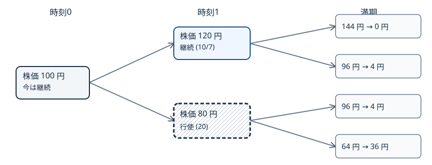

# U3-36 Least-squares Monte Carlo で American を評価

[離散 Snell 包絡の後退帰納](../U3-06/index.md#prop-u3-06-snell-maximum)では、各株価節点で「今行使する額」と「次の時刻以降の最適な受取額の条件付き期待値」を比べました。しかし、[GBM の陽解](../U3-14/index.md#thm-u3-14-explicit-gbm)から何万本も経路を生成した場合、節点ごとに同じ株価の経路が再集合するわけではありません。継続価値を、いま観測した株価からどう推定するのでしょうか。

本講では、継続価値を株価の簡単な関数の和で近似する **最小二乗 Monte Carlo 法（Least-squares Monte Carlo, LSM）** を作ります。未来の受取額を現在の状態に回帰させ、満期から時刻0へ判断を伝えます。最大の注意点は、**行使を学習した経路をそのまま価格評価にも使うと、未来を利用した先読みが入り得ること**です。学習経路と独立の評価経路を分け、推定額が何の下界になるのかまで確認します。

使用するのは、[Bermudan の行使日集合](../U3-07/index.md#def-u3-07-bermudan)、[最初の行使節点による最適停止](../U3-06/index.md#thm-u3-06-first-exercise)、[連続時間 American の最適停止価値](../U3-21/index.md#def-u3-21-american-value)、[リスク中立 Monte Carlo 推定量](../U3-26/index.md#def-u3-26-mc-estimator)です。

## 1. 経路は作れても、条件付き平均が足りない

以下では、満期を $T>0$ 年、行使価格を $K>0$ 円、初期株価を $s>0$ 円、定数金利を $r\ge0$ 年$^{-1}$、連続配当利回りを $q=0$、年率変動率を $\sigma>0$ 年$^{-1/2}$ とします。価格付け測度 $Q$ の Brown 運動を $W$ として

$$
S_t=s\exp\left\{\left(r-\frac{\sigma^2}{2}\right)t+\sigma W_t\right\},
\qquad 0\le t\le T
$$

を仮定します。行使可能日を $t_j=j\Delta t$、$\Delta t=T/m$、$j=0,\ldots,m$（$m\ge2$）とします。まずこの有限日程の **Bermudan put** を計算し、連続時刻で行使できる American put と区別します。

put をその時刻に行使すれば $h(x)=(K-x)_+$ 円を受け取ります。これに対して継続価値は「今は行使せず、次以降で最適に判断したときの条件付き期待値」です。[Bermudan の後退価値](../U3-07/index.md#def-u3-07-restricted-snell)を株価状態へ書き直すと、満期で $V_m(x)=h(x)$、それ以前では

$$
C_j(x)=E_Q\!\left[e^{-r\Delta t}V_{j+1}(S_{t_{j+1}})\mid S_{t_j}=x\right],
\qquad
V_j(x)=\max\{h(x),C_j(x)\}.
$$

ここで $V_j$ の単位は時刻 $t_j$ の円であり、割引は **一時点分だけ**です。定数係数GBMは、[GBM の陽解](../U3-14/index.md#thm-u3-14-explicit-gbm)と Brown 運動の独立増分から、現在株価 $x>0$ を与えると次期株価を

$$
S_{t_{j+1}}=x\exp\left\{
\left(r-\frac{\sigma^2}{2}\right)\Delta t
+\sigma\sqrt{\Delta t}\,Z
\right\},
\qquad Z\sim N(0,1)
$$

として生成できるモデルです。$Z$ は時刻 $t_j$ までの情報とは独立です。従って条件付き継続価値は

$$
C_j(x)=e^{-r\Delta t}
E\left[V_{j+1}\left(xe^{(r-\sigma^2/2)\Delta t+\sigma\sqrt{\Delta t}Z}\right)\right]
$$

と計算できます。$S_{t_j}=x$ が連続分布では確率0の事象でも、この式は「その株価 $x$ から出発する条件付き分布で平均する」という意味を与えます。put では $0\le V_{j+1}\le K$ なので期待値は有限です。この表示によって、条件付き平均を $x$ の関数として扱う根拠が得られます。

<!-- formal-statement-start -->
> **定義（Bermudan put の条件付き継続価値）**  
> 上の $Q$ 下のGBM、決定論的格子 $t_j=jT/m$、可測な非負行使額 $h(x)=(K-x)_+$ を固定する。$j<m$、$x>0$ について、$V_m=h$ として

$$
C_j(x)=E_Q[e^{-r\Delta t}V_{j+1}(S_{t_{j+1}})\mid S_{t_j}=x],
\quad
V_j(x)=\max(h(x),C_j(x))
$$

> を逆向きに定める。$C_j$ を時刻 $t_j$ の**条件付き継続価値**とする。同点では行使を選ぶものとする。
<!-- formal-statement-end -->

<!-- definition-example-start: def-u3-36-continuation -->
**定義の確認**：最終行使日の一つ前で、株価が $x$ のとき満期株価が $ux,dx$ となる2分岐モデルを考え、$u=1.2,d=0.8,R=1.05$、$Q$ 下の上昇確率 $p=5/8$ とします。この例では連続GBMの代わりに[有限二項モデルの条件付き平均](../U3-03/index.md#prop-u3-03-conditional-average)を用い、$e^{-r\Delta t}$ の役目を $R^{-1}$ が担います。$K=100$ 円、$x=80$ 円なら

$$
h(80)=20,\quad h(96)=4,\quad h(64)=36,
$$

$$
C_1(80)=\frac{(5/8)\cdot4+(3/8)\cdot36}{1.05}
=\frac{320}{21}\approx15.238,\qquad V_1(80)=20.
$$

即時20円が継続約15.238円以上なので行使します。株価120円なら $h(120)=0$、将来の株価144円・96円から

$$
C_1(120)=\frac{(5/8)\cdot0+(3/8)\cdot4}{1.05}
=\frac{10}{7}>0= h(120)
$$

となり継続します。これは条件付き平均・割引・最大化をそれぞれ確認した直接例です。
<!-- definition-example-end -->

この2期間二項木での判断は、時刻1で120円なら継続、80円なら行使です。図中の枠の形と文字でも区別しています。

このように木なら同じ状態の次期節点を足せますが、連続値の GBM 経路では同一の $x$ へ十分な経路が集まる保証はありません。そこで異なる $x$ の観測結果を使って、継続価値の曲線そのものを推定します。

## 2. 最小二乗で「現在の株価から将来の値」を学ぶ

まず満期より一歩前の $t_{m-1}$ を見ます。経路 $i$ の株価を $S_j^{(i)}$、現在の即時行使額を $H_j^{(i)}=h(S_j^{(i)})$ と書きます。満期に行使するなら、時刻 $t_{m-1}$ へ割り引いた将来の現金受取額は

$$
Y_{m-1}^{(i)}=e^{-r\Delta t}h(S_m^{(i)}).
$$

現在株価が近ければ将来の条件付き受取額の平均も近い、という情報を利用します。例えば $z=x/K$ とし、基底関数 $\phi_0(z)=1,\phi_1(z)=z,\phi_2(z)=z^2$ の線形結合

$$
\widehat C_j(x)=\widehat\beta_{j,0}+
\widehat\beta_{j,1}(x/K)+
\widehat\beta_{j,2}(x/K)^2
$$

を継続価値の近似とします。**線形回帰**とは係数 $\beta$ に関して線形という意味で、株価 $x$ に関しては二次式でも構いません。$K$ で割るのは数値の桁をそろえるためで、価格の単位を消す操作ではありません。係数の単位は円です。

<!-- formal-statement-start -->
> **定義（LSM 継続価値回帰）**  
> 時刻 $t_j$ における独立に生成された $N$ 本の $Q$ 下の訓練経路と、各経路の **時刻 $t_j$ 価値へ割り引いた**将来の行使受取額 $Y_j^{(i)}\ge0$ を与える。$I_j=\{i:h(S_j^{(i)})>0\}$ とし、$d$ 個の基底 $\phi_0,\ldots,\phi_{d-1}$ に対して、係数 $\widehat\beta_j\in\mathbb R^d$ を

$$
\widehat\beta_j\in\arg\min_{\beta\in\mathbb R^d}
\sum_{i\in I_j}
\left\{Y_j^{(i)}-\sum_{k=0}^{d-1}\beta_k\phi_k(S_j^{(i)}/K)\right\}^2
$$

> の解とする。**回帰継続価値**を

$$
\widehat C_j(x)=\sum_{k=0}^{d-1}
\widehat\beta_{j,k}\phi_k(x/K)
$$

> と定める。係数は訓練標本全体から推定し、行使判定では $h(x)>0$ の状態に使用する。
<!-- formal-statement-end -->

各経路の現在の株価を $z_i=S_j^{(i)}/K$ と書き、回帰に使う $i\in I_j$ を $1,\ldots,n_j$ と付け直します。基底の値を並べた行ベクトル $(\phi_0(z_i),\ldots,\phi_{d-1}(z_i))$ は、係数 $\beta$ を掛けるとその経路の予測値 $\sum_k\beta_k\phi_k(z_i)$ になるので、これらを縦に積んだ **設計行列** $X$ と目的値ベクトル $y$ を作れば、定義の残差平方和は $\|y-X\beta\|^2$ です。これは株価の座標変換ではなく、基底関数を標本点で評価して並べた行列です。

<!-- definition-example-start: def-u3-36-regression -->
**定義の確認**：行使価格を $K=100$ 円、二つの訓練時刻状態を $x=25,75$ 円、目的値を $Y=3,5$ 円とします。両状態とも $0<x<K$ で put の即時行使額が正なので、回帰集合 $I_j$ に属します。基底を $1,z$ とすると、設計行列の2行は $(1,1/4),(1,3/4)$ で、列は一次独立です。残差を0にする連立方程式

$$
\beta_0+\frac14\beta_1=3,\quad \beta_0+\frac34\beta_1=5
$$

から $\widehat\beta_1=4$ 円、$\widehat\beta_0=2$ 円です。従って $\widehat C(x)=2+4x/K$ 円で、25円・75円の学習点ではそれぞれ3円と5円を再現します。目的値は非負であり、回帰対象・基底の列独立性・イン・ザ・マネーという定義の各条件を満たします。
<!-- definition-example-end -->

put では $h(x)=0$ の節点で即時行使しても何も受け取れず、将来の受取額は非負です。従ってそこは継続を選んでよく、回帰を **イン・ザ・マネー（$S_j<K$）** の点へ集中させられます。これは全状態の条件付き期待値を推定したという意味ではありません。もし対象標本が少ない、または設計行列が階数不足なら、二次式の係数は一意には決まりません。基底を減らす・標本を増やす・数値的に安定な最小二乗解を選ぶ対策が必要です。添付の数値実装では、対象標本の不足や階数不足で回帰できない時刻は係数を作らず、評価時もその時刻では継続する規則を採用します。

<!-- formal-statement-start -->
> **命題（最小二乗の正規方程式と条件付き射影）**  
> $I_j$ に $n_j\ge d$ 個の点があり、行列 $X\in\mathbb R^{n_j\times d}$ の $(i,k)$ 成分が $\phi_k(S_j^{(i)}/K)$、目的ベクトルが $y\in\mathbb R^{n_j}$ であるとする。$X$ の列が一次独立なら、経験最小二乗解は一意で

$$
X^\mathsf{T}X\widehat\beta=X^\mathsf{T}y,
\qquad
\widehat\beta=(X^\mathsf{T}X)^{-1}X^\mathsf{T}y
$$

> を満たす。また $Y\in L^2(Q)$、$X_0=S_{t_j}$ とすると、$C(X_0)=E_Q[Y\mid X_0]$ は $X_0$ の任意の二乗可積分な関数 $f(X_0)$ に対して

$$
E_Q[(Y-f(X_0))^2]
=E_Q[(Y-C(X_0))^2]+E_Q[(C(X_0)-f(X_0))^2]
$$

> を満たす。従って条件付き期待値は二乗損失の最良予測である。
<!-- formal-statement-end -->

### 証明の見取り図

経験最小二乗は、残差を各基底列へ直交させて求めます。母集団では、条件付き期待値で残差を取ると、その残差は現在の状態だけの関数と直交します。二つの「直交」が、回帰を継続価値の推定に使う理由です。

<!-- proof-start -->
### 証明

経験損失は $L(\beta)=(y-X\beta)^\mathsf{T}(y-X\beta)$ です。ここでは設計行列 $X$ と観測値 $y$ を固定し、他の係数 $\beta_\ell$（$\ell\ne k$）も固定して成分 $\beta_k$ だけを動かす**偏微分**を行います。すると

$$
\frac{\partial L}{\partial\beta_k}
=-2\sum_iX_{ik}(y_i-(X\beta)_i).
$$

全成分を0とする条件をまとめると $X^\mathsf{T}(y-X\beta)=0$、すなわち正規方程式です。列一次独立なら任意の $v\ne0$ について

$$
v^\mathsf{T}X^\mathsf{T}Xv=\|Xv\|^2>0
$$

なので $X^\mathsf{T}X$ は可逆で、損失は厳密凸となり上記解が唯一の最小値を与えます。

母集団について $C=E[Y\mid X_0]$ と略記します。$Y-f=(Y-C)+(C-f)$ を平方すると交差項は

$$
E[(Y-C)(C-f)]
=E\!\left[E[Y-C\mid X_0]\,(C-f)\right]=0
$$

です。内側の条件付き期待値が0になるのは、$C$ の定義と $C-f$ の $X_0$ 可測性によります。$L^2$ の仮定で各積は可積分なので展開・期待値計算が正当化されます。よって結論が成立します。
<!-- proof-end -->

**重要な限定**：この母集団の等式は全ての $X_0$ に関するものです。イン・ザ・マネー標本だけで回帰すれば、実際には $X_0<K$ で重み付けされた損失を最小化します。有限の基底・有限の標本で真の $C_j$ が再現できる保証はありません。また行列の明示逆行列は理論式であり、数値実装では QR 分解や特異値分解（Singular Value Decomposition; SVD）に基づく最小二乗計算を使います。

## 3. 後退帰納法を回帰と組み合わせる

満期で全経路の残存受取額を $D_m^{(i)}=h(S_m^{(i)})$ とします。$j=m-1,m-2,\ldots,1$ の順に、次を繰り返します。

1. 将来の行使規則で決まった、時刻 $t_{j+1}$ における残存受取額 $D_{j+1}^{(i)}$ を、$Y_j^{(i)}=e^{-r\Delta t}D_{j+1}^{(i)}$ として現在時刻へ一期間割り引く。
2. 時刻 $t_j$ で $S_j^{(i)}<K$ の訓練標本を使い、$S_j^{(i)}$ から $Y_j^{(i)}$ を予測する[回帰継続価値](#def-u3-36-regression)を求める。
3. $h(S_j^{(i)})\ge\max\{\widehat C_j(S_j^{(i)}),0\}$ なら行使し、$D_j^{(i)}=h(S_j^{(i)})$ とする。それ以外では継続し、$D_j^{(i)}=Y_j^{(i)}$ とする。$S_j^{(i)}\ge K$ なら継続する。

各 $D_j$ は**学習済みのそれ以降の方策の受取額**であって、最適価値 $V_j(S_j)$ そのものではありません。将来で選んだ行使時刻 $\tau^{(i)}$ を明示して書けば、継続を選んだ経路では

$$
Y_j^{(i)}
=e^{-r(\tau^{(i)}-t_j)}h(S_{\tau^{(i)}}^{(i)}),
\qquad \tau^{(i)}\in\{t_{j+1},\ldots,t_m\}.
$$

この等式から「途中で一度割り引いた値に、さらに満期まで全期間を割り引く」という **二重割引**を避けられます。時刻0では全経路が同じ株価 $s$ にいるため、回帰はせず訓練標本の平均継続額と $h(s)$ を比べ、どちらを採用するかを一度だけ選びます。

<!-- formal-statement-start -->
> **定義（学習済み LSM 行使方策）**  
> 格子 $\{t_0,\ldots,t_m\}$ と非負の行使額 $h$ を固定する。訓練経路から得た、回帰できた各時刻の $\widehat C_j$、回帰を省いた時刻の継続指定、および時刻0の選択を固定する。別の経路では、回帰できた $j=1,\ldots,m-1$ の最初の時刻で

$$
h(S_{t_j})>0,\qquad
h(S_{t_j})\ge\max\{\widehat C_j(S_{t_j}),0\}
$$

> をともに満たせばそこで行使し、満たさなければ次の行使可能日へ進む。満期まで該当しなければ満期に行使する。時刻0の選択が即時行使なら全経路で時刻0に行使する。得られる時刻を $\widehat\tau$ とする。
<!-- formal-statement-end -->

<!-- definition-example-start: def-u3-36-lsm-policy -->
**定義の確認**：例えば学習された時刻1の近似が $\widehat C_1(x)=15$ 円、$K=100$ 円なら、株価80円では $h(80)=20\ge15$ なので行使し、株価90円では $h(90)=10<15$ なので継続します。株価110円では $h(110)=0$ なので継続します。どの判断もその時刻の $S_{t_1}$ と訓練時に固定された係数だけから決まり、評価経路の未来を参照しません。
<!-- definition-example-end -->

<!-- formal-statement-start -->
> **命題（独立経路上の LSM 方策の非先読み性）**  
> $Q$ 下の価格過程をその自然な情報 $\mathcal F_{t_j}=\sigma(S_{t_0},\ldots,S_{t_j})$ で観測する。訓練標本と独立の評価経路に対して、訓練後に固定された[LSM 行使方策](#def-u3-36-lsm-policy)の $\widehat\tau$ は、評価経路の時刻別情報に適合しており、その未来を参照せずに行使時刻を決める。
<!-- formal-statement-end -->

### 証明の見取り図

未来の株価を参照せず、その時刻までに得た判定結果だけで最初の行使時刻を決めるなら、未来を知らない停止規則になります。

<!-- proof-start -->
### 証明

訓練標本を固定すると、回帰できた各時刻の判定領域を

$$
A_j=\left\{x>0:h(x)>0,\ 
h(x)\ge\max(\widehat C_j(x),0)\right\}
$$

と置き、回帰を省いて継続する時刻では $A_j=\varnothing$ と置きます。いずれも（基底関数が可測であるから）可測集合です。$j\ge1$ の場合、$\{\widehat\tau=t_j\}$ は「時刻 $0,\ldots,j-1$ で行使せず、時刻 $j$ で $S_{t_j}\in A_j$」という事象です。各条件は対応時刻の観測株価だけから決まるので $\mathcal F_{t_j}$ に属します。従って

$$
\{\widehat\tau\le t_j\}
=\bigcup_{k=0}^j\{\widehat\tau=t_k\}\in\mathcal F_{t_j}.
$$

これは[各時点で行使済みかを判定する条件](../U3-06/index.md#def-u3-06-stopping)そのものです。時刻0の決定は訓練後に固定された定数なので同じ結論になります。訓練経路自身では、回帰係数に当該経路の未来が混ざるため、この条件付きの議論をそのまま当てはめてはいけません。
<!-- proof-end -->

## 4. 独立評価は下界となるが、標本値が必ず下に出るわけではない

訓練経路から作った方策の真の期待受取額を測るには、**別の乱数列**で発生させた $M\ge2$ 本の評価経路を使います。評価経路 $i$ では、学習時の係数を一切更新せず $\widehat\tau_i$ を決めます。以下の $X_i$ は第2節で使った設計行列 $X$ とは別で、経路 $i$ の**時刻0での割引受取額**です。すなわち

$$
X_i=e^{-r\widehat\tau_i}h(S_{\widehat\tau_i}^{(i)}),
\qquad
\widehat L_M=\frac1M\sum_{i=1}^M X_i.
$$

<!-- formal-statement-start -->
> **命題（独立評価の条件付き不偏性と価格下界）**  
> 非負で上に有界な行使額 $h(x)=(K-x)_+$、有限格子、$r\ge0$ とする。訓練データ $\mathcal T$ から[LSM 行使方策](#def-u3-36-lsm-policy)を固定し、これと独立な $M$ 本の $Q$ 下の評価経路で $\widehat L_M$ を作る。このとき

$$
E_Q[\widehat L_M\mid\mathcal T]
=L(\mathcal T):=
E_Q[e^{-r\widehat\tau}h(S_{\widehat\tau})\mid\mathcal T]
\le V_0^{(m)},
$$

> ただし $V_0^{(m)}$ はこの格子での最適 Bermudan 価格とする。また条件付きで $X_i$ が互いに独立で同じ分布に従うなら

$$
\operatorname{Var}(\widehat L_M\mid\mathcal T)
=\frac{\operatorname{Var}(X_1\mid\mathcal T)}M.
$$

> さらに、連続時間 American 価格 $V_0^{\mathrm A}$ について $V_0^{(m)}\le V_0^{\mathrm A}$ である。
<!-- formal-statement-end -->

### 証明の見取り図

訓練後に方策を固定すると、評価は通常の独立な割引支払標本の平均です。許された行使時刻の中から選んだ一つの規則なので、完全情報なしの最適停止価格を超える**期待価値**にはなりません。

<!-- proof-start -->
### 証明

$0\le h\le K$、$0<e^{-r\widehat\tau}\le1$ より $0\le X_i\le K$ で二次モーメントは有限です。訓練標本を固定すると、各評価経路は同じ確率法則に従い、係数も共通に固定されます。経路は訓練および相互に独立なので、[MC 平均の不偏性・分散](../U3-26/index.md#def-u3-26-mc-estimator)を $X_i$ に適用して

$$
E[\widehat L_M\mid\mathcal T]
=\frac1M\sum_iE[X_i\mid\mathcal T]=L(\mathcal T),
$$

$$
\operatorname{Var}(\widehat L_M\mid\mathcal T)
=\frac1{M^2}\sum_i\operatorname{Var}(X_i\mid\mathcal T)
=\frac{\operatorname{Var}(X_1\mid\mathcal T)}M
$$

を得ます。訓練を固定したとき、[非先読み性](#prop-u3-36-adapted-policy)から $\widehat\tau$ は格子上の許された行使規則です。ここで[有限二項木での停止時刻最大化](../U3-07/index.md#prop-u3-07-stopping-value)をGBMへ無条件に適用するのではなく、本章の有限行使日について同じ後退帰納を確認します。

満期 $t_m$ で任意の規則の受取額は $h(S_T)=V_m(S_T)$ です。時刻 $t_{j+1}$ 以降の任意の停止規則の条件付き価値が $V_{j+1}(S_{t_{j+1}})$ 以下と仮定します。時刻 $t_j$ で行使する場合の価値は $h(S_{t_j})$、継続する場合の価値は、塔の性質と帰納仮定から

$$
E_Q[e^{-r(\tau-t_j)}h(S_\tau)\mid\mathcal F_{t_j}]
\le e^{-r\Delta t}
E_Q[V_{j+1}(S_{t_{j+1}})\mid\mathcal F_{t_j}]
=C_j(S_{t_j})
$$

です（この式の左辺は継続する分岐で評価します）。行使する事象は時刻 $t_j$ の情報で判定できるため、両者を場合分けしても全体は $\max\{h(S_{t_j}),C_j(S_{t_j})\}=V_j(S_{t_j})$ 以下です。これを $j=m-1$ から $0$ まで繰り返すと、固定した $\widehat\tau$ の価値も $L(\mathcal T)\le V_0^{(m)}$ となります。

さらに有限格子上の可行な行使規則は連続時間で許される行使規則の一部なので、[連続時間 American 価値関数](../U3-21/index.md#def-u3-21-american-value)から $V_0^{(m)}\le V_0^{\rm A}$ です。
<!-- proof-end -->

独立評価の標本分散を $s_X^2=(M-1)^{-1}\sum_i(X_i-\widehat L_M)^2$ とすれば、方策固定の条件付き標準誤差は $s_X/\sqrt M$ です。訓練を固定した後の $X_i$ が独立同分布かつ $0<\operatorname{Var}(X_i\mid\mathcal T)<\infty$ であれば、[一般の Monte Carlo 中心極限定理](../../../計算系/MC/MC1/index.md#thm-mc1-clt)と[標本標準誤差の一致性](../../../計算系/MC/MC1/index.md#thm-mc1-standard-error-limit)を適用できます。このとき大標本では $\widehat L_M\pm1.96s_X/\sqrt M$ が**学習済み方策の価値**に対する近似区間となります。**最適 Bermudan 価格の両側信頼区間ではありません**。標本平均は偶然に真の最適価格を上回ることもあり、各実現値が厳密な下界になるとは言いません。

逆に、未来を全て見てから最も大きい割引支払額を選んだ

$$
U_{\rm foresight}
=E_Q\left[\max_{0\le j\le m}
e^{-rt_j}h(S_{t_j})\right]
$$

は、どの許容行使時刻 $\tau$ に対しても標本路ごとに $e^{-r\tau}h(S_\tau)\le\max_j e^{-rt_j}h(S_{t_j})$ なので、$V_0^{(m)}\le U_{\rm foresight}$ を満たします。ただしこれは**未来を知る非実行可能な方策**による緩い上界であり、その Monte Carlo 標本平均自体が必ず上界になるわけではありません。

## 5. 回帰誤差・行使規則・時間格子を切り分ける

学習済み方策による真の価格を $L(\mathcal T)$ とすると、次の分解が成り立ちます。

$$
V_0^{\rm A}-\widehat L_M
=\underbrace{(V_0^{\rm A}-V_0^{(m)})}_{\text{行使時刻の制限}}
+\underbrace{(V_0^{(m)}-L(\mathcal T))}_{\text{学習方策の劣最適性}}
+\underbrace{(L(\mathcal T)-\widehat L_M)}_{\text{独立評価の標本誤差}}.
$$

最初の二項は非負ですが、最後はどちらの符号にもなります。経路本数を増やすことは最後の標本誤差を減らす一方、基底の不足・学習標本の不足・時間格子の粗さを自動で解決しません。反対に基底の次数を無制限に増やすと、訓練標本に過剰に適合して評価経路で悪い判断をすることがあります。

[連続時間への格子近似の単調収束](../U3-21/index.md#prop-u3-21-grid-limit)を使うには、行使日を増やす格子が入れ子であること、連続経路と適切な可積分性など、その命題の仮定が必要です。また、LSM の評価標本が増えただけでは学習方策が最適へ収束することは主張できません。一般の回帰一致性には基底族の近似能力、学習本数、回帰安定性と行使境界近傍の扱いが必要です。

**失敗例**：同じ訓練経路の時刻 $t_j$ で、将来の割引支払額 $Y_j^{(i)}$ を**その経路自身にだけ適合する基底**で完全再現したとします。その場合 $\widehat C_j(S_j^{(i)})=Y_j^{(i)}$ となり、今の $h(S_j^{(i)})$ と**実現した未来**を比べることになってしまいます。そこで得た訓練平均は可行な停止規則の真の価値を表しません。破れた仮定は「判断規則が評価対象経路の未来と独立に固定されていること」です。独立評価ではこの混入を避けられます。

## 6. 数値検証：厳密な短い木と GBM の hold-out

### 6.1 手計算で検算できる二期間 put

1期間あたり預金倍率 $R=21/20$、上下倍率 $u=6/5,d=4/5$、初期100円、行使価格100円の2期間二項木です。[無裁定確率の式](../U3-02/index.md#def-u3-02-risk-neutral)に上記倍率を代入すると

$$
p=\frac{R-d}{u-d}
=\frac{21/20-4/5}{6/5-4/5}=\frac58.
$$

満期受取額は枝 UU, UD, DU, DD の順に $0,4,4,36$ 円。時刻1の上節点では継続 $10/7$ 円、下節点では即時行使20円です。従って

$$
V_0^{(2)}
=\frac{(5/8)(10/7)+(3/8)20}{21/20}
=\frac{1175}{147}
\approx7.993197\ \text{円}.
$$

満期だけで行使する European put の価格は

$$
V_0^{\rm E}
=\frac{2(5/8)(3/8)\cdot4+(3/8)^2\cdot36}{(21/20)^2}
=\frac{925}{147}\approx6.292517\ \text{円}.
$$

大小関係 $V_0^{\rm E}\le V_0^{(2)}$ を厳密な分数で確認できます。これは[U3-06 の同じ二期間木](../U3-06/index.md#cor-u3-06-european-bound)に一致します。二項木と GBM は異なるモデルなので、次の連続GBM実験の値へこの約7.993円を直接代入して「誤差」としてはいけません。

### 6.2 再現可能な独立学習・評価プログラム

添付の [lsmc_american_put.py](assets/lsmc_american_put.py) は NumPy を使い、固定シード・厳密GBM経路生成・二次基底・後退回帰・**新しい乱数列による独立評価**・CRR 二項木比較を一度に行います。実行は Python 3 と NumPy を用意して、教材リポジトリのルートから次のコマンドです。

~~~bash
python textbook/volumes/dream_thater/応用系/U/U3-36/assets/lsmc_american_put.py
~~~

例では $s=K=100$ 円、$r=0.05$ 年$^{-1}$、$q=0$、$\sigma=0.20$ 年$^{-1/2}$、$T=1$ 年、行使機会は25分割格子（26時点）です。訓練40,000経路と評価60,000経路の乱数列を別に固定しています。計算時間・回帰不安定性・乱数シードを変えた場合の分布が不確実性に関係します。出力は訓練経路上の平均と独立評価の平均、標準誤差、同じ25分割の CRR 木値、European の満期のみ評価を並べます。CRR 木は**有限刻みでは別の離散モデル**による参考近似であり、厳密な GBM Bermudan 真値ではありません。

**診断する順序**は、まず二期間木の解析結果と付録プログラム内の分数計算の一致、次に学習・評価の乱数分離、続いて行使日数と基底の変更、最後に価格と標準誤差の変化です。もし行使日数を変更したら、同じモデル・同じ行使可能日集合で比較しているかも確認します。

## 7. 演習と詳細解答

### Level A：時間・条件付き平均・回帰の基礎

### U3-36-A1：割引する期間を特定する

- Level: A

時刻 $t_2=0.4$ 年、$t_4=0.8$ 年、年率金利 $r=0.05$ の下で、経路が $t_4$ に20円を受け取る。$t_2$ から継続する場合、目的値 $Y_2$ は何円か。さらに時刻0での割引受取額を答えよ。

<!-- solution-start -->
**詳細解答**：[リスク中立割引支払標本と価格の標本平均](../U3-26/index.md#def-u3-26-mc-estimator)により、$t_2$ へは $t_4-t_2=0.4$ 年だけ割り引くので

$$
Y_2=20e^{-0.05(0.8-0.4)}=20e^{-0.02}\ \text{円}.
$$

時刻0へは残る0.4年分をさらに割り引き、

$$
e^{-0.05\cdot0.4}Y_2
=20e^{-0.02}e^{-0.02}
=20e^{-0.04}\ \text{円}.
$$

同じ0.8年を2回割り引いていない点が重要です。
<!-- solution-end -->

### U3-36-A2：定数基底の最小二乗

- Level: A

回帰対象の将来割引受取額が $2,4,6$ 円で、唯一の基底が $\phi_0=1$ とする。最小二乗係数を求めよ。

<!-- solution-start -->
**詳細解答**：損失 $L(b)=(2-b)^2+(4-b)^2+(6-b)^2$ は未知係数 $b$ だけの一変数関数です。第2節の複数係数に対する偏微分とは異なり、ここでの $L'(b)=dL/db$ は $b$ に関する通常の導関数で、

$$
L'(b)=2(b-2)+2(b-4)+2(b-6)=6b-24.
$$

従って $L'(b)=0$ より $b=4$ 円です。二階導関数は $L''(b)=6>0$ なので唯一の最小値です。定数基底の場合の回帰継続価値は4円です。
<!-- solution-end -->

### U3-36-A3：継続と行使の判定

- Level: A

put の行使価格は $K=100$ 円で、学習済み継続価値が $\widehat C_j(x)=12$ 円とする。評価経路上の株価 $x=85,92,105$ 円で行使か継続かを、同点行使の規約で判定せよ。

<!-- solution-start -->
**詳細解答**：$h(x)=(100-x)_+$ より

$$
h(85)=15,\qquad h(92)=8,\qquad h(105)=0.
$$

85円では $15\ge12$ かつ $h>0$ なので行使、92円では $8<12$ なので継続、105円では $h=0$ なので継続します。[LSM 方策の定義](#def-u3-36-lsm-policy)の二条件を別々に確認しています。
<!-- solution-end -->

### U3-36-A4：独立評価の標準誤差

- Level: A

学習済み方策を固定し、独立な評価経路 $M=400$ 本の割引受取額に標本標準偏差 $s_X=12$ 円を得た。標本平均の推定標準誤差を求め、何の誤差を表していないか説明せよ。

<!-- solution-start -->
**詳細解答**：[独立評価の条件付き不偏性と価格下界](#prop-u3-36-holdout-lower)より平均の分散は一経路当たりの分散の $1/M$ です。従って推定標準誤差は

$$
\widehat{\rm SE}=\frac{s_X}{\sqrt M}
=\frac{12}{\sqrt{400}}=0.6\ \text{円}.
$$

これは固定された行使方策の**評価標本誤差**の推定であり、回帰近似誤差・学習による劣最適性・行使格子の制限を含みません。
<!-- solution-end -->

### U3-36-A5：二期間 put の時刻1判断

- Level: A

$K=100,R=21/20,u=6/5,d=4/5,p=5/8$ の二項木で $S_1=80$ 円の節点にいる。満期での put の二状態の受取額と継続価値を求め、行使を判定せよ。

<!-- solution-start -->
**詳細解答**：満期の株価は $80(6/5)=96$ 円と $80(4/5)=64$ 円です。支払額は $4,36$ 円なので、

$$
C_1(80)=\frac{(5/8)4+(3/8)36}{21/20}
=\frac{2.5+13.5}{1.05}
=\frac{320}{21}\ \text{円}.
$$

現在の行使額は $h(80)=20$ 円であり、$20>320/21$ なので今行使します。
<!-- solution-end -->

### Level B：射影・行使時刻の適合性・下界の論証

### U3-36-B1：二つの基底の係数を求める

- Level: B

put のイン・ザ・マネー状態に限らない、一般の最小二乗計算を考える。回帰標本 $(z_i,Y_i)$ が $(1,2),(2,2),(3,4),(4,4)$ で、$\phi_0(z)=1,\phi_1(z)=z$ とする。正規方程式を作り、最小二乗係数を求めよ。

<!-- solution-start -->
**詳細解答**：[正規方程式](#prop-u3-36-normal-equations)の $X^\mathsf{T}X$ と $X^\mathsf{T}y$ を各項から計算します。

$$
\sum 1=4,\quad \sum z_i=10,\quad \sum z_i^2=30,
\quad \sum Y_i=12,\quad \sum z_iY_i=34.
$$

従って

$$
\begin{pmatrix}4&10\\10&30\end{pmatrix}
\begin{pmatrix}b_0\\b_1\end{pmatrix}
=\begin{pmatrix}12\\34\end{pmatrix}.
$$

最初の式を $b_0=3-\tfrac52b_1$ と変形し2番目に代入して

$$
10(3-\tfrac52b_1)+30b_1=34,\quad
5b_1=4,\quad b_1=\frac45,\quad b_0=1.
$$

行列式 $4\cdot30-10^2=20>0$ なので係数は一意です。よって $\widehat C(z)=1+(4/5)z$ 円です。
<!-- solution-end -->

### U3-36-B2：現在の状態を使う最良予測

- Level: B

二乗可積分な将来割引受取額 $Y$ と現在状態 $X$ について $C(X)=E[Y\mid X]$ とする。任意の二乗可積分な $f(X)$ に対し

$$
E[(Y-f(X))^2]\ge E[(Y-C(X))^2]
$$

を示し、等号成立条件を述べよ。

<!-- solution-start -->
**詳細解答**：[条件付き射影の命題](#prop-u3-36-normal-equations)の核心を、展開から直接確かめます。$Y-f=(Y-C)+(C-f)$ なので

$$
E[(Y-f)^2]=E[(Y-C)^2]+2E[(Y-C)(C-f)]+E[(C-f)^2].
$$

$C-f$ は $X$ の関数であり、$E[Y-C\mid X]=0$ なので、塔の性質から交差項は0です。残りの $E[(C-f)^2]$ は非負です。等号は $E[(C-f)^2]=0$、すなわち $f(X)=C(X)$ が確率1で成立する場合に限ります。
<!-- solution-end -->

### U3-36-B3：同じ経路で学習・評価すると何が破れるか

- Level: B

2期間格子で、時刻1に即時行使額10円、将来の実現割引受取額が経路Aで0円、経路Bで30円だったとする。「各経路の実現未来を完全に予測して行使」する規則を用いると、時刻1の受取額はそれぞれ何円になるか。また、それが未来を見ない方策でない理由を述べよ。ただし時刻1の観測株価は両経路とも同じとする。

<!-- solution-start -->
**詳細解答**：実現した未来と即時額を比較すると、経路Aは $\max(10,0)=10$ 円、Bは $\max(10,30)=30$ 円です。二経路平均は20円になります。しかし時刻1の株価が同じなのにAでは行使、Bでは継続という判断は、$t_1$ までに得た同一情報では区別できません。[各時点で行使済みかを判定する条件](../U3-06/index.md#def-u3-06-stopping)に反します。時刻1で分かる条件付き平均を、**その経路で後に実現する値**に取り違えたことが問題です。仮に各経路が等確率なら、時刻1の正しい継続価値は $(0+30)/2=15$ 円であり、共通の判断は継続、期待受取額は15円です。20円という先読み値を実行可能価格とみなしてはいけません。
<!-- solution-end -->

### U3-36-B4：評価標本の誤差と方策の差

- Level: B

最適格子価格が9円、学習済み方策の条件付き真価値が8円、独立評価の標本平均が8.4円だったとする。方策損失・標本誤差を符号付きで求め、標本平均8.4円が真価値の確定的下界か説明せよ。

<!-- solution-start -->
**詳細解答**：真の方策損失は $9-8=1$ 円です。標本誤差を「真価値−標本平均」と置けば $8-8.4=-0.4$ 円です。二つを足すと

$$
9-8.4=(9-8)+(8-8.4)=1-0.4=0.6\ \text{円}.
$$

[条件付き不偏性・下界命題](#prop-u3-36-holdout-lower)で保証されるのは真価値8円が最適価格9円以下という関係です。8.4円のような有限標本平均にはその保証はなく、例えば統計的変動で9円を超えることもあります。
<!-- solution-end -->

### Level C：小木・回帰・独立検証を統合する

### U3-36-C1：早期行使を学ぶ実験計画

- Level: C

初値100円、$K=100$ 円、2期間二項木 $u=6/5,d=4/5,R=21/20$、リスク中立確率 $p=5/8$ の put を考える。学習は時刻1のイン・ザ・マネー節点で定数基底を使う。次を示せ。

1. 時刻1の各節点での最適判断と、時刻0の格子価格を厳密に導く。
2. 時刻1の下節点への訓練経路が十分多いとき、そこでの定数回帰係数が近づく値を求める。
3. 独立評価で価格を測る理由と、European 価格および未来を見た最大値による比較の意味を説明する。

<!-- solution-start -->
**詳細解答**：

**1. 木の後退計算**：満期株価と put 支払額を各経路について求めると、

| 経路 | 満期株価 | 満期 put |
| --- | ---: | ---: |
| UU | 144 | 0 |
| UD | 96 | 4 |
| DU | 96 | 4 |
| DD | 64 | 36 |

時刻1の上節点では即時0円、継続 $(5/8\cdot0+3/8\cdot4)/(21/20)=10/7$ 円なので継続。下節点では即時20円、継続 $(5/8\cdot4+3/8\cdot36)/(21/20)=320/21$ 円なので行使です。時刻0では即時0円に対し、

$$
V_0=\frac{(5/8)(10/7)+(3/8)20}{21/20}
=\frac{1175}{147}\ \text{円}
$$

なので継続です。

**2. 回帰の意味**：$S_1=80$ になった訓練経路の目的値は、次の満期で上昇すれば $4/(21/20)$ 円、下降すれば $36/(21/20)$ 円です。定数回帰は標本平均です。下節点に到達した訓練経路で満期が上昇する割合は、成功確率 $5/8$ の独立な二値試行の平均として $5/8$ へ収束するので、十分な標本があれば

$$
\widehat\beta_0
\longrightarrow
\frac58\frac4{21/20}+\frac38\frac{36}{21/20}
=\frac{320}{21}\ \text{円}
$$

へ確率収束します。$h(80)=20>320/21$ なので、その近傍では正しく行使を学びます。一方 $S_1=120$ はイン・ザ・マネーではなく、非負継続価値に対して即時0円なので継続です。

**3. 評価と上下界**：訓練経路を使い直すと回帰係数が評価経路の未来を含み得ます。[独立評価の命題](#prop-u3-36-holdout-lower)によって、別の経路で固定方策を適用すれば、その真の期待価値は $1175/147$ 円以下です。満期限定の European 価格は $925/147$ 円で、格子最適価格の下にあります。ただし**学習が不十分な任意の方策**の真価値が European 価格より大きいとは限りません。さらに未来の全行使日を見て最大の割引支払額を取った期待値は格子最適価格の上界ですが、その方策は実行できません。評価標本平均や未来最大値の標本平均は、有限本数で確定的な上下界ではありません。
<!-- solution-end -->

## この講義で得たこと

最適停止の条件付き平均を回帰で近似し、その近似から行使方策を作れるようになりました。**価格評価に必要なのは、訓練経路上の都合のよい平均ではなく、独立な経路上で固定方策を実行した期待受取額**です。次講 U3-37 では、このように推定した価格のパラメータ感度を、差分・経路微分・尤度比とともに比較します。
