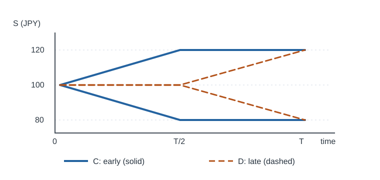

# U3-40 局所ボラティリティ・確率ボラティリティ

## この講義で問うこと

[前講のインプライド・ボラティリティ（IV）](../U3-39/index.md#def-u3-39-iv)は、同じ満期でも行使価格によって異なり得ました。一定の変動率を全契約へ代入する Black–Scholes モデルでは、一つの価格を再現しても他の価格を同時には説明できないことがあります。そこで「株価と時刻によって係数を変える」方法と、「変動率そのものをランダムに動かす」方法を区別します。

1. **局所ボラティリティ**：時刻と現在株価を指定すると、瞬間的な変動率が一つ決まる。
2. **確率ボラティリティ**：同じ時刻・株価でも、別のランダムな状態によって変動率が異なる。
3. **価格付けとヘッジ**：株式と預金だけで消せるリスクはどれか。
4. **観測と外挿**：一つのオプション価格、あるいは同満期の全欧州型価格から、何が判明し何が未決定か。

以下は架空のモデルを使った数学的検討です。時刻は年、株価・オプション価格は円、金利・配当利回りは年$^{-1}$、変動率は年$^{-1/2}$ とします。満期 $T>0$、初期株価 $s_0>0$、定数 $r\in\mathbb R$、$q\ge0$ を固定し、取引費用・信用リスク・売買制限はないものとします。$Q$ は**評価に用いる確率**であり、実現頻度を表す測度 $P$ とは同一視しません。

## 1. 変動率を現在株価の関数にする

既習の[配当付き Black–Scholes モデル](../U3-19/index.md#thm-u3-19-bsm-dividend)は、株価の相対変動率を一定の $\sigma$ としました。現時点の株価が大きく変わった後も同じ $\sigma$ を使うべきかは、モデル化の選択です。時刻 $t$、現在株価 $s$ を入力して係数 $a(t,s)$ を定めれば、状態によって動く幅を変えられます。

ここで $W$ は $Q$ の下での一次元ブラウン運動、$(\mathcal F_t)$ はその情報を含む通常のフィルトレーションです。係数 $a:[0,T]\times(0,\infty)\to(0,\infty)$ は決定論的で、可測、局所的に Lipschitz とし、具体的に存在・一意性や真のマルチンゲール性を論じる箇所ではさらに必要な条件を記します。

<!-- formal-statement-start -->
> **定義（局所ボラティリティモデル）**  
> 時刻と現在株価のみに依存する決定論的な正の関数 $a(t,s)$ を用い、リスク中立測度 $Q$ の下で株価 $S_t>0$ が

$$
dS_t=(r-q)S_t\,dt+a(t,S_t)S_t\,dW_t,
\qquad S_0=s_0
$$

> に従うとき、$a$ を**局所ボラティリティ**という。式は [SDE の積分表示](../../../解析系/STO/STO9/index.md#def-sto9-sde)の意味で解釈する。
<!-- formal-statement-end -->

<!-- definition-example-start: def-u3-40-local-vol -->
**定義の確認**：$s_0=100$ 円とし、

$$
a(t,s)=0.20\left[1+\frac12
\min\left\{\left(\frac{s}{100}-1\right)^2,1\right\}\right]
$$

とします。$t$ の影響がない場合も「$t$ と $s$ の決定論的関数」という条件を満たします。$s>0$ に対して $0.20\le a(t,s)\le0.30$ で正、区分ごとの連続性と局所 Lipschitz 性を持ちます。実際、$s=100$ なら $a=0.20$、$s=200$ なら $a=0.30$ です。係数はランダムな隠れた変数を追加せず、現在の $s$ から一意に決まります。
<!-- definition-example-end -->

関数 $s\mapsto s\,a(t,s)$ は上の例では大域 Lipschitz、線形成長です（$a$ の変化する区間は $0<s<200$ に限られ、外側では定数係数になります）。したがって[STO9 の SDE 存在一意性定理](../../../解析系/STO/STO9/index.md#thm-sto9-global-existence-uniqueness)を株価係数へ適用できます。さらに $a$ が有界なので、[Itô 公式](../../../解析系/STO/STO7/index.md#thm-sto7-ito-process-formula)を $\log S$ へ局所化して適用すると

$$
S_t=s_0\exp\left\{\int_0^t
\left(r-q-\frac12a(u,S_u)^2\right)du
+\int_0^t a(u,S_u)\,dW_u\right\}>0.
$$

これは積分内に未知の $S$ が残る**恒等式**であり、定数変動率のような閉形式の解ではありません。正値性を確認するには、有界な $a$ の下で指数表示を局所化して導き、$S$ が有限時刻にゼロへ達しないことを使います。

<!-- formal-statement-start -->
> **命題（局所変動率と割引総収益）**  
> 上のモデルで $a$ が有界であり、$S$ が正の非爆発解なら、配当を含む割引総収益のドリフトはゼロとなる。特に株式の割引後の増分と配当収益の和は

$$
d(e^{-rt}S_t)+e^{-rt}qS_t\,dt
=e^{-rt}a(t,S_t)S_t\,dW_t.
$$

> さらに $e^{-(r-q)t}S_t$ は真の $Q$-マルチンゲールで、$E_Q[S_t]=s_0e^{(r-q)t}$ である。
<!-- formal-statement-end -->

**証明の見取り図**：[Itô の積の公式](../../../解析系/STO/STO7/index.md#thm-sto7-ito-process-formula)で割引と配当をまとめ、正の指数過程の期待値が1であることを有界係数から確かめます。

<!-- proof-start -->
### 証明

$d(e^{-rt}S_t)=e^{-rt}dS_t-re^{-rt}S_tdt$ に定義の SDE を代入すると

$$
d(e^{-rt}S_t)
=e^{-rt}\{(r-q)-r\}S_tdt+e^{-rt}a(t,S_t)S_tdW_t.
$$

左辺へ $e^{-rt}qS_tdt$ を足すと、記載した等式が得られます。次に $M_t=e^{-(r-q)t}S_t/s_0$ とおくと

$$
dM_t=M_ta(t,S_t)\,dW_t,\qquad M_0=1.
$$

先に得た指数表示より $M$ は正の連続局所マルチンゲールです。$|a|\le A$ とし、$\tau_n=\inf\{t:M_t\ge n\}\wedge T$ で停止すると、[Itô 等長性](../../../解析系/STO/STO6/index.md#thm-sto6-ito-isometry-simple)により

$$
E_Q[M_{t\wedge\tau_n}^2]
=1+E_Q\left[\int_0^{t\wedge\tau_n}M_u^2a(u,S_u)^2du\right]
\le1+A^2\int_0^tE_Q[M_{u\wedge\tau_n}^2]du.
$$

[積分形Gronwall lemma](../../../解析系/STO/STO9/index.md#lem-sto9-gronwall)から $E_Q[M_{t\wedge\tau_n}^2]\le e^{A^2T}$ です。停止した $M$ は期待値1のマルチンゲールで、局所化を外す極限でもこの一様 $L^2$ 上界により一様可積分性が保たれます。従って $E_Q[M_t]=1$、同じ議論を条件付き期待値に適用して $M$ は真のマルチンゲールです。$S_t=s_0e^{(r-q)t}M_t$ から期待値公式が従います。
<!-- proof-end -->

## 2. 局所変動率の価格付けと価格曲面

局所変動率で満期の支払 $g(S_T)$ を評価するには、**いまの株価**を状態変数として期待値または PDE を計算します。ここでの価格関数は $v(t,s)=E_Q[e^{-r(T-t)}g(S_T)\mid S_t=s]$ と書ける、十分滑らかな Markov 型の解を考えます。

<!-- formal-statement-start -->
> **命題（局所変動率の価格 PDE と delta hedge）**  
> $a(t,s)>0$ の局所変動率モデルを考える。$g$ は可積分な満期支払であり、$v\in C^{1,2}([0,T)\times(0,\infty))$ が必要な成長条件を満たすとする。配当を含めて自己金融で複製できる滑らかな価格関数は

$$
v_t+(r-q)s v_s+\frac12a(t,s)^2s^2v_{ss}-rv=0,
\qquad v(T,s)=g(s)
$$

> を満たし、株式の保有数量は $\Delta_t=v_s(t,S_t)$ である。逆にこの PDE の古典解が与えられ、Itô 公式と自己金融積分が正当化される場合は、その $\Delta$ と預金保有によって $v(t,S_t)$ を複製できる。
<!-- formal-statement-end -->

**証明の見取り図**：株式だけがブラウン運動 $W$ を含み、価格過程の $dW$ 係数を株式保有分で消します。残る $dt$ 項を預金金利と配当で照合します。ここで主張するのはこのような滑らかな支払の複製であり、すべての無限次元の請求権の完備性を条件なしに宣言するものではありません。

<!-- proof-start -->
### 証明

[時間依存 Itô 公式](../../../解析系/STO/STO7/index.md#thm-sto7-ito-process-formula)の一変数の場合を $v(t,S_t)$ に使うと

$$
dv=\left(v_t+(r-q)Sv_s+\frac12 a^2S^2v_{ss}\right)dt
+aSv_s\,dW.
$$

株式を $\Delta$ 単位、預金を価値 $v-\Delta S$ 円だけ持つと、配当を受け取る自己金融の増分は

$$
\begin{aligned}
dv&=\Delta(dS+qS\,dt)+r(v-\Delta S)\,dt\\
&=\{(r-q)\Delta S+q\Delta S+rv-r\Delta S\}dt
+\Delta aS\,dW\\
&=rv\,dt+\Delta aS\,dW.
\end{aligned}
$$

まず $dW$ 係数を比較します。$aS>0$ なので $\Delta=v_s$ が必要です。次に $dt$ 係数を比較すると

$$
v_t+(r-q)Sv_s+\frac12a^2S^2v_{ss}=rv,
$$

すなわち命題の PDE です。満期条件 $v(T,s)=g(s)$ と価格初期値を一致させれば、二つの自己金融過程の全増分が一致するため複製が成立します。
<!-- proof-end -->

上の証明中、配当付き株式の保有損益は **$\Delta(dS+qSdt)$** です。株価変化だけを数え、配当を落とすと誤った PDE になります。

### 欧州型 call の価格曲面から係数を逆算する

[前講の smile](../U3-39/index.md#def-u3-39-smile)は一つの満期断面でした。ここでは時点0から見た**すべての満期 $T$ と行使価格 $K$** の call 価格を $C(T,K)$ とします。$K$ 方向の曲率は、$S_T$ の確率密度と直接結び付きます。

以下では、$S_T$ は $s>0$ 上の十分滑らかな密度 $p(T,s)$ を持ち、$C$ は $T$ で1回・$K$ で2回連続微分可能、$K>0$ で $C_{KK}>0$ と仮定します。密度の時間微分・積分交換、無限遠の境界項の消失、密度の時間発展式で必要な部分積分が正当化できることも仮定します。この正則性を欠く市場の少数気配に公式を直接代入してはいけません。

<!-- formal-statement-start -->
> **定理（滑らかな call 曲面と局所分散の関係）**  
> $r,q$ が時間一定で、正の局所変動率 $a(t,s)$ に従う株価の時点0 call 価格が

$$
C(T,K)=e^{-rT}E_Q[(S_T-K)_+],\qquad T>0,\ K>0
$$

> で与えられるとする。上記の密度・正則性・境界条件と $C_{KK}(T,K)>0$ の下で、

$$
\frac{\partial C}{\partial T}
=\frac12 K^2 a(T,K)^2 C_{KK}
-(r-q)K C_K-qC
$$

> が成り立つ。従って曲面に整合する局所分散は

$$
a(T,K)^2=
\frac{2\{C_T+(r-q)K C_K+qC\}}
{K^2 C_{KK}}
$$

> である。右辺の分母が正でも分子が負なら、この仮定の下の正の局所変動率としては解釈できない。
<!-- formal-statement-end -->

**証明の見取り図**：まず行使価格で微分して密度を取り出し、次に株価拡散の密度の時間変化を価格積分へ代入します。積分を2回部分積分すると拡散係数が $s=K$ で評価されます。

<!-- proof-start -->
### 証明

call の期待値を密度で書くと

$$
C(T,K)=e^{-rT}\int_K^\infty(s-K)p(T,s)\,ds.
$$

下端 $s=K$ では $s-K=0$ なので Leibniz の微分法から

$$
C_K=-e^{-rT}\int_K^\infty p(T,s)\,ds,
\qquad C_{KK}=e^{-rT}p(T,K).
$$

株価のドリフトを $\mu(s)=(r-q)s$、拡散係数を $b(T,s)=s\,a(T,s)$ と書きます。[Itô 公式](../../../解析系/STO/STO7/index.md#thm-sto7-ito-process-formula)を滑らかな試験関数 $f$ へ適用して期待値を取り、部分積分すると

$$
\int_0^\infty f(s)\,p_T(T,s)\,ds
=\int_0^\infty\left\{\mu(s)f'(s)+\frac12b(T,s)^2f''(s)\right\}p(T,s)\,ds.
$$

すべての滑らかな試験関数について等しいので、境界項が消える場合の密度の時間発展は

$$
p_T=-\partial_s(\mu p)+\frac12\partial_{ss}(b^2p)
$$

です。これを call 価格の $T$ 微分へ代入します。ドリフトの積分を部分積分すると

$$
-\int_K^\infty(s-K)\partial_s(\mu p)\,ds
=\int_K^\infty\mu(s)p(T,s)\,ds.
$$

拡散の積分は、$h(s)=b(T,s)^2p(T,s)$ と置いて2回部分積分すると

$$
\int_K^\infty(s-K)h''(s)\,ds
=-\int_K^\infty h'(s)\,ds=h(K).
$$

また $s=(s-K)+K$ によって

$$
e^{-rT}\int_K^\infty s p\,ds
=C(T,K)-K C_K(T,K).
$$

従って

$$
\begin{aligned}
C_T
&=-rC+(r-q)(C-KC_K)
+\frac12e^{-rT}K^2a(T,K)^2p(T,K)\\
&=-qC-(r-q)KC_K+\frac12K^2a(T,K)^2C_{KK}.
\end{aligned}
$$

最後に $K^2C_{KK}>0$ で割って結論を得ます。
<!-- proof-end -->

**直接の数値確認**：$r=q=0$、$K=100$ 円の滑らかな曲面で $C_T=2$ 円/年、$C_{KK}=0.01$ 円$^{-1}$ とすると

$$
a^2=\frac{2\cdot 2}{100^2\cdot 0.01}=0.04\ \text{年}^{-1},
\qquad a=0.20\ \text{年}^{-1/2}.
$$

これは一つの微分点での計算であり、与えた二つの導関数だけで**曲面全体の無裁定性が保証されたわけではありません**。[前講の行使価格に関する単調性・凸性](../U3-39/index.md#prop-u3-39-strike-check)は $C_K\le0,C_{KK}\ge0$ を要求しますが、観測気配へのノイズがあると数値的な2階微分は不安定になり得ます。満期方向の整合性と補間・平滑化も点検する必要があります。

## 3. 変動率を独立の確率過程にする

局所変動率では、$(t,S_t)$ が同じなら係数も同じでした。これに対し、株価以外に潜在状態 $Y_t$ を追加し、瞬間変動率を $\sigma_0e^{Y_t}$ とすると、株価だけではその値が分かりません。$Y_t$ 自体を Brown 運動で動かす最小の例を考えます。これは Heston モデルの平方根分散過程そのものではなく、**対数変動率が線形の平均回帰型確率過程に従う例**です。

<!-- formal-statement-start -->
> **定義（独立因子を持つ確率ボラティリティモデル）**  
> $W,B$ を同じフィルトレーション上の独立な $Q$-ブラウン運動とし、定数 $\sigma_0>0$、$\kappa>0$、$\xi>0$、$y_0\in\mathbb R$ を取る。株価と変動率状態 $(S,Y)$ が

$$
\begin{aligned}
dS_t&=(r-q)S_t\,dt+\sigma_0e^{Y_t}S_t\,dW_t,
& S_0&=s_0>0,\\
dY_t&=-\kappa Y_t\,dt+\xi\,dB_t,
&Y_0&=y_0
\end{aligned}
$$

> に従い、株式 $S$ と預金だけが取引可能なとき、このモデルを**確率ボラティリティモデル**の一例とする。瞬間変動率は $\sigma_t=\sigma_0e^{Y_t}$、瞬間分散は $V_t=\sigma_0^2e^{2Y_t}$ である。
<!-- formal-statement-end -->

<!-- definition-example-start: def-u3-40-stochastic-vol -->
**定義の確認**：$\sigma_0=0.20$ 年$^{-1/2}$、$\kappa=1$ 年$^{-1}$、$\xi=0.4$ 年$^{-1/2}$、$y_0=0$ とします。$Y$ はブラウン運動 $B$ によってランダムに変化し、瞬間変動率は常に正です。例えば同じ $S_t=100$ 円でも $Y_t=0$ の状態なら $0.20$、$Y_t=\log(3/2)$ なら $0.30$ 年$^{-1/2}$ です。二つの状態は同一の $(t,S_t)$ に対して異なる係数を与えるので、局所変動率の定義例とは本質的に異なります。$B$ が $W$ と独立であることも定義の非自明な条件です。
<!-- definition-example-end -->

<!-- formal-statement-start -->
> **命題（ランダムな積分分散と条件付き対数正規性）**  
> 上の独立 Brown 運動のモデルで、$0\le t\le T$ とすると

$$
Y_t=y_0e^{-\kappa t}
+\xi\int_0^t e^{-\kappa(t-u)}\,dB_u.
$$

> 特に $E_Q[Y_t]=y_0e^{-\kappa t}$、$\operatorname{Var}_Q(Y_t)=\xi^2(1-e^{-2\kappa t})/(2\kappa)>0$（$t>0$）である。また

$$
A_T:=\int_0^T\sigma_0^2e^{2Y_u}\,du
$$

> を定めると、$B$ の全経路を固定した条件付きで

$$
\log\frac{S_T}{s_0}\ \Big|\ \sigma(B_u:0\le u\le T)
\ \sim\ N\!\left((r-q)T-\frac12A_T,\ A_T\right).
$$

> よって $E_Q[S_T]=s_0e^{(r-q)T}$ であり、欧州型価格は $A_T$ による対数正規価格の混合になる。
<!-- formal-statement-end -->

**証明の見取り図**：$e^{\kappa t}Y_t$ への積の公式で OU の厳密解を作り、$W$ と $B$ の独立性を使って $B$ の経路を条件にした Itô 積分を正規分布として評価します。

<!-- proof-start -->
### 証明

積の公式より $d(e^{\kappa t}Y_t)=\xi e^{\kappa t}dB_t$ です。時刻0から積分し $e^{-\kappa t}$ を掛けると表示式を得ます。[Itô 等長性](../../../解析系/STO/STO6/index.md#thm-sto6-ito-isometry-simple)から積分項の分散は

$$
\xi^2\int_0^t e^{-2\kappa(t-u)}du
=\frac{\xi^2}{2\kappa}(1-e^{-2\kappa t}).
$$

株価へ[Itô 公式](../../../解析系/STO/STO7/index.md#thm-sto7-ito-process-formula)を用いると

$$
\log(S_T/s_0)=(r-q)T-\frac12A_T
+\int_0^T\sigma_0e^{Y_u}dW_u.
$$

有限区間上で $Y$ の連続標本路は有界なので、$A_T$ は各経路で正かつ有限です。$B$ の全経路を固定すると被積分関数は決定論的な $L^2[0,T]$ 関数になり、独立な $W$ による積分は平均0、分散 $A_T$ の正規分布です。従って条件付き対数正規性が得られます。指数正規モーメントを条件付きで計算すれば

$$
E_Q[S_T\mid\sigma(B_u:0\le u\le T)]
=s_0\exp\{(r-q)T-A_T/2+A_T/2\}
=s_0e^{(r-q)T}.
$$

両辺の期待値を取って最後の結論を得ます。
<!-- proof-end -->

この例では独立性のおかげで株価の真のマルチンゲール性を条件付きで確認できました。相関する二因子モデルや係数を変えたモデルで、**局所マルチンゲールであるだけ**から同じ結論を無条件に出してはいけません。

<!-- formal-statement-start -->
> **命題（二因子モデルの評価 PDE）**  
> 上の確率ボラティリティモデルで、指定された $Q$ の下の満期支払 $g(S_T,Y_T)$ の割引期待値を $F(t,s,y)$ とする。$F\in C^{1,2,2}$ で必要な可積分性と終端成長条件があり、[多次元 Itô 公式](../../../解析系/STO/STO7/index.md#thm-sto7-multidimensional-ito)を適用できるなら、

$$
F_t+(r-q)sF_s-\kappa yF_y
+\frac12\sigma_0^2e^{2y}s^2F_{ss}
+\frac12\xi^2F_{yy}-rF=0,
\qquad F(T,s,y)=g(s,y)
$$

> を満たす。独立な $W,B$ のため混合微分 $F_{sy}$ の係数はゼロである。
<!-- formal-statement-end -->

**証明の見取り図**：$S$ と $Y$ の各二次変分を別々に計算し、共変分がゼロであることを確認します。ドリフトに $-rF$ を加えるのは現在価値へ割り引くためです。

<!-- proof-start -->
### 証明

[多次元 Itô 公式](../../../解析系/STO/STO7/index.md#thm-sto7-multidimensional-ito)へ $(S,Y)$ を代入します。[ブラウン運動の共変分](../../../解析系/STO/STO7/index.md#prop-sto7-vector-brownian-covariation)から $d[W,B]_t=0$ なので

$$
d[S]_t=\sigma_0^2e^{2Y_t}S_t^2dt,\qquad
d[Y]_t=\xi^2dt,\qquad d[S,Y]_t=0.
$$

従って $F(t,S_t,Y_t)$ の $dt$ 係数は

$$
F_t+(r-q)SF_s-\kappa YF_y
+\frac12\sigma_0^2e^{2Y}S^2F_{ss}
+\frac12\xi^2F_{yy}.
$$

割引過程 $e^{-rt}F(t,S_t,Y_t)$ を局所マルチンゲールにするには、積の公式による追加ドリフト $-rF$ を差し引いた係数がゼロである必要があります。これが表示した PDE です。真の期待値表示との同一視には、局所化後の極限を交換できる可積分性・境界条件を別途必要とします。
<!-- proof-end -->

### 新しく増えたリスクは株だけで消せるか

$a(t,S_t)$ では $dW$ 方向しかなく、[局所変動率 PDE](#prop-u3-40-local-pde)に沿う滑らかな請求権なら delta hedge で複製できました。しかし二因子モデルでは、$F_y$ に比例する別の $dB$ 方向が発生します。$B$ に反応する取引可能資産がなければ、その変動を株式だけで一般には消せません。

<!-- formal-statement-start -->
> **命題（独立ボラティリティ因子による非完備性）**  
> $T>0$、$\xi,\kappa>0$ とし、上の二因子モデルで取引可能なのは配当付き株式と預金のみ、自己金融戦略の割引株式利得は二乗可積分な Itô 積分とする。満期請求権

$$
H=\mathbf 1_{\{Y_T>y_0e^{-\kappa T}\}}
$$

> は有界だが株式と預金だけでは複製できない。従ってこの市場は少なくともこの請求権を含む集合に関して非完備である。
<!-- formal-statement-end -->

**証明の見取り図**：$H$ は $B$ だけの非定数関数です。これに対し、割引株式利得の $dW$ 積分は、$B$ の全経路を固定して条件付き平均を取るとゼロになるため、両者を一致させられません。

<!-- proof-start -->
### 証明

[OU の明示解](#prop-u3-40-ou-conditional)より $Y_T-y_0e^{-\kappa T}$ は平均0・分散正の正規変数なので $Q(H=1)=Q(H=0)=1/2$ です。

複製できたと仮定します。時刻0での初期費用を $x$ 円、株式保有数量を予測可能な $\Delta_t$ とします。配当を受け取る自己金融条件と[割引総収益の式](#prop-u3-40-discounted-gain)と同じ積の計算から

$$
e^{-rT}H=x+\int_0^T e^{-rt}\Delta_t\sigma_0e^{Y_t}S_t\,dW_t.
$$

$B$ の全経路を固定したとき、$W$ は独立なブラウン運動のままです。二乗可積分な予測可能積分の条件付き平均は0です。これを確かめるには、単純予測可能過程の各左端係数と将来の $W$ 増分の条件付き平均が0であることを使い、[Itô 等長性](../../../解析系/STO/STO6/index.md#thm-sto6-ito-isometry-simple)で一般の被積分過程へ $L^2$ 極限を取ります。従って

$$
e^{-rT}H
=E_Q[e^{-rT}H\mid\sigma(B_u:0\le u\le T)]
=x
$$

となるはずです。しかし左辺は $0$ と $e^{-rT}$ をそれぞれ正の確率で取るため定数 $x$ に等しくありません。矛盾です。
<!-- proof-end -->

この証明は「どんな欧州型 call も絶対にヘッジできない」と述べたものではありません。**少なくとも一つ**の請求権が複製不能であることが、完備性を否定するには十分です。実際に $F_y\ne0$ の支払をヘッジするとき、独立な $dB$ 成分を株式保有で消せないことが残余リスクの仕組みです。

評価用測度 $Q$ で $Y$ にどのドリフトを与えるかは、株と預金の価格だけでは一意には決まりません。例えば上の $-\kappa Y$ を $-\kappa Y+\eta$ に置き換え、$B$ のドリフトだけを有限期間で Girsanov 変換すれば、$W$ と $B$ の独立性および株の割引総収益のマルチンゲール条件を保つ別の評価用測度が得られます。[Girsanov の定理](../../../解析系/STO/STO10/index.md#thm-sto10-girsanov)を用いる際は二因子の測度変更と密度の真のマルチンゲール条件を確認します。この追加の「ボラティリティ・リスク価格」は、観測できる派生商品の気配や市場で採用する価格付け規約から選ぶ必要があります。

## 4. 同じ価格が観測されても、その外側の価格は決まらない

前節の SDE では、係数も株価の確率分布も連続時間に従って変わります。しかしモデルを区別する論点は、もっと小さい有限確率空間で厳密に検算できます。以下の二つの比較は連続時間 SDE の数値近似そのものではなく、**観測価格の情報量に関する反例**です。

### 比較1：一つの call 価格を一致させても別の strike は一致しない

時刻0の株価を100円、1期間後を満期とし、$r=q=0$ とします。株式をマルチンゲールにする二つの評価用確率モデルを比較します。

| モデル | 満期株価と確率 | $K=100$ call | $K=120$ call |
| --- | --- | ---: | ---: |
| A：固定振幅 $20\%$ | $80,120$ 各 $1/2$ | $10$ 円 | $0$ 円 |
| B：ランダムな振幅 $10\%$ または $30\%$ | $70,90,110,130$ 各 $1/4$ | $10$ 円 | $2.5$ 円 |

A の株価平均は $(80+120)/2=100$、B は $(70+90+110+130)/4=100$ です。$K=100$ の支払期待値は A が $(0+20)/2=10$、B が $(0+0+10+30)/4=10$。しかし $K=120$ では A が0、B が $(130-120)/4=2.5$ 円です。B は追加のランダムな振幅を導入した有限モデルであり、連続時間 OU モデルを厳密に離散化したものではありません。

### 比較2：満期のすべての call が一致しても経路依存価格は一致しない

次は $t_0=0,t_1=1/2,t_2=1$ 年の二期間で、どの時点の割引も1とします。二つの等確率経路を用意します。

| モデル | 経路（上方向） | 経路（下方向） |
| --- | --- | --- |
| C：変動が前半に集中 | $100\to120\to120$ | $100\to80\to80$ |
| D：変動が後半に集中 | $100\to100\to120$ | $100\to100\to80$ |

図の実線 C は前半で価格が $80$ 円または $120$ 円へ動き、破線 D は後半まで $100$ 円に留まります。横軸は時刻、縦軸は株価（円）です。終点は同じでも、途中の価格は一致しません。

各節点の次期株価の条件付き平均は現在株価に一致するので、C も D もリスク中立のマルチンゲールです。どちらも $S_T=80,120$ を各確率 $1/2$ で取ります。従って**任意の $K$ について欧州型 call $(S_T-K)_+$ の価格は等しい**です。

一方、二時点算術平均に対する call

$$
H=\left(\frac{S_{t_1}+S_{t_2}}2-110\right)_+
$$

では、C は上方向で平均120、下方向で80なので期待支払は $(10+0)/2=5$ 円です。D は上方向で平均110、下方向で90なので、どちらの支払も0円です。同じ終端分布からは、途中経路の支払を決められません。[Asian オプションの状態追加](../U3-25/index.md#def-u3-25-asian)が必要になる理由がここにも現れます。

この二つの表は、連続時間の「局所モデルと確率モデルが常に同じ vanilla 曲面を作れる」という定理を主張しません。**一つの価格からは別 strike が定まらず、一つの満期の終端分布からは経路依存価格が定まらない**、という区別を有限例で証明しています。

## 5. モデルを選ぶときの点検

局所変動率の入力は滑らかな $a(t,s)$ という関数全体です。[Dupire の関係](#thm-u3-40-dupire)を逆向きに利用するには、同じ評価規約の満期・行使価格曲面、$C_{KK}>0$、分子の非負性、必要な正則性を点検します。価格気配の有限個の点を補間する方法やデータノイズの扱いで求まる係数は変わります。

確率ボラティリティの入力は $(S,Y)$ の二因子の係数と、取引されない変動率リスクへの評価測度です。[条件付き分散の混合](#prop-u3-40-ou-conditional)は smile の一つの発生機構になりますが、パラメータを任意にすれば観測価格が必ず再現されるわけではありません。[非完備性の証明](#prop-u3-40-incomplete)も、追加商品を取引可能にしたり相関・情報の仮定を変えれば、そのままでは適用できません。

どちらのモデルでも、[Monte Carlo 推定量と標本誤差](../U3-26/index.md#prop-u3-26-unbiased-sample-variance)を使って経路依存商品を評価するときは、数値離散化の偏りと標本誤差を別々に扱います。連続時間モデルを使うなら、時間刻み・初期状態・相関・評価用測度を固定してから価格を比較してください。

## 6. 演習と詳細解答

### Level A：定義を判定し一段階を計算する

### U3-40-A1：局所係数の値域
- Level: A

第1節の $a(t,s)$ について $s=100,150,200,250$ 円での変動率を求め、値域が $[0.20,0.30]$ に入る理由を示せ。

<!-- solution-start -->
**詳細解答**：$s/100-1$ は順に $0,0.5,1,1.5$ です。その二乗と1の最小値は $0,0.25,1,1$ なので

$$
a(100)=.20,\quad a(150)=.20(1+.125)=.225,\quad
a(200)=a(250)=.30.
$$

任意の $s>0$ で二乗は非負、$\min\{(\cdots)^2,1\}\in[0,1]$ です。従って $0.2[1+0]\le a\le0.2[1+1/2]$ となり、指定範囲に入ります。$a$ は株価の関数であって、別の乱数を引き直していません。
<!-- solution-end -->

### U3-40-A2：割引と配当
- Level: A

$r=.05,q=.02$ の局所変動率 SDE で、$d(e^{-rt}S_t)$ の $dt$ 係数と、配当を足した総収益の $dt$ 係数を求めよ。

<!-- solution-start -->
**詳細解答**：[割引総収益命題](#prop-u3-40-discounted-gain)の積の公式で

$$
d(e^{-.05t}S_t)
=e^{-.05t}[(.05-.02)-.05]S_tdt
+e^{-.05t}a(t,S_t)S_tdW_t.
$$

従って配当なしの割引株価の $dt$ 係数は $-.02e^{-.05t}S_t$ です。配当収益 $+.02e^{-.05t}S_tdt$ を足せば0になり、ブラウン項だけが残ります。
<!-- solution-end -->

### U3-40-A3：局所分散を逆算する
- Level: A

$r=q=0$、$T=1,K=100$ 円において滑らかな call 曲面の $C_T=3$ 円/年、$C_{KK}=0.015$ 円$^{-1}$ とする。局所分散と局所変動率を計算せよ。

<!-- solution-start -->
**詳細解答**：[Dupire の公式](#thm-u3-40-dupire)の分子は $2C_T=6$、分母は $K^2C_{KK}=10000\times.015=150$ なので

$$
a^2=6/150=.04\ \text{年}^{-1},\qquad
a=.20\ \text{年}^{-1/2}.
$$

この局所値が計算できるのは分母が正で、正の分散が得られたからです。価格曲面全体が条件を満たすかは別途検査します。
<!-- solution-end -->

### U3-40-A4：OU 因子の期待値と分散
- Level: A

$\kappa=1,\xi=.4,y_0=0,T=1$ とする。$Y_T$ の平均と分散を厳密式で求めよ。

<!-- solution-start -->
**詳細解答**：[OU の明示解](#prop-u3-40-ou-conditional)で $E[Y_T]=0e^{-1}=0$ です。独立な Brown 運動の増分の分散から

$$
\operatorname{Var}(Y_1)=.4^2\int_0^1e^{-2(1-u)}du
=.16\frac{1-e^{-2}}2=.08(1-e^{-2})>0.
$$

分散が正なので $Y_1$ は確定値ではありません。
<!-- solution-end -->

### U3-40-A5：追加状態の識別
- Level: A

$\sigma_0=.20$、$Y=0$ と $Y=\log 2$ で、瞬間変動率と瞬間分散をそれぞれ求めよ。同じ株価でも局所変動率で表せない理由を述べよ。

<!-- solution-start -->
**詳細解答**：[独立因子を持つ確率ボラティリティモデル](#def-u3-40-stochastic-vol)から $\sigma=.20e^Y$、$V=.04e^{2Y}$ です。$Y=0$ なら $(\sigma,V)=(.20,.04)$、$Y=\log2$ なら $(.40,.16)$ です。時刻と株価を同じ値に固定したまま二つの異なる係数を取り得るので、単一の決定論的関数 $a(t,s)$ による表示とは異なります。
<!-- solution-end -->

### Level B：条件の役割と主要証明を再構成する

### U3-40-B1：平方支払の PDE と複製
- Level: B

$r=q=0$、一定の局所変動率 $a=.20$、満期 $T>0$ の支払 $g(S_T)=S_T^2$ を考える。$v(t,s)=s^2e^{.04(T-t)}$ が[価格 PDE](#prop-u3-40-local-pde)を満たすことを示し、株式保有量を計算せよ。

<!-- solution-start -->
**詳細解答**：$v_t=-.04s^2e^{.04(T-t)}=-.04v$、$v_s=2se^{.04(T-t)}$、$v_{ss}=2e^{.04(T-t)}$ です。PDE の左辺は

$$
v_t+\frac12(.20)^2s^2v_{ss}
=-.04v+\frac12(.04)s^2(2e^{.04(T-t)})
=-.04v+.04v=0.
$$

満期に $e^0=1$ なので $v(T,s)=s^2$ です。[delta hedge](#prop-u3-40-local-pde)より株式保有数量は $\Delta_t=2S_te^{.04(T-t)}$。この例では $\Delta$ は株式2単位という固定数ではなく、株価に比例して調整されます。
<!-- solution-end -->

### U3-40-B2：call の行使価格二階微分
- Level: B

$S_T$ の密度が $p(T,s)$ であるとし、$C(T,K)=e^{-rT}\int_K^\infty(s-K)p(T,s)ds$ を考える。積分交換を許す正則性を仮定し、$C_K$、$C_{KK}$ を導き、凸性の必要性を説明せよ。

<!-- solution-start -->
**詳細解答**：$K$ で微分したとき積分の下端の寄与は $(K-K)p(T,K)=0$ です。一方、被積分関数の導関数は $-p(T,s)$ なので

$$
C_K=-e^{-rT}\int_K^\infty p(T,s)ds\le0.
$$

さらに積分下端を微分すれば

$$
C_{KK}=e^{-rT}p(T,K)\ge0.
$$

これにより価格は行使価格に関して非増加・凸です。密度が正なら $C_{KK}>0$ です。[前講の行使価格制約](../U3-39/index.md#prop-u3-39-strike-check)とも整合しますが、$C_{KK}=0$ では [Dupire の除算](#thm-u3-40-dupire)は実行できません。
<!-- solution-end -->

### U3-40-B3：なぜ株式だけで因子デジタルを複製できないか
- Level: B

$W,B$ が独立で、$Y_T$ が $B$ だけに依存して非退化な正規分布になるモデルを考える。$H=\mathbf1_{\{Y_T>E[Y_T]\}}$ を、二乗可積分な株式戦略と預金で複製できない理由を、$B$ の全経路への条件付き期待値を用いて説明せよ。

<!-- solution-start -->
**詳細解答**：[OU 明示解](#prop-u3-40-ou-conditional)により $H$ は $B$ の経路に対する可測関数で、$P_Q(H=1)=P_Q(H=0)=1/2$ です。複製したとすると、配当を含む自己金融条件から

$$
e^{-rT}H=x+\int_0^T\Delta_te^{-rt}\sigma_0e^{Y_t}S_t\,dW_t.
$$

$B$ の全経路を固定しても $W$ の将来増分は平均0です。単純予測可能積分の各項の条件付き平均は0、二乗可積分な極限にも[Itô 等長性](../../../解析系/STO/STO6/index.md#thm-sto6-ito-isometry-simple)で引き継げます。従って右辺の条件付き平均は定数 $x$。左辺の条件付き平均は $e^{-rT}H$ 自身なので、非定数の $H$ と矛盾します。株の $dW$ 一方向では $dB$ の請求権を張れません。
<!-- solution-end -->

### U3-40-B4：同じ終端分布と Asian の違い
- Level: B

第4節の二期間 C、D モデルを考える。いずれも時刻0と時刻1での株価平均を求め、任意の行使価格 $K$ の欧州型 call が一致する理由を示し、$( (S_{1/2}+S_1)/2-110)_+$ の価格をそれぞれ求めよ。

<!-- solution-start -->
**詳細解答**：両モデルとも $S_0=100$、$E[S_1]=(80+120)/2=100$ です。C は $t=1/2$ に $80,120$ を確率 $1/2$ ずつ、D は常に100を取ります。最終分布はともに $S_1=80,120$ を各 $1/2$ なので、任意の $K$ について

$$
C(K)=\frac12(80-K)_++\frac12(120-K)_+
$$

で一致します。一方 C の平均価格は上方向120・下方向80、D は上方向 $(100+120)/2=110$・下方向 $(100+80)/2=90$。よって Asian 支払の期待値は C が $\frac12(120-110)=5$ 円、D が0円です。終端分布だけでは途中の変動時刻が分かりません。
<!-- solution-end -->

### Level C：観測・モデルとヘッジの限界をまとめる

### U3-40-C1：価格一致から言えること／言えないこと
- Level: C

満期までの割引は1、$S_0=100$ 円とする。モデル A の満期 $S_T=80,120$ は各確率 $1/2$、モデル B の満期 $S_T=70,90,110,130$ は各確率 $1/4$ とする。さらにモデル C は経路 $(100,120,120)$ / $(100,80,80)$、D は $(100,100,120)$ / $(100,100,80)$ を各確率 $1/2$ とし、時刻は $(0,T/2,T)$ とする。

1. A と B で $K=100$、$K=120$ の欧州型 call 価格を計算し、単一の観測価格でどこまでモデルを識別できるか述べよ。
2. C と D で、すべての満期 call の一致と、算術平均 call（$K=110$）の不一致を証明せよ。
3. 連続時間で同じ違いをモデル化する際、局所変動率の係数の引数と二因子確率変動率の係数の引数を示し、なぜ追加の $B$ リスクを株式の delta だけでは消せないか説明せよ。

<!-- solution-start -->
**詳細解答**：

1. A の $K=100$ は $\{(80-100)_++(120-100)_+\}/2=(0+20)/2=10$ 円、B は $\{0+0+10+30\}/4=10$ 円です。$K=120$ は A が0、B は $\{0+0+0+(130-120)\}/4=2.5$ 円です。両モデルとも $E_Q[S_T]=100$ で無裁定の一期間株価平均を満たし、単一の $K=100$ 気配だけでは異なる $K$ の予測を決定できません。
2. C と D は最終分布が等しいので任意の $K$ で $\frac12(80-K)_++\frac12(120-K)_+$ を再現します。しかし平均株価は C で $120$ と $80$、D で $110$ と $90$ です。$K=110$ の平均 call の価格は C が $(10+0)/2=5$ 円、D が $(0+0)/2=0$ 円です。同じ満期の全 vanilla 価格から中間経路は確定しません。
3. [局所ボラティリティモデル](#def-u3-40-local-vol)は $a(t,S_t)$、[独立因子を持つ確率ボラティリティモデル](#def-u3-40-stochastic-vol)は $\sigma_0e^{Y_t}$ を係数に使います。後者には株価以外の状態 $Y_t$ が必要です。

   [二因子モデルの価格 PDE](#prop-u3-40-two-factor-pde) の計算で、価格 $F(t,S_t,Y_t)$ のブラウン項は次の二成分です。

$$
F_s\sigma_0e^{Y_t}S_t\,dW_t+\xi F_y\,dB_t.
$$

   株式を $\Delta$ 単位保有すると、調節できるのは $dW$ 方向の係数だけです。$B$ は $W$ と独立なので、$dB$ 係数を一般には消せません。[因子デジタルの非複製命題](#prop-u3-40-incomplete)が具体例です。
<!-- solution-end -->

## この講義で得たこと

局所ボラティリティは**一つの Brown 運動方向のまま係数を状態依存にする**モデルです。滑らかな欧州型 call 曲面が十分な正則性を持つなら、その時刻・行使価格での局所分散を [Dupire の関係](#thm-u3-40-dupire)から調べられます。一方、確率ボラティリティは**変動率を別の確率状態として動かす**ので、指定した評価測度の下で価格を計算できても、株と預金だけでは消せないリスクが残り得ます。

観測価格に一致させること、未知の strike や経路依存商品へ外挿すること、複製可能性を主張することは別の問いです。次講ではさらに**価格の不連続なジャンプ**が加わったときの非完備性を扱います。
