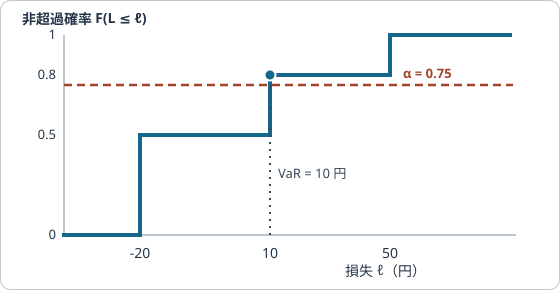

# U3-45 Value at Risk の定義と限界

<!-- definition-example-audit: strict -->

## この講義で問うこと

[前講の保有期間損失](../U3-44/index.md#def-u3-44-loss)では、今日の保有額と将来の全再評価額から「利益は負、損失は正」という金額 $L$ を作りました。[損失分布](../U3-44/index.md#def-u3-44-loss-law)では、実確率 $P$ によって各損失の起きやすさも計算できました。しかし、平均損失だけでは「100回に5回程度しか起こらない大きな損失」を読み取れません。

そこで本講では、**あらかじめ決めた確率水準までを覆う損失の境界**として Value at Risk（VaR）を定めます。ただし、境界の先の損失額や複数資産を組み合わせた際の危険を VaR だけで測れるとは限りません。

到達目標は次のとおりです。

1. 損失の向き、保有期間、実確率 $P$、信頼水準を指定し、左側分位点として VaR を定義する。
2. 確率が一点へ集まる離散分布でも境界の等号を正しく扱い、階段状の分布関数から VaR を読む。
3. 被覆確率、平行移動・正の倍率・単調性を仮定付きで証明する。
4. 二値損失と正規損失の VaR を手で計算する。
5. VaR が損失の深刻さを測り切れず、劣加法性さえ満たさない具体例を検算する。

金額の単位は円、特記しない場合は同じ固定保有期間の損失を比較します。確率は損失予測用の **$P$** であり、価格付け用の $Q$ ではありません。以下は分布を既知と仮定した数学上の例であって、実市場の保証値ではありません。

## 1. 分布のどこを境界とするか

損失 $L$ が実数値確率変数であるとします。$L=-20$ 円なら20円の利益、$L=50$ 円なら50円の損失です。金額 $\ell$ 以下の損失で収まる確率を表す分布関数は、[前講の非超過確率](../U3-44/index.md#def-u3-44-loss-law)と同じく

$$
F_L(\ell)=P(L\le\ell),\qquad \ell\in\mathbb R
$$

です。値の増加とともに $F_L$ は減少せず、左端で0、右端で1へ近づきます。$P(L=\ell)>0$ のとき、その点で分布関数が跳び上がります。

例えば次の離散損失を考えます。

| 損失 $\ell$（円） | $-20$ | $10$ | $50$ |
| --- | ---: | ---: | ---: |
| $P(L=\ell)$ | $1/2$ | $3/10$ | $1/5$ |
| $F_L(\ell)$ | $1/2$ | $4/5$ | $1$ |

確率は非負で合計1です。$F_L$ は $-20$ 円の位置で0から0.5へ、10円で0.5から0.8へ、50円で0.8から1へ跳びます。例えば $F_L(9)=0.5$ ですが $F_L(10)=0.8$ です。「確率が75%以上になる最も小さい金額」は、この表では10円です。

図の横軸は損失（円）、縦軸は非超過確率です。点線が境界額、破線が水準0.75を表します。**連続曲線と違って、水平線の高さ0.75に分布関数が厳密に等しい点がなくても**、境界は定義できます。

## 2. 信頼水準と左側分位点

「95% VaR」を読めるようにするには、95% が何の確率なのかを決める必要があります。ここでは $0<\alpha<1$ を**信頼水準**、$1-\alpha$ を上側尾部の目標確率とします。通常の統計的信頼区間の信頼係数を直接計算するのではなく、**一つの損失予測分布の分位点を取る**場面です。

<!-- formal-statement-start -->
> **定義（左側分位点による Value at Risk）**  
> 確率空間 $(\Omega,\mathcal F,P)$ 上の有限実数値確率変数 $L$（所定の保有期間における損失）と信頼水準 $\alpha\in(0,1)$ を指定する。分布関数 $F_L(\ell)=P(L\le\ell)$ に対し、左側分位点として Value at Risk を

$$
\operatorname{VaR}_{\alpha}^{P}(L)
=\inf\{\ell\in\mathbb R:F_L(\ell)\ge\alpha\}
$$

> と定める。単一の $P$ を固定している節では上付きの $P$ を省略する。負の値も許す。実数値確率変数ではこの下限は有限の実数である。
<!-- formal-statement-end -->

<!-- definition-example-start: def-u3-45-var -->
**定義の確認**：第1節の3点分布で $\alpha=0.75$ とします。$0<0.75<1$、損失はすべて有限で、$F_L(\ell)\ge0.75$ となるのは $\ell\ge10$ のときです。したがって集合の下限を直接取れば

$$
\operatorname{VaR}_{0.75}(L)=\inf[10,\infty)=10\ \text{円}.
$$

$\alpha=0.80$ でも $F_L(10)=0.80$ なので10円のままです。一方、$\alpha=0.81$ なら $F_L(10)=0.80<0.81$、$F_L(50)=1\ge0.81$ より50円です。水準の微小な変更が分位点を跳ばすのは離散分布の性質です。
<!-- definition-example-end -->

この規約では、境界額そのものに確率が付いている場合も、**境界以下を含めて**数えます。境界額を超える損失と、境界額以上の損失は区別します。

## 3. 分位点の被覆と有限状態の計算法

まず「VaR の額を超える損失は確率 $1-\alpha$ 以下」という解釈を証明します。正確にいうと、これは**指定した $P$ が正しい場合のモデル内確率**についての主張で、将来の実現損失の絶対上限を意味しません。

<!-- formal-statement-start -->
> **命題（VaR の非超過確率と超過確率）**  
> 実数値確率変数 $L$、$\alpha\in(0,1)$ に対し、$q=\operatorname{VaR}_{\alpha}(L)$ と置く。このとき

$$
P(L\le q)\ge\alpha,\qquad
P(L>q)\le1-\alpha.
$$

> 一般に $P(L\le q)=\alpha$ とは限らず、$P(L\ge q)\le1-\alpha$ と言い換えてもいけない。
<!-- formal-statement-end -->

**証明の見取り図**：定義の集合の下限が本当に集合へ入ることを、分布関数の右連続性で確認します。その後は補集合の確率を取ります。跳びがあれば等号を強制できません。

<!-- proof-start -->
### 証明

実数値確率変数の分布関数は右連続で、$\ell\to-\infty$ で0、$\ell\to+\infty$ で1に近づく。$\alpha\in(0,1)$ なので、集合 $A=\{\ell:F_L(\ell)\ge\alpha\}$ は空でなく下に有界で、$q=\inf A\in\mathbb R$ である。

各 $n\ge1$ について、下限の定義より $a_n\in A$ で $q\le a_n<q+1/n$ を満たす点がある。$F_L$ の単調性から $F_L(q+1/n)\ge F_L(a_n)\ge\alpha$。右連続性により

$$
F_L(q)=\lim_{n\to\infty}F_L(q+1/n)\ge\alpha.
$$

さらに $P(L>q)=1-P(L\le q)=1-F_L(q)\le1-\alpha$ である。一方、$P(L\ge q)=P(L>q)+P(L=q)$ なので、境界の原子確率 $P(L=q)$ が正なら別の値を取る。

例えば $P(L=0)=0.96$、$P(L=100)=0.04$ と $\alpha=0.95$ では $q=0$、$P(L\le q)=0.96$、$P(L>q)=0.04$、$P(L\ge q)=1$ である。
<!-- proof-end -->

離散分布は表から**累積確率が初めて $\alpha$ に届く行**を選べます。

<!-- formal-statement-start -->
> **命題（離散分布での VaR の決定法）**  
> $L$ の異なる有限個の値を $x_1<\cdots<x_m$ とし、$p_i=P(L=x_i)>0$、$\sum_{i=1}^m p_i=1$ とする。$\alpha\in(0,1)$ に対して

$$
k=\min\left\{j\in\{1,\ldots,m\}:\sum_{i=1}^{j}p_i\ge\alpha\right\}
$$

> とすれば $\operatorname{VaR}_{\alpha}(L)=x_k$ である。ゼロ確率の値は初めから除外し、同額損失の確率は合算する。
<!-- formal-statement-end -->

**証明の見取り図**：$x_k$ より小さい損失額で数えられるのは最初の $k-1$ 個までですが、その確率和は $\alpha$ に届きません。

<!-- proof-start -->
### 証明

有限個の確率は正で和1なので $k$ は必ず存在する。$F_L(x_k)=\sum_{i\le k}p_i\ge\alpha$ である。$k>1$ のとき、$x_k$ より小さい任意の実数 $\ell$ で

$$
F_L(\ell)\le\sum_{i=1}^{k-1}p_i<\alpha
$$

が成り立つ。$k=1$ のときは $\ell<x_1$ なら $F_L(\ell)=0<\alpha$ である。したがって、$F_L$ が初めて $\alpha$ 以上になる最小の点は $x_k$ で、[VaR の定義](#def-u3-45-var)に一致する。
<!-- proof-end -->

**二値損失の例**：確率 $1-p$ で0円、確率 $p$ で100円の損失なら、$0<p<1$ の下で

$$
\operatorname{VaR}_{\alpha}(L)=
\begin{cases}
0,&\alpha\le1-p,\\
100,&\alpha>1-p.
\end{cases}
$$

です。$p=0.04,\alpha=0.95$ では0円です。「95% VaR が0円」は、損失額100円が発生しない、という意味ではありません。

## 4. VaR の基本性質と、成立しない性質

保有ポジションに確定した費用を加える、数量を2倍にする、どの状態でも損失を小さくする、といった操作に対して VaR は予測可能な振る舞いをします。

<!-- formal-statement-start -->
> **命題（VaR の単調性・現金平行移動・正の斉次性）**  
> 同一の確率空間・確率測度 $P$ 上の実数値損失 $X,Y$、$\alpha\in(0,1)$、定数 $c\in\mathbb R$、倍率 $a\ge0$ に対し、次が成り立つ。
>
> **（単調性）** $P(X\le Y)=1$ なら $\operatorname{VaR}_{\alpha}(X)\le\operatorname{VaR}_{\alpha}(Y)$。
>
> **（平行移動）** $\operatorname{VaR}_{\alpha}(X+c)=\operatorname{VaR}_{\alpha}(X)+c$。
>
> **（正の斉次性）** $\operatorname{VaR}_{\alpha}(aX)=a\operatorname{VaR}_{\alpha}(X)$。
<!-- formal-statement-end -->

**証明の見取り図**：単調性は同じ閾値での非超過事象の包含を使います。平行移動は閾値を $c$ だけずらし、倍率が正なら閾値を $a$ で割ります。$a=0$ は別に確認します。

<!-- proof-start -->
### 証明

$X\le Y$ がほとんど確実に成り立つなら $\{Y\le t\}\subseteq\{X\le t\}$ が確率1の集合を除いて成立する。よって各 $t$ で $F_X(t)\ge F_Y(t)$ となる。特に $F_Y(t)\ge\alpha$ なら $F_X(t)\ge\alpha$ なので、定義の集合の包含から

$$
\inf\{t:F_X(t)\ge\alpha\}
\le\inf\{t:F_Y(t)\ge\alpha\}.
$$

次に $F_{X+c}(t)=P(X\le t-c)=F_X(t-c)$ である。$s=t-c$ と置けば

$$
\inf\{t:F_{X+c}(t)\ge\alpha\}
=c+\inf\{s:F_X(s)\ge\alpha\}.
$$

$a>0$ なら $F_{aX}(t)=F_X(t/a)$ であり、$s=t/a$ と置いて同様に $\operatorname{VaR}_{\alpha}(aX)=a\operatorname{VaR}_{\alpha}(X)$ を得る。$a=0$ なら $aX=0$ は確定値であり、分位点も0だから等式は成り立つ。
<!-- proof-end -->

**直接例**：第1節の3状態損失で $\operatorname{VaR}_{0.75}(L)=10$ 円でした。確定費用5円を加えると新しい値は $-15,15,55$ 円で、累積確率は0.5、0.8、1のままです。新しい VaR は15円で、確かに $10+5=15$ です。2倍の保有なら $-40,20,100$ 円で VaR は20円になります。

ただし、二つの損失 $X,Y$ の和について

$$
\operatorname{VaR}_{\alpha}(X+Y)
\le\operatorname{VaR}_{\alpha}(X)+\operatorname{VaR}_{\alpha}(Y)
$$

という**劣加法性**は一般には成立しません。これは次の独立な二値損失でも破れます。

## 5. 正規損失ではどのように計算するか

離散表では累積確率の行を探しました。連続分布、特に正規分布では確率を積分で計算してから逆に解きます。

[標準正規密度と分布関数](../U3-18/index.md#def-u3-18-normal-indices)を $\phi,\Phi$ とします。$\phi(z)>0$ であるため $\Phi$ は厳密単調増加かつ連続で、$0<\alpha<1$ に対してただ一つの数 $z_\alpha$ が $\Phi(z_\alpha)=\alpha$ を満たします。$z_\alpha=\Phi^{-1}(\alpha)$ と書きます。ここでの $\Phi$ は **$P$ の下の損失予測分布に使う**標準正規分布関数であって、BSM の価格付け測度 $Q$ を使うという意味ではありません。

<!-- formal-statement-start -->
> **命題（正規損失の VaR）**  
> 実確率 $P$ の下で $Z\sim N(0,1)$、$\mu\in\mathbb R$、$\sigma\ge0$ とし、損失を $L=\mu+\sigma Z$ とする。$\alpha\in(0,1)$ について、$\sigma>0$ なら

$$
\operatorname{VaR}_{\alpha}(L)
=\mu+\sigma\,\Phi^{-1}(\alpha).
$$

> $\sigma=0$ なら損失は確定値 $\mu$ であり、$\operatorname{VaR}_{\alpha}(L)=\mu$ である。
<!-- formal-statement-end -->

**証明の見取り図**：$\sigma>0$ の場合、損失が $\ell$ 以下となる不等式を標準正規の不等式へ変え、$\Phi$ の逆関数を使います。

<!-- proof-start -->
### 証明

$\sigma>0$ なら正の数で割れるので

$$
F_L(\ell)
=P(\mu+\sigma Z\le\ell)
=P\!\left(Z\le\frac{\ell-\mu}{\sigma}\right)
=\Phi\!\left(\frac{\ell-\mu}{\sigma}\right).
$$

$\Phi$ が厳密単調増加であることから $F_L(\ell)\ge\alpha$ と $(\ell-\mu)/\sigma\ge\Phi^{-1}(\alpha)$ は同値である。従って集合の最小境界は $\ell=\mu+\sigma\Phi^{-1}(\alpha)$ である。$\sigma=0$ の場合は $F_L(\ell)=0$（$\ell<\mu$）、$1$（$\ell\ge\mu$）なので、下限は $\mu$ である。
<!-- proof-end -->

**数値例**：1日の損失（円）を $P$ 下で $L=-2+10Z$ と仮定します。平均は $-2$ 円（平均2円の利益）、標準偏差は10円です。$z_{0.95}\approx1.644853627$ を用いると

$$
\operatorname{VaR}_{0.95}(L)
=-2+10(1.644853627)
\approx14.44853627\ \text{円}.
$$

損失がこの額を**超える**確率は、モデル内では正確に0.05です。連続分布では境界に原子がないため、先の離散分布と異なり $F_L(q)=\alpha$ が成立します。この正規仮定やパラメータ推定の正しさは別問題です。

## 6. VaR の限界：尾の大きさと分散効果の失敗

### 6.1 境界より先がどれほど深いかは分からない

$M>0$ 円、$p=0.01$ として、損失 $L_M$ が確率0.99で0円、確率0.01で $M$ 円であるとします。第3節の[離散分位点の計算法](#prop-u3-45-discrete)を $\alpha=0.95$ に適用すると

$$
\operatorname{VaR}_{0.95}(L_M)=0,\qquad
E^P[L_M]=0.99(0)+0.01M=0.01M.
$$

$M=100$ でも $M=10^6$ でも95% VaR は0円です。しかし $M$ を大きくすれば、実現しうる最悪の損失と平均損失はどこまでも増えます。VaR の0円を「損失がゼロ」と読み替えてはいけません。尾部全体の大きさを扱う道具は次講で導入します。

### 6.2 独立でも VaR は劣加法的でない

まず**劣加法性**とは、二つのポジションの合計リスクが、単体リスクの和を超えないという不等式を指します。数学的には前節末尾の式です。VaR でこの性質が破れることを、独立性まで明示した反例として確かめます。

<!-- formal-statement-start -->
> **命題（VaR の劣加法性が破れる反例）**  
> $P$ の下で独立な事象 $A,B$ を $P(A)=P(B)=0.04$ とする。損失 $X=100\mathbf1_A$ 円、$Y=100\mathbf1_B$ 円、信頼水準 $\alpha=0.95$ に対して

$$
\operatorname{VaR}_{0.95}(X+Y)=100
>
\operatorname{VaR}_{0.95}(X)+\operatorname{VaR}_{0.95}(Y)=0.
$$

> よって VaR は一般に劣加法的ではない。
<!-- formal-statement-end -->

**証明の見取り図**：個々の損失は96%の確率で0円なので95% VaR は0円です。しかし二つがともにゼロである確率は独立性により $0.96^2=0.9216$ へ下がり、95%には届きません。

<!-- proof-start -->
### 証明

$P(X=0)=P(A^c)=0.96\ge0.95$、$P(X=100)=0.04$ なので、[有限分位点の命題](#prop-u3-45-discrete)で $\operatorname{VaR}_{0.95}(X)=0$。$Y$ についても同じである。

独立性を使うと $P(A^c\cap B^c)=0.96^2=0.9216$、$P(A\cap B)=0.04^2=0.0016$ である。片方だけが起きる確率はそれぞれ $0.04\cdot0.96=0.0384$ だから

$$
\begin{aligned}
P(X+Y=0)&=0.9216,\\
P(X+Y=100)&=2(0.0384)=0.0768,\\
P(X+Y=200)&=0.0016.
\end{aligned}
$$

確率和は $0.9216+0.0768+0.0016=1$。したがって累積確率は $F_{X+Y}(0)=0.9216<0.95$、$F_{X+Y}(100)=0.9984\ge0.95$ である。定義から合計損失の VaR は100円であり、単体二つの VaR の和0円より大きい。
<!-- proof-end -->

**何が壊れたか**：個別に「損失ゼロが95%以上」という判定をしたとしても、**二つともゼロ**の確率が95%以上とは限りません。単体分位点の和が合計分位点を支配する、とする証明機構が存在しないのです。独立なら常に分散効果が VaR に現れる、という理解は誤りです。

なお二つの事象を完全に一致させた $A=B$ という別モデルでは、合計損失は確率0.96で0円、0.04で200円となり、95% VaR は0円です。同じ周辺分布でも**依存構造**で合計 VaR は変わります。これは後の U3-52 の中心問題です。

## 7. 実務上の読み方：四つの入力を同時に示す

VaR は単独の数値で報告するのではなく、**損失定義・保有期間・確率モデル $P$・信頼水準 $\alpha$** とともに指定します。たとえば「ある予測モデルにおける1日95% VaRが14.45円」は「このモデルでは1日損失が14.45円を超える確率が5%」を表すのであって、「最大損失14.45円」「5%の確率でちょうど14.45円の損失」という意味ではありません。

保有期間を1日から10日に延ばしただけで、分布を計算せずに VaR が自動的に10倍・$\sqrt{10}$ 倍になるとは言えません。損失の時間依存性とモデルを先に確定する必要があります。特に確率分布を別期間へ移すときは、[前講の保有期間損失](../U3-44/index.md#def-u3-44-loss)そのものを再定義します。

また予測損失 $L$ の $P$ を、今日の価格を無裁定に評価する $Q$ へ置き換えることはできません。[前講での両測度の役割](../U3-44/index.md#def-u3-44-p-q)が異なるからです。今後の尾部推定、超過検証、ストレステストでは、この区別を保ちます。

## 8. 演習と詳細解答

### Level A：定義と境界を確実に読む

### U3-45-A1：二値損失と等号
- Level: A

損失 $L$ が確率0.96で0円、0.04で100円である。95% VaR と97% VaR、95% VaR を厳密に超える確率を求め、境界に等しい損失の確率も述べよ。

<!-- solution-start -->
**詳細解答**：累積確率は $F_L(\ell)=0$（$\ell<0$）、$0.96$（$0\le\ell<100$）、$1$（$\ell\ge100$）である。

[分位点の定義](#def-u3-45-var)から、0.95は0円の累積確率0.96以下なので $\operatorname{VaR}_{0.95}(L)=0$ 円。0.97は $F_L(0)=0.96<0.97$ だが $F_L(100)=1\ge0.97$ なので $\operatorname{VaR}_{0.97}(L)=100$ 円。

95% VaR の厳密な超過確率は $P(L>0)=0.04$。境界に等しい確率は $P(L=0)=0.96$ であり、$P(L\ge0)=1$ と取り違えない。
<!-- solution-end -->

### U3-45-A2：累積確率の跳び
- Level: A

損失 $(-10,0,30)$ 円の確率がそれぞれ $(0.20,0.70,0.10)$ である。$\alpha=0.20,0.90,0.95$ の各 VaR と、$\alpha=0.90$ の厳密な超過確率を求めよ。

<!-- solution-start -->
**詳細解答**：確率和は $0.20+0.70+0.10=1$。累積確率は $F(-10)=0.20,F(0)=0.90,F(30)=1$ である。

[有限分位点の計算法](#prop-u3-45-discrete)の「以上」を使うと $0.20$ は最初の $-10$ 円で達成し、$0.90$ は0円で達成する。一方 $0.95>0.90$ なので30円まで進む。従って

$$
\operatorname{VaR}_{0.20}=-10,\quad
\operatorname{VaR}_{0.90}=0,\quad
\operatorname{VaR}_{0.95}=30\quad(\text{円}).
$$

$P(L>0)=P(L=30)=0.10$ で、$1-\alpha=0.10$ と一致する。$P(L\ge0)=0.80$ ではないことにも注意する。
<!-- solution-end -->

### U3-45-A3：確定費用と保有量
- Level: A

A2 の損失 $L$ に確定費用7円を加えた $L+7$ と、損失が2倍になる $2L$ の90% VaRをそれぞれ計算せよ。各分布の値と確率を示せ。

<!-- solution-start -->
**詳細解答**：[基本性質](#prop-u3-45-basic)を使うため、追加費用は確定した7円、倍率は $2>0$ と確かめる。A2で $\operatorname{VaR}_{0.90}(L)=0$ 円だったので

$$
\operatorname{VaR}_{0.90}(L+7)=0+7=7,\qquad
\operatorname{VaR}_{0.90}(2L)=2(0)=0\quad(\text{円}).
$$

直接にも、$L+7$ の値は $(-3,7,37)$ 円、$2L$ の値は $(-20,0,60)$ 円で、それぞれ確率 $(0.20,0.70,0.10)$ を保つ。両方とも2番目の値で累積確率が0.90となり、式と一致する。
<!-- solution-end -->

### U3-45-A4：正規分布と損失符号
- Level: A

$P$ の下で1日損失が $L=3+5Z$ 円、$Z\sim N(0,1)$ とする。$z_{0.95}=1.644853627$ を与える。平均損失、標準偏差、95% VaR を求め、VaR の符号の意味を説明せよ。

<!-- solution-start -->
**詳細解答**：$E^P[Z]=0,\operatorname{Var}^P(Z)=1$ なので

$$
E^P[L]=3+5(0)=3,\qquad
\operatorname{Var}^P(L)=5^2(1)=25.
$$

標準偏差は $\sqrt{25}=5$ 円である。[正規損失の公式](#prop-u3-45-normal)の条件 $\sigma=5>0$ を満たすので

$$
\operatorname{VaR}_{0.95}(L)
=3+5(1.644853627)
=11.224268135\ \text{円}.
$$

これは $P(L>11.224268135)\approx0.05$ というモデル内の境界である。損失の正値は利益ではなく損失を表し、平均損失3円とも区別する。
<!-- solution-end -->

### U3-45-A5：ゼロ VaR の背後の金額
- Level: A

$L$ は確率0.99で0円、0.01で5000円の損失とする。95% VaR、99% VaR、平均損失、厳密な99% VaR超過確率を求めよ。

<!-- solution-start -->
**詳細解答**：$F_L(0)=0.99$ で $F_L(5000)=1$。水準の等号を含むので

$$
\operatorname{VaR}_{0.95}(L)=0,\qquad
\operatorname{VaR}_{0.99}(L)=0\quad(\text{円}).
$$

平均損失は $0.99(0)+0.01(5000)=50$ 円。[超過確率の命題](#prop-u3-45-coverage)に合わせて境界を**厳密に超える**確率は $P(L>0)=0.01$。95% VaRが0でも、最悪5000円の損失が消えるわけではない。
<!-- solution-end -->

### Level B：証明と反例を再構成する

### U3-45-B1：一般の離散分布をまとめる
- Level: B

4状態の損失（円）が $(5,5,20,100)$、実確率が $(0.10,0.25,0.60,0.05)$ である。重複する損失を集約し、95% VaR と96% VaRを求めよ。$P(L>\operatorname{VaR}_{0.95})$ を計算し、「以下」「未満」を取り違えないよう説明せよ。

<!-- solution-start -->
**詳細解答**：5円の二状態は同じ値なので確率を足し、5円の確率は $0.10+0.25=0.35$。残る20円、100円の確率は0.60、0.05で、和は1となる。

異なる値に対する累積確率は $F_L(5)=0.35$、$F_L(20)=0.35+0.60=0.95$、$F_L(100)=1$ である。[有限分位点の命題](#prop-u3-45-discrete)から

$$
\operatorname{VaR}_{0.95}(L)=20,\qquad
\operatorname{VaR}_{0.96}(L)=100\quad(\text{円}).
$$

厳密な超過確率は $P(L>20)=0.05$。一方 $P(L\ge20)=0.60+0.05=0.65$ なので、境界を含めるかどうかによって結果は大きく異なる。
<!-- solution-end -->

### U3-45-B2：独立な低頻度損失を二つ足す
- Level: B

独立な損失 $X,Y$ がそれぞれ確率0.97で0円、0.03で200円である。信頼水準0.95で単体と合計の VaR を求め、劣加法性が成立するか証明せよ。

<!-- solution-start -->
**詳細解答**：単体では $F_X(0)=F_Y(0)=0.97\ge0.95$ なので、両方の95% VaRは0円である。独立性を明示して合計を分布化する。

$$
\begin{aligned}
P(X+Y=0)&=0.97^2=0.9409,\\
P(X+Y=200)&=2(0.03)(0.97)=0.0582,\\
P(X+Y=400)&=0.03^2=0.0009.
\end{aligned}
$$

確率和は $0.9409+0.0582+0.0009=1$。0円までの累積確率は0.9409で0.95未満、200円まででは $0.9409+0.0582=0.9991\ge0.95$ である。したがって

$$
\operatorname{VaR}_{0.95}(X+Y)=200>0+0.
$$

[反例の命題](#prop-u3-45-nonsubadditive)と同じ機構で劣加法性が破れる。単体の安全確率0.97を足し算のまま使うのでなく、独立な同時安全確率 $0.97^2$ を計算する必要があった。
<!-- solution-end -->

### U3-45-B3：同じ VaR で異なる尾
- Level: B

$M>0$ とし、$L_M$ は確率0.98で0円、0.02で $M$ 円の損失とする。95% VaR と平均損失を $M$ の関数で求めよ。$M=100$ と $M=10000$ のときの数値を比較して、VaRがどの情報を捨てているか論じよ。

<!-- solution-start -->
**詳細解答**：全ての $M>0$ に対して、値の順序は $0<M$、$F_{L_M}(0)=0.98\ge0.95$ である。したがって [二値の計算法](#prop-u3-45-discrete)で

$$
\operatorname{VaR}_{0.95}(L_M)=0,\qquad
E^P[L_M]=0.98(0)+0.02M=0.02M.
$$

$M=100$ の平均損失は2円、$M=10000$ では200円だが、95% VaR はどちらも0円。上側2%に入る損失の大きさが100倍になっても、**境界に至るまでの累積確率**は変わらない。VaRはこの深刻さを捨てている。
<!-- solution-end -->

### U3-45-B4：状態ごとの改善と VaR
- Level: B

有限状態 $\omega_1,\ldots,\omega_n$ の各 $P$ 確率を固定する。全状態で損失 $X(\omega_i)\le Y(\omega_i)$ が成り立つとき、任意の $\alpha\in(0,1)$ で $\operatorname{VaR}_{\alpha}(X)\le\operatorname{VaR}_{\alpha}(Y)$ と証明せよ。各状態での大小関係がない場合には、この証明をなぜ使えないか述べよ。

<!-- solution-start -->
**詳細解答**：任意の実数 $t$ について、$Y(\omega_i)\le t$ なら $X(\omega_i)\le Y(\omega_i)\le t$ が成り立つ。従って集合 $\{Y\le t\}$ は $\{X\le t\}$ の部分集合となり、確率の単調性より $F_Y(t)\le F_X(t)$ である。

そのため $F_Y(t)\ge\alpha$ を満たす $t$ は必ず $F_X(t)\ge\alpha$ も満たす。左側分位点の定義で下限を取ると

$$
\operatorname{VaR}_{\alpha}(X)
=\inf\{t:F_X(t)\ge\alpha\}
\le\inf\{t:F_Y(t)\ge\alpha\}
=\operatorname{VaR}_{\alpha}(Y).
$$

これは[単調性命題](#prop-u3-45-basic)の直接的な再証明である。状態別の大小関係を失うと事象の包含が保証できず、分布関数の大小もこの論理では得られない。
<!-- solution-end -->

### Level C：ポートフォリオの損失分布からリスク解釈まで

### U3-45-C1：株式と call のポジションの VaR
- Level: C

[前講の株式と call の3状態の計算](../U3-44/index.md#ex-u3-44-c1)に相当する固定ポジションを考える。1期間の単純損失 $L$ は、株価 $S_1=80,100,120$ 円の順に $(30,10,-50)$ 円とし、その実確率を $P=(1/5,1/2,3/10)$ とする。価格付け用に $Q=(1/4,1/2,1/4)$ も指定されている。損失と予測確率はすべてこの設問で固定する。

1. $P$ による損失分布を金額の昇順に並べ直し、各額の累積確率を求めよ。
2. $P$ による80% VaR と95% VaR、それぞれを厳密に超える確率を求めよ。
3. 同じ損失表を誤って $Q$ で集計した場合の80% VaRと、$P$ による80% VaRとの差を求めよ。
4. $P$ による平均損失と正の損失確率を計算し、95% VaRだけからは判定できない情報を述べよ。
5. ポジションへ確定費用5円を加えたときの $P$ による95% VaRを求め、その結果を直接分布から照合せよ。

<!-- solution-start -->
**詳細解答**：まず状態と損失額の対応を崩さず、損失の小さい順へ並べ替える。$S_1=120$ 円で $L=-50$ 円・確率 $3/10$、$S_1=100$ 円で $L=10$ 円・確率 $1/2$、$S_1=80$ 円で $L=30$ 円・確率 $1/5$。確率和は $3/10+1/2+1/5=1$ である。

| 損失（円） | $P$ 確率 | $P$ 累積確率 |
| ---: | ---: | ---: |
| $-50$ | $3/10$ | $3/10$ |
| $10$ | $1/2$ | $3/10+1/2=4/5$ |
| $30$ | $1/5$ | $4/5+1/5=1$ |

[分位点の定義](#def-u3-45-var)と[離散計算法](#prop-u3-45-discrete)により、$\alpha=0.80$ はちょうど累積確率0.80となる10円で達成される。一方 $\alpha=0.95$ は10円では届かず30円で達成されるので

$$
\operatorname{VaR}^{P}_{0.80}(L)=10,\qquad
\operatorname{VaR}^{P}_{0.95}(L)=30\quad(\text{円}).
$$

厳密な超過確率は $P(L>10)=P(L=30)=1/5=0.20$、$P(L>30)=0$。95% VaRの30円は「最大損失と偶然一致」しているだけで、VaR一般の定義に最大値は含まれない。

$Q$ で同じ損失額を昇順に並べると確率は $(1/4,1/2,1/4)$、累積確率は $(0.25,0.75,1)$ である。したがって

$$
\operatorname{VaR}^{Q}_{0.80}(L)=30,\qquad
\operatorname{VaR}^{Q}_{0.80}(L)-\operatorname{VaR}^{P}_{0.80}(L)
=30-10=20\ \text{円}.
$$

$Q$ は価格付け用の測度であり、[前講の $P$ と $Q$ の定義](../U3-44/index.md#def-u3-44-p-q)から、将来損失の予測へそのまま流用する根拠はない。

実確率の平均損失と正の損失確率を計算する。

$$
E^P[L]=\tfrac3{10}(-50)+\tfrac12(10)+\tfrac15(30)
=-15+5+6=-4\ \text{円},
$$

$$
P(L>0)=\tfrac12+\tfrac15=\tfrac7{10}=0.70.
$$

95% VaR は30円だが、平均は利益4円、正の損失が起こる確率は70%である。平均・損失確率・境界額は別々の集約値であり、ひとつから他を一意には復元できない。

最後に各損失へ5円を加えると、昇順の額は $(-45,15,35)$ 円、確率は $(0.3,0.5,0.2)$ のままで累積確率も変わらない。0.95 に最初に達するのは35円であり、[平行移動の性質](#prop-u3-45-basic)の $30+5=35$ 円と一致する。
<!-- solution-end -->

## 振り返りと次講

本講で導入した VaR は「**どの損失額までが $\alpha$ 以上の確率で収まるか**」という分位点です。離散損失では $F_L(q)\ge\alpha$ の等号を含むこと、$P(L>q)$ と $P(L\ge q)$ を区別することが不可欠です。

VaR は計算しやすい境界ですが、境界を超えた損失の大きさを要約できず、独立な損失を合算しても劣加法性を破る場合があります。次講 **U3-46「Expected Shortfall の定義と性質」** では、境界の先の損失も評価するために、分位点を上側で積分する指標へ進みます。
