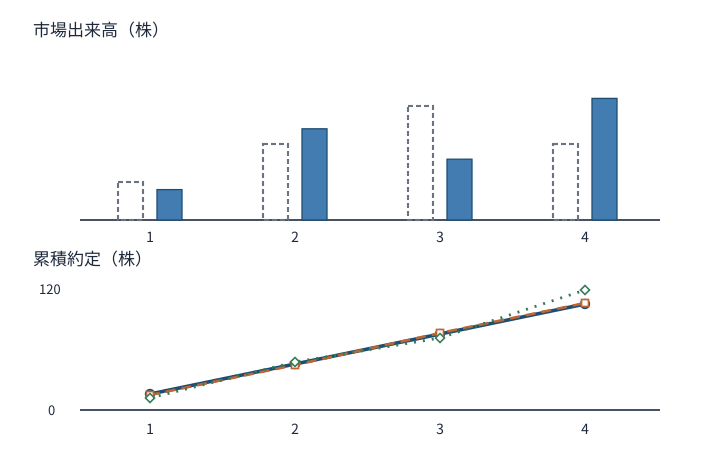

# U3-60 TWAP／VWAP／POV と基準執行スケジュール

<!-- definition-example-audit: strict -->

## この講義で問うこと

[前講の有限注文板](../U3-59/index.md#def-u3-59-order-book)では、一度の成行買いでも最良気配の数量が尽きれば次の価格帯へ進み、[執行不足額](../U3-59/index.md#def-u3-59-implementation-shortfall)には未約定の機会費用も入ることを学びました。大きな親注文を複数回に分ければ一度の板消費を避けられるかもしれません。しかし、**いつ何株ずつ執行するか**を決めるためには、時間と市場出来高の情報を区別する必要があります。

本講の中心問題は「すでに120株買うと決めたとき、いつ何株の子注文を出すか」です。利益を予想する問題でも最適執行を証明する講義でもありません。TWAP（時間均等）、予測出来高に基づく VWAP 配分、POV（出来高参加率）の三つを同一の架空の市場経路で比較します。

到達目標は次の5点です。

1. 親注文・スケジュール・実約定・残数量を区別する。
2. 時間と**注文時点で利用可能な**出来高予測から TWAP / VWAP の目標を計算する。
3. POV を観測された市場取引に因果的に追随させる。
4. 実現市場 VWAP の先読みを見抜く。
5. 同条件の費用・在庫・未約定を再計算する。

以下は単一銘柄の**買い**、価格は円／株、数量は株、費用は円です。4つの連続する時間区間を $i=1,2,3,4$ とします。全ての市場価格・出来高は架空の外生経路とし、子注文が市場価格や出来高を変えないと仮定します。実取引の約定保証や市場インパクト推定は行いません。整数株しか売買しない場面では、端数は最後の注文へ事前に割り振るなどの明示的な丸め規則が必要ですが、以下の主例は全配分が整数株です。

## 1. 親注文を時間で割る：TWAP

一定の区間ごとに同じ量を買うなら、出来高予測は要りません。この時間に従った均等配分が **TWAP 型スケジュール** の基本的な発想です。時間加重平均価格という元来の *価格のベンチマーク* と、時間均等に注文を分ける *執行方針* は異なる対象です。本講で扱うのは後者です。子注文の**約定上限**とは、その時間区間で実際に約定できたと仮定する最大株数のことです。本講では各区間の上限を $c_i$ と書き、流動性制約を模した合成値として扱います。これは実際の板の表示数量でも、注文時点で分かる約定保証でもありません。予定配分と実約定の違いを次の定義で確定します。

<!-- formal-statement-start -->
> **定義（親注文・目標配分と実約定）**  
> 買い親注文数量 $Q>0$ 株を $n\ge1$ 個の区間に分ける。開始時点に決めた目標配分を $d_i\ge0$ 株とし、$\sum_{i=1}^n d_i=Q$ とする。各区間での利用可能な約定上限を $c_i\ge0$ 株とし、繰越し・再配分を**しない**基準模型では、実約定 $x_i$、総約定 $N$、未約定 $R$ を
$$
x_i=\min(d_i,c_i),\qquad
N=\sum_{i=1}^n x_i,\qquad R=Q-N
$$
> とする。幅の等しい $n$ 区間で $d_i=Q/n$ とするものを **TWAP 型スケジュール** とする。一般の区間幅なら経過時間の比率で $d_i$ を配分する。
<!-- formal-statement-end -->

<!-- definition-example-start: def-u3-60-schedule -->
**定義の確認**：**直接例**：$Q=120$ 株、$n=4$、各区間の長さが等しければ目標は $(30,30,30,30)$ 株で、合計は120株です。仮に約定上限が $(16,48,32,64)$ 株なら、各区間の実約定は $(16,30,30,30)$ 株。全て $0\le x_i\le d_i,c_i$ を満たし、$N=106$ 株、$R=14$ 株です。残り14株は自動的に次の区間へ繰り越されません。
<!-- definition-example-end -->

まず「目標」と「実行」を分けることで、予定どおり発注しても未約定が出る理由が分かります。繰越しのない合成模型では、あとで別区間に余力があっても残数量は自動で埋まりません。

## 2. 予測出来高で割る：VWAP 型配分

市場の取引が多そうな時間に子注文を多くする考え方です。市場全体で発生する売買数量を **市場出来高** といい、自分の約定数量 $x_i$ とは区別します。開始前に使える予測を $\widehat v_i$、区間が終わったあと確定する実現値を $v_i$ と書きます。二つは偶然一致する場合があっても同じ情報ではありません。

<!-- formal-statement-start -->
> **定義（予測出来高に基づく VWAP 型配分と実現市場 VWAP）**  
> 親注文 $Q>0$ 株について、開始時点で既知の非負の予測出来高 $\widehat v_1,\ldots,\widehat v_n$（株）を用意し、$\widehat V=\sum_i\widehat v_i>0$ とする。VWAP 型の**予定配分**は
$$
d_i^{\mathrm V}=Q\frac{\widehat v_i}{\widehat V}.
$$
> 別に、実際の区間市場出来高 $v_i\ge0$ を観測する。$v_i>0$ の区間では成立した市場取引の数量加重平均価格 $m_i>0$（円／株）も観測する。$v_i=0$ の区間には市場取引の平均価格が存在しないため、以下の和のその区間の寄与 $v_i m_i$ は0と約束する。$V=\sum_i v_i>0$ のとき、**実現市場 VWAP** を
$$
P_{\mathrm{mkt}}^{\mathrm V}
=\frac{\sum_i v_i m_i}{V}
$$
> と定める。$m_i$ は本講では区間内の市場取引価格の平均であり、前講の**板の中値**と同じ記号・対象ではない。
<!-- formal-statement-end -->

<!-- definition-example-start: def-u3-60-forecast-vwap -->
**定義の確認**：**直接例**：開始前に $\widehat v=(100,200,300,200)$ 株を見積もったとします。各成分は非負、総量は $\widehat V=800>0$ 株であり、
$$
(d_1^{\mathrm V},d_2^{\mathrm V},d_3^{\mathrm V},d_4^{\mathrm V})
=120(100,200,300,200)/800=(15,30,45,30)
$$
となり合計120株です。のちに実現値が $v=(80,240,160,320)$ 株、区間市場価格が $m=(100,100.2,100.1,100.4)$ 円／株だと判明した場合、
$$
P_{\mathrm{mkt}}^{\mathrm V}
=\frac{80(100)+240(100.2)+160(100.1)+320(100.4)}{800}
=\frac{80192}{800}=100.24
$$
円／株です。実現出来高を使った $120v_i/V=(12,36,24,48)$ は**事後的な計算**であり、開始時点の予定配分ではありません。
<!-- definition-example-end -->

同じ「VWAP」という語が付いても、上の配分は注文するための意思決定、実現市場 VWAP は終了後の評価基準です。市場の出来高を自分の約定で推定してはいけません。

## 3. 市場の取引に追随する：POV

時間割も出来高予測も、実際に市場が静かになったときの約定進捗を保証しません。そこで、過去または**その瞬間までに確定した市場取引**の数量に一定割合で追随する方針を考えます。これが POV（percent of volume、出来高参加率）型です。

<!-- formal-statement-start -->
> **定義（因果的な POV 型注文）**  
> 開始時点に親注文 $Q>0$ 株、参加率 $0\le\rho\le1$ を決める。市場で新たに取引数量 $\delta v\ge0$ 株が実際に観測されるたび、その時点の親注文残数量と $\rho\delta v$ の**小さい方を必ず**その後の子注文数量とする（残数量が0なら発注しない）。観測後の各子注文が同じ区間内に全量約定し、区間 $i$ 内で順に観測された市場出来高の合計を $v_i$ 株とすれば、その区間の実約定は
$$
x_i^{\mathrm P}=\min\left(Q-\sum_{j<i}x_j^{\mathrm P},\ \rho v_i\right)
$$
> となる。この等式は**観測後に発注して即時約定できるという模型上の仮定**に依存し、区間終端で初めて $v_i$ を知って区間初めに発注する方式を意味しない。追加の流動性上限や遅延がある場合は等式をそのまま使用しない。
<!-- formal-statement-end -->

なぜ観測ごとの発注が区間全体の式になるのでしょうか。区間開始時の残数量を $r\ge0$、その区間で順に観測した取引量を $\delta v_1,\ldots,\delta v_h\ge0$ とし、$u_\ell=\rho\delta v_\ell$ と置きます。最初の2回について、約定済み数量の合計は

$$
\begin{aligned}
&\min(r,u_1)+\min\bigl(r-\min(r,u_1),u_2\bigr)\\
&\qquad=\min(r,u_1+u_2).
\end{aligned}
$$

です。実際、$u_1\ge r$ なら両辺とも $r$、$u_1<r$ なら左辺は $u_1+\min(r-u_1,u_2)$ で、やはり右辺に一致します。この計算を観測回数だけ繰り返すと、区間の合計約定は $\min(r,\sum_{\ell=1}^{h}u_\ell)=\min(r,\rho v_i)$ です。したがって区間終了後の $v_i$ を**区間開始前に入力する必要はありません**。ここでは株数を実数で計算する理想模型とし、整数株の端数処理は数値実験で別に扱います。

<!-- definition-example-start: def-u3-60-pov -->
**定義の確認**：**直接例**：$Q=120,\rho=0.15$、実現出来高を順に $(80,240,160,320)$ 株観測したとします。順番に $0.15(80)=12$、$0.15(240)=36$、$0.15(160)=24$、$0.15(320)=48$ 株が出せます。直前残量は $120,108,72,48$ 株で、それぞれの子注文はこれを超えません。累積は $12,48,72,120$ 株です。第4区間の320株を、まだ第1区間にいるときに使ったわけではありません。
<!-- definition-example-end -->

比例配分の閉じた形を証明しておけば、思わぬ数量の市場経路で「親注文を超えて買ってしまう」失敗を検知できます。

<!-- formal-statement-start -->
> **命題（POV の予算上限と未約定）**  
> [因果的な POV 型注文](#def-u3-60-pov)の即時約定模型で、$v_i\ge0$、$Q>0$、$\rho\in[0,1]$ とする。各 $k=1,\ldots,n$ について累積約定 $X_k=\sum_{i=1}^k x_i^{\mathrm P}$ は
$$
X_k=\min\left(Q,\rho\sum_{i=1}^k v_i\right).
$$
> したがって $0\le X_k\le Q$、最終残数量は $R=\max(0,Q-\rho V)$ である。
<!-- formal-statement-end -->

### 証明の見取り図

累積市場出来高に参加率を掛けた量が親注文を下回る間は同じ割合で増え、親注文に達した後はそれ以上増えません。

<!-- proof-start -->
### 証明

$X_0=0$ とします。定義から
$$
X_k=X_{k-1}+\min(Q-X_{k-1},\rho v_k)
=\min(Q,X_{k-1}+\rho v_k).
$$
$k=1$ では $X_0=0$ より $X_1=\min(Q,\rho v_1)$ です。$k-1$ まで成立すると仮定し、$S=\rho\sum_{i<k}v_i$ と置きます。$v_k\ge0$ なので $S\ge0$ です。$S\ge Q$ なら $X_{k-1}=Q$ で $X_k=Q$。$S<Q$ なら $X_{k-1}=S$ で $X_k=\min(Q,S+\rho v_k)$。どちらも $X_k=\min(Q,\rho\sum_{i\le k}v_i)$ です。帰納法で全区間に成立し、$R=Q-X_n=Q-\min(Q,\rho V)=\max(0,Q-\rho V)$ を得ます。
<!-- proof-end -->

**仮定を失う反例**：市場出来高を区間終端まで観測できないのに開始時点で $0.15v_i$ を発注したとすると、その注文は未来の $v_i$ を入力にしています。式自体の計算が正しくても実行可能なアルゴリズムではありません。注文遅延や板不足があれば、実際の $x_i$ は上記の予定値より小さくなり得ます。

## 4. 予測の制約と未約定を分離する

この講義の比較では、市場出来高の20%を各区間の**約定上限**とする合成制約 $c_i=0.20v_i$ を置きます。すでに分かった実現出来高により、事後の上限は $(16,48,32,64)$ 株です。上限は事後の検算値であって、TWAP/VWAP の注文開始時に既知の値ではありません。POV は参加率15%とし、この合成模型では20%上限に達しません。

<!-- formal-statement-start -->
> **命題（固定配分の欠損恒等式）**  
> [目標配分と実約定](#def-u3-60-schedule)で $\sum_i d_i=Q$、$d_i,c_i\ge0$ とすると、
$$
R=Q-\sum_i\min(d_i,c_i)=\sum_i\max(0,d_i-c_i).
$$
> これは区間間に繰越し・再配分を行わない政策の恒等式である。別区間に余力があっても、その余力を自動充当したとはみなさない。
<!-- formal-statement-end -->

### 証明の見取り図

各区間で「発注したが執行できなかった量」を足せば、総目標量と実約定量の差になります。

<!-- proof-start -->
### 証明

非負の $d_i,c_i$ について $d_i-\min(d_i,c_i)=\max(0,d_i-c_i)$ が成り立ちます。$d_i\le c_i$ なら左辺・右辺はともに0で、$d_i>c_i$ ならともに $d_i-c_i$ です。全区間で和を取り $\sum_i d_i=Q$ を代入して結論を得ます。
<!-- proof-end -->

数値を同じ表で比較しましょう。表の「出来高」は**市場全体**、「予定」は**自分の親注文**の数量です。

| 区間 | 予測市場出来高 $\widehat v_i$ | 実現市場出来高 $v_i$ | 上限 $c_i$ | TWAP 予定→約定 | 予測VWAP 予定→約定 | POV 約定 |
| ---: | ---: | ---: | ---: | ---: | ---: | ---: |
| 1 | 100 | 80 | 16 | 30→16 | 15→15 | 12 |
| 2 | 200 | 240 | 48 | 30→30 | 30→30 | 36 |
| 3 | 300 | 160 | 32 | 30→30 | 45→32 | 24 |
| 4 | 200 | 320 | 64 | 30→30 | 30→30 | 48 |
| 合計 | 800 | 800 | 160 | 120→106 | 120→107 | 120 |

図の上段は**予測出来高が破線枠・実現出来高が塗り棒**、下段は**TWAP が実線と丸印・予測 VWAP が破線と四角印・POV が点線と菱形印**です。横軸はそれぞれ第1〜4区間、下段の縦軸は累積実約定株数です。三本の線が近接する箇所は次表の正確な株数を使って比較してください。

下の累積値は図の各点の検算値です。特に第3区間で予測300株に対して実現160株しかないため、予測VWAP型の45株は13株不足します。

| 区間終了 | 0 | 1 | 2 | 3 | 4 |
| --- | ---: | ---: | ---: | ---: | ---: |
| TWAP累積約定 | 0 | 16 | 46 | 76 | 106 |
| 予測VWAP累積約定 | 0 | 15 | 45 | 77 | 107 |
| POV累積約定 | 0 | 12 | 48 | 72 | 120 |
| 実現市場累積出来高 | 0 | 80 | 320 | 480 | 800 |

## 5. 同じ約定価格経路で費用を比較する

各区間で約定した子注文には、その区間で**実際に使えたと仮定する**価格 $p=(100.1,100.3,100.2,100.5)$ 円／株を適用します。共通の到着時点基準価格を $m_0=100$ 円／株、期限時点の評価価格を $m_T=100.6$ 円／株、手数料を約定1株につき0.02円とします。この合成価格表は市場インパクトと執行リスクを因果的に説明するものではありません。基準 $m_0$ は、実現市場 VWAP とも異なります。

[前講の執行不足額](../U3-59/index.md#def-u3-59-implementation-shortfall)を買い $\sigma=+1$ に適用します。各手法とも親注文 $Q=120$、現実の約定 $x_i$ と残数量 $R$ を使います。

$$
\mathrm{IS}
=\sum_{i=1}^4 x_i(p_i-m_0)+R(m_T-m_0)
+0.02\sum_{i=1}^4 x_i .
$$

| 政策 | 実約定 $x_i$ | 約定分価格差 | 機会費用 | 手数料 | IS |
| --- | --- | ---: | ---: | ---: | ---: |
| TWAP | (16,30,30,30) | 31.60 | 8.40 | 2.12 | **42.12円** |
| 予測VWAP | (15,30,32,30) | 31.90 | 7.80 | 2.14 | **41.84円** |
| POV（15%） | (12,36,24,48) | 40.80 | 0 | 2.40 | **43.20円** |

TWAP の約定分価格差は $16(0.1)+30(0.3)+30(0.2)+30(0.5)=31.6$ 円。機会費用は $14(100.6-100)=8.4$ 円です。予測VWAP の差は $15(0.1)+30(0.3)+32(0.2)+30(0.5)=31.9$ 円、機会費用 $13(0.6)=7.8$ 円。POV の差は $12(0.1)+36(0.3)+24(0.2)+48(0.5)=40.8$ 円です。

この例では予測VWAPの IS が最小ですが、**最適性の証明ではありません**。後の価格経路、流動性、未約定評価時点を変えると順序は変わり得ます。機会費用 $R(m_T-m_0)$ は価格が下がると負にもなり、「必ず正の罰金」ではありません。約定しなかった残りを現金・在庫へ加算する誤りにも注意してください。

### 5.1 市場 VWAP に勝つ／負けるの意味

実現市場 VWAP は自分の注文を評価する一つのベンチマークです。自分の平均約定価格は、総約定 $N>0$ のとき $\overline p=\sum_i x_i p_i/N$ であり、[前講の平均約定価格](../U3-59/index.md#def-u3-59-market-sweep)と同じ数量加重平均の考え方です。ただし本講の $m_i$ は**区間市場で成立した取引の平均価格**であり、前講の[同時点の中値](../U3-59/index.md#prop-u3-59-shortfall-decomposition)としての $m_i$ とは異なります。市場側 VWAP は本講の $v_i$ を重みとして作ります。

<!-- formal-statement-start -->
> **命題（実現 VWAP との差の配分・価格差分解）**  
> 各区間の実約定 $x_i\ge0$、実現市場出来高 $v_i\ge0$ があり、$v_i=0$ の区間では $x_i=0$ とする。$v_i>0$ なら区間市場取引平均価格 $m_i>0$（円／株）、$x_i>0$ なら実約定価格 $p_i>0$（円／株）が与えられるとする。$N=\sum_i x_i>0$、$V=\sum_i v_i>0$ とし、数量が0の区間の各積は0として和を取る。このとき
$$
\overline p-P_{\mathrm{mkt}}^{\mathrm V}
=\sum_i\left(\frac{x_i}{N}-\frac{v_i}{V}\right)m_i
+\sum_i\frac{x_i}{N}(p_i-m_i).
$$
> 第1項は**約定数量の時間配分差**による値、第2項は**各区間の約定価格と市場平均価格の差**による値であり、因果的な市場インパクトの識別ではない。
<!-- formal-statement-end -->

### 証明の見取り図

自分の平均約定価格に市場の区間価格を足し引きすると、数量の重みの違いと同区間の価格の違いに分かれます。

<!-- proof-start -->
### 証明

[予測出来高に基づく VWAP 型配分と実現市場 VWAP](#def-u3-60-forecast-vwap)の定義から
$$
\begin{aligned}
\overline p-P_{\mathrm{mkt}}^{\mathrm V}
&=\sum_i\frac{x_i}{N}p_i-\sum_i\frac{v_i}{V}m_i\\
&=\sum_i\frac{x_i}{N}(p_i-m_i)
+\sum_i\frac{x_i}{N}m_i-\sum_i\frac{v_i}{V}m_i\\
&=\sum_i\frac{x_i}{N}(p_i-m_i)
+\sum_i\left(\frac{x_i}{N}-\frac{v_i}{V}\right)m_i.
\end{aligned}
$$
両辺の単位は円／株です。$N=0$ では自分の平均約定価格が定義されないため、結論を使いません。
<!-- proof-end -->

**直接数値確認**：POV の実約定 $(12,36,24,48)$ は市場出来高のちょうど15%であるため $x_i/N=v_i/V$ です。第1項は0円／株です。各 $p_i=m_i+0.1$ なので第2項は $\sum_i(x_i/120)0.1=0.1$ 円／株です。したがって $\overline p=100.34$ 円／株、実現市場 VWAP は100.24円／株で、差0.10円／株と一致します。

この等式は未約定機会費用や到着価格基準を含まないので、**VWAP 差をそのまま IS と呼ぶことはできません**。市場 VWAP との乖離を小さくすることも、到着価格基準の IS を小さくすることも、別の目的関数です。

## 6. 既知情報の範囲と再現可能な検算

次の Python 実験では、予測・実現出来高と実約定を同じ入力から計算し、各区間で予定・上限・実約定・累積数量を表示します。市場価格は外生的で、手数料以外の約定単価の選択も固定です。第4区間の出来高だけを変えると、POV の先行3区間は同じ値のままですが、事後に計算した実現 VWAP の重みは変わります。

~~~python-file-lab
# lab-id: u3-60-execution-schedules
# lab-title: TWAP・予測VWAP・POVの累積約定と費用
# lab-file: textbook/volumes/dream_thater/応用系/U/U3-60/assets/execution_schedules.py
# lab-preset: 基本例（120株） | --quantity 120
# lab-preset: 市場最終区間が半減 | --quantity 120 --last-volume 160
# lab-preset: 大きい親注文（150株） | --quantity 150
# lab-preset: 低い参加率（10%） | --quantity 120 --participation 0.10
# lab-timeout-ms: 30000
~~~

ローカルでは標準 Python 3.11 以降で計算できます。実行は純粋な数値処理で外部データ、乱数、ネットワークを使いません。出力の各費用を「約定分価格差＋未約定機会費用＋手数料」に再合計してください。プログラムでは整数株を扱うため、TWAP・予測VWAP の予定数量には最大剰余法、POV の区間内累積参加数量には切捨てを適用します。したがって $\rho v_i$ が整数でない一般入力については、実数株の命題の等式をそのまま主張せず、丸めの差を残数量へ反映します。

~~~text
python assets/execution_schedules.py --quantity 120
python -m unittest discover -s assets/tests -v
~~~

## 7. 演習と詳細解答

### Level A：入力と情報時点を確認する

### U3-60-A1：時間均等の目標
- Level: A

親注文120株、等長4区間の TWAP 型目標 $d_i$ と累積目標を求めよ。

<!-- solution-start -->
**詳細解答**：[TWAP 型スケジュール](#def-u3-60-schedule)で各区間は $120/4=30$ 株です。合計は $4(30)=120$ 株、累積目標は $30,60,90,120$ 株です。まだ上限 $c_i$ が与えられていないので実約定量を30株と断言しません。
<!-- solution-end -->

### U3-60-A2：予測出来高で予定配分
- Level: A

$\widehat v=(100,200,300,200)$ 株、親注文120株の VWAP 型予定配分を求め、非負性と総量を確かめよ。

<!-- solution-start -->
**詳細解答**：[予測出来高配分](#def-u3-60-forecast-vwap)で $\widehat V=800>0$ 株、比率は $1/8,1/4,3/8,1/4$ です。よって $d^{\mathrm V}=(15,30,45,30)$ 株です。全て0以上で、$15+30+45+30=120$ 株です。市場実現値 $v_i$ はここでは不要です。
<!-- solution-end -->

### U3-60-A3：固定配分の約定制約
- Level: A

予定 $(15,30,45,30)$ 株と区間上限 $(16,48,32,64)$ 株があり、繰越しなしとする。各実約定と残数量を求めよ。

<!-- solution-start -->
**詳細解答**：[実約定の定義](#def-u3-60-schedule)で $x_i=\min(d_i,c_i)$ だから $x=(15,30,32,30)$ 株です。合計は $15+30+32+30=107$ 株、$R=120-107=13$ 株です。[欠損恒等式](#prop-u3-60-schedule-deficit)でも区間ごとの不足を足すと

$$
\begin{aligned}
R
&=\max(0,15-16)+\max(0,30-48)\\
&\quad+\max(0,45-32)+\max(0,30-64)\\
&=0+0+13+0=13\ \text{株}
\end{aligned}
$$

と一致します。第4区間の余剰上限34株を勝手に転用しません。
<!-- solution-end -->

### U3-60-A4：POV の予算上限
- Level: A

$Q=90$ 株、$\rho=0.15$、実現市場出来高 $(80,240,160,320)$ 株が順に観測され、その後の子注文が全て約定する。区間別の実約定を求めよ。

<!-- solution-start -->
**詳細解答**：[POV の規則](#def-u3-60-pov)を順に適用します。第1区間は $\min(90,12)=12$ 株で残78株。第2区間は $\min(78,36)=36$ 株で残42株。第3区間は $\min(42,24)=24$ 株で残18株。第4区間は $\min(18,48)=18$ 株で残0株です。したがって $(12,36,24,18)$ 株、総量90株。市場出来高800株の15%は120株ですが、親注文90株を超えません。
<!-- solution-end -->

### U3-60-A5：実現市場 VWAP はいつ分かるか
- Level: A

実現市場出来高 $(80,240,160,320)$ 株、区間の市場平均価格 $(100,100.2,100.1,100.4)$ 円／株の実現 VWAP を求める。また開始時点でこの価格が確定していると言えるか。

<!-- solution-start -->
**詳細解答**：[実現市場 VWAP](#def-u3-60-forecast-vwap)の分母は $80+240+160+320=800$ 株です。分子は $8000+24048+16016+32128=80192$ 円なので $80192/800=100.24$ 円／株です。区間4の出来高320株と市場平均価格100.4円／株は終了後の観測値なので、開始時点では一般に分かりません。
<!-- solution-end -->

### Level B：制約・費用・情報時点をまとめて検算する

### U3-60-B1：TWAP の未約定と IS
- Level: B

$Q=120$ 株、TWAP 目標 $(30,30,30,30)$、上限 $(16,48,32,64)$、実約定価格 $(100.1,100.3,100.2,100.5)$ 円／株とする。到着基準100円／株、期限評価100.6円／株、手数料0.02円／約定株。残数量と IS を求めよ。

<!-- solution-start -->
**詳細解答**：[予定と実約定](#def-u3-60-schedule)から $x=(16,30,30,30)$ 株、$N=106$ 株、$R=14$ 株です。

[執行不足額](../U3-59/index.md#def-u3-59-implementation-shortfall)の約定価格差は

$$
16(0.1)+30(0.3)+30(0.2)+30(0.5)
=1.6+9+6+15=31.6\ \text{円}.
$$

未約定機会費用は $14(100.6-100)=8.4$ 円、手数料は $106(0.02)=2.12$ 円です。合計は

$$
\mathrm{IS}=31.6+8.4+2.12=\mathbf{42.12}\ \text{円}.
$$

実在庫は106株だけ増え、未約定14株を実際の買付に含めません。
<!-- solution-end -->

### U3-60-B2：予測 VWAP の残数量と IS
- Level: B

A2 の予測 VWAP 予定に B1 と同じ上限・価格・基準・手数料を適用し、IS を求めよ。B1 と大小を比較せよ。

<!-- solution-start -->
**詳細解答**：A2 の予定 $(15,30,45,30)$ 株と上限 $(16,48,32,64)$ 株から、[A3 の約定計算](#ex-u3-60-a3)のとおり $x=(15,30,32,30)$ 株です。総約定は107株、残りは13株です。

[執行不足額](../U3-59/index.md#def-u3-59-implementation-shortfall)の約定価格差を区間ごとに求めると、

$$
15(0.1)+30(0.3)+32(0.2)+30(0.5)
=1.5+9+6.4+15=31.9\ \text{円}.
$$

機会費用は $13(0.6)=7.8$ 円、手数料は $107(0.02)=2.14$ 円です。従って

$$
\mathrm{IS}=31.9+7.8+2.14=\mathbf{41.84}\ \text{円}.
$$

B1 の42.12円より、この**特定経路では**0.28円小さい値です。将来の価格経路が変わっても優越するとは言えません。
<!-- solution-end -->

### U3-60-B3：POV の IS・現金・在庫
- Level: B

$Q=120,\rho=0.15$、A4 と同じ市場出来高と B1 と同じ価格・基準・手数料を使い、POV の IS、現金変化、在庫変化を求めよ。

<!-- solution-start -->
**詳細解答**：[因果的な POV 型注文](#def-u3-60-pov)から実約定は $(12,36,24,48)$ 株です。総量120株で残数量は0株です。

実際の買付代金は

$$
\begin{aligned}
&12(100.1)+36(100.3)+24(100.2)+48(100.5)\\
&=1201.2+3610.8+2404.8+4824
=12040.8\ \text{円}.
\end{aligned}
$$

到着基準との差は $12040.8-120(100)=40.8$ 円です。手数料は $120(0.02)=2.4$ 円、機会費用は0円なので、IS は43.2円です。

[在庫・現金と執行不足額の恒等式](../U3-59/index.md#prop-u3-59-cash-inventory)より、実現現金変化は $-12040.8-2.4=-12043.2$ 円、在庫変化は $+120$ 株です。
<!-- solution-end -->

### U3-60-B4：未来情報を使わない反実仮想
- Level: B

POV の参加率15%、親注文120株。市場出来高の前3区間は $(80,240,160)$ 株で同じだが、区間4のみ320株ではなく160株になるとする。POV の各実約定と残数量を求め、前3区間で注文を変更する必要があるか述べよ。

<!-- solution-start -->
**詳細解答**：[POV 規則](#def-u3-60-pov)で区間1〜3に観測した出来高は変わらないため、子注文も $(12,36,24)$ 株で変わりません。第3区間までに72株約定し、残量は $120-72=48$ 株です。第4区間は $0.15(160)=24$ 株なので総約定 $72+24=96$ 株、残数量 $120-96=24$ 株です。[POV 残量命題](#prop-u3-60-pov-budget)でも市場出来高総数640株、$R=\max(0,120-0.15(640))=24$ 株です。前3区間に異なる取引を実行したとするなら、それは未来の区間4を先読みしています。
<!-- solution-end -->

### Level C：基準と費用を一つの表で整合させる

### U3-60-C1：三政策を再計算しベンチマークを区別する
- Level: C

親注文120株、予測出来高 $(100,200,300,200)$、実現出来高 $(80,240,160,320)$、区間市場価格 $m=(100,100.2,100.1,100.4)$、子注文約定価格 $p=(100.1,100.3,100.2,100.5)$、上限 $0.20v_i$、POV参加率0.15、到着基準100円、期限評価100.6円、手数料0.02円／約定株とする。いずれも繰越しなしで約定可能な範囲だけが成立する合成模型である。

1. TWAP、予測VWAP、POV の実約定と残数量を求めよ。
2. それぞれの IS を約定分差額・未約定機会費用・手数料に分けよ。
3. 実現市場 VWAP、自分の POV 平均約定価格、および[配分・価格差分解](#prop-u3-60-vwap-gap)の二項を求めよ。開始時点で実現市場 VWAP の重みを用いる方針がなぜ先読みか説明せよ。

<!-- solution-start -->
**詳細解答**：

**1. 予定と約定**。

[TWAP 型スケジュール](#def-u3-60-schedule)の予定は $(30,30,30,30)$ 株です。[予測出来高に基づく VWAP 型配分](#def-u3-60-forecast-vwap)の予定は $(15,30,45,30)$ 株です。[因果的な POV 型注文](#def-u3-60-pov)の希望数量は観測順に $(12,36,24,48)$ 株です。

区間ごとの約定上限は

$$
0.20(80,240,160,320)=(16,48,32,64)\ \text{株}
$$

です。POV の希望数量はいずれもこの上限以下です。区間別に予定量と上限の小さい方を取って集計すると、

- TWAP は実約定 $(16,30,30,30)$ 株、$N=106$ 株、$R=14$ 株。
- 予測 VWAP は実約定 $(15,30,32,30)$ 株、$N=107$ 株、$R=13$ 株。
- POV は実約定 $(12,36,24,48)$ 株、$N=120$ 株、$R=0$ 株。

いずれも実約定と残数量の和が親注文120株と一致します。

**2. 費用**。[前講 IS](../U3-59/index.md#def-u3-59-implementation-shortfall)の買いの式に順に代入します。各 $p_i-100$ は $(0.1,0.3,0.2,0.5)$ 円／株です。

TWAP の約定分価格差は $1.6+9+6+15=31.6$ 円、残数量14株の機会費用は8.4円、手数料は2.12円なので、

$$
\mathrm{IS}_{\mathrm{TWAP}}
=31.6+14(0.6)+106(0.02)
=42.12\ \text{円}.
$$

予測VWAP の約定分価格差は $1.5+9+6.4+15=31.9$ 円、残数量13株の機会費用は7.8円、手数料は2.14円なので、

$$
\mathrm{IS}_{\mathrm{VWAP}}
=31.9+13(0.6)+107(0.02)
=41.84\ \text{円}.
$$

POV の約定分価格差は $1.2+10.8+4.8+24=40.8$ 円、残数量0株なので機会費用は0円です。よって

$$
\mathrm{IS}_{\mathrm{POV}}
=40.8+0+120(0.02)
=43.20\ \text{円}.
$$

3政策とも費用の合算は同じ到着価格、期限評価、手数料に基づきます。未約定分を120株全量の現金変化に加算していません。

**3. VWAP の対象の違い**。[市場 VWAP](#def-u3-60-forecast-vwap)は $\sum v_i m_i=80192$ 円、$V=800$ 株より $100.24$ 円／株です。POV約定代金は
$$
1201.2+3610.8+2404.8+4824=12040.8\ \text{円}
$$
で、平均約定価格は $12040.8/120=100.34$ 円／株です。[分解命題](#prop-u3-60-vwap-gap)に $N=120$、$x=(12,36,24,48)$、$v=(80,240,160,320)$ を代入すると
$$
\frac{x_i}{N}
=\frac{0.15v_i}{0.15(800)}
=\frac{v_i}{V}
$$
なので配分差項は0です。一方 $p_i-m_i=0.1$ 円／株が全区間で共通なので区間価格差項は
$$
\sum_i\frac{x_i}{120}(0.1)=0.1\frac{120}{120}=0.1\ \text{円／株}.
$$
合計は $100.34-100.24=0.10$ 円／株と一致します。開始時点では第4区間の出来高320株も実現市場価格100.4円も未観測です。事後配分 $(12,36,24,48)$ を先に知っていたかのように使うと未来情報を利用した不適切な評価になります。POVは**順に観測される取引へ後追いで反応した**という追加の即時約定仮定の下でのみ同じ数量になります。
<!-- solution-end -->

## まとめと次講

TWAP は**時間**、VWAP 型予定配分は**開始前に利用可能な出来高予測**、POV は**観測済みの市場取引**を基準にします。事後の市場 VWAP は評価対象であり、先読みできる注文表ではありません。目標配分、実約定、在庫、現金、未約定機会費用を分ければ、基準手法の比較が会計的に整合します。

次の **U3-61「市場インパクトと価格形成」** では、本講で外生とした執行価格が注文速度や数量によって変わる場合を扱います。